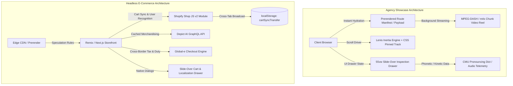

# Playbook: Agency & E-Commerce Production Architecture & Design Patterns

## Overview

This playbook establishes the architectural standards, design token systems, state synchronization mechanisms, and anti-AI-slop rules required when building bespoke high-craft agency portfolios, creative studio showcases, and high-conversion headless luxury and streetwear e-commerce applications.

It is synthesized directly from qualitative reverse-engineering dossiers of 17 elite production web properties:

- **Design Agencies & Creative Studios (9)**:
  - [[targets/www-romainavalle-dev/overview|www-romainavalle-dev]] — Interactive developer portfolio (Nuxt 3 SSR, floating bottom dock, full-bleed WebGL footer).
  - [[targets/www-studioplato-co/overview|www-studioplato-co]] — Creative studio (Webflow, interactive Lottie vector animations).
  - [[targets/microdose-studio/overview|microdose-studio]] — Creative digital studio (Geist + Metal typography, Lenis smooth scroll, dual-layer ambient shadows, logo mix-blend).
  - [[targets/twohalves-co/overview|twohalves-co]] — High-craft brand agency (Cutive Mono + Aileron editorial pairing, tactile paper/ink palette, fluid clamp padding, split-screen hero).
  - [[targets/houseofgiants-com/overview|houseofgiants-com]] — Digital agency (Tailwind CSS, proximity scroll snap, PostHog telemetry capture).
  - [[targets/recurziv-com/overview|recurziv-com]] — Cyberpunk interactive studio (Headless WP, CMU Pronouncing Dictionary phonetic animations, heartbeat pulse telemetry, 55vw side inspection drawer).
  - [[targets/www-ouiwill-com/overview|www-ouiwill-com]] — Brand strategy agency (SvelteKit micro-runtime, mathematical lerp gutters, polygon clip-path hover physics, native video dialogs).
  - [[targets/www-plugandplaydesign-co-uk/overview|www-plugandplaydesign-co-uk]] — Award-winning UK digital agency (Next.js, segmented MPEG-DASH `.m4s` video streaming chunks, dynamic navigation chrome API, motion-reduce accessibility).
  - [[targets/preymaker-com/overview|preymaker-com]] — High-end VFX/production studio (Next.js, Lenis smooth scroll, NewGrotesk typography, 12-column responsive layout engine, headless `/api/data`).

- **E-Commerce & Fashion / Lifestyle Brands (8)**:
  - [[targets/about-centra-com/overview|about-centra-com]] — Headless global fashion commerce engine (Island runtime architecture, glassmorphism navigation, mono color tokens).
  - [[targets/deadlyponies-com/overview|deadlyponies-com]] — Luxury leather goods (Shopify Storefront API, custom Deadly typography, Swym cross-device wishlist, dedicated Web Worker sandbox).
  - [[targets/www-killstar-com/overview|www-killstar-com]] — Alternative apparel powerhouse (Shopify Plus, Shop Pay cart sync v2, customer reviews subsystem, drop countdown timing).
  - [[targets/almadalabel-com/overview|almadalabel-com]] — Quiet luxury knitwear (Shopify Storefront, Depict AI vector-cached search, Global-e cross-border tax/currency engine, 3:4 aspect ratio discipline, theme-parameterized buttons).
  - [[targets/seedjewelry-com/overview|seedjewelry-com]] — Fine jewelry (Shopify Storefront, Shop Pay cart sync v2, gesture-transformable tap components, dual-section footer architecture).
  - [[targets/www-unimaticwatches-com/overview|www-unimaticwatches-com]] — Minimalist Italian watchmaker (Shopify Storefront, strict rem-based spatial scale, safe-area-aware dynamic drawers, native HTML `<dialog>` cart).
  - [[targets/palaceskateboards-com/overview|palaceskateboards-com]] — Cult streetwear icon (Remix / Shopify Hydrogen, manifest-driven localized routing, requested query cost monitoring, brutalist pointer-events overlay, `min-h-dvh`).
  - [[targets/arcteryx-com_us-en-explore-system0/overview|arcteryx-com_us-en-explore-system0]] — Arc'teryx System 0 concept microsite (Next.js CSS Modules, mathematical pinned scroll manifesto tracking, intro replay fatigue suppression via localStorage).

---

## 1. Real-World Client Architectures & State Patterns

Production web architectures differ fundamentally from textbook templates. Top-tier production systems decouple performance-sensitive paths, synchronize authentication across merchant networks, stream media asynchronously, and compute UI coordinates through CSS custom property algebra.



### 1.1 Headless E-Commerce State Synchronisation

#### A. Shop Pay v2 Cart Sync & User Recognition Engine
Observed across `deadlyponies-com`, `seedjewelry-com`, `www-killstar-com`, `almadalabel-com`, and `www-unimaticwatches-com`.
Modern headless Shopify does not rely on naive single-tab cookie carts. It employs a modular asynchronous subsystem (`/shopifycloud/shop-js/modules/v2/`):

1. **User Recognition Signals** (`chunk.useUserRecognitionSignal`): Identifies authenticated Shop users across merchants without explicit login triggers.
2. **Asynchronous Cart Transfer**: Evaluates local cart state and fires transfer attempts tracked via `signInWithShop:cartSyncTransferAttemptedAt` in `localStorage`.
3. **Cross-Tab & Cross-Window Event Hooks** (`chunk.useEventListener`, `chunk.storage`): Syncs quantity adjustments and line items across multiple browser tabs instantaneously without page reloads.
4. **WebMCP Bridge Adapter** (`shopify:webmcp_adapter_loaded: true`): Standardizes communication between headless frontends and Shopify's checkout pipeline.
5. **Speculative Prerendering** (`storefronts.moderate.specrules-*.json`): Utilizes the browser's Speculation Rules API to prefetch and prerender high-probability next navigations (e.g., product detail pages, checkout) during idle cycles.

#### B. Remix / Hydrogen Edge Routing & Query Budgeting
Observed in `palaceskateboards-com`:
- **Manifest-Driven Route Tree** (`/__manifest`): Employs granular nested routing with dynamic segments (`routes/($locale)._index`) where each route declares `hasLoader`, `hasAction`, `hasClientAction`, and dedicated client middleware.
- **GraphQL Cost Budgeting**: Queries executed against `/api/unstable/graphql.json` inspect `extensions.cost.requestedQueryCost` to ensure client queries never exceed Storefront API rate-limiting thresholds during lightning-fast product drops.
- **Brutalist Viewport Optimization**: Entire application layout is pinned to dynamic viewport units (`min-h-dvh flex flex-col`) with a zero-layout-shift fixed top navigation overlay (`pointer-events-none` with interactive child links).

#### C. Cross-Border Localization & Duty Calculation
Observed in `almadalabel-com`:
- **Global-e Integration** (`GlobalE_Analytics`): Dynamically resolves client IP and country code (`merchantId: 2006`, `shopperCountryCode`), injecting local currency, import duties, and VAT calculation into drawer elements before the user reaches checkout.
- **Dedicated Localization Drawer**: Uses CSS custom property flags (`--countries: has(.footer-localization__item:not([hidden]))`) to dynamically adjust drawer borders and layout when the currency drawer expands.

#### D. AI-Powered Catalog Caching & Search
Observed in `almadalabel-com`:
- **Vector Search Cache** (`depict_cached_fetch`): Queries to `/api/2026-07/graphql.json` for product search and recommendations are intercepted, cached, and hashed directly in browser storage to provide instant autocomplete with zero perceived network latency.

#### E. Native HTML `<dialog>` Cart Drawers with Scroll Locking
Observed in `www-unimaticwatches-com` and `almadalabel-com`:
- Instead of unsemantic `<div>` soup with heavy React portal wrappers, modern production sites leverage native `<dialog class="drawer cart-drawer">` and `<dialog class="header__drawer">`.
- Paired with strict body scroll lock routines (`body-scroll-lock-options.js`), modal dialogs avoid rubber-banding and scroll leaking on iOS Safari.

#### F. Non-Blocking Compute via Dedicated Web Workers
Observed in `deadlyponies-com`:
- Offloads non-critical client execution (telemetry parsing, heavy AST manipulation, third-party script isolation) to a dedicated worker bundle (`sandbox.BG0usfBQ.worker.js`), ensuring main-thread frame rates remain locked at 60/120fps during product filtering and cart toggles.

---

### 1.2 Creative Agency Performance & Media Paradigms

#### A. Segmented MPEG-DASH Video Chunk Streaming
Observed in `www-plugandplaydesign-co-uk`:
- **The Problem**: Monolithic MP4 hero background videos (often 10MB–30MB) cripple Largest Contentful Paint (LCP) and starve the main thread of bandwidth.
- **The Production Pattern**: The agency delivers cinematic video via fragmented MP4 chunks (`/v1/chunk/.../*.m4s`) buffered on demand. The initial page load only fetches chunk `18446744073709551615.m4s` (the media initialization segment) and chunk `0.m4s` (the first 2 seconds of playback). Subsequent segments buffer progressively as the user scrolls, decoupling page speed from high-definition video reels.

#### B. Nuxt 3 Static Payload Streaming
Observed in `www-romainavalle-dev`:
- The client fetches lightweight JSON payload chunks (`/_payload.json` and build metadata `/_nuxt/builds/meta/*.json`) containing pre-evaluated props and CMS records, preventing re-execution of SSR logic on route transition.

#### C. Kinetic Typography & Phonetic Animation Engines
Observed in `recurziv-com`:
- Client loads the complete CMU Pronouncing Dictionary (`cmudict.json`) to drive procedural phonetic text animations and syllable-level sound synthesis.
- Employs a low-latency heartbeat endpoint (`/wp-json/recurziv/v1/pulse`, returning `204 No Content`) to log user interactions and session vitality without heavy analytics SDK overhead.

#### D. Scroll-Driven Storytelling & Replay Fatigue Prevention
Observed in `arcteryx-com_us-en-explore-system0`:
- **Mathematical Scroll Pinned Tracks**: Rather than hijacking wheel events, the page calculates track lengths via CSS custom properties:
  ```css
  --manifesto-track-height: var(--manifesto-track-height-base);
  --manifesto-pin-range: calc(var(--manifesto-track-height) - 100svh);
  --manifesto-overlap: calc(var(--manifesto-pin-range) / 3);
  ```
- **Fatigue Protection**: Stores `intro-last-played` timestamp in `localStorage`. If visited within the session window, heavy splash animations and video sequences are bypassed automatically (`[data-can-play-intro=false]`).

---

## 2. Key Design Tokens & Design System Specifications

### 2.1 Concrete Typography Pairings

| Target | Display / Heading Font | Body / UI Font | Character & Style Intent |
|---|---|---|---|
| **twohalves-co** | `"Cutive Mono", monospace` | `"Aileron", "Helvetica Neue", sans-serif` | Editorial literary craft; pairing a vintage typewriter serif mono with a stark Swiss neo-grotesque. |
| **microdose-studio** | `'Metal', serif` | `'Geist', -apple-system, sans-serif` | Brutalist luxury; high-contrast display serif headers grounded by modern neutral developer grotesk. |
| **preymaker-com** | `"NewGrotesk", sans-serif` | `"NewGrotesk Fallback", sans-serif` | Cinematic technical VFX; tight letter-spacing, uppercase tracking, 12-column alignment. |
| **deadlyponies-com** | `"Deadly", sans-serif` | System Humanist Sans | Proprietary brand typography; bespoke letterforms reinforcing exclusivity in luxury leather goods. |
| **palaceskateboards-com** | Raw System Monospace / Sans | System Monospace | Counter-culture utilitarian brutalism; unadorned, lightning-fast, zero web-font latency. |

#### Fluid Typography & Dynamic Scaling Formulas
Production tokens avoid static breakpoint jumps. Instead, they leverage viewport interpolation directly in CSS custom properties:

```css
/* www-ouiwill-com: Dynamic multi-scale interpolation */
--multi: calc(((100vw - 1440px) / 1440 * -5));

/* www-unimaticwatches-com: Proportional typography scaling */
--i6e6fx0: calc((var(--x-typography-size-default) * 40) / 14);
--i6e6fx1: calc((var(--x-typography-size-default) * 24) / 14);

/* twohalves-co: Fluid responsive clamping */
--pad: clamp(16px, 3vw, 44px);
```

---

### 2.2 Color Systems & Surface Atmospherics

#### A. Tactile Paper & Ink Palette (`twohalves-co`)
Replaces sterile pure white `#ffffff` with warm, physical linen paper tones that simulate print materiality:
```css
:root {
  --paper: #fff5ee;         /* Primary warm linen background */
  --paper-2: #f2e9e2;       /* Secondary tactile surface */
  --ink: #000000;           /* Deep black typography */
  --ink-2: #000000;
  --ink-3: #161616;         /* Softened ink for secondary body copy */
  --mute: #9a9a9a;          /* Muted metadata */
  --mute-2: #6e6e6e;
  --crease: #8c8c8c;        /* Structural borders simulating folded paper */
  --seam: #8c8c8c;
  --line: #fff5ee29;
  --line-ink: #00000024;    /* Subtle 14% ink divider line */
}
```

#### B. Deep Cyber Void & Cyan Accent (`recurziv-com`)
A dark-mode aesthetic built on midnight navy rather than flat black `#000000`:
```css
:root {
  --bg: #04081a;                                /* Deep midnight blue void */
  --accent: #00d4ff;                            /* Electric cyan laser accent */
  --accent-dim: rgba(0, 212, 255, 0.18);       /* 18% translucent focus ring */
  --accent-faint: rgba(0, 212, 255, 0.06);     /* 6% translucent surface fill */
  --border: rgba(0, 212, 255, 0.13);           /* 13% structural grid borders */
  --panel-w: 55vw;                              /* Inspection side-drawer width */
}
```

#### C. Atmospheric Dark & Layered Shadows (`microdose-studio`)
Multi-layer shadows simulating natural diffused ambient lighting:
```css
:root {
  --color-black: #19171b;
  --color-dark: #0c152a;
  --color-bg-dark: #121113;
  --color-card-bg: #e8e8ec;
  --color-blue-start: #1935d9;
  --color-blue-end: #2f2be2;
  --color-pill-bg: rgba(62, 44, 62, 0.10);
  --color-dark-border: rgba(255, 255, 255, 0.06);

  /* Dual-layer ambient shadow tokens */
  --shadow-color-near: rgba(14, 15, 43, 0.08);
  --shadow-color-far: rgba(66, 39, 92, 0.02);
  --shadow-card: 0px 1px 2px var(--shadow-color-near), 0px 43px 80px var(--shadow-color-far);
  --shadow-blue-inset: inset 0px 1px 4px #2a3edc, inset 0px 4px 16px rgba(255, 255, 255, 0.15);
  --shadow-photo-card: 0 70px 109px -10px rgba(88, 92, 95, 0.08), 0 0 0 1px rgba(51, 51, 51, 0.08);
}
```

#### D. Industrial Technical Monochrome (`preymaker-com`, `www-unimaticwatches-com`)
Precision grayscale values reflecting precision industrial manufacturing:
```css
:root {
  --black: #000000;
  --color-tag-ink: #222222;  /* Dial and bezel tag color */
  --mid-grey-shade: #859099;
  --mid-grey: #b9c1c8;
  --grey-shade: #c0c6ca;
  --grey: #dde1e4;
}
```

---

### 2.3 Spacing Scales & Layout Mathematics

#### A. Strict Modular Rem Scale (`www-unimaticwatches-com`)
A disciplined 4-pixel base rhythm mapped to rem units:
```css
:root {
  --space-1: 0.4rem;   /* 4px */
  --space-2: 0.8rem;   /* 8px */
  --space-2-5: 1.0rem; /* 10px */
  --space-3: 1.2rem;   /* 12px */
  --space-4: 1.6rem;   /* 16px */
  --space-5: 2.4rem;   /* 24px */
  --space-6: 3.2rem;   /* 32px */
}
```

#### B. Safe-Area & Dynamic Header Stacking Calculations
```css
/* www-unimaticwatches-com: Dynamic drawer and sticky offsets */
--editorial-sticky-top: 6.4rem;
--drawer-width: 33rem;
--drawer-top-base: calc(var(--space-4) + var(--space-2-5) * 2 + 1.6rem);
--drawer-top: calc(max(env(safe-area-inset-top), 6.4rem) + 4rem);
--sticky-top: calc(var(--drawer-top-base) + var(--space-6));

/* almadalabel-com: Dynamic search drawer offset */
--search-top-offset: calc(var(--header-dynamic-height, var(--header-height, 0px)));
```

#### C. Linear Responsive Grid Interpolation (`www-ouiwill-com`)
```css
/* Seamless gutter and grid size interpolation between 375px and 1194px viewports */
--gutgrid: calc(5px + ((5) * (100vw - 375px) / (1194 - 375)));
--sizegrid: calc(100vw - ((var(--padgut)) * 2));
--padgut-s: calc(var(--gutgrid) + var(--padgrid-s));
```

---

### 2.4 Layout Grids & Structural Primitives

1. **Floating Pill Navigation Dock** (`www-romainavalle-dev`, `www-plugandplaydesign-co-uk`):
   - Rather than spanning edge-to-edge across the top, the navigation floats as an isolated pill docked either at the center bottom or top center:
   ```css
   /* Romain Avalle bottom floating pill dock */
   .nav-dock {
     position: fixed;
     bottom: 30px;
     left: 50%;
     transform: translateX(-50%);
     padding: 8px 16px;
     border-radius: 9999px;
     background: #000000;
     color: #ffffff;
     display: flex;
     gap: 16px;
     align-items: center;
     z-index: 50;
     backdrop-filter: blur(12px);
   }
   ```
2. **Dual-Tone Split Screen Hero** (`twohalves-co`):
   - Two vertically divided columns (`hero-half.a` vs `hero-half.b`) with inverted foreground/background schemes (`--fill: #000; --on-fill: #fff5ee` on one side; `--fill: #fff5ee; --on-fill: #000` on the other), establishing instant conceptual tension.
3. **Aspect Ratio Enforcement in Catalog Cards** (`almadalabel-com`, `www-ouiwill-com`):
   - Luxury fashion mandates strict portrait ratio `--aspect-ratio: .75` (3:4 ratio) for all product imagery, ensuring model posture and drape maintain consistent visual rhythm.
   - Agency case studies enforce landscape `--aPrjAR: 2 / 1` (2:1 ratio) to simulate cinematic widescreen film stills.
4. **Slide-Over Detail Drawer Panel** (`recurziv-com`):
   - Deep inspection UI opens into a `--panel-w: 55vw` side drawer with dedicated sub-primitives (`rz-side-header`, `rz-side-body`, `rz-side-footer`), maintaining context of the underlying grid.

---

### 2.5 Motion Physics, Easing & Accessibility

#### Custom Overshoot Cubic Bézier
Standard CSS eases (`ease`, `ease-in-out`) feel sluggish and artificial. Elite production properties employ crisp cubic Béziers with sharp acceleration and soft settles:
```css
/* twohalves-co standard transition curve */
--ease: cubic-bezier(0.22, 1, 0.36, 1);
```

#### Inertial Smooth Scroll Setup (Lenis)
Observed in `preymaker-com` and `microdose-studio`:
```css
html.lenis, html.lenis body {
  height: auto;
}
.lenis.lenis-smooth {
  scroll-behavior: auto !important;
}
.lenis.lenis-smooth [data-lenis-prevent] {
  overscroll-behavior: contain;
}
```

#### Strict Reduced Motion Compliance
Observed in `www-plugandplaydesign-co-uk`:
```css
.site-header {
  transition: background-color 300ms ease-in-out;
}
@media (prefers-reduced-motion: reduce) {
  .site-header, * {
    transition: none !important;
    animation: none !important;
  }
}
```

---

## 3. The Anti-AI-Slop Design Manifesto

Generic AI-generated sites share recognizable hallmarks: uniform card grids, interchangeable purple-to-blue gradient badges, generic rounded corners, standard Inter font stacks, and zero sense of material texture.

Production craft is defined by deliberate restraint, intentional asymmetry, tangible surface treatments, and technical depth.

| Design Vector | Generic AI-Generated Slop | Production Agency & E-Commerce Craft |
|---|---|---|
| **Background & Surfaces** | Pure `#ffffff` or flat `#000000` with uniform 1px solid gray `#e5e7eb` borders. | Tactile paper palettes (`#fff5ee`, `#f2e9e2`) with crease lines (`#8c8c8c`), or deep tinted cosmic navy (`#04081a`) with layered translucent cyan borders. |
| **Typography** | Default Inter, Roboto, or standard sans with default line-heights and unadjusted tracking. | Deliberate pairings: Monospace display (`"Cutive Mono"`) with Humanist sans (`"Aileron"`); or Grotesk (`"Geist"`) with display serif (`"Metal"`). Clamp-interpolated fluid scales. |
| **Layout Rhythm** | 3-column feature cards with centered icons and uniform padding. | Asymmetric split-screens (`twohalves-co`), 55vw slide-over inspection drawers (`recurziv-com`), fixed bottom pill docks (`www-romainavalle-dev`). |
| **Image Aspect Ratios** | Unconstrained, variable image heights causing layout shifts (CLS). | Strict mathematical ratios enforced: `--aspect-ratio: .75` (3:4 portrait) in luxury apparel; `2 / 1` in agency reels. |
| **Navigation** | Sticky full-width white navbar with standard logo-left, links-center, CTA-right. | Floating blurred pill docks, safe-area-aware dynamic drawers, or pointer-events overlay grids (`palaceskateboards-com`). |
| **Motion & Scroll** | Default browser scroll, generic fade-in CSS keyframes on element entry. | Lenis inertia smooth scrolling, scroll-snap proximity, pinned track timelines (`--manifesto-pin-range`), custom cubic Béziers. |
| **Commerce State** | Ephemeral React state or naive cookie cart lacking cross-tab synchronization. | Shopify Shop JS v2 cart sync with cross-tab broadcast, `useUserRecognitionSignal`, Speculation Rules API prerendering, and Global-e cross-border localization. |
| **User Fatigue** | Full hero intro splash video replays on every reload, annoying repeat visitors. | Timestamped replay suppression (`intro-last-played` in `localStorage`), skipping intros for returning users. |
| **Media Delivery** | Monolithic 20MB `.mp4` video blocking LCP. | Segmented MPEG-DASH `.m4s` streaming chunks loaded progressively on demand. |

---

## 4. Production Architectural Blueprints

### Blueprint A: Creative Agency Portfolio / Studio Showcase

```
agency-showcase/
├── app/
│   ├── layout.tsx              # Root shell with Lenis provider & safe-area metadata
│   ├── page.tsx                # Hero split-screen & pinned reel showcase
│   ├── api/
│   │   ├── page-nav-chrome/    # Dynamic chrome navigation state
│   │   └── data/               # Headless CMS content payload
│   └── project/[slug]/page.tsx # 55vw drawer inspection or dedicated case study
├── components/
│   ├── FloatingPillNav.tsx     # Centered bottom dock with blur-fade-in
│   ├── SplitScreenHero.tsx     # Dual-tone ink/paper contrasting halves
│   ├── StreamedVideoReel.tsx   # Progressive m4s chunk video player
│   └── KineticTypography.tsx   # CMUDict phonetic text animations
├── styles/
│   ├── tokens.css              # Paper/ink palette, clamp spacing, cubic eases
│   └── lenis.css               # Inertial smooth scroll definitions
└── lib/
    ├── lenis.ts                # Smooth scroll instance controller
    └── motion.ts               # Custom cubic-bezier transition curves
```

### Blueprint B: Headless Luxury E-Commerce Storefront

```
luxury-storefront/
├── app/
│   ├── ($locale)/              # Localized routing tree (Remix / Next.js)
│   │   ├── layout.tsx          # Storefront shell, Speculation Rules provider
│   │   ├── page.tsx            # Curated catalog grid with strict 3:4 aspect ratio
│   │   └── products/[handle]/  # PDP with Depict AI recommendations
│   └── api/
│       └── graphql/            # Storefront API proxy with query cost budgeting
├── components/
│   ├── CartDrawer.tsx          # Native <dialog> with body-scroll locking
│   ├── ProductCard.tsx         # Aspect-ratio: .75 container with hover swap
│   ├── LocalizationModal.tsx   # Global-e currency & duty drawer
│   └── QuickAddToCart.tsx      # Slide-out instant drawer variant selector
├── hooks/
│   ├── useShopCartSync.ts      # Shop Pay v2 cross-tab cart listener
│   └── useUserSignal.ts        # Shop user recognition signal detection
└── styles/
    ├── tokens.css              # Rem spatial scale (--space-1 to --space-6)
    └── ecom.css                # Button--PrimaryOnLight/Dark theme variants
```

---

## 5. Anti-Patterns & Common Pitfalls

1. **The Pure White `#ffffff` Trap**: Never flood an entire luxury or agency portfolio with raw `#ffffff`. Use warm paper tones (`#fff5ee`), soft off-whites (`#f8f8fa`), or deep navy voids (`#04081a`).
2. **Wheel Hijacking without Pinned Tracks**: Never intercept `wheel` events to force slide snapping. It breaks trackpads, breaks mouse wheels, and triggers browser jank. Always use CSS sticky containers with a tall track (`h-[200vh-400vh]`) and drive progress via `scroll` progress.
3. **Monolithic Video Assets**: Never embed a raw 15MB `.mp4` directly into an `<video autoplay>` hero tag. Segment the video into MPEG-DASH chunks (`.m4s`) or utilize specialized HLS streaming to protect Core Web Vitals.
4. **Unconstrained Image Heights**: In e-commerce catalog grids, never allow user-uploaded images to dictate card height. Enforce `--aspect-ratio: .75` (or consistent `1 / 1`) with `object-fit: cover` to maintain bulletproof grid alignment.
5. **Ignoring Safe Area Insets**: Never position floating pill headers or bottom navigation docks using static pixel coordinates alone. Always combine base padding with `env(safe-area-inset-bottom)` and `env(safe-area-inset-top)` to prevent overlap on mobile devices.
6. **Cart State Desynchronisation**: Never maintain shopping cart count purely in ephemeral local React component state. Always sync cart mutations across browser tabs using `storage` events or `BroadcastChannel`.

---

## 6. Step-by-Step Implementation Procedure

### Step 1: Design System Token Definition
1. Establish semantic CSS custom properties in `tokens.css`.
2. Define surface materials (e.g., `--paper`, `--ink`, `--crease`, or `--bg`, `--accent`, `--border`).
3. Set up the strict rem spacing scale (`--space-1` through `--space-6`) and clamp formulas for responsive typography and padding.
4. Define the brand easing curve (`--ease: cubic-bezier(0.22, 1, 0.36, 1)`).

### Step 2: Viewport & Layout Shell Construction
1. Configure dynamic viewport units (`min-h-dvh` or `100svh`) to handle mobile URL bar resizing smoothly.
2. Build the navigation primitive as an isolated floating pill dock or pointer-events overlay header.
3. Account for mobile safe-area insets (`env(safe-area-inset-*)`) in all fixed/sticky offset calculations.

### Step 3: Headless State & Cart Engine Integration
1. If building e-commerce: Configure the Storefront API client and integrate Shopify Shop JS v2 cart sync modules (`useUserRecognitionSignal`, `cartSyncTransferAttemptedAt`).
2. Set up Speculation Rules (`storefronts.moderate.specrules-*.json`) to prerender high-probability navigation targets.
3. Implement native HTML `<dialog>` elements for the cart slide-over drawer and localization menus, bound to body scroll locking.

### Step 4: Motion, Inertia & Media Streaming
1. Initialize Lenis inertial smooth scroll on the root container.
2. For video-heavy hero sections, implement progressive chunk streaming (MPEG-DASH `.m4s`) to safeguard LCP.
3. Implement intro replay fatigue checks: store `intro-last-played` in `localStorage` and skip splash sequences on repeat sessions.

### Step 5: Anti-Slop Audit & Verification
1. Inspect typography: Confirm no default unadjusted Inter or Roboto; verify high-character display/body pairings.
2. Inspect image aspect ratios: Verify strict 3:4 or 2:1 ratio constraints across all catalog and case-study grids.
3. Inspect surface colors: Verify layered ambient shadows and tactile tints in place of generic gray borders.
4. Verify accessibility: Confirm `prefers-reduced-motion: reduce` completely bypasses transitions and animations.

---

## Related Targets & Ventures

### Reverse-Engineered Targets
- [[targets/www-romainavalle-dev/overview|www-romainavalle-dev]] — Interactive developer portfolio (Nuxt 3, floating dock, WebGL).
- [[targets/www-studioplato-co/overview|www-studioplato-co]] — Creative studio (Webflow, Lottie vector animation).
- [[targets/microdose-studio/overview|microdose-studio]] — Creative digital studio (Geist + Metal, Lenis, ambient shadows).
- [[targets/twohalves-co/overview|twohalves-co]] — High-craft brand agency (Cutive Mono + Aileron, paper/ink palette).
- [[targets/houseofgiants-com/overview|houseofgiants-com]] — Digital agency (Tailwind CSS, proximity scroll-snap).
- [[targets/recurziv-com/overview|recurziv-com]] — Cyberpunk studio (CMU phonetic dictionary, pulse telemetry, 55vw drawer).
- [[targets/www-ouiwill-com/overview|www-ouiwill-com]] — Brand strategy agency (SvelteKit, mathematical lerp gutters).
- [[targets/www-plugandplaydesign-co-uk/overview|www-plugandplaydesign-co-uk]] — UK digital agency (Next.js, MPEG-DASH m4s chunk streaming).
- [[targets/preymaker-com/overview|preymaker-com]] — VFX studio (Next.js, Lenis, NewGrotesk, 12-column grid).
- [[targets/about-centra-com/overview|about-centra-com]] — Headless global fashion engine (Island runtime, glassmorphism).
- [[targets/deadlyponies-com/overview|deadlyponies-com]] — Luxury leather goods (Shopify Storefront API, custom Deadly typography, Web Worker).
- [[targets/www-killstar-com/overview|www-killstar-com]] — Alternative apparel powerhouse (Shopify Plus, Shop Pay cart sync v2).
- [[targets/almadalabel-com/overview|almadalabel-com]] — Quiet luxury knitwear (Shopify Storefront, Depict AI search, Global-e, 3:4 aspect ratio).
- [[targets/seedjewelry-com/overview|seedjewelry-com]] — Fine jewelry (Shopify Storefront, Shop Pay cart sync v2).
- [[targets/www-unimaticwatches-com/overview|www-unimaticwatches-com]] — Italian watchmaker (Shopify Storefront, rem spatial scale, native dialog cart).
- [[targets/palaceskateboards-com/overview|palaceskateboards-com]] — Cult streetwear (Remix / Hydrogen, query cost tracking, brutalist overlay).
- [[targets/arcteryx-com_us-en-explore-system0/overview|arcteryx-com_us-en-explore-system0]] — Arc'teryx System 0 concept microsite (CSS Modules, manifesto pinned scroll, replay fatigue prevention).

### Related Historical Ventures
- [[ventures/2026-10-31-cinematic-studio-portfolio|Cinematic 35mm Photography Portfolio & Interactive Viewfinder]] — Pinned optical zoom viewfinder with Web Audio tactile shutter synthesis and EXIF inspector.
- [[ventures/2026-11-14-awwwards-photography-expansion|Awwwards Photography Expansion]] — Reverse-engineering high-craft photography and visual agency production sites.
- [[playbooks/agent-harness-principles|Agent Harness Principles]] — Core design principles for agent tools and repository decoupling.
