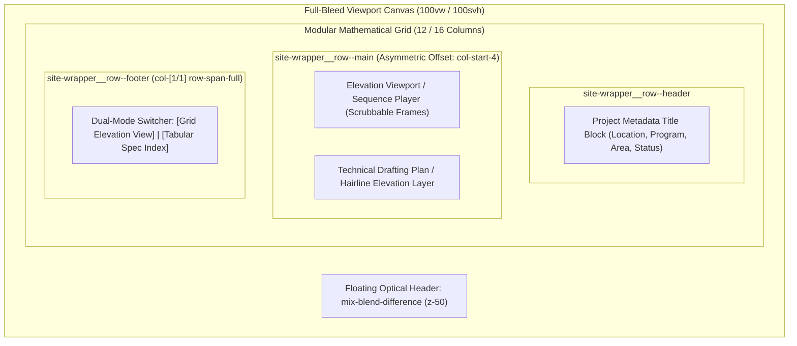

# Playbook: Architectural & Spatial Design Patterns

## Overview

Architectural practices, structural engineering consultancies, interior design ateliers, and spatial object studios demand a digital design language diametrically opposed to generic corporate SaaS or consumer tech. Where typical web applications prioritize colorful CTA buttons, rounded cards, high-velocity marketing copy, and bouncy micro-interactions, architectural digital spaces function as **tectonic enclosures**—digital extensions of physical spatial discipline.

This playbook provides actionable, production-grade patterns extracted from deep qualitative reverse-engineering of 13 leading global architecture, engineering, and spatial design websites:
- **`citadelgroup-org`**: Commercial/industrial construction harness; safety-hazard orange accents against deep carbon darkrooms and technical resource hubs.
- **`nakagawa-corp-com`**: Japanese residential timber architecture; stepped scale ladders (`720px` to `1760px`), `160px` section pauses, and unbleached washi plaster palettes.
- **`edisonfangworkshop-com`**: Spatial object and furniture workshop; tactile cabinet depth tokens (`11.9px` case depth), mechanical tray kinesthesis, and fired-terracotta accents.
- **`pda-archi_en`**: Parisian architectural practice; rigorous project taxonomy (`grid` vs `list`), asymmetric grid columns, and lifecycle states (`statusDelivered`, `statusInProgress`, `statusContest`, `statusRnD`).
- **`patmos-studio`**: Swiss/German architectural studio; overlapping full-grid coordinate primitives (`col-[1/1] row-span-full`) and perimeter gutter navigation.
- **`www-palaraiffeisen-ch`**: Swiss sports arena and civic architecture; 10-step monochrome alpha ladders and horizontal scale tracking (`--scaleX: 0 -> 1`).
- **`www-aat-architecten-be`**: Belgian architectural firm; tripartite tectonic row structuring (`site-wrapper__row--header`, `--main`, `--footer`) with dual contextual navigation.
- **`stillform-homes`**: Contemporary luxury pavilions; high-contrast pairing of `Instrument Serif` with `Familjen Grotesk`, floating optical inversion header (`mix-blend-difference`), and raw bone linen canvas (`#EDE6D6`).
- **`bcgbuildingdesign-com-au`**: Coastal building design practice; monumental `Neue Haas Grotesk Display Pro` with ultra-tight line height ratios (`font-height--tiny`) and sandstone linen tones.
- **`structureengineering-com-au`**: Structural and facade engineering consultancy; technical drafting monospace (`PP Fraktion Mono`), raw steel jet black, zinc grey, and structural gold accents.
- **`santalarch-com`**: High-end spatial architecture; real-time sequence-scrubbed elevation viewports (`/sequences/room.json`), 5%–20% hairline borders, and cubic-bezier transition curves.
- **`www-undplus-com`**: Brand architecture and spatial studio; Framer Motion physics-based spatial transitions and interactive hover text switches.
- **`montarville-ca`**: Integrated architectural management; dynamic modular math grids (`calc((100vw - 2*margin - gutters) / cols)`), monumental `128px` display scales, and vector drafting iconography.

---

## Architectural Layout Primitives



### 1. Blueprint-Style Framing & Tectonic Enclosures
Architectural web layouts reject floating drop-shadow "cards." Instead, structural framing treats the screen as an architect's drawing board or physical gallery enclosure:
- **Tripartite Structural Rows**: As observed in `www-aat-architecten-be`, the interface is partitioned into continuous horizontal tectonic registers:
  ```css
  .site-wrapper {
    display: flex;
    flex-direction: column;
    min-height: 100svh;
  }
  .site-wrapper__row--header { border-bottom: 1px solid var(--line-hairline); flex: 0 0 auto; }
  .site-wrapper__row--main   { flex: 1 0 auto; position: relative; }
  .site-wrapper__row--footer { border-top: 1px solid var(--line-hairline); flex: 0 0 auto; }
  ```
- **Overlapping Canvas Coordinates (`col-[1/1] row-span-full`)**: In `patmos-studio`, full-bleed spatial photography and navigation controls occupy identical CSS Grid coordinate cells. Rather than displacing one another, the interface layers directly over the elevation or perspective render.
- **Optical Inversion Floating Headers**: As reverse-engineered in `stillform-homes` and `santalarch-com`, top-level navigation avoids solid colored ribbons, translucent blur pills, or heavy dropshadows. Instead, navigation sits fixed across the full width with `mix-blend-difference`:
  ```css
  .nav-ghost-header {
    position: fixed;
    top: 0;
    left: 0;
    width: 100%;
    z-index: 50;
    padding: 1.5rem 2.5rem;
    color: #ffffff;
    mix-blend-mode: difference;
    pointer-events: auto;
  }
  ```
  Text dynamically inverts—appearing white over dark stone/timber imagery and jet-black over stark white daylight renderings—without JavaScript scroll listeners or background calculations.
- **Physical Depth & Cabinetry Tokens**: In `edisonfangworkshop-com`, spatial objects are housed within mechanical container units governed by physical dimension tokens:
  ```css
  :root {
    --case-depth: 11.9px;
    --case-half: 5.95px;
    --shelf-footer-height: calc(26px + env(safe-area-inset-bottom, 0px));
    --exchange-size: min(36vw, 260px, 42dvh);
    --tray-close-duration: 0.4s;
    --tray-close-delay: 0.65s;
    --tray-open-duration: 0.7s;
  }
  ```

### 2. Modular Grid Mathematics & Spatial Fluidity
- **Viewport-Derived Grid Columns**: In `montarville-ca`, layout column widths are calculated precisely using modular arithmetic rather than arbitrary percentage estimates:
  ```css
  :root {
    --grid-columns: 12;
    --grid-margin: clamp(1.5rem, 4vw, 4rem);
    --grid-gutter: clamp(1rem, 2vw, 2.5rem);
    --grid-col-width: calc(
      (100vw - (var(--grid-margin) * 2) - (var(--grid-gutter) * (var(--grid-columns) - 1))) 
      / var(--grid-columns)
    );
  }
  ```
- **Stepped Architectural Container Ladder**: `nakagawa-corp-com` defines rigid spatial widths mapping to architectural scales:
  - `--inner-xs`: `720px` (technical project specification columns)
  - `--inner-sm`: `1080px` (editorial drawing plates)
  - `--inner-md`: `1600px` (axonometric viewports)
  - `--inner-xl`: `1760px` (full site plan panoramic plates)
- **Asymmetric Offsets & Zero-Gap Bandings**: In `pda-archi_en`, layout columns use asymmetric offsets (`col-start-4 col-end-6` on a 12-column grid), leaving columns 1–3 as intentional architectural negative space. In `lpas-com`, `--row-gap: 0` creates contiguous bands of imagery touching without margins, emulating contact sheets and drafting elevations.

### 3. Elevation Viewports & Scrubbable Spatial Kinematics
Rather than standard image slideshows, high-end studios employ interactive elevation scrubbers:
- **Chunked Frame Sequence Manifests**: Reverse-engineered from `santalarch-com`, interactive 3D rooms and elevation sweeps load structured JSON chunk manifests:
  ```json
  {
    "codec": "image/webp",
    "width": 1920,
    "height": 1080,
    "fps": 60,
    "totalFrames": 120,
    "chunks": [
      { "file": "/sequences/room_001-040.bin", "size": 1420500 },
      { "file": "/sequences/room_041-080.bin", "size": 1398200 },
      { "file": "/sequences/room_081-120.bin", "size": 1441000 }
    ],
    "frames": [
      { "c": 0, "o": 0, "l": 12480, "t": 0, "ty": "key" }
    ]
  }
  ```
  A scroll-linked HTML5 `<canvas>` decodes and paints the chunked frames based on normalized scroll progress (`0.0` to `1.0`), allowing users to orbit around an architectural volume or scrub an elevation section cut interactively.
- **Scale Transform Progress Tracking**: `www-palaraiffeisen-ch` drives subtle linear telemetry meters (`--scaleX: calc(var(--scroll-percent) / 100)`) anchored to bottom borders, indicating the user's progress through an architectural dossier.

### 4. Rigorous Project Taxonomy Structures
Architectural portfolios do not treat case studies like blog posts. Real architectural workflows follow strict lifecycle phases and taxonomy primitives:
- **Dual Presentation Modes (Grid vs List)**: In `pda-archi_en`, the user can toggle between:
  1. *Grid Elevation View*: High-resolution architectural photography, line drawings, and section cuts.
  2. *Tabular Index View*: A dense, monospace technical inventory listing Project ID, Client/Sector, Typology, Year, Location, Surface Area ($m^2$), and Lifecycle Status.
- **Lifecycle Semantics (Strictly Enforced)**:
  ```typescript
  export type ProjectLifecycleStatus = 
    | 'statusDelivered'   // Completed, occupied, photographed
    | 'statusInProgress'  // Under construction, site works active
    | 'statusContest'     // Competition entry, shortlisted, or masterplan bid
    | 'statusRnD';        // Speculative lab, material research, structural prototype
  ```
- **Sectoral Market Categorization**: In `lpas-com`, projects are categorized into distinct practice sectors (`interiors`, `higherEducation`, `civic`, `commercial`), with dynamic CSS data-attributes switching palette tokens:
  ```css
  [data-marketcolor="interiors"]       { --marketAccent: rgb(178, 113, 80); }
  [data-marketcolor="higherEducation"] { --marketAccent: rgb(222, 231, 243); }
  [data-marketcolor="civic"]           { --marketAccent: rgb(180, 198, 184); }
  [data-marketcolor="commercial"]      { --marketAccent: rgb(241, 214, 196); }
  ```

---

## Typography & Styling Tokens

### 1. Austere Serif / Monoline / Grotesk Pairings
Architectural typography balances the intellectual authority of classic architectural monographs with the utilitarian precision of engineering blueprints.

| Pairing Archetype | Primary / Display | Secondary / Body & Metadata | Production Reference | Visual Character |
|---|---|---|---|---|
| **Editorial Pavilion** | `Instrument Serif` (Italic/Roman Display) | `Familjen Grotesk` (Light/Regular Sans) | `stillform-homes` | Austere, poetic, editorial; reminiscent of *El Croquis* or *Architectural Review*. |
| **Drafting Telemetry** | `Neue Haas Grotesk Display` (Semi-Bold) | `PP Fraktion Mono` (Monoline Monospace) | `structureengineering-com-au` | Engineering drawing title block; rigid, mathematical, blueprint annotations. |
| **Swiss Monumental** | `Neue Haas Grotesk Display Pro` (3.5rem, tiny leading) | `Helvetica Neue` / System Sans | `bcgbuildingdesign-com-au` | Modernist, heavy visual weight, zero decoration, tight vertical leading. |
| **Industrial Structural** | `Bebas Neue` (Condensed Caps) | `Montserrat` (Geometric Sans) | `citadelgroup-org` | Commercial general contracting; high-contrast numerals and bold structural signage. |

### 2. High-Contrast Monochrome & Material-Informed Palettes
Architectural sites avoid synthetic primary colors. Colors are derived from physical construction materials: limestone, travertine, charred cedar (shou sugi ban), hot-rolled steel, washi paper, and raw concrete.

```css
:root {
  /* =========================================================================
   * Material Substrates (Architectural Base Paper)
   * ========================================================================= */
  --substrate-bone:        #ede6d6;  /* stillform-homes: unbleached travertine */
  --substrate-washi:       #f7f7f4;  /* nakagawa-corp-com: warm plaster tone */
  --substrate-sandstone:   #f3efe8;  /* bcgbuildingdesign: warm sandstone */
  --substrate-linen:       #f4f2ee;  /* citadelgroup-org: vellum / specs paper */
  --substrate-carbon-dark: #0f0f0f;  /* santalarch-com: matte carbon black */
  --substrate-void-black:  #000000;  /* structureengineering: pitch drafting black */

  /* =========================================================================
   * Inks & Drawing Pigments
   * ========================================================================= */
  --ink-sumi:              #171814;  /* edisonfangworkshop: sumi drafting ink */
  --ink-charcoal:          #404044;  /* nakagawa-corp-com: muted graphite */
  --ink-zinc:              #818486;  /* citadelgroup-org: structural steel grey */
  --ink-hairline:          #babdc4;  /* nakagawa-corp-com: 1px boundary line */

  /* =========================================================================
   * Tectonic Accent Pigments (Applied with strict restraint < 5% surface area)
   * ========================================================================= */
  --accent-terracotta:     #ad573f;  /* edisonfangworkshop: fired brick / tile */
  --accent-gold-brass:     #b9b36d;  /* structureengineering: anodized brass */
  --accent-safety-orange:  #f87000;  /* citadelgroup-org: steelwork hazard orange */

  /* =========================================================================
   * Stepped Alpha Monochrome Ladders (www-palaraiffeisen-ch)
   * ========================================================================= */
  --c-black-05:  rgba(0, 0, 0, 0.05);
  --c-black-10:  rgba(0, 0, 0, 0.10);
  --c-black-20:  rgba(0, 0, 0, 0.20);
  --c-black-40:  rgba(0, 0, 0, 0.40);
  --c-black-80:  rgba(0, 0, 0, 0.80);
  --c-white-05:  rgba(255, 255, 255, 0.05);
  --c-white-10:  rgba(255, 255, 255, 0.10);
  --c-white-20:  rgba(255, 255, 255, 0.20);
  --c-white-60:  rgba(255, 255, 255, 0.60);
}
```

### 3. Hairline Border Tokens & Fractional Opacities
Standard `1px solid #ccc` borders look heavy and crude on high-density displays. Real architectural sites use subtle fractional opacity hairlines:
- **`santalarch-com` Hairlines**:
  - `--c-base-line-dark-bg: #f2f0f00d` (White at **5%** opacity for subtle grid subdivisions).
  - `--c-base-line-highlight: #f2f0f033` (White at **20%** opacity for active section borders).
- **Dynamic CSS Color-Mix**: In `edisonfangworkshop-com`, hairlines dynamically inherit foreground tones:
  ```css
  --mood-line: color-mix(in srgb, var(--mood-fg) 18%, transparent);
  ```
- **Zero Border Radius Policy**:
  ```css
  --radius-primary: 0px !important; /* In nakagawa-corp: --leap-project-radius-none: 0 */
  ```
  Architectural drawings use sharp, orthogonal intersections. Rounded corners (`rounded-xl`, `border-radius: 8px`) destroy the tectonic precision of the blueprint aesthetic.

### 4. Negative Space Ratios & Spatial Rhythm
Architectural websites treat negative space as a physical material:
- **Section Vertical Pauses**:
  - `nakagawa-corp-com`: `--section_pdg-sm: 120px`, `--section_pdg-md: 160px`.
  - `pda-archi_en`: `gap-y-52` (`208px` vertical spacing between editorial project entries).
  - `lpas-com`: `--xxlSpace: 8.5rem` (`136px`).
- **Display Scale Ratios**: In `montarville-ca`, hero typography is calculated to dominate the viewport without overflowing:
  ```css
  --font-size-h1: calc(128 / var(--base-px, 18) * 1rem); /* 7.11rem / ~128px */
  --font-size-h2-xl: calc(96 / var(--base-px, 18) * 1rem); /* 5.33rem / ~96px */
  ```

---

## Anti-Patterns & Pitfalls (Anti-Slop Guidelines)

When AI models or generic web agencies build architectural portfolio sites, they habitually generate generic startup/e-commerce patterns ("AI Slop"). Below are the explicit anti-patterns and their architectural remedies:

| Generic AI Slop Pattern | Why It Fails Architectural Credibility | Real Architectural Production Pattern |
|---|---|---|
| **Marketing Copy Fluff**: *"Crafting bespoke luxury dream spaces with passion, innovation, and timeless elegance."* | Vague, unsubstantiated marketing buzzwords that no licensed architect or structural engineer would put in a dossier. | **Objective Programmatic Title Block**: *"75011 Paris, France · Heritage Timber Rehabilitation · 340 m² · Glulam post-and-beam · Delivered 2024."* Specificity replaces adjectives. |
| **Card Soup Layout**: Centered 3-column grid of floating white cards with `border-radius: 12px` and soft drop shadows. | Looks like a SaaS pricing page or Shopify blog. Real blueprints are flat, orthogonal, and ruled. | **Orthogonal Framing with Hairlines**: Zero border radius (`radius: 0`), 1px hairline dividers at 8%–15% opacity, and asymmetric multi-column spans (`col-span-full lg:col-start-4`). |
| **Unsorted Portfolio Grid**: A single endless masonry wall with generic category tags ("Residential", "Modern", "Featured"). | Ignores the legal, operational, and commercial realities of architectural commissioning. | **Dual Grid / List View with Lifecycle Status**: Toggle between high-res elevation plates and a tabular monospace specification index filtered by `Delivered`, `Under Construction`, `Competition`, or `R&D`. |
| **Autoplay Carousel Hero**: A slider that auto-advances every 4 seconds with dots and chevron arrows. | Disorients the viewer and prevents deep study of plans, elevations, and material details. | **Full-Bleed Viewport Canvas with Scrubbable Frames or Static Spatial Hero**: Pinned viewport with optical inversion header (`mix-blend-difference`) or interactive frame-by-frame scrub. |
| **Vibrant Gradient CTAs**: Floating "Book a Free Consultation!" button with purple-to-blue gradient and glowing shadow. | Degrades the perception of professional architectural fee scale and technical authority. | **Austere Monoline Inquiry Trigger**: Monospace text link with minimal vector drafting glyph (`→ [Inquire for Commission]`) anchored in a fixed footer plate. |
| **Stock Imagery & Render Clichés**: Glossy 3D renders with fake sun flares, hyper-saturated green grass, and generic luxury cars. | Instantly spotted by clients, juries, and peers as speculative amateur work. | **Orthogonal Drawings Alongside Photography**: Balance site context photography with technical line plans, cross-sections, axonometrics, and material swatches. |

---

## Step-by-Step Procedure: Building an Architectural Digital Experience

Follow this rigorous sequence when designing or developing an architectural or spatial application:

### Step 1: Establish the Architectural Token Foundation
Define root CSS custom properties containing:
1. Strict 0px border radius token (`--radius: 0px`).
2. Material substrate backgrounds (bone `#ede6d6`, washi `#f7f7f4`, or carbon `#0f0f0f`).
3. Precision hairline opacities (`rgba(0,0,0,0.08)` or `rgba(255,255,255,0.12)`).
4. Typographic font family mappings (Serif or Grotesk display + Monospace telemetry).
5. Modular grid variables (`--grid-columns`, `--grid-margin`, `--grid-gutter`, `--grid-col-width`).

### Step 2: Implement the Floating Optical Inversion Header
1. Anchor `<header>` fixed at the top with `width: 100%`, `z-index: 50`.
2. Apply `mix-blend-mode: difference` and `color: #ffffff`.
3. Keep the header transparent (no background color or backdrop filter).
4. Use monoline or monospace styling for brand identifier and navigation links.

### Step 3: Construct the Technical Case Study Title Block
Every project page or modal must open with an architectural specification block:
- **Project Code & Name**: e.g., `ARC-2024-04 · Villa Vals Pavilion`
- **Location**: Specific city, district, coordinates (e.g., `Vals, Graubünden, Switzerland [46.6212° N, 9.1807° E]`)
- **Typology & Program**: e.g., `Subterranean Residential & Thermal Bath`
- **Floor Area**: Gross internal area in metric and imperial ($480\,m^2$ / $5,166\,sq\,ft$)
- **Structural System & Materials**: e.g., `Board-formed exposed concrete, local quartzite stone, triple-glazed thermal curtain wall`
- **Lifecycle Status**: Strict badge (`Delivered 2024`, `Under Construction`, `Competition Winner`, `R&D Prototype`)
- **Collaborators**: Structural engineer, facade consultant, general contractor, landscape architect

### Step 4: Implement Dual-Mode Taxonomy (Grid vs Technical Index)
Provide an interactive view switch in the portfolio archive:
1. **Grid Elevation View**: Displays visual elevation crops, section cuts, and contextual photography with minimal hover overlays.
2. **Tabular Specification View**: Displays a high-density, monospace table with columns: `Code`, `Project Name`, `Location`, `Typology`, `Year`, `Area`, `Status`. Enable sorting by Year, Area, and Status.

### Step 5: Integrate Elevation Scrubbing or Pinned Spatial Viewport
For primary featured works:
1. Load a chunked frame manifest (`/sequences/{project}.json`) containing WebP frames.
2. Bind frame rendering to scroll progress via an HTML5 `<canvas>`.
3. Overlay hairline crosshairs and elevation scale bars (`1:100` / `1:50`) that track viewport dimensions.

---

## Reference Implementations & Code Primitives

### 1. Architectural Design Tokens (`styles/architectural-tokens.css`)

```css
:root {
  /* Surface Substrates */
  --bg-canvas: #f7f7f4;
  --bg-surface: #ffffff;
  --bg-footer: #ede6d6;
  --bg-dark: #0f0f0f;

  /* Inks & Lines */
  --ink-primary: #171814;
  --ink-secondary: #404044;
  --ink-muted: #818486;
  --line-hairline: rgba(23, 24, 20, 0.12);
  --line-hairline-dark: rgba(255, 255, 255, 0.08);

  /* Restrained Accents */
  --accent-brick: #ad573f;
  --accent-brass: #b9b36d;

  /* Typography */
  --font-display: "Instrument Serif", Georgia, serif;
  --font-sans: "Familjen Grotesk", "Neue Haas Grotesk", -apple-system, sans-serif;
  --font-mono: "PP Fraktion Mono", "JetBrains Mono", monospace;

  /* Geometry & Grid */
  --radius-none: 0px;
  --grid-columns: 12;
  --grid-margin: clamp(1.5rem, 4vw, 4rem);
  --grid-gutter: clamp(1rem, 2vw, 2.5rem);
  --section-pad-y: clamp(5rem, 10vw, 10rem);
}
```

### 2. Floating Optical Header Component (`components/ArchitecturalHeader.tsx`)

```tsx
import React from 'react';
import Link from 'next/link';

export function ArchitecturalHeader() {
  return (
    <header className="fixed top-0 left-0 w-full z-50 px-6 py-5 md:px-12 flex justify-between items-baseline mix-blend-difference text-white pointer-events-auto">
      <div className="flex items-baseline gap-4">
        <Link href="/" className="font-mono text-xs tracking-widest uppercase hover:opacity-70 transition-opacity">
          ATELIER PRAXIS
        </Link>
        <span className="font-mono text-[10px] text-zinc-400 hidden sm:inline">
          [48.8566° N, 2.3522° E]
        </span>
      </div>

      <nav className="flex items-center gap-6 md:gap-10 font-mono text-xs uppercase tracking-wider">
        <Link href="/projects" className="hover:line-through transition-all">Projects</Link>
        <Link href="/practice" className="hover:line-through transition-all">Practice</Link>
        <Link href="/research" className="hover:line-through transition-all">R&D Lab</Link>
        <Link href="/contact" className="hover:line-through transition-all">Inquiries</Link>
      </nav>
    </header>
  );
}
```

### 3. Dual-Mode Project Catalog Component (`components/ProjectCatalog.tsx`)

```tsx
'use client';

import React, { useState } from 'react';
import Image from 'next/image';
import Link from 'next/link';

export interface ArchitecturalProject {
  id: string;
  code: string;
  title: string;
  location: string;
  typology: string;
  year: number;
  areaM2: number;
  status: 'statusDelivered' | 'statusInProgress' | 'statusContest' | 'statusRnD';
  heroImage: string;
}

const STATUS_LABELS = {
  statusDelivered: 'Delivered',
  statusInProgress: 'In Construction',
  statusContest: 'Competition Entry',
  statusRnD: 'R&D / Speculative',
};

export function ProjectCatalog({ projects }: { projects: ArchitecturalProject[] }) {
  const [viewMode, setViewMode] = useState<'grid' | 'list'>('grid');
  const [filterStatus, setFilterStatus] = useState<string>('all');

  const filtered = projects.filter(
    (p) => filterStatus === 'all' || p.status === filterStatus
  );

  return (
    <section className="w-full bg-[#F7F7F4] text-[#171814] pt-32 pb-24 px-6 md:px-12">
      {/* Controls Bar */}
      <div className="flex flex-col md:flex-row justify-between items-start md:items-center pb-6 border-b border-black/10 gap-4 font-mono text-xs">
        <div className="flex flex-wrap gap-4 uppercase tracking-wider">
          {['all', 'statusDelivered', 'statusInProgress', 'statusContest', 'statusRnD'].map((st) => (
            <button
              key={st}
              onClick={() => setFilterStatus(st)}
              className={`pb-1 ${filterStatus === st ? 'border-b-2 border-black font-semibold' : 'text-zinc-500 hover:text-black'}`}
            >
              {st === 'all' ? 'All Works' : STATUS_LABELS[st as keyof typeof STATUS_LABELS]}
            </button>
          ))}
        </div>

        <div className="flex items-center gap-3 self-end md:self-auto uppercase tracking-wider">
          <span className="text-zinc-400">View:</span>
          <button
            onClick={() => setViewMode('grid')}
            className={`px-2 py-1 ${viewMode === 'grid' ? 'bg-black text-white' : 'bg-transparent text-black border border-black/20'}`}
          >
            [Elevation Grid]
          </button>
          <button
            onClick={() => setViewMode('list')}
            className={`px-2 py-1 ${viewMode === 'list' ? 'bg-black text-white' : 'bg-transparent text-black border border-black/20'}`}
          >
            [Tabular Spec]
          </button>
        </div>
      </div>

      {/* Grid Mode */}
      {viewMode === 'grid' && (
        <div className="grid grid-cols-1 md:grid-cols-2 lg:grid-cols-3 gap-x-8 gap-y-16 pt-12">
          {filtered.map((proj) => (
            <Link key={proj.id} href={`/projects/${proj.id}`} className="group flex flex-col">
              <div className="relative aspect-[4/3] w-full bg-neutral-200 overflow-hidden border border-black/10">
                <Image
                  src={proj.heroImage}
                  alt={proj.title}
                  fill
                  className="object-cover grayscale group-hover:grayscale-0 group-hover:scale-105 transition-all duration-700 ease-out"
                />
                <span className="absolute top-3 left-3 font-mono text-[10px] bg-black/80 text-white px-2 py-0.5 uppercase tracking-widest">
                  {proj.code}
                </span>
              </div>
              <div className="pt-4 flex justify-between items-baseline">
                <h3 className="font-serif text-xl tracking-tight group-hover:italic">{proj.title}</h3>
                <span className="font-mono text-xs text-zinc-500">{proj.year}</span>
              </div>
              <p className="font-mono text-xs text-zinc-500 pt-1">
                {proj.location} · {proj.typology} · {proj.areaM2} m²
              </p>
            </Link>
          ))}
        </div>
      )}

      {/* Tabular List Mode */}
      {viewMode === 'list' && (
        <div className="w-full overflow-x-auto pt-8">
          <table className="w-full text-left font-mono text-xs border-collapse">
            <thead>
              <tr className="border-b border-black/20 text-zinc-400 uppercase tracking-widest pb-3">
                <th className="py-3 px-2">Code</th>
                <th className="py-3 px-2">Project Name</th>
                <th className="py-3 px-2">Location</th>
                <th className="py-3 px-2">Typology</th>
                <th className="py-3 px-2">Area</th>
                <th className="py-3 px-2">Year</th>
                <th className="py-3 px-2">Status</th>
              </tr>
            </thead>
            <tbody>
              {filtered.map((proj) => (
                <tr
                  key={proj.id}
                  className="border-b border-black/10 hover:bg-black/5 transition-colors cursor-pointer group"
                >
                  <td className="py-4 px-2 font-semibold">{proj.code}</td>
                  <td className="py-4 px-2 font-serif text-base group-hover:underline">
                    <Link href={`/projects/${proj.id}`}>{proj.title}</Link>
                  </td>
                  <td className="py-4 px-2 text-zinc-600">{proj.location}</td>
                  <td className="py-4 px-2 text-zinc-600">{proj.typology}</td>
                  <td className="py-4 px-2 text-zinc-600">{proj.areaM2} m²</td>
                  <td className="py-4 px-2 text-zinc-600">{proj.year}</td>
                  <td className="py-4 px-2">
                    <span className="inline-block border border-black/30 px-2 py-0.5 text-[10px] uppercase">
                      {STATUS_LABELS[proj.status]}
                    </span>
                  </td>
                </tr>
              ))}
            </tbody>
          </table>
        </div>
      )}
    </section>
  );
}
```

### 4. Interactive Elevation Scrubber Component (`components/ElevationScrubber.tsx`)

```tsx
'use client';

import React, { useRef, useEffect, useState } from 'react';

interface FrameManifest {
  totalFrames: number;
  width: number;
  height: number;
  frames: string[]; // Image URLs
}

export function ElevationScrubber({ manifest }: { manifest: FrameManifest }) {
  const containerRef = useRef<HTMLDivElement>(null);
  const canvasRef = useRef<HTMLCanvasElement>(null);
  const [currentFrame, setCurrentFrame] = useState(0);
  const imagesRef = useRef<HTMLImageElement[]>([]);

  // Preload frame sequence
  useEffect(() => {
    const loadedImages: HTMLImageElement[] = [];
    manifest.frames.forEach((src) => {
      const img = new window.Image();
      img.src = src;
      loadedImages.push(img);
    });
    imagesRef.current = loadedImages;
  }, [manifest]);

  // Handle scroll progress
  useEffect(() => {
    const handleScroll = () => {
      if (!containerRef.current) return;
      const rect = containerRef.current.getBoundingClientRect();
      const windowHeight = window.innerHeight;
      const totalScrollable = rect.height - windowHeight;
      if (totalScrollable <= 0) return;

      const progress = Math.min(Math.max(-rect.top / totalScrollable, 0), 1);
      const frameIndex = Math.min(
        Math.floor(progress * (manifest.totalFrames - 1)),
        manifest.totalFrames - 1
      );
      setCurrentFrame(frameIndex);
    };

    window.addEventListener('scroll', handleScroll, { passive: true });
    return () => window.removeEventListener('scroll', handleScroll);
  }, [manifest]);

  // Render to canvas
  useEffect(() => {
    const canvas = canvasRef.current;
    if (!canvas) return;
    const ctx = canvas.getContext('2d');
    if (!ctx) return;

    const img = imagesRef.current[currentFrame];
    if (img && img.complete) {
      ctx.clearRect(0, 0, canvas.width, canvas.height);
      ctx.drawImage(img, 0, 0, canvas.width, canvas.height);
    }
  }, [currentFrame]);

  return (
    <div ref={containerRef} className="relative h-[250vh] w-full bg-[#0F0F0F]">
      <div className="sticky top-0 h-screen w-full flex items-center justify-center overflow-hidden">
        <canvas
          ref={canvasRef}
          width={manifest.width}
          height={manifest.height}
          className="w-full h-full object-contain"
        />

        {/* Blueprint Drafting Overlay Crosshairs */}
        <div className="absolute inset-0 pointer-events-none p-8 flex flex-col justify-between font-mono text-[10px] text-white/40 uppercase">
          <div className="flex justify-between items-start">
            <span>Elevation Axis A-A · North Facade</span>
            <span>Scale 1:50</span>
          </div>
          <div className="flex justify-between items-end border-b border-white/10 pb-2">
            <span>Frame: {String(currentFrame + 1).padStart(3, '0')} / {manifest.totalFrames}</span>
            <span>Bearing: 342° NW</span>
          </div>
        </div>
      </div>
    </div>
  );
}
```

---

## Related Ventures & Production Targets

### Reverse-Engineered Targets
- [[citadelgroup-org/overview|citadelgroup-org]]: Industrial construction management, hazard orange tokens, Bebas Neue tabular figures.
- [[nakagawa-corp-com/overview|nakagawa-corp-com]]: Japanese timber architecture, 720px–1760px container sizing, 160px spatial padding.
- [[edisonfangworkshop-com/overview|edisonfangworkshop-com]]: Spatial objects, cabinet case depth (`11.9px`), tray kinesthesis, terracotta red.
- [[pda-archi_en/overview|pda-archi_en]]: Parisian practice, dual grid/list presentation, lifecycle taxonomy (`statusDelivered`, `statusInProgress`, `statusContest`, `statusRnD`).
- [[patmos-studio/overview|patmos-studio]]: Full-grid overlapping coordinate layout (`col-[1/1] row-span-full`).
- [[www-palaraiffeisen-ch/overview|www-palaraiffeisen-ch]]: Swiss arena architecture, 10-step monochrome alpha ladders, horizontal scale progress meters.
- [[www-aat-architecten-be/overview|www-aat-architecten-be]]: Tripartite tectonic row primitive (`site-wrapper__row--header`, `--main`, `--footer`).
- [[stillform-homes/overview|stillform-homes]]: Contemporary pavilions, `Instrument Serif` + `Familjen Grotesk`, `mix-blend-difference` header, `#EDE6D6` linen canvas.
- [[bcgbuildingdesign-com-au/overview|bcgbuildingdesign-com-au]]: `Neue Haas Grotesk Display Pro`, ultra-tight leading tokens, sandstone beige palette.
- [[structureengineering-com-au/overview|structureengineering-com-au]]: Structural engineering drafting monospace (`PP Fraktion Mono`), anodized gold accents.
- [[santalarch-com/overview|santalarch-com]]: Chunked frame sequence scrubber (`/sequences/room.json`), 5%–20% hairline borders.
- [[www-undplus-com/overview|www-undplus-com]]: Brand architecture and spatial design studio, Framer Motion transitions, interactive hover switches.
- [[montarville-ca/overview|montarville-ca]]: Modular math grid calculations (`--grid-col-width`), monumental 128px typography, drafting vector iconography.

### Historical Ventures & Playbooks
- [[agent-harness-principles]]: Fundamental harness principles, decoupled external project boundaries, and markdown-based knowledge structures.
- [[2026-10-31-cinematic-studio-portfolio]]: Pinned scroll-scrubbing optics, camera EXIF telemetry, and slide-over inquiry drawers.
- [[2026-11-14-awwwards-photography-expansion]]: Production reverse-engineering methodologies and high-aesthetic web architectures.
