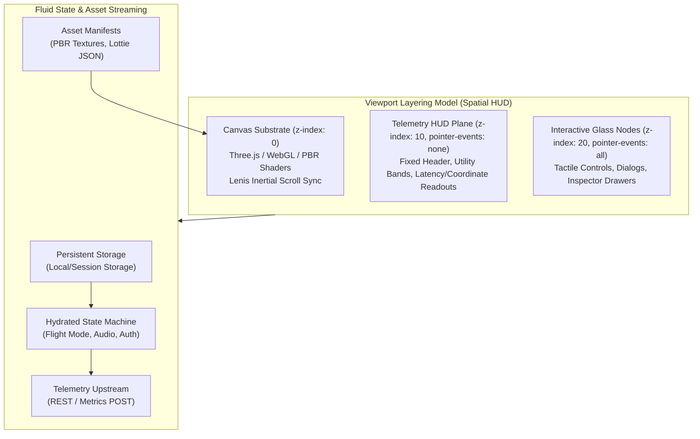
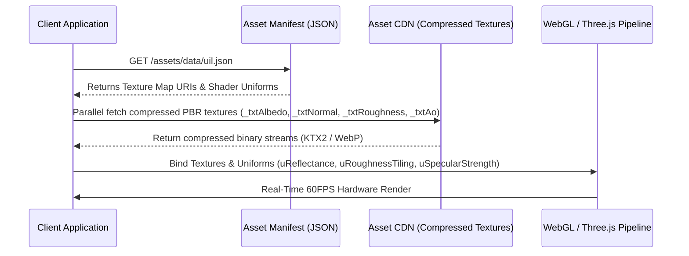

# Playbook: Technology & Experimental Systems Architecture

## Overview

Modern web applications frequently collapse into the "AI slop" uncanny valley: sterile white cards, generic purple gradients, bubbly rounded buttons, and cookie-cutter SaaS dashboard boilerplate. 

In contrast, cutting-edge technology and experimental systems—exemplified by autonomous defense platforms, hardware telemetry consoles, interactive WebGL physics engines, and brutalist creative engineering studios—demand a radically different paradigm: **High-Craft Hardware & Experimental UI**.

This playbook codifies the architectural principles, design tokens, canvas integration techniques, and fluid state management patterns extracted from reverse-engineering 18 production targets across Technology and Experimental categories.

### When to Apply This Playbook
- Building hardware, defense, aerospace, or industrial telemetry dashboards.
- Designing high-craft WebGL / 3D spatial interactive experiences.
- Developing developer tools, font/typography inspectors, or scientific data interfaces.
- Crafting experimental, brutalist, or award-winning portfolio/agency platforms that reject standard SaaS boilerplate.

---

## Recommended Pattern



### 1. Spatial Layering & Pointer-Events Segregation

In traditional web design, the DOM is a rigid document tree. In high-craft experimental and technology systems, the interface is structured as a **multi-plane spatial cockpit**:

1. **Base Spatial Substrate (`z-index: 0`)**:
   - Full-viewport WebGL `<canvas>` (Three.js / custom WebGL shaders).
   - Manages rendering of 3D models, physics simulations, particle systems, or planetary globes.
   - Listens to global window resize and pointer movement via normalized device coordinates (NDC: `[-1, 1]`).
2. **Telemetry HUD Overlay (`z-index: 10`, `pointer-events: none`)**:
   - Positioned fixed across the entire viewport (`fixed inset-0 pointer-events-none`).
   - Houses corner brackets, optical grids, telemetry gauges, flight tickers, breadcrumb paths, and title bands.
   - Text is set in dense monospace fonts with non-selectable, non-blocking operational readouts.
3. **Interactive Control Nodes (`pointer-events: auto` / `pointer-events: all`)**:
   - Only active interactive controls (buttons, tabs, drawers, dialogs, sliders) explicitly opt back into pointer events.
   - This ensures the underlying 3D canvas remains fully interactive (orbit, pan, raycast inspection) without dead zones caused by invisible DOM wrapper divs.

#### Canonical Cockpit DOM Architecture
```html
<div class="cockpit-viewport relative w-screen h-screen overflow-hidden bg-[#010101] text-[#f4f4f1]">
  <!-- Layer 0: Spatial Canvas Substrate -->
  <canvas id="webgl-canvas" class="fixed inset-0 w-full h-full z-0 block"></canvas>

  <!-- Layer 1: Global Telemetry HUD (Pointer Events Pass-Through) -->
  <header class="fixed top-0 left-0 right-0 z-10 flex justify-between items-center px-6 py-4 pointer-events-none font-mono text-xs tracking-wider uppercase">
    <div class="hud-brand flex items-center gap-3">
      <span class="hud-status-pip w-2 h-2 rounded-full bg-[#ff5c00] animate-pulse"></span>
      <span class="text-white font-semibold">AVILUS_SYS // ROADRUNNER-PBR</span>
    </div>
    <div class="hud-telemetry hidden md:flex items-center gap-6 text-[#9b9a94]">
      <span>FPS: <strong class="text-white font-mono" id="fps-counter">60.0</strong></span>
      <span>LAT: <strong class="text-white font-mono">37.7749° N</strong></span>
      <span>LON: <strong class="text-white font-mono">122.4194° W</strong></span>
      <span>STATUS: <strong class="text-[#5be38a]">NOMINAL</strong></span>
    </div>
  </header>

  <!-- Layer 2: Interactive Micro-Nodes -->
  <aside class="fixed right-6 top-1/2 -translate-y-1/2 z-20 flex flex-col gap-3 pointer-events-auto">
    <button class="hud-btn glass-panel px-4 py-2 text-xs font-mono border border-white/10 hover:border-[#ff5c00] transition-colors">
      [01] OPTICAL SENSORS
    </button>
    <button class="hud-btn glass-panel px-4 py-2 text-xs font-mono border border-white/10 hover:border-[#2e44ff] transition-colors">
      [02] KINEMATIC SIM
    </button>
  </aside>

  <!-- Layer 3: Dynamic Utility Title Band -->
  <footer class="fixed bottom-0 left-0 right-0 z-10 flex justify-between items-end px-6 py-4 pointer-events-none font-mono text-xs text-[#9b9a94]">
    <div>SEC_ID: 0x9F4A_DEPO // LATENCY: 14ms</div>
    <div class="pointer-events-auto">
      <button class="text-white hover:text-[#ff5c00] underline">[AUDIO: UNMUTED]</button>
    </div>
  </footer>
</div>
```

---

### 2. WebGL PBR Shader Uniform Pipeline & Asset Manifest Streaming

As observed in [[www-anduril-com/apis|Anduril Industries' production payload `uil.xxpaD5Cn-W.json`]], production hardware visualization does not rely on monolithic, opaque 3D files. Instead, it decouples the 3D scene graph from high-resolution physically-based rendering (PBR) texture maps and custom GLSL shader uniforms:



#### Production PBR Shader Architecture (Extracted from Anduril)
```typescript
interface PBRShaderAsset {
  filename: string;
  prefix: string;
  relative: string;
  src: string;
  compressed?: string;
}

interface Product3DSceneRoadrunner {
  _txtAlbedo: PBRShaderAsset;
  _txtAo: PBRShaderAsset;
  _txtDiffuse: PBRShaderAsset;
  _txtNormal: PBRShaderAsset;
  _txtRoughness: PBRShaderAsset;
  _txtSpecular: PBRShaderAsset;
  uReflectance: number;       // e.g. 0.82
  uRoughnessTiling: number;   // e.g. 2.50
  uSpecularStrength: number;  // e.g. 1.15
}

// Shader Material Uniform Binding
export function configurePBRMaterial(sceneData: Product3DSceneRoadrunner, loader: THREE.TextureLoader) {
  const material = new THREE.MeshStandardMaterial({
    map: loader.load(sceneData._txtAlbedo.src),
    aoMap: loader.load(sceneData._txtAo.src),
    normalMap: loader.load(sceneData._txtNormal.src),
    roughnessMap: loader.load(sceneData._txtRoughness.src),
    roughness: 0.45,
    metalness: 0.85,
  });

  material.onBeforeCompile = (shader) => {
    shader.uniforms.uReflectance = { value: sceneData.uReflectance };
    shader.uniforms.uRoughnessTiling = { value: sceneData.uRoughnessTiling };
    shader.uniforms.uSpecularStrength = { value: sceneData.uSpecularStrength };

    shader.fragmentShader = shader.fragmentShader.replace(
      '#include <roughnessmap_fragment>',
      `
      #include <roughnessmap_fragment>
      roughnessFactor *= uRoughnessTiling;
      `
    );
  };

  return material;
}
```

---

### 3. Fluid State Management & Client Persistence Patterns

Technology and experimental applications bridge interactive client physics with asynchronous telemetry loops:

1. **Session & Audio State Persistence**:
   - In [[thetiebreak-merci-michel-com/data-models|Merci-Michel's Miu Miu Wimbledon game]], user preference state is persisted locally to prevent repetitive modal interruptions:
     ```json
     // localStorage key: "miumiu-wimbledon"
     {
       "isAudioMuted": false,
       "audio-muted": 0
     }
     ```
2. **Player Identity & Mode Switching**:
   - In [[aviator-yakudoo-games/data-models|Karim Maaloul's Aviator game]], anonymous client UUID generation enables persistent leaderboards without authentication walls:
     ```json
     // localStorage key: "aviator.player" -> "ee41a193-db6b-491f-ae63-a697edb3c5df"
     // localStorage key: "aviator.mode" -> "chill" | "speed"
     ```
   - Client sends game telemetry to `POST /api/plays` and hydrates global rankings from `GET /api/leaderboard`.
3. **Decoupled Hashed JSON Data Stores**:
   - In [[errormade-tech/apis|Errormade Tech]], content state is detached from server-side rendering using immutable, content-hashed JSON endpoints (`/content/projects.46c0f58e5c6b4622.json` and `/content/settings.554574fc309429e9.json`), enabling instant client-side transitions with zero database latency.

---

### 4. High-Performance Design Token System

To avoid standard SaaS design cliches, adopt high-contrast hardware palettes consisting of **pitch-black or ultra-deep carbon substrates**, punctuated by **high-voltage neon phosphor accents** and **dense monospace typography**.

```mermaid
graph LR
    subgraph Substrates ["Deep Substrates (0-5% Luminance)"]
        S1["#010101 (Pitch Black / Anduril)"]
        S2["#050B14 (Deep Aerospace Navy / Crun AI)"]
        S3["#0b0b0c (Obsidian Charcoal / Fontsight)"]
        S4["#1a1a1e (Tactile Basalt / Clinia)"]
    end

    subgraph Phosphors ["Neon Phosphor Accents (80-100% Saturation)"]
        P1["#ff5c00 (Safety Phosphor Orange / Clinia & Avilus)"]
        P2["#0000ff / #2e44ff (Cobalt Laser Blue / Boolean & Fontsight)"]
        P3["#5be38a (Nominal Signal Green / Fontsight)"]
        P4["#cca44f (Military Armor Gold / Clinia)"]
        P5["#ff0000 / #ff5a36 (Critical Alert Tomato / Boolean & Fontsight)"]
    end

    Substrates -->|High Dynamic Range Contrast| Phosphors
```



#### Standard Design Token Catalog
```css
:root {
  /* =========================================================================
     1. SUBSTRATES & CARBON SURFACES
     ========================================================================= */
  --substrate-pitch:       #010101; /* Anduril absolute black */
  --substrate-aerospace:   #050B14; /* Crun AI deep navy void */
  --substrate-carbon:      #0b0b0c; /* Fontsight dark ink */
  --substrate-basalt:      #1a1a1e; /* Clinia primary dark */
  --surface-card:          #1c1c1b; /* Elevated container */
  --surface-well:          #262625; /* Inset recessed panel */
  --surface-line:          rgba(244, 244, 241, 0.10); /* Razor-thin technical border */

  /* =========================================================================
     2. HIGH-VOLTAGE NEON PHOSPHOR ACCENTS
     ========================================================================= */
  --phosphor-orange:       #ff5c00; /* Safety / Vital warning signal */
  --phosphor-cobalt:       #0000ff; /* Electric digital blue */
  --phosphor-laser-blue:   #2e44ff; /* Focused interactive hover */
  --phosphor-green:        #5be38a; /* Nominal telemetry / online status */
  --phosphor-yellow:       #ffd84a; /* Advisory state */
  --phosphor-gold:         #cca44f; /* Armor / Noble authority badge */
  --phosphor-alert:        #ff0000; /* Critical system fault */

  /* =========================================================================
     3. TYPOGRAPHY: DENSE MONOSPACE & TECHNICAL SANS
     ========================================================================= */
  --font-mono-telemetry:   "JetBrains Mono", "Geist Mono", "Space Mono", "IBM Plex Mono", ui-monospace, monospace;
  --font-sans-technical:   "Archivo", "Inter", "Bricolage Grotesque", -apple-system, sans-serif;
  --font-display-serif:    "Averia Serif Libre", Georgia, serif;

  /* =========================================================================
     4. MATHEMATICAL GRID & CLEARANCE (Errormade & Avilus Paradigm)
     ========================================================================= */
  --page-margin:           clamp(16px, 2.5vw, 48px);
  --grid-gap:              6px;
  --grid-columns:          12;
  --column-width:          calc((100vw - 2 * var(--page-margin) - (var(--grid-columns) - 1) * var(--grid-gap)) / var(--grid-columns));
  --hud-height:            clamp(32px, 2.8vw, 44px);
  --border-radius-tight:   2px; /* Hardware edges, reject 16px pill cards */

  /* =========================================================================
     5. KINETIC SPRINGS & MECHANICAL EASING
     ========================================================================= */
  --ease-mechanical:       cubic-bezier(0.7, 0, 0.2, 1);     /* Boolean Sequence sharp drop */
  --ease-pneumatic:        cubic-bezier(0.2, 0.8, 0.2, 1);   /* Fontsight smooth travel */
  --spring-rebound:        cubic-bezier(0.34, 1.56, 0.64, 1); /* Tactile switch bounce */
}
```

---

## Anti-Patterns & Pitfalls (Anti-AI-Slop)

| Anti-Pattern (AI Slop Default) | Production High-Craft Alternative | Discovered Target Origin |
|---|---|---|
| **White Card Containers with Massive Radius** (`rounded-3xl shadow-xl bg-white`) | **Razor-Thin Carbon Panels with Tight Radius** (`border border-white/10 bg-[#0b0b0c] rounded-[2px]`) | [[fontsight-xyz]], [[www-anduril-com]] |
| **Generic Purple Gradients** (`bg-gradient-to-r from-purple-500 to-indigo-600`) | **High-Voltage Functional Phosphor Accents** (`#ff5c00` Orange, `#0000ff` Laser Cobalt, `#5be38a` Green) | [[clinia-com]], [[booleansequence-niceunderground-xyz]] |
| **Centering Everything with Flexbox** | **Mathematical CSS Grid Layout with Dynamic Clamps** (`calc((100vw - 2 * margin) / cols)`) | [[errormade-tech]], [[www-avilus-com]] |
| **Standard Sans-Serif Everywhere** (`Inter` font for both headers, buttons, and data) | **Dense Technical Monospace Telemetry Pairing** (`JetBrains Mono` or `Space Mono` for data + `Archivo` or `Bricolage Grotesque` for display) | [[booleansequence-niceunderground-xyz]], [[www-xantium-com]] |
| **Monolithic 3D GlTF Blobs** (single 50MB file blocking initial load) | **Decoupled PBR Shader Maps & Progressive Asset Manifests** | [[www-anduril-com]], [[thetiebreak-merci-michel-com]] |
| **Full-Screen DOM Blocking Canvas** (Click events swallowed by invisible layout wrappers) | **Pointer-Events Pass-Through** (`pointer-events-none` on overlay HUD, `pointer-events-auto` on control nodes) | [[carnilove-ashfall-studio]], [[aviator-yakudoo-games]] |
| **Uncalibrated Native Scroll Jitter** | **Inertial Smooth Scroll Synced to Canvas Camera** (`Lenis` inertial physics loop) | [[www-anduril-com]], [[errormade-tech]], [[www-avilus-com]] |

---

## Step-by-Step Procedure

### 1. Initialize Viewport & Canvas Substrate
Set up the pitch-black viewport substrate and mount the WebGL canvas with high-DPI scaling:

```typescript
import * as THREE from 'three';
import Lenis from 'lenis';

export class CockpitViewport {
  private canvas: HTMLCanvasElement;
  private renderer: THREE.WebGLRenderer;
  private scene: THREE.Scene;
  private camera: THREE.PerspectiveCamera;
  private lenis: Lenis;

  constructor(canvas: HTMLCanvasElement) {
    this.canvas = canvas;
    this.scene = new THREE.Scene();
    this.scene.background = new THREE.Color(0x010101); // Pitch black substrate

    this.camera = new THREE.PerspectiveCamera(45, window.innerWidth / window.innerHeight, 0.1, 1000);
    this.camera.position.set(0, 0, 5);

    this.renderer = new THREE.WebGLRenderer({
      canvas: this.canvas,
      antialias: true,
      powerPreference: 'high-performance'
    });
    this.renderer.setPixelRatio(Math.min(window.devicePixelRatio, 2));
    this.renderer.setSize(window.innerWidth, window.innerHeight);

    // Initialize Lenis inertial scroll physics
    this.lenis = new Lenis({
      duration: 1.2,
      easing: (t) => Math.min(1, 1.001 - Math.pow(2, -10 * t))
    });

    this.bindEvents();
    this.render();
  }

  private bindEvents() {
    window.addEventListener('resize', () => {
      this.camera.aspect = window.innerWidth / window.innerHeight;
      this.camera.updateProjectionMatrix();
      this.renderer.setSize(window.innerWidth, window.innerHeight);
    });
  }

  private render = (time: number = 0) => {
    this.lenis.raf(time);
    this.renderer.render(this.scene, this.camera);
    requestAnimationFrame(this.render);
  };
}
```

### 2. Scaffold the Non-Blocking Telemetry HUD
Construct the HUD layer with CSS pointer-event segregation, corner registration markers, and live coordinate readouts:

```css
/* Telemetry HUD Framework */
.hud-plane {
  position: fixed;
  inset: 0;
  pointer-events: none;
  z-index: 10;
  display: grid;
  grid-template-rows: auto 1fr auto;
  padding: var(--page-margin);
}

.hud-control-node {
  pointer-events: auto;
  background: rgba(28, 28, 27, 0.7);
  backdrop-filter: blur(12px);
  -webkit-backdrop-filter: blur(12px);
  border: 1px solid rgba(244, 244, 241, 0.12);
  border-radius: var(--border-radius-tight);
  color: var(--phosphor-laser-blue);
  font-family: var(--font-mono-telemetry);
  font-size: 11px;
  text-transform: uppercase;
  letter-spacing: 0.08em;
  padding: 8px 14px;
  transition: all 0.15s var(--ease-mechanical);
}

.hud-control-node:hover {
  background: rgba(46, 68, 255, 0.15);
  border-color: var(--phosphor-laser-blue);
  color: #ffffff;
  box-shadow: 0 0 12px rgba(46, 68, 255, 0.35);
}

/* Corner Reticle Markers */
.hud-reticle-tl {
  position: absolute;
  top: 12px;
  left: 12px;
  width: 8px;
  height: 8px;
  border-top: 2px solid var(--phosphor-orange);
  border-left: 2px solid var(--phosphor-orange);
}
```

### 3. Implement Fluid State & Telemetry Loops
Track flight mode, audio preferences, and viewport interaction state without blocking UI threads:

```typescript
export interface TelemetryState {
  mode: 'flight' | 'tactical' | 'inspection';
  audioMuted: boolean;
  activeSensors: string[];
  fps: number;
}

class TelemetryController {
  private state: TelemetryState;

  constructor() {
    this.state = {
      mode: (localStorage.getItem('sys.mode') as any) || 'flight',
      audioMuted: localStorage.getItem('sys.audio') === 'muted',
      activeSensors: ['LIDAR', 'OPTICAL_IR'],
      fps: 60
    };
  }

  public setMode(mode: TelemetryState['mode']) {
    this.state.mode = mode;
    localStorage.setItem('sys.mode', mode);
    this.dispatchUpdate();
  }

  public toggleAudio(): boolean {
    this.state.audioMuted = !this.state.audioMuted;
    localStorage.setItem('sys.audio', this.state.audioMuted ? 'muted' : 'active');
    this.dispatchUpdate();
    return this.state.audioMuted;
  }

  public async logTelemetry(payload: Record<string, unknown>) {
    try {
      await fetch('/api/telemetry/report', {
        method: 'POST',
        headers: { 'Content-Type': 'application/json' },
        body: JSON.stringify({
          timestamp: Date.now(),
          clientState: this.state,
          ...payload
        })
      });
    } catch (err) {
      console.warn('Telemetry transmission deferred:', err);
    }
  }

  private dispatchUpdate() {
    window.dispatchEvent(new CustomEvent('telemetry:statechange', { detail: this.state }));
  }
}
```

---

## Production Target Reference Catalog

Comprehensive comparative matrix across the 18 analyzed targets:

| Target Dossier | Vertical | Core Aesthetic & Paradigm | Dominant Font Stack | Key Design Tokens & Signatures | Canvas / State Architecture |
|---|---|---|---|---|---|
| [[www-anduril-com/overview|www-anduril-com]] | Technology | Autonomous Defense Hardware | San Francisco / Monospace | `--theme-color-background: #010101`, `#fff` | Three.js PBR Shader Uniform pipeline (`Roadrunner`, `Dive-LD`), Lenis scroll |
| [[www-avilus-com/overview|www-avilus-com]] | Technology | Dual-Use Aircraft Logistics | Technical Sans & Variable Monospace | `--site--column-count: 12`, `--radius--main: .5rem`, `--_spacing---space--8: clamp(...)` | 12-column dynamic clamp math, tactical aircraft telemetry layout |
| [[withwise-com/overview|withwise-com]] | Technology | Compliance-First Infrastructure | Font Awesome 7 Free / Classic Sans | Dynamic data shortcode tokens, multi-tenant brand stylesheets | Asynchronous config manifests (`/client_data/.../config/...json`) |
| [[crun-ai/overview|crun-ai]] | Technology | AI Compute Platform | Crisp Palette / Modern Sans | Dark background `#050B14`, zinc neutrals, `--crisp-color-base-*` | Nuxt color-mode persistence, instant static build meta streaming |
| [[clinia-com/overview|clinia-com]] | Technology | Healthcare AI & Clinical Context | Tactical Grotesque / Sans | `--color-primary: #1a1a1e`, `--color-secondary: #ff5c00`, `--color-noble: #cca44f` | Blossom carousel, split tab navigation, medical telemetry indicators |
| [[adamperlis-com/overview|adamperlis-com]] | Technology | Creative Tech Leadership | Tailwind 3D Matrix / Sans | `--tw-translate-x/y/z` 3D perspective transforms | Interactive spatial DOM cards, contact telemetry API |
| [[www-xantium-com/overview|www-xantium-com]] | Technology | High-Tech Systems & Glassmorphism | `Inter` + `Space Mono` | `bg-cache-black`, `glass-beam-80`, `glass-effect` | Pointer-events-none sticky header, Space Mono coordinate readouts |
| [[fontsight-xyz/overview|fontsight-xyz]] | Technology | Real-Time Font Rendering Engine | `Geist Mono` + `Bricolage Grotesque` + `Inter` | `--card: #1c1c1b`, `--tomato: #ff5a36`, `--spring: cubic-bezier(.34, 1.56, .64, 1)` | Rolo modal dialog (`<dialog id="rolo">`), real-time letterform HUD telemetry |
| [[www-greenlock-io/overview|www-greenlock-io]] | Technology | Cryptographic Security Infrastructure | Technical Monospace / Sans | Lottie animation streaming tokens, `--_gcl_ls` schema | Streaming Lottie crypto-lock visualizers (`crystall.mp4.lottie.json`) |
| [[www-1centre-com/overview|www-1centre-com]] | Technology | Automated Trade Onboarding | Dark Slate / Monospace | `--tw-gradient-*`, `bg-[#0b0b0a]`, `border-white/10` | PostHog session recording telemetry, multi-step credit verification |
| [[wiro-ae/overview|wiro-ae]] | Technology | Modern AI Services | Tailwind Sans & Utility Tokens | Minimalist dark monochrome borders, zero-clutter grid | Fast utility DOM structure, clean responsive viewport bindings |
| [[switchblade-awwwards-vercel-app/overview|switchblade-awwwards-vercel-app]] | Experimental | Military Loitering Munition 3D Viewer | `IBM Plex Mono` + `Barlow` + `Averia Serif Libre` | Technical military typography, gradient-stops on dark basalt | WebGL 3D loitering drone camera controls, spec telemetry inspection |
| [[thetiebreak-merci-michel-com/overview|thetiebreak-merci-michel-com]] | Experimental | Interactive 3D WebGL Tennis Game | Sport Monospace / Sans | `--ball-size: max(35px, 1.8vw)`, `--bounce-height: 90px` | Three.js r165 canvas, audio mute persistence (`miumiu-wimbledon`), Baluchon asset manifests |
| [[booleansequence-niceunderground-xyz/overview|booleansequence-niceunderground-xyz]] | Experimental | Algorithmic Generative Art System | `JetBrains Mono` + `Archivo` | `--t: #0000ff`, `--err: #ff0000`, `--hud: clamp(30px, 2.4vw, 38px)` | Fixed `<header class="hud">`, real-time generative sequence ticks, Lenis scroll |
| [[aviator-yakudoo-games/overview|aviator-yakudoo-games]] | Experimental | Interactive 3D Airplane Flight Game | Minimalist Flight Display Mono | `--start-top: 59.5%`, `--hud-icon: calc(42 * var(--hud-scale))` | Three.js canvas flight physics, local state mode/player UUID, leaderboard REST API |
| [[carnilove-ashfall-studio/overview|carnilove-ashfall-studio]] | Experimental | Narrative 3D Cinematic Environment | Atmospheric Sans / Serif | Fullscreen viewport, pointer-events-none fixed HUD header | Fullscreen WebGL canvas anchored under pointer-events-none HUD header, Lenis scroll |
| [[exspeedia-com/overview|exspeedia-com]] | Experimental | 3D Interactive World Exploration | Font Awesome 7 Pro / Technical Sans | Dynamic world camera tokens, interactive travel nodes | Three.js interactive 3D globe canvas, `/api/world`, `/api/tours`, `/api/achievements` |
| [[errormade-tech/overview|errormade-tech]] | Experimental | Brutalist Creative Tech Studio | High-Precision Monospace / Sans | `--grid-gap: 6px`, `--column: calc(...)`, `--media-column: calc(...)` | Mathematical grid calculations, `<aside class="site-utilities">`, immutable JSON streaming |

---

## Related Ventures & Targets

### Historical Ventures
- [[2026-11-14-awwwards-multi-category-expansion]] — Cataloging 197 production targets across technology, experimental, fashion, and architecture verticals.
- [[2026-11-14-awwwards-photography-expansion]] — Automated reverse-engineering pipeline and design DNA extraction.
- [[2026-10-31-cinematic-studio-portfolio]] — High-craft 35mm optical viewfinder portfolio and EXIF telemetry HUD.

### Technology Target Dossiers
- [[www-avilus-com/overview|www-avilus-com]]
- [[withwise-com/overview|withwise-com]]
- [[www-anduril-com/overview|www-anduril-com]]
- [[crun-ai/overview|crun-ai]]
- [[clinia-com/overview|clinia-com]]
- [[adamperlis-com/overview|adamperlis-com]]
- [[www-xantium-com/overview|www-xantium-com]]
- [[fontsight-xyz/overview|fontsight-xyz]]
- [[www-greenlock-io/overview|www-greenlock-io]]
- [[www-1centre-com/overview|www-1centre-com]]
- [[wiro-ae/overview|wiro-ae]]

### Experimental Target Dossiers
- [[switchblade-awwwards-vercel-app/overview|switchblade-awwwards-vercel-app]]
- [[thetiebreak-merci-michel-com/overview|thetiebreak-merci-michel-com]]
- [[booleansequence-niceunderground-xyz/overview|booleansequence-niceunderground-xyz]]
- [[aviator-yakudoo-games/overview|aviator-yakudoo-games]]
- [[carnilove-ashfall-studio/overview|carnilove-ashfall-studio]]
- [[exspeedia-com/overview|exspeedia-com]]
- [[errormade-tech/overview|errormade-tech]]
