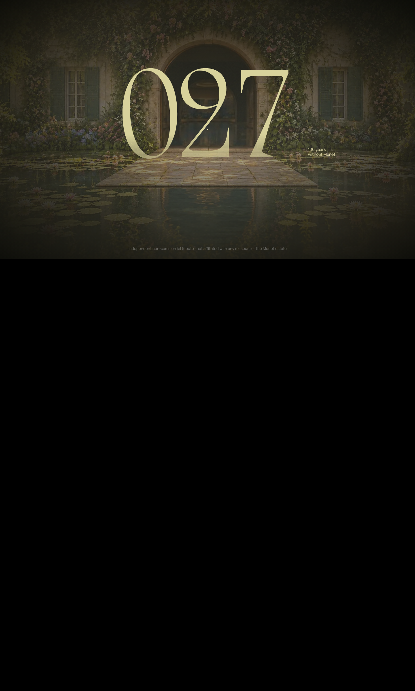
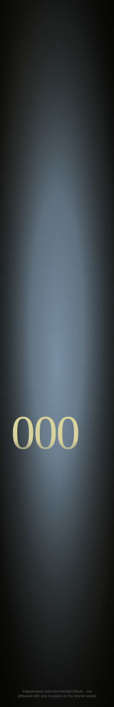

# UI Design System & Master Generation Blueprint: 100yearsmonet-com

> **Monet 100 — A century without Claude Monet · 3D gallery** (https://100yearsmonet.com) — A hundred years after Claude Monet’s death: walk on water through his paintings into the room of Water Lilies. An immersive 3D tribute wi...



---

## 1. Executive Visual Persona & Design Archetype

- **Brand Essence & Persona**: **Monet 100 — A century without Claude Monet · 3D gallery** (`https://100yearsmonet.com`). A hundred years after Claude Monet’s death: walk on water through his paintings into the room of Water Lilies. An immersive 3D tribute wi...
- **Visual Archetype**: **Dark-Substrate WebGL / Canvas Interactive Experience (`#000` / `#0b1020`)**.
- **Anti-AI-Slop Differentiators**:
  - **Source-Grounded Chromatic Polarity**: Anchors the viewport in `#000` (`body { background: #000 }`) paired with `#fff` primary typography and `#0b1020` accents.
  - **Extracted Typographic Hierarchy**: Pairs `Quelia` for display copy (`100 Years without Monet`) with `Manrope` and not declared in static CSS (uses primary stack / `ui-monospace`).
  - **Calibrated Spatial Grid & Motion**: Combines `55vw` container bounds (`gap: 20px`, padding `28px`) with `cubic-bezier(.3,.6,.2,1)` easing and Three.js / WebGL Canvas Pipeline.

---

## 2. Spatial Architecture & Modular Grid Mathematics



### Viewport Allocation & Container Geometry
- **Captured Viewport Dimensions**: Desktop `1440×18000px` (`assets/desktop.png`, full-page scroll capture), Mobile `390×2400px` (`assets/mobile.png`, capped at 2400px multi-section capture).
- **Master Container Bounds**: `55vw` extracted from `100yearsmonet-com` stylesheet.
- **Canvas Lateral Padding & Spacing**: `28px` lateral canvas padding with `20px` grid gap.
- **Border Radius Scale**: `50%`, `2px`, `3px`, `1px`.

### Responsive Breakpoint Architecture
- **Desktop Layout**: Multi-column CSS Grid / Flexbox layout at `1440px` (`max-width: 55vw`, `gap: 20px`).
- **Mobile Layout**: Single-column vertical stack at `390px` viewport width with `28px` horizontal padding.
- **Extracted CSS Media Queries**: `@media (max-width:600px)`, `@media (max-width:760px)`, `@media (prefers-reduced-motion:reduce)`, `@media (max-width:700px)`.

---

## 3. Color System, Materiality & Atmospheric Lighting

### Semantic Palette & Source Grounding
| Semantic Role | Ground-Truth Value | Extracted CSS Source / Selector |
|---|---|---|
| **Primary Canvas Substrate** | `#000` | `body { background: #000 }` |
| **Primary Typography Ink** | `#e5dce9` | `body { color: #e5dce9 }` |
| **Elevated Surface / Card Substrate** | `#777` | `button { color: #777 }` |
| **Interactive Accent / Highlight** | `#0b1020` | `.mui-pre { background: #0b1020 }` |
| **Secondary / Muted Copy** | `#1a1a22` | `.mui .mui-sound { color: #1a1a22 }` |
| **Structural Hairline Border** | `#fff` | `.mui-gtitle svg { fill: #fff }` |
| **Variable Token (`--mui-cream`)** | `#FCF4E9` | `var(--mui-cream)` in stylesheet |
| **Variable Token (`--mui-ink`)** | `#282B36` | `var(--mui-ink)` in stylesheet |
| **Variable Token (`--mui-night`)** | `#15141f` | `var(--mui-night)` in stylesheet |

### Sanitized Root CSS Variables (`ui-ux.md` Ground Truth)
| Variable Name | Extracted Value | Semantic Role |
|---|---|---|
| `--cat` | `calc(1 - var(--p,0))` | Design System Custom Token |
| `--fs` | `min(52vh,30vw)` | Dimension / Scale Token |
| `--snd-r` | `var(--mui-gutter,24px)` | Dimension / Scale Token |
| `--snd-b` | `calc(26px + env(safe-area-inset-bottom,0px))` | Dimension / Scale Token |
| `--bx` | `50%` | Dimension / Scale Token |
| `--by` | `46%` | Dimension / Scale Token |
| `--ch` | `150px` | Dimension / Scale Token |
| `--mui-cream` | `#FCF4E9` | Color / Atmospheric Token |
| `--mui-cream-rgb` | `252 244 233` | Design System Custom Token |
| `--mui-ink` | `#282B36` | Typography Ink Token |
| `--mui-night` | `#15141f` | Color / Atmospheric Token |
| `--mui-serif` | `"Quelia","Iowan Old Style",Georgia,serif` | Typography / Scale Token |
| `--mui-sans` | `"Manrope","Helvetica Neue",Arial,system-ui,sans-serif` | Typography / Scale Token |
| `--mui-ui` | `"Manrope","Helvetica Neue",Arial,system-ui,sans-serif` | Dimension / Scale Token |
| `--100yearsmonet-co-bg` | `#000` | Canvas Substrate (from `body { background: #000 }`) |
| `--100yearsmonet-co-ink` | `#fff` | Primary Typography Ink (stylesheet-derived) |

---

## 4. Typographic Scale & Editorial Hierarchy

### Font Family Stacks
- **Display Typography**: `Quelia`.
- **Primary Body Stack**: `Manrope`.
- **Technical / Metadata Stack**: not declared in static CSS (uses primary stack / `ui-monospace`).

### Typographic Scale & Rules (Extracted from Stylesheet & Variables)
- **Hero Display (`H1`)**: not explicitly declared on tag in static CSS (stylesheet font-size ladder: `11px`, `18px`, `36px`, `1.1em`, `clamp(1.3rem,2.2vw,2rem)`).
- **Section Heading (`H2`)**: rule `h2` (`letter-spacing: -.01em`).
- **Body Copy**: not explicitly declared on tag in static CSS (stylesheet font-size ladder: `11px`, `18px`, `36px`, `1.1em`, `clamp(1.3rem,2.2vw,2rem)`).
- **Metadata & Navigation Labels**: rule `small` (`letter-spacing: .12em`).

---

## 5. Choreographed Motion & Interaction Physics

### Primary Easing Curves
- **Extracted Timing Functions**: `cubic-bezier(.3,.6,.2,1)`, `cubic-bezier(.5,0,.2,1)`, `cubic-bezier(.2,.7,.2,1)`.

### Per-Element Transition & Choreography Rules
- **Selector `.mui-pre`**: `transition: opacity 1.4s ease .1s,visibility 1.6s` extracted from `100yearsmonet-com` stylesheet.
- **Selector `.mui-hero`**: `transition: opacity .9s ease,transform 1.4s cubic-bezier(.3,.6,.2,1),filter 1s` extracted from `100yearsmonet-com` stylesheet.
- **Selector `.mui .btn`**: `transition: background .25s,color .25s,border-color .25s` extracted from `100yearsmonet-com` stylesheet.
- **Extracted Easing Curve (`cubic-bezier(.3,.6,.2,1)`)**: Governs interactive state transitions across `<header.mui-hud>` and `<article.mui-card>`.
- **Runtime Interaction Engine**: Integrates Three.js / WebGL Canvas Pipeline with `prefers-reduced-motion: reduce` fallback guards.

---

## 6. Component Wireframe & Structural DOM Map

### Visual Layout Schematic (Grounded in `dom.html` — `1440px` Desktop & `390px` Mobile Reflow)
```
┌────────────────────────────────────────────────────────────────────────┐
│ DESKTOP VIEWPORT (1440px) — Monet 100 — A century without Claude Monet │
│ ====================================================================== │
│ [ <header.mui-hud>         | Musée de l’Orangerie · Musée d’Orsay · ]  │
│ ---------------------------------------------------------------------- │
│ | HERO STAGE: <section.mui-hero>                                   |   │
│ | H1: 100 Years without Monet                                      |   │
│ | Substrate: #000       | Ink: #fff       | Accent: #0b1020        |   │
│ ---------------------------------------------------------------------- │
│ | SHOWCASE GRID (<article.mui-card>        ) max-w: 55vw           |   │
│ | +------------------------------+  +------------------------------+ | │
│ | | 100 years without Monet      |  | Impression, Sunrise          | | │
│ | +------------------------------+  +------------------------------+ | │
│ ---------------------------------------------------------------------- │
│ | MOBILE VIEWPORT REFLOW (390px) — Single-Column Stack (gap: 20px  ) | │
│ | [<header.mui-hud>] -> [<section.mui-hero>] -> [<article.mui-card>] | │
│ ---------------------------------------------------------------------- │
│ [ FOOTER (<footer.mui-garden>   ) | https://100yearsmonet.com          │
└────────────────────────────────────────────────────────────────────────┘
```

### Granular DOM Region Breakdown
1. **Brand Header & Navigation Bar (<header.mui-hud> — `100yearsmonet-com`)**:
   - Landmark `<header class="mui-hud mui-hud--top">` hosting `Monet 100 — A century without Claude` navigation (`Musée de l’Orangerie · Musée d’Orsay · The Met · MFA Boston · Museum Barberini`), DOM attributes (`data-title-stay`, `data-enter="sound"`, `data-v="Dawn"`, `data-card="impression"`), and stylesheet rule `body { background:000 }`.
2. **Hero Stage & Focal Lead (<section.mui-hero> — `100 Years without Monet`)**:
   - Landmark `<section class="mui-hero">` presenting display lead `100 Years without Monet` and copy excerpt *"Claude Monet died at Giverny on 5 December 1926. A hundred years "* over `#000` canvas and `#fff` ink.
3. **Primary Showcase & Content Grid (<article.mui-card> — `100 years without Monet`)**:
   - Landmark `<article class="mui-card">` rendering section `100 years without Monet` with copy *"This experience needs JavaScript and WebGL."*, asset references (`favicon-32.png`, `apple-touch-icon.png`, `site.webmanifest`, `quelia.woff2`), and grid rule `canvas { position:fixed;inset:0;width:100%;height:100% }`.
4. **Interactive Detail & Feature Matrix (<article.mui-card> — `Impression, Sunrise`)**:
   - Landmark `<article class="mui-card">` framing `Impression, Sunrise` and `Woman with a Parasol` (*"Claude Monet 1926 — 2026"*) with `#777` surface cards, `#0b1020` accents, and `journey { height:2000vh;pointer-events:none }`.
5. **Colophon & Global Directory Footer (<footer.mui-garden> — `https://100yearsmonet.com`)**:
   - Landmark `<footer class="mui-garden">` anchoring `Monet 100 — A century without Cl` footer links (`Musée de l’Orangerie · Musée d’Orsay · The Met · MFA Boston · Museum Barberini`), copy *"He died at Giverny on 5 December 1926. A century later, walk"*, and `#fff` structural dividers.

---

## 7. Master Zero-Shot AI Generation Prompt

```markdown
# Master Zero-Shot Frontend Generation Prompt: 100yearsmonet-com (Monet 100 — A century without Claude Monet · 3D gallery)

You are a principal frontend architect and design systems engineer. Build a complete, production-ready web application replicating the exact design system, DOM landmarks, typographic hierarchy, color tokens, and motion physics of `100yearsmonet-com` (**Monet 100 — A century without Claude Monet · 3D gallery** — `https://100yearsmonet.com`).

### 1. Visual Archetype & Anti-AI-Slop Mandates
- **Archetype**: Dark-Substrate WebGL / Canvas Interactive Experience (`#000` / `#0b1020`).
- **Identity & Domain Context**: A hundred years after Claude Monet’s death: walk on water through his paintings into the room of Water Lilies. An immersive 3D tribute wi...
- **Primary Substrate**: `#000` (`body { background: #000 }`), **Primary Ink**: `#fff`, **Accent / Highlight**: `#0b1020`.
- **Site-Specific Differentiators**:
  - **Source-Grounded Chromatic Polarity**: Anchors the viewport in `#000` (`body { background: #000 }`) paired with `#fff` primary typography and `#0b1020` accents.
  - **Extracted Typographic Hierarchy**: Pairs `Quelia` for display copy (`100 Years without Monet`) with `Manrope` and not declared in static CSS (uses primary stack / `ui-monospace`).
  - **Calibrated Spatial Grid & Motion**: Combines `55vw` container bounds (`gap: 20px`, padding `28px`) with `cubic-bezier(.3,.6,.2,1)` easing and Three.js / WebGL Canvas Pipeline.

### 2. Ground-Truth CSS Variables (`:root` Token Contract)
Declare and consume these exact custom properties extracted from `100yearsmonet-com` in your global stylesheet:

:root {
  /* Monet 100 — A century without Claude Monet · 3D gallery (100yearsmonet-com) — Ground-Truth Extracted CSS Variables */
  --cat: calc(1 - var(--p,0)); /* Design System Custom Token (100yearsmonet-com) */
  --fs: min(52vh,30vw); /* Dimension / Scale Token (100yearsmonet-com) */
  --snd-r: var(--mui-gutter,24px); /* Dimension / Scale Token (100yearsmonet-com) */
  --snd-b: calc(26px + env(safe-area-inset-bottom,0px)); /* Dimension / Scale Token (100yearsmonet-com) */
  --bx: 50%; /* Dimension / Scale Token (100yearsmonet-com) */
  --by: 46%; /* Dimension / Scale Token (100yearsmonet-com) */
  --ch: 150px; /* Dimension / Scale Token (100yearsmonet-com) */
  --mui-cream: #FCF4E9; /* Color / Atmospheric Token (100yearsmonet-com) */
  --mui-cream-rgb: 252 244 233; /* Design System Custom Token (100yearsmonet-com) */
  --mui-ink: #282B36; /* Typography Ink Token (100yearsmonet-com) */
  --mui-night: #15141f; /* Color / Atmospheric Token (100yearsmonet-com) */
  --mui-serif: "Quelia","Iowan Old Style",Georgia,serif; /* Typography / Scale Token (100yearsmonet-com) */
  --mui-sans: "Manrope","Helvetica Neue",Arial,system-ui,sans-serif; /* Typography / Scale Token (100yearsmonet-com) */
  --mui-ui: "Manrope","Helvetica Neue",Arial,system-ui,sans-serif; /* Dimension / Scale Token (100yearsmonet-com) */
  --100yearsmonet-co-bg: #000; /* Canvas Substrate (from `body { background: #000 }`) (100yearsmonet-com) */
  --100yearsmonet-co-ink: #fff; /* Primary Typography Ink (stylesheet-derived) (100yearsmonet-com) */
}

### 3. Semantic Color & Materiality Contract
Map every surface, ink, and border strictly to these source-grounded tokens:
- **Primary Canvas Substrate**: `#000` — grounded in `body { background: #000 }`
- **Primary Typography Ink**: `#e5dce9` — grounded in `body { color: #e5dce9 }`
- **Elevated Surface / Card Substrate**: `#777` — grounded in `button { color: #777 }`
- **Interactive Accent / Highlight**: `#0b1020` — grounded in `.mui-pre { background: #0b1020 }`
- **Secondary / Muted Copy**: `#1a1a22` — grounded in `.mui .mui-sound { color: #1a1a22 }`
- **Structural Hairline Border**: `#fff` — grounded in `.mui-gtitle svg { fill: #fff }`
- **Variable Token (`--mui-cream`)**: `#FCF4E9` — grounded in `var(--mui-cream)` in stylesheet
- **Variable Token (`--mui-ink`)**: `#282B36` — grounded in `var(--mui-ink)` in stylesheet
- **Variable Token (`--mui-night`)**: `#15141f` — grounded in `var(--mui-night)` in stylesheet

### 4. Spatial Grid, Container Bounds & Responsive Breakpoints
- **Desktop Viewport Reference**: `1440×18000px` (full-page scroll capture, `1440px` standard desktop width).
- **Mobile Viewport Reference**: `390×2400px` (capped at 2400px multi-section capture, `390px` standard mobile width).
- **Container Max-Width**: `55vw` extracted from `100yearsmonet-com` stylesheet
- **Padding & Gutters**: `28px` lateral canvas padding with `20px` grid gap
- **Desktop Grid**: Multi-column CSS Grid / Flexbox layout at `1440px` (`max-width: 55vw`, `gap: 20px`)
- **Mobile Adaptation**: Single-column vertical stack at `390px` viewport width with `28px` horizontal padding
- **Media Queries**: `@media (max-width:600px)`, `@media (max-width:760px)`, `@media (prefers-reduced-motion:reduce)`, `@media (max-width:700px)`
- **Corner Radii**: `50%`, `2px`, `3px`, `1px`

### 5. Typography & Editorial Scale Contract
- **Display Font Stack**: `Quelia`
- **Body Font Stack**: `Manrope`
- **Monospace / Technical Font Stack**: not declared in static CSS (uses primary stack / `ui-monospace`)
- **H1 Display Rule**: not explicitly declared on tag in static CSS (stylesheet font-size ladder: `11px`, `18px`, `36px`, `1.1em`, `clamp(1.3rem,2.2vw,2rem)`)
- **H2 Section Rule**: rule `h2` (`letter-spacing: -.01em`)
- **Body Copy Rule**: not explicitly declared on tag in static CSS (stylesheet font-size ladder: `11px`, `18px`, `36px`, `1.1em`, `clamp(1.3rem,2.2vw,2rem)`)
- **Metadata & Index Rule**: rule `small` (`letter-spacing: .12em`)

### 6. Component Hierarchy, Verbatim Copy & Real DOM Landmarks
Scaffold `100yearsmonet-com` (`Monet 100 — A century without Claude Monet · 3D gallery`) with these exact structural regions, extracted copy, and CSS rules from `dom.html`:
1. **Brand Header & Navigation Bar (<header.mui-hud> — `100yearsmonet-com`)**:
   - DOM & Selectors: Landmark `<header class="mui-hud mui-hud--top">` hosting `Monet 100 — A century without Claude` navigation (`Musée de l’Orangerie · Musée d’Orsay · The Met · MFA Boston · Museum Barberini`), DOM attributes (`data-title-stay`, `data-enter="sound"`, `data-v="Dawn"`, `data-card="impression"`), and stylesheet rule `body { background:000 }`.
   - Responsive Contract: Header `Brand Header & Navigation Bar (<header.mui-hud> — `100yearsmonet-com`)` (`100yearsmonet-com`) adapts across `@media (max-width:600px)`, `@media (max-width:760px)`, `@media (prefers-reduced-motion:reduce)`, `@media (max-width:700px)` with `cubic-bezier(.3,.6,.2,1)`, `cubic-bezier(.5,0,.2,1)`, `cubic-bezier(.2,.7,.2,1)` transitions and links `Musée de l’Orangerie · Musée d’Orsay · The Met · MFA Boston · Museum Barberini`.
2. **Hero Stage & Focal Lead (<section.mui-hero> — `100 Years without Monet`)**:
   - DOM & Selectors: Landmark `<section class="mui-hero">` presenting display lead `100 Years without Monet` and copy excerpt *"Claude Monet died at Giverny on 5 December 1926. A hundred years "* over `#000` canvas and `#fff` ink.
   - Responsive Contract: Hero stage (`1440×18000px` desktop / `390×2400px` mobile) sets `#000` background with `#fff` headline `100 Years without Monet`.
3. **Primary Showcase & Content Grid (<article.mui-card> — `100 years without Monet`)**:
   - DOM & Selectors: Landmark `<article class="mui-card">` rendering section `100 years without Monet` with copy *"This experience needs JavaScript and WebGL."*, asset references (`favicon-32.png`, `apple-touch-icon.png`, `site.webmanifest`, `quelia.woff2`), and grid rule `canvas { position:fixed;inset:0;width:100%;height:100% }`.
   - Responsive Contract: Showcase grid `Primary Showcase & Content Grid (<article.mui-card> — `100 years without Monet`)` applies Multi-column CSS Grid / Flexbox layout at `1440px` (`max-width: 55vw`, `gap: 20px`) on desktop and Single-column vertical stack at `390px` viewport width with `28px` horizontal padding on mobile.
4. **Interactive Detail & Feature Matrix (<article.mui-card> — `Impression, Sunrise`)**:
   - DOM & Selectors: Landmark `<article class="mui-card">` framing `Impression, Sunrise` and `Woman with a Parasol` (*"Claude Monet 1926 — 2026"*) with `#777` surface cards, `#0b1020` accents, and `journey { height:2000vh;pointer-events:none }`.
   - Responsive Contract: Detail module `Interactive Detail & Feature Matrix (<article.mui-card> — `Impression, Sunrise`)` uses `50%`, `2px`, `3px`, `1px` radii, `#0b1020` highlights, and assets (favicon-32.png, apple-touch-icon.png, site.webmanifest).
5. **Colophon & Global Directory Footer (<footer.mui-garden> — `https://100yearsmonet.com`)**:
   - DOM & Selectors: Landmark `<footer class="mui-garden">` anchoring `Monet 100 — A century without Cl` footer links (`Musée de l’Orangerie · Musée d’Orsay · The Met · MFA Boston · Museum Barberini`), copy *"He died at Giverny on 5 December 1926. A century later, walk"*, and `#fff` structural dividers.
   - Responsive Contract: Footer `Colophon & Global Directory Footer (<footer.mui-garden> — `https://100yearsmonet.com`)` aligns to `55vw` extracted from `100yearsmonet-com` stylesheet with `28px` lateral canvas padding with `20px` grid gap and attributes (data-title-stay, data-enter="sound", data-v="Dawn").

#### Verbatim DOM Copy Excerpts (`dom.html`)
- Copy Excerpt 1: *"Claude Monet died at Giverny on 5 December 1926. A hundred years later, walk on th..."*
- Copy Excerpt 2: *"This experience needs JavaScript and WebGL."*
- Copy Excerpt 3: *"Claude Monet 1926 — 2026"*
- Copy Excerpt 4: *"He died at Giverny on 5 December 1926. A century later, walk on the water through..."*

### 7. Motion, Extracted Stylesheet Rules & Interaction Choreography
- **Primary Easing Functions**: `cubic-bezier(.3,.6,.2,1)`, `cubic-bezier(.5,0,.2,1)`, `cubic-bezier(.2,.7,.2,1)`
- **Extracted Stylesheet Rules (`100yearsmonet-com`)**:
- `body { background:000 }`
- `canvas { position:fixed;inset:0;width:100%;height:100% }`
- `journey { height:2000vh;pointer-events:none }`
- `header { position:fixed;top:28px;left:30px;letter-spacing:.2em;pointer-events:none }`
- `footer { position:fixed;bottom:28px;left:30px;right:30px;display:flex;justify-con... }`
- **Per-Selector Transition Rules**:
- **Selector `.mui-pre`**: `transition: opacity 1.4s ease .1s,visibility 1.6s` extracted from `100yearsmonet-com` stylesheet.
- **Selector `.mui-hero`**: `transition: opacity .9s ease,transform 1.4s cubic-bezier(.3,.6,.2,1),filter 1s` extracted from `100yearsmonet-com` stylesheet.
- **Selector `.mui .btn`**: `transition: background .25s,color .25s,border-color .25s` extracted from `100yearsmonet-com` stylesheet.
- **Extracted Easing Curve (`cubic-bezier(.3,.6,.2,1)`)**: Governs interactive state transitions across `<header.mui-hud>` and `<article.mui-card>`.
- **Runtime Interaction Engine**: Integrates Three.js / WebGL Canvas Pipeline with `prefers-reduced-motion: reduce` fallback guards.

### 8. Technical Deliverables
- Implement in Next.js (App Router) with TypeScript and Tailwind CSS consuming the `:root` custom properties defined above for `100yearsmonet-com`.
- Reproduce both the `1440px` desktop architecture and `390px` mobile breakpoint transitions, preserving semantic HTML5 landmarks (`<header>`, `<nav>`, `<main>`, `<section>`, `<footer>`) and `prefers-reduced-motion` accessibility guards.
```
