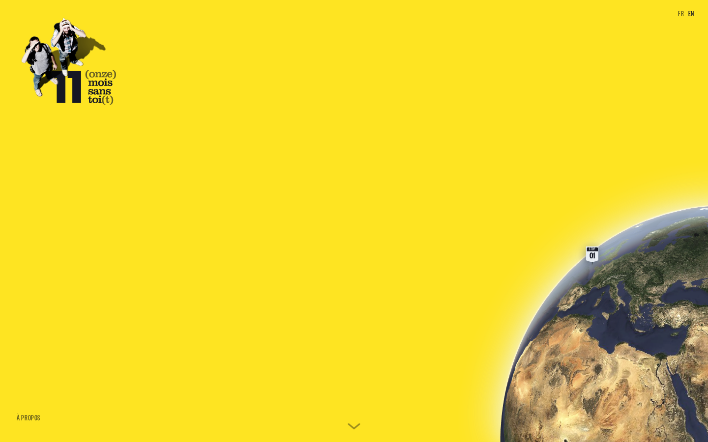

# UI Design System & Master Generation Blueprint: 11moissanstoit-com

> **11 mois sans toi(t), le tour du monde de Josué & Philippe** (https://11moissanstoit.com/) — Tour du monde autobiographique 2010-2011 de Josué & Philippe. 11 mois, des dizaines d'étapes, des milliers de tweets, de photos et de sou...



---

## 1. Executive Visual Persona & Design Archetype

- **Brand Essence & Persona**: **11 mois sans toi(t), le tour du monde de Josué & Philippe** (`https://11moissanstoit.com/`). Tour du monde autobiographique 2010-2011 de Josué & Philippe. 11 mois, des dizaines d'étapes, des milliers de tweets, de photos et de sou...
- **Capture Provenance**: Live browser capture (`tier1_fast`, HTTP `200`, captured `2026-11-23`).
- **Visual Archetype**: **Light-Gallery WebGL / Canvas Interactive Experience (`#fee422` / `#151723`)**.
- **Anti-AI-Slop Differentiators**:
  - **Live-Computed Chromatic Polarity**: Anchors the viewport in `#fee422` (live computed `body` `background-color` (`computed_styles.json`)) paired with `#000000` primary typography and `#151723` accents.
  - **Grounded Typographic Hierarchy**: Pairs `Founders Grotesk X-Condensed` for display copy (`11 mois sans toi(t), le tour du mond`) with `Founders Grotesk X-Condensed` and `SFMono-Regular`.
  - **Calibrated Spatial Grid & Motion**: Combines `1180px` container bounds (`gap: .25rem`, padding `.5rem`) with `cubic-bezier(.4,0,.6,1)` easing and Three.js / WebGL Canvas Pipeline.

---

## 2. Spatial Architecture & Modular Grid Mathematics


### Viewport Allocation & Container Geometry
- **Captured Viewport Dimensions**: Desktop `1440×900px` (`assets/desktop.png`, single-viewport 100vh live capture (900px)), Mobile `390×844px` (`assets/mobile.png`, single-viewport 100vh live capture (844px)).
- **Master Container Bounds**: `1180px` (measured widest bounded `<section>` landmark width on `1440px` desktop).
- **Canvas Lateral Padding & Spacing**: `.5rem` lateral canvas padding with `.25rem` grid gap.
- **Border Radius Scale**: `.25rem`, `10px`, `12px`, `15px`.

### Responsive Breakpoint Architecture
- **Desktop Layout**: Multi-column CSS Grid / Flexbox layout at `1440px` (`max-width: 1180px`, `gap: .25rem`).
- **Mobile Layout**: Single-column vertical stack at `390px` viewport width with `.5rem` horizontal padding.
- **Extracted CSS Media Queries**: `@media (min-width:640px)`, `@media (min-width:768px)`, `@media (min-width:1024px)`, `@media (min-width:1280px)`.

---

## 3. Color System, Materiality & Atmospheric Lighting

### Semantic Palette & Source Grounding
| Semantic Role | Ground-Truth Value | Extracted Live / CSS Source |
|---|---|---|
| **Primary Canvas Substrate** | `#fee422` | live computed `body` `background-color` (`computed_styles.json`) |
| **Primary Typography Ink** | `#000000` | live computed `a` `color` (`computed_styles.json`) |
| **Elevated Surface / Card Substrate** | `#c7cedb` | `.img-wait-logo:after { background-color: #c7cedb }` |
| **Interactive Accent / Highlight** | `#151723` | live computed `button` `color` (`computed_styles.json`) |
| **Secondary / Muted Copy** | `#151723` | live computed `p` `color` (`computed_styles.json`) |
| **Structural Hairline Border** | `#dbc522` | `15 { border-color: #dbc522 }` |
| **Variable Token (`--white-clear`)** | `#ffffff` | `var(--white-clear)` in `:root` |
| **Variable Token (`--medium-blue-grey`)** | `#92939d` | `var(--medium-blue-grey)` in `:root` |
| **Variable Token (`--hyper-light-blue-grey`)** | `#e8edf3` | `var(--hyper-light-blue-grey)` in `:root` |
| **Variable Token (`--brown-yellow-bright`)** | `#d1c658` | `var(--brown-yellow-bright)` in `:root` |
| **Variable Token (`--blue-notif`)** | `#3acfe1` | `var(--blue-notif)` in `:root` |

### Sanitized Root CSS Variables (`ui-ux.md` Ground Truth)
| Variable Name | Extracted Value | Semantic Role |
|---|---|---|
| `--primary-yellow` | `#fee422` | Brand / Palette Token |
| `--dark-blue` | `#151723` | Canvas / Surface Token |
| `--white-clear` | `#fff` | Canvas / Surface Token |
| `--medium-blue-grey` | `#92939d` | Color / Atmospheric Token |
| `--hyper-light-blue-grey` | `#e8edf3` | Canvas / Surface Token |
| `--brown-yellow-bright` | `#d1c658` | Color / Atmospheric Token |
| `--blue-notif` | `#3acfe1` | Color / Atmospheric Token |
| `--background` | `#fee422` | Canvas / Surface Token |
| `--foreground` | `#151723` | Typography Ink Token |
| `--tw-border-spacing-x` | `0` | Layout / Spatial Grid Token |
| `--tw-border-spacing-y` | `0` | Layout / Spatial Grid Token |
| `--tw-translate-x` | `0` | Design System Custom Token |
| `--tw-translate-y` | `0` | Design System Custom Token |
| `--tw-rotate` | `0` | Design System Custom Token |
| `--11moissanstoit-c-bg` | `#fee422` | Canvas Substrate (from live computed `body` `background-color` (`computed_styles.json`)) |
| `--11moissanstoit-c-ink` | `#000000` | Primary Typography Ink (computed-derived) |

---

## 4. Typographic Scale & Editorial Hierarchy

### Font Family Stacks
- **Display Typography**: `Founders Grotesk X-Condensed`.
- **Primary Body Stack**: `Founders Grotesk X-Condensed`.
- **Technical / Metadata Stack**: `SFMono-Regular`.

### Typographic Scale & Rules (Live Computed & Stylesheet Grounded)
- **Hero Display (`H1`)**: observed font-size ladder: `16px`, `120px`, `12px`, `1em`, `80%`.
- **Section Heading (`H2`)**: observed font-size ladder: `16px`, `120px`, `12px`, `1em`, `80%`.
- **Body Copy**: live computed `body` (`font-size: 16px`, `line-height: 24px`, `font-weight: 400`).
- **Metadata & Navigation Labels**: live computed `nav/a` (`font-size: 12px`, `line-height: 20px`, `font-weight: 400`).

---

## 5. Choreographed Motion & Interaction Physics

### Primary Easing Curves
- **Extracted Timing Functions**: `cubic-bezier(.4,0,.6,1)`, `cubic-bezier(.4,0,.2,1)`, `cubic-bezier(.4,0,1,1)`.

### Per-Element Transition & Choreography Rules
- **Selector `.transition`**: `transition: .15s` extracted from `11moissanstoit-com` stylesheet.
- **Selector `opacity\]`**: `transition: .15s` extracted from `11moissanstoit-com` stylesheet.
- **Selector `transform\]`**: `transition: .15s` extracted from `11moissanstoit-com` stylesheet.
- **Extracted Easing Curve (`cubic-bezier(.4,0,.6,1)`)**: Governs interactive state transitions across `<header.h-full>` and `<section.font-medium>`.
- **Runtime Interaction Engine**: Integrates Three.js / WebGL Canvas Pipeline with `prefers-reduced-motion: reduce` fallback guards.

---

## 6. Component Wireframe & Structural DOM Map

### Visual Layout Schematic — Desktop (`1440px`, Grounded in `dom.html` & Landmark Bounding Boxes)
```
┌────────────────────────────────────────────────────────────────────────┐
│ DESKTOP VIEWPORT (1440px) — 11 mois sans toi(t), le tour du monde de J │
│ ====================================================================== │
│ [ <header.h-full> (1440px)            | MapLibre · EOxCloudless 2024 ] │
│ ---------------------------------------------------------------------- │
│ | HERO STAGE: <section.font-condensed> (w=1440px)                    | │
│ | H1: 11 mois sans toi(t), le tour du monde de Josué &               | │
│ | Substrate: #fee422 | Ink: #000000 | Accent: #151723                | │
│ ---------------------------------------------------------------------- │
│ | SHOWCASE GRID (<section.font-medium>) max-w: 1180px                | │
│ | +------------------------------+  +------------------------------+ | │
│ | | Featured Work & Interactive  |  | Technical Architecture & Nar | | │
│ | +------------------------------+  +------------------------------+ | │
│ ---------------------------------------------------------------------- │
│ | DETAIL MODULE (<section.uppercase>) — Global Directory & Co        | │
│ ---------------------------------------------------------------------- │
│ [ FOOTER (<footer.inset-0>    ) | https://11moissanstoit.com/          │
└────────────────────────────────────────────────────────────────────────┘
```

### Visual Layout Schematic — Mobile Reflow (`390px`)
```
┌────────────────────────────────────────────────────────────────────────┐
│ MOBILE VIEWPORT REFLOW (390px) — Single-Column Stack (gap: .25rem)     │
│ ====================================================================== │
│ [ HEADER BAR (<header.h-full>         ) | Compact Menu (390px)         │
│ ---------------------------------------------------------------------- │
│ | HERO STAGE (<section.font-condensed>) — 390px Vertical Lead        | │
│ | H1: 11 mois sans toi(t), le tour du monde de Josué &               | │
│ ---------------------------------------------------------------------- │
│ | SHOWCASE STACK (<section.font-medium>) — 1-Col Stack               | │
│ | [ Item 1: Featured Work & Interactive Showcase                   ] | │
│ | [ Item 2: Technical Architecture & Narrative                     ] | │
│ ---------------------------------------------------------------------- │
│ | DETAIL STACK (<section.uppercase>) — 1-Col (Global Directory &)    | │
│ ---------------------------------------------------------------------- │
│ [ FOOTER (<footer.inset-0>    ) | Stacked 390px Colophon               │
└────────────────────────────────────────────────────────────────────────┘
```

### Granular DOM Region Breakdown
1. **Brand Header & Navigation Bar (<header.h-full> — `11moissanstoit-com`)**:
   - Landmark `<header class="h-full">` (`1440px`) hosting `11 mois sans toi(t), le tour du mond` navigation (`MapLibre · EOxCloudless 2024 · CC BY-NC-SA · OpenFreeMap · © OpenMapTiles`), DOM attributes (`data-precedence="next"`, `data-sdkn="@vercel/analytics/next"`, `data-sdkv="2.0.1"`, `data-disable-auto-track="1"`), and stylesheet rule `after { box-sizing:border-box;border:0 solid e5e7eb }`.
2. **Hero Stage & Focal Lead (<section.font-condensed> — `11 mois sans toi(t), le tour du mo`)**:
   - Landmark `<section class="font-condensed font-medium">` presenting display lead `11 mois sans toi(t), le tour du monde de Josué &` and copy excerpt *"OCTOBER 2010. PHILIPPE AND JOSUÉ, TWO CHILDHOOD FRIENDS, MAKE THE"* over `#fee422` canvas and `#000000` ink.
3. **Primary Showcase & Content Grid (<section.font-medium> — `Featured Work & Interactive Showca`)**:
   - Landmark `<section class="font-condensed font-medium">` rendering section `Featured Work & Interactive Showcase` with copy *"October 2010. Philippe and Josué , two childhood friends, make th"*, asset references (`logo-vecto.svg`, `photoLogo_11moissanstoi.png`, `2_er3-xpipny2.css`, `3cwyw8ne2vg7_.js`), and grid rule `body { line-height:inherit;margin:0 }`.
4. **Interactive Detail & Feature Matrix (<section.uppercase> — `Technical Architecture & Narrative`)**:
   - Landmark `<section class="font-condensed font-medium">` framing `Technical Architecture & Narrative` and `Global Directory & Contact` (*"a journey told in real time through their digital footprints, on "*) with `#c7cedb` surface cards, `#151723` accents, and `strong { font-weight:bolder }`.
5. **Colophon & Global Directory Footer (<footer.inset-0> — `https://11moissanstoit.com/`)**:
   - Landmark `<footer class="inset-0">` anchoring `11 mois sans toi(t), le tour du ` footer links (`MapLibre · EOxCloudless 2024 · CC BY-NC-SA · OpenFreeMap · © OpenMapTiles`), copy *"15 years later, for the anniversary of our return (August 24"*, and `#dbc522` structural dividers.

---

## 7. Master Zero-Shot AI Generation Prompt

```markdown
# Master Zero-Shot Frontend Generation Prompt: 11moissanstoit-com (11 mois sans toi(t), le tour du monde de Josué & Philippe)

You are a principal frontend architect and design systems engineer. Build a complete, production-ready web application replicating the exact design system, DOM landmarks, typographic hierarchy, color tokens, and motion physics of `11moissanstoit-com` (**11 mois sans toi(t), le tour du monde de Josué & Philippe** — `https://11moissanstoit.com/`).

### 1. Visual Archetype & Anti-AI-Slop Mandates
- **Archetype**: Light-Gallery WebGL / Canvas Interactive Experience (`#fee422` / `#151723`).
- **Identity & Domain Context**: Tour du monde autobiographique 2010-2011 de Josué & Philippe. 11 mois, des dizaines d'étapes, des milliers de tweets, de photos et de sou...
- **Primary Substrate**: `#fee422` (live computed `body` `background-color` (`computed_styles.json`)), **Primary Ink**: `#000000`, **Accent / Highlight**: `#151723`.
- **Site-Specific Differentiators**:
  - **Live-Computed Chromatic Polarity**: Anchors the viewport in `#fee422` (live computed `body` `background-color` (`computed_styles.json`)) paired with `#000000` primary typography and `#151723` accents.
  - **Grounded Typographic Hierarchy**: Pairs `Founders Grotesk X-Condensed` for display copy (`11 mois sans toi(t), le tour du mond`) with `Founders Grotesk X-Condensed` and `SFMono-Regular`.
  - **Calibrated Spatial Grid & Motion**: Combines `1180px` container bounds (`gap: .25rem`, padding `.5rem`) with `cubic-bezier(.4,0,.6,1)` easing and Three.js / WebGL Canvas Pipeline.

### 2. Ground-Truth CSS Variables (`:root` Token Contract)
Declare and consume these exact custom properties extracted from `11moissanstoit-com` in your global stylesheet:

:root {
  /* 11 mois sans toi(t), le tour du monde de Josué & Philippe (11moissanstoit-com) — Live-Grounded CSS Variables */
  --primary-yellow: #fee422; /* Brand / Palette Token (11moissanstoit-com) */
  --dark-blue: #151723; /* Canvas / Surface Token (11moissanstoit-com) */
  --white-clear: #fff; /* Canvas / Surface Token (11moissanstoit-com) */
  --medium-blue-grey: #92939d; /* Color / Atmospheric Token (11moissanstoit-com) */
  --hyper-light-blue-grey: #e8edf3; /* Canvas / Surface Token (11moissanstoit-com) */
  --brown-yellow-bright: #d1c658; /* Color / Atmospheric Token (11moissanstoit-com) */
  --blue-notif: #3acfe1; /* Color / Atmospheric Token (11moissanstoit-com) */
  --background: #fee422; /* Canvas / Surface Token (11moissanstoit-com) */
  --foreground: #151723; /* Typography Ink Token (11moissanstoit-com) */
  --tw-border-spacing-x: 0; /* Layout / Spatial Grid Token (11moissanstoit-com) */
  --tw-border-spacing-y: 0; /* Layout / Spatial Grid Token (11moissanstoit-com) */
  --tw-translate-x: 0; /* Design System Custom Token (11moissanstoit-com) */
  --tw-translate-y: 0; /* Design System Custom Token (11moissanstoit-com) */
  --tw-rotate: 0; /* Design System Custom Token (11moissanstoit-com) */
  --11moissanstoit-c-bg: #fee422; /* Canvas Substrate (from live computed `body` `background-color` (`computed_styles.json`)) (11moissanstoit-com) */
  --11moissanstoit-c-ink: #000000; /* Primary Typography Ink (computed-derived) (11moissanstoit-com) */
}

### 3. Semantic Color & Materiality Contract
Map every surface, ink, and border strictly to these source-grounded tokens:
- **Primary Canvas Substrate**: `#fee422` — grounded in live computed `body` `background-color` (`computed_styles.json`)
- **Primary Typography Ink**: `#000000` — grounded in live computed `a` `color` (`computed_styles.json`)
- **Elevated Surface / Card Substrate**: `#c7cedb` — grounded in `.img-wait-logo:after { background-color: #c7cedb }`
- **Interactive Accent / Highlight**: `#151723` — grounded in live computed `button` `color` (`computed_styles.json`)
- **Secondary / Muted Copy**: `#151723` — grounded in live computed `p` `color` (`computed_styles.json`)
- **Structural Hairline Border**: `#dbc522` — grounded in `15 { border-color: #dbc522 }`
- **Variable Token (`--white-clear`)**: `#ffffff` — grounded in `var(--white-clear)` in `:root`
- **Variable Token (`--medium-blue-grey`)**: `#92939d` — grounded in `var(--medium-blue-grey)` in `:root`
- **Variable Token (`--hyper-light-blue-grey`)**: `#e8edf3` — grounded in `var(--hyper-light-blue-grey)` in `:root`
- **Variable Token (`--brown-yellow-bright`)**: `#d1c658` — grounded in `var(--brown-yellow-bright)` in `:root`
- **Variable Token (`--blue-notif`)**: `#3acfe1` — grounded in `var(--blue-notif)` in `:root`

### 4. Spatial Grid, Container Bounds & Responsive Breakpoints
- **Desktop Viewport Reference**: `1440×900px` (single-viewport 100vh live capture (900px), `1440px` standard desktop width).
- **Mobile Viewport Reference**: `390×844px` (single-viewport 100vh live capture (844px), `390px` standard mobile width).
- **Container Max-Width**: `1180px` (measured widest bounded `<section>` landmark width on `1440px` desktop)
- **Padding & Gutters**: `.5rem` lateral canvas padding with `.25rem` grid gap
- **Desktop Grid**: Multi-column CSS Grid / Flexbox layout at `1440px` (`max-width: 1180px`, `gap: .25rem`)
- **Mobile Adaptation**: Single-column vertical stack at `390px` viewport width with `.5rem` horizontal padding
- **Media Queries**: `@media (min-width:640px)`, `@media (min-width:768px)`, `@media (min-width:1024px)`, `@media (min-width:1280px)`
- **Corner Radii**: `.25rem`, `10px`, `12px`, `15px`

### 5. Typography & Editorial Scale Contract
- **Display Font Stack**: `Founders Grotesk X-Condensed`
- **Body Font Stack**: `Founders Grotesk X-Condensed`
- **Monospace / Technical Font Stack**: `SFMono-Regular`
- **H1 Display Rule**: observed font-size ladder: `16px`, `120px`, `12px`, `1em`, `80%`
- **H2 Section Rule**: observed font-size ladder: `16px`, `120px`, `12px`, `1em`, `80%`
- **Body Copy Rule**: live computed `body` (`font-size: 16px`, `line-height: 24px`, `font-weight: 400`)
- **Metadata & Index Rule**: live computed `nav/a` (`font-size: 12px`, `line-height: 20px`, `font-weight: 400`)

### 6. Component Hierarchy, Verbatim Copy & Real DOM Landmarks
Scaffold `11moissanstoit-com` (`11 mois sans toi(t), le tour du monde de Josué & Philippe`) with these exact structural regions, extracted copy, and CSS rules from `dom.html`:
1. **Brand Header & Navigation Bar (<header.h-full> — `11moissanstoit-com`)**:
   - DOM & Selectors: Landmark `<header class="h-full">` (`1440px`) hosting `11 mois sans toi(t), le tour du mond` navigation (`MapLibre · EOxCloudless 2024 · CC BY-NC-SA · OpenFreeMap · © OpenMapTiles`), DOM attributes (`data-precedence="next"`, `data-sdkn="@vercel/analytics/next"`, `data-sdkv="2.0.1"`, `data-disable-auto-track="1"`), and stylesheet rule `after { box-sizing:border-box;border:0 solid e5e7eb }`.
   - Responsive Contract: Header `Brand Header & Navigation Bar (<header.h-full> — `11moissanstoit-com`)` (`11moissanstoit-com`) adapts across `@media (min-width:640px)`, `@media (min-width:768px)`, `@media (min-width:1024px)`, `@media (min-width:1280px)` with `cubic-bezier(.4,0,.6,1)`, `cubic-bezier(.4,0,.2,1)`, `cubic-bezier(.4,0,1,1)` transitions and links `MapLibre · EOxCloudless 2024 · CC BY-NC-SA · OpenFreeMap · © OpenMapTiles`.
2. **Hero Stage & Focal Lead (<section.font-condensed> — `11 mois sans toi(t), le tour du mo`)**:
   - DOM & Selectors: Landmark `<section class="font-condensed font-medium">` presenting display lead `11 mois sans toi(t), le tour du monde de Josué &` and copy excerpt *"OCTOBER 2010. PHILIPPE AND JOSUÉ, TWO CHILDHOOD FRIENDS, MAKE THE"* over `#fee422` canvas and `#000000` ink.
   - Responsive Contract: Hero stage (`1440×900px` desktop / `390×844px` mobile) sets `#fee422` background with `#000000` headline `11 mois sans toi(t), le tour du monde de Josué &`.
3. **Primary Showcase & Content Grid (<section.font-medium> — `Featured Work & Interactive Showca`)**:
   - DOM & Selectors: Landmark `<section class="font-condensed font-medium">` rendering section `Featured Work & Interactive Showcase` with copy *"October 2010. Philippe and Josué , two childhood friends, make th"*, asset references (`logo-vecto.svg`, `photoLogo_11moissanstoi.png`, `2_er3-xpipny2.css`, `3cwyw8ne2vg7_.js`), and grid rule `body { line-height:inherit;margin:0 }`.
   - Responsive Contract: Showcase grid `Primary Showcase & Content Grid (<section.font-medium> — `Featured Work & Interactive Showca`)` applies Multi-column CSS Grid / Flexbox layout at `1440px` (`max-width: 1180px`, `gap: .25rem`) on desktop and Single-column vertical stack at `390px` viewport width with `.5rem` horizontal padding on mobile.
4. **Interactive Detail & Feature Matrix (<section.uppercase> — `Technical Architecture & Narrative`)**:
   - DOM & Selectors: Landmark `<section class="font-condensed font-medium">` framing `Technical Architecture & Narrative` and `Global Directory & Contact` (*"a journey told in real time through their digital footprints, on "*) with `#c7cedb` surface cards, `#151723` accents, and `strong { font-weight:bolder }`.
   - Responsive Contract: Detail module `Interactive Detail & Feature Matrix (<section.uppercase> — `Technical Architecture & Narrative`)` uses `.25rem`, `10px`, `12px`, `15px` radii, `#151723` highlights, and assets (logo-vecto.svg, photoLogo_11moissanstoi.png, 2_er3-xpipny2.css).
5. **Colophon & Global Directory Footer (<footer.inset-0> — `https://11moissanstoit.com/`)**:
   - DOM & Selectors: Landmark `<footer class="inset-0">` anchoring `11 mois sans toi(t), le tour du ` footer links (`MapLibre · EOxCloudless 2024 · CC BY-NC-SA · OpenFreeMap · © OpenMapTiles`), copy *"15 years later, for the anniversary of our return (August 24"*, and `#dbc522` structural dividers.
   - Responsive Contract: Footer `Colophon & Global Directory Footer (<footer.inset-0> — `https://11moissanstoit.com/`)` aligns to `1180px` (measured widest bounded `<section>` landmark width on `1440px` desktop) with `.5rem` lateral canvas padding with `.25rem` grid gap and attributes (data-precedence="next", data-sdkn="@vercel/analytics/next", data-sdkv="2.0.1").

#### Verbatim DOM Copy Excerpts (`dom.html`)
- Copy Excerpt 1: *"OCTOBER 2010. PHILIPPE AND JOSUÉ, TWO CHILDHOOD FRIENDS, MAKE THEIR CHILDHOOD DREA..."*
- Copy Excerpt 2: *"October 2010. Philippe and Josué , two childhood friends, make their childhood dre..."*
- Copy Excerpt 3: *"a journey told in real time through their digital footprints, on a flash website:..."*
- Copy Excerpt 4: *"15 years later, for the anniversary of our return (August 24, 2011), this site is..."*

### 7. Motion, Extracted Stylesheet Rules & Interaction Choreography
- **Primary Easing Functions**: `cubic-bezier(.4,0,.6,1)`, `cubic-bezier(.4,0,.2,1)`, `cubic-bezier(.4,0,1,1)`
- **Extracted Stylesheet Rules (`11moissanstoit-com`)**:
- `after { box-sizing:border-box;border:0 solid e5e7eb }`
- `body { line-height:inherit;margin:0 }`
- `strong { font-weight:bolder }`
- `small { font-size:80% }`
- `sup { vertical-align:baseline;font-size:75%;line-height:0;position:relative }`
- **Per-Selector Transition Rules**:
- **Selector `.transition`**: `transition: .15s` extracted from `11moissanstoit-com` stylesheet.
- **Selector `opacity\]`**: `transition: .15s` extracted from `11moissanstoit-com` stylesheet.
- **Selector `transform\]`**: `transition: .15s` extracted from `11moissanstoit-com` stylesheet.
- **Extracted Easing Curve (`cubic-bezier(.4,0,.6,1)`)**: Governs interactive state transitions across `<header.h-full>` and `<section.font-medium>`.
- **Runtime Interaction Engine**: Integrates Three.js / WebGL Canvas Pipeline with `prefers-reduced-motion: reduce` fallback guards.

### 8. Technical Deliverables
- Implement in Next.js (App Router) with TypeScript and Tailwind CSS consuming the `:root` custom properties defined above for `11moissanstoit-com`.
- Reproduce both the `1440px` desktop architecture and `390px` mobile breakpoint transitions, preserving semantic HTML5 landmarks (`<header>`, `<nav>`, `<main>`, `<section>`, `<footer>`) and `prefers-reduced-motion` accessibility guards.
```
