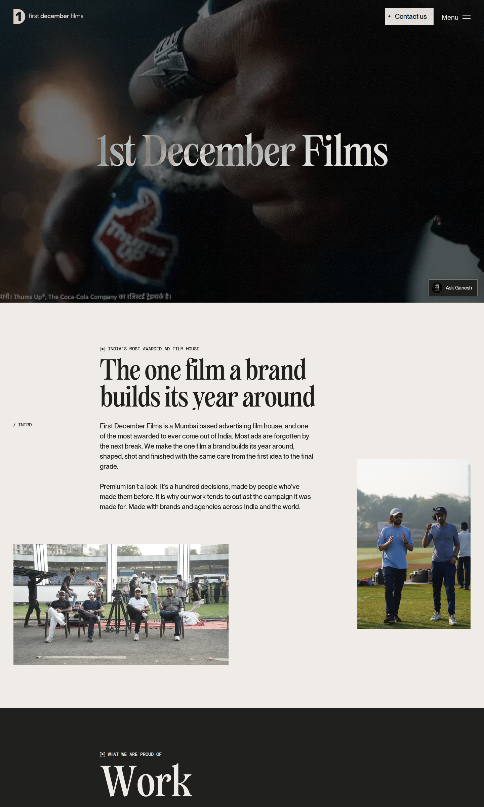

# UI Design System & Master Generation Blueprint: 1stdecember-com

> **First December Films · Ad Film Production House in India** (https://1stdecember.com) — Mumbai advertising film production house with 150+ international awards. TVCs, brand films and digital campaigns for brands across India...



---

## 1. Executive Visual Persona & Design Archetype

- **Brand Essence & Persona**: **First December Films · Ad Film Production House in India** (`https://1stdecember.com`). Mumbai advertising film production house with 150+ international awards. TVCs, brand films and digital campaigns for brands across India...
- **Capture Provenance**: Live browser capture (`tier1_fast`, HTTP `200`, captured `2026-11-23`).
- **Visual Archetype**: **Light-Substrate Editorial & Modular Grid System (`#efece7` canvas, `#20201e` ink, `#ffff00` accent)**.
- **Anti-AI-Slop Differentiators**:
  - **Live-Computed Chromatic Polarity**: Anchors the viewport in `#efece7` (live computed `body` `background-color` (`computed_styles.json`)) paired with `#20201e` primary typography and `#ffff00` accents.
  - **Grounded Typographic Hierarchy**: Pairs `Tartuffo Trial Regular` for display copy (`1st December Films`) with `Pp neue montreal Medium` and `DM Mono Medium`.
  - **Calibrated Spatial Grid & Motion**: Combines `64em` container bounds (`gap: 96px`, padding `40px`) with `cubic-bezier(1,0,0,1)` easing and Lenis Smooth Scroll (`data-lenis`), GSAP Timeline & ScrollTrigger.

---

## 2. Spatial Architecture & Modular Grid Mathematics


### Viewport Allocation & Container Geometry
- **Captured Viewport Dimensions**: Desktop `1440×2400px` (`assets/desktop.png`, clamped at 2400px live multi-section capture), Mobile `390×2400px` (`assets/mobile.png`, clamped at 2400px live multi-section capture).
- **Master Container Bounds**: `64em` (non-`@media` desktop container stylesheet rule).
- **Canvas Lateral Padding & Spacing**: `40px` lateral canvas padding with `96px` grid gap.
- **Border Radius Scale**: `3px`, `100%`, `50%`, `2px`.

### Responsive Breakpoint Architecture
- **Desktop Layout**: Multi-column CSS Grid / Flexbox layout at `1440px` (`max-width: 64em`, `gap: 96px`).
- **Mobile Layout**: Single-column vertical stack at `390px` viewport width with `40px` horizontal padding.
- **Extracted CSS Media Queries**: `@media screen and (max-width:991px)`, `@media screen and (max-width:767px)`, `@media screen and (max-width:479px)`, `@media (min-width:768px)`.

---

## 3. Color System, Materiality & Atmospheric Lighting

### Semantic Palette & Source Grounding
| Semantic Role | Ground-Truth Value | Extracted Live / CSS Source |
|---|---|---|
| **Primary Canvas Substrate** | `#efece7` | live computed `body` `background-color` (`computed_styles.json`) |
| **Primary Typography Ink** | `#20201e` | live computed `main` `color` (`computed_styles.json`) |
| **Elevated Surface / Card Substrate** | `#ffff00` | `mark { background: #ffff00 }` |
| **Interactive Accent / Highlight** | `#ffff00` | `.cta_blog_post { background-color: yellow }` (`#ffff00`) |
| **Secondary / Muted Copy** | `#999999` | `.w-select::placeholder { color: #999999 }` |
| **Structural Hairline Border** | `#e2e2e2` | `blockquote { border-left: #e2e2e2 }` |

### Sanitized Root CSS Variables (`ui-ux.md` Ground Truth)
| Variable Name | Extracted Value | Semantic Role |
|---|---|---|
| `--brand--white-light` | `#efece7` | Canvas / Surface Token |
| `--font-family--body` | `"Pp neue montreal Medium",Arial,sans-serif` | Typography / Scale Token |
| `--_theme---text--primary` | `var(--brand--black-dark)` | Typography Ink Token |
| `--_typography---body--body-font-size` | `1rem` | Typography / Scale Token |
| `--_typography---body--body-line-height` | `var(--font-height--xlarge)` | Typography / Scale Token |
| `--_typography---body--body-font-weight` | `var(--font-weight--normal)` | Typography / Scale Token |
| `--_typography---body--body-letter-spacing` | `var(--letter-spacing--default)` | Typography / Scale Token |
| `--_layout---spacing--none` | `0rem` | Layout / Spatial Grid Token |
| `--font-family--heading` | `"Tartuffo Trial Regular",Arial,sans-serif` | Typography Ink Token |
| `--_typography---h1--h1-font-size` | `7.5rem` | Typography / Scale Token |
| `--_typography---h1--h1-line-height` | `var(--font-height--tiny)` | Typography / Scale Token |
| `--_typography---h1--h1-font-weight` | `var(--font-weight--normal)` | Typography / Scale Token |
| `--_typography---h1--h1-letter-spacing` | `var(--letter-spacing--tighter)` | Typography / Scale Token |
| `--_typography---h2--h2-font-size` | `5rem` | Typography / Scale Token |
| `--_typography---h2--h2-line-height` | `var(--font-height--tiny)` | Typography / Scale Token |
| `--_typography---h2--h2-font-weight` | `var(--font-weight--normal)` | Typography / Scale Token |

---

## 4. Typographic Scale & Editorial Hierarchy

### Font Family Stacks
- **Display Typography**: `Tartuffo Trial Regular`.
- **Primary Body Stack**: `Pp neue montreal Medium`.
- **Technical / Metadata Stack**: `DM Mono Medium`.

### Typographic Scale & Rules (Live Computed & Stylesheet Grounded)
- **Hero Display (`H1`)**: live computed `h1` (`font-size: 120px`, `line-height: 120px`, `font-weight: 400`, `letter-spacing: -2.4px`); CSS variables `--_typography---h1--h1-font-size: 7.5rem`, `--_typography---h1--h1-line-height: var(--font-height--tiny)`, `--_typography---h1--h1-font-weight: var(--font-weight--normal)`.
- **Section Heading (`H2`)**: live computed `h3 (primary section heading)` (`font-size: 80px`, `line-height: 80px`, `font-weight: 400`, `letter-spacing: -1.6px`); CSS variables `--_typography---h2--h2-font-size: 5rem`, `--_typography---h2--h2-line-height: var(--font-height--tiny)`, `--_typography---h2--h2-font-weight: var(--font-weight--normal)`.
- **Body Copy**: live computed `body` (`font-size: 16px`, `line-height: 24px`, `font-weight: 400`); CSS variables `--font-family--body: "Pp neue montreal Medium",Arial,sans-serif`, `--_typography---body--body-font-size: 1rem`, `--_typography---body--body-line-height: var(--font-height--xlarge)`.
- **Metadata & Navigation Labels**: live computed `nav/a` (`font-size: 16px`, `line-height: 24px`, `font-weight: 400`); CSS variables `--_typography---body--body-letter-spacing: var(--letter-spacing--default)`, `--_typography---h1--h1-letter-spacing: var(--letter-spacing--tighter)`, `--_typography---h2--h2-letter-spacing: var(--letter-spacing--tighter)`.

---

## 5. Choreographed Motion & Interaction Physics

### Primary Easing Curves
- **Extracted Timing Functions**: `cubic-bezier(1,0,0,1)`, `cubic-bezier(.645,.045,.355,1)`, `cubic-bezier(0.32,0.72,0,1)`.

### Per-Element Transition & Choreography Rules
- **Selector `.w-webflow-badge>img`**: `transition: unset` extracted from `1stdecember-com` stylesheet.
- **Selector `.w-slider-dot`**: `transition: background-color .1s,color .1s` extracted from `1stdecember-com` stylesheet.
- **Selector `.w-lightbox-control`**: `transition: all .3s` extracted from `1stdecember-com` stylesheet.
- **Extracted Easing Curve (`cubic-bezier(1,0,0,1)`)**: Governs interactive state transitions across `<header.underlay-nav__header>` and `<section.section_work>`.
- **Runtime Interaction Engine**: Integrates Lenis Smooth Scroll (`data-lenis`), GSAP Timeline & ScrollTrigger, Swiper Touch Carousel Engine with `prefers-reduced-motion: reduce` fallback guards.

---

## 6. Component Wireframe & Structural DOM Map

### Visual Layout Schematic — Desktop (`1440px`, Grounded in `dom.html` & Landmark Bounding Boxes)
```
┌────────────────────────────────────────────────────────────────────────┐
│ DESKTOP VIEWPORT (1440px) — First December Films · Ad Film Production  │
│ ====================================================================== │
│ [ <header.underlay-nav__ (1440x98px)  | Home · Work · Directors · Ab ] │
│ ---------------------------------------------------------------------- │
│ | HERO STAGE: <section.section_about> (w=1440px)                     | │
│ | H1: 1st December Films                                             | │
│ | Substrate: #efece7 | Ink: #20201e | Accent: #ffff00                | │
│ ---------------------------------------------------------------------- │
│ | SHOWCASE GRID (<section.section_work>) max-w: 64em                 | │
│ | +------------------------------+  +------------------------------+ | │
│ | | India's most awarded ad film |  | The one film a brand builds  | | │
│ | +------------------------------+  +------------------------------+ | │
│ ---------------------------------------------------------------------- │
│ | DETAIL MODULE (<section.section_team-home) — what we are proud of  | │
│ ---------------------------------------------------------------------- │
│ [ FOOTER (<footer.demo-footer>) | https://1stdecember.com              │
└────────────────────────────────────────────────────────────────────────┘
```

### Visual Layout Schematic — Mobile Reflow (`390px`)
```
┌────────────────────────────────────────────────────────────────────────┐
│ MOBILE VIEWPORT REFLOW (390px) — Single-Column Stack (gap: 96px)       │
│ ====================================================================== │
│ [ HEADER BAR (<header.underlay-nav__he) | Compact Menu (390px)         │
│ ---------------------------------------------------------------------- │
│ | HERO STAGE (<section.section_about>) — 390px Vertical Lead         | │
│ | H1: 1st December Films                                             | │
│ ---------------------------------------------------------------------- │
│ | SHOWCASE STACK (<section.section_work>) — 1-Col Stack              | │
│ | [ Item 1: India's most awarded ad film house                     ] | │
│ | [ Item 2: The one film a brand builds its year around            ] | │
│ ---------------------------------------------------------------------- │
│ | DETAIL STACK (<section.section_team-ho) — 1-Col (what we are proud ) │
│ ---------------------------------------------------------------------- │
│ [ FOOTER (<footer.demo-footer>) | Stacked 390px Colophon               │
└────────────────────────────────────────────────────────────────────────┘
```

### Granular DOM Region Breakdown
1. **Brand Header & Navigation Bar (<header.underlay-nav__header> — `1stdecember-com`)**:
   - Landmark `<header class="underlay-nav__header">` (`1440x98px`) hosting `First December Films · Ad Film Produ` navigation (`Home · Work · Directors · About · AI Ad Films`), DOM attributes (`data-wf-domain="1stdecember.com"`, `data-wf-page="6a530ef9dd045382387c1080"`, `data-wf-site="6a530ef3dd045382387c1010"`, `data-key="CANq2ndVhhRcE6Gj1ydbwg"`), and stylesheet rule `html { -webkit-text-size-adjust:100%;-ms-text-size-adjust:100%;font-family:sans... }`.
2. **Hero Stage & Focal Lead (<section.section_about> — `1st December Films`)**:
   - Landmark `<section class="section_about">` presenting display lead `1st December Films` and copy excerpt *"First December Films is a Mumbai based advertising film house, an"* over `#efece7` canvas and `#20201e` ink.
3. **Primary Showcase & Content Grid (<section.section_work> — `India's most awarded ad film house`)**:
   - Landmark `<section class="section_work">` rendering section `India's most awarded ad film house` with copy *"E x p l o r e A l l W o r k"*, asset references (`cdn.prod.website-files.com`, `first-december-films.webflow.shar...`, `6acdf9b670164716e898eb2d_fav%20we...`, `6acdf9b6d5ee9f500bdfb333_fav%20we...`), and grid rule `summary { display:block }`.
4. **Interactive Detail & Feature Matrix (<section.section_team-home> — `The one film a brand builds its ye`)**:
   - Landmark `<section class="section_team-home">` framing `The one film a brand builds its year around` and `what we are proud of` (*"Cannes Gold and Glass Lion winning producer, counted among the wo"*) with `#ffff00` surface cards, `#ffff00` accents, and `video { vertical-align:baseline;display:inline-block }`.
5. **Colophon & Global Directory Footer (<footer.demo-footer> — `https://1stdecember.com`)**:
   - Landmark `<footer class="demo-footer">` anchoring `First December Films · Ad Film P` footer links (`Home · Work · Directors · About · AI Ad Films`), copy *"Cannes Lions winning director (2014, 2016, 2017) and the onl"*, and `#e2e2e2` structural dividers.

---

## 7. Master Zero-Shot AI Generation Prompt

```markdown
# Master Zero-Shot Frontend Generation Prompt: 1stdecember-com (First December Films · Ad Film Production House in India)

You are a principal frontend architect and design systems engineer. Build a complete, production-ready web application replicating the exact design system, DOM landmarks, typographic hierarchy, color tokens, and motion physics of `1stdecember-com` (**First December Films · Ad Film Production House in India** — `https://1stdecember.com`).

### 1. Visual Archetype & Anti-AI-Slop Mandates
- **Archetype**: Light-Substrate Editorial & Modular Grid System (`#efece7` canvas, `#20201e` ink, `#ffff00` accent).
- **Identity & Domain Context**: Mumbai advertising film production house with 150+ international awards. TVCs, brand films and digital campaigns for brands across India...
- **Primary Substrate**: `#efece7` (live computed `body` `background-color` (`computed_styles.json`)), **Primary Ink**: `#20201e`, **Accent / Highlight**: `#ffff00`.
- **Site-Specific Differentiators**:
  - **Live-Computed Chromatic Polarity**: Anchors the viewport in `#efece7` (live computed `body` `background-color` (`computed_styles.json`)) paired with `#20201e` primary typography and `#ffff00` accents.
  - **Grounded Typographic Hierarchy**: Pairs `Tartuffo Trial Regular` for display copy (`1st December Films`) with `Pp neue montreal Medium` and `DM Mono Medium`.
  - **Calibrated Spatial Grid & Motion**: Combines `64em` container bounds (`gap: 96px`, padding `40px`) with `cubic-bezier(1,0,0,1)` easing and Lenis Smooth Scroll (`data-lenis`), GSAP Timeline & ScrollTrigger.

### 2. Ground-Truth CSS Variables (`:root` Token Contract)
Declare and consume these exact custom properties extracted from `1stdecember-com` in your global stylesheet:

:root {
  /* First December Films · Ad Film Production House in India (1stdecember-com) — Live-Grounded CSS Variables */
  --brand--white-light: #efece7; /* Canvas / Surface Token (1stdecember-com) */
  --font-family--body: "Pp neue montreal Medium",Arial,sans-serif; /* Typography / Scale Token (1stdecember-com) */
  --_theme---text--primary: var(--brand--black-dark); /* Typography Ink Token (1stdecember-com) */
  --_typography---body--body-font-size: 1rem; /* Typography / Scale Token (1stdecember-com) */
  --_typography---body--body-line-height: var(--font-height--xlarge); /* Typography / Scale Token (1stdecember-com) */
  --_typography---body--body-font-weight: var(--font-weight--normal); /* Typography / Scale Token (1stdecember-com) */
  --_typography---body--body-letter-spacing: var(--letter-spacing--default); /* Typography / Scale Token (1stdecember-com) */
  --_layout---spacing--none: 0rem; /* Layout / Spatial Grid Token (1stdecember-com) */
  --font-family--heading: "Tartuffo Trial Regular",Arial,sans-serif; /* Typography Ink Token (1stdecember-com) */
  --_typography---h1--h1-font-size: 7.5rem; /* Typography / Scale Token (1stdecember-com) */
  --_typography---h1--h1-line-height: var(--font-height--tiny); /* Typography / Scale Token (1stdecember-com) */
  --_typography---h1--h1-font-weight: var(--font-weight--normal); /* Typography / Scale Token (1stdecember-com) */
  --_typography---h1--h1-letter-spacing: var(--letter-spacing--tighter); /* Typography / Scale Token (1stdecember-com) */
  --_typography---h2--h2-font-size: 5rem; /* Typography / Scale Token (1stdecember-com) */
  --_typography---h2--h2-line-height: var(--font-height--tiny); /* Typography / Scale Token (1stdecember-com) */
  --_typography---h2--h2-font-weight: var(--font-weight--normal); /* Typography / Scale Token (1stdecember-com) */
}

### 3. Semantic Color & Materiality Contract
Map every surface, ink, and border strictly to these source-grounded tokens:
- **Primary Canvas Substrate**: `#efece7` — grounded in live computed `body` `background-color` (`computed_styles.json`)
- **Primary Typography Ink**: `#20201e` — grounded in live computed `main` `color` (`computed_styles.json`)
- **Elevated Surface / Card Substrate**: `#ffff00` — grounded in `mark { background: #ffff00 }`
- **Interactive Accent / Highlight**: `#ffff00` — grounded in `.cta_blog_post { background-color: yellow }` (`#ffff00`)
- **Secondary / Muted Copy**: `#999999` — grounded in `.w-select::placeholder { color: #999999 }`
- **Structural Hairline Border**: `#e2e2e2` — grounded in `blockquote { border-left: #e2e2e2 }`

### 4. Spatial Grid, Container Bounds & Responsive Breakpoints
- **Desktop Viewport Reference**: `1440×2400px` (clamped at 2400px live multi-section capture, `1440px` standard desktop width).
- **Mobile Viewport Reference**: `390×2400px` (clamped at 2400px live multi-section capture, `390px` standard mobile width).
- **Container Max-Width**: `64em` (non-`@media` desktop container stylesheet rule)
- **Padding & Gutters**: `40px` lateral canvas padding with `96px` grid gap
- **Desktop Grid**: Multi-column CSS Grid / Flexbox layout at `1440px` (`max-width: 64em`, `gap: 96px`)
- **Mobile Adaptation**: Single-column vertical stack at `390px` viewport width with `40px` horizontal padding
- **Media Queries**: `@media screen and (max-width:991px)`, `@media screen and (max-width:767px)`, `@media screen and (max-width:479px)`, `@media (min-width:768px)`
- **Corner Radii**: `3px`, `100%`, `50%`, `2px`

### 5. Typography & Editorial Scale Contract
- **Display Font Stack**: `Tartuffo Trial Regular`
- **Body Font Stack**: `Pp neue montreal Medium`
- **Monospace / Technical Font Stack**: `DM Mono Medium`
- **H1 Display Rule**: live computed `h1` (`font-size: 120px`, `line-height: 120px`, `font-weight: 400`, `letter-spacing: -2.4px`); CSS variables `--_typography---h1--h1-font-size: 7.5rem`, `--_typography---h1--h1-line-height: var(--font-height--tiny)`, `--_typography---h1--h1-font-weight: var(--font-weight--normal)`
- **H2 Section Rule**: live computed `h3 (primary section heading)` (`font-size: 80px`, `line-height: 80px`, `font-weight: 400`, `letter-spacing: -1.6px`); CSS variables `--_typography---h2--h2-font-size: 5rem`, `--_typography---h2--h2-line-height: var(--font-height--tiny)`, `--_typography---h2--h2-font-weight: var(--font-weight--normal)`
- **Body Copy Rule**: live computed `body` (`font-size: 16px`, `line-height: 24px`, `font-weight: 400`); CSS variables `--font-family--body: "Pp neue montreal Medium",Arial,sans-serif`, `--_typography---body--body-font-size: 1rem`, `--_typography---body--body-line-height: var(--font-height--xlarge)`
- **Metadata & Index Rule**: live computed `nav/a` (`font-size: 16px`, `line-height: 24px`, `font-weight: 400`); CSS variables `--_typography---body--body-letter-spacing: var(--letter-spacing--default)`, `--_typography---h1--h1-letter-spacing: var(--letter-spacing--tighter)`, `--_typography---h2--h2-letter-spacing: var(--letter-spacing--tighter)`

### 6. Component Hierarchy, Verbatim Copy & Real DOM Landmarks
Scaffold `1stdecember-com` (`First December Films · Ad Film Production House in India`) with these exact structural regions, extracted copy, and CSS rules from `dom.html`:
1. **Brand Header & Navigation Bar (<header.underlay-nav__header> — `1stdecember-com`)**:
   - DOM & Selectors: Landmark `<header class="underlay-nav__header">` (`1440x98px`) hosting `First December Films · Ad Film Produ` navigation (`Home · Work · Directors · About · AI Ad Films`), DOM attributes (`data-wf-domain="1stdecember.com"`, `data-wf-page="6a530ef9dd045382387c1080"`, `data-wf-site="6a530ef3dd045382387c1010"`, `data-key="CANq2ndVhhRcE6Gj1ydbwg"`), and stylesheet rule `html { -webkit-text-size-adjust:100%;-ms-text-size-adjust:100%;font-family:sans... }`.
   - Responsive Contract: Header `Brand Header & Navigation Bar (<header.underlay-nav__header> — `1stdecember-com`)` (`1stdecember-com`) adapts across `@media screen and (max-width:991px)`, `@media screen and (max-width:767px)`, `@media screen and (max-width:479px)`, `@media (min-width:768px)` with `cubic-bezier(1,0,0,1)`, `cubic-bezier(.645,.045,.355,1)`, `cubic-bezier(0.32,0.72,0,1)` transitions and links `Home · Work · Directors · About · AI Ad Films`.
2. **Hero Stage & Focal Lead (<section.section_about> — `1st December Films`)**:
   - DOM & Selectors: Landmark `<section class="section_about">` presenting display lead `1st December Films` and copy excerpt *"First December Films is a Mumbai based advertising film house, an"* over `#efece7` canvas and `#20201e` ink.
   - Responsive Contract: Hero stage (`1440×2400px` desktop / `390×2400px` mobile) sets `#efece7` background with `#20201e` headline `1st December Films`.
3. **Primary Showcase & Content Grid (<section.section_work> — `India's most awarded ad film house`)**:
   - DOM & Selectors: Landmark `<section class="section_work">` rendering section `India's most awarded ad film house` with copy *"E x p l o r e A l l W o r k"*, asset references (`cdn.prod.website-files.com`, `first-december-films.webflow.shar...`, `6acdf9b670164716e898eb2d_fav%20we...`, `6acdf9b6d5ee9f500bdfb333_fav%20we...`), and grid rule `summary { display:block }`.
   - Responsive Contract: Showcase grid `Primary Showcase & Content Grid (<section.section_work> — `India's most awarded ad film house`)` applies Multi-column CSS Grid / Flexbox layout at `1440px` (`max-width: 64em`, `gap: 96px`) on desktop and Single-column vertical stack at `390px` viewport width with `40px` horizontal padding on mobile.
4. **Interactive Detail & Feature Matrix (<section.section_team-home> — `The one film a brand builds its ye`)**:
   - DOM & Selectors: Landmark `<section class="section_team-home">` framing `The one film a brand builds its year around` and `what we are proud of` (*"Cannes Gold and Glass Lion winning producer, counted among the wo"*) with `#ffff00` surface cards, `#ffff00` accents, and `video { vertical-align:baseline;display:inline-block }`.
   - Responsive Contract: Detail module `Interactive Detail & Feature Matrix (<section.section_team-home> — `The one film a brand builds its ye`)` uses `3px`, `100%`, `50%`, `2px` radii, `#ffff00` highlights, and assets (cdn.prod.website-files.com, first-december-films.webflow.shar..., 6acdf9b670164716e898eb2d_fav%20we...).
5. **Colophon & Global Directory Footer (<footer.demo-footer> — `https://1stdecember.com`)**:
   - DOM & Selectors: Landmark `<footer class="demo-footer">` anchoring `First December Films · Ad Film P` footer links (`Home · Work · Directors · About · AI Ad Films`), copy *"Cannes Lions winning director (2014, 2016, 2017) and the onl"*, and `#e2e2e2` structural dividers.
   - Responsive Contract: Footer `Colophon & Global Directory Footer (<footer.demo-footer> — `https://1stdecember.com`)` aligns to `64em` (non-`@media` desktop container stylesheet rule) with `40px` lateral canvas padding with `96px` grid gap and attributes (data-wf-domain="1stdecember.com", data-wf-page="6a530ef9dd045382387c1080", data-wf-site="6a530ef3dd045382387c1010").

#### Verbatim DOM Copy Excerpts (`dom.html`)
- Copy Excerpt 1: *"First December Films is a Mumbai based advertising film house, and one of the most..."*
- Copy Excerpt 2: *"E x p l o r e A l l W o r k"*
- Copy Excerpt 3: *"Cannes Gold and Glass Lion winning producer, counted among the world’s top TV comm..."*
- Copy Excerpt 4: *"Cannes Lions winning director (2014, 2016, 2017) and the only Indian ever named in..."*

### 7. Motion, Extracted Stylesheet Rules & Interaction Choreography
- **Primary Easing Functions**: `cubic-bezier(1,0,0,1)`, `cubic-bezier(.645,.045,.355,1)`, `cubic-bezier(0.32,0.72,0,1)`
- **Extracted Stylesheet Rules (`1stdecember-com`)**:
- `html { -webkit-text-size-adjust:100%;-ms-text-size-adjust:100%;font-family:sans... }`
- `summary { display:block }`
- `video { vertical-align:baseline;display:inline-block }`
- `template { display:none }`
- `strong { font-weight:700 }`
- **Per-Selector Transition Rules**:
- **Selector `.w-webflow-badge>img`**: `transition: unset` extracted from `1stdecember-com` stylesheet.
- **Selector `.w-slider-dot`**: `transition: background-color .1s,color .1s` extracted from `1stdecember-com` stylesheet.
- **Selector `.w-lightbox-control`**: `transition: all .3s` extracted from `1stdecember-com` stylesheet.
- **Extracted Easing Curve (`cubic-bezier(1,0,0,1)`)**: Governs interactive state transitions across `<header.underlay-nav__header>` and `<section.section_work>`.
- **Runtime Interaction Engine**: Integrates Lenis Smooth Scroll (`data-lenis`), GSAP Timeline & ScrollTrigger, Swiper Touch Carousel Engine with `prefers-reduced-motion: reduce` fallback guards.

### 8. Technical Deliverables
- Implement in Next.js (App Router) with TypeScript and Tailwind CSS consuming the `:root` custom properties defined above for `1stdecember-com`.
- Reproduce both the `1440px` desktop architecture and `390px` mobile breakpoint transitions, preserving semantic HTML5 landmarks (`<header>`, `<nav>`, `<main>`, `<section>`, `<footer>`) and `prefers-reduced-motion` accessibility guards.
```
