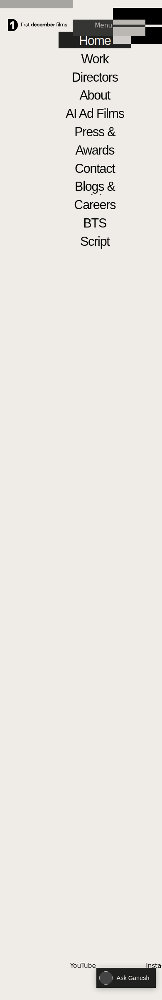

# UI Design System & Master Generation Blueprint: 1stdecember-com

> **First December Films · Ad Film Production House in India** (https://1stdecember.com) — Mumbai advertising film production house with 150+ international awards. TVCs, brand films and digital campaigns for brands across India...


---

## 1. Executive Visual Persona & Design Archetype

- **Brand Essence & Persona**: **First December Films · Ad Film Production House in India** (`https://1stdecember.com`). Mumbai advertising film production house with 150+ international awards. TVCs, brand films and digital campaigns for brands across India...
- **Visual Archetype**: **Light-Substrate Editorial & Modular Grid System (`#efece7` canvas, `#000` ink, `#eee` accent)**.
- **Anti-AI-Slop Differentiators**:
  - **Source-Grounded Chromatic Polarity**: Anchors the viewport in `#efece7` (`var(--brand--white-light)` in `:root`) paired with `#000` primary typography and `#eee` accents.
  - **Extracted Typographic Hierarchy**: Pairs `Pp neue montreal Medium` for display copy (`1st December Films`) with `DM Mono Medium` and `DM Mono Medium`.
  - **Calibrated Spatial Grid & Motion**: Combines `940px` container bounds (`gap: 16px`, padding `9px`) with `cubic-bezier(1,0,0,1)` easing and Lenis Smooth Scroll (`data-lenis`), GSAP Timeline & ScrollTrigger.

---

## 2. Spatial Architecture & Modular Grid Mathematics



### Viewport Allocation & Container Geometry
- **Captured Viewport Dimensions**: Desktop `1440×2400px` (`assets/desktop.png`, capped at 2400px multi-section capture), Mobile `390×2400px` (`assets/mobile.png`, capped at 2400px multi-section capture).
- **Master Container Bounds**: `940px` extracted from `1stdecember-com` stylesheet.
- **Canvas Lateral Padding & Spacing**: `9px` lateral canvas padding with `16px` grid gap.
- **Border Radius Scale**: `3px`, `100%`, `50%`, `2px`.

### Responsive Breakpoint Architecture
- **Desktop Layout**: Multi-column CSS Grid / Flexbox layout at `1440px` (`max-width: 940px`, `gap: 16px`).
- **Mobile Layout**: Single-column vertical stack at `390px` viewport width with `9px` horizontal padding.
- **Extracted CSS Media Queries**: `@media screen and (max-width:991px)`, `@media screen and (max-width:767px)`, `@media screen and (max-width:479px)`, `@media (min-width:768px)`.

---

## 3. Color System, Materiality & Atmospheric Lighting

### Semantic Palette & Source Grounding
| Semantic Role | Ground-Truth Value | Extracted CSS Source / Selector |
|---|---|---|
| **Primary Canvas Substrate** | `#efece7` | `var(--brand--white-light)` in `:root` |
| **Primary Typography Ink** | `#20201e` | `var(--brand--black-dark)` in `:root` |
| **Elevated Surface / Card Substrate** | `#fec032` | `var(--brand--yellow)` in `:root` |
| **Interactive Accent / Highlight** | `#eee` | `var(--neutral--neutral-light)` in `:root` |
| **Secondary / Muted Copy** | `#fff` | `var(--neutral--white)` in `:root` |
| **Structural Hairline Border** | `#000` | `var(--neutral--black)` in `:root` |

### Sanitized Root CSS Variables (`ui-ux.md` Ground Truth)
| Variable Name | Extracted Value | Semantic Role |
|---|---|---|
| `--w-backdrop-animation` | `initial` | Motion / Easing Token |
| `--brand--white-light` | `#efece7` | Canvas / Surface Token |
| `--font-family--body` | `"Pp neue montreal Medium",Arial,sans-serif` | Typography / Scale Token |
| `--_theme---text--primary` | `var(--brand--black-dark)` | Typography Ink Token |
| `--_typography---body--body-font-size` | `1rem` | Typography / Scale Token |
| `--_typography---body--body-line-height` | `var(--font-height--xlarge)` | Typography / Scale Token |
| `--_typography---body--body-font-weight` | `var(--font-weight--normal)` | Typography / Scale Token |
| `--_typography---body--body-letter-spacing` | `var(--letter-spacing--default)` | Typography / Scale Token |
| `--_layout---spacing--none` | `0rem` | Layout / Spatial Grid Token |
| `--font-family--heading` | `"Tartuffo Trial Regular",Arial,sans-serif` | Typography Ink Token |
| `--_typography---h1--h1-font-size` | `7.5rem` | Typography / Scale Token |
| `--_typography---h1--h1-line-height` | `var(--font-height--tiny)` | Typography / Scale Token |
| `--_typography---h1--h1-font-weight` | `var(--font-weight--normal)` | Typography / Scale Token |
| `--_typography---h1--h1-letter-spacing` | `var(--letter-spacing--tighter)` | Typography / Scale Token |
| `--_typography---h2--h2-font-size` | `5rem` | Typography / Scale Token |
| `--_typography---h2--h2-line-height` | `var(--font-height--tiny)` | Typography / Scale Token |

---

## 4. Typographic Scale & Editorial Hierarchy

### Font Family Stacks
- **Display Typography**: `Pp neue montreal Medium`.
- **Primary Body Stack**: `DM Mono Medium`.
- **Technical / Metadata Stack**: `DM Mono Medium`.

### Typographic Scale & Rules (Extracted from Stylesheet & Variables)
- **Hero Display (`H1`)**: CSS variables `--_typography---h1--h1-font-size: 7.5rem`, `--_typography---h1--h1-line-height: var(--font-height--tiny)`, `--_typography---h1--h1-font-weight: var(--font-weight--normal)`.
- **Section Heading (`H2`)**: CSS variables `--_typography---h2--h2-font-size: 5rem`, `--_typography---h2--h2-line-height: var(--font-height--tiny)`, `--_typography---h2--h2-font-weight: var(--font-weight--normal)`.
- **Body Copy**: CSS variables `--font-family--body: "Pp neue montreal Medium",Arial,sans-serif`, `--_typography---body--body-font-size: 1rem`, `--_typography---body--body-line-height: var(--font-height--xlarge)`.
- **Metadata & Navigation Labels**: CSS variables `--_typography---body--body-letter-spacing: var(--letter-spacing--default)`, `--_typography---h1--h1-letter-spacing: var(--letter-spacing--tighter)`, `--_typography---h2--h2-letter-spacing: var(--letter-spacing--tighter)`.

---

## 5. Choreographed Motion & Interaction Physics

### Primary Easing Curves
- **Extracted Timing Functions**: `cubic-bezier(1,0,0,1)`, `cubic-bezier(.645,.045,.355,1)`, `cubic-bezier(0.32,0.72,0,1)`.

### Per-Element Transition & Choreography Rules
- **Selector `.w-webflow-badge>img`**: `transition: unset` extracted from `1stdecember-com` stylesheet.
- **Selector `.w-slider-dot`**: `transition: background-color .1s,color .1s` extracted from `1stdecember-com` stylesheet.
- **Selector `.w-lightbox-control`**: `transition: all .3s` extracted from `1stdecember-com` stylesheet.
- **Extracted Easing Curve (`cubic-bezier(1,0,0,1)`)**: Governs interactive state transitions across `<header.underlay-nav__header>` and `<section.section_work>`.
- **Runtime Interaction Engine**: Integrates Lenis Smooth Scroll (`data-lenis`), GSAP Timeline & ScrollTrigger, Swiper Touch Carousel Engine with `prefers-reduced-motion: reduce` fallback guards.

---

## 6. Component Wireframe & Structural DOM Map

### Visual Layout Schematic (Grounded in `dom.html` — `1440px` Desktop & `390px` Mobile Reflow)
```
┌────────────────────────────────────────────────────────────────────────┐
│ DESKTOP VIEWPORT (1440px) — First December Films · Ad Film Production  │
│ ====================================================================== │
│ [ <header.underlay-nav__he | Home · Work · Directors · About · AI A ]  │
│ ---------------------------------------------------------------------- │
│ | HERO STAGE: <section.section_about>                              |   │
│ | H1: 1st December Films                                           |   │
│ | Substrate: #efece7    | Ink: #000       | Accent: #eee           |   │
│ ---------------------------------------------------------------------- │
│ | SHOWCASE GRID (<section.section_work>    ) max-w: 940px          |   │
│ | +------------------------------+  +------------------------------+ | │
│ | | India's most awarded ad film |  | The one film a brand builds  | | │
│ | +------------------------------+  +------------------------------+ | │
│ ---------------------------------------------------------------------- │
│ | MOBILE VIEWPORT REFLOW (390px) — Single-Column Stack (gap: 16px  ) | │
│ | [<header.underlay-n] -> [<section.section_a] -> [<section.section_w] │
│ ---------------------------------------------------------------------- │
│ [ FOOTER (<footer.demo-footer>  ) | https://1stdecember.com            │
└────────────────────────────────────────────────────────────────────────┘
```

### Granular DOM Region Breakdown
1. **Brand Header & Navigation Bar (<header.underlay-nav__header> — `1stdecember-com`)**:
   - Landmark `<header class="underlay-nav__header">` hosting `First December Films · Ad Film Produ` navigation (`Home · Work · Directors · About · AI Ad Films`), DOM attributes (`data-wf-domain="1stdecember.com"`, `data-wf-page="6a530ef9dd045382387c1080"`, `data-wf-site="6a530ef3dd045382387c1010"`, `data-key="CANq2ndVhhRcE6Gj1ydbwg"`), and stylesheet rule `html { -webkit-text-size-adjust:100%;-ms-text-size-adjust:100%;font-family:sans... }`.
2. **Hero Stage & Focal Lead (<section.section_about> — `1st December Films`)**:
   - Landmark `<section class="section_about">` presenting display lead `1st December Films` and copy excerpt *"06 Festivals / Shows"* over `#efece7` canvas and `#000` ink.
3. **Primary Showcase & Content Grid (<section.section_work> — `India's most awarded ad film house`)**:
   - Landmark `<section class="section_work">` rendering section `India's most awarded ad film house` with copy *"First December Films is a Mumbai based advertising film house, an"*, asset references (`cdn.prod.website-files.com`, `first-december-films.webflow.shar...`, `6acdf9b670164716e898eb2d_fav%20we...`, `6acdf9b6d5ee9f500bdfb333_fav%20we...`), and grid rule `summary { display:block }`.
4. **Interactive Detail & Feature Matrix (<section.section_team-home> — `The one film a brand builds its ye`)**:
   - Landmark `<section class="section_team-home">` framing `The one film a brand builds its year around` and `Intro` (*"No media found Pro Bono - CSR"*) with `#fec032` surface cards, `#eee` accents, and `video { vertical-align:baseline;display:inline-block }`.
5. **Colophon & Global Directory Footer (<footer.demo-footer> — `https://1stdecember.com`)**:
   - Landmark `<footer class="demo-footer">` anchoring `First December Films · Ad Film P` footer links (`Home · Work · Directors · About · AI Ad Films`), copy *"E x p l o r e A l l W o r k"*, and `#000` structural dividers.

---

## 7. Master Zero-Shot AI Generation Prompt

```markdown
# Master Zero-Shot Frontend Generation Prompt: 1stdecember-com (First December Films · Ad Film Production House in India)

You are a principal frontend architect and design systems engineer. Build a complete, production-ready web application replicating the exact design system, DOM landmarks, typographic hierarchy, color tokens, and motion physics of `1stdecember-com` (**First December Films · Ad Film Production House in India** — `https://1stdecember.com`).

### 1. Visual Archetype & Anti-AI-Slop Mandates
- **Archetype**: Light-Substrate Editorial & Modular Grid System (`#efece7` canvas, `#000` ink, `#eee` accent).
- **Identity & Domain Context**: Mumbai advertising film production house with 150+ international awards. TVCs, brand films and digital campaigns for brands across India...
- **Primary Substrate**: `#efece7` (`var(--brand--white-light)` in `:root`), **Primary Ink**: `#000`, **Accent / Highlight**: `#eee`.
- **Site-Specific Differentiators**:
  - **Source-Grounded Chromatic Polarity**: Anchors the viewport in `#efece7` (`var(--brand--white-light)` in `:root`) paired with `#000` primary typography and `#eee` accents.
  - **Extracted Typographic Hierarchy**: Pairs `Pp neue montreal Medium` for display copy (`1st December Films`) with `DM Mono Medium` and `DM Mono Medium`.
  - **Calibrated Spatial Grid & Motion**: Combines `940px` container bounds (`gap: 16px`, padding `9px`) with `cubic-bezier(1,0,0,1)` easing and Lenis Smooth Scroll (`data-lenis`), GSAP Timeline & ScrollTrigger.

### 2. Ground-Truth CSS Variables (`:root` Token Contract)
Declare and consume these exact custom properties extracted from `1stdecember-com` in your global stylesheet:

:root {
  /* First December Films · Ad Film Production House in India (1stdecember-com) — Ground-Truth Extracted CSS Variables */
  --w-backdrop-animation: initial; /* Motion / Easing Token (1stdecember-com) */
  --brand--white-light: #efece7; /* Canvas / Surface Token (1stdecember-com) */
  --font-family--body: "Pp neue montreal Medium",Arial,sans-serif; /* Typography / Scale Token (1stdecember-com) */
  --_theme---text--primary: var(--brand--black-dark); /* Typography Ink Token (1stdecember-com) */
  --_typography---body--body-font-size: 1rem; /* Typography / Scale Token (1stdecember-com) */
  --_typography---body--body-line-height: var(--font-height--xlarge); /* Typography / Scale Token (1stdecember-com) */
  --_typography---body--body-font-weight: var(--font-weight--normal); /* Typography / Scale Token (1stdecember-com) */
  --_typography---body--body-letter-spacing: var(--letter-spacing--default); /* Typography / Scale Token (1stdecember-com) */
  --_layout---spacing--none: 0rem; /* Layout / Spatial Grid Token (1stdecember-com) */
  --font-family--heading: "Tartuffo Trial Regular",Arial,sans-serif; /* Typography Ink Token (1stdecember-com) */
  --_typography---h1--h1-font-size: 7.5rem; /* Typography / Scale Token (1stdecember-com) */
  --_typography---h1--h1-line-height: var(--font-height--tiny); /* Typography / Scale Token (1stdecember-com) */
  --_typography---h1--h1-font-weight: var(--font-weight--normal); /* Typography / Scale Token (1stdecember-com) */
  --_typography---h1--h1-letter-spacing: var(--letter-spacing--tighter); /* Typography / Scale Token (1stdecember-com) */
  --_typography---h2--h2-font-size: 5rem; /* Typography / Scale Token (1stdecember-com) */
  --_typography---h2--h2-line-height: var(--font-height--tiny); /* Typography / Scale Token (1stdecember-com) */
}

### 3. Semantic Color & Materiality Contract
Map every surface, ink, and border strictly to these source-grounded tokens:
- **Primary Canvas Substrate**: `#efece7` — grounded in `var(--brand--white-light)` in `:root`
- **Primary Typography Ink**: `#20201e` — grounded in `var(--brand--black-dark)` in `:root`
- **Elevated Surface / Card Substrate**: `#fec032` — grounded in `var(--brand--yellow)` in `:root`
- **Interactive Accent / Highlight**: `#eee` — grounded in `var(--neutral--neutral-light)` in `:root`
- **Secondary / Muted Copy**: `#fff` — grounded in `var(--neutral--white)` in `:root`
- **Structural Hairline Border**: `#000` — grounded in `var(--neutral--black)` in `:root`

### 4. Spatial Grid, Container Bounds & Responsive Breakpoints
- **Desktop Viewport Reference**: `1440×2400px` (capped at 2400px multi-section capture, `1440px` standard desktop width).
- **Mobile Viewport Reference**: `390×2400px` (capped at 2400px multi-section capture, `390px` standard mobile width).
- **Container Max-Width**: `940px` extracted from `1stdecember-com` stylesheet
- **Padding & Gutters**: `9px` lateral canvas padding with `16px` grid gap
- **Desktop Grid**: Multi-column CSS Grid / Flexbox layout at `1440px` (`max-width: 940px`, `gap: 16px`)
- **Mobile Adaptation**: Single-column vertical stack at `390px` viewport width with `9px` horizontal padding
- **Media Queries**: `@media screen and (max-width:991px)`, `@media screen and (max-width:767px)`, `@media screen and (max-width:479px)`, `@media (min-width:768px)`
- **Corner Radii**: `3px`, `100%`, `50%`, `2px`

### 5. Typography & Editorial Scale Contract
- **Display Font Stack**: `Pp neue montreal Medium`
- **Body Font Stack**: `DM Mono Medium`
- **Monospace / Technical Font Stack**: `DM Mono Medium`
- **H1 Display Rule**: CSS variables `--_typography---h1--h1-font-size: 7.5rem`, `--_typography---h1--h1-line-height: var(--font-height--tiny)`, `--_typography---h1--h1-font-weight: var(--font-weight--normal)`
- **H2 Section Rule**: CSS variables `--_typography---h2--h2-font-size: 5rem`, `--_typography---h2--h2-line-height: var(--font-height--tiny)`, `--_typography---h2--h2-font-weight: var(--font-weight--normal)`
- **Body Copy Rule**: CSS variables `--font-family--body: "Pp neue montreal Medium",Arial,sans-serif`, `--_typography---body--body-font-size: 1rem`, `--_typography---body--body-line-height: var(--font-height--xlarge)`
- **Metadata & Index Rule**: CSS variables `--_typography---body--body-letter-spacing: var(--letter-spacing--default)`, `--_typography---h1--h1-letter-spacing: var(--letter-spacing--tighter)`, `--_typography---h2--h2-letter-spacing: var(--letter-spacing--tighter)`

### 6. Component Hierarchy, Verbatim Copy & Real DOM Landmarks
Scaffold `1stdecember-com` (`First December Films · Ad Film Production House in India`) with these exact structural regions, extracted copy, and CSS rules from `dom.html`:
1. **Brand Header & Navigation Bar (<header.underlay-nav__header> — `1stdecember-com`)**:
   - DOM & Selectors: Landmark `<header class="underlay-nav__header">` hosting `First December Films · Ad Film Produ` navigation (`Home · Work · Directors · About · AI Ad Films`), DOM attributes (`data-wf-domain="1stdecember.com"`, `data-wf-page="6a530ef9dd045382387c1080"`, `data-wf-site="6a530ef3dd045382387c1010"`, `data-key="CANq2ndVhhRcE6Gj1ydbwg"`), and stylesheet rule `html { -webkit-text-size-adjust:100%;-ms-text-size-adjust:100%;font-family:sans... }`.
   - Responsive Contract: Header `Brand Header & Navigation Bar (<header.underlay-nav__header> — `1stdecember-com`)` (`1stdecember-com`) adapts across `@media screen and (max-width:991px)`, `@media screen and (max-width:767px)`, `@media screen and (max-width:479px)`, `@media (min-width:768px)` with `cubic-bezier(1,0,0,1)`, `cubic-bezier(.645,.045,.355,1)`, `cubic-bezier(0.32,0.72,0,1)` transitions and links `Home · Work · Directors · About · AI Ad Films`.
2. **Hero Stage & Focal Lead (<section.section_about> — `1st December Films`)**:
   - DOM & Selectors: Landmark `<section class="section_about">` presenting display lead `1st December Films` and copy excerpt *"06 Festivals / Shows"* over `#efece7` canvas and `#000` ink.
   - Responsive Contract: Hero stage (`1440×2400px` desktop / `390×2400px` mobile) sets `#efece7` background with `#000` headline `1st December Films`.
3. **Primary Showcase & Content Grid (<section.section_work> — `India's most awarded ad film house`)**:
   - DOM & Selectors: Landmark `<section class="section_work">` rendering section `India's most awarded ad film house` with copy *"First December Films is a Mumbai based advertising film house, an"*, asset references (`cdn.prod.website-files.com`, `first-december-films.webflow.shar...`, `6acdf9b670164716e898eb2d_fav%20we...`, `6acdf9b6d5ee9f500bdfb333_fav%20we...`), and grid rule `summary { display:block }`.
   - Responsive Contract: Showcase grid `Primary Showcase & Content Grid (<section.section_work> — `India's most awarded ad film house`)` applies Multi-column CSS Grid / Flexbox layout at `1440px` (`max-width: 940px`, `gap: 16px`) on desktop and Single-column vertical stack at `390px` viewport width with `9px` horizontal padding on mobile.
4. **Interactive Detail & Feature Matrix (<section.section_team-home> — `The one film a brand builds its ye`)**:
   - DOM & Selectors: Landmark `<section class="section_team-home">` framing `The one film a brand builds its year around` and `Intro` (*"No media found Pro Bono - CSR"*) with `#fec032` surface cards, `#eee` accents, and `video { vertical-align:baseline;display:inline-block }`.
   - Responsive Contract: Detail module `Interactive Detail & Feature Matrix (<section.section_team-home> — `The one film a brand builds its ye`)` uses `3px`, `100%`, `50%`, `2px` radii, `#eee` highlights, and assets (cdn.prod.website-files.com, first-december-films.webflow.shar..., 6acdf9b670164716e898eb2d_fav%20we...).
5. **Colophon & Global Directory Footer (<footer.demo-footer> — `https://1stdecember.com`)**:
   - DOM & Selectors: Landmark `<footer class="demo-footer">` anchoring `First December Films · Ad Film P` footer links (`Home · Work · Directors · About · AI Ad Films`), copy *"E x p l o r e A l l W o r k"*, and `#000` structural dividers.
   - Responsive Contract: Footer `Colophon & Global Directory Footer (<footer.demo-footer> — `https://1stdecember.com`)` aligns to `940px` extracted from `1stdecember-com` stylesheet with `9px` lateral canvas padding with `16px` grid gap and attributes (data-wf-domain="1stdecember.com", data-wf-page="6a530ef9dd045382387c1080", data-wf-site="6a530ef3dd045382387c1010").

#### Verbatim DOM Copy Excerpts (`dom.html`)
- Copy Excerpt 1: *"06 Festivals / Shows"*
- Copy Excerpt 2: *"First December Films is a Mumbai based advertising film house, and one of the most..."*
- Copy Excerpt 3: *"No media found Pro Bono - CSR"*
- Copy Excerpt 4: *"E x p l o r e A l l W o r k"*

### 7. Motion, Extracted Stylesheet Rules & Interaction Choreography
- **Primary Easing Functions**: `cubic-bezier(1,0,0,1)`, `cubic-bezier(.645,.045,.355,1)`, `cubic-bezier(0.32,0.72,0,1)`
- **Extracted Stylesheet Rules (`1stdecember-com`)**:
- `html { -webkit-text-size-adjust:100%;-ms-text-size-adjust:100%;font-family:sans... }`
- `summary { display:block }`
- `video { vertical-align:baseline;display:inline-block }`
- `template { display:none }`
- `strong { font-weight:700 }`
- **Per-Selector Transition Rules**:
- **Selector `.w-webflow-badge>img`**: `transition: unset` extracted from `1stdecember-com` stylesheet.
- **Selector `.w-slider-dot`**: `transition: background-color .1s,color .1s` extracted from `1stdecember-com` stylesheet.
- **Selector `.w-lightbox-control`**: `transition: all .3s` extracted from `1stdecember-com` stylesheet.
- **Extracted Easing Curve (`cubic-bezier(1,0,0,1)`)**: Governs interactive state transitions across `<header.underlay-nav__header>` and `<section.section_work>`.
- **Runtime Interaction Engine**: Integrates Lenis Smooth Scroll (`data-lenis`), GSAP Timeline & ScrollTrigger, Swiper Touch Carousel Engine with `prefers-reduced-motion: reduce` fallback guards.

### 8. Technical Deliverables
- Implement in Next.js (App Router) with TypeScript and Tailwind CSS consuming the `:root` custom properties defined above for `1stdecember-com`.
- Reproduce both the `1440px` desktop architecture and `390px` mobile breakpoint transitions, preserving semantic HTML5 landmarks (`<header>`, `<nav>`, `<main>`, `<section>`, `<footer>`) and `prefers-reduced-motion` accessibility guards.
```
