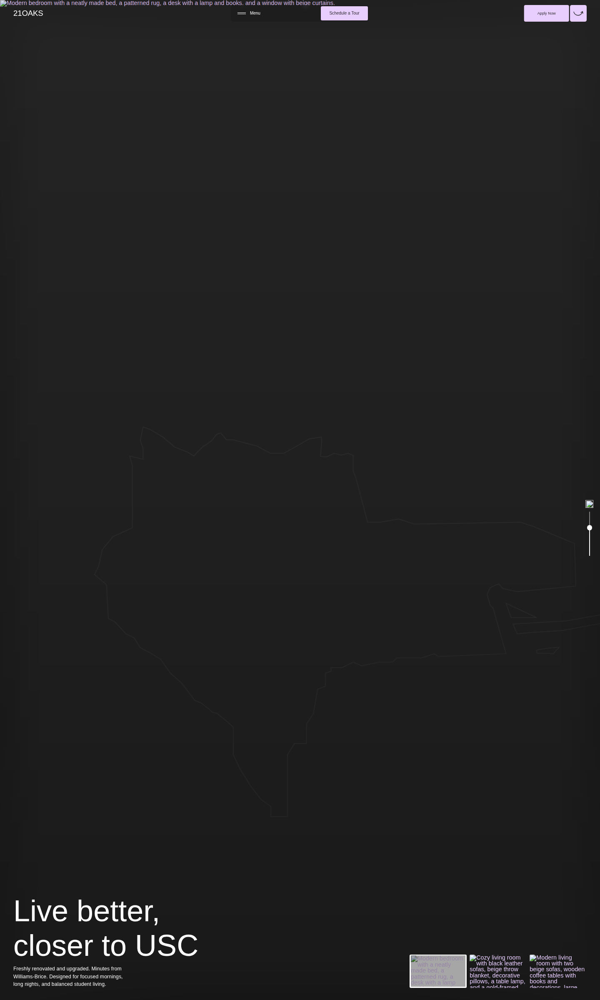
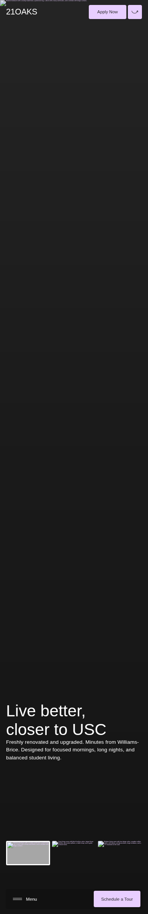

# UI Design System & Master Generation Blueprint: 21oaks-org

> **21Oaks Student Apartments • USC & Williams-Brice** (https://21oaks.org/) — Freshly renovated student apartments minutes from Williams-Brice and USC. Modern living with pool, study spaces, and everything within re...



---

## 1. Executive Visual Persona & Design Archetype

- **Brand Essence & Persona**: **21Oaks Student Apartments • USC & Williams-Brice** (`https://21oaks.org/`). Freshly renovated student apartments minutes from Williams-Brice and USC. Modern living with pool, study spaces, and everything within re...
- **Visual Archetype**: **High-Contrast Obsidian / Atmospheric Design System (`#292929` canvas, `#ff0` ink, `#000` accent)**.
- **Anti-AI-Slop Differentiators**:
  - **Source-Grounded Chromatic Polarity**: Anchors the viewport in `#292929` (`var(--black)` in `:root`) paired with `#ff0` primary typography and `#000` accents.
  - **Extracted Typographic Hierarchy**: Pairs `Exposure` for display copy (`Live better, closer to USC`) with `Exposure Italic` and not declared in static CSS (uses primary stack / `ui-monospace`).
  - **Calibrated Spatial Grid & Motion**: Combines `940px` container bounds (`gap: 16px`, padding `9px`) with `cubic-bezier(.165,.84,.44,1)` easing and Lenis Smooth Scroll (`data-lenis`), GSAP Timeline & ScrollTrigger.

---

## 2. Spatial Architecture & Modular Grid Mathematics



### Viewport Allocation & Container Geometry
- **Captured Viewport Dimensions**: Desktop `1440×2400px` (`assets/desktop.png`, capped at 2400px multi-section capture), Mobile `390×2400px` (`assets/mobile.png`, capped at 2400px multi-section capture).
- **Master Container Bounds**: `940px` extracted from `21oaks-org` stylesheet.
- **Canvas Lateral Padding & Spacing**: `9px` lateral canvas padding with `16px` grid gap.
- **Border Radius Scale**: `3px`, `100%`, `50%`, `2px`.

### Responsive Breakpoint Architecture
- **Desktop Layout**: Multi-column CSS Grid / Flexbox layout at `1440px` (`max-width: 940px`, `gap: 16px`).
- **Mobile Layout**: Single-column vertical stack at `390px` viewport width with `9px` horizontal padding.
- **Extracted CSS Media Queries**: `@media screen and (max-width:991px)`, `@media screen and (max-width:767px)`, `@media screen and (max-width:479px)`, `@media (min-width:768px)`.

---

## 3. Color System, Materiality & Atmospheric Lighting

### Semantic Palette & Source Grounding
| Semantic Role | Ground-Truth Value | Extracted CSS Source / Selector |
|---|---|---|
| **Primary Canvas Substrate** | `#292929` | `var(--black)` in `:root` |
| **Primary Typography Ink** | `#e8ceff` | `var(--primary)` in `:root` |
| **Elevated Surface / Card Substrate** | `#0000` | `a { background-color: #0000 }` |
| **Interactive Accent / Highlight** | `#000` | `mark { color: #000 }` |
| **Secondary / Muted Copy** | `#ff0` | `mark { background: #ff0 }` |
| **Structural Hairline Border** | `#333` | `body { color: #333 }` |

### Sanitized Root CSS Variables (`ui-ux.md` Ground Truth)
| Variable Name | Extracted Value | Semantic Role |
|---|---|---|
| `--white` | `white` | Canvas / Surface Token |
| `--black` | `#292929` | Canvas / Surface Token |
| `--primary` | `#e8ceff` | Brand / Palette Token |
| `--icon` | `40px` | Dimension / Scale Token |
| `--shift-gap` | `0.25em` | Layout / Spatial Grid Token |
| `--dur` | `650ms` | Motion / Timing Token |
| `--ease` | `cubic-bezier(0.83, 0, 0.17, 1)` | Motion / Easing Token |
| `--scribble-line-color` | `#e8ceff` | Brand / Palette Token |
| `--ring-size` | `0.1em` | Layout / Spatial Grid Token |
| `--21oaks-org-bg` | `#292929` | Canvas Substrate (from `var(--black)` in `:root`) |
| `--21oaks-org-ink` | `#ff0` | Primary Typography Ink (stylesheet-derived) |
| `--21oaks-org-surface` | `#0000` | Surface Substrate (stylesheet-derived) |
| `--21oaks-org-accent` | `#000` | Interactive Accent (stylesheet-derived) |
| `--21oaks-org-muted` | `#ff0` | Secondary Ink (stylesheet-derived) |
| `--21oaks-org-border` | `#333` | Structural Border (stylesheet-derived) |
| `--21oaks-org-container` | `940px` | Container Bound (stylesheet-derived) |

---

## 4. Typographic Scale & Editorial Hierarchy

### Font Family Stacks
- **Display Typography**: `Exposure`.
- **Primary Body Stack**: `Exposure Italic`.
- **Technical / Metadata Stack**: not declared in static CSS (uses primary stack / `ui-monospace`).

### Typographic Scale & Rules (Extracted from Stylesheet & Variables)
- **Hero Display (`H1`)**: not explicitly declared on tag in static CSS (stylesheet font-size ladder: `2em`, `80%`, `75%`, `1em`, `14px`).
- **Section Heading (`H2`)**: not explicitly declared on tag in static CSS (stylesheet font-size ladder: `2em`, `80%`, `75%`, `1em`, `14px`).
- **Body Copy**: not explicitly declared on tag in static CSS (stylesheet font-size ladder: `2em`, `80%`, `75%`, `1em`, `14px`).
- **Metadata & Navigation Labels**: not explicitly declared on tag in static CSS (stylesheet font-size ladder: `2em`, `80%`, `75%`, `1em`, `14px`).

---

## 5. Choreographed Motion & Interaction Physics

### Primary Easing Curves
- **Extracted Timing Functions**: `cubic-bezier(.165,.84,.44,1)`, `cubic-bezier(0.4,0,0.2,1)`, `cubic-bezier(0.83,0,0.17,1)`.

### Per-Element Transition & Choreography Rules
- **Selector `.w-webflow-badge>img`**: `transition: unset` extracted from `21oaks-org` stylesheet.
- **Selector `.w-slider-dot`**: `transition: background-color .1s,color .1s` extracted from `21oaks-org` stylesheet.
- **Selector `.w-lightbox-control`**: `transition: all .3s` extracted from `21oaks-org` stylesheet.
- **Extracted Easing Curve (`cubic-bezier(.165,.84,.44,1)`)**: Governs interactive state transitions across `<header.header>` and `<section.dynamic_section>`.
- **Runtime Interaction Engine**: Integrates Lenis Smooth Scroll (`data-lenis`), GSAP Timeline & ScrollTrigger, Swiper Touch Carousel Engine, Lottie Vector Animation Player with `prefers-reduced-motion: reduce` fallback guards.

---

## 6. Component Wireframe & Structural DOM Map

### Visual Layout Schematic (Grounded in `dom.html` — `1440px` Desktop & `390px` Mobile Reflow)
```
┌────────────────────────────────────────────────────────────────────────┐
│ DESKTOP VIEWPORT (1440px) — 21Oaks Student Apartments • USC & Williams │
│ ====================================================================== │
│ [ <header.header>          | 21Oaks · Home · Apartments · Amenities ]  │
│ ---------------------------------------------------------------------- │
│ | HERO STAGE: <section.hero>                                       |   │
│ | H1: Live better, closer to USC                                   |   │
│ | Substrate: #292929    | Ink: #ff0       | Accent: #000           |   │
│ ---------------------------------------------------------------------- │
│ | SHOWCASE GRID (<section.dynamic_section> ) max-w: 940px          |   │
│ | +------------------------------+  +------------------------------+ | │
│ | | Everything student living sh |  | Made for everyday living     | | │
│ | +------------------------------+  +------------------------------+ | │
│ ---------------------------------------------------------------------- │
│ | MOBILE VIEWPORT REFLOW (390px) — Single-Column Stack (gap: 16px  ) | │
│ | [<header.header>] -> [<section.hero>] -> [<section.dynamic_s] |      │
│ ---------------------------------------------------------------------- │
│ [ FOOTER (<footer.footer>       ) | https://21oaks.org/                │
└────────────────────────────────────────────────────────────────────────┘
```

### Granular DOM Region Breakdown
1. **Brand Header & Navigation Bar (<header.header> — `21oaks-org`)**:
   - Landmark `<header class="header">` hosting `21Oaks Student Apartments • USC & Wi` navigation (`21Oaks · Home · Apartments · Amenities · Location`), DOM attributes (`data-wf-domain="21oaks.org"`, `data-wf-page="6a31483f3822b51654193a43"`, `data-wf-site="6a31483f3822b51654193a68"`, `data-appearance="horizontal"`), and stylesheet rule `html { -webkit-text-size-adjust:100%;-ms-text-size-adjust:100%;font-family:sans... }`.
2. **Hero Stage & Focal Lead (<section.hero> — `Live better, closer to USC`)**:
   - Landmark `<section class="hero">` presenting display lead `Live better, closer to USC` and copy excerpt *"He sido nominado como submission.awardCategory.nameHonors en Awww"* over `#292929` canvas and `#ff0` ink.
3. **Primary Showcase & Content Grid (<section.dynamic_section> — `Everything student living should b`)**:
   - Landmark `<section class="dynamic_section">` rendering section `Everything student living should be` with copy *"Designed to recharge"*, asset references (`cdn.prod.website-files.com`, `21oakswebsite.webflow.shared.1884...`, `6a31483f3822b51654193afd_favicon.png`, `69fb54ec6fea40c496e176b6_favicon.png`), and grid rule `summary { display:block }`.
4. **Interactive Detail & Feature Matrix (<section.sides> — `Made for everyday living`)**:
   - Landmark `<section class="sides">` framing `Made for everyday living` and `Where student life feels balanced` (*"Comfort in every corner"*) with `#0000` surface cards, `#000` accents, and `video { vertical-align:baseline;display:inline-block }`.
5. **Colophon & Global Directory Footer (<footer.footer> — `https://21oaks.org/`)**:
   - Landmark `<footer class="footer">` anchoring `21Oaks Student Apartments • USC ` footer links (`21Oaks · Home · Apartments · Amenities · Location`), copy *"Little details matter"*, and `#333` structural dividers.

---

## 7. Master Zero-Shot AI Generation Prompt

```markdown
# Master Zero-Shot Frontend Generation Prompt: 21oaks-org (21Oaks Student Apartments • USC & Williams-Brice)

You are a principal frontend architect and design systems engineer. Build a complete, production-ready web application replicating the exact design system, DOM landmarks, typographic hierarchy, color tokens, and motion physics of `21oaks-org` (**21Oaks Student Apartments • USC & Williams-Brice** — `https://21oaks.org/`).

### 1. Visual Archetype & Anti-AI-Slop Mandates
- **Archetype**: High-Contrast Obsidian / Atmospheric Design System (`#292929` canvas, `#ff0` ink, `#000` accent).
- **Identity & Domain Context**: Freshly renovated student apartments minutes from Williams-Brice and USC. Modern living with pool, study spaces, and everything within re...
- **Primary Substrate**: `#292929` (`var(--black)` in `:root`), **Primary Ink**: `#ff0`, **Accent / Highlight**: `#000`.
- **Site-Specific Differentiators**:
  - **Source-Grounded Chromatic Polarity**: Anchors the viewport in `#292929` (`var(--black)` in `:root`) paired with `#ff0` primary typography and `#000` accents.
  - **Extracted Typographic Hierarchy**: Pairs `Exposure` for display copy (`Live better, closer to USC`) with `Exposure Italic` and not declared in static CSS (uses primary stack / `ui-monospace`).
  - **Calibrated Spatial Grid & Motion**: Combines `940px` container bounds (`gap: 16px`, padding `9px`) with `cubic-bezier(.165,.84,.44,1)` easing and Lenis Smooth Scroll (`data-lenis`), GSAP Timeline & ScrollTrigger.

### 2. Ground-Truth CSS Variables (`:root` Token Contract)
Declare and consume these exact custom properties extracted from `21oaks-org` in your global stylesheet:

:root {
  /* 21Oaks Student Apartments • USC & Williams-Brice (21oaks-org) — Ground-Truth Extracted CSS Variables */
  --white: white; /* Canvas / Surface Token (21oaks-org) */
  --black: #292929; /* Canvas / Surface Token (21oaks-org) */
  --primary: #e8ceff; /* Brand / Palette Token (21oaks-org) */
  --icon: 40px; /* Dimension / Scale Token (21oaks-org) */
  --shift-gap: 0.25em; /* Layout / Spatial Grid Token (21oaks-org) */
  --dur: 650ms; /* Motion / Timing Token (21oaks-org) */
  --ease: cubic-bezier(0.83, 0, 0.17, 1); /* Motion / Easing Token (21oaks-org) */
  --scribble-line-color: #e8ceff; /* Brand / Palette Token (21oaks-org) */
  --ring-size: 0.1em; /* Layout / Spatial Grid Token (21oaks-org) */
  --21oaks-org-bg: #292929; /* Canvas Substrate (from `var(--black)` in `:root`) (21oaks-org) */
  --21oaks-org-ink: #ff0; /* Primary Typography Ink (stylesheet-derived) (21oaks-org) */
  --21oaks-org-surface: #0000; /* Surface Substrate (stylesheet-derived) (21oaks-org) */
  --21oaks-org-accent: #000; /* Interactive Accent (stylesheet-derived) (21oaks-org) */
  --21oaks-org-muted: #ff0; /* Secondary Ink (stylesheet-derived) (21oaks-org) */
  --21oaks-org-border: #333; /* Structural Border (stylesheet-derived) (21oaks-org) */
  --21oaks-org-container: 940px; /* Container Bound (stylesheet-derived) (21oaks-org) */
}

### 3. Semantic Color & Materiality Contract
Map every surface, ink, and border strictly to these source-grounded tokens:
- **Primary Canvas Substrate**: `#292929` — grounded in `var(--black)` in `:root`
- **Primary Typography Ink**: `#e8ceff` — grounded in `var(--primary)` in `:root`
- **Elevated Surface / Card Substrate**: `#0000` — grounded in `a { background-color: #0000 }`
- **Interactive Accent / Highlight**: `#000` — grounded in `mark { color: #000 }`
- **Secondary / Muted Copy**: `#ff0` — grounded in `mark { background: #ff0 }`
- **Structural Hairline Border**: `#333` — grounded in `body { color: #333 }`

### 4. Spatial Grid, Container Bounds & Responsive Breakpoints
- **Desktop Viewport Reference**: `1440×2400px` (capped at 2400px multi-section capture, `1440px` standard desktop width).
- **Mobile Viewport Reference**: `390×2400px` (capped at 2400px multi-section capture, `390px` standard mobile width).
- **Container Max-Width**: `940px` extracted from `21oaks-org` stylesheet
- **Padding & Gutters**: `9px` lateral canvas padding with `16px` grid gap
- **Desktop Grid**: Multi-column CSS Grid / Flexbox layout at `1440px` (`max-width: 940px`, `gap: 16px`)
- **Mobile Adaptation**: Single-column vertical stack at `390px` viewport width with `9px` horizontal padding
- **Media Queries**: `@media screen and (max-width:991px)`, `@media screen and (max-width:767px)`, `@media screen and (max-width:479px)`, `@media (min-width:768px)`
- **Corner Radii**: `3px`, `100%`, `50%`, `2px`

### 5. Typography & Editorial Scale Contract
- **Display Font Stack**: `Exposure`
- **Body Font Stack**: `Exposure Italic`
- **Monospace / Technical Font Stack**: not declared in static CSS (uses primary stack / `ui-monospace`)
- **H1 Display Rule**: not explicitly declared on tag in static CSS (stylesheet font-size ladder: `2em`, `80%`, `75%`, `1em`, `14px`)
- **H2 Section Rule**: not explicitly declared on tag in static CSS (stylesheet font-size ladder: `2em`, `80%`, `75%`, `1em`, `14px`)
- **Body Copy Rule**: not explicitly declared on tag in static CSS (stylesheet font-size ladder: `2em`, `80%`, `75%`, `1em`, `14px`)
- **Metadata & Index Rule**: not explicitly declared on tag in static CSS (stylesheet font-size ladder: `2em`, `80%`, `75%`, `1em`, `14px`)

### 6. Component Hierarchy, Verbatim Copy & Real DOM Landmarks
Scaffold `21oaks-org` (`21Oaks Student Apartments • USC & Williams-Brice`) with these exact structural regions, extracted copy, and CSS rules from `dom.html`:
1. **Brand Header & Navigation Bar (<header.header> — `21oaks-org`)**:
   - DOM & Selectors: Landmark `<header class="header">` hosting `21Oaks Student Apartments • USC & Wi` navigation (`21Oaks · Home · Apartments · Amenities · Location`), DOM attributes (`data-wf-domain="21oaks.org"`, `data-wf-page="6a31483f3822b51654193a43"`, `data-wf-site="6a31483f3822b51654193a68"`, `data-appearance="horizontal"`), and stylesheet rule `html { -webkit-text-size-adjust:100%;-ms-text-size-adjust:100%;font-family:sans... }`.
   - Responsive Contract: Header `Brand Header & Navigation Bar (<header.header> — `21oaks-org`)` (`21oaks-org`) adapts across `@media screen and (max-width:991px)`, `@media screen and (max-width:767px)`, `@media screen and (max-width:479px)`, `@media (min-width:768px)` with `cubic-bezier(.165,.84,.44,1)`, `cubic-bezier(0.4,0,0.2,1)`, `cubic-bezier(0.83,0,0.17,1)` transitions and links `21Oaks · Home · Apartments · Amenities · Location`.
2. **Hero Stage & Focal Lead (<section.hero> — `Live better, closer to USC`)**:
   - DOM & Selectors: Landmark `<section class="hero">` presenting display lead `Live better, closer to USC` and copy excerpt *"He sido nominado como submission.awardCategory.nameHonors en Awww"* over `#292929` canvas and `#ff0` ink.
   - Responsive Contract: Hero stage (`1440×2400px` desktop / `390×2400px` mobile) sets `#292929` background with `#ff0` headline `Live better, closer to USC`.
3. **Primary Showcase & Content Grid (<section.dynamic_section> — `Everything student living should b`)**:
   - DOM & Selectors: Landmark `<section class="dynamic_section">` rendering section `Everything student living should be` with copy *"Designed to recharge"*, asset references (`cdn.prod.website-files.com`, `21oakswebsite.webflow.shared.1884...`, `6a31483f3822b51654193afd_favicon.png`, `69fb54ec6fea40c496e176b6_favicon.png`), and grid rule `summary { display:block }`.
   - Responsive Contract: Showcase grid `Primary Showcase & Content Grid (<section.dynamic_section> — `Everything student living should b`)` applies Multi-column CSS Grid / Flexbox layout at `1440px` (`max-width: 940px`, `gap: 16px`) on desktop and Single-column vertical stack at `390px` viewport width with `9px` horizontal padding on mobile.
4. **Interactive Detail & Feature Matrix (<section.sides> — `Made for everyday living`)**:
   - DOM & Selectors: Landmark `<section class="sides">` framing `Made for everyday living` and `Where student life feels balanced` (*"Comfort in every corner"*) with `#0000` surface cards, `#000` accents, and `video { vertical-align:baseline;display:inline-block }`.
   - Responsive Contract: Detail module `Interactive Detail & Feature Matrix (<section.sides> — `Made for everyday living`)` uses `3px`, `100%`, `50%`, `2px` radii, `#000` highlights, and assets (cdn.prod.website-files.com, 21oakswebsite.webflow.shared.1884..., 6a31483f3822b51654193afd_favicon.png).
5. **Colophon & Global Directory Footer (<footer.footer> — `https://21oaks.org/`)**:
   - DOM & Selectors: Landmark `<footer class="footer">` anchoring `21Oaks Student Apartments • USC ` footer links (`21Oaks · Home · Apartments · Amenities · Location`), copy *"Little details matter"*, and `#333` structural dividers.
   - Responsive Contract: Footer `Colophon & Global Directory Footer (<footer.footer> — `https://21oaks.org/`)` aligns to `940px` extracted from `21oaks-org` stylesheet with `9px` lateral canvas padding with `16px` grid gap and attributes (data-wf-domain="21oaks.org", data-wf-page="6a31483f3822b51654193a43", data-wf-site="6a31483f3822b51654193a68").

#### Verbatim DOM Copy Excerpts (`dom.html`)
- Copy Excerpt 1: *"He sido nominado como submission.awardCategory.nameHonors en Awwwards ."*
- Copy Excerpt 2: *"Designed to recharge"*
- Copy Excerpt 3: *"Comfort in every corner"*
- Copy Excerpt 4: *"Little details matter"*

### 7. Motion, Extracted Stylesheet Rules & Interaction Choreography
- **Primary Easing Functions**: `cubic-bezier(.165,.84,.44,1)`, `cubic-bezier(0.4,0,0.2,1)`, `cubic-bezier(0.83,0,0.17,1)`
- **Extracted Stylesheet Rules (`21oaks-org`)**:
- `html { -webkit-text-size-adjust:100%;-ms-text-size-adjust:100%;font-family:sans... }`
- `summary { display:block }`
- `video { vertical-align:baseline;display:inline-block }`
- `template { display:none }`
- `strong { font-weight:700 }`
- **Per-Selector Transition Rules**:
- **Selector `.w-webflow-badge>img`**: `transition: unset` extracted from `21oaks-org` stylesheet.
- **Selector `.w-slider-dot`**: `transition: background-color .1s,color .1s` extracted from `21oaks-org` stylesheet.
- **Selector `.w-lightbox-control`**: `transition: all .3s` extracted from `21oaks-org` stylesheet.
- **Extracted Easing Curve (`cubic-bezier(.165,.84,.44,1)`)**: Governs interactive state transitions across `<header.header>` and `<section.dynamic_section>`.
- **Runtime Interaction Engine**: Integrates Lenis Smooth Scroll (`data-lenis`), GSAP Timeline & ScrollTrigger, Swiper Touch Carousel Engine, Lottie Vector Animation Player with `prefers-reduced-motion: reduce` fallback guards.

### 8. Technical Deliverables
- Implement in Next.js (App Router) with TypeScript and Tailwind CSS consuming the `:root` custom properties defined above for `21oaks-org`.
- Reproduce both the `1440px` desktop architecture and `390px` mobile breakpoint transitions, preserving semantic HTML5 landmarks (`<header>`, `<nav>`, `<main>`, `<section>`, `<footer>`) and `prefers-reduced-motion` accessibility guards.
```
