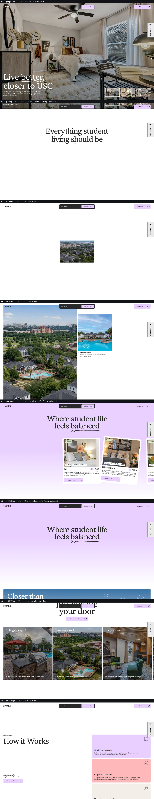
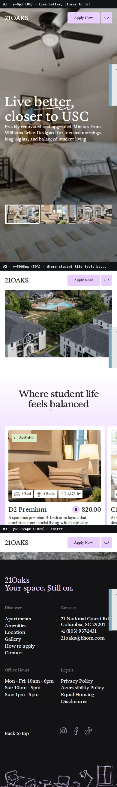

# UI Design System & Master Generation Blueprint: 21oaks-org

> **21Oaks Student Apartments • USC & Williams-Brice** (https://21oaks.org/) — Freshly renovated student apartments minutes from Williams-Brice and USC. Modern living with pool, study spaces, and everything within re...





---

## 1. Executive Visual Persona & Design Archetype

- **Brand Essence & Persona**: **21Oaks Student Apartments • USC & Williams-Brice** (`https://21oaks.org/`). Freshly renovated student apartments minutes from Williams-Brice and USC. Modern living with pool, study spaces, and everything within re...
- **Capture Provenance**: Live browser capture (`tier1_fast`, HTTP `200`, captured `2026-11-24`).
- **Visual Archetype**: **Light-Substrate Editorial & Modular Grid System (`#ffffff` canvas, `#292929` ink, `#0082f3` accent)**.
- **Anti-AI-Slop Differentiators**:
  - **Live-Computed Chromatic Polarity**: Anchors the viewport in `#ffffff` (live computed `body` `background-color` (`computed_styles.json`)) paired with `#292929` primary typography and `#0082f3` accents.
  - **Grounded Typographic Hierarchy**: Uses `Exposure` across display (`Live better, closer to USC`) and body copy.
  - **Calibrated Spatial Grid & Motion**: Combines `1440px` container bounds (`gap: 16px`, padding `9px`) with `cubic-bezier(.165,.84,.44,1)` easing and Lenis Smooth Scroll (`data-lenis`), GSAP Timeline & ScrollTrigger.

---

## 2. Spatial Architecture & Modular Grid Mathematics

### Viewport Allocation & Container Geometry
- **Captured Journey Filmstrips**: Desktop `1280×6624px` (`assets/desktop-journey.webp`, `8` keyframes up to `y=14400px` / doc `19650px`), Mobile `390×2616px` (`assets/mobile-journey.webp`, `3` keyframes).
- **Master Container Bounds**: `1440px` (full-bleed `100%` desktop stage measured on `1440px` viewport).
- **Canvas Lateral Padding & Spacing**: `9px` lateral canvas padding with `16px` grid gap.
- **Border Radius Scale**: `4px`, `3px`, `100%`, `50%`.

### Responsive Breakpoint Architecture
- **Desktop Layout**: Multi-column CSS Grid / Flexbox layout at `1440px` (`max-width: 1440px`, `gap: 16px`).
- **Mobile Layout**: Single-column vertical stack at `390px` viewport width with `9px` horizontal padding.
- **Extracted CSS Media Queries**: `@media screen and (max-width:991px)`, `@media screen and (max-width:767px)`, `@media screen and (max-width:479px)`, `@media (min-width:768px)`.

---

## 3. Color System, Materiality & Atmospheric Lighting

### Semantic Palette & Source Grounding
| Semantic Role | Ground-Truth Value | Extracted Live / CSS Source |
|---|---|---|
| **Primary Canvas Substrate** | `#ffffff` | live computed `body` `background-color` (`computed_styles.json`) |
| **Primary Typography Ink** | `#292929` | live computed `main` `color` (`computed_styles.json`) |
| **Elevated Surface / Card Substrate** | `#ffff00` | `mark { background: #ffff00 }` |
| **Interactive Accent / Highlight** | `#0082f3` | `.w-dropdown-link.w--current { color: #0082f3 }` |
| **Secondary / Muted Copy** | `#999999` | `.w-select::placeholder { color: #999999 }` |
| **Structural Hairline Border** | `#e8ceff` | `var(--scribble-line-color)` in `:root` |

### Sanitized Root CSS Variables (`ui-ux.md` Ground Truth)
| Variable Name | Extracted Value | Semantic Role |
|---|---|---|
| `--white` | `white` | Canvas / Surface Token |
| `--black` | `#292929` | Canvas / Surface Token |
| `--primary` | `#e8ceff` | Brand / Palette Token |
| `--icon` | `40px` | Dimension / Scale Token |
| `--shift-gap` | `0.25em` | Layout / Spatial Grid Token |
| `--dur` | `650ms` | Motion / Timing Token |
| `--ease` | `cubic-bezier(0.83, 0, 0.17, 1)` | Motion / Easing Token |
| `--scribble-line-color` | `#e8ceff` | Brand / Palette Token |
| `--ring-size` | `0.1em` | Layout / Spatial Grid Token |
| `--21oaks-org-bg` | `#ffffff` | Canvas Substrate (from live computed `body` `background-color` (`computed_styles.json`)) |
| `--21oaks-org-ink` | `#292929` | Primary Typography Ink (computed-derived) |
| `--21oaks-org-surface` | `#ffff00` | Surface Substrate (computed-derived) |
| `--21oaks-org-accent` | `#0082f3` | Interactive Accent (computed-derived) |
| `--21oaks-org-muted` | `#999999` | Secondary Ink (computed-derived) |
| `--21oaks-org-border` | `#e8ceff` | Structural Border (computed-derived) |
| `--21oaks-org-container` | `1440px` | Container Bound (computed-derived) |

---

## 4. Typographic Scale & Editorial Hierarchy

### Font Family Stacks
- **Display Typography**: `Exposure`.
- **Primary Body Stack**: `Exposure`.
- **Technical / Metadata Stack**: not declared in live computed styles (uses primary stack / `ui-monospace`).

### Typographic Scale & Rules (Live Computed & Stylesheet Grounded)
- **Hero Display (`H1`)**: live computed `h1` (`font-size: 72px`, `line-height: 64.8px`, `font-weight: 400`).
- **Section Heading (`H2`)**: live computed `h2` (`font-size: 93.6px`, `line-height: 102.96px`, `font-weight: 400`, `letter-spacing: -1.872px`).
- **Body Copy**: live computed `body` (`font-size: 14.4px`, `line-height: 14.4px`, `font-weight: 400`).
- **Metadata & Navigation Labels**: live computed `nav/a` (`font-size: 18.72px`, `line-height: 18.72px`, `font-weight: 400`, `letter-spacing: -0.1872px`).

---

## 5. Choreographed Motion & Interaction Physics

### Primary Easing Curves
- **Extracted Timing Functions**: `cubic-bezier(.165,.84,.44,1)`, `cubic-bezier(0.4,0,0.2,1)`, `cubic-bezier(0.83,0,0.17,1)`.

### Per-Element Transition & Choreography Rules
- **Selector `.w-webflow-badge>img`**: `transition: unset` extracted from `21oaks-org` stylesheet.
- **Selector `.w-slider-dot`**: `transition: background-color .1s,color .1s` extracted from `21oaks-org` stylesheet.
- **Selector `.w-lightbox-control`**: `transition: all .3s` extracted from `21oaks-org` stylesheet.
- **Extracted Easing Curve (`cubic-bezier(.165,.84,.44,1)`)**: Governs interactive state transitions across `<header.header>` and `<section.dynamic_section>`.
- **Runtime Interaction Engine**: Integrates Lenis Smooth Scroll (`data-lenis`), GSAP Timeline & ScrollTrigger, Swiper Touch Carousel Engine, Lottie Vector Animation Player with `prefers-reduced-motion: reduce` fallback guards.
### Measured Runtime Scroll & Interaction Telemetry (`behavioral_journey_v2`)
- **Scroll Driver Mode**: `native` (max document height `19650px`, deepest scrollY reached `14400px` across `8` desktop keyframes).
- **Detected Scroll / Motion Libraries**: `Lenis`, `GSAP/ScrollTrigger`.
- **Hover Physics (`primary_cta` · `Schedule a Tour`)**: `backgroundColor`: `rgb(232, 206, 255)` -> `rgb(214, 191, 237)` (`transition-duration: 0.4s`, `timing: ease`).
- **Route Transition Architecture**: First internal navigation (`/apartments-cards/d1`) measured as `direct` in `968ms`.

---

## 6. Component Wireframe & Structural DOM Map

### Visual Layout Schematic — Desktop (`1440px`, Grounded in `dom.html` & Landmark Bounding Boxes)
```
┌────────────────────────────────────────────────────────────────────────┐
│ DESKTOP VIEWPORT (1440px) — 21Oaks Student Apartments • USC & Williams │
│ ====================================================================== │
│ [ <header.header> (1440x64px)         | 21Oaks · Home · Apartments · ] │
│ ---------------------------------------------------------------------- │
│ | HERO STAGE: <section.hero> (w=1440px)                              | │
│ | H1: Live better, closer to USC                                     | │
│ | Substrate: #ffffff | Ink: #292929 | Accent: #0082f3                | │
│ ---------------------------------------------------------------------- │
│ | SHOWCASE GRID (<section.dynamic_section>) max-w: 1440px            | │
│ | +------------------------------+  +------------------------------+ | │
│ | | Everything student living sh |  | Designed to recharge         | | │
│ | +------------------------------+  +------------------------------+ | │
│ ---------------------------------------------------------------------- │
│ | DETAIL MODULE (<section.dynamic_section:n) — Comfort in every corn | │
│ ---------------------------------------------------------------------- │
│ [ FOOTER (<footer.footer>     ) | https://21oaks.org/                  │
└────────────────────────────────────────────────────────────────────────┘
```

### Visual Layout Schematic — Mobile Reflow (`390px`)
```
┌────────────────────────────────────────────────────────────────────────┐
│ MOBILE VIEWPORT REFLOW (390px) — Single-Column Stack (gap: 16px)       │
│ ====================================================================== │
│ [ HEADER BAR (<header.header>         ) | Compact Menu (390px)         │
│ ---------------------------------------------------------------------- │
│ | HERO STAGE (<section.hero>) — 390px Vertical Lead                  | │
│ | H1: Live better, closer to USC                                     | │
│ ---------------------------------------------------------------------- │
│ | SHOWCASE STACK (<section.dynamic_secti) — 1-Col Stack              | │
│ | [ Item 1: Everything student living should be                    ] | │
│ | [ Item 2: Designed to recharge                                   ] | │
│ ---------------------------------------------------------------------- │
│ | DETAIL STACK (<section.dynamic_section) — 1-Col (Comfort in every c) │
│ ---------------------------------------------------------------------- │
│ [ FOOTER (<footer.footer>     ) | Stacked 390px Colophon               │
└────────────────────────────────────────────────────────────────────────┘
```

### Granular DOM Region Breakdown
1. **Brand Header & Navigation Bar (<header.header> — `21oaks-org`)**:
   - Landmark `<header class="header">` (`1440x64px`) hosting `21Oaks Student Apartments • USC & Wi` navigation (`21Oaks · Home · Apartments · Amenities · Location`), DOM attributes (`data-wf-domain="21oaks.org"`, `data-wf-page="6a31483f3822b51654193a43"`, `data-wf-site="6a31483f3822b51654193a68"`, `data-appearance="horizontal"`), and stylesheet rule `html { -webkit-text-size-adjust:100%;-ms-text-size-adjust:100%;font-family:sans... }`.
2. **Hero Stage & Focal Lead (<section.hero> — `Live better, closer to USC`)**:
   - Landmark `<section class="hero">` presenting display lead `Live better, closer to USC` and copy excerpt *"Click “Apply Now,” choose your lease term and floor plan, and com"* over `#ffffff` canvas and `#292929` ink.
3. **Primary Showcase & Content Grid (<section.dynamic_section> — `Everything student living should b`)**:
   - Landmark `<section class="dynamic_section">` rendering section `Everything student living should be` with copy *"Designed to recharge"*, asset references (`cdn.prod.website-files.com`, `21oakswebsite.webflow.shared.1884...`, `6a31483f3822b51654193afd_favicon.png`, `69fb54ec6fea40c496e176b6_favicon.png`), and grid rule `summary { display:block }`.
4. **Interactive Detail & Feature Matrix (<section.dynamic_section:nth(2)> — `Designed to recharge`)**:
   - Landmark `<section class="dynamic_section">` framing `Designed to recharge` and `Comfort in every corner` (*"Comfort in every corner"*) with `#ffff00` surface cards, `#0082f3` accents, and `video { vertical-align:baseline;display:inline-block }`.
5. **Colophon & Global Directory Footer (<footer.footer> — `https://21oaks.org/`)**:
   - Landmark `<footer class="footer">` anchoring `21Oaks Student Apartments • USC ` footer links (`21Oaks · Home · Apartments · Amenities · Location`), copy *"Little details matter"*, and `#e8ceff` structural dividers.
### Full Vertical Scroll Sequence (Desktop `1440×900` Keyframes)
- **Step 01** (`y=0px`, `0%`): Active landmark `Live better, closer to USC` · sticky/fixed elements: `2`
- **Step 02** (`y=850px`, `6%`): Active landmark `Everything student living should be` · sticky/fixed elements: `3`
- **Step 03** (`y=3400px`, `24%`): Active landmark `Section @ 24%` · sticky/fixed elements: `3`
- **Step 04** (`y=5950px`, `33%`): Active landmark `Section @ 33%` · sticky/fixed elements: `4`
- **Step 05** (`y=8500px`, `47%`): Active landmark `Where student life feels balanced` · sticky/fixed elements: `3`
- **Step 06** (`y=11050px`, `59%`): Active landmark `Where student life feels balanced` · sticky/fixed elements: `2`
- **Step 07** (`y=13600px`, `73%`): Active landmark `Just outside your door` · sticky/fixed elements: `2`
- **Step 08** (`y=14400px`, `77%`): Active landmark `How it Works` · sticky/fixed elements: `2`

### Multi-Page Internal Route Map
- **Detail Route (`/apartments-cards/d1`)**: `https://21oaks.org/apartments-cards/d1` — H1: `D1`, scrollHeight `11503px`, transition `direct` (`968ms`)
- **About Route (`/contact`)**: `https://21oaks.org/contact` — H1: `Contact`, scrollHeight `4113px`, transition `direct` (`553ms`)
- **Detail Route (`/apartments-cards/d1-premium`)**: `https://21oaks.org/apartments-cards/d1-premium` — H1: `D1 Premium`, scrollHeight `11025px`, transition `direct` (`4818ms`)

---

## 7. Master Zero-Shot AI Generation Prompt

```markdown
# Master Zero-Shot Frontend Generation Prompt: 21oaks-org (21Oaks Student Apartments • USC & Williams-Brice)

You are a principal frontend architect and design systems engineer. Build a complete, production-ready web application replicating the exact design system, DOM landmarks, typographic hierarchy, color tokens, and motion physics of `21oaks-org` (**21Oaks Student Apartments • USC & Williams-Brice** — `https://21oaks.org/`).

### 1. Visual Archetype & Anti-AI-Slop Mandates
- **Archetype**: Light-Substrate Editorial & Modular Grid System (`#ffffff` canvas, `#292929` ink, `#0082f3` accent).
- **Identity & Domain Context**: Freshly renovated student apartments minutes from Williams-Brice and USC. Modern living with pool, study spaces, and everything within re...
- **Primary Substrate**: `#ffffff` (live computed `body` `background-color` (`computed_styles.json`)), **Primary Ink**: `#292929`, **Accent / Highlight**: `#0082f3`.
- **Site-Specific Differentiators**:
  - **Live-Computed Chromatic Polarity**: Anchors the viewport in `#ffffff` (live computed `body` `background-color` (`computed_styles.json`)) paired with `#292929` primary typography and `#0082f3` accents.
  - **Grounded Typographic Hierarchy**: Uses `Exposure` across display (`Live better, closer to USC`) and body copy.
  - **Calibrated Spatial Grid & Motion**: Combines `1440px` container bounds (`gap: 16px`, padding `9px`) with `cubic-bezier(.165,.84,.44,1)` easing and Lenis Smooth Scroll (`data-lenis`), GSAP Timeline & ScrollTrigger.

### 2. Ground-Truth CSS Variables (`:root` Token Contract)
Declare and consume these exact custom properties extracted from `21oaks-org` in your global stylesheet:

:root {
  /* 21Oaks Student Apartments • USC & Williams-Brice (21oaks-org) — Live-Grounded CSS Variables */
  --white: white; /* Canvas / Surface Token (21oaks-org) */
  --black: #292929; /* Canvas / Surface Token (21oaks-org) */
  --primary: #e8ceff; /* Brand / Palette Token (21oaks-org) */
  --icon: 40px; /* Dimension / Scale Token (21oaks-org) */
  --shift-gap: 0.25em; /* Layout / Spatial Grid Token (21oaks-org) */
  --dur: 650ms; /* Motion / Timing Token (21oaks-org) */
  --ease: cubic-bezier(0.83, 0, 0.17, 1); /* Motion / Easing Token (21oaks-org) */
  --scribble-line-color: #e8ceff; /* Brand / Palette Token (21oaks-org) */
  --ring-size: 0.1em; /* Layout / Spatial Grid Token (21oaks-org) */
  --21oaks-org-bg: #ffffff; /* Canvas Substrate (from live computed `body` `background-color` (`computed_styles.json`)) (21oaks-org) */
  --21oaks-org-ink: #292929; /* Primary Typography Ink (computed-derived) (21oaks-org) */
  --21oaks-org-surface: #ffff00; /* Surface Substrate (computed-derived) (21oaks-org) */
  --21oaks-org-accent: #0082f3; /* Interactive Accent (computed-derived) (21oaks-org) */
  --21oaks-org-muted: #999999; /* Secondary Ink (computed-derived) (21oaks-org) */
  --21oaks-org-border: #e8ceff; /* Structural Border (computed-derived) (21oaks-org) */
  --21oaks-org-container: 1440px; /* Container Bound (computed-derived) (21oaks-org) */
}

### 3. Semantic Color & Materiality Contract
Map every surface, ink, and border strictly to these source-grounded tokens:
- **Primary Canvas Substrate**: `#ffffff` — grounded in live computed `body` `background-color` (`computed_styles.json`)
- **Primary Typography Ink**: `#292929` — grounded in live computed `main` `color` (`computed_styles.json`)
- **Elevated Surface / Card Substrate**: `#ffff00` — grounded in `mark { background: #ffff00 }`
- **Interactive Accent / Highlight**: `#0082f3` — grounded in `.w-dropdown-link.w--current { color: #0082f3 }`
- **Secondary / Muted Copy**: `#999999` — grounded in `.w-select::placeholder { color: #999999 }`
- **Structural Hairline Border**: `#e8ceff` — grounded in `var(--scribble-line-color)` in `:root`

### 4. Spatial Grid, Container Bounds & Responsive Breakpoints
- **Desktop Viewport Reference**: `1280×6624px` (multi-frame vertical journey filmstrip (6624px), `1440px` standard desktop width).
- **Mobile Viewport Reference**: `390×2616px` (multi-frame vertical journey filmstrip (2616px), `390px` standard mobile width).
- **Container Max-Width**: `1440px` (full-bleed `100%` desktop stage measured on `1440px` viewport)
- **Padding & Gutters**: `9px` lateral canvas padding with `16px` grid gap
- **Desktop Grid**: Multi-column CSS Grid / Flexbox layout at `1440px` (`max-width: 1440px`, `gap: 16px`)
- **Mobile Adaptation**: Single-column vertical stack at `390px` viewport width with `9px` horizontal padding
- **Media Queries**: `@media screen and (max-width:991px)`, `@media screen and (max-width:767px)`, `@media screen and (max-width:479px)`, `@media (min-width:768px)`
- **Corner Radii**: `4px`, `3px`, `100%`, `50%`

### 5. Typography & Editorial Scale Contract
- **Display Font Stack**: `Exposure`
- **Body Font Stack**: `Exposure`
- **Monospace / Technical Font Stack**: not declared in live computed styles (uses primary stack / `ui-monospace`)
- **H1 Display Rule**: live computed `h1` (`font-size: 72px`, `line-height: 64.8px`, `font-weight: 400`)
- **H2 Section Rule**: live computed `h2` (`font-size: 93.6px`, `line-height: 102.96px`, `font-weight: 400`, `letter-spacing: -1.872px`)
- **Body Copy Rule**: live computed `body` (`font-size: 14.4px`, `line-height: 14.4px`, `font-weight: 400`)
- **Metadata & Index Rule**: live computed `nav/a` (`font-size: 18.72px`, `line-height: 18.72px`, `font-weight: 400`, `letter-spacing: -0.1872px`)

### 6. Component Hierarchy, Verbatim Copy & Real DOM Landmarks
Scaffold `21oaks-org` (`21Oaks Student Apartments • USC & Williams-Brice`) with these exact structural regions, extracted copy, and CSS rules from `dom.html`:
1. **Brand Header & Navigation Bar (<header.header> — `21oaks-org`)**:
   - DOM & Selectors: Landmark `<header class="header">` (`1440x64px`) hosting `21Oaks Student Apartments • USC & Wi` navigation (`21Oaks · Home · Apartments · Amenities · Location`), DOM attributes (`data-wf-domain="21oaks.org"`, `data-wf-page="6a31483f3822b51654193a43"`, `data-wf-site="6a31483f3822b51654193a68"`, `data-appearance="horizontal"`), and stylesheet rule `html { -webkit-text-size-adjust:100%;-ms-text-size-adjust:100%;font-family:sans... }`.
   - Responsive Contract: Header `Brand Header & Navigation Bar (<header.header> — `21oaks-org`)` (`21oaks-org`) adapts across `@media screen and (max-width:991px)`, `@media screen and (max-width:767px)`, `@media screen and (max-width:479px)`, `@media (min-width:768px)` with `cubic-bezier(.165,.84,.44,1)`, `cubic-bezier(0.4,0,0.2,1)`, `cubic-bezier(0.83,0,0.17,1)` transitions and links `21Oaks · Home · Apartments · Amenities · Location`.
2. **Hero Stage & Focal Lead (<section.hero> — `Live better, closer to USC`)**:
   - DOM & Selectors: Landmark `<section class="hero">` presenting display lead `Live better, closer to USC` and copy excerpt *"Click “Apply Now,” choose your lease term and floor plan, and com"* over `#ffffff` canvas and `#292929` ink.
   - Responsive Contract: Hero stage (`1280×6624px` desktop / `390×2616px` mobile) sets `#ffffff` background with `#292929` headline `Live better, closer to USC`.
3. **Primary Showcase & Content Grid (<section.dynamic_section> — `Everything student living should b`)**:
   - DOM & Selectors: Landmark `<section class="dynamic_section">` rendering section `Everything student living should be` with copy *"Designed to recharge"*, asset references (`cdn.prod.website-files.com`, `21oakswebsite.webflow.shared.1884...`, `6a31483f3822b51654193afd_favicon.png`, `69fb54ec6fea40c496e176b6_favicon.png`), and grid rule `summary { display:block }`.
   - Responsive Contract: Showcase grid `Primary Showcase & Content Grid (<section.dynamic_section> — `Everything student living should b`)` applies Multi-column CSS Grid / Flexbox layout at `1440px` (`max-width: 1440px`, `gap: 16px`) on desktop and Single-column vertical stack at `390px` viewport width with `9px` horizontal padding on mobile.
4. **Interactive Detail & Feature Matrix (<section.dynamic_section:nth(2)> — `Designed to recharge`)**:
   - DOM & Selectors: Landmark `<section class="dynamic_section">` framing `Designed to recharge` and `Comfort in every corner` (*"Comfort in every corner"*) with `#ffff00` surface cards, `#0082f3` accents, and `video { vertical-align:baseline;display:inline-block }`.
   - Responsive Contract: Detail module `Interactive Detail & Feature Matrix (<section.dynamic_section:nth(2)> — `Designed to recharge`)` uses `4px`, `3px`, `100%`, `50%` radii, `#0082f3` highlights, and assets (cdn.prod.website-files.com, 21oakswebsite.webflow.shared.1884..., 6a31483f3822b51654193afd_favicon.png).
5. **Colophon & Global Directory Footer (<footer.footer> — `https://21oaks.org/`)**:
   - DOM & Selectors: Landmark `<footer class="footer">` anchoring `21Oaks Student Apartments • USC ` footer links (`21Oaks · Home · Apartments · Amenities · Location`), copy *"Little details matter"*, and `#e8ceff` structural dividers.
   - Responsive Contract: Footer `Colophon & Global Directory Footer (<footer.footer> — `https://21oaks.org/`)` aligns to `1440px` (full-bleed `100%` desktop stage measured on `1440px` viewport) with `9px` lateral canvas padding with `16px` grid gap and attributes (data-wf-domain="21oaks.org", data-wf-page="6a31483f3822b51654193a43", data-wf-site="6a31483f3822b51654193a68").

#### Verbatim DOM Copy Excerpts (`dom.html`)
- Copy Excerpt 1: *"Click “Apply Now,” choose your lease term and floor plan, and complete the online..."*
- Copy Excerpt 2: *"Designed to recharge"*
- Copy Excerpt 3: *"Comfort in every corner"*
- Copy Excerpt 4: *"Little details matter"*

### 7. Motion, Extracted Stylesheet Rules & Interaction Choreography
- **Primary Easing Functions**: `cubic-bezier(.165,.84,.44,1)`, `cubic-bezier(0.4,0,0.2,1)`, `cubic-bezier(0.83,0,0.17,1)`
- **Extracted Stylesheet Rules (`21oaks-org`)**:
- `html { -webkit-text-size-adjust:100%;-ms-text-size-adjust:100%;font-family:sans... }`
- `summary { display:block }`
- `video { vertical-align:baseline;display:inline-block }`
- `template { display:none }`
- `strong { font-weight:700 }`
- **Per-Selector Transition Rules**:
- **Selector `.w-webflow-badge>img`**: `transition: unset` extracted from `21oaks-org` stylesheet.
- **Selector `.w-slider-dot`**: `transition: background-color .1s,color .1s` extracted from `21oaks-org` stylesheet.
- **Selector `.w-lightbox-control`**: `transition: all .3s` extracted from `21oaks-org` stylesheet.
- **Extracted Easing Curve (`cubic-bezier(.165,.84,.44,1)`)**: Governs interactive state transitions across `<header.header>` and `<section.dynamic_section>`.
- **Runtime Interaction Engine**: Integrates Lenis Smooth Scroll (`data-lenis`), GSAP Timeline & ScrollTrigger, Swiper Touch Carousel Engine, Lottie Vector Animation Player with `prefers-reduced-motion: reduce` fallback guards.
### 7b. Full-Page Scroll Choreography, Interactive States & Multi-Page Routes
- **Scroll Mechanics**: Implement `native` vertical progression up to `19650px` across 8 distinct viewport chapters using Lenis, GSAP/ScrollTrigger.
- **Vertical Chapter Sequence**: Live better, closer to USC (0%) -> Everything student living s... (6%) -> Section @ 24% (24%) -> Section @ 33% (33%) -> Where student life feels ba... (47%) -> Where student life feels ba... (59%) -> Just outside your door (73%) -> How it Works (77%).
- **Hover Micro-Interaction (`primary_cta`)**: Animate `backgroundColor` with `0.4s ease`.
- **Multi-Page Routes**: Scaffold internal routes `/apartments-cards/d1` (detail, direct), `/contact` (about, direct), `/apartments-cards/d1-premium` (detail, direct) sharing the global header/footer shell and design tokens.

### 8. Technical Deliverables
- Implement in Next.js (App Router) with TypeScript and Tailwind CSS consuming the `:root` custom properties defined above for `21oaks-org`.
- Reproduce both the `1440px` desktop architecture and `390px` mobile breakpoint transitions, preserving semantic HTML5 landmarks (`<header>`, `<nav>`, `<main>`, `<section>`, `<footer>`) and `prefers-reduced-motion` accessibility guards.
```
---

## 8. Full-Page Scroll Journey, Interactive States & Subpage Inventory

### Desktop Scroll Keyframes (`1440×900` WebP)
| Step | Scroll Y | Progress | Active Landmark / Section | Sticky/Fixed | Visual Asset |
| :---: | :---: | :---: | :--- | :---: | :--- |
| `#01` | `0px` | `0%` | Live better, closer to USC | `2` | [desktop-step-01.webp](assets/desktop-step-01.webp) |
| `#02` | `850px` | `6%` | Everything student living should be | `3` | [desktop-step-02.webp](assets/desktop-step-02.webp) |
| `#03` | `3400px` | `24%` | Section @ 24% | `3` | [desktop-step-03.webp](assets/desktop-step-03.webp) |
| `#04` | `5950px` | `33%` | Section @ 33% | `4` | [desktop-step-04.webp](assets/desktop-step-04.webp) |
| `#05` | `8500px` | `47%` | Where student life feels balanced | `3` | [desktop-step-05.webp](assets/desktop-step-05.webp) |
| `#06` | `11050px` | `59%` | Where student life feels balanced | `2` | [desktop-step-06.webp](assets/desktop-step-06.webp) |
| `#07` | `13600px` | `73%` | Just outside your door | `2` | [desktop-step-07.webp](assets/desktop-step-07.webp) |
| `#08` | `14400px` | `77%` | How it Works | `2` | [desktop-step-08.webp](assets/desktop-step-08.webp) |

### Mobile Condensed Keyframes (`390×844` WebP)
| Step | Scroll Y | Progress | Active Landmark | Visual Asset |
| :---: | :---: | :---: | :--- | :--- |
| `#01` | `0px` | `0%` | Live better, closer to USC | [mobile-step-01.webp](assets/mobile-step-01.webp) |
| `#02` | `5906px` | `50%` | Where student life feels balanced | [mobile-step-02.webp](assets/mobile-step-02.webp) |
| `#03` | `11726px` | `100%` | Footer | [mobile-step-03.webp](assets/mobile-step-03.webp) |

### Internal Subpage Filmstrips (`1080px` Wide WebP)
| # | Template | Route URL | H1 / Title | Scroll Height | Transition | Filmstrip Asset |
| :-: | :---: | :--- | :--- | :---: | :---: | :--- |
| `1` | `detail` | `https://21oaks.org/apartments-cards/d1` | D1 | `11503px` | `direct` (`968ms`) | [subpage-01-apartments-cards-d1.webp](assets/subpage-01-apartments-cards-d1.webp) |
| `2` | `about` | `https://21oaks.org/contact` | Contact | `4113px` | `direct` (`553ms`) | [subpage-02-contact.webp](assets/subpage-02-contact.webp) |
| `3` | `detail` | `https://21oaks.org/apartments-cards/d1-premium` | D1 Premium | `11025px` | `direct` (`4818ms`) | [subpage-03-apartments-cards-d1-premium.webp](assets/subpage-03-apartments-cards-d1-premium.webp) |

