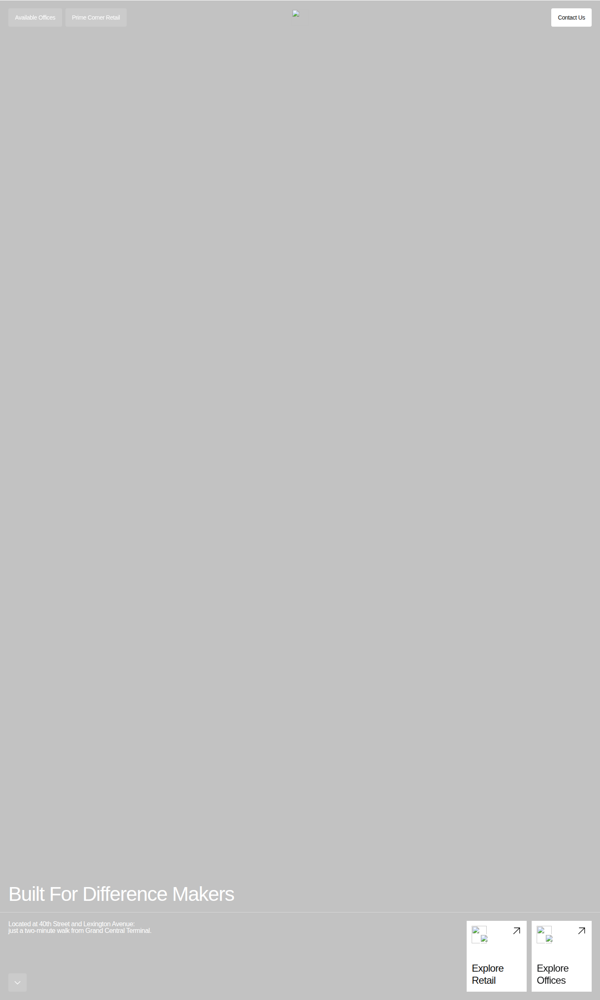
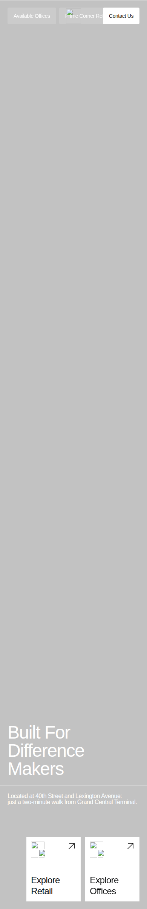

# UI Design System & Master Generation Blueprint: 360lexingtonave-com

> **360 Lexington Avenue** (https://360lexingtonave.com) — Located at 40th Street and Lexington Avenue, just a two-minute walk from Grand Central Terminal.



---

## 1. Executive Visual Persona & Design Archetype

- **Brand Essence & Persona**: **360 Lexington Avenue** (`https://360lexingtonave.com`). Located at 40th Street and Lexington Avenue, just a two-minute walk from Grand Central Terminal.
- **Visual Archetype**: **High-Contrast Obsidian / Atmospheric Design System (`#111213` canvas, `#fff` ink, `#000` accent)**.
- **Anti-AI-Slop Differentiators**:
  - **Source-Grounded Chromatic Polarity**: Anchors the viewport in `#111213` (`var(--token-c796e2cf-d257-4b33-b047-54ba873a0aa1)` in `:root`) paired with `#fff` primary typography and `#000` accents.
  - **Extracted Typographic Hierarchy**: Pairs `Instrument Sans` for display copy (`Built For Difference Makers`) with `Inter` and not declared in static CSS (uses primary stack / `ui-monospace`).
  - **Calibrated Spatial Grid & Motion**: Combines `1023.98px` container bounds (`gap: 10px`, padding `20px`) with `cubic-bezier(0.25,0.1,0.25,1)` easing and Lenis Smooth Scroll (`data-lenis`), Barba.js Page Transition Router.

---

## 2. Spatial Architecture & Modular Grid Mathematics



### Viewport Allocation & Container Geometry
- **Captured Viewport Dimensions**: Desktop `1440×2400px` (`assets/desktop.png`, capped at 2400px multi-section capture), Mobile `390×2400px` (`assets/mobile.png`, capped at 2400px multi-section capture).
- **Master Container Bounds**: `1023.98px` extracted from `360lexingtonave-com` stylesheet.
- **Canvas Lateral Padding & Spacing**: `20px` lateral canvas padding with `10px` grid gap.
- **Border Radius Scale**: `8px`, `15px`, `4px`, `0px`.

### Responsive Breakpoint Architecture
- **Desktop Layout**: Multi-column CSS Grid / Flexbox layout at `1440px` (`max-width: 1023.98px`, `gap: 10px`).
- **Mobile Layout**: Single-column vertical stack at `390px` viewport width with `20px` horizontal padding.
- **Extracted CSS Media Queries**: `@media (min-width:810px) and (max-width:1023.98px)`, `@media (max-width:809.98px)`, `@media (min-width:1024px) and (max-width:1439.98px)`.

---

## 3. Color System, Materiality & Atmospheric Lighting

### Semantic Palette & Source Grounding
| Semantic Role | Ground-Truth Value | Extracted CSS Source / Selector |
|---|---|---|
| **Primary Canvas Substrate** | `#111213` | `var(--token-c796e2cf-d257-4b33-b047-54ba873a0aa1)` in `:root` |
| **Primary Typography Ink** | `#fff` | `var(--token-12fc5a7c-f912-48c9-8238-1c64b516e639)` in `:root` |
| **Elevated Surface / Card Substrate** | `#fff6` | `var(--token-fcb71b86-915a-48dc-848f-900a8d21781e)` in `:root` |
| **Interactive Accent / Highlight** | `#000` | `:hover { color: #000 }` |
| **Secondary / Muted Copy** | `#f5f5f5` | `.framer-jJ6Uj .framer-oq6atu { background-color: #f5f5f5 }` |
| **Variable Token (`--token-1e846e4d-2af5-4cab-b763-361cb3703674`)** | `#ffffff29` | `var(--token-1e846e4d-2af5-4cab-b763-361cb3703674)` in `:root` |
| **Variable Token (`--token-fedfb1b7-b3b3-4fcd-a5c5-e2a1955b044e`)** | `#11121366` | `var(--token-fedfb1b7-b3b3-4fcd-a5c5-e2a1955b044e)` in `:root` |
| **Variable Token (`--token-6ac23283-84f0-4aba-8ffe-b86657dd600d`)** | `#1112130a` | `var(--token-6ac23283-84f0-4aba-8ffe-b86657dd600d)` in `:root` |

### Sanitized Root CSS Variables (`ui-ux.md` Ground Truth)
| Variable Name | Extracted Value | Semantic Role |
|---|---|---|
| `--token-c796e2cf-d257-4b33-b047-54ba873a0aa1` | `#111213` | Color / Atmospheric Token |
| `--token-12fc5a7c-f912-48c9-8238-1c64b516e639` | `#fff` | Color / Atmospheric Token |
| `--token-fcb71b86-915a-48dc-848f-900a8d21781e` | `#fff6` | Color / Atmospheric Token |
| `--token-1e846e4d-2af5-4cab-b763-361cb3703674` | `#ffffff29` | Color / Atmospheric Token |
| `--token-fedfb1b7-b3b3-4fcd-a5c5-e2a1955b044e` | `#11121366` | Color / Atmospheric Token |
| `--token-6ac23283-84f0-4aba-8ffe-b86657dd600d` | `#1112130a` | Color / Atmospheric Token |
| `--text-decoration-skip-ink` | `var(--framer-text-decoration-skip-ink)` | Typography Ink Token |
| `--text-underline-offset` | `var(--framer-text-decoration-offset)` | Typography Ink Token |
| `--font-family` | `var(--framer-font-family)` | Typography / Scale Token |
| `--font-style` | `var(--framer-font-style)` | Typography / Scale Token |
| `--font-weight` | `var(--framer-font-weight)` | Typography / Scale Token |
| `--text-color` | `var(--framer-text-color)` | Typography Ink Token |
| `--letter-spacing` | `var(--framer-letter-spacing)` | Typography / Scale Token |
| `--font-size` | `var(--framer-font-size)` | Typography / Scale Token |
| `--text-transform` | `var(--framer-text-transform)` | Typography Ink Token |
| `--line-height` | `var(--framer-line-height)` | Typography / Scale Token |

---

## 4. Typographic Scale & Editorial Hierarchy

### Font Family Stacks
- **Display Typography**: `Instrument Sans`.
- **Primary Body Stack**: `Inter`.
- **Technical / Metadata Stack**: not declared in static CSS (uses primary stack / `ui-monospace`).

### Typographic Scale & Rules (Extracted from Stylesheet & Variables)
- **Hero Display (`H1`)**: rule `h1` (`font-size: 110px`, `line-height: 100%`, `letter-spacing: -.03em`, `font-weight: 400`).
- **Section Heading (`H2`)**: rule `h2` (`font-size: 74px`, `line-height: 100%`, `letter-spacing: -.03em`, `font-weight: 400`).
- **Body Copy**: rule `p` (`font-size: 12px`, `line-height: 116%`, `letter-spacing: -.03em`, `font-weight: 400`).
- **Metadata & Navigation Labels**: CSS variables `--letter-spacing: var(--framer-letter-spacing)`.

---

## 5. Choreographed Motion & Interaction Physics

### Primary Easing Curves
- **Extracted Timing Functions**: `cubic-bezier(0.25,0.1,0.25,1)`.

### Per-Element Transition & Choreography Rules
- **Selector `.framer-form-input-wrapper:after`**: `transition: var(--framer-input-focused-transition)` extracted from `360lexingtonave-com` stylesheet.
- **Selector `.framer-form-input-wrapper`**: `transition: var(--framer-input-focused-transition)` extracted from `360lexingtonave-com` stylesheet.
- **Selector `.framer-form-text-input-clear`**: `transition: color .15s` extracted from `360lexingtonave-com` stylesheet.
- **Standard CSS Easing (`cubic-bezier(0.25,0.1,0.25,1)`)**: Default timing curve (no custom `cubic-bezier()` declared in static CSS).
- **Runtime Interaction Engine**: Integrates Lenis Smooth Scroll (`data-lenis`), Barba.js Page Transition Router, Framer Motion Layout Physics with `prefers-reduced-motion: reduce` fallback guards.

---

## 6. Component Wireframe & Structural DOM Map

### Visual Layout Schematic (Grounded in `dom.html` — `1440px` Desktop & `390px` Mobile Reflow)
```
┌────────────────────────────────────────────────────────────────────────┐
│ DESKTOP VIEWPORT (1440px) — 360 Lexington Avenue                       │
│ ====================================================================== │
│ [ <header.lenis>           | Available Offices · Prime Corner Retai ]  │
│ ---------------------------------------------------------------------- │
│ | HERO STAGE: <div.lenis-smooth>                                   |   │
│ | H1: Built For Difference Makers                                  |   │
│ | Substrate: #111213    | Ink: #fff       | Accent: #000           |   │
│ ---------------------------------------------------------------------- │
│ | SHOWCASE GRID (<div.framer-jJ6Uj>        ) max-w: 1023.98px      |   │
│ | +------------------------------+  +------------------------------+ | │
│ | | 360 Lex has been thoroughly  |  | 2-Minute Walk to Grand Centr | | │
│ | +------------------------------+  +------------------------------+ | │
│ ---------------------------------------------------------------------- │
│ | MOBILE VIEWPORT REFLOW (390px) — Single-Column Stack (gap: 10px  ) | │
│ | [<header.lenis>] -> [<div.lenis-smooth>] -> [<div.framer-jJ6Uj>] |   │
│ ---------------------------------------------------------------------- │
│ [ FOOTER (<footer.framer-Kw8IE> ) | https://360lexingtonave.com        │
└────────────────────────────────────────────────────────────────────────┘
```

### Granular DOM Region Breakdown
1. **Brand Header & Navigation Bar (<header.lenis> — `360lexingtonave-com`)**:
   - Landmark `<header class="lenis">` hosting `360 Lexington Avenue` navigation (`Available Offices · Prime Corner Retail · Contact Us · Explore Retail · Explore Offices`), DOM attributes (`data-framer-font-css`, `data-framer-css-ssr-minified`, `data-framer-components="framer-lib-cursors-ho..."`, `data-fid="e25c75bee6148e62c6ea7..."`), and stylesheet rule `main { box-sizing:border-box;margin:0;padding:0 }`.
2. **Hero Stage & Focal Lead (<div.lenis-smooth> — `Built For Difference Makers`)**:
   - Landmark `<div class="lenis-smooth">` presenting display lead `Built For Difference Makers` and copy excerpt *"Prime Corner Retail"* over `#111213` canvas and `#fff` ink.
3. **Primary Showcase & Content Grid (<div.framer-jJ6Uj> — `360 Lex has been thoroughly reimag`)**:
   - Landmark `<div class="framer-jJ6Uj">` rendering section `360 Lex has been thoroughly reimagined with a new...` with copy *"Located at 40th Street and Lexington Avenue:"*, asset references (`Grxz4pBrnDA6VjRjN6h8ucts0.png`, `oehMxFzuMfSIeZHPUFXOF3LFOiM.png`, `factors.js`, `fonts.gstatic.com`), and grid rule `root { -webkit-font-smoothing:antialiased;-moz-osx-font-smoothing:grayscale }`.
4. **Interactive Detail & Feature Matrix (<div.framer-DOsz9> — `2-Minute Walk to Grand Central`)**:
   - Landmark `<div class="framer-DOsz9">` framing `2-Minute Walk to Grand Central` and `Surrounded By Dining & Entertainment` (*"just a two-minute walk from Grand Central Terminal."*) with `#fff6` surface cards, `#000` accents, and `button { font-family:sans-serif;font-size:12px }`.
5. **Colophon & Global Directory Footer (<footer.framer-Kw8IE> — `https://360lexingtonave.com`)**:
   - Landmark `<footer class="framer-Kw8IE">` anchoring `360 Lexington Avenue` footer links (`Available Offices · Prime Corner Retail · Contact Us · Explore Retail · Explore Offices`), copy *"Located at 40th and Lexington Avenue, just a two-minute walk"*, and `#fff` structural dividers.

---

## 7. Master Zero-Shot AI Generation Prompt

```markdown
# Master Zero-Shot Frontend Generation Prompt: 360lexingtonave-com (360 Lexington Avenue)

You are a principal frontend architect and design systems engineer. Build a complete, production-ready web application replicating the exact design system, DOM landmarks, typographic hierarchy, color tokens, and motion physics of `360lexingtonave-com` (**360 Lexington Avenue** — `https://360lexingtonave.com`).

### 1. Visual Archetype & Anti-AI-Slop Mandates
- **Archetype**: High-Contrast Obsidian / Atmospheric Design System (`#111213` canvas, `#fff` ink, `#000` accent).
- **Identity & Domain Context**: Located at 40th Street and Lexington Avenue, just a two-minute walk from Grand Central Terminal.
- **Primary Substrate**: `#111213` (`var(--token-c796e2cf-d257-4b33-b047-54ba873a0aa1)` in `:root`), **Primary Ink**: `#fff`, **Accent / Highlight**: `#000`.
- **Site-Specific Differentiators**:
  - **Source-Grounded Chromatic Polarity**: Anchors the viewport in `#111213` (`var(--token-c796e2cf-d257-4b33-b047-54ba873a0aa1)` in `:root`) paired with `#fff` primary typography and `#000` accents.
  - **Extracted Typographic Hierarchy**: Pairs `Instrument Sans` for display copy (`Built For Difference Makers`) with `Inter` and not declared in static CSS (uses primary stack / `ui-monospace`).
  - **Calibrated Spatial Grid & Motion**: Combines `1023.98px` container bounds (`gap: 10px`, padding `20px`) with `cubic-bezier(0.25,0.1,0.25,1)` easing and Lenis Smooth Scroll (`data-lenis`), Barba.js Page Transition Router.

### 2. Ground-Truth CSS Variables (`:root` Token Contract)
Declare and consume these exact custom properties extracted from `360lexingtonave-com` in your global stylesheet:

:root {
  /* 360 Lexington Avenue (360lexingtonave-com) — Ground-Truth Extracted CSS Variables */
  --token-c796e2cf-d257-4b33-b047-54ba873a0aa1: #111213; /* Color / Atmospheric Token (360lexingtonave-com) */
  --token-12fc5a7c-f912-48c9-8238-1c64b516e639: #fff; /* Color / Atmospheric Token (360lexingtonave-com) */
  --token-fcb71b86-915a-48dc-848f-900a8d21781e: #fff6; /* Color / Atmospheric Token (360lexingtonave-com) */
  --token-1e846e4d-2af5-4cab-b763-361cb3703674: #ffffff29; /* Color / Atmospheric Token (360lexingtonave-com) */
  --token-fedfb1b7-b3b3-4fcd-a5c5-e2a1955b044e: #11121366; /* Color / Atmospheric Token (360lexingtonave-com) */
  --token-6ac23283-84f0-4aba-8ffe-b86657dd600d: #1112130a; /* Color / Atmospheric Token (360lexingtonave-com) */
  --text-decoration-skip-ink: var(--framer-text-decoration-skip-ink); /* Typography Ink Token (360lexingtonave-com) */
  --text-underline-offset: var(--framer-text-decoration-offset); /* Typography Ink Token (360lexingtonave-com) */
  --font-family: var(--framer-font-family); /* Typography / Scale Token (360lexingtonave-com) */
  --font-style: var(--framer-font-style); /* Typography / Scale Token (360lexingtonave-com) */
  --font-weight: var(--framer-font-weight); /* Typography / Scale Token (360lexingtonave-com) */
  --text-color: var(--framer-text-color); /* Typography Ink Token (360lexingtonave-com) */
  --letter-spacing: var(--framer-letter-spacing); /* Typography / Scale Token (360lexingtonave-com) */
  --font-size: var(--framer-font-size); /* Typography / Scale Token (360lexingtonave-com) */
  --text-transform: var(--framer-text-transform); /* Typography Ink Token (360lexingtonave-com) */
  --line-height: var(--framer-line-height); /* Typography / Scale Token (360lexingtonave-com) */
}

### 3. Semantic Color & Materiality Contract
Map every surface, ink, and border strictly to these source-grounded tokens:
- **Primary Canvas Substrate**: `#111213` — grounded in `var(--token-c796e2cf-d257-4b33-b047-54ba873a0aa1)` in `:root`
- **Primary Typography Ink**: `#fff` — grounded in `var(--token-12fc5a7c-f912-48c9-8238-1c64b516e639)` in `:root`
- **Elevated Surface / Card Substrate**: `#fff6` — grounded in `var(--token-fcb71b86-915a-48dc-848f-900a8d21781e)` in `:root`
- **Interactive Accent / Highlight**: `#000` — grounded in `:hover { color: #000 }`
- **Secondary / Muted Copy**: `#f5f5f5` — grounded in `.framer-jJ6Uj .framer-oq6atu { background-color: #f5f5f5 }`
- **Variable Token (`--token-1e846e4d-2af5-4cab-b763-361cb3703674`)**: `#ffffff29` — grounded in `var(--token-1e846e4d-2af5-4cab-b763-361cb3703674)` in `:root`
- **Variable Token (`--token-fedfb1b7-b3b3-4fcd-a5c5-e2a1955b044e`)**: `#11121366` — grounded in `var(--token-fedfb1b7-b3b3-4fcd-a5c5-e2a1955b044e)` in `:root`
- **Variable Token (`--token-6ac23283-84f0-4aba-8ffe-b86657dd600d`)**: `#1112130a` — grounded in `var(--token-6ac23283-84f0-4aba-8ffe-b86657dd600d)` in `:root`

### 4. Spatial Grid, Container Bounds & Responsive Breakpoints
- **Desktop Viewport Reference**: `1440×2400px` (capped at 2400px multi-section capture, `1440px` standard desktop width).
- **Mobile Viewport Reference**: `390×2400px` (capped at 2400px multi-section capture, `390px` standard mobile width).
- **Container Max-Width**: `1023.98px` extracted from `360lexingtonave-com` stylesheet
- **Padding & Gutters**: `20px` lateral canvas padding with `10px` grid gap
- **Desktop Grid**: Multi-column CSS Grid / Flexbox layout at `1440px` (`max-width: 1023.98px`, `gap: 10px`)
- **Mobile Adaptation**: Single-column vertical stack at `390px` viewport width with `20px` horizontal padding
- **Media Queries**: `@media (min-width:810px) and (max-width:1023.98px)`, `@media (max-width:809.98px)`, `@media (min-width:1024px) and (max-width:1439.98px)`
- **Corner Radii**: `8px`, `15px`, `4px`, `0px`

### 5. Typography & Editorial Scale Contract
- **Display Font Stack**: `Instrument Sans`
- **Body Font Stack**: `Inter`
- **Monospace / Technical Font Stack**: not declared in static CSS (uses primary stack / `ui-monospace`)
- **H1 Display Rule**: rule `h1` (`font-size: 110px`, `line-height: 100%`, `letter-spacing: -.03em`, `font-weight: 400`)
- **H2 Section Rule**: rule `h2` (`font-size: 74px`, `line-height: 100%`, `letter-spacing: -.03em`, `font-weight: 400`)
- **Body Copy Rule**: rule `p` (`font-size: 12px`, `line-height: 116%`, `letter-spacing: -.03em`, `font-weight: 400`)
- **Metadata & Index Rule**: CSS variables `--letter-spacing: var(--framer-letter-spacing)`

### 6. Component Hierarchy, Verbatim Copy & Real DOM Landmarks
Scaffold `360lexingtonave-com` (`360 Lexington Avenue`) with these exact structural regions, extracted copy, and CSS rules from `dom.html`:
1. **Brand Header & Navigation Bar (<header.lenis> — `360lexingtonave-com`)**:
   - DOM & Selectors: Landmark `<header class="lenis">` hosting `360 Lexington Avenue` navigation (`Available Offices · Prime Corner Retail · Contact Us · Explore Retail · Explore Offices`), DOM attributes (`data-framer-font-css`, `data-framer-css-ssr-minified`, `data-framer-components="framer-lib-cursors-ho..."`, `data-fid="e25c75bee6148e62c6ea7..."`), and stylesheet rule `main { box-sizing:border-box;margin:0;padding:0 }`.
   - Responsive Contract: Header `Brand Header & Navigation Bar (<header.lenis> — `360lexingtonave-com`)` (`360lexingtonave-com`) adapts across `@media (min-width:810px) and (max-width:1023.98px)`, `@media (max-width:809.98px)`, `@media (min-width:1024px) and (max-width:1439.98px)` with `cubic-bezier(0.25,0.1,0.25,1)` transitions and links `Available Offices · Prime Corner Retail · Contact Us · Explore Retail · Explore Offices`.
2. **Hero Stage & Focal Lead (<div.lenis-smooth> — `Built For Difference Makers`)**:
   - DOM & Selectors: Landmark `<div class="lenis-smooth">` presenting display lead `Built For Difference Makers` and copy excerpt *"Prime Corner Retail"* over `#111213` canvas and `#fff` ink.
   - Responsive Contract: Hero stage (`1440×2400px` desktop / `390×2400px` mobile) sets `#111213` background with `#fff` headline `Built For Difference Makers`.
3. **Primary Showcase & Content Grid (<div.framer-jJ6Uj> — `360 Lex has been thoroughly reimag`)**:
   - DOM & Selectors: Landmark `<div class="framer-jJ6Uj">` rendering section `360 Lex has been thoroughly reimagined with a new...` with copy *"Located at 40th Street and Lexington Avenue:"*, asset references (`Grxz4pBrnDA6VjRjN6h8ucts0.png`, `oehMxFzuMfSIeZHPUFXOF3LFOiM.png`, `factors.js`, `fonts.gstatic.com`), and grid rule `root { -webkit-font-smoothing:antialiased;-moz-osx-font-smoothing:grayscale }`.
   - Responsive Contract: Showcase grid `Primary Showcase & Content Grid (<div.framer-jJ6Uj> — `360 Lex has been thoroughly reimag`)` applies Multi-column CSS Grid / Flexbox layout at `1440px` (`max-width: 1023.98px`, `gap: 10px`) on desktop and Single-column vertical stack at `390px` viewport width with `20px` horizontal padding on mobile.
4. **Interactive Detail & Feature Matrix (<div.framer-DOsz9> — `2-Minute Walk to Grand Central`)**:
   - DOM & Selectors: Landmark `<div class="framer-DOsz9">` framing `2-Minute Walk to Grand Central` and `Surrounded By Dining & Entertainment` (*"just a two-minute walk from Grand Central Terminal."*) with `#fff6` surface cards, `#000` accents, and `button { font-family:sans-serif;font-size:12px }`.
   - Responsive Contract: Detail module `Interactive Detail & Feature Matrix (<div.framer-DOsz9> — `2-Minute Walk to Grand Central`)` uses `8px`, `15px`, `4px`, `0px` radii, `#000` highlights, and assets (Grxz4pBrnDA6VjRjN6h8ucts0.png, oehMxFzuMfSIeZHPUFXOF3LFOiM.png, factors.js).
5. **Colophon & Global Directory Footer (<footer.framer-Kw8IE> — `https://360lexingtonave.com`)**:
   - DOM & Selectors: Landmark `<footer class="framer-Kw8IE">` anchoring `360 Lexington Avenue` footer links (`Available Offices · Prime Corner Retail · Contact Us · Explore Retail · Explore Offices`), copy *"Located at 40th and Lexington Avenue, just a two-minute walk"*, and `#fff` structural dividers.
   - Responsive Contract: Footer `Colophon & Global Directory Footer (<footer.framer-Kw8IE> — `https://360lexingtonave.com`)` aligns to `1023.98px` extracted from `360lexingtonave-com` stylesheet with `20px` lateral canvas padding with `10px` grid gap and attributes (data-framer-font-css, data-framer-css-ssr-minified, data-framer-components="framer-lib-cursors-ho...").

#### Verbatim DOM Copy Excerpts (`dom.html`)
- Copy Excerpt 1: *"Prime Corner Retail"*
- Copy Excerpt 2: *"Located at 40th Street and Lexington Avenue:"*
- Copy Excerpt 3: *"just a two-minute walk from Grand Central Terminal."*
- Copy Excerpt 4: *"Located at 40th and Lexington Avenue, just a two-minute walk from Grand Central Te..."*

### 7. Motion, Extracted Stylesheet Rules & Interaction Choreography
- **Primary Easing Functions**: `cubic-bezier(0.25,0.1,0.25,1)`
- **Extracted Stylesheet Rules (`360lexingtonave-com`)**:
- `main { box-sizing:border-box;margin:0;padding:0 }`
- `root { -webkit-font-smoothing:antialiased;-moz-osx-font-smoothing:grayscale }`
- `button { font-family:sans-serif;font-size:12px }`
- `body { --framer-will-change-override:transform }`
- `h6 span { display:block }`
- **Per-Selector Transition Rules**:
- **Selector `.framer-form-input-wrapper:after`**: `transition: var(--framer-input-focused-transition)` extracted from `360lexingtonave-com` stylesheet.
- **Selector `.framer-form-input-wrapper`**: `transition: var(--framer-input-focused-transition)` extracted from `360lexingtonave-com` stylesheet.
- **Selector `.framer-form-text-input-clear`**: `transition: color .15s` extracted from `360lexingtonave-com` stylesheet.
- **Standard CSS Easing (`cubic-bezier(0.25,0.1,0.25,1)`)**: Default timing curve (no custom `cubic-bezier()` declared in static CSS).
- **Runtime Interaction Engine**: Integrates Lenis Smooth Scroll (`data-lenis`), Barba.js Page Transition Router, Framer Motion Layout Physics with `prefers-reduced-motion: reduce` fallback guards.

### 8. Technical Deliverables
- Implement in Next.js (App Router) with TypeScript and Tailwind CSS consuming the `:root` custom properties defined above for `360lexingtonave-com`.
- Reproduce both the `1440px` desktop architecture and `390px` mobile breakpoint transitions, preserving semantic HTML5 landmarks (`<header>`, `<nav>`, `<main>`, `<section>`, `<footer>`) and `prefers-reduced-motion` accessibility guards.
```
