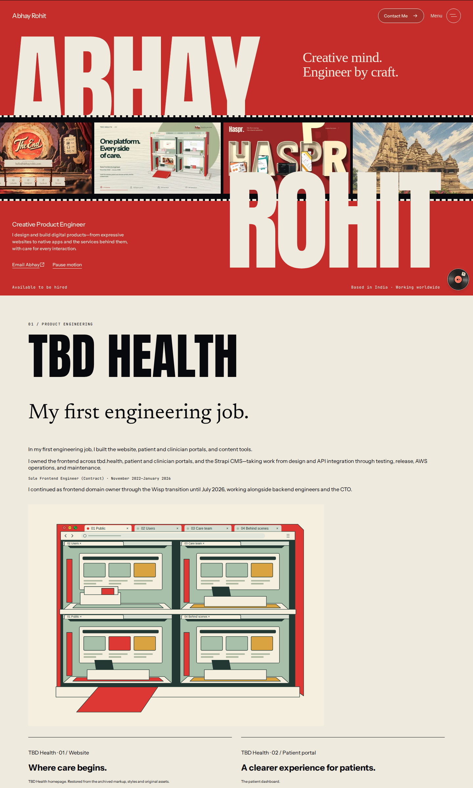

# UI Design System & Master Generation Blueprint: abhayrohit-com

> **Abhay Rohit — Creative Product Engineer** (https://abhayrohit.com/) — Abhay Rohit is a creative product engineer in Indore, India, specializing in frontend engineering and interactive design with React, Next...



---

## 1. Executive Visual Persona & Design Archetype

- **Brand Essence & Persona**: **Abhay Rohit — Creative Product Engineer** (`https://abhayrohit.com/`). Abhay Rohit is a creative product engineer in Indore, India, specializing in frontend engineering and interactive design with React, Next...
- **Capture Provenance**: Live browser capture (`tier1_fast`, HTTP `200`, captured `2026-11-23`).
- **Visual Archetype**: **Dark-Substrate WebGL / Canvas Interactive Experience (`#de3834` / `#ff0000`)**.
- **Anti-AI-Slop Differentiators**:
  - **Live-Computed Chromatic Polarity**: Anchors the viewport in `#de3834` (live computed `body` `background-color` (`computed_styles.json`)) paired with `#efeade` primary typography and `#ff0000` accents.
  - **Grounded Typographic Hierarchy**: Pairs `anton` for display copy (`A B H A Y R O H I T`) with `antonStudio` and `jetbrainsMono`.
  - **Calibrated Spatial Grid & Motion**: Combines `1250px` container bounds (`gap: 24px`, padding `37.4375px`) with `cubic-bezier(.22,1,.36,1)` easing and GSAP Timeline & ScrollTrigger, Three.js / WebGL Canvas Pipeline.

---

## 2. Spatial Architecture & Modular Grid Mathematics


### Viewport Allocation & Container Geometry
- **Captured Viewport Dimensions**: Desktop `1440×2400px` (`assets/desktop.png`, clamped at 2400px live multi-section capture), Mobile `390×2400px` (`assets/mobile.png`, clamped at 2400px live multi-section capture).
- **Master Container Bounds**: `1250px` (non-`@media` desktop container stylesheet rule).
- **Canvas Lateral Padding & Spacing**: `37.4375px` lateral canvas padding with `24px` grid gap.
- **Border Radius Scale**: `50%`, `7px`, `2px`, `3px`.

### Responsive Breakpoint Architecture
- **Desktop Layout**: Multi-column CSS Grid / Flexbox layout at `1440px` (`max-width: 1250px`, `gap: 24px`).
- **Mobile Layout**: Single-column vertical stack at `390px` viewport width with `37.4375px` horizontal padding.
- **Extracted CSS Media Queries**: `@media (prefers-reduced-motion:no-preference)`, `@media (min-width:761px) and (max-height:700px)`, `@media (max-width:1000px) and (max-height:500px) and (pointer:co...`, `@media (max-width:1000px)`.

---

## 3. Color System, Materiality & Atmospheric Lighting

### Semantic Palette & Source Grounding
| Semantic Role | Ground-Truth Value | Extracted Live / CSS Source |
|---|---|---|
| **Primary Canvas Substrate** | `#de3834` | live computed `body` `background-color` (`computed_styles.json`) |
| **Primary Typography Ink** | `#efeade` | live computed `h1` `color` (`computed_styles.json`) |
| **Elevated Surface / Card Substrate** | `#241910` | `var(--paper)` in `:root` |
| **Interactive Accent / Highlight** | `#ff0000` | `.PNc5aa_header nav a:hover { color: red }` (`#ff0000`) |
| **Secondary / Muted Copy** | `#919599` | `var(--qi-muted)` in `:root` |
| **Structural Hairline Border** | `#b83530` | `var(--editorial-rule)` in `:root` (`29291f36`) |
| **Variable Token (`--qi-studio`)** | `#a52d2b` | `var(--qi-studio)` in `:root` |
| **Variable Token (`--qi-ink`)** | `#07090d` | `var(--qi-ink)` in `:root` |
| **Variable Token (`--qi-hero-carmine`)** | `#c42d2a` | `var(--qi-hero-carmine)` in `:root` |

### Sanitized Root CSS Variables (`ui-ux.md` Ground Truth)
| Variable Name | Extracted Value | Semantic Role |
|---|---|---|
| `--qi-studio` | `#a52d2b` | Color / Atmospheric Token |
| `--qi-ink` | `#07090d` | Typography Ink Token |
| `--qi-bone` | `#efeade` | Color / Atmospheric Token |
| `--qi-muted` | `#919599` | Color / Atmospheric Token |
| `--qi-carmine` | `#de3834` | Color / Atmospheric Token |
| `--qi-hero-carmine` | `#c42d2a` | Color / Atmospheric Token |
| `--s-3` | `16px` | Dimension / Scale Token |
| `--s-4` | `24px` | Dimension / Scale Token |
| `--s-6` | `64px` | Dimension / Scale Token |
| `--ease-out` | `cubic-bezier(.22, 1, .36, 1)` | Motion / Easing Token |
| `--t-fast` | `.18s` | Motion / Timing Token |
| `--sound-right` | `calc(12px + env(safe-area-inset-right))` | Dimension / Scale Token |
| `--sound-bottom` | `calc(16px + env(safe-area-inset-bottom))` | Dimension / Scale Token |
| `--sound-width` | `72px` | Layout / Spatial Grid Token |
| `--sound-height` | `66px` | Layout / Spatial Grid Token |
| `--sound-clear-inline` | `calc(var(--sound-right) + var(--sound-width) + 16px)` | Dimension / Scale Token |

---

## 4. Typographic Scale & Editorial Hierarchy

### Font Family Stacks
- **Display Typography**: `anton`.
- **Primary Body Stack**: `antonStudio`.
- **Technical / Metadata Stack**: `jetbrainsMono`.

### Typographic Scale & Rules (Live Computed & Stylesheet Grounded)
- **Hero Display (`H1`)**: live computed `h1` (`font-size: 338.4px`, `line-height: 338.4px`, `font-weight: 400`); CSS variables `--archive-display: "display", "display Fallback", Impact`, `--qi-font-display: "anton", "anton Fallback", Impact, Arial Narrow, sans-serif`, `--qi-font-studio-display: "antonStudio", "antonStudio Fallback"`; rule `h1` (`font-size: clamp(58px,8.8vw,144px)`).
- **Section Heading (`H2`)**: live computed `h2` (`font-size: 150px`, `line-height: 150px`, `font-weight: 400`); CSS variables `--opening-subtitle: clamp(34.72px,3.224cqw,59.52px)`; rule `h2` (`letter-spacing: -.04em`).
- **Body Copy**: live computed `body` (`font-size: 16px`, `line-height: normal`, `font-weight: 400`); rule `p` (`font-size: 16px`, `line-height: 1.75`).
- **Metadata & Navigation Labels**: live computed `nav/a` (`font-size: 16px`, `line-height: normal`, `font-weight: 400`); CSS variables `--archive-mono: "mono", "mono Fallback", Courier New`, `--qi-font-mono: "jetbrainsMono", ui-monospace, monospace`; rule `nav` (`font-size: 14px`).

---

## 5. Choreographed Motion & Interaction Physics

### Primary Easing Curves
- **Extracted Timing Functions**: `cubic-bezier(.22,1,.36,1)`, `cubic-bezier(.16,1,.3,1)`, `cubic-bezier(.2,.8,.2,1)`.

### Per-Element Transition & Choreography Rules
- **Selector `.UOQEPW_sheet`**: `transition: transform .85s var(--process-ease),box-shadow .85s var(--proce...` extracted from `abhayrohit-com` stylesheet.
- **Selector `.UOQEPW_circle`**: `transition: background .35s,color .35s,transform .7s var(--process-ease)` extracted from `abhayrohit-com` stylesheet.
- **Selector `.UOQEPW_circle>span`**: `transition: transform .7s var(--process-ease)` extracted from `abhayrohit-com` stylesheet.
- **Extracted Easing Curve (`cubic-bezier(.22,1,.36,1)`)**: Governs interactive state transitions across `<header.MLPEba_header>` and `<section.KKuYoa_variable>`.
- **Runtime Interaction Engine**: Integrates GSAP Timeline & ScrollTrigger, Three.js / WebGL Canvas Pipeline with `prefers-reduced-motion: reduce` fallback guards.

---

## 6. Component Wireframe & Structural DOM Map

### Visual Layout Schematic — Desktop (`1440px`, Grounded in `dom.html` & Landmark Bounding Boxes)
```
┌────────────────────────────────────────────────────────────────────────┐
│ DESKTOP VIEWPORT (1440px) — Abhay Rohit — Creative Product Engineer    │
│ ====================================================================== │
│ [ <header.MLPEba_header> (1440x96px)  | 01 Car care · 02 Schoolbus K ] │
│ ---------------------------------------------------------------------- │
│ | HERO STAGE: <section.MLPEba_hero> (w=1440px)                       | │
│ | H1: A B H A Y R O H I T                                            | │
│ | Substrate: #de3834 | Ink: #efeade | Accent: #ff0000                | │
│ ---------------------------------------------------------------------- │
│ | SHOWCASE GRID (<section.KKuYoa_variable>) max-w: 1250px            | │
│ | +------------------------------+  +------------------------------+ | │
│ | | My first engineering job.    |  | Where care begins.           | | │
│ | +------------------------------+  +------------------------------+ | │
│ ---------------------------------------------------------------------- │
│ | DETAIL MODULE (<article.rojSVa_variable>) — A clearer experience   | │
│ ---------------------------------------------------------------------- │
│ [ FOOTER (<footer.jFvPUW_foote) | https://abhayrohit.com/              │
└────────────────────────────────────────────────────────────────────────┘
```

### Visual Layout Schematic — Mobile Reflow (`390px`)
```
┌────────────────────────────────────────────────────────────────────────┐
│ MOBILE VIEWPORT REFLOW (390px) — Single-Column Stack (gap: 24px)       │
│ ====================================================================== │
│ [ HEADER BAR (<header.MLPEba_header>  ) | Compact Menu (390px)         │
│ ---------------------------------------------------------------------- │
│ | HERO STAGE (<section.MLPEba_hero>) — 390px Vertical Lead           | │
│ | H1: A B H A Y R O H I T                                            | │
│ ---------------------------------------------------------------------- │
│ | SHOWCASE STACK (<section.KKuYoa_variab) — 1-Col Stack              | │
│ | [ Item 1: My first engineering job.                              ] | │
│ | [ Item 2: Where care begins.                                     ] | │
│ ---------------------------------------------------------------------- │
│ | DETAIL STACK (<article.rojSVa_variable) — 1-Col (A clearer experien) │
│ ---------------------------------------------------------------------- │
│ [ FOOTER (<footer.jFvPUW_foote) | Stacked 390px Colophon               │
└────────────────────────────────────────────────────────────────────────┘
```

### Granular DOM Region Breakdown
1. **Brand Header & Navigation Bar (<header.MLPEba_header> — `abhayrohit-com`)**:
   - Landmark `<header class="MLPEba_header">` (`1440x96px`) hosting `Abhay Rohit — Creative Product Engin` navigation (`01 Car care · 02 Schoolbus Karo · 03 Accounting · 04 Hyre Me · 05 Khajuraho Expo`), DOM attributes (`data-film-entry="cold-home"`, `data-preload-tier="desktop"`, `data-preload-bytes="153382"`, `data-scroll-motion="inertia"`), and stylesheet rule `.UOQEPW_process :after { box-sizing:border-box }`.
2. **Hero Stage & Focal Lead (<section.MLPEba_hero> — `A B H A Y R O H I T`)**:
   - Landmark `<section class="MLPEba_hero">` presenting display lead `A B H A Y R O H I T` and copy excerpt *"Creative mind. Engineer by craft."* over `#de3834` canvas and `#efeade` ink.
3. **Primary Showcase & Content Grid (<section.KKuYoa_variable> — `My first engineering job.`)**:
   - Landmark `<section class="KKuYoa_variable">` rendering section `My first engineering job.` with copy *"Drag the grip to explore; release to return home. Tap to visit th"*, asset references (`anton_full_entry_subset-s.p.0dq58...`, `anton_kinetic_margin-s.p.1o1u0v9k...`, `instrument_sans_latin_wdth_normal...`, `jetbrains_mono_latin_wght_normal_...`), and grid rule `.UOQEPW_process summary { cursor:pointer;-webkit-tap-highlight-color:0000;list-style:none }`.
4. **Interactive Detail & Feature Matrix (<article.rojSVa_variable> — `Where care begins.`)**:
   - Landmark `<article class="rojSVa_variable">` framing `Where care begins.` and `A clearer experience for patients.` (*"Gaming. A miniature world of music, gaming, photography and train"*) with `#241910` surface cards, `#ff0000` accents, and `process summary::-webkit-details-... { display:none }`.
5. **Colophon & Global Directory Footer (<footer.jFvPUW_footer> — `https://abhayrohit.com/`)**:
   - Landmark `<footer class="jFvPUW_footer">` anchoring `Abhay Rohit — Creative Product E` footer links (`01 Car care · 02 Schoolbus Karo · 03 Accounting · 04 Hyre Me · 05 Khajuraho Expo`), copy *"Engineer by craft."*, and `#b83530` structural dividers.

---

## 7. Master Zero-Shot AI Generation Prompt

```markdown
# Master Zero-Shot Frontend Generation Prompt: abhayrohit-com (Abhay Rohit — Creative Product Engineer)

You are a principal frontend architect and design systems engineer. Build a complete, production-ready web application replicating the exact design system, DOM landmarks, typographic hierarchy, color tokens, and motion physics of `abhayrohit-com` (**Abhay Rohit — Creative Product Engineer** — `https://abhayrohit.com/`).

### 1. Visual Archetype & Anti-AI-Slop Mandates
- **Archetype**: Dark-Substrate WebGL / Canvas Interactive Experience (`#de3834` / `#ff0000`).
- **Identity & Domain Context**: Abhay Rohit is a creative product engineer in Indore, India, specializing in frontend engineering and interactive design with React, Next...
- **Primary Substrate**: `#de3834` (live computed `body` `background-color` (`computed_styles.json`)), **Primary Ink**: `#efeade`, **Accent / Highlight**: `#ff0000`.
- **Site-Specific Differentiators**:
  - **Live-Computed Chromatic Polarity**: Anchors the viewport in `#de3834` (live computed `body` `background-color` (`computed_styles.json`)) paired with `#efeade` primary typography and `#ff0000` accents.
  - **Grounded Typographic Hierarchy**: Pairs `anton` for display copy (`A B H A Y R O H I T`) with `antonStudio` and `jetbrainsMono`.
  - **Calibrated Spatial Grid & Motion**: Combines `1250px` container bounds (`gap: 24px`, padding `37.4375px`) with `cubic-bezier(.22,1,.36,1)` easing and GSAP Timeline & ScrollTrigger, Three.js / WebGL Canvas Pipeline.

### 2. Ground-Truth CSS Variables (`:root` Token Contract)
Declare and consume these exact custom properties extracted from `abhayrohit-com` in your global stylesheet:

:root {
  /* Abhay Rohit — Creative Product Engineer (abhayrohit-com) — Live-Grounded CSS Variables */
  --qi-studio: #a52d2b; /* Color / Atmospheric Token (abhayrohit-com) */
  --qi-ink: #07090d; /* Typography Ink Token (abhayrohit-com) */
  --qi-bone: #efeade; /* Color / Atmospheric Token (abhayrohit-com) */
  --qi-muted: #919599; /* Color / Atmospheric Token (abhayrohit-com) */
  --qi-carmine: #de3834; /* Color / Atmospheric Token (abhayrohit-com) */
  --qi-hero-carmine: #c42d2a; /* Color / Atmospheric Token (abhayrohit-com) */
  --s-3: 16px; /* Dimension / Scale Token (abhayrohit-com) */
  --s-4: 24px; /* Dimension / Scale Token (abhayrohit-com) */
  --s-6: 64px; /* Dimension / Scale Token (abhayrohit-com) */
  --ease-out: cubic-bezier(.22, 1, .36, 1); /* Motion / Easing Token (abhayrohit-com) */
  --t-fast: .18s; /* Motion / Timing Token (abhayrohit-com) */
  --sound-right: calc(12px + env(safe-area-inset-right)); /* Dimension / Scale Token (abhayrohit-com) */
  --sound-bottom: calc(16px + env(safe-area-inset-bottom)); /* Dimension / Scale Token (abhayrohit-com) */
  --sound-width: 72px; /* Layout / Spatial Grid Token (abhayrohit-com) */
  --sound-height: 66px; /* Layout / Spatial Grid Token (abhayrohit-com) */
  --sound-clear-inline: calc(var(--sound-right) + var(--sound-width) + 16px); /* Dimension / Scale Token (abhayrohit-com) */
}

### 3. Semantic Color & Materiality Contract
Map every surface, ink, and border strictly to these source-grounded tokens:
- **Primary Canvas Substrate**: `#de3834` — grounded in live computed `body` `background-color` (`computed_styles.json`)
- **Primary Typography Ink**: `#efeade` — grounded in live computed `h1` `color` (`computed_styles.json`)
- **Elevated Surface / Card Substrate**: `#241910` — grounded in `var(--paper)` in `:root`
- **Interactive Accent / Highlight**: `#ff0000` — grounded in `.PNc5aa_header nav a:hover { color: red }` (`#ff0000`)
- **Secondary / Muted Copy**: `#919599` — grounded in `var(--qi-muted)` in `:root`
- **Structural Hairline Border**: `#b83530` — grounded in `var(--editorial-rule)` in `:root` (`29291f36`)
- **Variable Token (`--qi-studio`)**: `#a52d2b` — grounded in `var(--qi-studio)` in `:root`
- **Variable Token (`--qi-ink`)**: `#07090d` — grounded in `var(--qi-ink)` in `:root`
- **Variable Token (`--qi-hero-carmine`)**: `#c42d2a` — grounded in `var(--qi-hero-carmine)` in `:root`

### 4. Spatial Grid, Container Bounds & Responsive Breakpoints
- **Desktop Viewport Reference**: `1440×2400px` (clamped at 2400px live multi-section capture, `1440px` standard desktop width).
- **Mobile Viewport Reference**: `390×2400px` (clamped at 2400px live multi-section capture, `390px` standard mobile width).
- **Container Max-Width**: `1250px` (non-`@media` desktop container stylesheet rule)
- **Padding & Gutters**: `37.4375px` lateral canvas padding with `24px` grid gap
- **Desktop Grid**: Multi-column CSS Grid / Flexbox layout at `1440px` (`max-width: 1250px`, `gap: 24px`)
- **Mobile Adaptation**: Single-column vertical stack at `390px` viewport width with `37.4375px` horizontal padding
- **Media Queries**: `@media (prefers-reduced-motion:no-preference)`, `@media (min-width:761px) and (max-height:700px)`, `@media (max-width:1000px) and (max-height:500px) and (pointer:co...`, `@media (max-width:1000px)`
- **Corner Radii**: `50%`, `7px`, `2px`, `3px`

### 5. Typography & Editorial Scale Contract
- **Display Font Stack**: `anton`
- **Body Font Stack**: `antonStudio`
- **Monospace / Technical Font Stack**: `jetbrainsMono`
- **H1 Display Rule**: live computed `h1` (`font-size: 338.4px`, `line-height: 338.4px`, `font-weight: 400`); CSS variables `--archive-display: "display", "display Fallback", Impact`, `--qi-font-display: "anton", "anton Fallback", Impact, Arial Narrow, sans-serif`, `--qi-font-studio-display: "antonStudio", "antonStudio Fallback"`; rule `h1` (`font-size: clamp(58px,8.8vw,144px)`)
- **H2 Section Rule**: live computed `h2` (`font-size: 150px`, `line-height: 150px`, `font-weight: 400`); CSS variables `--opening-subtitle: clamp(34.72px,3.224cqw,59.52px)`; rule `h2` (`letter-spacing: -.04em`)
- **Body Copy Rule**: live computed `body` (`font-size: 16px`, `line-height: normal`, `font-weight: 400`); rule `p` (`font-size: 16px`, `line-height: 1.75`)
- **Metadata & Index Rule**: live computed `nav/a` (`font-size: 16px`, `line-height: normal`, `font-weight: 400`); CSS variables `--archive-mono: "mono", "mono Fallback", Courier New`, `--qi-font-mono: "jetbrainsMono", ui-monospace, monospace`; rule `nav` (`font-size: 14px`)

### 6. Component Hierarchy, Verbatim Copy & Real DOM Landmarks
Scaffold `abhayrohit-com` (`Abhay Rohit — Creative Product Engineer`) with these exact structural regions, extracted copy, and CSS rules from `dom.html`:
1. **Brand Header & Navigation Bar (<header.MLPEba_header> — `abhayrohit-com`)**:
   - DOM & Selectors: Landmark `<header class="MLPEba_header">` (`1440x96px`) hosting `Abhay Rohit — Creative Product Engin` navigation (`01 Car care · 02 Schoolbus Karo · 03 Accounting · 04 Hyre Me · 05 Khajuraho Expo`), DOM attributes (`data-film-entry="cold-home"`, `data-preload-tier="desktop"`, `data-preload-bytes="153382"`, `data-scroll-motion="inertia"`), and stylesheet rule `.UOQEPW_process :after { box-sizing:border-box }`.
   - Responsive Contract: Header `Brand Header & Navigation Bar (<header.MLPEba_header> — `abhayrohit-com`)` (`abhayrohit-com`) adapts across `@media (prefers-reduced-motion:no-preference)`, `@media (min-width:761px) and (max-height:700px)`, `@media (max-width:1000px) and (max-height:500px) and (pointer:co...`, `@media (max-width:1000px)` with `cubic-bezier(.22,1,.36,1)`, `cubic-bezier(.16,1,.3,1)`, `cubic-bezier(.2,.8,.2,1)` transitions and links `01 Car care · 02 Schoolbus Karo · 03 Accounting · 04 Hyre Me · 05 Khajuraho Expo`.
2. **Hero Stage & Focal Lead (<section.MLPEba_hero> — `A B H A Y R O H I T`)**:
   - DOM & Selectors: Landmark `<section class="MLPEba_hero">` presenting display lead `A B H A Y R O H I T` and copy excerpt *"Creative mind. Engineer by craft."* over `#de3834` canvas and `#efeade` ink.
   - Responsive Contract: Hero stage (`1440×2400px` desktop / `390×2400px` mobile) sets `#de3834` background with `#efeade` headline `A B H A Y R O H I T`.
3. **Primary Showcase & Content Grid (<section.KKuYoa_variable> — `My first engineering job.`)**:
   - DOM & Selectors: Landmark `<section class="KKuYoa_variable">` rendering section `My first engineering job.` with copy *"Drag the grip to explore; release to return home. Tap to visit th"*, asset references (`anton_full_entry_subset-s.p.0dq58...`, `anton_kinetic_margin-s.p.1o1u0v9k...`, `instrument_sans_latin_wdth_normal...`, `jetbrains_mono_latin_wght_normal_...`), and grid rule `.UOQEPW_process summary { cursor:pointer;-webkit-tap-highlight-color:0000;list-style:none }`.
   - Responsive Contract: Showcase grid `Primary Showcase & Content Grid (<section.KKuYoa_variable> — `My first engineering job.`)` applies Multi-column CSS Grid / Flexbox layout at `1440px` (`max-width: 1250px`, `gap: 24px`) on desktop and Single-column vertical stack at `390px` viewport width with `37.4375px` horizontal padding on mobile.
4. **Interactive Detail & Feature Matrix (<article.rojSVa_variable> — `Where care begins.`)**:
   - DOM & Selectors: Landmark `<article class="rojSVa_variable">` framing `Where care begins.` and `A clearer experience for patients.` (*"Gaming. A miniature world of music, gaming, photography and train"*) with `#241910` surface cards, `#ff0000` accents, and `process summary::-webkit-details-... { display:none }`.
   - Responsive Contract: Detail module `Interactive Detail & Feature Matrix (<article.rojSVa_variable> — `Where care begins.`)` uses `50%`, `7px`, `2px`, `3px` radii, `#ff0000` highlights, and assets (anton_full_entry_subset-s.p.0dq58..., anton_kinetic_margin-s.p.1o1u0v9k..., instrument_sans_latin_wdth_normal...).
5. **Colophon & Global Directory Footer (<footer.jFvPUW_footer> — `https://abhayrohit.com/`)**:
   - DOM & Selectors: Landmark `<footer class="jFvPUW_footer">` anchoring `Abhay Rohit — Creative Product E` footer links (`01 Car care · 02 Schoolbus Karo · 03 Accounting · 04 Hyre Me · 05 Khajuraho Expo`), copy *"Engineer by craft."*, and `#b83530` structural dividers.
   - Responsive Contract: Footer `Colophon & Global Directory Footer (<footer.jFvPUW_footer> — `https://abhayrohit.com/`)` aligns to `1250px` (non-`@media` desktop container stylesheet rule) with `37.4375px` lateral canvas padding with `24px` grid gap and attributes (data-film-entry="cold-home", data-preload-tier="desktop", data-preload-bytes="153382").

#### Verbatim DOM Copy Excerpts (`dom.html`)
- Copy Excerpt 1: *"Creative mind. Engineer by craft."*
- Copy Excerpt 2: *"Drag the grip to explore; release to return home. Tap to visit the next detail. Th..."*
- Copy Excerpt 3: *"Gaming. A miniature world of music, gaming, photography and training behind the name."*
- Copy Excerpt 4: *"Engineer by craft."*

### 7. Motion, Extracted Stylesheet Rules & Interaction Choreography
- **Primary Easing Functions**: `cubic-bezier(.22,1,.36,1)`, `cubic-bezier(.16,1,.3,1)`, `cubic-bezier(.2,.8,.2,1)`
- **Extracted Stylesheet Rules (`abhayrohit-com`)**:
- `.UOQEPW_process :after { box-sizing:border-box }`
- `.UOQEPW_process summary { cursor:pointer;-webkit-tap-highlight-color:0000;list-style:none }`
- `process summary::-webkit-details-... { display:none }`
- `.UOQEPW_process a:focus-visible { outline:2px solid var(--process-accent);outline-offset:6px }`
- `.UOQEPW_trigger:after { content:"";pointer-events:none;border:1px solid ffffff12;position:absolu... }`
- **Per-Selector Transition Rules**:
- **Selector `.UOQEPW_sheet`**: `transition: transform .85s var(--process-ease),box-shadow .85s var(--proce...` extracted from `abhayrohit-com` stylesheet.
- **Selector `.UOQEPW_circle`**: `transition: background .35s,color .35s,transform .7s var(--process-ease)` extracted from `abhayrohit-com` stylesheet.
- **Selector `.UOQEPW_circle>span`**: `transition: transform .7s var(--process-ease)` extracted from `abhayrohit-com` stylesheet.
- **Extracted Easing Curve (`cubic-bezier(.22,1,.36,1)`)**: Governs interactive state transitions across `<header.MLPEba_header>` and `<section.KKuYoa_variable>`.
- **Runtime Interaction Engine**: Integrates GSAP Timeline & ScrollTrigger, Three.js / WebGL Canvas Pipeline with `prefers-reduced-motion: reduce` fallback guards.

### 8. Technical Deliverables
- Implement in Next.js (App Router) with TypeScript and Tailwind CSS consuming the `:root` custom properties defined above for `abhayrohit-com`.
- Reproduce both the `1440px` desktop architecture and `390px` mobile breakpoint transitions, preserving semantic HTML5 landmarks (`<header>`, `<nav>`, `<main>`, `<section>`, `<footer>`) and `prefers-reduced-motion` accessibility guards.
```
