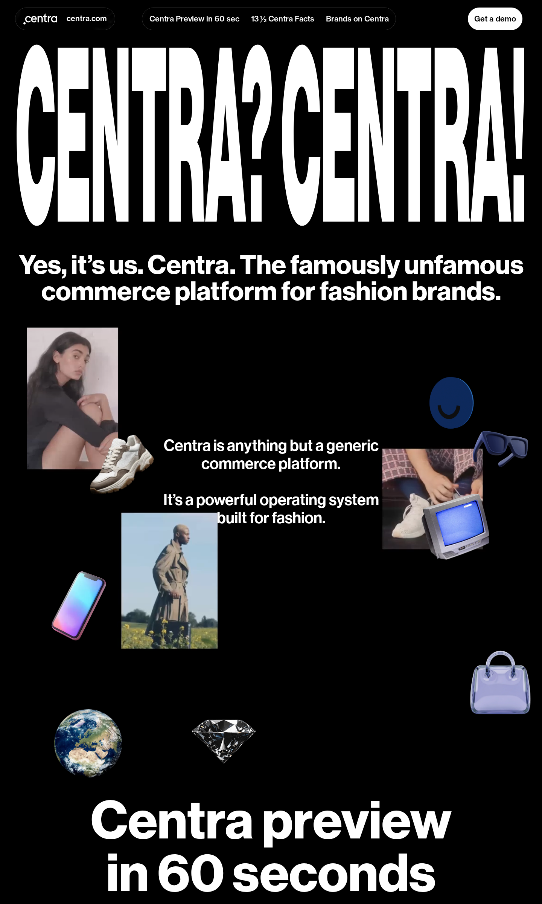
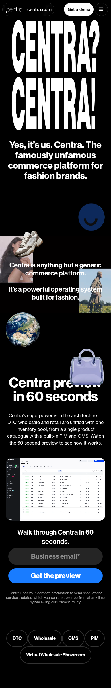

# UI Design System & Master Generation Blueprint: about-centra-com

> **Centra? Centra! The definitive guide.** (https://about.centra.com) — The commerce platform for fashion brands.



---

## 1. Executive Visual Persona & Design Archetype

- **Brand Essence & Persona**: **Centra? Centra! The definitive guide.** (`https://about.centra.com`). The commerce platform for fashion brands.
- **Capture Provenance**: Live browser capture (`tier1_fast`, HTTP `200`, captured `2026-11-23`).
- **Visual Archetype**: **High-Contrast Obsidian / Atmospheric Design System (`#000000` canvas, `#ffffff` ink, `#ffff00` accent)**.
- **Anti-AI-Slop Differentiators**:
  - **Live-Computed Chromatic Polarity**: Anchors the viewport in `#000000` (live computed `body` `background-color` (`computed_styles.json`)) paired with `#ffffff` primary typography and `#ffff00` accents.
  - **Grounded Typographic Hierarchy**: Pairs `neue-haas-grotesk-display` for display copy (`CENTRA? CENTRA!`) with `neue-haas-grotesk-text` and not declared in live computed styles (uses primary stack / `ui-monospace`).
  - **Calibrated Spatial Grid & Motion**: Combines `1920px` container bounds (`gap: 16px`, padding `9px`) with `cubic-bezier(0.25,0.1,0.25,1)` easing and GSAP Timeline & ScrollTrigger, Three.js / WebGL Canvas Pipeline.

---

## 2. Spatial Architecture & Modular Grid Mathematics



### Viewport Allocation & Container Geometry
- **Captured Viewport Dimensions**: Desktop `1440×2400px` (`assets/desktop.png`, clamped at 2400px live multi-section capture), Mobile `390×2400px` (`assets/mobile.png`, clamped at 2400px live multi-section capture).
- **Master Container Bounds**: `1920px` (non-`@media` desktop container stylesheet rule).
- **Canvas Lateral Padding & Spacing**: `9px` lateral canvas padding with `16px` grid gap.
- **Border Radius Scale**: `3px`, `100%`, `50%`, `2px`.

### Responsive Breakpoint Architecture
- **Desktop Layout**: Multi-column CSS Grid / Flexbox layout at `1440px` (`max-width: 1920px`, `gap: 16px`).
- **Mobile Layout**: Single-column vertical stack at `390px` viewport width with `9px` horizontal padding.
- **Extracted CSS Media Queries**: `@media screen and (max-width:991px)`, `@media screen and (max-width:767px)`, `@media screen and (max-width:479px)`, `@media (min-width:768px)`.

---

## 3. Color System, Materiality & Atmospheric Lighting

### Semantic Palette & Source Grounding
| Semantic Role | Ground-Truth Value | Extracted Live / CSS Source |
|---|---|---|
| **Primary Canvas Substrate** | `#000000` | live computed `body` `background-color` (`computed_styles.json`) |
| **Primary Typography Ink** | `#ffffff` | live computed `h1` `color` (`computed_styles.json`) |
| **Elevated Surface / Card Substrate** | `#222222` | `.w-slider-nav-invert>div.w-active { background-color: #222222 }` |
| **Interactive Accent / Highlight** | `#ffff00` | `.hs-button.submit:hover { background-color: yellow }` (`#ffff00`) |
| **Secondary / Muted Copy** | `#a9a9a9` | live computed `p` `color` (`computed_styles.json`) |
| **Structural Hairline Border** | `#3898ec` | `.w-select:focus { border-color: #3898ec }` |
| **Variable Token (`--_colours---mono--200`)** | `#d9d9d9` | `var(--_colours---mono--200)` in `:root` |
| **Variable Token (`--_colours---yellow--main`)** | `#fecf48` | `var(--_colours---yellow--main)` in `:root` |
| **Variable Token (`--_colours---mono--800`)** | `#191919` | `var(--_colours---mono--800)` in `:root` |
| **Variable Token (`--_colours---red--main`)** | `#f85943` | `var(--_colours---red--main)` in `:root` |
| **Variable Token (`--_colours---mono--600`)** | `#333333` | `var(--_colours---mono--600)` in `:root` |
| **Variable Token (`--_colours---green--main`)** | `#1cad56` | `var(--_colours---green--main)` in `:root` |
| **Variable Token (`--_colours---blue--main`)** | `#1d80f6` | `var(--_colours---blue--main)` in `:root` |
| **Variable Token (`--_colours---mono--400`)** | `#787878` | `var(--_colours---mono--400)` in `:root` |
| **Variable Token (`--_colours---mono--700`)** | `#252525` | `var(--_colours---mono--700)` in `:root` |

### Sanitized Root CSS Variables (`ui-ux.md` Ground Truth)
| Variable Name | Extracted Value | Semantic Role |
|---|---|---|
| `--_colours---mono--0` | `white` | Typography / Scale Token |
| `--_colours---mono--900` | `black` | Typography / Scale Token |
| `--_colours---mono--300` | `darkgrey` | Typography / Scale Token |
| `--_colours---mono--200` | `#d9d9d9` | Typography / Scale Token |
| `--padding-inner-md` | `40px` | Layout / Spatial Grid Token |
| `--_colours---yellow--main` | `#fecf48` | Layout / Spatial Grid Token |
| `--padding-section-xl` | `90px` | Layout / Spatial Grid Token |
| `--padding-inner-sm` | `20px` | Layout / Spatial Grid Token |
| `--_colours---mono--800` | `#191919` | Typography / Scale Token |
| `--_colours---red--main` | `#f85943` | Layout / Spatial Grid Token |
| `--_colours---mono--600` | `#333` | Typography / Scale Token |
| `--_colours---green--main` | `#1cad56` | Layout / Spatial Grid Token |
| `--_colours---blue--main` | `#1d80f6` | Layout / Spatial Grid Token |
| `--padding-inner-lg` | `80px` | Layout / Spatial Grid Token |
| `--_colours---mono--400` | `#787878` | Typography / Scale Token |
| `--_colours---mono--700` | `#252525` | Typography / Scale Token |

---

## 4. Typographic Scale & Editorial Hierarchy

### Font Family Stacks
- **Display Typography**: `neue-haas-grotesk-display`.
- **Primary Body Stack**: `neue-haas-grotesk-text`.
- **Technical / Metadata Stack**: not declared in live computed styles (uses primary stack / `ui-monospace`).

### Typographic Scale & Rules (Live Computed & Stylesheet Grounded)
- **Hero Display (`H1`)**: live computed `h1` (`font-size: 144px`, `line-height: 122.4px`, `font-weight: 900`, `letter-spacing: 0.12px`).
- **Section Heading (`H2`)**: live computed `h2` (`font-size: 70px`, `line-height: 70px`, `font-weight: 700`).
- **Body Copy**: live computed `body` (`font-size: 14px`, `line-height: 20px`, `font-weight: 400`).
- **Metadata & Navigation Labels**: live computed `nav/a` (`font-size: 16px`, `line-height: 26px`, `font-weight: 400`); CSS variables `--_colours---mono--0: white`, `--_colours---mono--900: black`, `--_colours---mono--300: darkgrey`.

---

## 5. Choreographed Motion & Interaction Physics

### Primary Easing Curves
- **Extracted Timing Functions**: `cubic-bezier(0.25,0.1,0.25,1)`.

### Per-Element Transition & Choreography Rules
- **Selector `.w-webflow-badge>img`**: `transition: unset` extracted from `about-centra-com` stylesheet.
- **Selector `.w-slider-dot`**: `transition: background-color .1s,color .1s` extracted from `about-centra-com` stylesheet.
- **Selector `.w-lightbox-control`**: `transition: all .3s` extracted from `about-centra-com` stylesheet.
- **Standard CSS Easing (`cubic-bezier(0.25,0.1,0.25,1)`)**: Default timing curve (no custom `cubic-bezier()` declared in captured CSS).
- **Runtime Interaction Engine**: Integrates GSAP Timeline & ScrollTrigger, Three.js / WebGL Canvas Pipeline, Swiper Touch Carousel Engine with `prefers-reduced-motion: reduce` fallback guards.

---

## 6. Component Wireframe & Structural DOM Map

### Visual Layout Schematic — Desktop (`1440px`, Grounded in `dom.html` & Landmark Bounding Boxes)
```
┌────────────────────────────────────────────────────────────────────────┐
│ DESKTOP VIEWPORT (1440px) — Centra? Centra! The definitive guide.      │
│ ====================================================================== │
│ [ <nav.navigation-glass- (675x60px)   | 13 ½ Centra Facts · Brands o ] │
│ ---------------------------------------------------------------------- │
│ | HERO STAGE: <section.heading-animation> (w=1440px)                 | │
│ | H1: CENTRA? CENTRA!                                                | │
│ | Substrate: #000000 | Ink: #ffffff | Accent: #ffff00                | │
│ ---------------------------------------------------------------------- │
│ | SHOWCASE GRID (<section.section-parallax>) max-w: 1920px           | │
│ | +------------------------------+  +------------------------------+ | │
│ | | Centra? Centra!              |  | about-centra-com Interactive | | │
│ | +------------------------------+  +------------------------------+ | │
│ ---------------------------------------------------------------------- │
│ | DETAIL MODULE (<section.section-call-to-a) — about-centra-com Arch | │
│ ---------------------------------------------------------------------- │
│ [ FOOTER (<footer.wf-neuehaasg) | https://about.centra.com             │
└────────────────────────────────────────────────────────────────────────┘
```

### Visual Layout Schematic — Mobile Reflow (`390px`)
```
┌────────────────────────────────────────────────────────────────────────┐
│ MOBILE VIEWPORT REFLOW (390px) — Single-Column Stack (gap: 16px)       │
│ ====================================================================== │
│ [ HEADER BAR (<nav.navigation-glass-wr) | Compact Menu (390px)         │
│ ---------------------------------------------------------------------- │
│ | HERO STAGE (<section.heading-animati) — 390px Vertical Lead        | │
│ | H1: CENTRA? CENTRA!                                                | │
│ ---------------------------------------------------------------------- │
│ | SHOWCASE STACK (<section.section-paral) — 1-Col Stack              | │
│ | [ Item 1: Centra? Centra!                                        ] | │
│ | [ Item 2: about-centra-com Interactive Matrix                    ] | │
│ ---------------------------------------------------------------------- │
│ | DETAIL STACK (<section.section-call-to) — 1-Col (about-centra-com A) │
│ ---------------------------------------------------------------------- │
│ [ FOOTER (<footer.wf-neuehaasg) | Stacked 390px Colophon               │
└────────────────────────────────────────────────────────────────────────┘
```

### Granular DOM Region Breakdown
1. **Brand Header & Navigation Bar (<nav.navigation-glass-wrapper> — `about-centra-com`)**:
   - Landmark `<nav class="navigation-glass-wrapper mobile-navigation">` (`675x60px`) hosting `Centra? Centra! The definitive guide` navigation (`13 ½ Centra Facts · Brands on Centra`), DOM attributes (`data-wf-domain="about.centra.com"`, `data-wf-page="6a0af5d1e1f707540842bee4"`, `data-wf-site="6a0af5d1e1f707540842bf02"`, `data-global-dreamdata-analytics-key="dreamdata"`), and stylesheet rule `html { -webkit-text-size-adjust:100%;-ms-text-size-adjust:100%;font-family:sans... }`.
2. **Hero Stage & Focal Lead (<section.heading-animation> — `CENTRA? CENTRA!`)**:
   - Landmark `<section class="heading-animation">` presenting display lead `CENTRA? CENTRA!` and copy excerpt *"Centra uses your contact information to send product and service "* over `#000000` canvas and `#ffffff` ink.
3. **Primary Showcase & Content Grid (<section.section-parallax> — `Centra? Centra!`)**:
   - Landmark `<section class="section-parallax">` rendering section `Centra? Centra!` with copy *"CENTRA? CENTRA!"*, asset references (`cdn.prod.website-files.com`, `centra-centra.webflow.shared.3f63...`, `dreamdata.min.js`, `lftracker_v1_ywVkO4XVlwx8Z6Bj.js`), and grid rule `summary { display:block }`.
4. **Interactive Detail & Feature Matrix (<section.section-call-to-action> — `about-centra-com Interactive Matri`)**:
   - Landmark `<section class="section-call-to-action">` framing `about-centra-com Interactive Matrix` and `about-centra-com Archive & Directory` (*"Centra? Centra!"*) with `#222222` surface cards, `#ffff00` accents, and `video { vertical-align:baseline;display:inline-block }`.
5. **Colophon & Global Directory Footer (<footer.wf-neuehaasgrotesktext-n4-active> — `https://about.centra.com`)**:
   - Landmark `<footer class="wf-neuehaasgrotesktext-n4-active">` anchoring `Centra? Centra! The definitive g` footer links (`13 ½ Centra Facts · Brands on Centra`), copy *"about-centra-com Interactive Matrix"*, and `#3898ec` structural dividers.

---

## 7. Master Zero-Shot AI Generation Prompt

```markdown
# Master Zero-Shot Frontend Generation Prompt: about-centra-com (Centra? Centra! The definitive guide.)

You are a principal frontend architect and design systems engineer. Build a complete, production-ready web application replicating the exact design system, DOM landmarks, typographic hierarchy, color tokens, and motion physics of `about-centra-com` (**Centra? Centra! The definitive guide.** — `https://about.centra.com`).

### 1. Visual Archetype & Anti-AI-Slop Mandates
- **Archetype**: High-Contrast Obsidian / Atmospheric Design System (`#000000` canvas, `#ffffff` ink, `#ffff00` accent).
- **Identity & Domain Context**: The commerce platform for fashion brands.
- **Primary Substrate**: `#000000` (live computed `body` `background-color` (`computed_styles.json`)), **Primary Ink**: `#ffffff`, **Accent / Highlight**: `#ffff00`.
- **Site-Specific Differentiators**:
  - **Live-Computed Chromatic Polarity**: Anchors the viewport in `#000000` (live computed `body` `background-color` (`computed_styles.json`)) paired with `#ffffff` primary typography and `#ffff00` accents.
  - **Grounded Typographic Hierarchy**: Pairs `neue-haas-grotesk-display` for display copy (`CENTRA? CENTRA!`) with `neue-haas-grotesk-text` and not declared in live computed styles (uses primary stack / `ui-monospace`).
  - **Calibrated Spatial Grid & Motion**: Combines `1920px` container bounds (`gap: 16px`, padding `9px`) with `cubic-bezier(0.25,0.1,0.25,1)` easing and GSAP Timeline & ScrollTrigger, Three.js / WebGL Canvas Pipeline.

### 2. Ground-Truth CSS Variables (`:root` Token Contract)
Declare and consume these exact custom properties extracted from `about-centra-com` in your global stylesheet:

:root {
  /* Centra? Centra! The definitive guide. (about-centra-com) — Live-Grounded CSS Variables */
  --_colours---mono--0: white; /* Typography / Scale Token (about-centra-com) */
  --_colours---mono--900: black; /* Typography / Scale Token (about-centra-com) */
  --_colours---mono--300: darkgrey; /* Typography / Scale Token (about-centra-com) */
  --_colours---mono--200: #d9d9d9; /* Typography / Scale Token (about-centra-com) */
  --padding-inner-md: 40px; /* Layout / Spatial Grid Token (about-centra-com) */
  --_colours---yellow--main: #fecf48; /* Layout / Spatial Grid Token (about-centra-com) */
  --padding-section-xl: 90px; /* Layout / Spatial Grid Token (about-centra-com) */
  --padding-inner-sm: 20px; /* Layout / Spatial Grid Token (about-centra-com) */
  --_colours---mono--800: #191919; /* Typography / Scale Token (about-centra-com) */
  --_colours---red--main: #f85943; /* Layout / Spatial Grid Token (about-centra-com) */
  --_colours---mono--600: #333; /* Typography / Scale Token (about-centra-com) */
  --_colours---green--main: #1cad56; /* Layout / Spatial Grid Token (about-centra-com) */
  --_colours---blue--main: #1d80f6; /* Layout / Spatial Grid Token (about-centra-com) */
  --padding-inner-lg: 80px; /* Layout / Spatial Grid Token (about-centra-com) */
  --_colours---mono--400: #787878; /* Typography / Scale Token (about-centra-com) */
  --_colours---mono--700: #252525; /* Typography / Scale Token (about-centra-com) */
}

### 3. Semantic Color & Materiality Contract
Map every surface, ink, and border strictly to these source-grounded tokens:
- **Primary Canvas Substrate**: `#000000` — grounded in live computed `body` `background-color` (`computed_styles.json`)
- **Primary Typography Ink**: `#ffffff` — grounded in live computed `h1` `color` (`computed_styles.json`)
- **Elevated Surface / Card Substrate**: `#222222` — grounded in `.w-slider-nav-invert>div.w-active { background-color: #222222 }`
- **Interactive Accent / Highlight**: `#ffff00` — grounded in `.hs-button.submit:hover { background-color: yellow }` (`#ffff00`)
- **Secondary / Muted Copy**: `#a9a9a9` — grounded in live computed `p` `color` (`computed_styles.json`)
- **Structural Hairline Border**: `#3898ec` — grounded in `.w-select:focus { border-color: #3898ec }`
- **Variable Token (`--_colours---mono--200`)**: `#d9d9d9` — grounded in `var(--_colours---mono--200)` in `:root`
- **Variable Token (`--_colours---yellow--main`)**: `#fecf48` — grounded in `var(--_colours---yellow--main)` in `:root`
- **Variable Token (`--_colours---mono--800`)**: `#191919` — grounded in `var(--_colours---mono--800)` in `:root`
- **Variable Token (`--_colours---red--main`)**: `#f85943` — grounded in `var(--_colours---red--main)` in `:root`
- **Variable Token (`--_colours---mono--600`)**: `#333333` — grounded in `var(--_colours---mono--600)` in `:root`
- **Variable Token (`--_colours---green--main`)**: `#1cad56` — grounded in `var(--_colours---green--main)` in `:root`
- **Variable Token (`--_colours---blue--main`)**: `#1d80f6` — grounded in `var(--_colours---blue--main)` in `:root`
- **Variable Token (`--_colours---mono--400`)**: `#787878` — grounded in `var(--_colours---mono--400)` in `:root`
- **Variable Token (`--_colours---mono--700`)**: `#252525` — grounded in `var(--_colours---mono--700)` in `:root`

### 4. Spatial Grid, Container Bounds & Responsive Breakpoints
- **Desktop Viewport Reference**: `1440×2400px` (clamped at 2400px live multi-section capture, `1440px` standard desktop width).
- **Mobile Viewport Reference**: `390×2400px` (clamped at 2400px live multi-section capture, `390px` standard mobile width).
- **Container Max-Width**: `1920px` (non-`@media` desktop container stylesheet rule)
- **Padding & Gutters**: `9px` lateral canvas padding with `16px` grid gap
- **Desktop Grid**: Multi-column CSS Grid / Flexbox layout at `1440px` (`max-width: 1920px`, `gap: 16px`)
- **Mobile Adaptation**: Single-column vertical stack at `390px` viewport width with `9px` horizontal padding
- **Media Queries**: `@media screen and (max-width:991px)`, `@media screen and (max-width:767px)`, `@media screen and (max-width:479px)`, `@media (min-width:768px)`
- **Corner Radii**: `3px`, `100%`, `50%`, `2px`

### 5. Typography & Editorial Scale Contract
- **Display Font Stack**: `neue-haas-grotesk-display`
- **Body Font Stack**: `neue-haas-grotesk-text`
- **Monospace / Technical Font Stack**: not declared in live computed styles (uses primary stack / `ui-monospace`)
- **H1 Display Rule**: live computed `h1` (`font-size: 144px`, `line-height: 122.4px`, `font-weight: 900`, `letter-spacing: 0.12px`)
- **H2 Section Rule**: live computed `h2` (`font-size: 70px`, `line-height: 70px`, `font-weight: 700`)
- **Body Copy Rule**: live computed `body` (`font-size: 14px`, `line-height: 20px`, `font-weight: 400`)
- **Metadata & Index Rule**: live computed `nav/a` (`font-size: 16px`, `line-height: 26px`, `font-weight: 400`); CSS variables `--_colours---mono--0: white`, `--_colours---mono--900: black`, `--_colours---mono--300: darkgrey`

### 6. Component Hierarchy, Verbatim Copy & Real DOM Landmarks
Scaffold `about-centra-com` (`Centra? Centra! The definitive guide.`) with these exact structural regions, extracted copy, and CSS rules from `dom.html`:
1. **Brand Header & Navigation Bar (<nav.navigation-glass-wrapper> — `about-centra-com`)**:
   - DOM & Selectors: Landmark `<nav class="navigation-glass-wrapper mobile-navigation">` (`675x60px`) hosting `Centra? Centra! The definitive guide` navigation (`13 ½ Centra Facts · Brands on Centra`), DOM attributes (`data-wf-domain="about.centra.com"`, `data-wf-page="6a0af5d1e1f707540842bee4"`, `data-wf-site="6a0af5d1e1f707540842bf02"`, `data-global-dreamdata-analytics-key="dreamdata"`), and stylesheet rule `html { -webkit-text-size-adjust:100%;-ms-text-size-adjust:100%;font-family:sans... }`.
   - Responsive Contract: Header `Brand Header & Navigation Bar (<nav.navigation-glass-wrapper> — `about-centra-com`)` (`about-centra-com`) adapts across `@media screen and (max-width:991px)`, `@media screen and (max-width:767px)`, `@media screen and (max-width:479px)`, `@media (min-width:768px)` with `cubic-bezier(0.25,0.1,0.25,1)` transitions and links `13 ½ Centra Facts · Brands on Centra`.
2. **Hero Stage & Focal Lead (<section.heading-animation> — `CENTRA? CENTRA!`)**:
   - DOM & Selectors: Landmark `<section class="heading-animation">` presenting display lead `CENTRA? CENTRA!` and copy excerpt *"Centra uses your contact information to send product and service "* over `#000000` canvas and `#ffffff` ink.
   - Responsive Contract: Hero stage (`1440×2400px` desktop / `390×2400px` mobile) sets `#000000` background with `#ffffff` headline `CENTRA? CENTRA!`.
3. **Primary Showcase & Content Grid (<section.section-parallax> — `Centra? Centra!`)**:
   - DOM & Selectors: Landmark `<section class="section-parallax">` rendering section `Centra? Centra!` with copy *"CENTRA? CENTRA!"*, asset references (`cdn.prod.website-files.com`, `centra-centra.webflow.shared.3f63...`, `dreamdata.min.js`, `lftracker_v1_ywVkO4XVlwx8Z6Bj.js`), and grid rule `summary { display:block }`.
   - Responsive Contract: Showcase grid `Primary Showcase & Content Grid (<section.section-parallax> — `Centra? Centra!`)` applies Multi-column CSS Grid / Flexbox layout at `1440px` (`max-width: 1920px`, `gap: 16px`) on desktop and Single-column vertical stack at `390px` viewport width with `9px` horizontal padding on mobile.
4. **Interactive Detail & Feature Matrix (<section.section-call-to-action> — `about-centra-com Interactive Matri`)**:
   - DOM & Selectors: Landmark `<section class="section-call-to-action">` framing `about-centra-com Interactive Matrix` and `about-centra-com Archive & Directory` (*"Centra? Centra!"*) with `#222222` surface cards, `#ffff00` accents, and `video { vertical-align:baseline;display:inline-block }`.
   - Responsive Contract: Detail module `Interactive Detail & Feature Matrix (<section.section-call-to-action> — `about-centra-com Interactive Matri`)` uses `3px`, `100%`, `50%`, `2px` radii, `#ffff00` highlights, and assets (cdn.prod.website-files.com, centra-centra.webflow.shared.3f63..., dreamdata.min.js).
5. **Colophon & Global Directory Footer (<footer.wf-neuehaasgrotesktext-n4-active> — `https://about.centra.com`)**:
   - DOM & Selectors: Landmark `<footer class="wf-neuehaasgrotesktext-n4-active">` anchoring `Centra? Centra! The definitive g` footer links (`13 ½ Centra Facts · Brands on Centra`), copy *"about-centra-com Interactive Matrix"*, and `#3898ec` structural dividers.
   - Responsive Contract: Footer `Colophon & Global Directory Footer (<footer.wf-neuehaasgrotesktext-n4-active> — `https://about.centra.com`)` aligns to `1920px` (non-`@media` desktop container stylesheet rule) with `9px` lateral canvas padding with `16px` grid gap and attributes (data-wf-domain="about.centra.com", data-wf-page="6a0af5d1e1f707540842bee4", data-wf-site="6a0af5d1e1f707540842bf02").

#### Verbatim DOM Copy Excerpts (`dom.html`)
- Copy Excerpt 1: *"Centra uses your contact information to send product and service updates, which yo..."*

### 7. Motion, Extracted Stylesheet Rules & Interaction Choreography
- **Primary Easing Functions**: `cubic-bezier(0.25,0.1,0.25,1)`
- **Extracted Stylesheet Rules (`about-centra-com`)**:
- `html { -webkit-text-size-adjust:100%;-ms-text-size-adjust:100%;font-family:sans... }`
- `summary { display:block }`
- `video { vertical-align:baseline;display:inline-block }`
- `template { display:none }`
- `strong { font-weight:700 }`
- **Per-Selector Transition Rules**:
- **Selector `.w-webflow-badge>img`**: `transition: unset` extracted from `about-centra-com` stylesheet.
- **Selector `.w-slider-dot`**: `transition: background-color .1s,color .1s` extracted from `about-centra-com` stylesheet.
- **Selector `.w-lightbox-control`**: `transition: all .3s` extracted from `about-centra-com` stylesheet.
- **Standard CSS Easing (`cubic-bezier(0.25,0.1,0.25,1)`)**: Default timing curve (no custom `cubic-bezier()` declared in captured CSS).
- **Runtime Interaction Engine**: Integrates GSAP Timeline & ScrollTrigger, Three.js / WebGL Canvas Pipeline, Swiper Touch Carousel Engine with `prefers-reduced-motion: reduce` fallback guards.

### 8. Technical Deliverables
- Implement in Next.js (App Router) with TypeScript and Tailwind CSS consuming the `:root` custom properties defined above for `about-centra-com`.
- Reproduce both the `1440px` desktop architecture and `390px` mobile breakpoint transitions, preserving semantic HTML5 landmarks (`<header>`, `<nav>`, `<main>`, `<section>`, `<footer>`) and `prefers-reduced-motion` accessibility guards.
```
