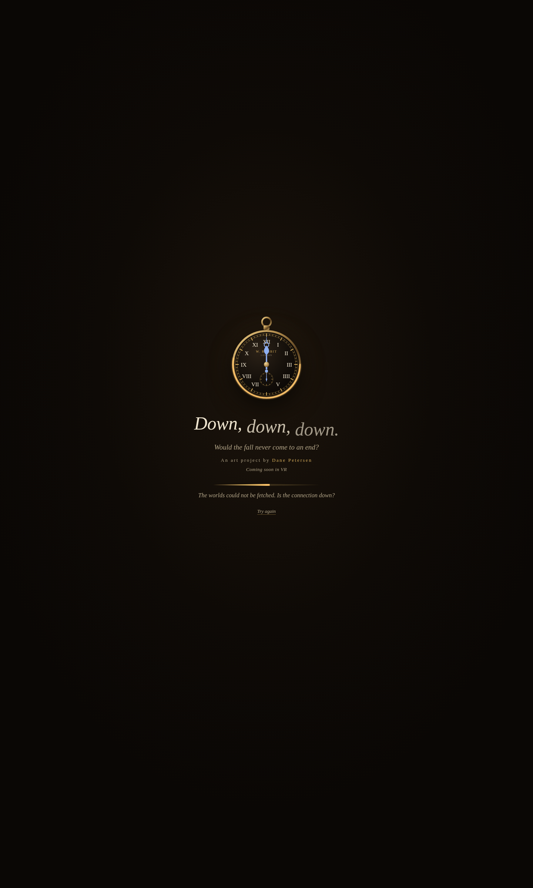

# UI Design System & Master Generation Blueprint: abyme-app

> **Curiouser and Curiouser** (https://abyme.app) — An endless fall through a keyhole into hundreds of mathematical worlds, each holding the next. An art project by Dane Petersen.



---

## 1. Executive Visual Persona & Design Archetype

- **Brand Essence & Persona**: **Curiouser and Curiouser** (`https://abyme.app`). An endless fall through a keyhole into hundreds of mathematical worlds, each holding the next. An art project by Dane Petersen.
- **Visual Archetype**: **Dark-Substrate WebGL / Canvas Interactive Experience (`#0a0705` / `#2c130f`)**.
- **Anti-AI-Slop Differentiators**:
  - **Source-Grounded Chromatic Polarity**: Anchors the viewport in `#0a0705` (`var(--ink)` in `:root`) paired with `#efe5cf` primary typography and `#2c130f` accents.
  - **Extracted Typographic Hierarchy**: Pairs `IBM Plex Mono` for display copy (`Curiouser and Curiouser`) with `IM Fell English` and `IBM Plex Mono`.
  - **Calibrated Spatial Grid & Motion**: Combines `31rem` container bounds (`gap: 12px`, padding `24px`) with `cubic-bezier(0.22,1,0.36,1)` easing and Three.js / WebGL Canvas Pipeline.

---

## 2. Spatial Architecture & Modular Grid Mathematics


### Viewport Allocation & Container Geometry
- **Captured Viewport Dimensions**: Desktop `1440×2400px` (`assets/desktop.png`, capped at 2400px multi-section capture), Mobile `390×2400px` (`assets/mobile.png`, capped at 2400px multi-section capture).
- **Master Container Bounds**: `31rem` extracted from `abyme-app` stylesheet.
- **Canvas Lateral Padding & Spacing**: `24px` lateral canvas padding with `12px` grid gap.
- **Border Radius Scale**: `50%`, `3px`, `999px`, `2px`.

### Responsive Breakpoint Architecture
- **Desktop Layout**: Multi-column CSS Grid / Flexbox layout at `1440px` (`max-width: 31rem`, `gap: 12px`).
- **Mobile Layout**: Single-column vertical stack at `390px` viewport width with `24px` horizontal padding.
- **Extracted CSS Media Queries**: `@media (max-height: 660px)`, `@media (prefers-reduced-motion: reduce)`, `@media (max-width: 640px)`, `@media (max-width: 1080px) and (min-width: 641px)`.

---

## 3. Color System, Materiality & Atmospheric Lighting

### Semantic Palette & Source Grounding
| Semantic Role | Ground-Truth Value | Extracted CSS Source / Selector |
|---|---|---|
| **Primary Canvas Substrate** | `#0a0705` | `var(--ink)` in `:root` |
| **Primary Typography Ink** | `#15100b` | `var(--smoke)` in `:root` |
| **Elevated Surface / Card Substrate** | `#1d0c0a` | `var(--cloth)` in `:root` |
| **Interactive Accent / Highlight** | `#2c130f` | `var(--cloth-hi)` in `:root` |
| **Secondary / Muted Copy** | `#efe5cf` | `var(--paper)` in `:root` |
| **Structural Hairline Border** | `#b4a689` | `var(--paper-dim)` in `:root` |
| **Variable Token (`--paper-faint`)** | `#8a7e69` | `var(--paper-faint)` in `:root` |
| **Variable Token (`--card`)** | `#e9ddc2` | `var(--card)` in `:root` |
| **Variable Token (`--card-ink`)** | `#2a1a10` | `var(--card-ink)` in `:root` |
| **Variable Token (`--card-dim`)** | `#6c5843` | `var(--card-dim)` in `:root` |
| **Variable Token (`--rubric`)** | `#8f2a1b` | `var(--rubric)` in `:root` |
| **Variable Token (`--gilt`)** | `#d8af5c` | `var(--gilt)` in `:root` |
| **Variable Token (`--lamp`)** | `#ffc46a` | `var(--lamp)` in `:root` |
| **Variable Token (`--brass`)** | `#a8834a` | `var(--brass)` in `:root` |

### Sanitized Root CSS Variables (`ui-ux.md` Ground Truth)
| Variable Name | Extracted Value | Semantic Role |
|---|---|---|
| `--ink` | `#0a0705` | Typography Ink Token |
| `--smoke` | `#15100b` | Color / Atmospheric Token |
| `--cloth` | `#1d0c0a` | Color / Atmospheric Token |
| `--cloth-hi` | `#2c130f` | Color / Atmospheric Token |
| `--paper` | `#efe5cf` | Canvas / Surface Token |
| `--paper-dim` | `#b4a689` | Canvas / Surface Token |
| `--paper-faint` | `#8a7e69` | Canvas / Surface Token |
| `--card` | `#e9ddc2` | Color / Atmospheric Token |
| `--card-ink` | `#2a1a10` | Typography Ink Token |
| `--card-dim` | `#6c5843` | Color / Atmospheric Token |
| `--rubric` | `#8f2a1b` | Color / Atmospheric Token |
| `--gilt` | `#d8af5c` | Color / Atmospheric Token |
| `--gilt-dim` | `rgba(216, 175, 92, 0.42)` | Color / Atmospheric Token |
| `--gilt-faint` | `rgba(216, 175, 92, 0.17)` | Color / Atmospheric Token |
| `--lamp` | `#ffc46a` | Color / Atmospheric Token |
| `--brass` | `#a8834a` | Color / Atmospheric Token |

---

## 4. Typographic Scale & Editorial Hierarchy

### Font Family Stacks
- **Display Typography**: `IBM Plex Mono`.
- **Primary Body Stack**: `IM Fell English`.
- **Technical / Metadata Stack**: `IBM Plex Mono`.

### Typographic Scale & Rules (Extracted from Stylesheet & Variables)
- **Hero Display (`H1`)**: rule `.title` (`font-weight: 400`).
- **Section Heading (`H2`)**: rule `h2` (`letter-spacing: -0.005em`).
- **Body Copy**: not explicitly declared on tag in static CSS (stylesheet font-size ladder: `8px`, `3px`, `1.3em`, `var(--t-pica)`, `0.78em`).
- **Metadata & Navigation Labels**: rule `.label` (`letter-spacing: 0.16em`).

---

## 5. Choreographed Motion & Interaction Physics

### Primary Easing Curves
- **Extracted Timing Functions**: `cubic-bezier(0.22,1,0.36,1)`, `cubic-bezier(0.64,0,0.78,0)`, `cubic-bezier(0.83,0,0.17,1)`.

### Per-Element Transition & Choreography Rules
- **Selector `.prelude`**: `transition: opacity 1.1s var(--ease-inout), visibility 0s linear 1.1s` extracted from `abyme-app` stylesheet.
- **Selector `.watch`**: `transition: transform 1.1s var(--ease-in)` extracted from `abyme-app` stylesheet.
- **Selector `.reel i`**: `transition: transform 240ms linear` extracted from `abyme-app` stylesheet.
- **Extracted Easing Curve (`cubic-bezier(0.22,1,0.36,1)`)**: Governs interactive state transitions across `<header.bar>` and `<section.plate>`.
- **Runtime Interaction Engine**: Integrates Three.js / WebGL Canvas Pipeline with `prefers-reduced-motion: reduce` fallback guards.

---

## 6. Component Wireframe & Structural DOM Map

### Visual Layout Schematic (Grounded in `dom.html` — `1440px` Desktop & `390px` Mobile Reflow)
```
┌────────────────────────────────────────────────────────────────────────┐
│ DESKTOP VIEWPORT (1440px) — Curiouser and Curiouser                    │
│ ====================================================================== │
│ [ <header.bar>             | Overview · Index · Archive · About · C ]  │
│ ---------------------------------------------------------------------- │
│ | HERO STAGE: <section.intro>                                      |   │
│ | H1: Curiouser and Curiouser                                      |   │
│ | Substrate: #0a0705    | Ink: #efe5cf    | Accent: #2c130f        |   │
│ ---------------------------------------------------------------------- │
│ | SHOWCASE GRID (<section.plate>           ) max-w: 31rem          |   │
│ | +------------------------------+  +------------------------------+ | │
│ | | The shader                   |  | Dream a world                | | │
│ | +------------------------------+  +------------------------------+ | │
│ ---------------------------------------------------------------------- │
│ | MOBILE VIEWPORT REFLOW (390px) — Single-Column Stack (gap: 12px  ) | │
│ | [<header.bar>] -> [<section.intro>] -> [<section.plate>] |           │
│ ---------------------------------------------------------------------- │
│ [ FOOTER (<footer.ring>         ) | https://abyme.app                  │
└────────────────────────────────────────────────────────────────────────┘
```

### Granular DOM Region Breakdown
1. **Brand Header & Navigation Bar (<header.bar> — `abyme-app`)**:
   - Landmark `<header class="bar">` hosting `Curiouser and Curiouser` navigation (`Overview · Index · Archive · About · Contact`), DOM attributes (`data-engine="three.js r170"`, `data-on="false"`, `data-do="record"`, `data-pace="slow"`), and stylesheet rule `root { padding-top:env(safe-area-inset-top);padding-bottom:env(safe-area-inset-... }`.
2. **Hero Stage & Focal Lead (<section.intro> — `Curiouser and Curiouser`)**:
   - Landmark `<section class="intro">` presenting display lead `Curiouser and Curiouser` and copy excerpt *"Would the fall never come to an end?"* over `#0a0705` canvas and `#efe5cf` ink.
3. **Primary Showcase & Content Grid (<section.plate> — `The shader`)**:
   - Landmark `<section class="plate">` rendering section `The shader` with copy *"An art project by Dane Petersen"*, asset references (`icon-180.png`, `three.module.min.js`, `UnrealBloomPass.js`, `Pass.js`), and grid rule `body { margin:0;font:14px system-ui;background:0a0705 }`.
4. **Interactive Detail & Feature Matrix (<section.help-sec> — `Dream a world`)**:
   - Landmark `<section class="help-sec help-fine">` framing `Dream a world` and `Breed with…` (*"Step in now, and let the room finish furnishing itself"*) with `#1d0c0a` surface cards, `#2c130f` accents, and `img { max-width:100% }`.
5. **Colophon & Global Directory Footer (<footer.ring> — `https://abyme.app`)**:
   - Landmark `<footer class="ring">` anchoring `Curiouser and Curiouser` footer links (`Overview · Index · Archive · About · Contact`), copy *"Click, or press any key. Tap to step in. The music begins as"*, and `#b4a689` structural dividers.

---

## 7. Master Zero-Shot AI Generation Prompt

```markdown
# Master Zero-Shot Frontend Generation Prompt: abyme-app (Curiouser and Curiouser)

You are a principal frontend architect and design systems engineer. Build a complete, production-ready web application replicating the exact design system, DOM landmarks, typographic hierarchy, color tokens, and motion physics of `abyme-app` (**Curiouser and Curiouser** — `https://abyme.app`).

### 1. Visual Archetype & Anti-AI-Slop Mandates
- **Archetype**: Dark-Substrate WebGL / Canvas Interactive Experience (`#0a0705` / `#2c130f`).
- **Identity & Domain Context**: An endless fall through a keyhole into hundreds of mathematical worlds, each holding the next. An art project by Dane Petersen.
- **Primary Substrate**: `#0a0705` (`var(--ink)` in `:root`), **Primary Ink**: `#efe5cf`, **Accent / Highlight**: `#2c130f`.
- **Site-Specific Differentiators**:
  - **Source-Grounded Chromatic Polarity**: Anchors the viewport in `#0a0705` (`var(--ink)` in `:root`) paired with `#efe5cf` primary typography and `#2c130f` accents.
  - **Extracted Typographic Hierarchy**: Pairs `IBM Plex Mono` for display copy (`Curiouser and Curiouser`) with `IM Fell English` and `IBM Plex Mono`.
  - **Calibrated Spatial Grid & Motion**: Combines `31rem` container bounds (`gap: 12px`, padding `24px`) with `cubic-bezier(0.22,1,0.36,1)` easing and Three.js / WebGL Canvas Pipeline.

### 2. Ground-Truth CSS Variables (`:root` Token Contract)
Declare and consume these exact custom properties extracted from `abyme-app` in your global stylesheet:

:root {
  /* Curiouser and Curiouser (abyme-app) — Ground-Truth Extracted CSS Variables */
  --ink: #0a0705; /* Typography Ink Token (abyme-app) */
  --smoke: #15100b; /* Color / Atmospheric Token (abyme-app) */
  --cloth: #1d0c0a; /* Color / Atmospheric Token (abyme-app) */
  --cloth-hi: #2c130f; /* Color / Atmospheric Token (abyme-app) */
  --paper: #efe5cf; /* Canvas / Surface Token (abyme-app) */
  --paper-dim: #b4a689; /* Canvas / Surface Token (abyme-app) */
  --paper-faint: #8a7e69; /* Canvas / Surface Token (abyme-app) */
  --card: #e9ddc2; /* Color / Atmospheric Token (abyme-app) */
  --card-ink: #2a1a10; /* Typography Ink Token (abyme-app) */
  --card-dim: #6c5843; /* Color / Atmospheric Token (abyme-app) */
  --rubric: #8f2a1b; /* Color / Atmospheric Token (abyme-app) */
  --gilt: #d8af5c; /* Color / Atmospheric Token (abyme-app) */
  --gilt-dim: rgba(216, 175, 92, 0.42); /* Color / Atmospheric Token (abyme-app) */
  --gilt-faint: rgba(216, 175, 92, 0.17); /* Color / Atmospheric Token (abyme-app) */
  --lamp: #ffc46a; /* Color / Atmospheric Token (abyme-app) */
  --brass: #a8834a; /* Color / Atmospheric Token (abyme-app) */
}

### 3. Semantic Color & Materiality Contract
Map every surface, ink, and border strictly to these source-grounded tokens:
- **Primary Canvas Substrate**: `#0a0705` — grounded in `var(--ink)` in `:root`
- **Primary Typography Ink**: `#15100b` — grounded in `var(--smoke)` in `:root`
- **Elevated Surface / Card Substrate**: `#1d0c0a` — grounded in `var(--cloth)` in `:root`
- **Interactive Accent / Highlight**: `#2c130f` — grounded in `var(--cloth-hi)` in `:root`
- **Secondary / Muted Copy**: `#efe5cf` — grounded in `var(--paper)` in `:root`
- **Structural Hairline Border**: `#b4a689` — grounded in `var(--paper-dim)` in `:root`
- **Variable Token (`--paper-faint`)**: `#8a7e69` — grounded in `var(--paper-faint)` in `:root`
- **Variable Token (`--card`)**: `#e9ddc2` — grounded in `var(--card)` in `:root`
- **Variable Token (`--card-ink`)**: `#2a1a10` — grounded in `var(--card-ink)` in `:root`
- **Variable Token (`--card-dim`)**: `#6c5843` — grounded in `var(--card-dim)` in `:root`
- **Variable Token (`--rubric`)**: `#8f2a1b` — grounded in `var(--rubric)` in `:root`
- **Variable Token (`--gilt`)**: `#d8af5c` — grounded in `var(--gilt)` in `:root`
- **Variable Token (`--lamp`)**: `#ffc46a` — grounded in `var(--lamp)` in `:root`
- **Variable Token (`--brass`)**: `#a8834a` — grounded in `var(--brass)` in `:root`

### 4. Spatial Grid, Container Bounds & Responsive Breakpoints
- **Desktop Viewport Reference**: `1440×2400px` (capped at 2400px multi-section capture, `1440px` standard desktop width).
- **Mobile Viewport Reference**: `390×2400px` (capped at 2400px multi-section capture, `390px` standard mobile width).
- **Container Max-Width**: `31rem` extracted from `abyme-app` stylesheet
- **Padding & Gutters**: `24px` lateral canvas padding with `12px` grid gap
- **Desktop Grid**: Multi-column CSS Grid / Flexbox layout at `1440px` (`max-width: 31rem`, `gap: 12px`)
- **Mobile Adaptation**: Single-column vertical stack at `390px` viewport width with `24px` horizontal padding
- **Media Queries**: `@media (max-height: 660px)`, `@media (prefers-reduced-motion: reduce)`, `@media (max-width: 640px)`, `@media (max-width: 1080px) and (min-width: 641px)`
- **Corner Radii**: `50%`, `3px`, `999px`, `2px`

### 5. Typography & Editorial Scale Contract
- **Display Font Stack**: `IBM Plex Mono`
- **Body Font Stack**: `IM Fell English`
- **Monospace / Technical Font Stack**: `IBM Plex Mono`
- **H1 Display Rule**: rule `.title` (`font-weight: 400`)
- **H2 Section Rule**: rule `h2` (`letter-spacing: -0.005em`)
- **Body Copy Rule**: not explicitly declared on tag in static CSS (stylesheet font-size ladder: `8px`, `3px`, `1.3em`, `var(--t-pica)`, `0.78em`)
- **Metadata & Index Rule**: rule `.label` (`letter-spacing: 0.16em`)

### 6. Component Hierarchy, Verbatim Copy & Real DOM Landmarks
Scaffold `abyme-app` (`Curiouser and Curiouser`) with these exact structural regions, extracted copy, and CSS rules from `dom.html`:
1. **Brand Header & Navigation Bar (<header.bar> — `abyme-app`)**:
   - DOM & Selectors: Landmark `<header class="bar">` hosting `Curiouser and Curiouser` navigation (`Overview · Index · Archive · About · Contact`), DOM attributes (`data-engine="three.js r170"`, `data-on="false"`, `data-do="record"`, `data-pace="slow"`), and stylesheet rule `root { padding-top:env(safe-area-inset-top);padding-bottom:env(safe-area-inset-... }`.
   - Responsive Contract: Header `Brand Header & Navigation Bar (<header.bar> — `abyme-app`)` (`abyme-app`) adapts across `@media (max-height: 660px)`, `@media (prefers-reduced-motion: reduce)`, `@media (max-width: 640px)`, `@media (max-width: 1080px) and (min-width: 641px)` with `cubic-bezier(0.22,1,0.36,1)`, `cubic-bezier(0.64,0,0.78,0)`, `cubic-bezier(0.83,0,0.17,1)` transitions and links `Overview · Index · Archive · About · Contact`.
2. **Hero Stage & Focal Lead (<section.intro> — `Curiouser and Curiouser`)**:
   - DOM & Selectors: Landmark `<section class="intro">` presenting display lead `Curiouser and Curiouser` and copy excerpt *"Would the fall never come to an end?"* over `#0a0705` canvas and `#efe5cf` ink.
   - Responsive Contract: Hero stage (`1440×2400px` desktop / `390×2400px` mobile) sets `#0a0705` background with `#efe5cf` headline `Curiouser and Curiouser`.
3. **Primary Showcase & Content Grid (<section.plate> — `The shader`)**:
   - DOM & Selectors: Landmark `<section class="plate">` rendering section `The shader` with copy *"An art project by Dane Petersen"*, asset references (`icon-180.png`, `three.module.min.js`, `UnrealBloomPass.js`, `Pass.js`), and grid rule `body { margin:0;font:14px system-ui;background:0a0705 }`.
   - Responsive Contract: Showcase grid `Primary Showcase & Content Grid (<section.plate> — `The shader`)` applies Multi-column CSS Grid / Flexbox layout at `1440px` (`max-width: 31rem`, `gap: 12px`) on desktop and Single-column vertical stack at `390px` viewport width with `24px` horizontal padding on mobile.
4. **Interactive Detail & Feature Matrix (<section.help-sec> — `Dream a world`)**:
   - DOM & Selectors: Landmark `<section class="help-sec help-fine">` framing `Dream a world` and `Breed with…` (*"Step in now, and let the room finish furnishing itself"*) with `#1d0c0a` surface cards, `#2c130f` accents, and `img { max-width:100% }`.
   - Responsive Contract: Detail module `Interactive Detail & Feature Matrix (<section.help-sec> — `Dream a world`)` uses `50%`, `3px`, `999px`, `2px` radii, `#2c130f` highlights, and assets (icon-180.png, three.module.min.js, UnrealBloomPass.js).
5. **Colophon & Global Directory Footer (<footer.ring> — `https://abyme.app`)**:
   - DOM & Selectors: Landmark `<footer class="ring">` anchoring `Curiouser and Curiouser` footer links (`Overview · Index · Archive · About · Contact`), copy *"Click, or press any key. Tap to step in. The music begins as"*, and `#b4a689` structural dividers.
   - Responsive Contract: Footer `Colophon & Global Directory Footer (<footer.ring> — `https://abyme.app`)` aligns to `31rem` extracted from `abyme-app` stylesheet with `24px` lateral canvas padding with `12px` grid gap and attributes (data-engine="three.js r170", data-on="false", data-do="record").

#### Verbatim DOM Copy Excerpts (`dom.html`)
- Copy Excerpt 1: *"Would the fall never come to an end?"*
- Copy Excerpt 2: *"An art project by Dane Petersen"*
- Copy Excerpt 3: *"Step in now, and let the room finish furnishing itself"*
- Copy Excerpt 4: *"Click, or press any key. Tap to step in. The music begins as you do."*

### 7. Motion, Extracted Stylesheet Rules & Interaction Choreography
- **Primary Easing Functions**: `cubic-bezier(0.22,1,0.36,1)`, `cubic-bezier(0.64,0,0.78,0)`, `cubic-bezier(0.83,0,0.17,1)`
- **Extracted Stylesheet Rules (`abyme-app`)**:
- `root { padding-top:env(safe-area-inset-top);padding-bottom:env(safe-area-inset-... }`
- `body { margin:0;font:14px system-ui;background:0a0705 }`
- `img { max-width:100% }`
- `button { font: inherit; color: inherit; }`
- `focus-visible { outline: 2px solid var(--lamp); outline-offset: 3px; box-shadow: 0 0 0 6... }`
- **Per-Selector Transition Rules**:
- **Selector `.prelude`**: `transition: opacity 1.1s var(--ease-inout), visibility 0s linear 1.1s` extracted from `abyme-app` stylesheet.
- **Selector `.watch`**: `transition: transform 1.1s var(--ease-in)` extracted from `abyme-app` stylesheet.
- **Selector `.reel i`**: `transition: transform 240ms linear` extracted from `abyme-app` stylesheet.
- **Extracted Easing Curve (`cubic-bezier(0.22,1,0.36,1)`)**: Governs interactive state transitions across `<header.bar>` and `<section.plate>`.
- **Runtime Interaction Engine**: Integrates Three.js / WebGL Canvas Pipeline with `prefers-reduced-motion: reduce` fallback guards.

### 8. Technical Deliverables
- Implement in Next.js (App Router) with TypeScript and Tailwind CSS consuming the `:root` custom properties defined above for `abyme-app`.
- Reproduce both the `1440px` desktop architecture and `390px` mobile breakpoint transitions, preserving semantic HTML5 landmarks (`<header>`, `<nav>`, `<main>`, `<section>`, `<footer>`) and `prefers-reduced-motion` accessibility guards.
```
