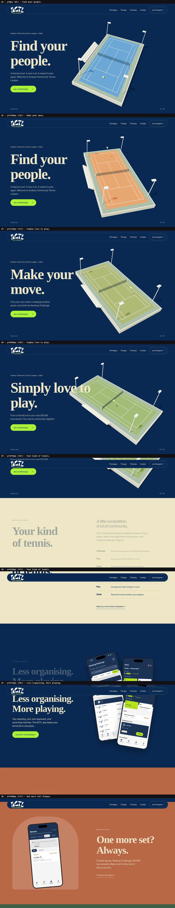
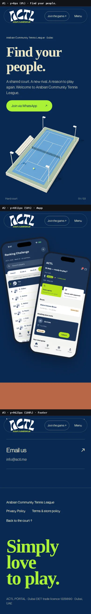

# UI Design System & Master Generation Blueprint: actl-me

> **ACTL — Arabian Community Tennis League** (https://actl.me/) — Find your next tennis match in Dubai. Discover the ACTL community, challenge players, follow your ranking and explore ACTL merchandise.





---

## 1. Executive Visual Persona & Design Archetype

- **Brand Essence & Persona**: **ACTL — Arabian Community Tennis League** (`https://actl.me/`). Find your next tennis match in Dubai. Discover the ACTL community, challenge players, follow your ranking and explore ACTL merchandise.
- **Capture Provenance**: Live browser capture (`tier1_fast`, HTTP `200`, captured `2026-11-24`).
- **Visual Archetype**: **Dark-Substrate WebGL / Canvas Interactive Experience (`#0a2952` / `#000080`)**.
- **Anti-AI-Slop Differentiators**:
  - **Live-Computed Chromatic Polarity**: Anchors the viewport in `#0a2952` (live computed `body` `background-color` (`computed_styles.json`)) paired with `#ede6c4` primary typography and `#000080` accents.
  - **Grounded Typographic Hierarchy**: Pairs `Georgia` for display copy (`Find your people.`) with `montreal`.
  - **Calibrated Spatial Grid & Motion**: Combines `1440px` container bounds (`gap: 28px`, padding `26px`) with `cubic-bezier(0.25,0.1,0.25,1)` easing and Three.js / WebGL Canvas Pipeline.

---

## 2. Spatial Architecture & Modular Grid Mathematics

### Viewport Allocation & Container Geometry
- **Captured Journey Filmstrips**: Desktop `1280×6624px` (`assets/desktop-journey.webp`, `8` keyframes up to `y=5400px` / doc `10391px`), Mobile `390×2616px` (`assets/mobile-journey.webp`, `3` keyframes).
- **Master Container Bounds**: `1440px` (full-bleed `100%` desktop stage measured on `1440px` viewport).
- **Canvas Lateral Padding & Spacing**: `26px` lateral canvas padding with `28px` grid gap.
- **Border Radius Scale**: `30px`, `40px`, `32px`, `35px`.

### Responsive Breakpoint Architecture
- **Desktop Layout**: Multi-column CSS Grid / Flexbox layout at `1440px` (`max-width: 1440px`, `gap: 28px`).
- **Mobile Layout**: Single-column vertical stack at `390px` viewport width with `26px` horizontal padding.
- **Extracted CSS Media Queries**: `@media (max-width:1000px)`, `@media (max-width:760px)`, `@media (prefers-reduced-motion:reduce)`, `@media (max-width:600px)`.

---

## 3. Color System, Materiality & Atmospheric Lighting

### Semantic Palette & Source Grounding
| Semantic Role | Ground-Truth Value | Extracted Live / CSS Source |
|---|---|---|
| **Primary Canvas Substrate** | `#0a2952` | live computed `body` `background-color` (`computed_styles.json`) |
| **Primary Typography Ink** | `#ede6c4` | live computed `h1` `color` (`computed_styles.json`) |
| **Elevated Surface / Card Substrate** | `#000080` | `body { background: navy }` (`#000080`) |
| **Interactive Accent / Highlight** | `#000080` | `.collection-colours button { color: navy }` (`#000080`) |
| **Secondary / Muted Copy** | `#8d251a` | `.checkout-error { color: #8d251a }` |
| **Structural Hairline Border** | `#6e7c84` | `.header-cta { border: #6e7c84 }` |
| **Variable Token (`--lime`)** | `#aaf136` | `var(--lime)` in `:root` |
| **Variable Token (`--paper`)** | `#f4f4f2` | `var(--paper)` in `:root` |

### Sanitized Root CSS Variables (`ui-ux.md` Ground Truth)
| Variable Name | Extracted Value | Semantic Role |
|---|---|---|
| `--navy` | `#0a2952` | Layout / Spatial Grid Token |
| `--lime` | `#aaf136` | Color / Atmospheric Token |
| `--cream` | `#ede6c4` | Color / Atmospheric Token |
| `--paper` | `#f4f4f2` | Canvas / Surface Token |
| `--font-body` | `"montreal", "montreal Fallback"` | Typography / Scale Token |
| `--actl-me-bg` | `#0a2952` | Canvas Substrate (from live computed `body` `background-color` (`computed_styles.json`)) |
| `--actl-me-ink` | `#ede6c4` | Primary Typography Ink (computed-derived) |
| `--actl-me-surface` | `#000080` | Surface Substrate (computed-derived) |
| `--actl-me-accent` | `#000080` | Interactive Accent (computed-derived) |
| `--actl-me-muted` | `#8d251a` | Secondary Ink (computed-derived) |
| `--actl-me-border` | `#6e7c84` | Structural Border (computed-derived) |
| `--actl-me-container` | `1440px` | Container Bound (computed-derived) |
| `--actl-me-gap` | `28px` | Grid Gutter (computed-derived) |
| `--actl-me-pad` | `26px` | Lateral Padding (computed-derived) |
| `--actl-me-ease` | `cubic-bezier(0.25,0.1,0.25,1)` | Primary Easing Function |
| `--actl-me-radius` | `30px` | Corner Radius (computed-derived) |

---

## 4. Typographic Scale & Editorial Hierarchy

### Font Family Stacks
- **Display Typography**: `Georgia`.
- **Primary Body Stack**: `montreal`.
- **Technical / Metadata Stack**: not declared in live computed styles (uses primary stack / `ui-monospace`).

### Typographic Scale & Rules (Live Computed & Stylesheet Grounded)
- **Hero Display (`H1`)**: live computed `h1` (`font-size: 118.08px`, `line-height: 122.803px`, `font-weight: 700`, `letter-spacing: -4.1328px`); rule `h1` (`font-size: clamp(60px,14vw,90px)`).
- **Section Heading (`H2`)**: live computed `h2` (`font-size: 93.6px`, `line-height: 97.344px`, `font-weight: 700`, `letter-spacing: -3.276px`); rule `,h2` (`line-height: 1.04`, `letter-spacing: -.035em`, `font-weight: 700`).
- **Body Copy**: live computed `body` (`font-size: 16px`, `line-height: normal`, `font-weight: 400`); CSS variables `--font-body: "montreal", "montreal Fallback"`; rule `p` (`font-size: 15px`).
- **Metadata & Navigation Labels**: live computed `nav/a` (`font-size: 14px`, `line-height: normal`, `font-weight: 400`); rule `small` (`font-size: 16px`, `letter-spacing: 0`).

---

## 5. Choreographed Motion & Interaction Physics

### Primary Easing Curves
- **Extracted Timing Functions**: `cubic-bezier(0.25,0.1,0.25,1)`.

### Per-Element Transition & Choreography Rules
- **Selector `.button`**: `transition: transform .2s,background .2s` extracted from `actl-me` stylesheet.
- **Selector `.collection-colours button`**: `transition: background .2s,border-color .2s` extracted from `actl-me` stylesheet.
- **Selector `.product-image svg`**: `transition: transform .5s` extracted from `actl-me` stylesheet.
- **Standard CSS Easing (`cubic-bezier(0.25,0.1,0.25,1)`)**: Default timing curve (no custom `cubic-bezier()` declared in captured CSS).
- **Runtime Interaction Engine**: Integrates Three.js / WebGL Canvas Pipeline with `prefers-reduced-motion: reduce` fallback guards.
### Measured Runtime Scroll & Interaction Telemetry (`behavioral_journey_v2`)
- **Scroll Driver Mode**: `wheel` (max document height `10391px`, deepest scrollY reached `5400px` across `8` desktop keyframes).
- **Detected Scroll / Motion Libraries**: `WebGL/Canvas`.
- **Hover Physics (`primary_cta` · `Join via WhatsApp ↗`)**: `transform`: `none` -> `matrix(1, 0, 0, 1, 0, 0)` (`transition-duration: 0.2s, 0.2s`, `timing: ease, ease`).
- **Interactive Control Probe (`accordion`)**: Tested `What is ACTL?` (diff `1.406`).

---

## 6. Component Wireframe & Structural DOM Map

### Visual Layout Schematic — Desktop (`1440px`, Grounded in `dom.html` & Landmark Bounding Boxes)
```
┌────────────────────────────────────────────────────────────────────────┐
│ DESKTOP VIEWPORT (1440px) — ACTL — Arabian Community Tennis League     │
│ ====================================================================== │
│ [ <header.header> (1325x68px)         | The league · The app · The s ] │
│ ---------------------------------------------------------------------- │
│ | HERO STAGE: <section.league> (w=1440px)                            | │
│ | H1: Find your people.                                              | │
│ | Substrate: #0a2952 | Ink: #ede6c4 | Accent: #000080                | │
│ ---------------------------------------------------------------------- │
│ | SHOWCASE GRID (<section.app>) max-w: 1440px                        | │
│ | +------------------------------+  +------------------------------+ | │
│ | | Your kind of tennis.         |  | Less organising. More playin | | │
│ | +------------------------------+  +------------------------------+ | │
│ ---------------------------------------------------------------------- │
│ | DETAIL MODULE (<section.match-section>) — One more set? Always.    | │
│ ---------------------------------------------------------------------- │
│ [ FOOTER (<footer.header-cta> ) | https://actl.me/                     │
└────────────────────────────────────────────────────────────────────────┘
```

### Visual Layout Schematic — Mobile Reflow (`390px`)
```
┌────────────────────────────────────────────────────────────────────────┐
│ MOBILE VIEWPORT REFLOW (390px) — Single-Column Stack (gap: 28px)       │
│ ====================================================================== │
│ [ HEADER BAR (<header.header>         ) | Compact Menu (390px)         │
│ ---------------------------------------------------------------------- │
│ | HERO STAGE (<section.league>) — 390px Vertical Lead                | │
│ | H1: Find your people.                                              | │
│ ---------------------------------------------------------------------- │
│ | SHOWCASE STACK (<section.app>) — 1-Col Stack                       | │
│ | [ Item 1: Your kind of tennis.                                   ] | │
│ | [ Item 2: Less organising. More playing.                         ] | │
│ ---------------------------------------------------------------------- │
│ | DETAIL STACK (<section.match-section>) — 1-Col (One more set? Alwa)  │
│ ---------------------------------------------------------------------- │
│ [ FOOTER (<footer.header-cta> ) | Stacked 390px Colophon               │
└────────────────────────────────────────────────────────────────────────┘
```

### Granular DOM Region Breakdown
1. **Brand Header & Navigation Bar (<header.header> — `actl-me`)**:
   - Landmark `<header class="header">` (`1325x68px`) hosting `ACTL — Arabian Community Tennis Leag` navigation (`The league · The app · The shop · Contact`), DOM attributes (`data-precedence="next"`, `data-engine="three.js r185"`, `data-reveal="true"`, `data-reveal="true"`), and stylesheet rule `real_ae148c7a-module__pSTb6W__cla... { font-family:montreal,montreal Fallback }`.
2. **Hero Stage & Focal Lead (<section.league> — `Find your people.`)**:
   - Landmark `<section class="league section">` presenting display lead `Find your people.` and copy excerpt *"Arabian Community Tennis League · Dubai"* over `#0a2952` canvas and `#ede6c4` ink.
3. **Primary Showcase & Content Grid (<section.app> — `Your kind of tennis.`)**:
   - Landmark `<section class="app section">` rendering section `Your kind of tennis.` with copy *"A shared court. A new rival. A reason to play again. Welcome to A"*, asset references (`NeueMontreal_Bold-s.p.1cs3sgkx_vm...`, `NeueMontreal_Regular-s.p.3qaxr7gv...`, `actl-logo.png`, `0xt1j8hd4-iqd.css`), and grid rule `treal_ae148c7a-module__pSTb6W__va... { --font-body:"montreal", "montreal Fallback" }`.
4. **Interactive Detail & Feature Matrix (<section.match-section> — `Less organising. More playing.`)**:
   - Landmark `<section class="match-section section">` framing `Less organising. More playing.` and `One more set? Always.` (*"More than the match"*) with `#000080` surface cards, `#000080` accents, and `root { --navy:0a2952;--lime:aaf136;--cream:ede6c4;--paper:f4f4f2 }`.
5. **Colophon & Global Directory Footer (<footer.header-cta> — `https://actl.me/`)**:
   - Landmark `<footer class="header-cta">` anchoring `ACTL — Arabian Community Tennis ` footer links (`The league · The app · The shop · Contact`), copy *"A little competition. A lot of community."*, and `#6e7c84` structural dividers.
### Full Vertical Scroll Sequence (Desktop `1440×900` Keyframes)
- **Step 01** (`y=0px`, `0%`): Active landmark `Find your people.` · sticky/fixed elements: `2`
- **Step 02** (`y=1500px`, `16%`): Active landmark `Make your move.` · sticky/fixed elements: `2`
- **Step 03** (`y=2150px`, `23%`): Active landmark `Simply love to play.` · sticky/fixed elements: `2`
- **Step 04** (`y=2800px`, `30%`): Active landmark `Simply love to play.` · sticky/fixed elements: `2`
- **Step 05** (`y=3450px`, `36%`): Active landmark `Your kind of tennis.` · sticky/fixed elements: `2`
- **Step 06** (`y=4100px`, `43%`): Active landmark `Your kind of tennis.` · sticky/fixed elements: `1`
- **Step 07** (`y=4750px`, `50%`): Active landmark `Less organising. More playing.` · sticky/fixed elements: `1`
- **Step 08** (`y=5400px`, `57%`): Active landmark `One more set? Always.` · sticky/fixed elements: `1`

---

## 7. Master Zero-Shot AI Generation Prompt

```markdown
# Master Zero-Shot Frontend Generation Prompt: actl-me (ACTL — Arabian Community Tennis League)

You are a principal frontend architect and design systems engineer. Build a complete, production-ready web application replicating the exact design system, DOM landmarks, typographic hierarchy, color tokens, and motion physics of `actl-me` (**ACTL — Arabian Community Tennis League** — `https://actl.me/`).

### 1. Visual Archetype & Anti-AI-Slop Mandates
- **Archetype**: Dark-Substrate WebGL / Canvas Interactive Experience (`#0a2952` / `#000080`).
- **Identity & Domain Context**: Find your next tennis match in Dubai. Discover the ACTL community, challenge players, follow your ranking and explore ACTL merchandise.
- **Primary Substrate**: `#0a2952` (live computed `body` `background-color` (`computed_styles.json`)), **Primary Ink**: `#ede6c4`, **Accent / Highlight**: `#000080`.
- **Site-Specific Differentiators**:
  - **Live-Computed Chromatic Polarity**: Anchors the viewport in `#0a2952` (live computed `body` `background-color` (`computed_styles.json`)) paired with `#ede6c4` primary typography and `#000080` accents.
  - **Grounded Typographic Hierarchy**: Pairs `Georgia` for display copy (`Find your people.`) with `montreal`.
  - **Calibrated Spatial Grid & Motion**: Combines `1440px` container bounds (`gap: 28px`, padding `26px`) with `cubic-bezier(0.25,0.1,0.25,1)` easing and Three.js / WebGL Canvas Pipeline.

### 2. Ground-Truth CSS Variables (`:root` Token Contract)
Declare and consume these exact custom properties extracted from `actl-me` in your global stylesheet:

:root {
  /* ACTL — Arabian Community Tennis League (actl-me) — Live-Grounded CSS Variables */
  --navy: #0a2952; /* Layout / Spatial Grid Token (actl-me) */
  --lime: #aaf136; /* Color / Atmospheric Token (actl-me) */
  --cream: #ede6c4; /* Color / Atmospheric Token (actl-me) */
  --paper: #f4f4f2; /* Canvas / Surface Token (actl-me) */
  --font-body: "montreal", "montreal Fallback"; /* Typography / Scale Token (actl-me) */
  --actl-me-bg: #0a2952; /* Canvas Substrate (from live computed `body` `background-color` (`computed_styles.json`)) (actl-me) */
  --actl-me-ink: #ede6c4; /* Primary Typography Ink (computed-derived) (actl-me) */
  --actl-me-surface: #000080; /* Surface Substrate (computed-derived) (actl-me) */
  --actl-me-accent: #000080; /* Interactive Accent (computed-derived) (actl-me) */
  --actl-me-muted: #8d251a; /* Secondary Ink (computed-derived) (actl-me) */
  --actl-me-border: #6e7c84; /* Structural Border (computed-derived) (actl-me) */
  --actl-me-container: 1440px; /* Container Bound (computed-derived) (actl-me) */
  --actl-me-gap: 28px; /* Grid Gutter (computed-derived) (actl-me) */
  --actl-me-pad: 26px; /* Lateral Padding (computed-derived) (actl-me) */
  --actl-me-ease: cubic-bezier(0.25,0.1,0.25,1); /* Primary Easing Function (actl-me) */
  --actl-me-radius: 30px; /* Corner Radius (computed-derived) (actl-me) */
}

### 3. Semantic Color & Materiality Contract
Map every surface, ink, and border strictly to these source-grounded tokens:
- **Primary Canvas Substrate**: `#0a2952` — grounded in live computed `body` `background-color` (`computed_styles.json`)
- **Primary Typography Ink**: `#ede6c4` — grounded in live computed `h1` `color` (`computed_styles.json`)
- **Elevated Surface / Card Substrate**: `#000080` — grounded in `body { background: navy }` (`#000080`)
- **Interactive Accent / Highlight**: `#000080` — grounded in `.collection-colours button { color: navy }` (`#000080`)
- **Secondary / Muted Copy**: `#8d251a` — grounded in `.checkout-error { color: #8d251a }`
- **Structural Hairline Border**: `#6e7c84` — grounded in `.header-cta { border: #6e7c84 }`
- **Variable Token (`--lime`)**: `#aaf136` — grounded in `var(--lime)` in `:root`
- **Variable Token (`--paper`)**: `#f4f4f2` — grounded in `var(--paper)` in `:root`

### 4. Spatial Grid, Container Bounds & Responsive Breakpoints
- **Desktop Viewport Reference**: `1280×6624px` (multi-frame vertical journey filmstrip (6624px), `1440px` standard desktop width).
- **Mobile Viewport Reference**: `390×2616px` (multi-frame vertical journey filmstrip (2616px), `390px` standard mobile width).
- **Container Max-Width**: `1440px` (full-bleed `100%` desktop stage measured on `1440px` viewport)
- **Padding & Gutters**: `26px` lateral canvas padding with `28px` grid gap
- **Desktop Grid**: Multi-column CSS Grid / Flexbox layout at `1440px` (`max-width: 1440px`, `gap: 28px`)
- **Mobile Adaptation**: Single-column vertical stack at `390px` viewport width with `26px` horizontal padding
- **Media Queries**: `@media (max-width:1000px)`, `@media (max-width:760px)`, `@media (prefers-reduced-motion:reduce)`, `@media (max-width:600px)`
- **Corner Radii**: `30px`, `40px`, `32px`, `35px`

### 5. Typography & Editorial Scale Contract
- **Display Font Stack**: `Georgia`
- **Body Font Stack**: `montreal`
- **Monospace / Technical Font Stack**: not declared in live computed styles (uses primary stack / `ui-monospace`)
- **H1 Display Rule**: live computed `h1` (`font-size: 118.08px`, `line-height: 122.803px`, `font-weight: 700`, `letter-spacing: -4.1328px`); rule `h1` (`font-size: clamp(60px,14vw,90px)`)
- **H2 Section Rule**: live computed `h2` (`font-size: 93.6px`, `line-height: 97.344px`, `font-weight: 700`, `letter-spacing: -3.276px`); rule `,h2` (`line-height: 1.04`, `letter-spacing: -.035em`, `font-weight: 700`)
- **Body Copy Rule**: live computed `body` (`font-size: 16px`, `line-height: normal`, `font-weight: 400`); CSS variables `--font-body: "montreal", "montreal Fallback"`; rule `p` (`font-size: 15px`)
- **Metadata & Index Rule**: live computed `nav/a` (`font-size: 14px`, `line-height: normal`, `font-weight: 400`); rule `small` (`font-size: 16px`, `letter-spacing: 0`)

### 6. Component Hierarchy, Verbatim Copy & Real DOM Landmarks
Scaffold `actl-me` (`ACTL — Arabian Community Tennis League`) with these exact structural regions, extracted copy, and CSS rules from `dom.html`:
1. **Brand Header & Navigation Bar (<header.header> — `actl-me`)**:
   - DOM & Selectors: Landmark `<header class="header">` (`1325x68px`) hosting `ACTL — Arabian Community Tennis Leag` navigation (`The league · The app · The shop · Contact`), DOM attributes (`data-precedence="next"`, `data-engine="three.js r185"`, `data-reveal="true"`, `data-reveal="true"`), and stylesheet rule `real_ae148c7a-module__pSTb6W__cla... { font-family:montreal,montreal Fallback }`.
   - Responsive Contract: Header `Brand Header & Navigation Bar (<header.header> — `actl-me`)` (`actl-me`) adapts across `@media (max-width:1000px)`, `@media (max-width:760px)`, `@media (prefers-reduced-motion:reduce)`, `@media (max-width:600px)` with `cubic-bezier(0.25,0.1,0.25,1)` transitions and links `The league · The app · The shop · Contact`.
2. **Hero Stage & Focal Lead (<section.league> — `Find your people.`)**:
   - DOM & Selectors: Landmark `<section class="league section">` presenting display lead `Find your people.` and copy excerpt *"Arabian Community Tennis League · Dubai"* over `#0a2952` canvas and `#ede6c4` ink.
   - Responsive Contract: Hero stage (`1280×6624px` desktop / `390×2616px` mobile) sets `#0a2952` background with `#ede6c4` headline `Find your people.`.
3. **Primary Showcase & Content Grid (<section.app> — `Your kind of tennis.`)**:
   - DOM & Selectors: Landmark `<section class="app section">` rendering section `Your kind of tennis.` with copy *"A shared court. A new rival. A reason to play again. Welcome to A"*, asset references (`NeueMontreal_Bold-s.p.1cs3sgkx_vm...`, `NeueMontreal_Regular-s.p.3qaxr7gv...`, `actl-logo.png`, `0xt1j8hd4-iqd.css`), and grid rule `treal_ae148c7a-module__pSTb6W__va... { --font-body:"montreal", "montreal Fallback" }`.
   - Responsive Contract: Showcase grid `Primary Showcase & Content Grid (<section.app> — `Your kind of tennis.`)` applies Multi-column CSS Grid / Flexbox layout at `1440px` (`max-width: 1440px`, `gap: 28px`) on desktop and Single-column vertical stack at `390px` viewport width with `26px` horizontal padding on mobile.
4. **Interactive Detail & Feature Matrix (<section.match-section> — `Less organising. More playing.`)**:
   - DOM & Selectors: Landmark `<section class="match-section section">` framing `Less organising. More playing.` and `One more set? Always.` (*"More than the match"*) with `#000080` surface cards, `#000080` accents, and `root { --navy:0a2952;--lime:aaf136;--cream:ede6c4;--paper:f4f4f2 }`.
   - Responsive Contract: Detail module `Interactive Detail & Feature Matrix (<section.match-section> — `Less organising. More playing.`)` uses `30px`, `40px`, `32px`, `35px` radii, `#000080` highlights, and assets (NeueMontreal_Bold-s.p.1cs3sgkx_vm..., NeueMontreal_Regular-s.p.3qaxr7gv..., actl-logo.png).
5. **Colophon & Global Directory Footer (<footer.header-cta> — `https://actl.me/`)**:
   - DOM & Selectors: Landmark `<footer class="header-cta">` anchoring `ACTL — Arabian Community Tennis ` footer links (`The league · The app · The shop · Contact`), copy *"A little competition. A lot of community."*, and `#6e7c84` structural dividers.
   - Responsive Contract: Footer `Colophon & Global Directory Footer (<footer.header-cta> — `https://actl.me/`)` aligns to `1440px` (full-bleed `100%` desktop stage measured on `1440px` viewport) with `26px` lateral canvas padding with `28px` grid gap and attributes (data-precedence="next", data-engine="three.js r185", data-reveal="true").

#### Verbatim DOM Copy Excerpts (`dom.html`)
- Copy Excerpt 1: *"Arabian Community Tennis League · Dubai"*
- Copy Excerpt 2: *"A shared court. A new rival. A reason to play again. Welcome to Arabian Community..."*
- Copy Excerpt 3: *"More than the match"*
- Copy Excerpt 4: *"A little competition. A lot of community."*

### 7. Motion, Extracted Stylesheet Rules & Interaction Choreography
- **Primary Easing Functions**: `cubic-bezier(0.25,0.1,0.25,1)`
- **Extracted Stylesheet Rules (`actl-me`)**:
- `real_ae148c7a-module__pSTb6W__cla... { font-family:montreal,montreal Fallback }`
- `treal_ae148c7a-module__pSTb6W__va... { --font-body:"montreal", "montreal Fallback" }`
- `root { --navy:0a2952;--lime:aaf136;--cream:ede6c4;--paper:f4f4f2 }`
- `html { scroll-behavior:smooth;scroll-padding-top:100px }`
- `body { background:var(--navy);color:var(--cream);font-family:var(--font-body),... }`
- **Per-Selector Transition Rules**:
- **Selector `.button`**: `transition: transform .2s,background .2s` extracted from `actl-me` stylesheet.
- **Selector `.collection-colours button`**: `transition: background .2s,border-color .2s` extracted from `actl-me` stylesheet.
- **Selector `.product-image svg`**: `transition: transform .5s` extracted from `actl-me` stylesheet.
- **Standard CSS Easing (`cubic-bezier(0.25,0.1,0.25,1)`)**: Default timing curve (no custom `cubic-bezier()` declared in captured CSS).
- **Runtime Interaction Engine**: Integrates Three.js / WebGL Canvas Pipeline with `prefers-reduced-motion: reduce` fallback guards.
### 7b. Full-Page Scroll Choreography, Interactive States & Multi-Page Routes
- **Scroll Mechanics**: Implement `wheel` vertical progression up to `10391px` across 8 distinct viewport chapters using WebGL/Canvas.
- **Vertical Chapter Sequence**: Find your people. (0%) -> Make your move. (16%) -> Simply love to play. (23%) -> Simply love to play. (30%) -> Your kind of tennis. (36%) -> Your kind of tennis. (43%) -> Less organising. More playing. (50%) -> One more set? Always. (57%).
- **Hover Micro-Interaction (`primary_cta`)**: Animate `transform` with `0.2s, 0.2s ease, ease`.

### 8. Technical Deliverables
- Implement in Next.js (App Router) with TypeScript and Tailwind CSS consuming the `:root` custom properties defined above for `actl-me`.
- Reproduce both the `1440px` desktop architecture and `390px` mobile breakpoint transitions, preserving semantic HTML5 landmarks (`<header>`, `<nav>`, `<main>`, `<section>`, `<footer>`) and `prefers-reduced-motion` accessibility guards.
```
---

## 8. Full-Page Scroll Journey, Interactive States & Subpage Inventory

### Desktop Scroll Keyframes (`1440×900` WebP)
| Step | Scroll Y | Progress | Active Landmark / Section | Sticky/Fixed | Visual Asset |
| :---: | :---: | :---: | :--- | :---: | :--- |
| `#01` | `0px` | `0%` | Find your people. | `2` | [desktop-step-01.webp](assets/desktop-step-01.webp) |
| `#02` | `1500px` | `16%` | Make your move. | `2` | [desktop-step-02.webp](assets/desktop-step-02.webp) |
| `#03` | `2150px` | `23%` | Simply love to play. | `2` | [desktop-step-03.webp](assets/desktop-step-03.webp) |
| `#04` | `2800px` | `30%` | Simply love to play. | `2` | [desktop-step-04.webp](assets/desktop-step-04.webp) |
| `#05` | `3450px` | `36%` | Your kind of tennis. | `2` | [desktop-step-05.webp](assets/desktop-step-05.webp) |
| `#06` | `4100px` | `43%` | Your kind of tennis. | `1` | [desktop-step-06.webp](assets/desktop-step-06.webp) |
| `#07` | `4750px` | `50%` | Less organising. More playing. | `1` | [desktop-step-07.webp](assets/desktop-step-07.webp) |
| `#08` | `5400px` | `57%` | One more set? Always. | `1` | [desktop-step-08.webp](assets/desktop-step-08.webp) |

### Mobile Condensed Keyframes (`390×844` WebP)
| Step | Scroll Y | Progress | Active Landmark | Visual Asset |
| :---: | :---: | :---: | :--- | :--- |
| `#01` | `0px` | `0%` | Find your people. | [mobile-step-01.webp](assets/mobile-step-01.webp) |
| `#02` | `4811px` | `50%` | #app | [mobile-step-02.webp](assets/mobile-step-02.webp) |
| `#03` | `9623px` | `100%` | Footer | [mobile-step-03.webp](assets/mobile-step-03.webp) |

