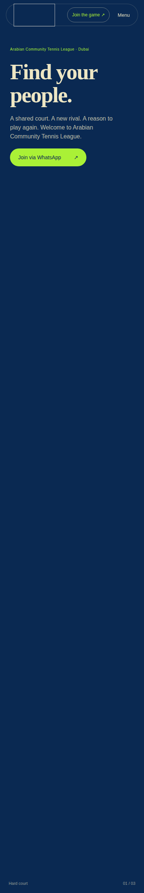

# UI Design System & Master Generation Blueprint: actl-me

> **ACTL — Arabian Community Tennis League** (https://actl.me/) — Find your next tennis match in Dubai. Discover the ACTL community, challenge players, follow your ranking and explore ACTL merchandise.


---

## 1. Executive Visual Persona & Design Archetype

- **Brand Essence & Persona**: **ACTL — Arabian Community Tennis League** (`https://actl.me/`). Find your next tennis match in Dubai. Discover the ACTL community, challenge players, follow your ranking and explore ACTL merchandise.
- **Visual Archetype**: **Dark-Substrate WebGL / Canvas Interactive Experience (`#0a2952` / `#f4f4f2`)**.
- **Anti-AI-Slop Differentiators**:
  - **Source-Grounded Chromatic Polarity**: Anchors the viewport in `#0a2952` (`var(--navy)` in `:root`) paired with `#f4f4f2` primary typography and `#f4f4f2` accents.
  - **Extracted Typographic Hierarchy**: Pairs `montreal` for display copy (`Find your people.`) with `montreal Fallback` and not declared in static CSS (uses primary stack / `ui-monospace`).
  - **Calibrated Spatial Grid & Motion**: Combines `720px` container bounds (`gap: 28px`, padding `8px`) with `cubic-bezier(0.25,0.1,0.25,1)` easing and Three.js / WebGL Canvas Pipeline.

---

## 2. Spatial Architecture & Modular Grid Mathematics



### Viewport Allocation & Container Geometry
- **Captured Viewport Dimensions**: Desktop `1440×10391px` (`assets/desktop.png`, full-page scroll capture), Mobile `390×2400px` (`assets/mobile.png`, capped at 2400px multi-section capture).
- **Master Container Bounds**: `720px` extracted from `actl-me` stylesheet.
- **Canvas Lateral Padding & Spacing**: `8px` lateral canvas padding with `28px` grid gap.
- **Border Radius Scale**: `40px`, `30px`, `32px`, `35px`.

### Responsive Breakpoint Architecture
- **Desktop Layout**: Multi-column CSS Grid / Flexbox layout at `1440px` (`max-width: 720px`, `gap: 28px`).
- **Mobile Layout**: Single-column vertical stack at `390px` viewport width with `8px` horizontal padding.
- **Extracted CSS Media Queries**: `@media (max-width:1000px)`, `@media (max-width:760px)`, `@media (prefers-reduced-motion:reduce)`, `@media (max-width:600px)`.

---

## 3. Color System, Materiality & Atmospheric Lighting

### Semantic Palette & Source Grounding
| Semantic Role | Ground-Truth Value | Extracted CSS Source / Selector |
|---|---|---|
| **Primary Canvas Substrate** | `#0a2952` | `var(--navy)` in `:root` |
| **Primary Typography Ink** | `#aaf136` | `var(--lime)` in `:root` |
| **Elevated Surface / Card Substrate** | `#ede6c4` | `var(--cream)` in `:root` |
| **Interactive Accent / Highlight** | `#f4f4f2` | `var(--paper)` in `:root` |
| **Secondary / Muted Copy** | `#000080` | `body { background: navy }` (`#000080`) |
| **Structural Hairline Border** | `#162131` | `.phone { border: #162131 }` |

### Sanitized Root CSS Variables (`ui-ux.md` Ground Truth)
| Variable Name | Extracted Value | Semantic Role |
|---|---|---|
| `--font-body` | `"montreal", "montreal Fallback"` | Typography / Scale Token |
| `--navy` | `#0a2952` | Layout / Spatial Grid Token |
| `--lime` | `#aaf136` | Color / Atmospheric Token |
| `--cream` | `#ede6c4` | Color / Atmospheric Token |
| `--paper` | `#f4f4f2` | Canvas / Surface Token |
| `--actl-me-bg` | `#0a2952` | Canvas Substrate (from `var(--navy)` in `:root`) |
| `--actl-me-ink` | `#f4f4f2` | Primary Typography Ink (stylesheet-derived) |
| `--actl-me-surface` | `#ede6c4` | Surface Substrate (stylesheet-derived) |
| `--actl-me-accent` | `#f4f4f2` | Interactive Accent (stylesheet-derived) |
| `--actl-me-muted` | `#000080` | Secondary Ink (stylesheet-derived) |
| `--actl-me-border` | `#162131` | Structural Border (stylesheet-derived) |
| `--actl-me-container` | `720px` | Container Bound (stylesheet-derived) |
| `--actl-me-gap` | `28px` | Grid Gutter (stylesheet-derived) |
| `--actl-me-pad` | `8px` | Lateral Padding (stylesheet-derived) |
| `--actl-me-ease` | `cubic-bezier(0.25,0.1,0.25,1)` | Primary Easing Function |
| `--actl-me-radius` | `40px` | Corner Radius (stylesheet-derived) |

---

## 4. Typographic Scale & Editorial Hierarchy

### Font Family Stacks
- **Display Typography**: `montreal`.
- **Primary Body Stack**: `montreal Fallback`.
- **Technical / Metadata Stack**: not declared in static CSS (uses primary stack / `ui-monospace`).

### Typographic Scale & Rules (Extracted from Stylesheet & Variables)
- **Hero Display (`H1`)**: rule `h1` (`font-size: clamp(60px,14vw,90px)`).
- **Section Heading (`H2`)**: rule `,h2` (`line-height: 1.04`, `letter-spacing: -.035em`, `font-weight: 700`).
- **Body Copy**: CSS variables `--font-body: "montreal", "montreal Fallback"`; rule `p` (`font-size: 15px`).
- **Metadata & Navigation Labels**: rule `small` (`font-size: 16px`, `letter-spacing: 0`).

---

## 5. Choreographed Motion & Interaction Physics

### Primary Easing Curves
- **Extracted Timing Functions**: `cubic-bezier(0.25,0.1,0.25,1)`.

### Per-Element Transition & Choreography Rules
- **Selector `.button`**: `transition: transform .2s,background .2s` extracted from `actl-me` stylesheet.
- **Selector `.collection-colours button`**: `transition: background .2s,border-color .2s` extracted from `actl-me` stylesheet.
- **Selector `.product-image svg`**: `transition: transform .5s` extracted from `actl-me` stylesheet.
- **Standard CSS Easing (`cubic-bezier(0.25,0.1,0.25,1)`)**: Default timing curve (no custom `cubic-bezier()` declared in static CSS).
- **Runtime Interaction Engine**: Integrates Three.js / WebGL Canvas Pipeline with `prefers-reduced-motion: reduce` fallback guards.

---

## 6. Component Wireframe & Structural DOM Map

### Visual Layout Schematic (Grounded in `dom.html` — `1440px` Desktop & `390px` Mobile Reflow)
```
┌────────────────────────────────────────────────────────────────────────┐
│ DESKTOP VIEWPORT (1440px) — ACTL — Arabian Community Tennis League     │
│ ====================================================================== │
│ [ <header.header>          | The league · The app · The shop · Cont ]  │
│ ---------------------------------------------------------------------- │
│ | HERO STAGE: <section.league>                                     |   │
│ | H1: Find your people.                                            |   │
│ | Substrate: #0a2952    | Ink: #f4f4f2    | Accent: #f4f4f2        |   │
│ ---------------------------------------------------------------------- │
│ | SHOWCASE GRID (<section.app>             ) max-w: 720px          |   │
│ | +------------------------------+  +------------------------------+ | │
│ | | Your kind of tennis.         |  | Less organising. More playin | | │
│ | +------------------------------+  +------------------------------+ | │
│ ---------------------------------------------------------------------- │
│ | MOBILE VIEWPORT REFLOW (390px) — Single-Column Stack (gap: 28px  ) | │
│ | [<header.header>] -> [<section.league>] -> [<section.app>] |         │
│ ---------------------------------------------------------------------- │
│ [ FOOTER (<footer.header-cta>   ) | https://actl.me/                   │
└────────────────────────────────────────────────────────────────────────┘
```

### Granular DOM Region Breakdown
1. **Brand Header & Navigation Bar (<header.header> — `actl-me`)**:
   - Landmark `<header class="header">` hosting `ACTL — Arabian Community Tennis Leag` navigation (`The league · The app · The shop · Contact`), DOM attributes (`data-precedence="next"`, `data-engine="three.js r185"`, `data-reveal="true"`, `data-reveal="true"`), and stylesheet rule `real_ae148c7a-module__pSTb6W__cla... { font-family:montreal,montreal Fallback }`.
2. **Hero Stage & Focal Lead (<section.league> — `Find your people.`)**:
   - Landmark `<section class="league section">` presenting display lead `Find your people.` and copy excerpt *"Arabian Community Tennis League · Dubai"* over `#0a2952` canvas and `#f4f4f2` ink.
3. **Primary Showcase & Content Grid (<section.app> — `Your kind of tennis.`)**:
   - Landmark `<section class="app section">` rendering section `Your kind of tennis.` with copy *"A shared court. A new rival. A reason to play again. Welcome to A"*, asset references (`NeueMontreal_Bold-s.p.1cs3sgkx_vm...`, `NeueMontreal_Regular-s.p.3qaxr7gv...`, `actl-logo.png`, `0xt1j8hd4-iqd.css`), and grid rule `treal_ae148c7a-module__pSTb6W__va... { --font-body:"montreal", "montreal Fallback" }`.
4. **Interactive Detail & Feature Matrix (<section.match-section> — `Less organising. More playing.`)**:
   - Landmark `<section class="match-section section">` framing `Less organising. More playing.` and `One more set? Always.` (*"Join via WhatsApp ↗"*) with `#ede6c4` surface cards, `#f4f4f2` accents, and `root { --navy:0a2952;--lime:aaf136;--cream:ede6c4;--paper:f4f4f2 }`.
5. **Colophon & Global Directory Footer (<footer.header-cta> — `https://actl.me/`)**:
   - Landmark `<footer class="header-cta">` anchoring `ACTL — Arabian Community Tennis ` footer links (`The league · The app · The shop · Contact`), copy *"More than the match"*, and `#162131` structural dividers.

---

## 7. Master Zero-Shot AI Generation Prompt

```markdown
# Master Zero-Shot Frontend Generation Prompt: actl-me (ACTL — Arabian Community Tennis League)

You are a principal frontend architect and design systems engineer. Build a complete, production-ready web application replicating the exact design system, DOM landmarks, typographic hierarchy, color tokens, and motion physics of `actl-me` (**ACTL — Arabian Community Tennis League** — `https://actl.me/`).

### 1. Visual Archetype & Anti-AI-Slop Mandates
- **Archetype**: Dark-Substrate WebGL / Canvas Interactive Experience (`#0a2952` / `#f4f4f2`).
- **Identity & Domain Context**: Find your next tennis match in Dubai. Discover the ACTL community, challenge players, follow your ranking and explore ACTL merchandise.
- **Primary Substrate**: `#0a2952` (`var(--navy)` in `:root`), **Primary Ink**: `#f4f4f2`, **Accent / Highlight**: `#f4f4f2`.
- **Site-Specific Differentiators**:
  - **Source-Grounded Chromatic Polarity**: Anchors the viewport in `#0a2952` (`var(--navy)` in `:root`) paired with `#f4f4f2` primary typography and `#f4f4f2` accents.
  - **Extracted Typographic Hierarchy**: Pairs `montreal` for display copy (`Find your people.`) with `montreal Fallback` and not declared in static CSS (uses primary stack / `ui-monospace`).
  - **Calibrated Spatial Grid & Motion**: Combines `720px` container bounds (`gap: 28px`, padding `8px`) with `cubic-bezier(0.25,0.1,0.25,1)` easing and Three.js / WebGL Canvas Pipeline.

### 2. Ground-Truth CSS Variables (`:root` Token Contract)
Declare and consume these exact custom properties extracted from `actl-me` in your global stylesheet:

:root {
  /* ACTL — Arabian Community Tennis League (actl-me) — Ground-Truth Extracted CSS Variables */
  --font-body: "montreal", "montreal Fallback"; /* Typography / Scale Token (actl-me) */
  --navy: #0a2952; /* Layout / Spatial Grid Token (actl-me) */
  --lime: #aaf136; /* Color / Atmospheric Token (actl-me) */
  --cream: #ede6c4; /* Color / Atmospheric Token (actl-me) */
  --paper: #f4f4f2; /* Canvas / Surface Token (actl-me) */
  --actl-me-bg: #0a2952; /* Canvas Substrate (from `var(--navy)` in `:root`) (actl-me) */
  --actl-me-ink: #f4f4f2; /* Primary Typography Ink (stylesheet-derived) (actl-me) */
  --actl-me-surface: #ede6c4; /* Surface Substrate (stylesheet-derived) (actl-me) */
  --actl-me-accent: #f4f4f2; /* Interactive Accent (stylesheet-derived) (actl-me) */
  --actl-me-muted: #000080; /* Secondary Ink (stylesheet-derived) (actl-me) */
  --actl-me-border: #162131; /* Structural Border (stylesheet-derived) (actl-me) */
  --actl-me-container: 720px; /* Container Bound (stylesheet-derived) (actl-me) */
  --actl-me-gap: 28px; /* Grid Gutter (stylesheet-derived) (actl-me) */
  --actl-me-pad: 8px; /* Lateral Padding (stylesheet-derived) (actl-me) */
  --actl-me-ease: cubic-bezier(0.25,0.1,0.25,1); /* Primary Easing Function (actl-me) */
  --actl-me-radius: 40px; /* Corner Radius (stylesheet-derived) (actl-me) */
}

### 3. Semantic Color & Materiality Contract
Map every surface, ink, and border strictly to these source-grounded tokens:
- **Primary Canvas Substrate**: `#0a2952` — grounded in `var(--navy)` in `:root`
- **Primary Typography Ink**: `#aaf136` — grounded in `var(--lime)` in `:root`
- **Elevated Surface / Card Substrate**: `#ede6c4` — grounded in `var(--cream)` in `:root`
- **Interactive Accent / Highlight**: `#f4f4f2` — grounded in `var(--paper)` in `:root`
- **Secondary / Muted Copy**: `#000080` — grounded in `body { background: navy }` (`#000080`)
- **Structural Hairline Border**: `#162131` — grounded in `.phone { border: #162131 }`

### 4. Spatial Grid, Container Bounds & Responsive Breakpoints
- **Desktop Viewport Reference**: `1440×10391px` (full-page scroll capture, `1440px` standard desktop width).
- **Mobile Viewport Reference**: `390×2400px` (capped at 2400px multi-section capture, `390px` standard mobile width).
- **Container Max-Width**: `720px` extracted from `actl-me` stylesheet
- **Padding & Gutters**: `8px` lateral canvas padding with `28px` grid gap
- **Desktop Grid**: Multi-column CSS Grid / Flexbox layout at `1440px` (`max-width: 720px`, `gap: 28px`)
- **Mobile Adaptation**: Single-column vertical stack at `390px` viewport width with `8px` horizontal padding
- **Media Queries**: `@media (max-width:1000px)`, `@media (max-width:760px)`, `@media (prefers-reduced-motion:reduce)`, `@media (max-width:600px)`
- **Corner Radii**: `40px`, `30px`, `32px`, `35px`

### 5. Typography & Editorial Scale Contract
- **Display Font Stack**: `montreal`
- **Body Font Stack**: `montreal Fallback`
- **Monospace / Technical Font Stack**: not declared in static CSS (uses primary stack / `ui-monospace`)
- **H1 Display Rule**: rule `h1` (`font-size: clamp(60px,14vw,90px)`)
- **H2 Section Rule**: rule `,h2` (`line-height: 1.04`, `letter-spacing: -.035em`, `font-weight: 700`)
- **Body Copy Rule**: CSS variables `--font-body: "montreal", "montreal Fallback"`; rule `p` (`font-size: 15px`)
- **Metadata & Index Rule**: rule `small` (`font-size: 16px`, `letter-spacing: 0`)

### 6. Component Hierarchy, Verbatim Copy & Real DOM Landmarks
Scaffold `actl-me` (`ACTL — Arabian Community Tennis League`) with these exact structural regions, extracted copy, and CSS rules from `dom.html`:
1. **Brand Header & Navigation Bar (<header.header> — `actl-me`)**:
   - DOM & Selectors: Landmark `<header class="header">` hosting `ACTL — Arabian Community Tennis Leag` navigation (`The league · The app · The shop · Contact`), DOM attributes (`data-precedence="next"`, `data-engine="three.js r185"`, `data-reveal="true"`, `data-reveal="true"`), and stylesheet rule `real_ae148c7a-module__pSTb6W__cla... { font-family:montreal,montreal Fallback }`.
   - Responsive Contract: Header `Brand Header & Navigation Bar (<header.header> — `actl-me`)` (`actl-me`) adapts across `@media (max-width:1000px)`, `@media (max-width:760px)`, `@media (prefers-reduced-motion:reduce)`, `@media (max-width:600px)` with `cubic-bezier(0.25,0.1,0.25,1)` transitions and links `The league · The app · The shop · Contact`.
2. **Hero Stage & Focal Lead (<section.league> — `Find your people.`)**:
   - DOM & Selectors: Landmark `<section class="league section">` presenting display lead `Find your people.` and copy excerpt *"Arabian Community Tennis League · Dubai"* over `#0a2952` canvas and `#f4f4f2` ink.
   - Responsive Contract: Hero stage (`1440×10391px` desktop / `390×2400px` mobile) sets `#0a2952` background with `#f4f4f2` headline `Find your people.`.
3. **Primary Showcase & Content Grid (<section.app> — `Your kind of tennis.`)**:
   - DOM & Selectors: Landmark `<section class="app section">` rendering section `Your kind of tennis.` with copy *"A shared court. A new rival. A reason to play again. Welcome to A"*, asset references (`NeueMontreal_Bold-s.p.1cs3sgkx_vm...`, `NeueMontreal_Regular-s.p.3qaxr7gv...`, `actl-logo.png`, `0xt1j8hd4-iqd.css`), and grid rule `treal_ae148c7a-module__pSTb6W__va... { --font-body:"montreal", "montreal Fallback" }`.
   - Responsive Contract: Showcase grid `Primary Showcase & Content Grid (<section.app> — `Your kind of tennis.`)` applies Multi-column CSS Grid / Flexbox layout at `1440px` (`max-width: 720px`, `gap: 28px`) on desktop and Single-column vertical stack at `390px` viewport width with `8px` horizontal padding on mobile.
4. **Interactive Detail & Feature Matrix (<section.match-section> — `Less organising. More playing.`)**:
   - DOM & Selectors: Landmark `<section class="match-section section">` framing `Less organising. More playing.` and `One more set? Always.` (*"Join via WhatsApp ↗"*) with `#ede6c4` surface cards, `#f4f4f2` accents, and `root { --navy:0a2952;--lime:aaf136;--cream:ede6c4;--paper:f4f4f2 }`.
   - Responsive Contract: Detail module `Interactive Detail & Feature Matrix (<section.match-section> — `Less organising. More playing.`)` uses `40px`, `30px`, `32px`, `35px` radii, `#f4f4f2` highlights, and assets (NeueMontreal_Bold-s.p.1cs3sgkx_vm..., NeueMontreal_Regular-s.p.3qaxr7gv..., actl-logo.png).
5. **Colophon & Global Directory Footer (<footer.header-cta> — `https://actl.me/`)**:
   - DOM & Selectors: Landmark `<footer class="header-cta">` anchoring `ACTL — Arabian Community Tennis ` footer links (`The league · The app · The shop · Contact`), copy *"More than the match"*, and `#162131` structural dividers.
   - Responsive Contract: Footer `Colophon & Global Directory Footer (<footer.header-cta> — `https://actl.me/`)` aligns to `720px` extracted from `actl-me` stylesheet with `8px` lateral canvas padding with `28px` grid gap and attributes (data-precedence="next", data-engine="three.js r185", data-reveal="true").

#### Verbatim DOM Copy Excerpts (`dom.html`)
- Copy Excerpt 1: *"Arabian Community Tennis League · Dubai"*
- Copy Excerpt 2: *"A shared court. A new rival. A reason to play again. Welcome to Arabian Community..."*
- Copy Excerpt 3: *"Join via WhatsApp ↗"*
- Copy Excerpt 4: *"More than the match"*

### 7. Motion, Extracted Stylesheet Rules & Interaction Choreography
- **Primary Easing Functions**: `cubic-bezier(0.25,0.1,0.25,1)`
- **Extracted Stylesheet Rules (`actl-me`)**:
- `real_ae148c7a-module__pSTb6W__cla... { font-family:montreal,montreal Fallback }`
- `treal_ae148c7a-module__pSTb6W__va... { --font-body:"montreal", "montreal Fallback" }`
- `root { --navy:0a2952;--lime:aaf136;--cream:ede6c4;--paper:f4f4f2 }`
- `html { scroll-behavior:smooth;scroll-padding-top:100px }`
- `body { background:var(--navy);color:var(--cream);font-family:var(--font-body),... }`
- **Per-Selector Transition Rules**:
- **Selector `.button`**: `transition: transform .2s,background .2s` extracted from `actl-me` stylesheet.
- **Selector `.collection-colours button`**: `transition: background .2s,border-color .2s` extracted from `actl-me` stylesheet.
- **Selector `.product-image svg`**: `transition: transform .5s` extracted from `actl-me` stylesheet.
- **Standard CSS Easing (`cubic-bezier(0.25,0.1,0.25,1)`)**: Default timing curve (no custom `cubic-bezier()` declared in static CSS).
- **Runtime Interaction Engine**: Integrates Three.js / WebGL Canvas Pipeline with `prefers-reduced-motion: reduce` fallback guards.

### 8. Technical Deliverables
- Implement in Next.js (App Router) with TypeScript and Tailwind CSS consuming the `:root` custom properties defined above for `actl-me`.
- Reproduce both the `1440px` desktop architecture and `390px` mobile breakpoint transitions, preserving semantic HTML5 landmarks (`<header>`, `<nav>`, `<main>`, `<section>`, `<footer>`) and `prefers-reduced-motion` accessibility guards.
```
