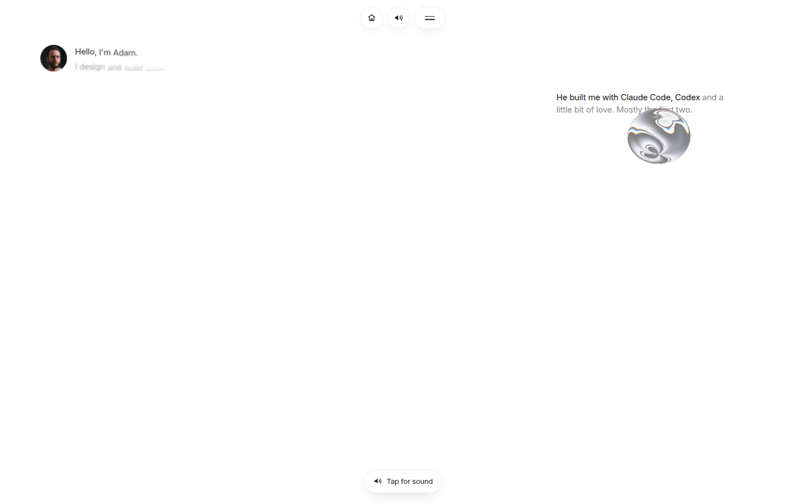
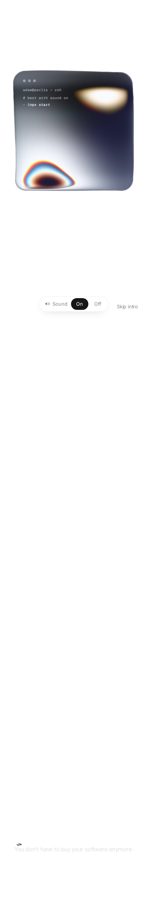

# UI Design System & Master Generation Blueprint: adamperlis-com

> **Adam Perlis — I design and build apps** (https://adamperlis.com) — Founder of Academy, formerly Head of Design at TIME and Head of UX at AKQA. I help founders and teams design, build and ship their apps.



---

## 1. Executive Visual Persona & Design Archetype

- **Brand Essence & Persona**: **Adam Perlis — I design and build apps** (`https://adamperlis.com`). Founder of Academy, formerly Head of Design at TIME and Head of UX at AKQA. I help founders and teams design, build and ship their apps.
- **Capture Provenance**: Live browser capture (`tier2_webgl`, HTTP `200`, captured `2026-11-23`).
- **Visual Archetype**: **Light-Gallery WebGL / Canvas Interactive Experience (`#ffffff` / `#009dff`)**.
- **Anti-AI-Slop Differentiators**:
  - **Live-Computed Chromatic Polarity**: Anchors the viewport in `#ffffff` (live computed `body` `background-color` (`computed_styles.json`)) paired with `#161615` primary typography and `#009dff` accents.
  - **Grounded Typographic Hierarchy**: Pairs `SF Pro Display` for display copy (`Hello, I'm Adam. I design and build `) with `SF Pro Display` and `Geist Mono Variable`.
  - **Calibrated Spatial Grid & Motion**: Combines `1408px` container bounds (`gap: 8px`, padding `16px`) with `cubic-bezier(.4,0,1,1)` easing and Lenis Smooth Scroll (`data-lenis`), GSAP Timeline & ScrollTrigger.

---

## 2. Spatial Architecture & Modular Grid Mathematics



### Viewport Allocation & Container Geometry
- **Captured Viewport Dimensions**: Desktop `1440×900px` (`assets/desktop.png`, single-viewport 100vh live capture (900px)), Mobile `390×2400px` (`assets/mobile.png`, clamped at 2400px live multi-section capture).
- **Master Container Bounds**: `1408px` (measured widest bounded `<section>` landmark width on `1440px` desktop).
- **Canvas Lateral Padding & Spacing**: `16px` lateral canvas padding with `8px` grid gap.
- **Border Radius Scale**: `3.35544e+07px`, `4px`, `.25rem`, `var(--radius-2xl)`.

### Responsive Breakpoint Architecture
- **Desktop Layout**: Multi-column CSS Grid / Flexbox layout at `1440px` (`max-width: 1408px`, `gap: 8px`).
- **Mobile Layout**: Single-column vertical stack at `390px` viewport width with `16px` horizontal padding.
- **Extracted CSS Media Queries**: `@media (width>=40rem)`, `@media (width>=48rem)`, `@media (width>=64rem)`, `@media (width>=80rem)`.

---

## 3. Color System, Materiality & Atmospheric Lighting

### Semantic Palette & Source Grounding
| Semantic Role | Ground-Truth Value | Extracted Live / CSS Source |
|---|---|---|
| **Primary Canvas Substrate** | `#ffffff` | live computed `body` `background-color` (`computed_styles.json`) |
| **Primary Typography Ink** | `#161615` | live computed `h1` `color` (`computed_styles.json`) |
| **Elevated Surface / Card Substrate** | `#e4e4df` | `:hover { background-color: #e4e4df }` |
| **Interactive Accent / Highlight** | `#009dff` | `var(--color-glass)` in `:root` |
| **Secondary / Muted Copy** | `#8a8a85` | live computed `p` `color` (`computed_styles.json`) |
| **Structural Hairline Border** | `#ebebe7` | `var(--color-rule)` in `:root` |
| **Variable Token (`--color-black`)** | `#000000` | `var(--color-black)` in `:root` |

### Sanitized Root CSS Variables (`ui-ux.md` Ground Truth)
| Variable Name | Extracted Value | Semantic Role |
|---|---|---|
| `--font-mono` | `"Geist Mono Variable", ui-monospace, "SF Mono", Menlo, monospace` | Typography / Scale Token |
| `--color-red-500` | `oklch(63.7% .237 25.331)` | Brand / Palette Token |
| `--color-black` | `#000` | Canvas / Surface Token |
| `--color-white` | `#fff` | Canvas / Surface Token |
| `--spacing` | `.25rem` | Layout / Spatial Grid Token |
| `--container-sm` | `24rem` | Layout / Spatial Grid Token |
| `--container-md` | `28rem` | Layout / Spatial Grid Token |
| `--container-lg` | `32rem` | Layout / Spatial Grid Token |
| `--container-xl` | `36rem` | Layout / Spatial Grid Token |
| `--container-2xl` | `42rem` | Layout / Spatial Grid Token |
| `--container-3xl` | `48rem` | Layout / Spatial Grid Token |
| `--container-4xl` | `56rem` | Layout / Spatial Grid Token |
| `--container-5xl` | `64rem` | Layout / Spatial Grid Token |
| `--container-6xl` | `72rem` | Layout / Spatial Grid Token |
| `--text-xs` | `.75rem` | Typography Ink Token |
| `--text-xs--line-height` | `calc(1 / .75)` | Typography Ink Token |

---

## 4. Typographic Scale & Editorial Hierarchy

### Font Family Stacks
- **Display Typography**: `SF Pro Display`.
- **Primary Body Stack**: `SF Pro Display`.
- **Technical / Metadata Stack**: `Geist Mono Variable`.

### Typographic Scale & Rules (Live Computed & Stylesheet Grounded)
- **Hero Display (`H1`)**: live computed `h1` (`font-size: 15px`, `line-height: 22.5px`, `font-weight: 400`, `letter-spacing: -0.21px`); CSS variables `--text-4xl: 2.25rem`, `--text-4xl--line-height: calc(2.5 / 2.25)`, `--text-5xl: 3rem`.
- **Section Heading (`H2`)**: CSS variables `--text-2xl: 1.5rem`, `--text-2xl--line-height: calc(2 / 1.5)`, `--text-3xl: 1.875rem`.
- **Body Copy**: live computed `body` (`font-size: 15px`, `line-height: 22.5px`, `font-weight: 400`, `letter-spacing: -0.21px`); CSS variables `--text-base: 1rem`, `--text-base--line-height: calc(1.5 / 1)`.
- **Metadata & Navigation Labels**: live computed `nav/a` (`font-size: 15px`, `line-height: 22.5px`, `font-weight: 400`, `letter-spacing: -0.21px`); CSS variables `--font-mono: "Geist Mono Variable", ui-monospace, "SF Mono", Menlo, monospace`, `--text-xs: .75rem`, `--text-xs--line-height: calc(1 / .75)`.

---

## 5. Choreographed Motion & Interaction Physics

### Primary Easing Curves
- **Extracted Timing Functions**: `cubic-bezier(.4,0,1,1)`, `cubic-bezier(0,0,.2,1)`, `cubic-bezier(.4,0,.2,1)`.

### Per-Element Transition & Choreography Rules
- **Selector `layer theme`**: `transition: .15s` extracted from `adamperlis-com` stylesheet.
- **Selector `.metal-glass`**: `transition: background-color .45s var(--ease-out-quart), backdrop-filter ....` extracted from `adamperlis-com` stylesheet.
- **Selector `.metal-halo`**: `transition: opacity .45s var(--ease-out-quart)` extracted from `adamperlis-com` stylesheet.
- **Extracted Easing Curve (`cubic-bezier(.4,0,1,1)`)**: Governs interactive state transitions across `<header.pointer-events-none>` and `<section.moment>`.
- **Runtime Interaction Engine**: Integrates Lenis Smooth Scroll (`data-lenis`), GSAP Timeline & ScrollTrigger, Three.js / WebGL Canvas Pipeline, Barba.js Page Transition Router with `prefers-reduced-motion: reduce` fallback guards.

---

## 6. Component Wireframe & Structural DOM Map

### Visual Layout Schematic — Desktop (`1440px`, Grounded in `dom.html` & Landmark Bounding Boxes)
```
┌────────────────────────────────────────────────────────────────────────┐
│ DESKTOP VIEWPORT (1440px) — Adam Perlis — I design and build apps      │
│ ====================================================================== │
│ [ <header.pointer-events (1440x52px)  | 01 Home · 02 Work · 03 Skill ] │
│ ---------------------------------------------------------------------- │
│ | HERO STAGE: <section.wrap> (w=1440px)                              | │
│ | H1: Hello, I'm Adam. I design and build apps.                      | │
│ | Substrate: #ffffff | Ink: #161615 | Accent: #009dff                | │
│ ---------------------------------------------------------------------- │
│ | SHOWCASE GRID (<section.moment>) max-w: 1408px                     | │
│ | +------------------------------+  +------------------------------+ | │
│ | | He built me with Claude Code |  | I design and build apps.     | | │
│ | +------------------------------+  +------------------------------+ | │
│ ---------------------------------------------------------------------- │
│ | DETAIL MODULE (<section.place-items-cente) — Fifteen years leading | │
│ ---------------------------------------------------------------------- │
│ [ FOOTER (<footer.wrap>       ) | https://adamperlis.com               │
└────────────────────────────────────────────────────────────────────────┘
```

### Visual Layout Schematic — Mobile Reflow (`390px`)
```
┌────────────────────────────────────────────────────────────────────────┐
│ MOBILE VIEWPORT REFLOW (390px) — Single-Column Stack (gap: 8px)        │
│ ====================================================================== │
│ [ HEADER BAR (<header.pointer-events-n) | Compact Menu (390px)         │
│ ---------------------------------------------------------------------- │
│ | HERO STAGE (<section.wrap>) — 390px Vertical Lead                  | │
│ | H1: Hello, I'm Adam. I design and build apps.                      | │
│ ---------------------------------------------------------------------- │
│ | SHOWCASE STACK (<section.moment>) — 1-Col Stack                    | │
│ | [ Item 1: He built me with Claude Code, Codex and a little       ] | │
│ | [ Item 2: I design and build apps.                               ] | │
│ ---------------------------------------------------------------------- │
│ | DETAIL STACK (<section.place-items-cen) — 1-Col (Fifteen years lead) │
│ ---------------------------------------------------------------------- │
│ [ FOOTER (<footer.wrap>       ) | Stacked 390px Colophon               │
└────────────────────────────────────────────────────────────────────────┘
```

### Granular DOM Region Breakdown
1. **Brand Header & Navigation Bar (<header.pointer-events-none> — `adamperlis-com`)**:
   - Landmark `<header class="pointer-events-none inset-x-0">` (`1440x52px`) hosting `Adam Perlis — I design and build app` navigation (`01 Home · 02 Work · 03 Skills · 04 Playground · 05 Services`), DOM attributes (`data-paper-shader`, `data-site-header`, `data-home`, `data-buddy-sound`), and stylesheet rule `backdrop { box-sizing:border-box;border:0 solid;margin:0;padding:0 }`.
2. **Hero Stage & Focal Lead (<section.wrap> — `Hello, I'm Adam. I design and buil`)**:
   - Landmark `<section class="wrap relative">` presenting display lead `Hello, I'm Adam. I design and build apps.` and copy excerpt *"He built me with Claude Code, Codex and a little bit of love. Mos"* over `#ffffff` canvas and `#161615` ink.
3. **Primary Showcase & Content Grid (<section.moment> — `He built me with Claude Code, Code`)**:
   - Landmark `<section class="moment py-12">` rendering section `He built me with Claude Code, Codex and a little` with copy *"I design and build apps."*, asset references (`favicon.ico`, `favicon-32.png`, `apple-touch-icon.png`, `site.webmanifest`), and grid rule `file-selector-button { box-sizing:border-box;border:0 solid;margin:0;padding:0 }`.
4. **Interactive Detail & Feature Matrix (<section.place-items-center> — `I design and build apps.`)**:
   - Landmark `<section class="place-items-center grid">` framing `I design and build apps.` and `Fifteen years leading design for clients like Go` (*"Fifteen years leading design for clients like Google, Microsoft, "*) with `#e4e4df` surface cards, `#009dff` accents, and `strong { font-weight:bolder }`.
5. **Colophon & Global Directory Footer (<footer.wrap> — `https://adamperlis.com`)**:
   - Landmark `<footer class="wrap gap-4">` anchoring `Adam Perlis — I design and build` footer links (`01 Home · 02 Work · 03 Skills · 04 Playground · 05 Services`), copy *"Formerly Head of Product Design at TIME, AKQA, B-Reel and BA"*, and `#ebebe7` structural dividers.

---

## 7. Master Zero-Shot AI Generation Prompt

```markdown
# Master Zero-Shot Frontend Generation Prompt: adamperlis-com (Adam Perlis — I design and build apps)

You are a principal frontend architect and design systems engineer. Build a complete, production-ready web application replicating the exact design system, DOM landmarks, typographic hierarchy, color tokens, and motion physics of `adamperlis-com` (**Adam Perlis — I design and build apps** — `https://adamperlis.com`).

### 1. Visual Archetype & Anti-AI-Slop Mandates
- **Archetype**: Light-Gallery WebGL / Canvas Interactive Experience (`#ffffff` / `#009dff`).
- **Identity & Domain Context**: Founder of Academy, formerly Head of Design at TIME and Head of UX at AKQA. I help founders and teams design, build and ship their apps.
- **Primary Substrate**: `#ffffff` (live computed `body` `background-color` (`computed_styles.json`)), **Primary Ink**: `#161615`, **Accent / Highlight**: `#009dff`.
- **Site-Specific Differentiators**:
  - **Live-Computed Chromatic Polarity**: Anchors the viewport in `#ffffff` (live computed `body` `background-color` (`computed_styles.json`)) paired with `#161615` primary typography and `#009dff` accents.
  - **Grounded Typographic Hierarchy**: Pairs `SF Pro Display` for display copy (`Hello, I'm Adam. I design and build `) with `SF Pro Display` and `Geist Mono Variable`.
  - **Calibrated Spatial Grid & Motion**: Combines `1408px` container bounds (`gap: 8px`, padding `16px`) with `cubic-bezier(.4,0,1,1)` easing and Lenis Smooth Scroll (`data-lenis`), GSAP Timeline & ScrollTrigger.

### 2. Ground-Truth CSS Variables (`:root` Token Contract)
Declare and consume these exact custom properties extracted from `adamperlis-com` in your global stylesheet:

:root {
  /* Adam Perlis — I design and build apps (adamperlis-com) — Live-Grounded CSS Variables */
  --font-mono: "Geist Mono Variable", ui-monospace, "SF Mono", Menlo, monospace; /* Typography / Scale Token (adamperlis-com) */
  --color-red-500: oklch(63.7% .237 25.331); /* Brand / Palette Token (adamperlis-com) */
  --color-black: #000; /* Canvas / Surface Token (adamperlis-com) */
  --color-white: #fff; /* Canvas / Surface Token (adamperlis-com) */
  --spacing: .25rem; /* Layout / Spatial Grid Token (adamperlis-com) */
  --container-sm: 24rem; /* Layout / Spatial Grid Token (adamperlis-com) */
  --container-md: 28rem; /* Layout / Spatial Grid Token (adamperlis-com) */
  --container-lg: 32rem; /* Layout / Spatial Grid Token (adamperlis-com) */
  --container-xl: 36rem; /* Layout / Spatial Grid Token (adamperlis-com) */
  --container-2xl: 42rem; /* Layout / Spatial Grid Token (adamperlis-com) */
  --container-3xl: 48rem; /* Layout / Spatial Grid Token (adamperlis-com) */
  --container-4xl: 56rem; /* Layout / Spatial Grid Token (adamperlis-com) */
  --container-5xl: 64rem; /* Layout / Spatial Grid Token (adamperlis-com) */
  --container-6xl: 72rem; /* Layout / Spatial Grid Token (adamperlis-com) */
  --text-xs: .75rem; /* Typography Ink Token (adamperlis-com) */
  --text-xs--line-height: calc(1 / .75); /* Typography Ink Token (adamperlis-com) */
}

### 3. Semantic Color & Materiality Contract
Map every surface, ink, and border strictly to these source-grounded tokens:
- **Primary Canvas Substrate**: `#ffffff` — grounded in live computed `body` `background-color` (`computed_styles.json`)
- **Primary Typography Ink**: `#161615` — grounded in live computed `h1` `color` (`computed_styles.json`)
- **Elevated Surface / Card Substrate**: `#e4e4df` — grounded in `:hover { background-color: #e4e4df }`
- **Interactive Accent / Highlight**: `#009dff` — grounded in `var(--color-glass)` in `:root`
- **Secondary / Muted Copy**: `#8a8a85` — grounded in live computed `p` `color` (`computed_styles.json`)
- **Structural Hairline Border**: `#ebebe7` — grounded in `var(--color-rule)` in `:root`
- **Variable Token (`--color-black`)**: `#000000` — grounded in `var(--color-black)` in `:root`

### 4. Spatial Grid, Container Bounds & Responsive Breakpoints
- **Desktop Viewport Reference**: `1440×900px` (single-viewport 100vh live capture (900px), `1440px` standard desktop width).
- **Mobile Viewport Reference**: `390×2400px` (clamped at 2400px live multi-section capture, `390px` standard mobile width).
- **Container Max-Width**: `1408px` (measured widest bounded `<section>` landmark width on `1440px` desktop)
- **Padding & Gutters**: `16px` lateral canvas padding with `8px` grid gap
- **Desktop Grid**: Multi-column CSS Grid / Flexbox layout at `1440px` (`max-width: 1408px`, `gap: 8px`)
- **Mobile Adaptation**: Single-column vertical stack at `390px` viewport width with `16px` horizontal padding
- **Media Queries**: `@media (width>=40rem)`, `@media (width>=48rem)`, `@media (width>=64rem)`, `@media (width>=80rem)`
- **Corner Radii**: `3.35544e+07px`, `4px`, `.25rem`, `var(--radius-2xl)`

### 5. Typography & Editorial Scale Contract
- **Display Font Stack**: `SF Pro Display`
- **Body Font Stack**: `SF Pro Display`
- **Monospace / Technical Font Stack**: `Geist Mono Variable`
- **H1 Display Rule**: live computed `h1` (`font-size: 15px`, `line-height: 22.5px`, `font-weight: 400`, `letter-spacing: -0.21px`); CSS variables `--text-4xl: 2.25rem`, `--text-4xl--line-height: calc(2.5 / 2.25)`, `--text-5xl: 3rem`
- **H2 Section Rule**: CSS variables `--text-2xl: 1.5rem`, `--text-2xl--line-height: calc(2 / 1.5)`, `--text-3xl: 1.875rem`
- **Body Copy Rule**: live computed `body` (`font-size: 15px`, `line-height: 22.5px`, `font-weight: 400`, `letter-spacing: -0.21px`); CSS variables `--text-base: 1rem`, `--text-base--line-height: calc(1.5 / 1)`
- **Metadata & Index Rule**: live computed `nav/a` (`font-size: 15px`, `line-height: 22.5px`, `font-weight: 400`, `letter-spacing: -0.21px`); CSS variables `--font-mono: "Geist Mono Variable", ui-monospace, "SF Mono", Menlo, monospace`, `--text-xs: .75rem`, `--text-xs--line-height: calc(1 / .75)`

### 6. Component Hierarchy, Verbatim Copy & Real DOM Landmarks
Scaffold `adamperlis-com` (`Adam Perlis — I design and build apps`) with these exact structural regions, extracted copy, and CSS rules from `dom.html`:
1. **Brand Header & Navigation Bar (<header.pointer-events-none> — `adamperlis-com`)**:
   - DOM & Selectors: Landmark `<header class="pointer-events-none inset-x-0">` (`1440x52px`) hosting `Adam Perlis — I design and build app` navigation (`01 Home · 02 Work · 03 Skills · 04 Playground · 05 Services`), DOM attributes (`data-paper-shader`, `data-site-header`, `data-home`, `data-buddy-sound`), and stylesheet rule `backdrop { box-sizing:border-box;border:0 solid;margin:0;padding:0 }`.
   - Responsive Contract: Header `Brand Header & Navigation Bar (<header.pointer-events-none> — `adamperlis-com`)` (`adamperlis-com`) adapts across `@media (width>=40rem)`, `@media (width>=48rem)`, `@media (width>=64rem)`, `@media (width>=80rem)` with `cubic-bezier(.4,0,1,1)`, `cubic-bezier(0,0,.2,1)`, `cubic-bezier(.4,0,.2,1)` transitions and links `01 Home · 02 Work · 03 Skills · 04 Playground · 05 Services`.
2. **Hero Stage & Focal Lead (<section.wrap> — `Hello, I'm Adam. I design and buil`)**:
   - DOM & Selectors: Landmark `<section class="wrap relative">` presenting display lead `Hello, I'm Adam. I design and build apps.` and copy excerpt *"He built me with Claude Code, Codex and a little bit of love. Mos"* over `#ffffff` canvas and `#161615` ink.
   - Responsive Contract: Hero stage (`1440×900px` desktop / `390×2400px` mobile) sets `#ffffff` background with `#161615` headline `Hello, I'm Adam. I design and build apps.`.
3. **Primary Showcase & Content Grid (<section.moment> — `He built me with Claude Code, Code`)**:
   - DOM & Selectors: Landmark `<section class="moment py-12">` rendering section `He built me with Claude Code, Codex and a little` with copy *"I design and build apps."*, asset references (`favicon.ico`, `favicon-32.png`, `apple-touch-icon.png`, `site.webmanifest`), and grid rule `file-selector-button { box-sizing:border-box;border:0 solid;margin:0;padding:0 }`.
   - Responsive Contract: Showcase grid `Primary Showcase & Content Grid (<section.moment> — `He built me with Claude Code, Code`)` applies Multi-column CSS Grid / Flexbox layout at `1440px` (`max-width: 1408px`, `gap: 8px`) on desktop and Single-column vertical stack at `390px` viewport width with `16px` horizontal padding on mobile.
4. **Interactive Detail & Feature Matrix (<section.place-items-center> — `I design and build apps.`)**:
   - DOM & Selectors: Landmark `<section class="place-items-center grid">` framing `I design and build apps.` and `Fifteen years leading design for clients like Go` (*"Fifteen years leading design for clients like Google, Microsoft, "*) with `#e4e4df` surface cards, `#009dff` accents, and `strong { font-weight:bolder }`.
   - Responsive Contract: Detail module `Interactive Detail & Feature Matrix (<section.place-items-center> — `I design and build apps.`)` uses `3.35544e+07px`, `4px`, `.25rem`, `var(--radius-2xl)` radii, `#009dff` highlights, and assets (favicon.ico, favicon-32.png, apple-touch-icon.png).
5. **Colophon & Global Directory Footer (<footer.wrap> — `https://adamperlis.com`)**:
   - DOM & Selectors: Landmark `<footer class="wrap gap-4">` anchoring `Adam Perlis — I design and build` footer links (`01 Home · 02 Work · 03 Skills · 04 Playground · 05 Services`), copy *"Formerly Head of Product Design at TIME, AKQA, B-Reel and BA"*, and `#ebebe7` structural dividers.
   - Responsive Contract: Footer `Colophon & Global Directory Footer (<footer.wrap> — `https://adamperlis.com`)` aligns to `1408px` (measured widest bounded `<section>` landmark width on `1440px` desktop) with `16px` lateral canvas padding with `8px` grid gap and attributes (data-paper-shader, data-site-header, data-home).

#### Verbatim DOM Copy Excerpts (`dom.html`)
- Copy Excerpt 1: *"He built me with Claude Code, Codex and a little bit of love. Mostly the first two."*
- Copy Excerpt 2: *"I design and build apps."*
- Copy Excerpt 3: *"Fifteen years leading design for clients like Google, Microsoft, Amazon, Meta and..."*
- Copy Excerpt 4: *"Formerly Head of Product Design at TIME, AKQA, B-Reel and BASIC/DEPT®. Founder of..."*

### 7. Motion, Extracted Stylesheet Rules & Interaction Choreography
- **Primary Easing Functions**: `cubic-bezier(.4,0,1,1)`, `cubic-bezier(0,0,.2,1)`, `cubic-bezier(.4,0,.2,1)`
- **Extracted Stylesheet Rules (`adamperlis-com`)**:
- `backdrop { box-sizing:border-box;border:0 solid;margin:0;padding:0 }`
- `file-selector-button { box-sizing:border-box;border:0 solid;margin:0;padding:0 }`
- `strong { font-weight:bolder }`
- `small { font-size:80% }`
- `sup { vertical-align:baseline;font-size:75%;line-height:0;position:relative }`
- **Per-Selector Transition Rules**:
- **Selector `layer theme`**: `transition: .15s` extracted from `adamperlis-com` stylesheet.
- **Selector `.metal-glass`**: `transition: background-color .45s var(--ease-out-quart), backdrop-filter ....` extracted from `adamperlis-com` stylesheet.
- **Selector `.metal-halo`**: `transition: opacity .45s var(--ease-out-quart)` extracted from `adamperlis-com` stylesheet.
- **Extracted Easing Curve (`cubic-bezier(.4,0,1,1)`)**: Governs interactive state transitions across `<header.pointer-events-none>` and `<section.moment>`.
- **Runtime Interaction Engine**: Integrates Lenis Smooth Scroll (`data-lenis`), GSAP Timeline & ScrollTrigger, Three.js / WebGL Canvas Pipeline, Barba.js Page Transition Router with `prefers-reduced-motion: reduce` fallback guards.

### 8. Technical Deliverables
- Implement in Next.js (App Router) with TypeScript and Tailwind CSS consuming the `:root` custom properties defined above for `adamperlis-com`.
- Reproduce both the `1440px` desktop architecture and `390px` mobile breakpoint transitions, preserving semantic HTML5 landmarks (`<header>`, `<nav>`, `<main>`, `<section>`, `<footer>`) and `prefers-reduced-motion` accessibility guards.
```
