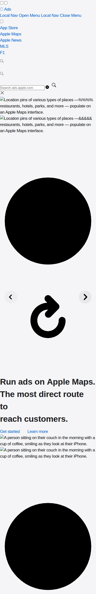

# UI Design System & Master Generation Blueprint: ads-apple-com

> **Apple Ads** (http://ads.apple.com) — Reach customers where only Apple Ads can take you. Learn how to grow your business with ads on the App Store, Apple Maps, Apple News, MLS...


---

## 1. Executive Visual Persona & Design Archetype

- **Brand Essence & Persona**: **Apple Ads** (`http://ads.apple.com`). Reach customers where only Apple Ads can take you. Learn how to grow your business with ads on the App Store, Apple Maps, Apple News, MLS...
- **Visual Archetype**: **Light-Substrate Editorial & Modular Grid System (`#f5f5f7` canvas, `#1d1d1f` ink, `#06c` accent)**.
- **Anti-AI-Slop Differentiators**:
  - **Source-Grounded Chromatic Polarity**: Anchors the viewport in `#f5f5f7` (`var(--buystrip-background)` in `:root`) paired with `#1d1d1f` primary typography and `#06c` accents.
  - **Extracted Typographic Hierarchy**: Pairs `Apple Legacy Chevron` for display copy (`Enable JavaScript`) with `SF Pro Display` and not declared in static CSS (uses primary stack / `ui-monospace`).
  - **Calibrated Spatial Grid & Motion**: Combines `833px` container bounds (`gap: var(--sk-cssgrid-column-gutter-inner-large)`, padding `22px`) with `cubic-bezier(.4,0,.6,1)` easing and Three.js / WebGL Canvas Pipeline.

---

## 2. Spatial Architecture & Modular Grid Mathematics



### Viewport Allocation & Container Geometry
- **Captured Viewport Dimensions**: Desktop `1440×7027px` (`assets/desktop.png`, full-page scroll capture), Mobile `390×2400px` (`assets/mobile.png`, capped at 2400px multi-section capture).
- **Master Container Bounds**: `833px` extracted from `ads-apple-com` stylesheet.
- **Canvas Lateral Padding & Spacing**: `22px` lateral canvas padding with `var(--sk-cssgrid-column-gutter-inner-large)` grid gap.
- **Border Radius Scale**: `5px`, `6px`, `980px`, `var(--sk-button-border-radius)`.

### Responsive Breakpoint Architecture
- **Desktop Layout**: Multi-column CSS Grid / Flexbox layout at `1440px` (`max-width: 833px`, `gap: var(--sk-cssgrid-column-gutter-inner-large)`).
- **Mobile Layout**: Single-column vertical stack at `390px` viewport width with `22px` horizontal padding.
- **Extracted CSS Media Queries**: `@media only screen and (max-width: 833px)`, `@media only screen and (max-width: 480px)`, `@media only screen and (max-width: 1023px)`, `@media only screen and (max-width: 734px)`.

---

## 3. Color System, Materiality & Atmospheric Lighting

### Semantic Palette & Source Grounding
| Semantic Role | Ground-Truth Value | Extracted CSS Source / Selector |
|---|---|---|
| **Primary Canvas Substrate** | `#f5f5f7` | `var(--buystrip-background)` in `:root` |
| **Primary Typography Ink** | `#d2d2d7` | `var(--buystrip-border-color)` in `:root` |
| **Elevated Surface / Card Substrate** | `#1d1d1f` | `var(--buystrip-text-color)` in `:root` |
| **Interactive Accent / Highlight** | `#06c` | `var(--buystrip-link-color)` in `:root` |
| **Secondary / Muted Copy** | `#6e6e73` | `var(--buystrip-icon-color)` in `:root` |
| **Structural Hairline Border** | `#424245` | `var(--footer-link-color)` in `:root` |
| **Variable Token (`--footer-pipe-color`)** | `#86868b` | `var(--footer-pipe-color)` in `:root` |
| **Variable Token (`--footer-directory-title-color-hover`)** | `#000` | `var(--footer-directory-title-color-hover)` in `:root` |

### Sanitized Root CSS Variables (`ui-ux.md` Ground Truth)
| Variable Name | Extracted Value | Semantic Role |
|---|---|---|
| `--buystrip-background` | `#f5f5f7` | Canvas / Surface Token |
| `--buystrip-border-color` | `#d2d2d7` | Brand / Palette Token |
| `--buystrip-text-color` | `#1d1d1f` | Typography Ink Token |
| `--buystrip-link-color` | `#06c` | Typography Ink Token |
| `--buystrip-icon-color` | `#6e6e73` | Brand / Palette Token |
| `--buystrip-content-maxwidth` | `980px` | Layout / Spatial Grid Token |
| `--buystrip-content-padding` | `22px` | Layout / Spatial Grid Token |
| `--buystrip-items-padding-top` | `0` | Layout / Spatial Grid Token |
| `--buystrip-items-padding-bottom` | `56px` | Layout / Spatial Grid Token |
| `--footer-background` | `#f5f5f7` | Canvas / Surface Token |
| `--footer-border-color` | `#d2d2d7` | Brand / Palette Token |
| `--footer-text-color` | `#6e6e73` | Typography Ink Token |
| `--footer-link-color` | `#424245` | Typography Ink Token |
| `--footer-pipe-color` | `#86868b` | Brand / Palette Token |
| `--footer-directory-title-color` | `#1d1d1f` | Brand / Palette Token |
| `--footer-directory-title-color-hover` | `#000` | Brand / Palette Token |

---

## 4. Typographic Scale & Editorial Hierarchy

### Font Family Stacks
- **Display Typography**: `Apple Legacy Chevron`.
- **Primary Body Stack**: `SF Pro Display`.
- **Technical / Metadata Stack**: not declared in static CSS (uses primary stack / `ui-monospace`).

### Typographic Scale & Rules (Extracted from Stylesheet & Variables)
- **Hero Display (`H1`)**: CSS variables `--sk-button-display: inline-block`, `--sk-badge-display: initial`, `--sk-iconcontrol-display: inline-flex`; rule `h1` (`font-size: 1em`, `font-weight: 600`).
- **Section Heading (`H2`)**: rule `h2` (`font-size: 40px`, `line-height: 1.1`, `letter-spacing: 0em`, `font-weight: 600`).
- **Body Copy**: CSS variables `--sk-body-text-color: rgb(29, 29, 31)`, `--sk-body-background-color: rgb(255, 255, 255)`, `--sk-body-font-stack: text`; rule `p` (`font-size: 14px`, `line-height: 1.4285914286`, `letter-spacing: -.016em`, `font-weight: 400`).
- **Metadata & Navigation Labels**: CSS variables `--r-localnav-viewport-small-min-width: 320px`, `--r-localnav-viewport-small-max-width: 767px`, `--r-localnav-viewport-small-query: (min-width: 320px)`; rule `small` (`font-size: 1em`).

---

## 5. Choreographed Motion & Interaction Physics

### Primary Easing Curves
- **Extracted Timing Functions**: `cubic-bezier(.4,0,.6,1)`, `cubic-bezier(.25,.1,.3,1)`, `cubic-bezier(1,.1,0,.3)`.

### Per-Element Transition & Choreography Rules
- **Selector `media only screen and (max-width:...`**: `transition: transform .3s ease` extracted from `ads-apple-com` stylesheet.
- **Selector `panded .ac-gf-directory-column-se...`**: `transition: transform 300ms ease` extracted from `ads-apple-com` stylesheet.
- **Selector `obalnav.globalnav-block-transitio...`**: `transition: none!important` extracted from `ads-apple-com` stylesheet.
- **Extracted Easing Curve (`cubic-bezier(.4,0,.6,1)`)**: Governs interactive state transitions across `<nav.localnav>` and `<section.hero-panel-cb>`.
- **Runtime Interaction Engine**: Integrates Three.js / WebGL Canvas Pipeline with `prefers-reduced-motion: reduce` fallback guards.

---

## 6. Component Wireframe & Structural DOM Map

### Visual Layout Schematic (Grounded in `dom.html` — `1440px` Desktop & `390px` Mobile Reflow)
```
┌────────────────────────────────────────────────────────────────────────┐
│ DESKTOP VIEWPORT (1440px) — Apple Ads                                  │
│ ====================================================================== │
│ [ <nav.localnav>           |  Ads · Local Nav Open Menu · Local Na ]  │
│ ---------------------------------------------------------------------- │
│ | HERO STAGE: <section.hero-panel-cb>                              |   │
│ | H1: Enable JavaScript                                            |   │
│ | Substrate: #f5f5f7    | Ink: #1d1d1f    | Accent: #06c           |   │
│ ---------------------------------------------------------------------- │
│ | SHOWCASE GRID (<section.hero-panel-cb>   ) max-w: 833px          |   │
│ | +------------------------------+  +------------------------------+ | │
│ | | Run ads on Apple Maps. The m |  | Advertising that works for e | | │
│ | +------------------------------+  +------------------------------+ | │
│ ---------------------------------------------------------------------- │
│ | MOBILE VIEWPORT REFLOW (390px) — Single-Column Stack (gap: var(--) | │
│ | [<nav.localnav>] -> [<section.hero-pane] -> [<section.hero-pane] |   │
│ ---------------------------------------------------------------------- │
│ [ FOOTER (<footer.js>           ) | http://ads.apple.com               │
└────────────────────────────────────────────────────────────────────────┘
```

### Granular DOM Region Breakdown
1. **Brand Header & Navigation Bar (<nav.localnav> — `ads-apple-com`)**:
   - Landmark `<nav class="localnav localnav--custom-background">` hosting `Apple Ads` navigation (` Ads · Local Nav Open Menu · Local Nav Close Menu · App Store · Apple Maps`), DOM attributes (`data-anim-scroll-group="body"`, `data-sticky="sticky"`, `data-tracking-title="App Store"`, `data-tracking-title="Apple Maps"`), and stylesheet rule `font-face { font-family: "Apple Icons 100"; src: url("../assets/ac-footer/legacy/app... }`.
2. **Hero Stage & Focal Lead (<section.hero-panel-cb> — `Enable JavaScript`)**:
   - Landmark `<section class="hero-panel-cb heroPanel-video-v1">` presenting display lead `Enable JavaScript` and copy excerpt *"Local Nav Open Menu"* over `#f5f5f7` canvas and `#1d1d1f` ink.
3. **Primary Showcase & Content Grid (<section.hero-panel-cb> — `Run ads on Apple Maps. The most di`)**:
   - Landmark `<section class="hero-panel-cb heroPanel-video-v1">` rendering section `Run ads on Apple Maps. The most direct route to r...` with copy *"Local Nav Close Menu"*, asset references (`favicon.ico`, `180_touch.png`, `ads.apple.com`, `globalheader.css`), and grid rule `ac-globalfooter { font-weight: normal; -webkit-text-size-adjust: 100%; text-size-adjust: 100% }`.
4. **Interactive Detail & Feature Matrix (<section.callout-text-with-gradient> — `Advertising that works for everyon`)**:
   - Landmark `<section class="callout-text-with-gradient section-content--fixed">` framing `Advertising that works for everyone.` and `Experiences only Apple can deliver.` (*"Please turn on JavaScript to view this page correctly."*) with `#1d1d1f` surface cards, `#06c` accents, and `after { box-sizing: content-box; margin: 0; padding: 0; pointer-events: auto; le... }`.
5. **Colophon & Global Directory Footer (<footer.js> — `http://ads.apple.com`)**:
   - Landmark `<footer class="js sa-footer">` anchoring `Apple Ads` footer links (` Ads · Local Nav Open Menu · Local Nav Close Menu · App Store · Apple Maps`), copy *"Promote your brand in the places people love and trust. Appl"*, and `#424245` structural dividers.

---

## 7. Master Zero-Shot AI Generation Prompt

```markdown
# Master Zero-Shot Frontend Generation Prompt: ads-apple-com (Apple Ads)

You are a principal frontend architect and design systems engineer. Build a complete, production-ready web application replicating the exact design system, DOM landmarks, typographic hierarchy, color tokens, and motion physics of `ads-apple-com` (**Apple Ads** — `http://ads.apple.com`).

### 1. Visual Archetype & Anti-AI-Slop Mandates
- **Archetype**: Light-Substrate Editorial & Modular Grid System (`#f5f5f7` canvas, `#1d1d1f` ink, `#06c` accent).
- **Identity & Domain Context**: Reach customers where only Apple Ads can take you. Learn how to grow your business with ads on the App Store, Apple Maps, Apple News, MLS...
- **Primary Substrate**: `#f5f5f7` (`var(--buystrip-background)` in `:root`), **Primary Ink**: `#1d1d1f`, **Accent / Highlight**: `#06c`.
- **Site-Specific Differentiators**:
  - **Source-Grounded Chromatic Polarity**: Anchors the viewport in `#f5f5f7` (`var(--buystrip-background)` in `:root`) paired with `#1d1d1f` primary typography and `#06c` accents.
  - **Extracted Typographic Hierarchy**: Pairs `Apple Legacy Chevron` for display copy (`Enable JavaScript`) with `SF Pro Display` and not declared in static CSS (uses primary stack / `ui-monospace`).
  - **Calibrated Spatial Grid & Motion**: Combines `833px` container bounds (`gap: var(--sk-cssgrid-column-gutter-inner-large)`, padding `22px`) with `cubic-bezier(.4,0,.6,1)` easing and Three.js / WebGL Canvas Pipeline.

### 2. Ground-Truth CSS Variables (`:root` Token Contract)
Declare and consume these exact custom properties extracted from `ads-apple-com` in your global stylesheet:

:root {
  /* Apple Ads (ads-apple-com) — Ground-Truth Extracted CSS Variables */
  --buystrip-background: #f5f5f7; /* Canvas / Surface Token (ads-apple-com) */
  --buystrip-border-color: #d2d2d7; /* Brand / Palette Token (ads-apple-com) */
  --buystrip-text-color: #1d1d1f; /* Typography Ink Token (ads-apple-com) */
  --buystrip-link-color: #06c; /* Typography Ink Token (ads-apple-com) */
  --buystrip-icon-color: #6e6e73; /* Brand / Palette Token (ads-apple-com) */
  --buystrip-content-maxwidth: 980px; /* Layout / Spatial Grid Token (ads-apple-com) */
  --buystrip-content-padding: 22px; /* Layout / Spatial Grid Token (ads-apple-com) */
  --buystrip-items-padding-top: 0; /* Layout / Spatial Grid Token (ads-apple-com) */
  --buystrip-items-padding-bottom: 56px; /* Layout / Spatial Grid Token (ads-apple-com) */
  --footer-background: #f5f5f7; /* Canvas / Surface Token (ads-apple-com) */
  --footer-border-color: #d2d2d7; /* Brand / Palette Token (ads-apple-com) */
  --footer-text-color: #6e6e73; /* Typography Ink Token (ads-apple-com) */
  --footer-link-color: #424245; /* Typography Ink Token (ads-apple-com) */
  --footer-pipe-color: #86868b; /* Brand / Palette Token (ads-apple-com) */
  --footer-directory-title-color: #1d1d1f; /* Brand / Palette Token (ads-apple-com) */
  --footer-directory-title-color-hover: #000; /* Brand / Palette Token (ads-apple-com) */
}

### 3. Semantic Color & Materiality Contract
Map every surface, ink, and border strictly to these source-grounded tokens:
- **Primary Canvas Substrate**: `#f5f5f7` — grounded in `var(--buystrip-background)` in `:root`
- **Primary Typography Ink**: `#d2d2d7` — grounded in `var(--buystrip-border-color)` in `:root`
- **Elevated Surface / Card Substrate**: `#1d1d1f` — grounded in `var(--buystrip-text-color)` in `:root`
- **Interactive Accent / Highlight**: `#06c` — grounded in `var(--buystrip-link-color)` in `:root`
- **Secondary / Muted Copy**: `#6e6e73` — grounded in `var(--buystrip-icon-color)` in `:root`
- **Structural Hairline Border**: `#424245` — grounded in `var(--footer-link-color)` in `:root`
- **Variable Token (`--footer-pipe-color`)**: `#86868b` — grounded in `var(--footer-pipe-color)` in `:root`
- **Variable Token (`--footer-directory-title-color-hover`)**: `#000` — grounded in `var(--footer-directory-title-color-hover)` in `:root`

### 4. Spatial Grid, Container Bounds & Responsive Breakpoints
- **Desktop Viewport Reference**: `1440×7027px` (full-page scroll capture, `1440px` standard desktop width).
- **Mobile Viewport Reference**: `390×2400px` (capped at 2400px multi-section capture, `390px` standard mobile width).
- **Container Max-Width**: `833px` extracted from `ads-apple-com` stylesheet
- **Padding & Gutters**: `22px` lateral canvas padding with `var(--sk-cssgrid-column-gutter-inner-large)` grid gap
- **Desktop Grid**: Multi-column CSS Grid / Flexbox layout at `1440px` (`max-width: 833px`, `gap: var(--sk-cssgrid-column-gutter-inner-large)`)
- **Mobile Adaptation**: Single-column vertical stack at `390px` viewport width with `22px` horizontal padding
- **Media Queries**: `@media only screen and (max-width: 833px)`, `@media only screen and (max-width: 480px)`, `@media only screen and (max-width: 1023px)`, `@media only screen and (max-width: 734px)`
- **Corner Radii**: `5px`, `6px`, `980px`, `var(--sk-button-border-radius)`

### 5. Typography & Editorial Scale Contract
- **Display Font Stack**: `Apple Legacy Chevron`
- **Body Font Stack**: `SF Pro Display`
- **Monospace / Technical Font Stack**: not declared in static CSS (uses primary stack / `ui-monospace`)
- **H1 Display Rule**: CSS variables `--sk-button-display: inline-block`, `--sk-badge-display: initial`, `--sk-iconcontrol-display: inline-flex`; rule `h1` (`font-size: 1em`, `font-weight: 600`)
- **H2 Section Rule**: rule `h2` (`font-size: 40px`, `line-height: 1.1`, `letter-spacing: 0em`, `font-weight: 600`)
- **Body Copy Rule**: CSS variables `--sk-body-text-color: rgb(29, 29, 31)`, `--sk-body-background-color: rgb(255, 255, 255)`, `--sk-body-font-stack: text`; rule `p` (`font-size: 14px`, `line-height: 1.4285914286`, `letter-spacing: -.016em`, `font-weight: 400`)
- **Metadata & Index Rule**: CSS variables `--r-localnav-viewport-small-min-width: 320px`, `--r-localnav-viewport-small-max-width: 767px`, `--r-localnav-viewport-small-query: (min-width: 320px)`; rule `small` (`font-size: 1em`)

### 6. Component Hierarchy, Verbatim Copy & Real DOM Landmarks
Scaffold `ads-apple-com` (`Apple Ads`) with these exact structural regions, extracted copy, and CSS rules from `dom.html`:
1. **Brand Header & Navigation Bar (<nav.localnav> — `ads-apple-com`)**:
   - DOM & Selectors: Landmark `<nav class="localnav localnav--custom-background">` hosting `Apple Ads` navigation (` Ads · Local Nav Open Menu · Local Nav Close Menu · App Store · Apple Maps`), DOM attributes (`data-anim-scroll-group="body"`, `data-sticky="sticky"`, `data-tracking-title="App Store"`, `data-tracking-title="Apple Maps"`), and stylesheet rule `font-face { font-family: "Apple Icons 100"; src: url("../assets/ac-footer/legacy/app... }`.
   - Responsive Contract: Header `Brand Header & Navigation Bar (<nav.localnav> — `ads-apple-com`)` (`ads-apple-com`) adapts across `@media only screen and (max-width: 833px)`, `@media only screen and (max-width: 480px)`, `@media only screen and (max-width: 1023px)`, `@media only screen and (max-width: 734px)` with `cubic-bezier(.4,0,.6,1)`, `cubic-bezier(.25,.1,.3,1)`, `cubic-bezier(1,.1,0,.3)` transitions and links ` Ads · Local Nav Open Menu · Local Nav Close Menu · App Store · Apple Maps`.
2. **Hero Stage & Focal Lead (<section.hero-panel-cb> — `Enable JavaScript`)**:
   - DOM & Selectors: Landmark `<section class="hero-panel-cb heroPanel-video-v1">` presenting display lead `Enable JavaScript` and copy excerpt *"Local Nav Open Menu"* over `#f5f5f7` canvas and `#1d1d1f` ink.
   - Responsive Contract: Hero stage (`1440×7027px` desktop / `390×2400px` mobile) sets `#f5f5f7` background with `#1d1d1f` headline `Enable JavaScript`.
3. **Primary Showcase & Content Grid (<section.hero-panel-cb> — `Run ads on Apple Maps. The most di`)**:
   - DOM & Selectors: Landmark `<section class="hero-panel-cb heroPanel-video-v1">` rendering section `Run ads on Apple Maps. The most direct route to r...` with copy *"Local Nav Close Menu"*, asset references (`favicon.ico`, `180_touch.png`, `ads.apple.com`, `globalheader.css`), and grid rule `ac-globalfooter { font-weight: normal; -webkit-text-size-adjust: 100%; text-size-adjust: 100% }`.
   - Responsive Contract: Showcase grid `Primary Showcase & Content Grid (<section.hero-panel-cb> — `Run ads on Apple Maps. The most di`)` applies Multi-column CSS Grid / Flexbox layout at `1440px` (`max-width: 833px`, `gap: var(--sk-cssgrid-column-gutter-inner-large)`) on desktop and Single-column vertical stack at `390px` viewport width with `22px` horizontal padding on mobile.
4. **Interactive Detail & Feature Matrix (<section.callout-text-with-gradient> — `Advertising that works for everyon`)**:
   - DOM & Selectors: Landmark `<section class="callout-text-with-gradient section-content--fixed">` framing `Advertising that works for everyone.` and `Experiences only Apple can deliver.` (*"Please turn on JavaScript to view this page correctly."*) with `#1d1d1f` surface cards, `#06c` accents, and `after { box-sizing: content-box; margin: 0; padding: 0; pointer-events: auto; le... }`.
   - Responsive Contract: Detail module `Interactive Detail & Feature Matrix (<section.callout-text-with-gradient> — `Advertising that works for everyon`)` uses `5px`, `6px`, `980px`, `var(--sk-button-border-radius)` radii, `#06c` highlights, and assets (favicon.ico, 180_touch.png, ads.apple.com).
5. **Colophon & Global Directory Footer (<footer.js> — `http://ads.apple.com`)**:
   - DOM & Selectors: Landmark `<footer class="js sa-footer">` anchoring `Apple Ads` footer links (` Ads · Local Nav Open Menu · Local Nav Close Menu · App Store · Apple Maps`), copy *"Promote your brand in the places people love and trust. Appl"*, and `#424245` structural dividers.
   - Responsive Contract: Footer `Colophon & Global Directory Footer (<footer.js> — `http://ads.apple.com`)` aligns to `833px` extracted from `ads-apple-com` stylesheet with `22px` lateral canvas padding with `var(--sk-cssgrid-column-gutter-inner-large)` grid gap and attributes (data-anim-scroll-group="body", data-sticky="sticky", data-tracking-title="App Store").

#### Verbatim DOM Copy Excerpts (`dom.html`)
- Copy Excerpt 1: *"Local Nav Open Menu"*
- Copy Excerpt 2: *"Local Nav Close Menu"*
- Copy Excerpt 3: *"Please turn on JavaScript to view this page correctly."*
- Copy Excerpt 4: *"Promote your brand in the places people love and trust. Apple Ads purposefully int..."*

### 7. Motion, Extracted Stylesheet Rules & Interaction Choreography
- **Primary Easing Functions**: `cubic-bezier(.4,0,.6,1)`, `cubic-bezier(.25,.1,.3,1)`, `cubic-bezier(1,.1,0,.3)`
- **Extracted Stylesheet Rules (`ads-apple-com`)**:
- `font-face { font-family: "Apple Icons 100"; src: url("../assets/ac-footer/legacy/app... }`
- `ac-globalfooter { font-weight: normal; -webkit-text-size-adjust: 100%; text-size-adjust: 100% }`
- `after { box-sizing: content-box; margin: 0; padding: 0; pointer-events: auto; le... }`
- `ac-globalfooter section { display: block }`
- `ac-globalfooter img { border: 0; vertical-align: middle }`
- **Per-Selector Transition Rules**:
- **Selector `media only screen and (max-width:...`**: `transition: transform .3s ease` extracted from `ads-apple-com` stylesheet.
- **Selector `panded .ac-gf-directory-column-se...`**: `transition: transform 300ms ease` extracted from `ads-apple-com` stylesheet.
- **Selector `obalnav.globalnav-block-transitio...`**: `transition: none!important` extracted from `ads-apple-com` stylesheet.
- **Extracted Easing Curve (`cubic-bezier(.4,0,.6,1)`)**: Governs interactive state transitions across `<nav.localnav>` and `<section.hero-panel-cb>`.
- **Runtime Interaction Engine**: Integrates Three.js / WebGL Canvas Pipeline with `prefers-reduced-motion: reduce` fallback guards.

### 8. Technical Deliverables
- Implement in Next.js (App Router) with TypeScript and Tailwind CSS consuming the `:root` custom properties defined above for `ads-apple-com`.
- Reproduce both the `1440px` desktop architecture and `390px` mobile breakpoint transitions, preserving semantic HTML5 landmarks (`<header>`, `<nav>`, `<main>`, `<section>`, `<footer>`) and `prefers-reduced-motion` accessibility guards.
```
