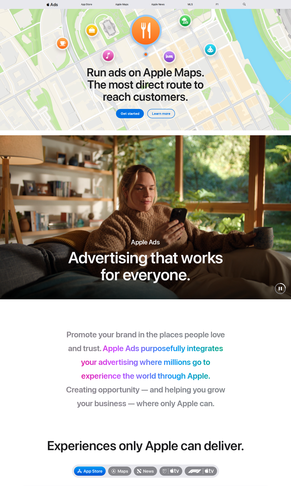

# UI Design System & Master Generation Blueprint: ads-apple-com

> **Apple Ads** (http://ads.apple.com) — Reach customers where only Apple Ads can take you. Learn how to grow your business with ads on the App Store, Apple Maps, Apple News, MLS...



---

## 1. Executive Visual Persona & Design Archetype

- **Brand Essence & Persona**: **Apple Ads** (`http://ads.apple.com`). Reach customers where only Apple Ads can take you. Learn how to grow your business with ads on the App Store, Apple Maps, Apple News, MLS...
- **Capture Provenance**: Live browser capture (`tier1_fast`, HTTP `200`, captured `2026-11-23`).
- **Visual Archetype**: **Light-Substrate Editorial & Modular Grid System (`#ffffff` canvas, `#000000` ink, `#2997ff` accent)**.
- **Anti-AI-Slop Differentiators**:
  - **Live-Computed Chromatic Polarity**: Anchors the viewport in `#ffffff` (live computed `body` `background-color` (`computed_styles.json`)) paired with `#000000` primary typography and `#2997ff` accents.
  - **Grounded Typographic Hierarchy**: Pairs `SF Pro Display` for display copy (`Run ads on Apple Maps. The most dire`) with `SF Pro Text` and not declared in live computed styles (uses primary stack / `ui-monospace`).
  - **Calibrated Spatial Grid & Motion**: Combines `1260px` container bounds (`gap: 40px`, padding `7px`) with `cubic-bezier(.4,0,.6,1)` easing.

---

## 2. Spatial Architecture & Modular Grid Mathematics


### Viewport Allocation & Container Geometry
- **Captured Viewport Dimensions**: Desktop `1440×2400px` (`assets/desktop.png`, clamped at 2400px live multi-section capture), Mobile `390×2400px` (`assets/mobile.png`, clamped at 2400px live multi-section capture).
- **Master Container Bounds**: `1260px` (measured widest bounded `<section>` landmark width on `1440px` desktop).
- **Canvas Lateral Padding & Spacing**: `7px` lateral canvas padding with `40px` grid gap.
- **Border Radius Scale**: `5px`, `6px`, `980px`, `var(--sk-button-border-radius)`.

### Responsive Breakpoint Architecture
- **Desktop Layout**: Multi-column CSS Grid / Flexbox layout at `1440px` (`max-width: 1260px`, `gap: 40px`).
- **Mobile Layout**: Single-column vertical stack at `390px` viewport width with `7px` horizontal padding.
- **Extracted CSS Media Queries**: `@media (min-width: 834px)`, `@media (max-width: 833px)`, `@media (max-width: 640px)`, `@media (min-width: 641px) and (max-width: 833px)`.

---

## 3. Color System, Materiality & Atmospheric Lighting

### Semantic Palette & Source Grounding
| Semantic Role | Ground-Truth Value | Extracted Live / CSS Source |
|---|---|---|
| **Primary Canvas Substrate** | `#ffffff` | live computed `body` `background-color` (`computed_styles.json`) |
| **Primary Typography Ink** | `#000000` | live computed `a` `color` (`computed_styles.json`) |
| **Elevated Surface / Card Substrate** | `#e8e8ed` | live computed `nav` `background-color` (`computed_styles.json`) |
| **Interactive Accent / Highlight** | `#2997ff` | `ooter-dark a.ac-gf-block .ac-gf... { color: #2997ff }` |
| **Secondary / Muted Copy** | `#888888` | live computed `button` `color` (`computed_styles.json`) |
| **Structural Hairline Border** | `#d2d2d7` | `var(--buystrip-border-color)` in `:root` |

### Sanitized Root CSS Variables (`ui-ux.md` Ground Truth)
| Variable Name | Extracted Value | Semantic Role |
|---|---|---|
| `--r-localnav-height` | `52px` | Layout / Spatial Grid Token |
| `--r-localnav-stacked-height` | `66px` | Layout / Spatial Grid Token |
| `--r-localnav-viewport-large-min-width` | `1024px` | Layout / Spatial Grid Token |
| `--r-localnav-viewport-large-query` | `(min-width: 1024px)` | Layout / Spatial Grid Token |
| `--r-localnav-viewport-medium-min-width` | `768px` | Layout / Spatial Grid Token |
| `--r-localnav-viewport-medium-max-width` | `1023px` | Layout / Spatial Grid Token |
| `--r-localnav-viewport-medium-query` | `(min-width: 768px)` | Layout / Spatial Grid Token |
| `--r-localnav-viewport-small-min-width` | `320px` | Layout / Spatial Grid Token |
| `--r-localnav-viewport-small-max-width` | `767px` | Layout / Spatial Grid Token |
| `--r-localnav-viewport-small-query` | `(min-width: 320px)` | Layout / Spatial Grid Token |
| `--sk-body-text-color` | `rgb(29, 29, 31)` | Typography Ink Token |
| `--sk-headline-text-color` | `rgb(29, 29, 31)` | Typography Ink Token |
| `--sk-body-background-color` | `rgb(255, 255, 255)` | Canvas / Surface Token |
| `--sk-body-font-stack` | `text` | Typography / Scale Token |
| `--sk-default-stacked-margin` | `.4em` | Layout / Spatial Grid Token |
| `--sk-paragraph-plus-element-margin` | `.8em` | Typography / Scale Token |

---

## 4. Typographic Scale & Editorial Hierarchy

### Font Family Stacks
- **Display Typography**: `SF Pro Display`.
- **Primary Body Stack**: `SF Pro Text`.
- **Technical / Metadata Stack**: not declared in live computed styles (uses primary stack / `ui-monospace`).

### Typographic Scale & Rules (Live Computed & Stylesheet Grounded)
- **Hero Display (`H1`)**: live computed `h1` (`font-size: 56px`, `line-height: 60px`, `font-weight: 600`, `letter-spacing: -0.28px`); CSS variables `--sk-button-display: inline-block`; rule `h1` (`font-size: 40px`, `font-weight: 500`).
- **Section Heading (`H2`)**: live computed `h2` (`font-size: 64px`, `line-height: 68px`, `font-weight: 600`, `letter-spacing: -0.576px`).
- **Body Copy**: live computed `body` (`font-size: 17px`, `line-height: 25px`, `font-weight: 400`, `letter-spacing: -0.374px`); CSS variables `--sk-body-font-stack: text`, `--sk-paragraph-plus-element-margin: .8em`, `--sk-paragraph-plus-headline-margin: 1.6em`; rule `p` (`font-size: 12px`, `line-height: 1.33337`, `letter-spacing: -.01em`, `font-weight: 400`).
- **Metadata & Navigation Labels**: live computed `nav/a` (`font-size: 17px`, `line-height: 25px`, `font-weight: 400`, `letter-spacing: -0.374px`); CSS variables `--r-localnav-viewport-small-min-width: 320px`, `--r-localnav-viewport-small-max-width: 767px`, `--r-localnav-viewport-small-query: (min-width: 320px)`; rule `small` (`font-size: 1em`).

---

## 5. Choreographed Motion & Interaction Physics

### Primary Easing Curves
- **Extracted Timing Functions**: `cubic-bezier(.4,0,.6,1)`, `cubic-bezier(.25,.1,.3,1)`, `cubic-bezier(1,.1,0,.3)`.

### Per-Element Transition & Choreography Rules
- **Selector `obalnav.globalnav-block-transitio...`**: `transition: none!important` extracted from `ads-apple-com` stylesheet.
- **Selector `.globalnav-curtain`**: `transition: opacity .32s cubic-bezier(.4,0,.6,1) 80ms,visibility .32s step...` extracted from `ads-apple-com` stylesheet.
- **Selector `obalnav-with-flyout-open~.globaln...`**: `transition: opacity .32s cubic-bezier(.4,0,.6,1) 80ms,visibility .32s step...` extracted from `ads-apple-com` stylesheet.
- **Extracted Easing Curve (`cubic-bezier(.4,0,.6,1)`)**: Governs interactive state transitions across `<nav.localnav>` and `<section.heroPanel-video-v1>`.
- **State & Hover Choreography**: Opacity and transform transitions on `<section.hero-panel-cb>` and `<section.heroPanel-video-v1>` interactive targets.

---

## 6. Component Wireframe & Structural DOM Map

### Visual Layout Schematic — Desktop (`1440px`, Grounded in `dom.html` & Landmark Bounding Boxes)
```
┌────────────────────────────────────────────────────────────────────────┐
│ DESKTOP VIEWPORT (1440px) — Apple Ads                                  │
│ ====================================================================== │
│ [ <nav.localnav> (1440x44px)          |  Ads · Local Nav Open Menu  ] │
│ ---------------------------------------------------------------------- │
│ | HERO STAGE: <section.hero-panel-cb> (w=1440px)                     | │
│ | H1: Run ads on Apple Maps. The most direct route to r...           | │
│ | Substrate: #ffffff | Ink: #000000 | Accent: #2997ff                | │
│ ---------------------------------------------------------------------- │
│ | SHOWCASE GRID (<section.heroPanel-video-v) max-w: 1260px           | │
│ | +------------------------------+  +------------------------------+ | │
│ | | Advertising that works for e |  | Experiences only Apple can d | | │
│ | +------------------------------+  +------------------------------+ | │
│ ---------------------------------------------------------------------- │
│ | DETAIL MODULE (<section.callout-text-with) — Spark discovery where | │
│ ---------------------------------------------------------------------- │
│ [ FOOTER (<footer.js>         ) | http://ads.apple.com                 │
└────────────────────────────────────────────────────────────────────────┘
```

### Visual Layout Schematic — Mobile Reflow (`390px`)
```
┌────────────────────────────────────────────────────────────────────────┐
│ MOBILE VIEWPORT REFLOW (390px) — Single-Column Stack (gap: 40px)       │
│ ====================================================================== │
│ [ HEADER BAR (<nav.localnav>          ) | Compact Menu (390px)         │
│ ---------------------------------------------------------------------- │
│ | HERO STAGE (<section.hero-panel-cb>) — 390px Vertical Lead         | │
│ | H1: Run ads on Apple Maps. The most direct route to r...           | │
│ ---------------------------------------------------------------------- │
│ | SHOWCASE STACK (<section.heroPanel-vid) — 1-Col Stack              | │
│ | [ Item 1: Advertising that works for everyone.                   ] | │
│ | [ Item 2: Experiences only Apple can deliver.                    ] | │
│ ---------------------------------------------------------------------- │
│ | DETAIL STACK (<section.callout-text-wi) — 1-Col (Spark discovery wh) │
│ ---------------------------------------------------------------------- │
│ [ FOOTER (<footer.js>         ) | Stacked 390px Colophon               │
└────────────────────────────────────────────────────────────────────────┘
```

### Granular DOM Region Breakdown
1. **Brand Header & Navigation Bar (<nav.localnav> — `ads-apple-com`)**:
   - Landmark `<nav class="localnav localnav--custom-background">` (`1440x44px`) hosting `Apple Ads` navigation (` Ads · Local Nav Open Menu · Local Nav Close Menu · App Store · Apple Maps`), DOM attributes (`data-anim-scroll-group="body"`, `data-sticky="sticky"`, `data-tracking-title="App Store"`, `data-tracking-title="Apple Maps"`), and stylesheet rule `globalheader html { -ms-text-size-adjust:100%;-webkit-text-size-adjust:100% }`.
2. **Hero Stage & Focal Lead (<section.hero-panel-cb> — `Run ads on Apple Maps. The most di`)**:
   - Landmark `<section class="hero-panel-cb heroPanel-video-v1">` presenting display lead `Run ads on Apple Maps. The most direct route to r...` and copy excerpt *"Promote your brand in the places people love and trust. Apple Ads"* over `#ffffff` canvas and `#000000` ink.
3. **Primary Showcase & Content Grid (<section.heroPanel-video-v1> — `Advertising that works for everyon`)**:
   - Landmark `<section class="hero-panel-cb heroPanel-video-v1">` rendering section `Advertising that works for everyone.` with copy *"Promote your brand in the places people love and trust."*, asset references (`favicon.ico`, `180_touch.png`, `ads.apple.com`, `globalheader.css`), and grid rule `globalheader body { margin:0;padding:0 }`.
4. **Interactive Detail & Feature Matrix (<section.callout-text-with-gradient> — `Experiences only Apple can deliver`)**:
   - Landmark `<section class="callout-text-with-gradient section-content--fixed">` framing `Experiences only Apple can deliver.` and `Spark discovery where downloads happen.` (*"Apple Ads purposefully integrates your advertising where millions"*) with `#e8e8ed` surface cards, `#2997ff` accents, and `globalheader button { margin:0;padding:0 }`.
5. **Colophon & Global Directory Footer (<footer.js> — `http://ads.apple.com`)**:
   - Landmark `<footer class="js sa-footer">` anchoring `Apple Ads` footer links (` Ads · Local Nav Open Menu · Local Nav Close Menu · App Store · Apple Maps`), copy *"Creating opportunity — and helping you grow your business — "*, and `#d2d2d7` structural dividers.

---

## 7. Master Zero-Shot AI Generation Prompt

```markdown
# Master Zero-Shot Frontend Generation Prompt: ads-apple-com (Apple Ads)

You are a principal frontend architect and design systems engineer. Build a complete, production-ready web application replicating the exact design system, DOM landmarks, typographic hierarchy, color tokens, and motion physics of `ads-apple-com` (**Apple Ads** — `http://ads.apple.com`).

### 1. Visual Archetype & Anti-AI-Slop Mandates
- **Archetype**: Light-Substrate Editorial & Modular Grid System (`#ffffff` canvas, `#000000` ink, `#2997ff` accent).
- **Identity & Domain Context**: Reach customers where only Apple Ads can take you. Learn how to grow your business with ads on the App Store, Apple Maps, Apple News, MLS...
- **Primary Substrate**: `#ffffff` (live computed `body` `background-color` (`computed_styles.json`)), **Primary Ink**: `#000000`, **Accent / Highlight**: `#2997ff`.
- **Site-Specific Differentiators**:
  - **Live-Computed Chromatic Polarity**: Anchors the viewport in `#ffffff` (live computed `body` `background-color` (`computed_styles.json`)) paired with `#000000` primary typography and `#2997ff` accents.
  - **Grounded Typographic Hierarchy**: Pairs `SF Pro Display` for display copy (`Run ads on Apple Maps. The most dire`) with `SF Pro Text` and not declared in live computed styles (uses primary stack / `ui-monospace`).
  - **Calibrated Spatial Grid & Motion**: Combines `1260px` container bounds (`gap: 40px`, padding `7px`) with `cubic-bezier(.4,0,.6,1)` easing.

### 2. Ground-Truth CSS Variables (`:root` Token Contract)
Declare and consume these exact custom properties extracted from `ads-apple-com` in your global stylesheet:

:root {
  /* Apple Ads (ads-apple-com) — Live-Grounded CSS Variables */
  --r-localnav-height: 52px; /* Layout / Spatial Grid Token (ads-apple-com) */
  --r-localnav-stacked-height: 66px; /* Layout / Spatial Grid Token (ads-apple-com) */
  --r-localnav-viewport-large-min-width: 1024px; /* Layout / Spatial Grid Token (ads-apple-com) */
  --r-localnav-viewport-large-query: (min-width: 1024px); /* Layout / Spatial Grid Token (ads-apple-com) */
  --r-localnav-viewport-medium-min-width: 768px; /* Layout / Spatial Grid Token (ads-apple-com) */
  --r-localnav-viewport-medium-max-width: 1023px; /* Layout / Spatial Grid Token (ads-apple-com) */
  --r-localnav-viewport-medium-query: (min-width: 768px); /* Layout / Spatial Grid Token (ads-apple-com) */
  --r-localnav-viewport-small-min-width: 320px; /* Layout / Spatial Grid Token (ads-apple-com) */
  --r-localnav-viewport-small-max-width: 767px; /* Layout / Spatial Grid Token (ads-apple-com) */
  --r-localnav-viewport-small-query: (min-width: 320px); /* Layout / Spatial Grid Token (ads-apple-com) */
  --sk-body-text-color: rgb(29, 29, 31); /* Typography Ink Token (ads-apple-com) */
  --sk-headline-text-color: rgb(29, 29, 31); /* Typography Ink Token (ads-apple-com) */
  --sk-body-background-color: rgb(255, 255, 255); /* Canvas / Surface Token (ads-apple-com) */
  --sk-body-font-stack: text; /* Typography / Scale Token (ads-apple-com) */
  --sk-default-stacked-margin: .4em; /* Layout / Spatial Grid Token (ads-apple-com) */
  --sk-paragraph-plus-element-margin: .8em; /* Typography / Scale Token (ads-apple-com) */
}

### 3. Semantic Color & Materiality Contract
Map every surface, ink, and border strictly to these source-grounded tokens:
- **Primary Canvas Substrate**: `#ffffff` — grounded in live computed `body` `background-color` (`computed_styles.json`)
- **Primary Typography Ink**: `#000000` — grounded in live computed `a` `color` (`computed_styles.json`)
- **Elevated Surface / Card Substrate**: `#e8e8ed` — grounded in live computed `nav` `background-color` (`computed_styles.json`)
- **Interactive Accent / Highlight**: `#2997ff` — grounded in `ooter-dark a.ac-gf-block .ac-gf... { color: #2997ff }`
- **Secondary / Muted Copy**: `#888888` — grounded in live computed `button` `color` (`computed_styles.json`)
- **Structural Hairline Border**: `#d2d2d7` — grounded in `var(--buystrip-border-color)` in `:root`

### 4. Spatial Grid, Container Bounds & Responsive Breakpoints
- **Desktop Viewport Reference**: `1440×2400px` (clamped at 2400px live multi-section capture, `1440px` standard desktop width).
- **Mobile Viewport Reference**: `390×2400px` (clamped at 2400px live multi-section capture, `390px` standard mobile width).
- **Container Max-Width**: `1260px` (measured widest bounded `<section>` landmark width on `1440px` desktop)
- **Padding & Gutters**: `7px` lateral canvas padding with `40px` grid gap
- **Desktop Grid**: Multi-column CSS Grid / Flexbox layout at `1440px` (`max-width: 1260px`, `gap: 40px`)
- **Mobile Adaptation**: Single-column vertical stack at `390px` viewport width with `7px` horizontal padding
- **Media Queries**: `@media (min-width: 834px)`, `@media (max-width: 833px)`, `@media (max-width: 640px)`, `@media (min-width: 641px) and (max-width: 833px)`
- **Corner Radii**: `5px`, `6px`, `980px`, `var(--sk-button-border-radius)`

### 5. Typography & Editorial Scale Contract
- **Display Font Stack**: `SF Pro Display`
- **Body Font Stack**: `SF Pro Text`
- **Monospace / Technical Font Stack**: not declared in live computed styles (uses primary stack / `ui-monospace`)
- **H1 Display Rule**: live computed `h1` (`font-size: 56px`, `line-height: 60px`, `font-weight: 600`, `letter-spacing: -0.28px`); CSS variables `--sk-button-display: inline-block`; rule `h1` (`font-size: 40px`, `font-weight: 500`)
- **H2 Section Rule**: live computed `h2` (`font-size: 64px`, `line-height: 68px`, `font-weight: 600`, `letter-spacing: -0.576px`)
- **Body Copy Rule**: live computed `body` (`font-size: 17px`, `line-height: 25px`, `font-weight: 400`, `letter-spacing: -0.374px`); CSS variables `--sk-body-font-stack: text`, `--sk-paragraph-plus-element-margin: .8em`, `--sk-paragraph-plus-headline-margin: 1.6em`; rule `p` (`font-size: 12px`, `line-height: 1.33337`, `letter-spacing: -.01em`, `font-weight: 400`)
- **Metadata & Index Rule**: live computed `nav/a` (`font-size: 17px`, `line-height: 25px`, `font-weight: 400`, `letter-spacing: -0.374px`); CSS variables `--r-localnav-viewport-small-min-width: 320px`, `--r-localnav-viewport-small-max-width: 767px`, `--r-localnav-viewport-small-query: (min-width: 320px)`; rule `small` (`font-size: 1em`)

### 6. Component Hierarchy, Verbatim Copy & Real DOM Landmarks
Scaffold `ads-apple-com` (`Apple Ads`) with these exact structural regions, extracted copy, and CSS rules from `dom.html`:
1. **Brand Header & Navigation Bar (<nav.localnav> — `ads-apple-com`)**:
   - DOM & Selectors: Landmark `<nav class="localnav localnav--custom-background">` (`1440x44px`) hosting `Apple Ads` navigation (` Ads · Local Nav Open Menu · Local Nav Close Menu · App Store · Apple Maps`), DOM attributes (`data-anim-scroll-group="body"`, `data-sticky="sticky"`, `data-tracking-title="App Store"`, `data-tracking-title="Apple Maps"`), and stylesheet rule `globalheader html { -ms-text-size-adjust:100%;-webkit-text-size-adjust:100% }`.
   - Responsive Contract: Header `Brand Header & Navigation Bar (<nav.localnav> — `ads-apple-com`)` (`ads-apple-com`) adapts across `@media (min-width: 834px)`, `@media (max-width: 833px)`, `@media (max-width: 640px)`, `@media (min-width: 641px) and (max-width: 833px)` with `cubic-bezier(.4,0,.6,1)`, `cubic-bezier(.25,.1,.3,1)`, `cubic-bezier(1,.1,0,.3)` transitions and links ` Ads · Local Nav Open Menu · Local Nav Close Menu · App Store · Apple Maps`.
2. **Hero Stage & Focal Lead (<section.hero-panel-cb> — `Run ads on Apple Maps. The most di`)**:
   - DOM & Selectors: Landmark `<section class="hero-panel-cb heroPanel-video-v1">` presenting display lead `Run ads on Apple Maps. The most direct route to r...` and copy excerpt *"Promote your brand in the places people love and trust. Apple Ads"* over `#ffffff` canvas and `#000000` ink.
   - Responsive Contract: Hero stage (`1440×2400px` desktop / `390×2400px` mobile) sets `#ffffff` background with `#000000` headline `Run ads on Apple Maps. The most direct route to r...`.
3. **Primary Showcase & Content Grid (<section.heroPanel-video-v1> — `Advertising that works for everyon`)**:
   - DOM & Selectors: Landmark `<section class="hero-panel-cb heroPanel-video-v1">` rendering section `Advertising that works for everyone.` with copy *"Promote your brand in the places people love and trust."*, asset references (`favicon.ico`, `180_touch.png`, `ads.apple.com`, `globalheader.css`), and grid rule `globalheader body { margin:0;padding:0 }`.
   - Responsive Contract: Showcase grid `Primary Showcase & Content Grid (<section.heroPanel-video-v1> — `Advertising that works for everyon`)` applies Multi-column CSS Grid / Flexbox layout at `1440px` (`max-width: 1260px`, `gap: 40px`) on desktop and Single-column vertical stack at `390px` viewport width with `7px` horizontal padding on mobile.
4. **Interactive Detail & Feature Matrix (<section.callout-text-with-gradient> — `Experiences only Apple can deliver`)**:
   - DOM & Selectors: Landmark `<section class="callout-text-with-gradient section-content--fixed">` framing `Experiences only Apple can deliver.` and `Spark discovery where downloads happen.` (*"Apple Ads purposefully integrates your advertising where millions"*) with `#e8e8ed` surface cards, `#2997ff` accents, and `globalheader button { margin:0;padding:0 }`.
   - Responsive Contract: Detail module `Interactive Detail & Feature Matrix (<section.callout-text-with-gradient> — `Experiences only Apple can deliver`)` uses `5px`, `6px`, `980px`, `var(--sk-button-border-radius)` radii, `#2997ff` highlights, and assets (favicon.ico, 180_touch.png, ads.apple.com).
5. **Colophon & Global Directory Footer (<footer.js> — `http://ads.apple.com`)**:
   - DOM & Selectors: Landmark `<footer class="js sa-footer">` anchoring `Apple Ads` footer links (` Ads · Local Nav Open Menu · Local Nav Close Menu · App Store · Apple Maps`), copy *"Creating opportunity — and helping you grow your business — "*, and `#d2d2d7` structural dividers.
   - Responsive Contract: Footer `Colophon & Global Directory Footer (<footer.js> — `http://ads.apple.com`)` aligns to `1260px` (measured widest bounded `<section>` landmark width on `1440px` desktop) with `7px` lateral canvas padding with `40px` grid gap and attributes (data-anim-scroll-group="body", data-sticky="sticky", data-tracking-title="App Store").

#### Verbatim DOM Copy Excerpts (`dom.html`)
- Copy Excerpt 1: *"Promote your brand in the places people love and trust. Apple Ads purposefully int..."*
- Copy Excerpt 2: *"Promote your brand in the places people love and trust."*
- Copy Excerpt 3: *"Apple Ads purposefully integrates your advertising where millions go to experience..."*
- Copy Excerpt 4: *"Creating opportunity — and helping you grow your business — where only Apple can."*

### 7. Motion, Extracted Stylesheet Rules & Interaction Choreography
- **Primary Easing Functions**: `cubic-bezier(.4,0,.6,1)`, `cubic-bezier(.25,.1,.3,1)`, `cubic-bezier(1,.1,0,.3)`
- **Extracted Stylesheet Rules (`ads-apple-com`)**:
- `globalheader html { -ms-text-size-adjust:100%;-webkit-text-size-adjust:100% }`
- `globalheader body { margin:0;padding:0 }`
- `globalheader button { margin:0;padding:0 }`
- `globalheader figcaption { font-size:1em;font-weight:400;font-style:normal }`
- `globalheader th { text-align:left }`
- **Per-Selector Transition Rules**:
- **Selector `obalnav.globalnav-block-transitio...`**: `transition: none!important` extracted from `ads-apple-com` stylesheet.
- **Selector `.globalnav-curtain`**: `transition: opacity .32s cubic-bezier(.4,0,.6,1) 80ms,visibility .32s step...` extracted from `ads-apple-com` stylesheet.
- **Selector `obalnav-with-flyout-open~.globaln...`**: `transition: opacity .32s cubic-bezier(.4,0,.6,1) 80ms,visibility .32s step...` extracted from `ads-apple-com` stylesheet.
- **Extracted Easing Curve (`cubic-bezier(.4,0,.6,1)`)**: Governs interactive state transitions across `<nav.localnav>` and `<section.heroPanel-video-v1>`.
- **State & Hover Choreography**: Opacity and transform transitions on `<section.hero-panel-cb>` and `<section.heroPanel-video-v1>` interactive targets.

### 8. Technical Deliverables
- Implement in Next.js (App Router) with TypeScript and Tailwind CSS consuming the `:root` custom properties defined above for `ads-apple-com`.
- Reproduce both the `1440px` desktop architecture and `390px` mobile breakpoint transitions, preserving semantic HTML5 landmarks (`<header>`, `<nav>`, `<main>`, `<section>`, `<footer>`) and `prefers-reduced-motion` accessibility guards.
```
