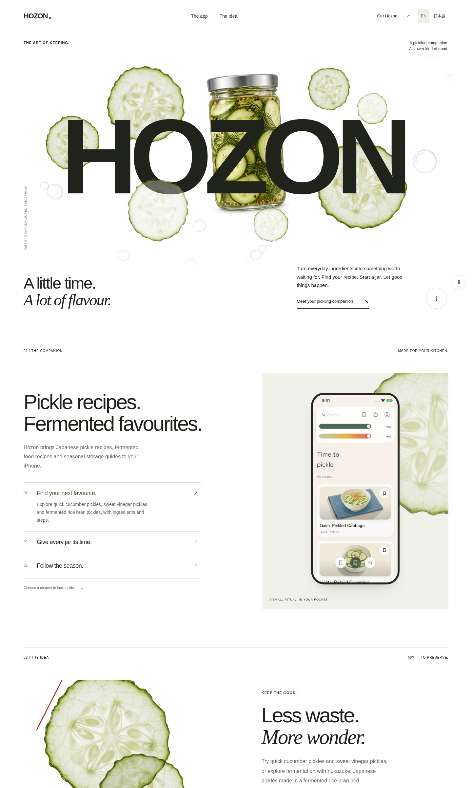
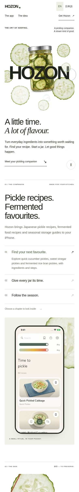

# UI Design System & Master Generation Blueprint: aestudio-studio_hozon

> **Hozon — Pickle & Fermented Food Recipe App** (https://aestudio.studio/hozon) — Find Japanese pickle recipes and fermented food recipes in Hozon for iPhone. Explore quick pickles and nukazuke, track jars and discover...



---

## 1. Executive Visual Persona & Design Archetype

- **Brand Essence & Persona**: **Hozon — Pickle & Fermented Food Recipe App** (`https://aestudio.studio/hozon`). Find Japanese pickle recipes and fermented food recipes in Hozon for iPhone. Explore quick pickles and nukazuke, track jars and discover...
- **Capture Provenance**: Live browser capture (`tier1_fast`, HTTP `200`, captured `2026-11-23`).
- **Visual Archetype**: **Light-Gallery WebGL / Canvas Interactive Experience (`#ffffff` / `#008000`)**.
- **Anti-AI-Slop Differentiators**:
  - **Live-Computed Chromatic Polarity**: Anchors the viewport in `#ffffff` (live computed `html` `background-color` (`computed_styles.json`)) paired with `#20221c` primary typography and `#008000` accents.
  - **Grounded Typographic Hierarchy**: Pairs `Georgia` for display copy (`HOZON`) with `Hiragino Kaku Gothic ProN` and not declared in live computed styles (uses primary stack / `ui-monospace`).
  - **Calibrated Spatial Grid & Motion**: Combines `1600px` container bounds (`gap: 24px`, padding `72px`) with `cubic-bezier(0.25,0.1,0.25,1)` easing and HTML5 `<canvas>` Interactive Viewport Surface.

---

## 2. Spatial Architecture & Modular Grid Mathematics



### Viewport Allocation & Container Geometry
- **Captured Viewport Dimensions**: Desktop `1440×2400px` (`assets/desktop.png`, clamped at 2400px live multi-section capture), Mobile `390×2400px` (`assets/mobile.png`, clamped at 2400px live multi-section capture).
- **Master Container Bounds**: `1600px` (non-`@media` desktop container stylesheet rule).
- **Canvas Lateral Padding & Spacing**: `72px` lateral canvas padding with `24px` grid gap.
- **Border Radius Scale**: `50%`, `3px`, `40px`, `2px`.

### Responsive Breakpoint Architecture
- **Desktop Layout**: Multi-column CSS Grid / Flexbox layout at `1440px` (`max-width: 1600px`, `gap: 24px`).
- **Mobile Layout**: Single-column vertical stack at `390px` viewport width with `72px` horizontal padding.
- **Extracted CSS Media Queries**: `@media (min-width:1600px)`, `@media (max-width:1000px)`, `@media (max-width:700px)`, `@media (max-width:370px)`.

---

## 3. Color System, Materiality & Atmospheric Lighting

### Semantic Palette & Source Grounding
| Semantic Role | Ground-Truth Value | Extracted Live / CSS Source |
|---|---|---|
| **Primary Canvas Substrate** | `#ffffff` | live computed `html` `background-color` (`computed_styles.json`) |
| **Primary Typography Ink** | `#20221c` | live computed `h1` `color` (`computed_styles.json`) |
| **Elevated Surface / Card Substrate** | `#eef0e5` | `.scroll-link:hover { background: #eef0e5 }` |
| **Interactive Accent / Highlight** | `#008000` | `.text-link:hover { color: green }` (`#008000`) |
| **Secondary / Muted Copy** | `#62665b` | `var(--muted)` in `:root` |
| **Structural Hairline Border** | `#dedfd7` | `var(--line)` in `:root` |
| **Variable Token (`--green`)** | `#4b603c` | `var(--green)` in `:root` |

### Sanitized Root CSS Variables (`ui-ux.md` Ground Truth)
| Variable Name | Extracted Value | Semantic Role |
|---|---|---|
| `--ink` | `#20221c` | Typography Ink Token |
| `--green` | `#4b603c` | Color / Atmospheric Token |
| `--line` | `#dedfd7` | Color / Atmospheric Token |
| `--paper` | `#fff` | Canvas / Surface Token |
| `--muted` | `#62665b` | Color / Atmospheric Token |
| `--angle` | `-26deg` | Design System Custom Token |
| `--px` | `0px` | Dimension / Scale Token |
| `--sy` | `0px` | Dimension / Scale Token |
| `--study-shift` | `0px` | Dimension / Scale Token |
| `--rock` | `0deg` | Design System Custom Token |
| `--aestudio-studio--bg` | `#ffffff` | Canvas Substrate (from live computed `html` `background-color` (`computed_styles.json`)) |
| `--aestudio-studio--ink` | `#20221c` | Primary Typography Ink (computed-derived) |
| `--aestudio-studio--surface` | `#eef0e5` | Surface Substrate (computed-derived) |
| `--aestudio-studio--accent` | `#008000` | Interactive Accent (computed-derived) |
| `--aestudio-studio--muted` | `#62665b` | Secondary Ink (computed-derived) |
| `--aestudio-studio--border` | `#dedfd7` | Structural Border (computed-derived) |

---

## 4. Typographic Scale & Editorial Hierarchy

### Font Family Stacks
- **Display Typography**: `Georgia`.
- **Primary Body Stack**: `Hiragino Kaku Gothic ProN`.
- **Technical / Metadata Stack**: not declared in live computed styles (uses primary stack / `ui-monospace`).

### Typographic Scale & Rules (Live Computed & Stylesheet Grounded)
- **Hero Display (`H1`)**: live computed `h1` (`font-size: 324px`, `line-height: 246.24px`, `font-weight: 900`, `letter-spacing: -24.3px`); rule `h1` (`font-size: clamp(100px,22.5vw,345px)`, `line-height: .76`, `letter-spacing: -.075em`, `font-weight: 900`).
- **Section Heading (`H2`)**: live computed `h2` (`font-size: 48.96px`, `line-height: 50.9184px`, `font-weight: 400`, `letter-spacing: -2.2032px`); rule `h2` (`font-size: clamp(32px,3.4vw,52px)`, `line-height: 1.04`, `letter-spacing: -.045em`, `font-weight: 400`).
- **Body Copy**: live computed `body` (`font-size: 16px`, `line-height: normal`, `font-weight: 400`); rule `p` (`font-size: 15px`, `line-height: 1.7`).
- **Metadata & Navigation Labels**: live computed `nav/a` (`font-size: 14px`, `line-height: normal`, `font-weight: 400`); rule `nav` (`font-size: 14px`).

---

## 5. Choreographed Motion & Interaction Physics

### Primary Easing Curves
- **Extracted Timing Functions**: `cubic-bezier(0.25,0.1,0.25,1)`.

### Per-Element Transition & Choreography Rules
- **Selector `.scroll-link`**: `transition: background .2s,transform .2s` extracted from `aestudio-studio_hozon` stylesheet.
- **Selector `.closing-cta`**: `transition: background .2s` extracted from `aestudio-studio_hozon` stylesheet.
- **Selector `::after`**: `transition: none!important` extracted from `aestudio-studio_hozon` stylesheet.
- **Standard CSS Easing (`cubic-bezier(0.25,0.1,0.25,1)`)**: Default timing curve (no custom `cubic-bezier()` declared in captured CSS).
- **Runtime Interaction Engine**: Integrates HTML5 `<canvas>` Interactive Viewport Surface with `prefers-reduced-motion: reduce` fallback guards.

---

## 6. Component Wireframe & Structural DOM Map

### Visual Layout Schematic — Desktop (`1440px`, Grounded in `dom.html` & Landmark Bounding Boxes)
```
┌────────────────────────────────────────────────────────────────────────┐
│ DESKTOP VIEWPORT (1440px) — Hozon — Pickle & Fermented Food Recipe App │
│ ====================================================================== │
│ [ <header.header> (1440x98px)         | The app · The idea           ] │
│ ---------------------------------------------------------------------- │
│ | HERO STAGE: <section.hero> (w=1440px)                              | │
│ | H1: HOZON                                                          | │
│ | Substrate: #ffffff | Ink: #20221c | Accent: #008000                | │
│ ---------------------------------------------------------------------- │
│ | SHOWCASE GRID (<section.app-section>) max-w: 1600px                | │
│ | +------------------------------+  +------------------------------+ | │
│ | | A little time. A lot of flav |  | Pickle recipes. Fermented fa | | │
│ | +------------------------------+  +------------------------------+ | │
│ ---------------------------------------------------------------------- │
│ | DETAIL MODULE (<section.idea-section>) — Less waste. More wond     | │
│ ---------------------------------------------------------------------- │
│ [ FOOTER (<footer.footer>     ) | https://aestudio.studio/hozon        │
└────────────────────────────────────────────────────────────────────────┘
```

### Visual Layout Schematic — Mobile Reflow (`390px`)
```
┌────────────────────────────────────────────────────────────────────────┐
│ MOBILE VIEWPORT REFLOW (390px) — Single-Column Stack (gap: 24px)       │
│ ====================================================================== │
│ [ HEADER BAR (<header.header>         ) | Compact Menu (390px)         │
│ ---------------------------------------------------------------------- │
│ | HERO STAGE (<section.hero>) — 390px Vertical Lead                  | │
│ | H1: HOZON                                                          | │
│ ---------------------------------------------------------------------- │
│ | SHOWCASE STACK (<section.app-section>) — 1-Col Stack               | │
│ | [ Item 1: A little time. A lot of flavour.                       ] | │
│ | [ Item 2: Pickle recipes. Fermented favourites.                  ] | │
│ ---------------------------------------------------------------------- │
│ | DETAIL STACK (<section.idea-section>) — 1-Col (Less waste. More w) | │
│ ---------------------------------------------------------------------- │
│ [ FOOTER (<footer.footer>     ) | Stacked 390px Colophon               │
└────────────────────────────────────────────────────────────────────────┘
```

### Granular DOM Region Breakdown
1. **Brand Header & Navigation Bar (<header.header> — `aestudio-studio_hozon`)**:
   - Landmark `<header class="header">` (`1440x98px`) hosting `Hozon — Pickle & Fermented Food Reci` navigation (`The app · The idea`), DOM attributes (`data-depth="-0.65"`, `data-depth="0.65"`, `data-depth="-0.3"`, `data-depth="0.4"`), and stylesheet rule `button { font:inherit;color:inherit }`.
2. **Hero Stage & Focal Lead (<section.hero> — `HOZON`)**:
   - Landmark `<section class="hero">` presenting display lead `HOZON` and copy excerpt *"THE ART OF KEEPING."* over `#ffffff` canvas and `#20221c` ink.
3. **Primary Showcase & Content Grid (<section.app-section> — `A little time. A lot of flavour.`)**:
   - Landmark `<section class="app-section section-wrap">` rendering section `A little time. A lot of flavour.` with copy *"A pickling companion. A slower kind of good."*, asset references (`hozon`, `favicon.svg`, `jar-v1.webp`, `cucumber-v2.webp`), and grid rule `img { display:block;max-width:100%;height:auto }`.
4. **Interactive Detail & Feature Matrix (<section.idea-section> — `Pickle recipes. Fermented favourit`)**:
   - Landmark `<section class="idea-section section-wrap">` framing `Pickle recipes. Fermented favourites.` and `Less waste. More wonder.` (*"FRESH TODAY. SAVOURED TOMORROW."*) with `#eef0e5` surface cards, `#008000` accents, and `focus-visible { outline:3px solid var(--green);outline-offset:6px }`.
5. **Colophon & Global Directory Footer (<footer.footer> — `https://aestudio.studio/hozon`)**:
   - Landmark `<footer class="footer">` anchoring `Hozon — Pickle & Fermented Food ` footer links (`The app · The idea`), copy *"Turn everyday ingredients into something worth waiting for. "*, and `#dedfd7` structural dividers.

---

## 7. Master Zero-Shot AI Generation Prompt

```markdown
# Master Zero-Shot Frontend Generation Prompt: aestudio-studio_hozon (Hozon — Pickle & Fermented Food Recipe App)

You are a principal frontend architect and design systems engineer. Build a complete, production-ready web application replicating the exact design system, DOM landmarks, typographic hierarchy, color tokens, and motion physics of `aestudio-studio_hozon` (**Hozon — Pickle & Fermented Food Recipe App** — `https://aestudio.studio/hozon`).

### 1. Visual Archetype & Anti-AI-Slop Mandates
- **Archetype**: Light-Gallery WebGL / Canvas Interactive Experience (`#ffffff` / `#008000`).
- **Identity & Domain Context**: Find Japanese pickle recipes and fermented food recipes in Hozon for iPhone. Explore quick pickles and nukazuke, track jars and discover...
- **Primary Substrate**: `#ffffff` (live computed `html` `background-color` (`computed_styles.json`)), **Primary Ink**: `#20221c`, **Accent / Highlight**: `#008000`.
- **Site-Specific Differentiators**:
  - **Live-Computed Chromatic Polarity**: Anchors the viewport in `#ffffff` (live computed `html` `background-color` (`computed_styles.json`)) paired with `#20221c` primary typography and `#008000` accents.
  - **Grounded Typographic Hierarchy**: Pairs `Georgia` for display copy (`HOZON`) with `Hiragino Kaku Gothic ProN` and not declared in live computed styles (uses primary stack / `ui-monospace`).
  - **Calibrated Spatial Grid & Motion**: Combines `1600px` container bounds (`gap: 24px`, padding `72px`) with `cubic-bezier(0.25,0.1,0.25,1)` easing and HTML5 `<canvas>` Interactive Viewport Surface.

### 2. Ground-Truth CSS Variables (`:root` Token Contract)
Declare and consume these exact custom properties extracted from `aestudio-studio_hozon` in your global stylesheet:

:root {
  /* Hozon — Pickle & Fermented Food Recipe App (aestudio-studio_hozon) — Live-Grounded CSS Variables */
  --ink: #20221c; /* Typography Ink Token (aestudio-studio_hozon) */
  --green: #4b603c; /* Color / Atmospheric Token (aestudio-studio_hozon) */
  --line: #dedfd7; /* Color / Atmospheric Token (aestudio-studio_hozon) */
  --paper: #fff; /* Canvas / Surface Token (aestudio-studio_hozon) */
  --muted: #62665b; /* Color / Atmospheric Token (aestudio-studio_hozon) */
  --angle: -26deg; /* Design System Custom Token (aestudio-studio_hozon) */
  --px: 0px; /* Dimension / Scale Token (aestudio-studio_hozon) */
  --sy: 0px; /* Dimension / Scale Token (aestudio-studio_hozon) */
  --study-shift: 0px; /* Dimension / Scale Token (aestudio-studio_hozon) */
  --rock: 0deg; /* Design System Custom Token (aestudio-studio_hozon) */
  --aestudio-studio--bg: #ffffff; /* Canvas Substrate (from live computed `html` `background-color` (`computed_styles.json`)) (aestudio-studio_hozon) */
  --aestudio-studio--ink: #20221c; /* Primary Typography Ink (computed-derived) (aestudio-studio_hozon) */
  --aestudio-studio--surface: #eef0e5; /* Surface Substrate (computed-derived) (aestudio-studio_hozon) */
  --aestudio-studio--accent: #008000; /* Interactive Accent (computed-derived) (aestudio-studio_hozon) */
  --aestudio-studio--muted: #62665b; /* Secondary Ink (computed-derived) (aestudio-studio_hozon) */
  --aestudio-studio--border: #dedfd7; /* Structural Border (computed-derived) (aestudio-studio_hozon) */
}

### 3. Semantic Color & Materiality Contract
Map every surface, ink, and border strictly to these source-grounded tokens:
- **Primary Canvas Substrate**: `#ffffff` — grounded in live computed `html` `background-color` (`computed_styles.json`)
- **Primary Typography Ink**: `#20221c` — grounded in live computed `h1` `color` (`computed_styles.json`)
- **Elevated Surface / Card Substrate**: `#eef0e5` — grounded in `.scroll-link:hover { background: #eef0e5 }`
- **Interactive Accent / Highlight**: `#008000` — grounded in `.text-link:hover { color: green }` (`#008000`)
- **Secondary / Muted Copy**: `#62665b` — grounded in `var(--muted)` in `:root`
- **Structural Hairline Border**: `#dedfd7` — grounded in `var(--line)` in `:root`
- **Variable Token (`--green`)**: `#4b603c` — grounded in `var(--green)` in `:root`

### 4. Spatial Grid, Container Bounds & Responsive Breakpoints
- **Desktop Viewport Reference**: `1440×2400px` (clamped at 2400px live multi-section capture, `1440px` standard desktop width).
- **Mobile Viewport Reference**: `390×2400px` (clamped at 2400px live multi-section capture, `390px` standard mobile width).
- **Container Max-Width**: `1600px` (non-`@media` desktop container stylesheet rule)
- **Padding & Gutters**: `72px` lateral canvas padding with `24px` grid gap
- **Desktop Grid**: Multi-column CSS Grid / Flexbox layout at `1440px` (`max-width: 1600px`, `gap: 24px`)
- **Mobile Adaptation**: Single-column vertical stack at `390px` viewport width with `72px` horizontal padding
- **Media Queries**: `@media (min-width:1600px)`, `@media (max-width:1000px)`, `@media (max-width:700px)`, `@media (max-width:370px)`
- **Corner Radii**: `50%`, `3px`, `40px`, `2px`

### 5. Typography & Editorial Scale Contract
- **Display Font Stack**: `Georgia`
- **Body Font Stack**: `Hiragino Kaku Gothic ProN`
- **Monospace / Technical Font Stack**: not declared in live computed styles (uses primary stack / `ui-monospace`)
- **H1 Display Rule**: live computed `h1` (`font-size: 324px`, `line-height: 246.24px`, `font-weight: 900`, `letter-spacing: -24.3px`); rule `h1` (`font-size: clamp(100px,22.5vw,345px)`, `line-height: .76`, `letter-spacing: -.075em`, `font-weight: 900`)
- **H2 Section Rule**: live computed `h2` (`font-size: 48.96px`, `line-height: 50.9184px`, `font-weight: 400`, `letter-spacing: -2.2032px`); rule `h2` (`font-size: clamp(32px,3.4vw,52px)`, `line-height: 1.04`, `letter-spacing: -.045em`, `font-weight: 400`)
- **Body Copy Rule**: live computed `body` (`font-size: 16px`, `line-height: normal`, `font-weight: 400`); rule `p` (`font-size: 15px`, `line-height: 1.7`)
- **Metadata & Index Rule**: live computed `nav/a` (`font-size: 14px`, `line-height: normal`, `font-weight: 400`); rule `nav` (`font-size: 14px`)

### 6. Component Hierarchy, Verbatim Copy & Real DOM Landmarks
Scaffold `aestudio-studio_hozon` (`Hozon — Pickle & Fermented Food Recipe App`) with these exact structural regions, extracted copy, and CSS rules from `dom.html`:
1. **Brand Header & Navigation Bar (<header.header> — `aestudio-studio_hozon`)**:
   - DOM & Selectors: Landmark `<header class="header">` (`1440x98px`) hosting `Hozon — Pickle & Fermented Food Reci` navigation (`The app · The idea`), DOM attributes (`data-depth="-0.65"`, `data-depth="0.65"`, `data-depth="-0.3"`, `data-depth="0.4"`), and stylesheet rule `button { font:inherit;color:inherit }`.
   - Responsive Contract: Header `Brand Header & Navigation Bar (<header.header> — `aestudio-studio_hozon`)` (`aestudio-studio_hozon`) adapts across `@media (min-width:1600px)`, `@media (max-width:1000px)`, `@media (max-width:700px)`, `@media (max-width:370px)` with `cubic-bezier(0.25,0.1,0.25,1)` transitions and links `The app · The idea`.
2. **Hero Stage & Focal Lead (<section.hero> — `HOZON`)**:
   - DOM & Selectors: Landmark `<section class="hero">` presenting display lead `HOZON` and copy excerpt *"THE ART OF KEEPING."* over `#ffffff` canvas and `#20221c` ink.
   - Responsive Contract: Hero stage (`1440×2400px` desktop / `390×2400px` mobile) sets `#ffffff` background with `#20221c` headline `HOZON`.
3. **Primary Showcase & Content Grid (<section.app-section> — `A little time. A lot of flavour.`)**:
   - DOM & Selectors: Landmark `<section class="app-section section-wrap">` rendering section `A little time. A lot of flavour.` with copy *"A pickling companion. A slower kind of good."*, asset references (`hozon`, `favicon.svg`, `jar-v1.webp`, `cucumber-v2.webp`), and grid rule `img { display:block;max-width:100%;height:auto }`.
   - Responsive Contract: Showcase grid `Primary Showcase & Content Grid (<section.app-section> — `A little time. A lot of flavour.`)` applies Multi-column CSS Grid / Flexbox layout at `1440px` (`max-width: 1600px`, `gap: 24px`) on desktop and Single-column vertical stack at `390px` viewport width with `72px` horizontal padding on mobile.
4. **Interactive Detail & Feature Matrix (<section.idea-section> — `Pickle recipes. Fermented favourit`)**:
   - DOM & Selectors: Landmark `<section class="idea-section section-wrap">` framing `Pickle recipes. Fermented favourites.` and `Less waste. More wonder.` (*"FRESH TODAY. SAVOURED TOMORROW."*) with `#eef0e5` surface cards, `#008000` accents, and `focus-visible { outline:3px solid var(--green);outline-offset:6px }`.
   - Responsive Contract: Detail module `Interactive Detail & Feature Matrix (<section.idea-section> — `Pickle recipes. Fermented favourit`)` uses `50%`, `3px`, `40px`, `2px` radii, `#008000` highlights, and assets (hozon, favicon.svg, jar-v1.webp).
5. **Colophon & Global Directory Footer (<footer.footer> — `https://aestudio.studio/hozon`)**:
   - DOM & Selectors: Landmark `<footer class="footer">` anchoring `Hozon — Pickle & Fermented Food ` footer links (`The app · The idea`), copy *"Turn everyday ingredients into something worth waiting for. "*, and `#dedfd7` structural dividers.
   - Responsive Contract: Footer `Colophon & Global Directory Footer (<footer.footer> — `https://aestudio.studio/hozon`)` aligns to `1600px` (non-`@media` desktop container stylesheet rule) with `72px` lateral canvas padding with `24px` grid gap and attributes (data-depth="-0.65", data-depth="0.65", data-depth="-0.3").

#### Verbatim DOM Copy Excerpts (`dom.html`)
- Copy Excerpt 1: *"THE ART OF KEEPING."*
- Copy Excerpt 2: *"A pickling companion. A slower kind of good."*
- Copy Excerpt 3: *"FRESH TODAY. SAVOURED TOMORROW."*
- Copy Excerpt 4: *"Turn everyday ingredients into something worth waiting for. Find your recipe. Star..."*

### 7. Motion, Extracted Stylesheet Rules & Interaction Choreography
- **Primary Easing Functions**: `cubic-bezier(0.25,0.1,0.25,1)`
- **Extracted Stylesheet Rules (`aestudio-studio_hozon`)**:
- `button { font:inherit;color:inherit }`
- `img { display:block;max-width:100%;height:auto }`
- `focus-visible { outline:3px solid var(--green);outline-offset:6px }`
- `.skip { position:fixed;top:8px;left:8px;z-index:100;background:fff;padding:14px;... }`
- `.skip:focus { transform:none }`
- **Per-Selector Transition Rules**:
- **Selector `.scroll-link`**: `transition: background .2s,transform .2s` extracted from `aestudio-studio_hozon` stylesheet.
- **Selector `.closing-cta`**: `transition: background .2s` extracted from `aestudio-studio_hozon` stylesheet.
- **Selector `::after`**: `transition: none!important` extracted from `aestudio-studio_hozon` stylesheet.
- **Standard CSS Easing (`cubic-bezier(0.25,0.1,0.25,1)`)**: Default timing curve (no custom `cubic-bezier()` declared in captured CSS).
- **Runtime Interaction Engine**: Integrates HTML5 `<canvas>` Interactive Viewport Surface with `prefers-reduced-motion: reduce` fallback guards.

### 8. Technical Deliverables
- Implement in Next.js (App Router) with TypeScript and Tailwind CSS consuming the `:root` custom properties defined above for `aestudio-studio_hozon`.
- Reproduce both the `1440px` desktop architecture and `390px` mobile breakpoint transitions, preserving semantic HTML5 landmarks (`<header>`, `<nav>`, `<main>`, `<section>`, `<footer>`) and `prefers-reduced-motion` accessibility guards.
```
