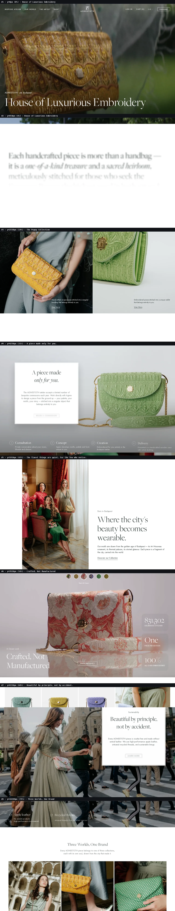
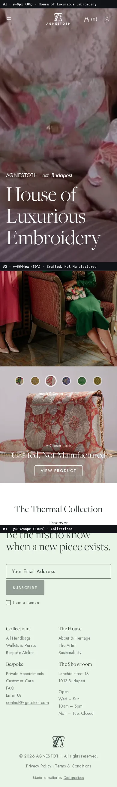

# UI Design System & Master Generation Blueprint: agnestoth-com

> **AGNESTOTH · House of Luxurious Embroidery** (https://agnestoth.com) — Discover one-of-a-kind luxury embroidered handbags by AGNESTOTH, created in Budapest from apple leather with original artist-led designs.





---

## 1. Executive Visual Persona & Design Archetype

- **Brand Essence & Persona**: **AGNESTOTH · House of Luxurious Embroidery** (`https://agnestoth.com`). Discover one-of-a-kind luxury embroidered handbags by AGNESTOTH, created in Budapest from apple leather with original artist-led designs.
- **Capture Provenance**: Live browser capture (`tier1_fast`, HTTP `200`, captured `2026-11-24`).
- **Visual Archetype**: **Light-Substrate Editorial & Modular Grid System (`#ffffff` canvas, `#121212` ink, `#1990c6` accent)**.
- **Anti-AI-Slop Differentiators**:
  - **Live-Computed Chromatic Polarity**: Anchors the viewport in `#ffffff` (live computed `body` `background-color` (`computed_styles.json`)) paired with `#121212` primary typography and `#1990c6` accents.
  - **Grounded Typographic Hierarchy**: Pairs `FreightBig Pro` for display copy (`House of Luxurious Embroidery`) with `Jost`.
  - **Calibrated Spatial Grid & Motion**: Combines `90rem` container bounds (`gap: 1rem`, padding `var(--agnes-gutter)`) with `cubic-bezier(.22,1,.36,1)` easing and Lenis Smooth Scroll (`data-lenis`), GSAP Timeline & ScrollTrigger.

---

## 2. Spatial Architecture & Modular Grid Mathematics

### Viewport Allocation & Container Geometry
- **Captured Journey Filmstrips**: Desktop `1280×6624px` (`assets/desktop-journey.webp`, `8` keyframes up to `y=10200px` / doc `14638px`), Mobile `390×2616px` (`assets/mobile-journey.webp`, `3` keyframes).
- **Master Container Bounds**: `90rem` (non-`@media` desktop container stylesheet rule).
- **Canvas Lateral Padding & Spacing**: `var(--agnes-gutter)` lateral canvas padding with `1rem` grid gap.
- **Border Radius Scale**: `2px`, `4px`, `var(--product-card-corner-radius)`, `var(--collection-card-corner-radius)`.

### Responsive Breakpoint Architecture
- **Desktop Layout**: Multi-column CSS Grid / Flexbox layout at `1440px` (`max-width: 90rem`, `gap: 1rem`).
- **Mobile Layout**: Single-column vertical stack at `390px` viewport width with `var(--agnes-gutter)` horizontal padding.
- **Extracted CSS Media Queries**: `@media screen and (forced-colors:active)`, `@media screen and (width<=750px)`, `@media screen and (max-width:1024px)`, `@media (hover:hover)and (min-width:750px)`.

---

## 3. Color System, Materiality & Atmospheric Lighting

### Semantic Palette & Source Grounding
| Semantic Role | Ground-Truth Value | Extracted Live / CSS Source |
|---|---|---|
| **Primary Canvas Substrate** | `#ffffff` | live computed `body` `background-color` (`computed_styles.json`) |
| **Primary Typography Ink** | `#121212` | live computed `main` `color` (`computed_styles.json`) |
| **Elevated Surface / Card Substrate** | `#f0eee9` | `var(--agnes-tile-bg)` in `:root` |
| **Interactive Accent / Highlight** | `#1990c6` | `.shopify-payment-button__button... { background-color: #1990c6 }` |
| **Secondary / Muted Copy** | `#707c7a` | `var(--agnes-muted)` in `:root` |
| **Structural Hairline Border** | `#d1d3d3` | `var(--agnes-hairline)` in `:root` (`rgba(46, 57, 55, .22)`) |

### Sanitized Root CSS Variables (`ui-ux.md` Ground Truth)
| Variable Name | Extracted Value | Semantic Role |
|---|---|---|
| `--color-background` | `255,255,255` | Canvas / Surface Token |
| `--gradient-background` | `#FFFFFF` | Canvas / Surface Token |
| `--color-foreground` | `18,18,18` | Typography Ink Token |
| `--color-background-contrast` | `191,191,191` | Canvas / Surface Token |
| `--color-shadow` | `18,18,18` | Brand / Palette Token |
| `--color-button` | `18,18,18` | Brand / Palette Token |
| `--color-button-text` | `255,255,255` | Typography Ink Token |
| `--color-secondary-button` | `255,255,255` | Brand / Palette Token |
| `--color-secondary-button-text` | `18,18,18` | Typography Ink Token |
| `--color-link` | `18,18,18` | Typography Ink Token |
| `--color-badge-foreground` | `18,18,18` | Typography Ink Token |
| `--color-badge-background` | `255,255,255` | Canvas / Surface Token |
| `--color-badge-border` | `18,18,18` | Brand / Palette Token |
| `--payment-terms-background-color` | `rgb(255 255 255)` | Canvas / Surface Token |
| `--font-body-family` | `Assistant, sans-serif` | Typography / Scale Token |
| `--font-body-style` | `normal` | Typography / Scale Token |

---

## 4. Typographic Scale & Editorial Hierarchy

### Font Family Stacks
- **Display Typography**: `FreightBig Pro`.
- **Primary Body Stack**: `Jost`.
- **Technical / Metadata Stack**: not declared in live computed styles (uses primary stack / `ui-monospace`).

### Typographic Scale & Rules (Live Computed & Stylesheet Grounded)
- **Hero Display (`H1`)**: live computed `h1` (`font-size: 100px`, `line-height: 100px`, `font-weight: 300`); CSS variables `--x-shell-disclosure-display: block`, `--x-shell-order-summary-display: none`, `--x-shell-content-display: grid`; rule `h1` (`font-size: 5.2rem`, `line-height: 1.3`, `font-weight: 400`).
- **Section Heading (`H2`)**: live computed `h2` (`font-size: 70px`, `line-height: 74px`, `font-weight: 300`); rule `h2` (`font-size: 2.8rem`, `line-height: 1.3`, `font-weight: 400`).
- **Body Copy**: live computed `body` (`font-size: 16px`, `line-height: 28.8px`, `font-weight: 400`, `letter-spacing: 0.6px`); CSS variables `--font-body-family: Assistant, sans-serif`, `--font-body-style: normal`, `--font-body-weight: 400`; rule `p` (`font-size: 1.6rem`, `line-height: 2.4rem`, `letter-spacing: .02em`).
- **Metadata & Navigation Labels**: live computed `nav/a` (`font-size: 16px`, `line-height: 28.8px`, `font-weight: 400`, `letter-spacing: 0.6px`); CSS variables `--agnes-label-size: 1.3rem`, `--agnes-label-weight: 500`, `--agnes-label-tracking: .14em`.

---

## 5. Choreographed Motion & Interaction Physics

### Primary Easing Curves
- **Extracted Timing Functions**: `cubic-bezier(.22,1,.36,1)`, `cubic-bezier(0,0,.3,1)`, `cubic-bezier(.25,.46,.45,.94)`.

### Per-Element Transition & Choreography Rules
- **Selector `.shopify-payment-button__button`**: `transition: background .2s ease-in-out` extracted from `agnestoth-com` stylesheet.
- **Selector `.agnes-btn`**: `transition: background-color .4s var(--agnes-ease),color .4s var(--agnes-e...` extracted from `agnestoth-com` stylesheet.
- **Selector `.agnes-cats__link:after`**: `transition: transform .5s var(--agnes-ease)` extracted from `agnestoth-com` stylesheet.
- **Extracted Easing Curve (`cubic-bezier(.22,1,.36,1)`)**: Governs interactive state transitions across `<header.shopify-section>` and `<section.agnes-hero>`.
- **Runtime Interaction Engine**: Integrates Lenis Smooth Scroll (`data-lenis`), GSAP Timeline & ScrollTrigger, Three.js / WebGL Canvas Pipeline with `prefers-reduced-motion: reduce` fallback guards.
### Measured Runtime Scroll & Interaction Telemetry (`behavioral_journey_v2`)
- **Scroll Driver Mode**: `native` (max document height `14638px`, deepest scrollY reached `10200px` across `8` desktop keyframes).
- **Detected Scroll / Motion Libraries**: `Lenis`, `GSAP/ScrollTrigger`.
- **Nav / Drawer Probe (`Currency`)**: Triggered visual change (pixel diff `31.649`, captured in `assets/state-nav.webp`); revealed links: SKIP TO CONTENT, BESPOKE ATELIER, OUR WORLD, THE ARTIST, SHOP, AGNESTOTH.
- **Hover Physics (`primary_cta` · `AGNESTOTH`)**: Computed transition `0s` / `ease` (no static color/transform shift captured at rest).
- **Theme Toggle Probe**: Detected `Nature's Delight` (no body background diff).
- **Route Transition Architecture**: First internal navigation (`/pages/bespoke-atelier`) measured as `MPA` in `1351ms`.

---

## 6. Component Wireframe & Structural DOM Map

### Visual Layout Schematic — Desktop (`1440px`, Grounded in `dom.html` & Landmark Bounding Boxes)
```
┌────────────────────────────────────────────────────────────────────────┐
│ DESKTOP VIEWPORT (1440px) — AGNESTOTH · House of Luxurious Embroidery  │
│ ====================================================================== │
│ [ <header.shopify-sectio (1360x78px)  | Bespoke Atelier · Our World  ] │
│ ---------------------------------------------------------------------- │
│ | HERO STAGE: <section.shopify-section> (w=1440px)                   | │
│ | H1: House of Luxurious Embroidery                                  | │
│ | Substrate: #ffffff | Ink: #121212 | Accent: #1990c6                | │
│ ---------------------------------------------------------------------- │
│ | SHOWCASE GRID (<section.agnes-hero>) max-w: 90rem                  | │
│ | +------------------------------+  +------------------------------+ | │
│ | | H o u s e o f L u x u r i o  |  | The Poppy Collection         | | │
│ | +------------------------------+  +------------------------------+ | │
│ ---------------------------------------------------------------------- │
│ | DETAIL MODULE (<section.agnes-section>) — Discover the Poppy Co    | │
│ ---------------------------------------------------------------------- │
│ [ FOOTER (<footer.shopify-sect) | https://agnestoth.com                │
└────────────────────────────────────────────────────────────────────────┘
```

### Visual Layout Schematic — Mobile Reflow (`390px`)
```
┌────────────────────────────────────────────────────────────────────────┐
│ MOBILE VIEWPORT REFLOW (390px) — Single-Column Stack (gap: 1rem)       │
│ ====================================================================== │
│ [ HEADER BAR (<header.shopify-section>) | Compact Menu (390px)         │
│ ---------------------------------------------------------------------- │
│ | HERO STAGE (<section.shopify-section) — 390px Vertical Lead        | │
│ | H1: House of Luxurious Embroidery                                  | │
│ ---------------------------------------------------------------------- │
│ | SHOWCASE STACK (<section.agnes-hero>) — 1-Col Stack                | │
│ | [ Item 1: H o u s e o f L u x u r i o u s E m b r o i d e r y    ] | │
│ | [ Item 2: The Poppy Collection                                   ] | │
│ ---------------------------------------------------------------------- │
│ | DETAIL STACK (<section.agnes-section>) — 1-Col (Discover the Poppy)  │
│ ---------------------------------------------------------------------- │
│ [ FOOTER (<footer.shopify-sect) | Stacked 390px Colophon               │
└────────────────────────────────────────────────────────────────────────┘
```

### Granular DOM Region Breakdown
1. **Brand Header & Navigation Bar (<header.shopify-section> — `agnestoth-com`)**:
   - Landmark `<header class="shopify-section shopify-section-group-header-group">` (`1360x78px`) hosting `AGNESTOTH · House of Luxurious Embro` navigation (`Bespoke Atelier · Our World · The Artist · Shop`), DOM attributes (`data-source-attribution="shopify.exit_intersti..."`, `data-shopify`, `data-shop-id="110210285906"`, `data-venmo-supported="false"`), and stylesheet rule `.shopify-payment-button__button--... { visibility:hidden }`.
2. **Hero Stage & Focal Lead (<section.shopify-section> — `House of Luxurious Embroidery`)**:
   - Landmark `<section class="shopify-section agnes-section">` presenting display lead `House of Luxurious Embroidery` and copy excerpt *"AGNESTOTH • est. Budapest"* over `#ffffff` canvas and `#121212` ink.
3. **Primary Showcase & Content Grid (<section.agnes-hero> — `H o u s e o f L u x u r i o u s E `)**:
   - Landmark `<section class="agnes-hero color-scheme-1">` rendering section `H o u s e o f L u x u r i o u s E m b r o i d e r y` with copy *"A g n e s T o t h • e s t . B u d a p e s t"*, asset references (`693823798186760`, `fbevents.js`, `favicon.ico`, `favicon-32x32.png`), and grid rule `opify-payment-button__button--unb... { background-color:1990c6;padding:1em 2em }`.
4. **Interactive Detail & Feature Matrix (<section.agnes-section> — `The Poppy Collection`)**:
   - Landmark `<section class="shopify-section agnes-section">` framing `The Poppy Collection` and `Discover the Poppy Collection` (*"Each handcrafted piece is more than a handbag — it is a one-of-a-"*) with `#f0eee9` surface cards, `#1990c6` accents, and `ptions.shopify-payment-button__sk... { width:50%;margin-left:25%;margin-right:25%;border-radius:4px!important;h... }`.
5. **Colophon & Global Directory Footer (<footer.shopify-section> — `https://agnestoth.com`)**:
   - Landmark `<footer class="shopify-section shopify-section-group-footer-group">` anchoring `AGNESTOTH · House of Luxurious E` footer links (`Bespoke Atelier · Our World · The Artist · Shop`), copy *"— Agnes Toth, Artist & Founder"*, and `#d1d3d3` structural dividers.
### Full Vertical Scroll Sequence (Desktop `1440×900` Keyframes)
- **Step 01** (`y=0px`, `0%`): Active landmark `House of Luxurious Embroidery` · sticky/fixed elements: `1`
- **Step 02** (`y=850px`, `6%`): Active landmark `House of Luxurious Embroidery` · sticky/fixed elements: `1`
- **Step 03** (`y=2550px`, `19%`): Active landmark `The Poppy Collection` · sticky/fixed elements: `0`
- **Step 04** (`y=4250px`, `31%`): Active landmark `A piece made only for you.` · sticky/fixed elements: `1`
- **Step 05** (`y=5950px`, `43%`): Active landmark `The finest things are quiet. For the few who notice.` · sticky/fixed elements: `1`
- **Step 06** (`y=7650px`, `56%`): Active landmark `Crafted, Not Manufactured` · sticky/fixed elements: `0`
- **Step 07** (`y=9350px`, `68%`): Active landmark `Beautiful by principle, not by accident.` · sticky/fixed elements: `1`
- **Step 08** (`y=10200px`, `74%`): Active landmark `Three Worlds, One Brand` · sticky/fixed elements: `0`

### Multi-Page Internal Route Map
- **Detail Route (`/pages/bespoke-atelier`)**: `https://agnestoth.com/pages/bespoke-atelier` — H1: `One of One, Made for You`, scrollHeight `7140px`, transition `MPA` (`1351ms`)
- **Detail Route (`/pages/our-world`)**: `https://agnestoth.com/pages/our-world` — H1: `Two Centuries in Every Stitch`, scrollHeight `9669px`, transition `direct` (`1075ms`)
- **Detail Route (`/pages/the-artist`)**: `https://agnestoth.com/pages/the-artist` — H1: `Agnes Toth`, scrollHeight `8769px`, transition `direct` (`563ms`)

---

## 7. Master Zero-Shot AI Generation Prompt

```markdown
# Master Zero-Shot Frontend Generation Prompt: agnestoth-com (AGNESTOTH · House of Luxurious Embroidery)

You are a principal frontend architect and design systems engineer. Build a complete, production-ready web application replicating the exact design system, DOM landmarks, typographic hierarchy, color tokens, and motion physics of `agnestoth-com` (**AGNESTOTH · House of Luxurious Embroidery** — `https://agnestoth.com`).

### 1. Visual Archetype & Anti-AI-Slop Mandates
- **Archetype**: Light-Substrate Editorial & Modular Grid System (`#ffffff` canvas, `#121212` ink, `#1990c6` accent).
- **Identity & Domain Context**: Discover one-of-a-kind luxury embroidered handbags by AGNESTOTH, created in Budapest from apple leather with original artist-led designs.
- **Primary Substrate**: `#ffffff` (live computed `body` `background-color` (`computed_styles.json`)), **Primary Ink**: `#121212`, **Accent / Highlight**: `#1990c6`.
- **Site-Specific Differentiators**:
  - **Live-Computed Chromatic Polarity**: Anchors the viewport in `#ffffff` (live computed `body` `background-color` (`computed_styles.json`)) paired with `#121212` primary typography and `#1990c6` accents.
  - **Grounded Typographic Hierarchy**: Pairs `FreightBig Pro` for display copy (`House of Luxurious Embroidery`) with `Jost`.
  - **Calibrated Spatial Grid & Motion**: Combines `90rem` container bounds (`gap: 1rem`, padding `var(--agnes-gutter)`) with `cubic-bezier(.22,1,.36,1)` easing and Lenis Smooth Scroll (`data-lenis`), GSAP Timeline & ScrollTrigger.

### 2. Ground-Truth CSS Variables (`:root` Token Contract)
Declare and consume these exact custom properties extracted from `agnestoth-com` in your global stylesheet:

:root {
  /* AGNESTOTH · House of Luxurious Embroidery (agnestoth-com) — Live-Grounded CSS Variables */
  --color-background: 255,255,255; /* Canvas / Surface Token (agnestoth-com) */
  --gradient-background: #FFFFFF; /* Canvas / Surface Token (agnestoth-com) */
  --color-foreground: 18,18,18; /* Typography Ink Token (agnestoth-com) */
  --color-background-contrast: 191,191,191; /* Canvas / Surface Token (agnestoth-com) */
  --color-shadow: 18,18,18; /* Brand / Palette Token (agnestoth-com) */
  --color-button: 18,18,18; /* Brand / Palette Token (agnestoth-com) */
  --color-button-text: 255,255,255; /* Typography Ink Token (agnestoth-com) */
  --color-secondary-button: 255,255,255; /* Brand / Palette Token (agnestoth-com) */
  --color-secondary-button-text: 18,18,18; /* Typography Ink Token (agnestoth-com) */
  --color-link: 18,18,18; /* Typography Ink Token (agnestoth-com) */
  --color-badge-foreground: 18,18,18; /* Typography Ink Token (agnestoth-com) */
  --color-badge-background: 255,255,255; /* Canvas / Surface Token (agnestoth-com) */
  --color-badge-border: 18,18,18; /* Brand / Palette Token (agnestoth-com) */
  --payment-terms-background-color: rgb(255 255 255); /* Canvas / Surface Token (agnestoth-com) */
  --font-body-family: Assistant, sans-serif; /* Typography / Scale Token (agnestoth-com) */
  --font-body-style: normal; /* Typography / Scale Token (agnestoth-com) */
}

### 3. Semantic Color & Materiality Contract
Map every surface, ink, and border strictly to these source-grounded tokens:
- **Primary Canvas Substrate**: `#ffffff` — grounded in live computed `body` `background-color` (`computed_styles.json`)
- **Primary Typography Ink**: `#121212` — grounded in live computed `main` `color` (`computed_styles.json`)
- **Elevated Surface / Card Substrate**: `#f0eee9` — grounded in `var(--agnes-tile-bg)` in `:root`
- **Interactive Accent / Highlight**: `#1990c6` — grounded in `.shopify-payment-button__button... { background-color: #1990c6 }`
- **Secondary / Muted Copy**: `#707c7a` — grounded in `var(--agnes-muted)` in `:root`
- **Structural Hairline Border**: `#d1d3d3` — grounded in `var(--agnes-hairline)` in `:root` (`rgba(46, 57, 55, .22)`)

### 4. Spatial Grid, Container Bounds & Responsive Breakpoints
- **Desktop Viewport Reference**: `1280×6624px` (multi-frame vertical journey filmstrip (6624px), `1440px` standard desktop width).
- **Mobile Viewport Reference**: `390×2616px` (multi-frame vertical journey filmstrip (2616px), `390px` standard mobile width).
- **Container Max-Width**: `90rem` (non-`@media` desktop container stylesheet rule)
- **Padding & Gutters**: `var(--agnes-gutter)` lateral canvas padding with `1rem` grid gap
- **Desktop Grid**: Multi-column CSS Grid / Flexbox layout at `1440px` (`max-width: 90rem`, `gap: 1rem`)
- **Mobile Adaptation**: Single-column vertical stack at `390px` viewport width with `var(--agnes-gutter)` horizontal padding
- **Media Queries**: `@media screen and (forced-colors:active)`, `@media screen and (width<=750px)`, `@media screen and (max-width:1024px)`, `@media (hover:hover)and (min-width:750px)`
- **Corner Radii**: `2px`, `4px`, `var(--product-card-corner-radius)`, `var(--collection-card-corner-radius)`

### 5. Typography & Editorial Scale Contract
- **Display Font Stack**: `FreightBig Pro`
- **Body Font Stack**: `Jost`
- **Monospace / Technical Font Stack**: not declared in live computed styles (uses primary stack / `ui-monospace`)
- **H1 Display Rule**: live computed `h1` (`font-size: 100px`, `line-height: 100px`, `font-weight: 300`); CSS variables `--x-shell-disclosure-display: block`, `--x-shell-order-summary-display: none`, `--x-shell-content-display: grid`; rule `h1` (`font-size: 5.2rem`, `line-height: 1.3`, `font-weight: 400`)
- **H2 Section Rule**: live computed `h2` (`font-size: 70px`, `line-height: 74px`, `font-weight: 300`); rule `h2` (`font-size: 2.8rem`, `line-height: 1.3`, `font-weight: 400`)
- **Body Copy Rule**: live computed `body` (`font-size: 16px`, `line-height: 28.8px`, `font-weight: 400`, `letter-spacing: 0.6px`); CSS variables `--font-body-family: Assistant, sans-serif`, `--font-body-style: normal`, `--font-body-weight: 400`; rule `p` (`font-size: 1.6rem`, `line-height: 2.4rem`, `letter-spacing: .02em`)
- **Metadata & Index Rule**: live computed `nav/a` (`font-size: 16px`, `line-height: 28.8px`, `font-weight: 400`, `letter-spacing: 0.6px`); CSS variables `--agnes-label-size: 1.3rem`, `--agnes-label-weight: 500`, `--agnes-label-tracking: .14em`

### 6. Component Hierarchy, Verbatim Copy & Real DOM Landmarks
Scaffold `agnestoth-com` (`AGNESTOTH · House of Luxurious Embroidery`) with these exact structural regions, extracted copy, and CSS rules from `dom.html`:
1. **Brand Header & Navigation Bar (<header.shopify-section> — `agnestoth-com`)**:
   - DOM & Selectors: Landmark `<header class="shopify-section shopify-section-group-header-group">` (`1360x78px`) hosting `AGNESTOTH · House of Luxurious Embro` navigation (`Bespoke Atelier · Our World · The Artist · Shop`), DOM attributes (`data-source-attribution="shopify.exit_intersti..."`, `data-shopify`, `data-shop-id="110210285906"`, `data-venmo-supported="false"`), and stylesheet rule `.shopify-payment-button__button--... { visibility:hidden }`.
   - Responsive Contract: Header `Brand Header & Navigation Bar (<header.shopify-section> — `agnestoth-com`)` (`agnestoth-com`) adapts across `@media screen and (forced-colors:active)`, `@media screen and (width<=750px)`, `@media screen and (max-width:1024px)`, `@media (hover:hover)and (min-width:750px)` with `cubic-bezier(.22,1,.36,1)`, `cubic-bezier(0,0,.3,1)`, `cubic-bezier(.25,.46,.45,.94)` transitions and links `Bespoke Atelier · Our World · The Artist · Shop`.
2. **Hero Stage & Focal Lead (<section.shopify-section> — `House of Luxurious Embroidery`)**:
   - DOM & Selectors: Landmark `<section class="shopify-section agnes-section">` presenting display lead `House of Luxurious Embroidery` and copy excerpt *"AGNESTOTH • est. Budapest"* over `#ffffff` canvas and `#121212` ink.
   - Responsive Contract: Hero stage (`1280×6624px` desktop / `390×2616px` mobile) sets `#ffffff` background with `#121212` headline `House of Luxurious Embroidery`.
3. **Primary Showcase & Content Grid (<section.agnes-hero> — `H o u s e o f L u x u r i o u s E `)**:
   - DOM & Selectors: Landmark `<section class="agnes-hero color-scheme-1">` rendering section `H o u s e o f L u x u r i o u s E m b r o i d e r y` with copy *"A g n e s T o t h • e s t . B u d a p e s t"*, asset references (`693823798186760`, `fbevents.js`, `favicon.ico`, `favicon-32x32.png`), and grid rule `opify-payment-button__button--unb... { background-color:1990c6;padding:1em 2em }`.
   - Responsive Contract: Showcase grid `Primary Showcase & Content Grid (<section.agnes-hero> — `H o u s e o f L u x u r i o u s E `)` applies Multi-column CSS Grid / Flexbox layout at `1440px` (`max-width: 90rem`, `gap: 1rem`) on desktop and Single-column vertical stack at `390px` viewport width with `var(--agnes-gutter)` horizontal padding on mobile.
4. **Interactive Detail & Feature Matrix (<section.agnes-section> — `The Poppy Collection`)**:
   - DOM & Selectors: Landmark `<section class="shopify-section agnes-section">` framing `The Poppy Collection` and `Discover the Poppy Collection` (*"Each handcrafted piece is more than a handbag — it is a one-of-a-"*) with `#f0eee9` surface cards, `#1990c6` accents, and `ptions.shopify-payment-button__sk... { width:50%;margin-left:25%;margin-right:25%;border-radius:4px!important;h... }`.
   - Responsive Contract: Detail module `Interactive Detail & Feature Matrix (<section.agnes-section> — `The Poppy Collection`)` uses `2px`, `4px`, `var(--product-card-corner-radius)`, `var(--collection-card-corner-radius)` radii, `#1990c6` highlights, and assets (693823798186760, fbevents.js, favicon.ico).
5. **Colophon & Global Directory Footer (<footer.shopify-section> — `https://agnestoth.com`)**:
   - DOM & Selectors: Landmark `<footer class="shopify-section shopify-section-group-footer-group">` anchoring `AGNESTOTH · House of Luxurious E` footer links (`Bespoke Atelier · Our World · The Artist · Shop`), copy *"— Agnes Toth, Artist & Founder"*, and `#d1d3d3` structural dividers.
   - Responsive Contract: Footer `Colophon & Global Directory Footer (<footer.shopify-section> — `https://agnestoth.com`)` aligns to `90rem` (non-`@media` desktop container stylesheet rule) with `var(--agnes-gutter)` lateral canvas padding with `1rem` grid gap and attributes (data-source-attribution="shopify.exit_intersti...", data-shopify, data-shop-id="110210285906").

#### Verbatim DOM Copy Excerpts (`dom.html`)
- Copy Excerpt 1: *"AGNESTOTH • est. Budapest"*
- Copy Excerpt 2: *"A g n e s T o t h • e s t . B u d a p e s t"*
- Copy Excerpt 3: *"Each handcrafted piece is more than a handbag — it is a one-of-a-kind treasure and..."*
- Copy Excerpt 4: *"— Agnes Toth, Artist & Founder"*

### 7. Motion, Extracted Stylesheet Rules & Interaction Choreography
- **Primary Easing Functions**: `cubic-bezier(.22,1,.36,1)`, `cubic-bezier(0,0,.3,1)`, `cubic-bezier(.25,.46,.45,.94)`
- **Extracted Stylesheet Rules (`agnestoth-com`)**:
- `.shopify-payment-button__button--... { visibility:hidden }`
- `opify-payment-button__button--unb... { background-color:1990c6;padding:1em 2em }`
- `ptions.shopify-payment-button__sk... { width:50%;margin-left:25%;margin-right:25%;border-radius:4px!important;h... }`
- `shopify-payment-button__button--b... { z-index:1;flex-direction:column;display:flex;position:relative }`
- `on__button--branded .shopify-clea... { flex-direction:column!important;flex:1!important;display:flex!important }`
- **Per-Selector Transition Rules**:
- **Selector `.shopify-payment-button__button`**: `transition: background .2s ease-in-out` extracted from `agnestoth-com` stylesheet.
- **Selector `.agnes-btn`**: `transition: background-color .4s var(--agnes-ease),color .4s var(--agnes-e...` extracted from `agnestoth-com` stylesheet.
- **Selector `.agnes-cats__link:after`**: `transition: transform .5s var(--agnes-ease)` extracted from `agnestoth-com` stylesheet.
- **Extracted Easing Curve (`cubic-bezier(.22,1,.36,1)`)**: Governs interactive state transitions across `<header.shopify-section>` and `<section.agnes-hero>`.
- **Runtime Interaction Engine**: Integrates Lenis Smooth Scroll (`data-lenis`), GSAP Timeline & ScrollTrigger, Three.js / WebGL Canvas Pipeline with `prefers-reduced-motion: reduce` fallback guards.
### 7b. Full-Page Scroll Choreography, Interactive States & Multi-Page Routes
- **Scroll Mechanics**: Implement `native` vertical progression up to `14638px` across 8 distinct viewport chapters using Lenis, GSAP/ScrollTrigger.
- **Vertical Chapter Sequence**: House of Luxurious Embroidery (0%) -> House of Luxurious Embroidery (6%) -> The Poppy Collection (19%) -> A piece made only for you. (31%) -> The finest things are quiet... (43%) -> Crafted, Not Manufactured (56%) -> Beautiful by principle, not... (68%) -> Three Worlds, One Brand (74%).
- **Navigation Drawer / Menu State**: Replicate interactive menu toggle (`Currency`) with Escape-to-close keyboard handling.
- **Multi-Page Routes**: Scaffold internal routes `/pages/bespoke-atelier` (detail, MPA), `/pages/our-world` (detail, direct), `/pages/the-artist` (detail, direct) sharing the global header/footer shell and design tokens.

### 8. Technical Deliverables
- Implement in Next.js (App Router) with TypeScript and Tailwind CSS consuming the `:root` custom properties defined above for `agnestoth-com`.
- Reproduce both the `1440px` desktop architecture and `390px` mobile breakpoint transitions, preserving semantic HTML5 landmarks (`<header>`, `<nav>`, `<main>`, `<section>`, `<footer>`) and `prefers-reduced-motion` accessibility guards.
```
---

## 8. Full-Page Scroll Journey, Interactive States & Subpage Inventory

### Desktop Scroll Keyframes (`1440×900` WebP)
| Step | Scroll Y | Progress | Active Landmark / Section | Sticky/Fixed | Visual Asset |
| :---: | :---: | :---: | :--- | :---: | :--- |
| `#01` | `0px` | `0%` | House of Luxurious Embroidery | `1` | [desktop-step-01.webp](assets/desktop-step-01.webp) |
| `#02` | `850px` | `6%` | House of Luxurious Embroidery | `1` | [desktop-step-02.webp](assets/desktop-step-02.webp) |
| `#03` | `2550px` | `19%` | The Poppy Collection | `0` | [desktop-step-03.webp](assets/desktop-step-03.webp) |
| `#04` | `4250px` | `31%` | A piece made only for you. | `1` | [desktop-step-04.webp](assets/desktop-step-04.webp) |
| `#05` | `5950px` | `43%` | The finest things are quiet. For the few who... | `1` | [desktop-step-05.webp](assets/desktop-step-05.webp) |
| `#06` | `7650px` | `56%` | Crafted, Not Manufactured | `0` | [desktop-step-06.webp](assets/desktop-step-06.webp) |
| `#07` | `9350px` | `68%` | Beautiful by principle, not by accident. | `1` | [desktop-step-07.webp](assets/desktop-step-07.webp) |
| `#08` | `10200px` | `74%` | Three Worlds, One Brand | `0` | [desktop-step-08.webp](assets/desktop-step-08.webp) |

### Mobile Condensed Keyframes (`390×844` WebP)
| Step | Scroll Y | Progress | Active Landmark | Visual Asset |
| :---: | :---: | :---: | :--- | :--- |
| `#01` | `0px` | `0%` | House of Luxurious Embroidery | [mobile-step-01.webp](assets/mobile-step-01.webp) |
| `#02` | `6644px` | `50%` | Crafted, Not Manufactured | [mobile-step-02.webp](assets/mobile-step-02.webp) |
| `#03` | `13288px` | `100%` | Collections | [mobile-step-03.webp](assets/mobile-step-03.webp) |

### Interactive UI State Captures (`1440×900` WebP)
| State Type | Trigger / Observation | Visual Asset |
| :--- | :--- | :--- |
| `nav_menu` | Nav/Menu opened (`Currency`, diff `31.649`) | [state-nav.webp](assets/state-nav.webp) |

### Internal Subpage Filmstrips (`1080px` Wide WebP)
| # | Template | Route URL | H1 / Title | Scroll Height | Transition | Filmstrip Asset |
| :-: | :---: | :--- | :--- | :---: | :---: | :--- |
| `1` | `detail` | `https://agnestoth.com/pages/bespoke-atelier` | One of One, Made for You | `7140px` | `MPA` (`1351ms`) | [subpage-01-pages-bespoke-atelier.webp](assets/subpage-01-pages-bespoke-atelier.webp) |
| `2` | `detail` | `https://agnestoth.com/pages/our-world` | Two Centuries in Every Stitch | `9669px` | `direct` (`1075ms`) | [subpage-02-pages-our-world.webp](assets/subpage-02-pages-our-world.webp) |
| `3` | `detail` | `https://agnestoth.com/pages/the-artist` | Agnes Toth | `8769px` | `direct` (`563ms`) | [subpage-03-pages-the-artist.webp](assets/subpage-03-pages-the-artist.webp) |

