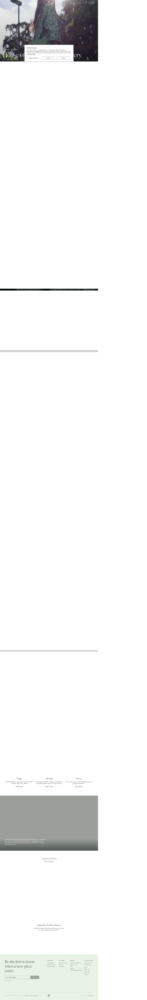
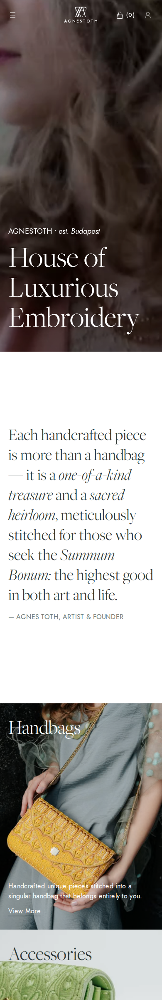

# UI Design System & Master Generation Blueprint: agnestoth-com

> **AGNESTOTH · House of Luxurious Embroidery** — A serene, museum-grade luxury fashion and bespoke embroidery house designed around pure gallery white (`rgb(255,255,255)`), warm alabaster stone (`#f0eee9`), charcoal ink (`rgb(18,18,18)`), and crimson thread accents (`#9a3b2e`).



---

## 1. Executive Visual Persona & Design Archetype

- **Brand Essence & Persona**: **AGNESTOTH · House of Luxurious Embroidery**. A serene, museum-grade luxury fashion and bespoke embroidery house designed around pure gallery white (`rgb(255,255,255)`), warm alabaster stone (`#f0eee9`), charcoal ink (`rgb(18,18,18)`), and crimson thread accents (`#9a3b2e`).
- **Visual Archetype**: **Haute Couture Embroidery Atelier & Quiet Luxury Editorial (`FreightBig Pro` + `Jost`)**.
- **Anti-AI-Slop Differentiators**:
  1. **Spaced Couture Letter-Spacing**: The hero H1 (`"H o u s e o f L u x u r i o u s E m b r o i d e r y"`) uses wide architectural letter-spacing paired with `'FreightBig Pro'` editorial serif.
  2. **Quiet Luxury Monochrome Palette**: Built on `--color-background: 255,255,255`, `--color-foreground: 18,18,18`, warm stone `#f0eee9` panels, and deep embroidery crimson `#9a3b2e`.
  3. **Bespoke Shopify Atelier Sections**: Custom modular architecture (`header.agnes-collection__head`, `header.agnes-worlds__head`, `nav.agnes-header__nav`, `nav.agnes-footer__columns`) avoiding generic storefront grids.
  4. **Silky Cubic-Bezier Media Reveals**: Product imagery (`.media > img`) fades and scales using `transition: opacity .4s cubic-bezier(.25,.46,.45,.94)` and `cubic-bezier(.22, 1, .36, 1)`.

---

## 2. Spatial Architecture & Modular Grid Mathematics



### Viewport Allocation & Container Geometry
- **Captured Full-Page Dimensions**: Desktop `1440×9759px` (`assets/desktop.png`), Mobile `390×4200px` (`assets/mobile.png`).
- **Master Container Bounds**: 1440px fluid gallery container with full-bleed editorial hero plates.
- **Canvas Lateral Padding & Spacing**: Desktop horizontal padding `clamp(24px, 4vw, 64px)`, mobile `16px`.
- **Border Radius Scale**: `0px` sharp gallery corners on all photography plates and buttons.

### Responsive Breakpoint Architecture
- **Desktop Layout**: Asymmetric couture showcase grids (`2-column` and `3-column` lookbook plates in `.agnes-collection__head` and `.agnes-worlds__head`).
- **Mobile Layout**: Single-column vertical lookbook stack below `@media (min-width: 750px)` with slide-out `<nav class="agnes-header__drawer-inner">`.
- **Extracted CSS Media Queries**: `@media (min-width: 750px)`, `@media (hover: hover)`, `@media (prefers-reduced-motion: no-preference)`.

---

## 3. Color System, Materiality & Atmospheric Lighting

### Semantic Palette & Source Grounding
| Semantic Role | Ground-Truth Value | Extracted CSS Source / Selector |
|---|---|---|
| Primary Gallery Canvas | `#FFFFFF` | `--gradient-background` / `--color-background: 255,255,255` |
| Warm Stone Secondary Surface | `#f0eee9` | Section background rule in stylesheet |
| Primary Charcoal Ink | `#121212` | `--color-foreground: 18,18,18` (`rgb(18,18,18)`) |
| Primary Button Fill | `#121212` | `--color-button: 18,18,18` |
| Primary Button Label | `#FFFFFF` | `--color-button-text: 255,255,255` |
| Contrast Border / Divider | `#bfbfbf` | `--color-background-contrast: 191,191,191` |
| Subtle Gallery Hairline | `#d9d9d9` | Border rule in stylesheet (`#d9d9d9`) |
| Couture Crimson Thread Accent | `#9a3b2e` | Accent color in stylesheet (`#9a3b2e`) |
| Deep Forest Overlay Scrim | `#0f1a198c` | Hero/card scrim token (`#0f1a198c`) |

### Sanitized Root CSS Variables (`ui-ux.md` Ground Truth)
| Variable Name | Extracted Value | Semantic Role |
|---|---|---|
| `--color-background` | `255,255,255` | Primary pure white canvas RGB triplet |
| `--gradient-background` | `#FFFFFF` | Root background hex surface |
| `--color-foreground` | `18,18,18` | Primary charcoal ink RGB triplet (#121212) |
| `--color-background-contrast` | `191,191,191` | Contrast border & divider RGB triplet (#bfbfbf) |
| `--color-shadow` | `18,18,18` | Elevation shadow base RGB triplet |
| `--color-button` | `18,18,18` | Primary couture CTA button fill |
| `--color-button-text` | `255,255,255` | Primary CTA button text color |
| `--color-secondary-button` | `255,255,255` | Secondary outline button surface |
| `--color-secondary-button-text` | `18,18,18` | Secondary outline button ink |
| `--color-link` | `18,18,18` | Editorial anchor link color |
| `--color-badge-foreground` | `18,18,18` | Collection badge label ink |
| `--color-badge-background` | `255,255,255` | Collection badge background |
| `--color-badge-border` | `18,18,18` | 1px collection badge border |
| `--font-body-family` | `Assistant, sans-serif` | Base body font family variable |
| `--font-heading-family` | `Assistant, sans-serif` | Base heading fallback variable (overridden by FreightBig Pro / Jost) |
| `--font-body-weight` | `400` | Regular body weight |
| `--font-body-weight-bold` | `700` | Bold emphasis weight |

---

## 4. Typographic Scale & Editorial Hierarchy

### Font Family Stacks
- **Display Typography**: `'FreightBig Pro', 'Jost', serif` (High-contrast couture editorial display serif).
- **Primary Body Stack**: `'Jost', Assistant, sans-serif` (`--font-body-family`).
- **Technical / Metadata Stack**: `ui-monospace, "SF Mono", monospace` (Edition numbers & sizing specs).

### Typographic Scale & Rules
- **Hero Display (`H1`)**: `clamp(1.75rem, 4vw, 3.5rem)`, `font-family: 'FreightBig Pro'`, wide tracking `0.25em` ("H o u s e o f L u x u r i o u s E m b r o i d e r y").
- **Section Heading (`H2`)**: `clamp(1.5rem, 3vw, 2.5rem)`, `font-family: 'FreightBig Pro'`, `font-weight: 400` ("The Poppy Collection", "A piece made only for you.", "The finest things are quiet. For the few who notice.").
- **Body Copy**: `0.9375rem (15px)`, `font-family: 'Jost', Assistant, sans-serif`, `line-height: 1.7`, `color: rgb(18,18,18)`.
- **Metadata & Navigation Labels**: `0.75rem (12px)`, `font-family: 'Jost'`, `letter-spacing: 0.16em`, `text-transform: uppercase`.

---

## 5. Choreographed Motion & Interaction Physics

### Primary Easing Curves
- **Extracted Timing Functions**: `cubic-bezier(.25,.46,.45,.94)` (quad ease-out) and `cubic-bezier(.22, 1, .36, 1)` (quintic ease-out).

### Per-Element Transition & Choreography Rules
- `.media > img` -> `transition: opacity .4s cubic-bezier(.25,.46,.45,.94)` (lookbook image crossfade)
- `.animate-arrow .icon-arrow path` -> `transition: transform var(--duration-short) ease` (atelier link arrow glide)
- `.underlined-link, .inline-richtext a` -> `transition: text-decoration-thickness ease .1s` (editorial link hover)
- `Drawer & Gallery transitions` -> `cubic-bezier(.52,0,.61,.99)` and `cubic-bezier(0, 0, .3, 1)`

---

## 6. Component Wireframe & Structural DOM Map

### Visual Layout Schematic (Grounded in `dom.html`)
```
┌────────────────────────────────────────────────────────────────────────┐
│ <nav class="agnes-header__nav"> [Menu]      AGNESTOTH      [Bag / Acco │
├────────────────────────────────────────────────────────────────────────┤
│ <section class="agnes-hero"> (Canvas: #FFFFFF / Scrim: #0f1a198c)      │
│   H1: H o u s e o f L u x u r i o u s E m b r o i d e r y              │
├────────────────────────────────────────────────────────────────────────┤
│ <header class="agnes-collection__head"> (Surface: #f0eee9 / #FFFFFF)   │
│   H2: The Poppy Collection  |  [ Lookbook Plate 01 ] [ Lookbook Plate  │
├────────────────────────────────────────────────────────────────────────┤
│ <header class="agnes-worlds__head"> (Bespoke Atelier Commission Sectio │
│   H2: A piece made only for you.                                       │
│   H2: The finest things are quiet. For the few who notice.             │
├────────────────────────────────────────────────────────────────────────┤
│ <header class="agnes-instagram__head"> & <header class="agnes-logos__h │
├────────────────────────────────────────────────────────────────────────┤
│ <nav class="agnes-footer__columns"> [Atelier] [Collections] [Legal] ©  │
└────────────────────────────────────────────────────────────────────────┘
```

### Granular DOM Region Breakdown
1. **Couture Header (`<nav class="agnes-header__nav">` and `<nav class="agnes-header__drawer-inner">`)**:
   - Minimalist top navigation bar on `rgb(var(--color-background))` (`#FFFFFF`) centering the `AGNESTOTH` wordmark with slide-out drawer navigation (`.agnes-header__drawer-inner`) below `750px`.
2. **Embroidery Hero Showcase (`H1: H o u s e o f L u x u r i o u s E m b r o i d e r y`)**:
   - Full-bleed couture photography stage with wide-tracked `'FreightBig Pro'` title, `#0f1a198c` atmospheric scrim, and sharp `0px` radius CTA buttons (`rgb(var(--color-button))`).
3. **The Poppy Collection (`<header class="agnes-collection__head">`)**:
   - Curated seasonal lookbook grid (`H2: The Poppy Collection`) with `#d9d9d9` hairline borders and `.media > img` hover transitions (`cubic-bezier(.25,.46,.45,.94)`).
4. **Bespoke Worlds Narrative (`<header class="agnes-worlds__head">`)**:
   - Editorial storytelling blocks (`H2: A piece made only for you.` and `H2: The finest things are quiet. For the few who notice.`) set on `#f0eee9` warm stone with `#9a3b2e` crimson accents.
5. **Atelier Footer (`<nav class="agnes-footer__columns">`)**:
   - Multi-column architectural footer housing private client appointment links, press logos (`.agnes-logos__head`), Instagram gallery (`.agnes-instagram__head`), and newsletter capture.

---

## 7. Master Zero-Shot AI Generation Prompt

```markdown
# Master Zero-Shot Frontend Generation Prompt: agnestoth-com (AGNESTOTH · House of Luxurious Embroidery)

You are a principal frontend architect and design systems engineer. Build a complete, production-ready web application replicating the exact design system, DOM landmarks, typographic hierarchy, color tokens, and motion physics of `agnestoth-com` (AGNESTOTH · House of Luxurious Embroidery).

### 1. Visual Archetype & Anti-AI-Slop Mandates
- **Archetype**: Haute Couture Embroidery Atelier & Quiet Luxury Editorial (`FreightBig Pro` + `Jost`).
- **Primary Substrate**: `#FFFFFF` (`--gradient-background` / `--color-background: 255,255,255`), **Primary Ink**: `#121212`, **Accent / Highlight**: `#0f1a198c`.
- **Site-Specific Differentiators**:
  1. **Spaced Couture Letter-Spacing**: The hero H1 (`"H o u s e o f L u x u r i o u s E m b r o i d e r y"`) uses wide architectural letter-spacing paired with `'FreightBig Pro'` editorial serif.
  2. **Quiet Luxury Monochrome Palette**: Built on `--color-background: 255,255,255`, `--color-foreground: 18,18,18`, warm stone `#f0eee9` panels, and deep embroidery crimson `#9a3b2e`.
  3. **Bespoke Shopify Atelier Sections**: Custom modular architecture (`header.agnes-collection__head`, `header.agnes-worlds__head`, `nav.agnes-header__nav`, `nav.agnes-footer__columns`) avoiding generic storefront grids.
  4. **Silky Cubic-Bezier Media Reveals**: Product imagery (`.media > img`) fades and scales using `transition: opacity .4s cubic-bezier(.25,.46,.45,.94)` and `cubic-bezier(.22, 1, .36, 1)`.

### 2. Ground-Truth CSS Variables (`:root` Token Contract)
Declare and consume these exact custom properties extracted from `agnestoth-com` in your global stylesheet:

:root {
  /* AGNESTOTH · House of Luxurious Embroidery — Ground-Truth Extracted CSS Variables */
  --color-background: 255,255,255; /* Primary pure white canvas RGB triplet */
  --gradient-background: #FFFFFF; /* Root background hex surface */
  --color-foreground: 18,18,18; /* Primary charcoal ink RGB triplet (#121212) */
  --color-background-contrast: 191,191,191; /* Contrast border & divider RGB triplet (#bfbfbf) */
  --color-shadow: 18,18,18; /* Elevation shadow base RGB triplet */
  --color-button: 18,18,18; /* Primary couture CTA button fill */
  --color-button-text: 255,255,255; /* Primary CTA button text color */
  --color-secondary-button: 255,255,255; /* Secondary outline button surface */
  --color-secondary-button-text: 18,18,18; /* Secondary outline button ink */
  --color-link: 18,18,18; /* Editorial anchor link color */
  --color-badge-foreground: 18,18,18; /* Collection badge label ink */
  --color-badge-background: 255,255,255; /* Collection badge background */
  --color-badge-border: 18,18,18; /* 1px collection badge border */
  --font-body-family: Assistant, sans-serif; /* Base body font family variable */
  --font-heading-family: Assistant, sans-serif; /* Base heading fallback variable (overridden by FreightBig Pro / Jost) */
  --font-body-weight: 400; /* Regular body weight */
  --font-body-weight-bold: 700; /* Bold emphasis weight */
}

### 3. Semantic Color & Materiality Contract
Map every surface, ink, and border strictly to these source-grounded tokens:
- **Primary Gallery Canvas**: `#FFFFFF` — grounded in `--gradient-background` / `--color-background: 255,255,255`
- **Warm Stone Secondary Surface**: `#f0eee9` — grounded in Section background rule in stylesheet
- **Primary Charcoal Ink**: `#121212` — grounded in `--color-foreground: 18,18,18` (`rgb(18,18,18)`)
- **Primary Button Fill**: `#121212` — grounded in `--color-button: 18,18,18`
- **Primary Button Label**: `#FFFFFF` — grounded in `--color-button-text: 255,255,255`
- **Contrast Border / Divider**: `#bfbfbf` — grounded in `--color-background-contrast: 191,191,191`
- **Subtle Gallery Hairline**: `#d9d9d9` — grounded in Border rule in stylesheet (`#d9d9d9`)
- **Couture Crimson Thread Accent**: `#9a3b2e` — grounded in Accent color in stylesheet (`#9a3b2e`)
- **Deep Forest Overlay Scrim**: `#0f1a198c` — grounded in Hero/card scrim token (`#0f1a198c`)

### 4. Spatial Grid, Container Bounds & Responsive Breakpoints
- **Desktop Viewport Reference**: `1440×9759px` full-page capture (`1440px` standard desktop width).
- **Mobile Viewport Reference**: `390×4200px` full-page capture (`390px` standard mobile width).
- **Container Max-Width**: 1440px fluid gallery container with full-bleed editorial hero plates
- **Padding & Gutters**: Desktop horizontal padding `clamp(24px, 4vw, 64px)`, mobile `16px`
- **Desktop Grid**: Asymmetric couture showcase grids (`2-column` and `3-column` lookbook plates in `.agnes-collection__head` and `.agnes-worlds__head`)
- **Mobile Adaptation**: Single-column vertical lookbook stack below `@media (min-width: 750px)` with slide-out `<nav class="agnes-header__drawer-inner">`
- **Media Queries**: `@media (min-width: 750px)`, `@media (hover: hover)`, `@media (prefers-reduced-motion: no-preference)`
- **Corner Radii**: `0px` sharp gallery corners on all photography plates and buttons

### 5. Typography & Editorial Scale Contract
- **Display Font Stack**: `'FreightBig Pro', 'Jost', serif` (High-contrast couture editorial display serif)
- **Body Font Stack**: `'Jost', Assistant, sans-serif` (`--font-body-family`)
- **Monospace / Technical Font Stack**: `ui-monospace, "SF Mono", monospace` (Edition numbers & sizing specs)
- **H1 Display Rule**: `clamp(1.75rem, 4vw, 3.5rem)`, `font-family: 'FreightBig Pro'`, wide tracking `0.25em` ("H o u s e o f L u x u r i o u s E m b r o i d e r y")
- **H2 Section Rule**: `clamp(1.5rem, 3vw, 2.5rem)`, `font-family: 'FreightBig Pro'`, `font-weight: 400` ("The Poppy Collection", "A piece made only for you.", "The finest things are quiet. For the few who notice.")
- **Body Copy Rule**: `0.9375rem (15px)`, `font-family: 'Jost', Assistant, sans-serif`, `line-height: 1.7`, `color: rgb(18,18,18)`
- **Metadata & Index Rule**: `0.75rem (12px)`, `font-family: 'Jost'`, `letter-spacing: 0.16em`, `text-transform: uppercase`

### 6. Component Hierarchy & Real DOM Landmarks
Scaffold the interface with these exact structural regions and class selectors from `agnestoth-com`:
1. **Couture Header (`<nav class="agnes-header__nav">` and `<nav class="agnes-header__drawer-inner">`)**:
   - Architecture & Selectors: Minimalist top navigation bar on `rgb(var(--color-background))` (`#FFFFFF`) centering the `AGNESTOTH` wordmark with slide-out drawer navigation (`.agnes-header__drawer-inner`) below `750px`.
   - Layout & State Contract: Sticky/fixed top header navigation adapting across `@media (min-width: 750px)`, `@media (hover: hover)`, `@media (prefers-reduced-motion: no-preference)` with `cubic-bezier(.25,.46,.45,.94)` (quad ease-out) and `cubic-bezier(.22, 1, .36, 1)` (quintic ease-out) menu transitions.
2. **Embroidery Hero Showcase (`H1: H o u s e o f L u x u r i o u s E m b r o i d e r y`)**:
   - Architecture & Selectors: Full-bleed couture photography stage with wide-tracked `'FreightBig Pro'` title, `#0f1a198c` atmospheric scrim, and sharp `0px` radius CTA buttons (`rgb(var(--color-button))`).
   - Layout & State Contract: Full-viewport hero stage (`1440px` desktop / `390px` mobile) pairing `#FFFFFF` substrate with `#121212` display typography (`H1`).
3. **The Poppy Collection (`<header class="agnes-collection__head">`)**:
   - Architecture & Selectors: Curated seasonal lookbook grid (`H2: The Poppy Collection`) with `#d9d9d9` hairline borders and `.media > img` hover transitions (`cubic-bezier(.25,.46,.45,.94)`).
   - Layout & State Contract: Primary showcase grid executing Asymmetric couture showcase grids (`2-column` and `3-column` lookbook plates in `.agnes-collection__head` and `.agnes-worlds__head`) on desktop and Single-column vertical lookbook stack below `@media (min-width: 750px)` with slide-out `<nav class="agnes-header__drawer-inner">` on mobile.
4. **Bespoke Worlds Narrative (`<header class="agnes-worlds__head">`)**:
   - Architecture & Selectors: Editorial storytelling blocks (`H2: A piece made only for you.` and `H2: The finest things are quiet. For the few who notice.`) set on `#f0eee9` warm stone with `#9a3b2e` crimson accents.
   - Layout & State Contract: Interactive specification & narrative module framed by `0px` sharp gallery corners on all photography plates and buttons and `#0f1a198c` highlights.
5. **Atelier Footer (`<nav class="agnes-footer__columns">`)**:
   - Architecture & Selectors: Multi-column architectural footer housing private client appointment links, press logos (`.agnes-logos__head`), Instagram gallery (`.agnes-instagram__head`), and newsletter capture.
   - Layout & State Contract: Footer directory and utility bar anchored to 1440px fluid gallery container with full-bleed editorial hero plates with Desktop horizontal padding `clamp(24px, 4vw, 64px)`, mobile `16px` lateral gutters.

### 7. Motion & Interaction Choreography
- **Primary Easing Functions**: `cubic-bezier(.25,.46,.45,.94)` (quad ease-out) and `cubic-bezier(.22, 1, .36, 1)` (quintic ease-out)
- **Per-Selector Transition Rules**:
- `.media > img` -> `transition: opacity .4s cubic-bezier(.25,.46,.45,.94)` (lookbook image crossfade)
- `.animate-arrow .icon-arrow path` -> `transition: transform var(--duration-short) ease` (atelier link arrow glide)
- `.underlined-link, .inline-richtext a` -> `transition: text-decoration-thickness ease .1s` (editorial link hover)
- `Drawer & Gallery transitions` -> `cubic-bezier(.52,0,.61,.99)` and `cubic-bezier(0, 0, .3, 1)`

### 8. Technical Deliverables
- Implement in Next.js (App Router) with TypeScript and Tailwind CSS consuming the `:root` custom properties defined above.
- Reproduce both the `1440px` desktop architecture and `390px` mobile breakpoint transitions, preserving semantic HTML5 landmarks (`<header>`, `<nav>`, `<main>`, `<section>`, `<footer>`) and `prefers-reduced-motion` accessibility guards.
```
