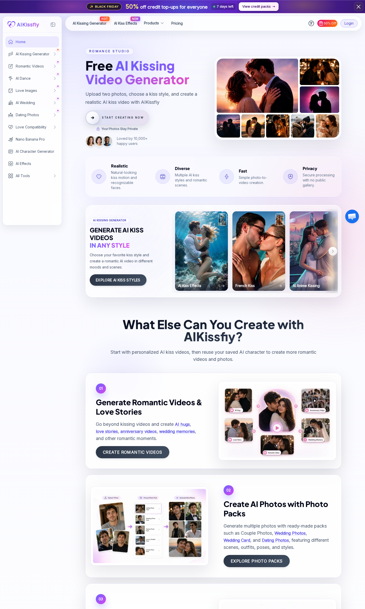
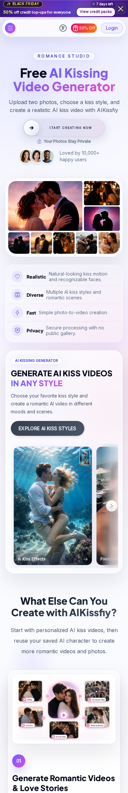

# UI Design System & Master Generation Blueprint: aikissfiy-com

> **Free AI Kissing Video Generator: Create AI Kiss Videos Online - AIKissfiy** (https://aikissfiy.com) — Description: AIKissfiy creates realistic AI kissing videos from your photos. Choose different kiss styles, keep faces recognizable, and e...



---

## 1. Executive Visual Persona & Design Archetype

- **Brand Essence & Persona**: **Free AI Kissing Video Generator: Create AI Kiss Videos Online - AIKissfiy** (`https://aikissfiy.com`). Description: AIKissfiy creates realistic AI kissing videos from your photos. Choose different kiss styles, keep faces recognizable, and e...
- **Capture Provenance**: Live browser capture (`tier1_fast`, HTTP `200`, captured `2026-11-23`).
- **Visual Archetype**: **Light-Substrate Editorial & Modular Grid System (`#ffffff` canvas, `#020617` ink, `#6c63ff` accent)**.
- **Anti-AI-Slop Differentiators**:
  - **Live-Computed Chromatic Polarity**: Anchors the viewport in `#ffffff` (live computed `section` `background-color` (`computed_styles.json`)) paired with `#020617` primary typography and `#6c63ff` accents.
  - **Grounded Typographic Hierarchy**: Pairs `Plus Jakarta Sans` for display copy (`Free AI Kissing Video Generator`) with `Inter` and not declared in live computed styles (uses primary stack / `ui-monospace`).
  - **Calibrated Spatial Grid & Motion**: Combines `1196px` container bounds (`gap: 4px`, padding `8px`) with `cubic-bezier(.4,0,.2,1)` easing.

---

## 2. Spatial Architecture & Modular Grid Mathematics



### Viewport Allocation & Container Geometry
- **Captured Viewport Dimensions**: Desktop `1440×2400px` (`assets/desktop.png`, clamped at 2400px live multi-section capture), Mobile `390×2400px` (`assets/mobile.png`, clamped at 2400px live multi-section capture).
- **Master Container Bounds**: `1196px` (measured `<main>` bounding box width within `1440px` desktop viewport).
- **Canvas Lateral Padding & Spacing**: `8px` lateral canvas padding with `4px` grid gap.
- **Border Radius Scale**: `10px`, `var(--ak-border-radius-base)`, `var(--ak-border-radius-round)`, `50%`.

### Responsive Breakpoint Architecture
- **Desktop Layout**: 2-column persistent left sidebar (`232px`, <nav.app-navigation__nav>) + `1196px` main content stage at `1440px` (`max-width: 1196px`, `gap: 4px`).
- **Mobile Layout**: Single-column vertical stack at `390px` viewport width with collapsed `<nav.app-navigation__nav>` drawer navigation and `8px` horizontal padding.
- **Extracted CSS Media Queries**: `@media (min-width:768px)`, `@media (max-width:767px)`, `@media (max-width:767px)and (any-hover:hover)and (any-pointer:fine)`, `@media (max-width:639px)`.

---

## 3. Color System, Materiality & Atmospheric Lighting

### Semantic Palette & Source Grounding
| Semantic Role | Ground-Truth Value | Extracted Live / CSS Source |
|---|---|---|
| **Primary Canvas Substrate** | `#ffffff` | live computed `section` `background-color` (`computed_styles.json`) |
| **Primary Typography Ink** | `#020617` | live computed `h1` `color` (`computed_styles.json`) |
| **Elevated Surface / Card Substrate** | `#f7f8fb` | live computed `footer` `background-color` (`computed_styles.json`) |
| **Interactive Accent / Highlight** | `#6c63ff` | `var(--gradient-primary)` in `:root` |
| **Secondary / Muted Copy** | `#64748b` | `var(--aikiss-soft-muted)` in `:root` |
| **Structural Hairline Border** | `#d1d5db` | `var(--border-color)` in `:root` |
| **Variable Token (`--aikiss-text`)** | `#0f172a` | `var(--aikiss-text)` in `:root` |
| **Variable Token (`--aikiss-muted`)** | `#475569` | `var(--aikiss-muted)` in `:root` |
| **Variable Token (`--gradient-primary`)** | `#8b81ff` | `var(--gradient-primary)` in `:root` |
| **Variable Token (`--gradient-primary`)** | `#b941ff` | `var(--gradient-primary)` in `:root` |
| **Variable Token (`--gradient-primary`)** | `#ec4899` | `var(--gradient-primary)` in `:root` |

### Sanitized Root CSS Variables (`ui-ux.md` Ground Truth)
| Variable Name | Extracted Value | Semantic Role |
|---|---|---|
| `--font-sans` | `Inter,system-ui,sans-serif` | Typography / Scale Token |
| `--default-font-family` | `var(--font-sans)` | Typography / Scale Token |
| `--aikiss-section-bg` | `transparent` | Canvas / Surface Token |
| `--aikiss-surface-solid` | `#fff` | Canvas / Surface Token |
| `--aikiss-surface-muted` | `rgba(248,250,252,.82)` | Canvas / Surface Token |
| `--aikiss-border` | `rgba(99,102,241,.2)` | Elevation / Border Token |
| `--aikiss-border-strong` | `rgba(99,102,241,.34)` | Elevation / Border Token |
| `--aikiss-text` | `#0f172a` | Typography Ink Token |
| `--aikiss-muted` | `#475569` | Color / Atmospheric Token |
| `--aikiss-soft-muted` | `#64748b` | Color / Atmospheric Token |
| `--aikiss-glow-primary` | `rgba(108,99,255,.2)` | Brand / Palette Token |
| `--aikiss-glow-secondary` | `rgba(236,72,153,.14)` | Brand / Palette Token |
| `--gradient-primary` | `linear-gradient(135deg,#6c63ff,#8b81ff 30%,#b941ff 66%,#ec4899)` | Brand / Palette Token |
| `--aikiss-inner-highlight` | `hsla(0,0%,100%,.78)` | Canvas / Surface Token |
| `--aikiss-shadow` | `0 24px 60px rgba(15,23,42,.1)` | Elevation / Border Token |
| `--aikiss-tool-shell` | `hsla(0,0%,100%,.58)` | Color / Atmospheric Token |

---

## 4. Typographic Scale & Editorial Hierarchy

### Font Family Stacks
- **Display Typography**: `Plus Jakarta Sans`.
- **Primary Body Stack**: `Inter`.
- **Technical / Metadata Stack**: not declared in live computed styles (uses primary stack / `ui-monospace`).

### Typographic Scale & Rules (Live Computed & Stylesheet Grounded)
- **Hero Display (`H1`)**: live computed `h1` (`font-size: 50px`, `line-height: 54px`, `font-weight: 800`); CSS variables `--text-4xl: 2.25rem`, `--text-4xl--line-height: 1.11111`, `--text-5xl: 3rem`; rule `h1` (`font-size: 2em`).
- **Section Heading (`H2`)**: live computed `h2 (largest visible desktop heading)` (`font-size: 60px`, `line-height: 1.2`, `font-weight: 900`); CSS variables `--text-2xl: 1.5rem`, `--text-2xl--line-height: 1.33333`, `--text-3xl: 1.875rem`; rule `h2` (`font-size: 1.5em`).
- **Body Copy**: live computed `body` (`font-size: 16px`, `line-height: 24px`, `font-weight: 400`); CSS variables `--text-base: 1rem`, `--text-base--line-height: 1.5`.
- **Metadata & Navigation Labels**: live computed `nav/a` (`font-size: 16px`, `line-height: 24px`, `font-weight: 400`); CSS variables `--text-xs: .75rem`, `--text-xs--line-height: 1.33333`, `--text-sm: .875rem`.

---

## 5. Choreographed Motion & Interaction Physics

### Primary Easing Curves
- **Extracted Timing Functions**: `cubic-bezier(.4,0,.2,1)`, `cubic-bezier(.22,1,.36,1)`, `cubic-bezier(.23,1,.32,1)`.

### Per-Element Transition & Choreography Rules
- **Selector `.ak-button`**: `transition: .1s` extracted from `aikissfiy-com` stylesheet.
- **Selector `.ak-button:focus-visible`**: `transition: outline-offset 0s,outline 0s` extracted from `aikissfiy-com` stylesheet.
- **Selector `ton.is-text:not(.is-disabled):foc...`**: `transition: outline-offset 0s,outline 0s` extracted from `aikissfiy-com` stylesheet.
- **Extracted Easing Curve (`cubic-bezier(.4,0,.2,1)`)**: Governs interactive state transitions across `<header.navigate-new>` and `<article.gap-3>`.
- **State & Hover Choreography**: Opacity and transform transitions on `<section.home-section>` and `<article.gap-3>` interactive targets.

---

## 6. Component Wireframe & Structural DOM Map

### Visual Layout Schematic — Desktop (`1440px`, Grounded in `dom.html` & Landmark Bounding Boxes)
```
┌────────────────────────────────────────────────────────────────────────┐
│ DESKTOP VIEWPORT (1440px) — Sidebar (232px) + Main (1196px)            │
│ ====================================================================== │
│ +--[ SIDEBAR (232px) ]--+--[ MAIN CONTENT STAGE (1196px) ]-----------+ │
│ | <nav.app-navigation__ | [ <header.navigate- | Home · Nano Banana ] | │
│ | - Home                | ------------------------------------------ | │
│ | - Nano Banana Pro     | HERO STAGE: <section.home-section>         | │
│ | - AI Effects          | H1: Free AI Kissing Video Generator        | │
│ | - Explore             | Bg:#ffffff Ink:#020617 Acc:#6c63ff         | │
│ | x=11 h=608px rail     | ------------------------------------------ | │
│ |                       | SHOWCASE: <article.gap-3> max:1196px       | │
│ |                       | [Generate AI Kiss V] [What Else Can You ]  | │
│ |                       | DETAIL: <article.px-3>                     | │
│ +-----------------------+--------------------------------------------+ │
│ [ FOOTER (<footer.border-slate) | https://aikissfiy.com                │
└────────────────────────────────────────────────────────────────────────┘
```

### Visual Layout Schematic — Mobile Reflow (`390px`)
```
┌────────────────────────────────────────────────────────────────────────┐
│ MOBILE VIEWPORT REFLOW (390px) — Collapsed Sidebar + 1-Col Stack       │
│ ====================================================================== │
│ [ DRAWER (<nav.app-navigation__n) | <header.navigate-new>              │
│ ---------------------------------------------------------------------- │
│ | HERO STAGE (<section.home-section>) — 390px Full-Width             | │
│ | H1: Free AI Kissing Video Generator                                | │
│ ---------------------------------------------------------------------- │
│ | SHOWCASE STACK (<article.gap-3>) — 1-Col (gap: 4px)                | │
│ | [ Card 1: Generate AI Kiss Videos in Any Style                   ] | │
│ | [ Card 2: What Else Can You Create with AIKissfiy?               ] | │
│ ---------------------------------------------------------------------- │
│ | DETAIL STACK (<article.px-3>) — 1-Col (Generate Romantic )         | │
│ ---------------------------------------------------------------------- │
│ [ FOOTER (<footer.border-slate-2) | Stacked 390px Colophon             │
└────────────────────────────────────────────────────────────────────────┘
```

### Granular DOM Region Breakdown
1. **Persistent Left Sidebar Navigation (<nav.app-navigation__nav> — `232×608px` at `x=11`)**:
   - Fixed/sticky left rail `<nav class="app-navigation__nav desktop-only">` (`232px` wide) paired with top bar `<header class="navigate-new top-0">` hosting `Free AI Kissing Video Generato` navigation (`Home · Nano Banana Pro · AI Effects`), DOM attributes (`data-hid="page-structured-data"`, `data-gtag`, `data-v-3c617593`, `data-v-122af031`), and rule `webkit-scrollbar { display:none }`.
2. **Hero Stage & Focal Lead (<section.home-section> — `Free AI Kissing Video Generator`)**:
   - Landmark `<section class="home-section aikiss-ambient-section">` inside `1196px` main stage presenting display lead `Free AI Kissing Video Generator` and copy excerpt *"Upload two photos, choose a kiss style, and create a realistic AI"* over `#ffffff` canvas and `#020617` ink.
3. **Primary Showcase & Content Grid (<article.gap-3> — `Generate AI Kiss Videos in Any Sty`)**:
   - Landmark `<article class="gap-3 px-3">` rendering section `Generate AI Kiss Videos in Any Style` with copy *"AI Kissing Video Generator"*, asset references (`cdn.aikissfiy.com`, `entry.BRsH49Xa.css`, `OverlayScrollbar.CrLIJdLh.css`, `LanguageSwitch.BsPr10ru.css`), and grid rule `.ak-button:focus-visible { outline:2px solid var(--ak-button-outline-color);outline-offset:1px;tran... }`.
4. **Interactive Detail & Feature Matrix (<article.px-3> — `What Else Can You Create with AIKi`)**:
   - Landmark `<article class="gap-3 px-3">` framing `What Else Can You Create with AIKissfiy?` and `Generate Romantic Videos & Love Stories` (*"Start Creating Now"*) with `#f7f8fb` surface cards, `#6c63ff` accents, and `.ak-button>span { align-items:center;display:inline-flex }`.
5. **Colophon & Global Directory Footer (<footer.border-slate-200> — `https://aikissfiy.com`)**:
   - Landmark `<footer class="border-slate-200 pt-8">` anchoring `Free AI Kissing Video Generator:` footer links (`Home · Nano Banana Pro · AI Effects`), copy *"Your Photos Stay Private"*, and `#d1d5db` structural dividers.

---

## 7. Master Zero-Shot AI Generation Prompt

```markdown
# Master Zero-Shot Frontend Generation Prompt: aikissfiy-com (Free AI Kissing Video Generator: Create AI Kiss Videos Online - AIKissfiy)

You are a principal frontend architect and design systems engineer. Build a complete, production-ready web application replicating the exact design system, DOM landmarks, typographic hierarchy, color tokens, and motion physics of `aikissfiy-com` (**Free AI Kissing Video Generator: Create AI Kiss Videos Online - AIKissfiy** — `https://aikissfiy.com`).

### 1. Visual Archetype & Anti-AI-Slop Mandates
- **Archetype**: Light-Substrate Editorial & Modular Grid System (`#ffffff` canvas, `#020617` ink, `#6c63ff` accent).
- **Identity & Domain Context**: Description: AIKissfiy creates realistic AI kissing videos from your photos. Choose different kiss styles, keep faces recognizable, and e...
- **Primary Substrate**: `#ffffff` (live computed `section` `background-color` (`computed_styles.json`)), **Primary Ink**: `#020617`, **Accent / Highlight**: `#6c63ff`.
- **Site-Specific Differentiators**:
  - **Live-Computed Chromatic Polarity**: Anchors the viewport in `#ffffff` (live computed `section` `background-color` (`computed_styles.json`)) paired with `#020617` primary typography and `#6c63ff` accents.
  - **Grounded Typographic Hierarchy**: Pairs `Plus Jakarta Sans` for display copy (`Free AI Kissing Video Generator`) with `Inter` and not declared in live computed styles (uses primary stack / `ui-monospace`).
  - **Calibrated Spatial Grid & Motion**: Combines `1196px` container bounds (`gap: 4px`, padding `8px`) with `cubic-bezier(.4,0,.2,1)` easing.

### 2. Ground-Truth CSS Variables (`:root` Token Contract)
Declare and consume these exact custom properties extracted from `aikissfiy-com` in your global stylesheet:

:root {
  /* Free AI Kissing Video Generator: Create AI Kiss Videos Online - AIKissfiy (aikissfiy-com) — Live-Grounded CSS Variables */
  --font-sans: Inter,system-ui,sans-serif; /* Typography / Scale Token (aikissfiy-com) */
  --default-font-family: var(--font-sans); /* Typography / Scale Token (aikissfiy-com) */
  --aikiss-section-bg: transparent; /* Canvas / Surface Token (aikissfiy-com) */
  --aikiss-surface-solid: #fff; /* Canvas / Surface Token (aikissfiy-com) */
  --aikiss-surface-muted: rgba(248,250,252,.82); /* Canvas / Surface Token (aikissfiy-com) */
  --aikiss-border: rgba(99,102,241,.2); /* Elevation / Border Token (aikissfiy-com) */
  --aikiss-border-strong: rgba(99,102,241,.34); /* Elevation / Border Token (aikissfiy-com) */
  --aikiss-text: #0f172a; /* Typography Ink Token (aikissfiy-com) */
  --aikiss-muted: #475569; /* Color / Atmospheric Token (aikissfiy-com) */
  --aikiss-soft-muted: #64748b; /* Color / Atmospheric Token (aikissfiy-com) */
  --aikiss-glow-primary: rgba(108,99,255,.2); /* Brand / Palette Token (aikissfiy-com) */
  --aikiss-glow-secondary: rgba(236,72,153,.14); /* Brand / Palette Token (aikissfiy-com) */
  --gradient-primary: linear-gradient(135deg,#6c63ff,#8b81ff 30%,#b941ff 66%,#ec4899); /* Brand / Palette Token (aikissfiy-com) */
  --aikiss-inner-highlight: hsla(0,0%,100%,.78); /* Canvas / Surface Token (aikissfiy-com) */
  --aikiss-shadow: 0 24px 60px rgba(15,23,42,.1); /* Elevation / Border Token (aikissfiy-com) */
  --aikiss-tool-shell: hsla(0,0%,100%,.58); /* Color / Atmospheric Token (aikissfiy-com) */
}

### 3. Semantic Color & Materiality Contract
Map every surface, ink, and border strictly to these source-grounded tokens:
- **Primary Canvas Substrate**: `#ffffff` — grounded in live computed `section` `background-color` (`computed_styles.json`)
- **Primary Typography Ink**: `#020617` — grounded in live computed `h1` `color` (`computed_styles.json`)
- **Elevated Surface / Card Substrate**: `#f7f8fb` — grounded in live computed `footer` `background-color` (`computed_styles.json`)
- **Interactive Accent / Highlight**: `#6c63ff` — grounded in `var(--gradient-primary)` in `:root`
- **Secondary / Muted Copy**: `#64748b` — grounded in `var(--aikiss-soft-muted)` in `:root`
- **Structural Hairline Border**: `#d1d5db` — grounded in `var(--border-color)` in `:root`
- **Variable Token (`--aikiss-text`)**: `#0f172a` — grounded in `var(--aikiss-text)` in `:root`
- **Variable Token (`--aikiss-muted`)**: `#475569` — grounded in `var(--aikiss-muted)` in `:root`
- **Variable Token (`--gradient-primary`)**: `#8b81ff` — grounded in `var(--gradient-primary)` in `:root`
- **Variable Token (`--gradient-primary`)**: `#b941ff` — grounded in `var(--gradient-primary)` in `:root`
- **Variable Token (`--gradient-primary`)**: `#ec4899` — grounded in `var(--gradient-primary)` in `:root`

### 4. Spatial Grid, Container Bounds & Responsive Breakpoints
- **Desktop Viewport Reference**: `1440×2400px` (clamped at 2400px live multi-section capture, `1440px` standard desktop width).
- **Mobile Viewport Reference**: `390×2400px` (clamped at 2400px live multi-section capture, `390px` standard mobile width).
- **Container Max-Width**: `1196px` (measured `<main>` bounding box width within `1440px` desktop viewport)
- **Padding & Gutters**: `8px` lateral canvas padding with `4px` grid gap
- **Desktop Grid**: 2-column persistent left sidebar (`232px`, <nav.app-navigation__nav>) + `1196px` main content stage at `1440px` (`max-width: 1196px`, `gap: 4px`)
- **Mobile Adaptation**: Single-column vertical stack at `390px` viewport width with collapsed `<nav.app-navigation__nav>` drawer navigation and `8px` horizontal padding
- **Media Queries**: `@media (min-width:768px)`, `@media (max-width:767px)`, `@media (max-width:767px)and (any-hover:hover)and (any-pointer:fine)`, `@media (max-width:639px)`
- **Corner Radii**: `10px`, `var(--ak-border-radius-base)`, `var(--ak-border-radius-round)`, `50%`

### 5. Typography & Editorial Scale Contract
- **Display Font Stack**: `Plus Jakarta Sans`
- **Body Font Stack**: `Inter`
- **Monospace / Technical Font Stack**: not declared in live computed styles (uses primary stack / `ui-monospace`)
- **H1 Display Rule**: live computed `h1` (`font-size: 50px`, `line-height: 54px`, `font-weight: 800`); CSS variables `--text-4xl: 2.25rem`, `--text-4xl--line-height: 1.11111`, `--text-5xl: 3rem`; rule `h1` (`font-size: 2em`)
- **H2 Section Rule**: live computed `h2 (largest visible desktop heading)` (`font-size: 60px`, `line-height: 1.2`, `font-weight: 900`); CSS variables `--text-2xl: 1.5rem`, `--text-2xl--line-height: 1.33333`, `--text-3xl: 1.875rem`; rule `h2` (`font-size: 1.5em`)
- **Body Copy Rule**: live computed `body` (`font-size: 16px`, `line-height: 24px`, `font-weight: 400`); CSS variables `--text-base: 1rem`, `--text-base--line-height: 1.5`
- **Metadata & Index Rule**: live computed `nav/a` (`font-size: 16px`, `line-height: 24px`, `font-weight: 400`); CSS variables `--text-xs: .75rem`, `--text-xs--line-height: 1.33333`, `--text-sm: .875rem`

### 6. Component Hierarchy, Verbatim Copy & Real DOM Landmarks
Scaffold `aikissfiy-com` (`Free AI Kissing Video Generator: Create AI Kiss Videos Online - AIKissfiy`) with these exact structural regions, extracted copy, and CSS rules from `dom.html`:
1. **Persistent Left Sidebar Navigation (<nav.app-navigation__nav> — `232×608px` at `x=11`)**:
   - DOM & Selectors: Fixed/sticky left rail `<nav class="app-navigation__nav desktop-only">` (`232px` wide) paired with top bar `<header class="navigate-new top-0">` hosting `Free AI Kissing Video Generato` navigation (`Home · Nano Banana Pro · AI Effects`), DOM attributes (`data-hid="page-structured-data"`, `data-gtag`, `data-v-3c617593`, `data-v-122af031`), and rule `webkit-scrollbar { display:none }`.
   - Responsive Contract: Header `Persistent Left Sidebar Navigation (<nav.app-navigation__nav> — `232×608px` at `x=11`)` (`aikissfiy-com`) adapts across `@media (min-width:768px)`, `@media (max-width:767px)`, `@media (max-width:767px)and (any-hover:hover)and (any-pointer:fine)`, `@media (max-width:639px)` with `cubic-bezier(.4,0,.2,1)`, `cubic-bezier(.22,1,.36,1)`, `cubic-bezier(.23,1,.32,1)` transitions and links `Home · Nano Banana Pro · AI Effects`.
2. **Hero Stage & Focal Lead (<section.home-section> — `Free AI Kissing Video Generator`)**:
   - DOM & Selectors: Landmark `<section class="home-section aikiss-ambient-section">` inside `1196px` main stage presenting display lead `Free AI Kissing Video Generator` and copy excerpt *"Upload two photos, choose a kiss style, and create a realistic AI"* over `#ffffff` canvas and `#020617` ink.
   - Responsive Contract: Hero stage (`1440×2400px` desktop / `390×2400px` mobile) sets `#ffffff` background with `#020617` headline `Free AI Kissing Video Generator`.
3. **Primary Showcase & Content Grid (<article.gap-3> — `Generate AI Kiss Videos in Any Sty`)**:
   - DOM & Selectors: Landmark `<article class="gap-3 px-3">` rendering section `Generate AI Kiss Videos in Any Style` with copy *"AI Kissing Video Generator"*, asset references (`cdn.aikissfiy.com`, `entry.BRsH49Xa.css`, `OverlayScrollbar.CrLIJdLh.css`, `LanguageSwitch.BsPr10ru.css`), and grid rule `.ak-button:focus-visible { outline:2px solid var(--ak-button-outline-color);outline-offset:1px;tran... }`.
   - Responsive Contract: Showcase grid `Primary Showcase & Content Grid (<article.gap-3> — `Generate AI Kiss Videos in Any Sty`)` applies 2-column persistent left sidebar (`232px`, <nav.app-navigation__nav>) + `1196px` main content stage at `1440px` (`max-width: 1196px`, `gap: 4px`) on desktop and Single-column vertical stack at `390px` viewport width with collapsed `<nav.app-navigation__nav>` drawer navigation and `8px` horizontal padding on mobile.
4. **Interactive Detail & Feature Matrix (<article.px-3> — `What Else Can You Create with AIKi`)**:
   - DOM & Selectors: Landmark `<article class="gap-3 px-3">` framing `What Else Can You Create with AIKissfiy?` and `Generate Romantic Videos & Love Stories` (*"Start Creating Now"*) with `#f7f8fb` surface cards, `#6c63ff` accents, and `.ak-button>span { align-items:center;display:inline-flex }`.
   - Responsive Contract: Detail module `Interactive Detail & Feature Matrix (<article.px-3> — `What Else Can You Create with AIKi`)` uses `10px`, `var(--ak-border-radius-base)`, `var(--ak-border-radius-round)`, `50%` radii, `#6c63ff` highlights, and assets (cdn.aikissfiy.com, entry.BRsH49Xa.css, OverlayScrollbar.CrLIJdLh.css).
5. **Colophon & Global Directory Footer (<footer.border-slate-200> — `https://aikissfiy.com`)**:
   - DOM & Selectors: Landmark `<footer class="border-slate-200 pt-8">` anchoring `Free AI Kissing Video Generator:` footer links (`Home · Nano Banana Pro · AI Effects`), copy *"Your Photos Stay Private"*, and `#d1d5db` structural dividers.
   - Responsive Contract: Footer `Colophon & Global Directory Footer (<footer.border-slate-200> — `https://aikissfiy.com`)` aligns to `1196px` (measured `<main>` bounding box width within `1440px` desktop viewport) with `8px` lateral canvas padding with `4px` grid gap and attributes (data-hid="page-structured-data", data-gtag, data-v-3c617593).

#### Verbatim DOM Copy Excerpts (`dom.html`)
- Copy Excerpt 1: *"Upload two photos, choose a kiss style, and create a realistic AI kiss video with..."*
- Copy Excerpt 2: *"AI Kissing Video Generator"*
- Copy Excerpt 3: *"Start Creating Now"*
- Copy Excerpt 4: *"Your Photos Stay Private"*

### 7. Motion, Extracted Stylesheet Rules & Interaction Choreography
- **Primary Easing Functions**: `cubic-bezier(.4,0,.2,1)`, `cubic-bezier(.22,1,.36,1)`, `cubic-bezier(.23,1,.32,1)`
- **Extracted Stylesheet Rules (`aikissfiy-com`)**:
- `webkit-scrollbar { display:none }`
- `.ak-button:focus-visible { outline:2px solid var(--ak-button-outline-color);outline-offset:1px;tran... }`
- `.ak-button>span { align-items:center;display:inline-flex }`
- `.ak-button { margin-left:12px }`
- `.ak-button.is-round { padding:8px 15px }`
- **Per-Selector Transition Rules**:
- **Selector `.ak-button`**: `transition: .1s` extracted from `aikissfiy-com` stylesheet.
- **Selector `.ak-button:focus-visible`**: `transition: outline-offset 0s,outline 0s` extracted from `aikissfiy-com` stylesheet.
- **Selector `ton.is-text:not(.is-disabled):foc...`**: `transition: outline-offset 0s,outline 0s` extracted from `aikissfiy-com` stylesheet.
- **Extracted Easing Curve (`cubic-bezier(.4,0,.2,1)`)**: Governs interactive state transitions across `<header.navigate-new>` and `<article.gap-3>`.
- **State & Hover Choreography**: Opacity and transform transitions on `<section.home-section>` and `<article.gap-3>` interactive targets.

### 8. Technical Deliverables
- Implement in Next.js (App Router) with TypeScript and Tailwind CSS consuming the `:root` custom properties defined above for `aikissfiy-com`.
- Reproduce both the `1440px` desktop architecture and `390px` mobile breakpoint transitions, preserving semantic HTML5 landmarks (`<header>`, `<nav>`, `<main>`, `<section>`, `<footer>`) and `prefers-reduced-motion` accessibility guards.
```
