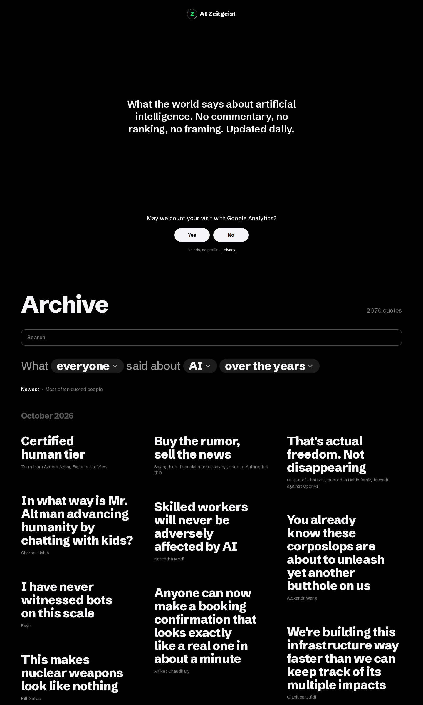
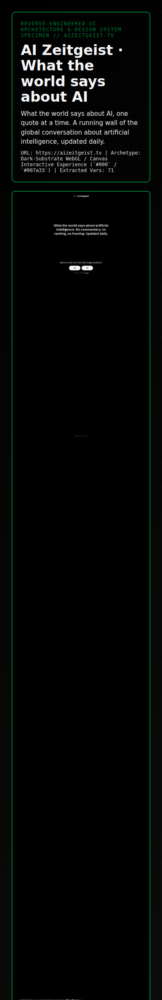

# UI Design System & Master Generation Blueprint: aizeitgeist-tv

> **AI Zeitgeist · What the world says about AI** (https://aizeitgeist.tv) — What the world says about AI, one quote at a time. A running wall of the global conversation about artificial intelligence, updated daily.



---

## 1. Executive Visual Persona & Design Archetype

- **Brand Essence & Persona**: **AI Zeitgeist · What the world says about AI** (`https://aizeitgeist.tv`). What the world says about AI, one quote at a time. A running wall of the global conversation about artificial intelligence, updated daily.
- **Visual Archetype**: **Dark-Substrate WebGL / Canvas Interactive Experience (`#000` / `#007a33`)**.
- **Anti-AI-Slop Differentiators**:
  - **Source-Grounded Chromatic Polarity**: Anchors the viewport in `#000` (`var(--bg)` in `:root`) paired with `#f5f5f7` primary typography and `#007a33` accents.
  - **Extracted Typographic Hierarchy**: Pairs `Schibsted Grotesk` for display copy (`AI Zeitgeist: what the world says ab`) with `Helvetica Neue` and not declared in static CSS (uses primary stack / `ui-monospace`).
  - **Calibrated Spatial Grid & Motion**: Combines `640px` container bounds (`gap: 2px`, padding `12px`) with `cubic-bezier(.55,0,.2,1)` easing and Three.js / WebGL Canvas Pipeline.

---

## 2. Spatial Architecture & Modular Grid Mathematics



### Viewport Allocation & Container Geometry
- **Captured Viewport Dimensions**: Desktop `1440×13433px` (`assets/desktop.png`, full-page scroll capture), Mobile `390×2400px` (`assets/mobile.png`, capped at 2400px multi-section capture).
- **Master Container Bounds**: `640px` extracted from `aizeitgeist-tv` stylesheet.
- **Canvas Lateral Padding & Spacing**: `12px` lateral canvas padding with `2px` grid gap.
- **Border Radius Scale**: `4px`, `50%`, `999px`, `12px`.

### Responsive Breakpoint Architecture
- **Desktop Layout**: Multi-column CSS Grid / Flexbox layout at `1440px` (`max-width: 640px`, `gap: 2px`).
- **Mobile Layout**: Single-column vertical stack at `390px` viewport width with `12px` horizontal padding.
- **Extracted CSS Media Queries**: `@media (max-width:640px)`, `@media (prefers-reduced-motion:reduce)`, `@media (prefers-reduced-motion:no-preference)and (pointer:coarse)`, `@media (min-width:641px)and (max-width:1919px)`.

---

## 3. Color System, Materiality & Atmospheric Lighting

### Semantic Palette & Source Grounding
| Semantic Role | Ground-Truth Value | Extracted CSS Source / Selector |
|---|---|---|
| **Primary Canvas Substrate** | `#000` | `var(--bg)` in `:root` |
| **Primary Typography Ink** | `#f5f5f7` | `var(--fg)` in `:root` |
| **Elevated Surface / Card Substrate** | `#00ff66` | `var(--accent)` in `:root` |
| **Interactive Accent / Highlight** | `#007a33` | `.award:hover { color: #007a33 }` |
| **Secondary / Muted Copy** | `#101010` | `.intro-actions { background: #101010 }` |
| **Structural Hairline Border** | `#00c853` | `:hover { color: #00c853 }` |

### Sanitized Root CSS Variables (`ui-ux.md` Ground Truth)
| Variable Name | Extracted Value | Semantic Role |
|---|---|---|
| `--bg` | `#000` | Canvas / Surface Token |
| `--fg` | `#f5f5f7` | Typography Ink Token |
| `--fg-2` | `rgb(245 245 247 / .62)` | Typography Ink Token |
| `--fg-3` | `rgb(245 245 247 / .5)` | Typography Ink Token |
| `--fg-4` | `rgb(245 245 247 / .36)` | Typography Ink Token |
| `--line` | `rgb(245 245 247 / .14)` | Color / Atmospheric Token |
| `--pill-line` | `rgb(245 245 247 / .3)` | Color / Atmospheric Token |
| `--sheen` | `rgb(245 245 247 / .32)` | Color / Atmospheric Token |
| `--pill-bg` | `rgb(20 20 20 / .72)` | Canvas / Surface Token |
| `--pop-bg` | `rgb(16 16 16 / .92)` | Canvas / Surface Token |
| `--kbd-line` | `rgb(245 245 247 / .28)` | Color / Atmospheric Token |
| `--kbd-bg` | `rgb(245 245 247 / .08)` | Canvas / Surface Token |
| `--accent` | `#00ff66` | Brand / Palette Token |
| `--grid-alpha` | `.075` | Layout / Spatial Grid Token |
| `--font` | `"Schibsted Grotesk", "Helvetica Neue", Helvetica, Arial, sans-serif` | Typography / Scale Token |
| `--pill-h` | `60px` | Dimension / Scale Token |

---

## 4. Typographic Scale & Editorial Hierarchy

### Font Family Stacks
- **Display Typography**: `Schibsted Grotesk`.
- **Primary Body Stack**: `Helvetica Neue`.
- **Technical / Metadata Stack**: not declared in static CSS (uses primary stack / `ui-monospace`).

### Typographic Scale & Rules (Extracted from Stylesheet & Variables)
- **Hero Display (`H1`)**: rule `h1` (`font-size: clamp(1.9rem,4vw,2.6rem)`).
- **Section Heading (`H2`)**: rule `h2` (`font-size: clamp(2.4rem,8vw,7rem)`, `line-height: 1`, `letter-spacing: -.03em`, `font-weight: 800`).
- **Body Copy**: rule `p` (`font-size: 1rem`, `line-height: 1.5`).
- **Metadata & Navigation Labels**: CSS variables `--av3-meta-gap: 16px`, `--av3-label-fs: clamp(1.3rem, 2.5vw, 1.7rem)`; rule `small` (`font-size: .78rem`).

---

## 5. Choreographed Motion & Interaction Physics

### Primary Easing Curves
- **Extracted Timing Functions**: `cubic-bezier(.55,0,.2,1)`, `cubic-bezier(.2,.8,.3,1)`, `cubic-bezier(.25,.9,.3,1)`.

### Per-Element Transition & Choreography Rules
- **Selector `.lead-more`**: `transition: color .15s,text-decoration-color .15s` extracted from `aizeitgeist-tv` stylesheet.
- **Selector `.hero-cube`**: `transition: transform 1.1s cubic-bezier(.55,0,.2,1)` extracted from `aizeitgeist-tv` stylesheet.
- **Selector `.hero-face:after`**: `transition: opacity .3s` extracted from `aizeitgeist-tv` stylesheet.
- **Extracted Easing Curve (`cubic-bezier(.55,0,.2,1)`)**: Governs interactive state transitions across `<header.brand>` and `<article.hero-noscript>`.
- **Runtime Interaction Engine**: Integrates Three.js / WebGL Canvas Pipeline with `prefers-reduced-motion: reduce` fallback guards.

---

## 6. Component Wireframe & Structural DOM Map

### Visual Layout Schematic (Grounded in `dom.html` — `1440px` Desktop & `390px` Mobile Reflow)
```
┌────────────────────────────────────────────────────────────────────────┐
│ DESKTOP VIEWPORT (1440px) — AI Zeitgeist · What the world says about A │
│ ====================================================================== │
│ [ <header.brand>           | The Wall live · What's hot · Archive · ]  │
│ ---------------------------------------------------------------------- │
│ | HERO STAGE: <section.hero>                                       |   │
│ | H1: AI Zeitgeist: what the world says about AI, one q...         |   │
│ | Substrate: #000       | Ink: #f5f5f7    | Accent: #007a33        |   │
│ ---------------------------------------------------------------------- │
│ | SHOWCASE GRID (<article.hero-noscript>   ) max-w: 640px          |   │
│ | +------------------------------+  +------------------------------+ | │
│ | | Can machines think?          |  | Daily by mail                | | │
│ | +------------------------------+  +------------------------------+ | │
│ ---------------------------------------------------------------------- │
│ | MOBILE VIEWPORT REFLOW (390px) — Single-Column Stack (gap: 2px   ) | │
│ | [<header.brand>] -> [<section.hero>] -> [<article.hero-nosc] |       │
│ ---------------------------------------------------------------------- │
│ [ FOOTER (<footer.foot>         ) | https://aizeitgeist.tv             │
└────────────────────────────────────────────────────────────────────────┘
```

### Granular DOM Region Breakdown
1. **Brand Header & Navigation Bar (<header.brand> — `aizeitgeist-tv`)**:
   - Landmark `<header class="brand">` hosting `AI Zeitgeist · What the world says a` navigation (`The Wall live · What's hot · Archive · Speakers · Topics`), DOM attributes (`data-theme="dark"`, `data-themes="off"`, `data-consent-state="ask"`, `data-archive="v3"`), and stylesheet rule `html { scroll-padding-top:var(--jump, 100px) }`.
2. **Hero Stage & Focal Lead (<section.hero> — `AI Zeitgeist: what the world says `)**:
   - Landmark `<section class="hero">` presenting display lead `AI Zeitgeist: what the world says about AI, one q...` and copy excerpt *"What the world says about artificial intelligence. No commentary,"* over `#000` canvas and `#f5f5f7` ink.
3. **Primary Showcase & Content Grid (<article.hero-noscript> — `Can machines think?`)**:
   - Landmark `<article class="hero-noscript">` rendering section `Can machines think?` with copy *"May we count your visit with Google Analytics?"*, asset references (`@AIZeitgeist`, `feed.xml`, `live.json`, `sitemap.xml`), and grid rule `body { margin:0;background:var(--bg);color:var(--fg);font-family:var(--font);fo... }`.
4. **Interactive Detail & Feature Matrix (<section.menu-it> — `Daily by mail`)**:
   - Landmark `<section class="menu-it">` framing `Daily by mail` and `Archive` (*"No ads, no profiles. Privacy"*) with `#00ff66` surface cards, `#007a33` accents, and `.archive-count { font-variant-numeric:tabular-nums }`.
5. **Colophon & Global Directory Footer (<footer.foot> — `https://aizeitgeist.tv`)**:
   - Landmark `<footer class="foot">` anchoring `AI Zeitgeist · What the world sa` footer links (`The Wall live · What's hot · Archive · Speakers · Topics`), copy *"Alan Turing, 1950. Source and context . The moving wall need"*, and `#00c853` structural dividers.

---

## 7. Master Zero-Shot AI Generation Prompt

```markdown
# Master Zero-Shot Frontend Generation Prompt: aizeitgeist-tv (AI Zeitgeist · What the world says about AI)

You are a principal frontend architect and design systems engineer. Build a complete, production-ready web application replicating the exact design system, DOM landmarks, typographic hierarchy, color tokens, and motion physics of `aizeitgeist-tv` (**AI Zeitgeist · What the world says about AI** — `https://aizeitgeist.tv`).

### 1. Visual Archetype & Anti-AI-Slop Mandates
- **Archetype**: Dark-Substrate WebGL / Canvas Interactive Experience (`#000` / `#007a33`).
- **Identity & Domain Context**: What the world says about AI, one quote at a time. A running wall of the global conversation about artificial intelligence, updated daily.
- **Primary Substrate**: `#000` (`var(--bg)` in `:root`), **Primary Ink**: `#f5f5f7`, **Accent / Highlight**: `#007a33`.
- **Site-Specific Differentiators**:
  - **Source-Grounded Chromatic Polarity**: Anchors the viewport in `#000` (`var(--bg)` in `:root`) paired with `#f5f5f7` primary typography and `#007a33` accents.
  - **Extracted Typographic Hierarchy**: Pairs `Schibsted Grotesk` for display copy (`AI Zeitgeist: what the world says ab`) with `Helvetica Neue` and not declared in static CSS (uses primary stack / `ui-monospace`).
  - **Calibrated Spatial Grid & Motion**: Combines `640px` container bounds (`gap: 2px`, padding `12px`) with `cubic-bezier(.55,0,.2,1)` easing and Three.js / WebGL Canvas Pipeline.

### 2. Ground-Truth CSS Variables (`:root` Token Contract)
Declare and consume these exact custom properties extracted from `aizeitgeist-tv` in your global stylesheet:

:root {
  /* AI Zeitgeist · What the world says about AI (aizeitgeist-tv) — Ground-Truth Extracted CSS Variables */
  --bg: #000; /* Canvas / Surface Token (aizeitgeist-tv) */
  --fg: #f5f5f7; /* Typography Ink Token (aizeitgeist-tv) */
  --fg-2: rgb(245 245 247 / .62); /* Typography Ink Token (aizeitgeist-tv) */
  --fg-3: rgb(245 245 247 / .5); /* Typography Ink Token (aizeitgeist-tv) */
  --fg-4: rgb(245 245 247 / .36); /* Typography Ink Token (aizeitgeist-tv) */
  --line: rgb(245 245 247 / .14); /* Color / Atmospheric Token (aizeitgeist-tv) */
  --pill-line: rgb(245 245 247 / .3); /* Color / Atmospheric Token (aizeitgeist-tv) */
  --sheen: rgb(245 245 247 / .32); /* Color / Atmospheric Token (aizeitgeist-tv) */
  --pill-bg: rgb(20 20 20 / .72); /* Canvas / Surface Token (aizeitgeist-tv) */
  --pop-bg: rgb(16 16 16 / .92); /* Canvas / Surface Token (aizeitgeist-tv) */
  --kbd-line: rgb(245 245 247 / .28); /* Color / Atmospheric Token (aizeitgeist-tv) */
  --kbd-bg: rgb(245 245 247 / .08); /* Canvas / Surface Token (aizeitgeist-tv) */
  --accent: #00ff66; /* Brand / Palette Token (aizeitgeist-tv) */
  --grid-alpha: .075; /* Layout / Spatial Grid Token (aizeitgeist-tv) */
  --font: "Schibsted Grotesk", "Helvetica Neue", Helvetica, Arial, sans-serif; /* Typography / Scale Token (aizeitgeist-tv) */
  --pill-h: 60px; /* Dimension / Scale Token (aizeitgeist-tv) */
}

### 3. Semantic Color & Materiality Contract
Map every surface, ink, and border strictly to these source-grounded tokens:
- **Primary Canvas Substrate**: `#000` — grounded in `var(--bg)` in `:root`
- **Primary Typography Ink**: `#f5f5f7` — grounded in `var(--fg)` in `:root`
- **Elevated Surface / Card Substrate**: `#00ff66` — grounded in `var(--accent)` in `:root`
- **Interactive Accent / Highlight**: `#007a33` — grounded in `.award:hover { color: #007a33 }`
- **Secondary / Muted Copy**: `#101010` — grounded in `.intro-actions { background: #101010 }`
- **Structural Hairline Border**: `#00c853` — grounded in `:hover { color: #00c853 }`

### 4. Spatial Grid, Container Bounds & Responsive Breakpoints
- **Desktop Viewport Reference**: `1440×13433px` (full-page scroll capture, `1440px` standard desktop width).
- **Mobile Viewport Reference**: `390×2400px` (capped at 2400px multi-section capture, `390px` standard mobile width).
- **Container Max-Width**: `640px` extracted from `aizeitgeist-tv` stylesheet
- **Padding & Gutters**: `12px` lateral canvas padding with `2px` grid gap
- **Desktop Grid**: Multi-column CSS Grid / Flexbox layout at `1440px` (`max-width: 640px`, `gap: 2px`)
- **Mobile Adaptation**: Single-column vertical stack at `390px` viewport width with `12px` horizontal padding
- **Media Queries**: `@media (max-width:640px)`, `@media (prefers-reduced-motion:reduce)`, `@media (prefers-reduced-motion:no-preference)and (pointer:coarse)`, `@media (min-width:641px)and (max-width:1919px)`
- **Corner Radii**: `4px`, `50%`, `999px`, `12px`

### 5. Typography & Editorial Scale Contract
- **Display Font Stack**: `Schibsted Grotesk`
- **Body Font Stack**: `Helvetica Neue`
- **Monospace / Technical Font Stack**: not declared in static CSS (uses primary stack / `ui-monospace`)
- **H1 Display Rule**: rule `h1` (`font-size: clamp(1.9rem,4vw,2.6rem)`)
- **H2 Section Rule**: rule `h2` (`font-size: clamp(2.4rem,8vw,7rem)`, `line-height: 1`, `letter-spacing: -.03em`, `font-weight: 800`)
- **Body Copy Rule**: rule `p` (`font-size: 1rem`, `line-height: 1.5`)
- **Metadata & Index Rule**: CSS variables `--av3-meta-gap: 16px`, `--av3-label-fs: clamp(1.3rem, 2.5vw, 1.7rem)`; rule `small` (`font-size: .78rem`)

### 6. Component Hierarchy, Verbatim Copy & Real DOM Landmarks
Scaffold `aizeitgeist-tv` (`AI Zeitgeist · What the world says about AI`) with these exact structural regions, extracted copy, and CSS rules from `dom.html`:
1. **Brand Header & Navigation Bar (<header.brand> — `aizeitgeist-tv`)**:
   - DOM & Selectors: Landmark `<header class="brand">` hosting `AI Zeitgeist · What the world says a` navigation (`The Wall live · What's hot · Archive · Speakers · Topics`), DOM attributes (`data-theme="dark"`, `data-themes="off"`, `data-consent-state="ask"`, `data-archive="v3"`), and stylesheet rule `html { scroll-padding-top:var(--jump, 100px) }`.
   - Responsive Contract: Header `Brand Header & Navigation Bar (<header.brand> — `aizeitgeist-tv`)` (`aizeitgeist-tv`) adapts across `@media (max-width:640px)`, `@media (prefers-reduced-motion:reduce)`, `@media (prefers-reduced-motion:no-preference)and (pointer:coarse)`, `@media (min-width:641px)and (max-width:1919px)` with `cubic-bezier(.55,0,.2,1)`, `cubic-bezier(.2,.8,.3,1)`, `cubic-bezier(.25,.9,.3,1)` transitions and links `The Wall live · What's hot · Archive · Speakers · Topics`.
2. **Hero Stage & Focal Lead (<section.hero> — `AI Zeitgeist: what the world says `)**:
   - DOM & Selectors: Landmark `<section class="hero">` presenting display lead `AI Zeitgeist: what the world says about AI, one q...` and copy excerpt *"What the world says about artificial intelligence. No commentary,"* over `#000` canvas and `#f5f5f7` ink.
   - Responsive Contract: Hero stage (`1440×13433px` desktop / `390×2400px` mobile) sets `#000` background with `#f5f5f7` headline `AI Zeitgeist: what the world says about AI, one q...`.
3. **Primary Showcase & Content Grid (<article.hero-noscript> — `Can machines think?`)**:
   - DOM & Selectors: Landmark `<article class="hero-noscript">` rendering section `Can machines think?` with copy *"May we count your visit with Google Analytics?"*, asset references (`@AIZeitgeist`, `feed.xml`, `live.json`, `sitemap.xml`), and grid rule `body { margin:0;background:var(--bg);color:var(--fg);font-family:var(--font);fo... }`.
   - Responsive Contract: Showcase grid `Primary Showcase & Content Grid (<article.hero-noscript> — `Can machines think?`)` applies Multi-column CSS Grid / Flexbox layout at `1440px` (`max-width: 640px`, `gap: 2px`) on desktop and Single-column vertical stack at `390px` viewport width with `12px` horizontal padding on mobile.
4. **Interactive Detail & Feature Matrix (<section.menu-it> — `Daily by mail`)**:
   - DOM & Selectors: Landmark `<section class="menu-it">` framing `Daily by mail` and `Archive` (*"No ads, no profiles. Privacy"*) with `#00ff66` surface cards, `#007a33` accents, and `.archive-count { font-variant-numeric:tabular-nums }`.
   - Responsive Contract: Detail module `Interactive Detail & Feature Matrix (<section.menu-it> — `Daily by mail`)` uses `4px`, `50%`, `999px`, `12px` radii, `#007a33` highlights, and assets (@AIZeitgeist, feed.xml, live.json).
5. **Colophon & Global Directory Footer (<footer.foot> — `https://aizeitgeist.tv`)**:
   - DOM & Selectors: Landmark `<footer class="foot">` anchoring `AI Zeitgeist · What the world sa` footer links (`The Wall live · What's hot · Archive · Speakers · Topics`), copy *"Alan Turing, 1950. Source and context . The moving wall need"*, and `#00c853` structural dividers.
   - Responsive Contract: Footer `Colophon & Global Directory Footer (<footer.foot> — `https://aizeitgeist.tv`)` aligns to `640px` extracted from `aizeitgeist-tv` stylesheet with `12px` lateral canvas padding with `2px` grid gap and attributes (data-theme="dark", data-themes="off", data-consent-state="ask").

#### Verbatim DOM Copy Excerpts (`dom.html`)
- Copy Excerpt 1: *"What the world says about artificial intelligence. No commentary, no ranking, no f..."*
- Copy Excerpt 2: *"May we count your visit with Google Analytics?"*
- Copy Excerpt 3: *"No ads, no profiles. Privacy"*
- Copy Excerpt 4: *"Alan Turing, 1950. Source and context . The moving wall needs JavaScript; the arch..."*

### 7. Motion, Extracted Stylesheet Rules & Interaction Choreography
- **Primary Easing Functions**: `cubic-bezier(.55,0,.2,1)`, `cubic-bezier(.2,.8,.3,1)`, `cubic-bezier(.25,.9,.3,1)`
- **Extracted Stylesheet Rules (`aizeitgeist-tv`)**:
- `html { scroll-padding-top:var(--jump, 100px) }`
- `body { margin:0;background:var(--bg);color:var(--fg);font-family:var(--font);fo... }`
- `.archive-count { font-variant-numeric:tabular-nums }`
- `a:focus-visible { text-decoration-color:var(--accent) }`
- `button { font:inherit;color:inherit }`
- **Per-Selector Transition Rules**:
- **Selector `.lead-more`**: `transition: color .15s,text-decoration-color .15s` extracted from `aizeitgeist-tv` stylesheet.
- **Selector `.hero-cube`**: `transition: transform 1.1s cubic-bezier(.55,0,.2,1)` extracted from `aizeitgeist-tv` stylesheet.
- **Selector `.hero-face:after`**: `transition: opacity .3s` extracted from `aizeitgeist-tv` stylesheet.
- **Extracted Easing Curve (`cubic-bezier(.55,0,.2,1)`)**: Governs interactive state transitions across `<header.brand>` and `<article.hero-noscript>`.
- **Runtime Interaction Engine**: Integrates Three.js / WebGL Canvas Pipeline with `prefers-reduced-motion: reduce` fallback guards.

### 8. Technical Deliverables
- Implement in Next.js (App Router) with TypeScript and Tailwind CSS consuming the `:root` custom properties defined above for `aizeitgeist-tv`.
- Reproduce both the `1440px` desktop architecture and `390px` mobile breakpoint transitions, preserving semantic HTML5 landmarks (`<header>`, `<nav>`, `<main>`, `<section>`, `<footer>`) and `prefers-reduced-motion` accessibility guards.
```
