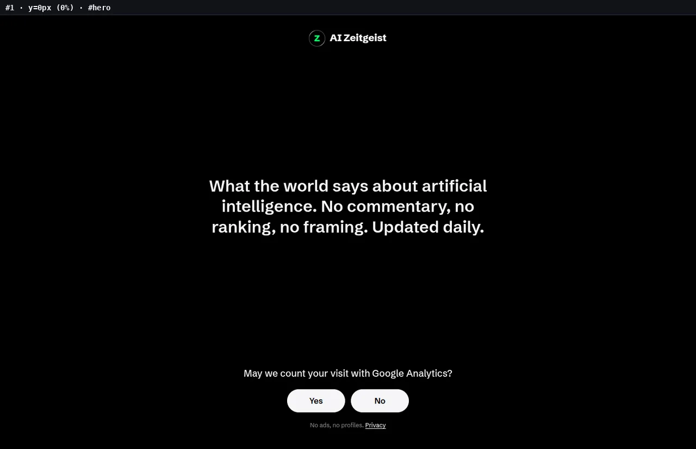
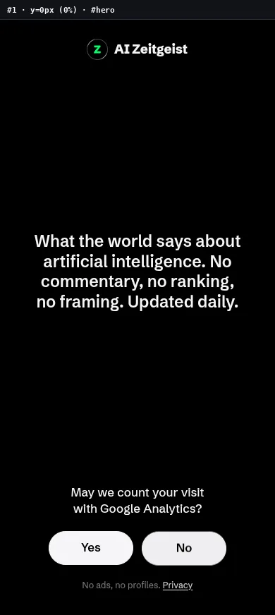

# UI Design System & Master Generation Blueprint: aizeitgeist-tv

> **AI Zeitgeist: AI quotes from the people shaping it** (https://aizeitgeist.tv) — AI quotes from the people shaping it: what researchers, founders, politicians and critics say about artificial intelligence, one quote at...





---

## 1. Executive Visual Persona & Design Archetype

- **Brand Essence & Persona**: **AI Zeitgeist: AI quotes from the people shaping it** (`https://aizeitgeist.tv`). AI quotes from the people shaping it: what researchers, founders, politicians and critics say about artificial intelligence, one quote at...
- **Capture Provenance**: Live browser capture (`tier2_webgl`, HTTP `200`, captured `2026-11-24`).
- **Visual Archetype**: **Dark-Substrate WebGL / Canvas Interactive Experience (`#000000` / `#00ff66`)**.
- **Anti-AI-Slop Differentiators**:
  - **Live-Computed Chromatic Polarity**: Anchors the viewport in `#000000` (live computed `body` `background-color` (`computed_styles.json`)) paired with `#f5f5f7` primary typography and `#00ff66` accents.
  - **Grounded Typographic Hierarchy**: Uses `Schibsted Grotesk` across display (`AI Zeitgeist: what the world says ab`) and body copy.
  - **Calibrated Spatial Grid & Motion**: Combines `1760px` container bounds (`gap: 10px`, padding `72px`) with `cubic-bezier(.55,0,.2,1)` easing and Three.js / WebGL Canvas Pipeline.

---

## 2. Spatial Architecture & Modular Grid Mathematics

### Viewport Allocation & Container Geometry
- **Captured Journey Filmstrips**: Desktop `1280×828px` (`assets/desktop-journey.webp`, `1` keyframes up to `y=0px` / doc `13433px`), Mobile `390×872px` (`assets/mobile-journey.webp`, `1` keyframes).
- **Master Container Bounds**: `1760px` (live computed `main` `max-width`).
- **Canvas Lateral Padding & Spacing**: `72px` lateral canvas padding with `10px` grid gap.
- **Border Radius Scale**: `999px`, `4px`, `50%`, `12px`.

### Responsive Breakpoint Architecture
- **Desktop Layout**: Multi-column CSS Grid / Flexbox layout at `1440px` (`max-width: 1760px`, `gap: 10px`).
- **Mobile Layout**: Single-column vertical stack at `390px` viewport width with `72px` horizontal padding.
- **Extracted CSS Media Queries**: `@media (max-width:640px)`, `@media (prefers-reduced-motion:reduce)`, `@media (prefers-reduced-motion:no-preference)and (pointer:coarse)`, `@media (min-width:641px)and (max-width:1919px)`.

---

## 3. Color System, Materiality & Atmospheric Lighting

### Semantic Palette & Source Grounding
| Semantic Role | Ground-Truth Value | Extracted Live / CSS Source |
|---|---|---|
| **Primary Canvas Substrate** | `#000000` | live computed `body` `background-color` (`computed_styles.json`) |
| **Primary Typography Ink** | `#f5f5f7` | live computed `h1` `color` (`computed_styles.json`) |
| **Elevated Surface / Card Substrate** | `#141414` | live computed `nav` `background-color` (`computed_styles.json`) |
| **Interactive Accent / Highlight** | `#00ff66` | `var(--accent)` in `:root` |
| **Secondary / Muted Copy** | `#00c853` | `:hover { color: #00c853 }` |
| **Structural Hairline Border** | `#222223` | `var(--line)` in `:root` (`rgb(245 245 247 / .14)`) |

### Sanitized Root CSS Variables (`ui-ux.md` Ground Truth)
| Variable Name | Extracted Value | Semantic Role |
|---|---|---|
| `--bg` | `#000` | Canvas / Surface Token |
| `--fg` | `#f5f5f7` | Typography Ink Token |
| `--fg-2` | `rgb(245 245 247 / .62)` | Typography Ink Token |
| `--fg-3` | `rgb(245 245 247 / .5)` | Typography Ink Token |
| `--fg-4` | `rgb(245 245 247 / .36)` | Typography Ink Token |
| `--line` | `rgb(245 245 247 / .14)` | Color / Atmospheric Token |
| `--pill-line` | `rgb(245 245 247 / .3)` | Color / Atmospheric Token |
| `--sheen` | `rgb(245 245 247 / .32)` | Color / Atmospheric Token |
| `--pill-bg` | `rgb(20 20 20 / .72)` | Canvas / Surface Token |
| `--pop-bg` | `rgb(16 16 16 / .92)` | Canvas / Surface Token |
| `--kbd-line` | `rgb(245 245 247 / .28)` | Color / Atmospheric Token |
| `--kbd-bg` | `rgb(245 245 247 / .08)` | Canvas / Surface Token |
| `--accent` | `#00ff66` | Brand / Palette Token |
| `--grid-alpha` | `.075` | Layout / Spatial Grid Token |
| `--font` | `"Schibsted Grotesk", "Helvetica Neue", Helvetica, Arial, sans-serif` | Typography / Scale Token |
| `--pill-h` | `60px` | Dimension / Scale Token |

---

## 4. Typographic Scale & Editorial Hierarchy

### Font Family Stacks
- **Display Typography**: `Schibsted Grotesk`.
- **Primary Body Stack**: `Schibsted Grotesk`.
- **Technical / Metadata Stack**: not declared in live computed styles (uses primary stack / `ui-monospace`).

### Typographic Scale & Rules (Live Computed & Stylesheet Grounded)
- **Hero Display (`H1`)**: live computed `h1` (`font-size: 32px`, `line-height: 46.4px`, `font-weight: 700`); rule `h1` (`font-size: clamp(1.9rem,4vw,2.6rem)`).
- **Section Heading (`H2`)**: live computed `h2` (`font-size: 240px`, `line-height: 211.2px`, `font-weight: 800`, `letter-spacing: -10.8px`); rule `h2` (`font-size: clamp(2.4rem,8vw,7rem)`, `line-height: 1`, `letter-spacing: -.03em`, `font-weight: 800`).
- **Body Copy**: live computed `body` (`font-size: 16px`, `line-height: 23.2px`, `font-weight: 400`); rule `p` (`font-size: 1rem`, `line-height: 1.5`).
- **Metadata & Navigation Labels**: live computed `nav/a` (`font-size: 16px`, `line-height: 23.2px`, `font-weight: 400`); CSS variables `--av3-meta-gap: 16px`, `--av3-label-fs: clamp(1.3rem, 2.5vw, 1.7rem)`; rule `small` (`font-size: .78rem`).

---

## 5. Choreographed Motion & Interaction Physics

### Primary Easing Curves
- **Extracted Timing Functions**: `cubic-bezier(.55,0,.2,1)`, `cubic-bezier(.2,.8,.3,1)`, `cubic-bezier(.25,.9,.3,1)`.

### Per-Element Transition & Choreography Rules
- **Selector `.lead-more`**: `transition: color .15s,text-decoration-color .15s` extracted from `aizeitgeist-tv` stylesheet.
- **Selector `.hero-cube`**: `transition: transform 1.1s cubic-bezier(.55,0,.2,1)` extracted from `aizeitgeist-tv` stylesheet.
- **Selector `.hero-face:after`**: `transition: opacity .3s` extracted from `aizeitgeist-tv` stylesheet.
- **Extracted Easing Curve (`cubic-bezier(.55,0,.2,1)`)**: Governs interactive state transitions across `<header.brand>` and `<section.hot-home>`.
- **Runtime Interaction Engine**: Integrates Three.js / WebGL Canvas Pipeline with `prefers-reduced-motion: reduce` fallback guards.
### Measured Runtime Scroll & Interaction Telemetry (`behavioral_journey_v2`)
- **Scroll Driver Mode**: `native+wheel` (max document height `13433px`, deepest scrollY reached `0px` across `1` desktop keyframes).
- **Detected Scroll / Motion Libraries**: `WebGL/Canvas`.
- **Nav / Drawer Probe**: Tested trigger `Menu` (diff `0.0`, below state-capture threshold).
- **Interactive Control Probe (`accordion`)**: Tested `Choose a speaker` (diff `0.0`).
- **Route Transition Architecture**: First internal navigation (`/topics/culture`) measured as `direct` in `646ms`.

---

## 6. Component Wireframe & Structural DOM Map

### Visual Layout Schematic — Desktop (`1440px`, Grounded in `dom.html` & Landmark Bounding Boxes)
```
┌────────────────────────────────────────────────────────────────────────┐
│ DESKTOP VIEWPORT (1440px) — AI Zeitgeist: AI quotes from the people sh │
│ ====================================================================== │
│ [ <header.brand> (391x44px)           | The Wall live · What's hot 5 ] │
│ ---------------------------------------------------------------------- │
│ | HERO STAGE: <section.archive> (w=1440px)                           | │
│ | H1: AI Zeitgeist: what the world says about AI, one q...           | │
│ | Substrate: #000000 | Ink: #f5f5f7 | Accent: #00ff66                | │
│ ---------------------------------------------------------------------- │
│ | SHOWCASE GRID (<section.hot-home>) max-w: 1760px                   | │
│ | +------------------------------+  +------------------------------+ | │
│ | | The people on the wall       |  | Share the wall               | | │
│ | +------------------------------+  +------------------------------+ | │
│ ---------------------------------------------------------------------- │
│ | DETAIL MODULE (<section.people>) — Follow the wall                 | │
│ ---------------------------------------------------------------------- │
│ [ FOOTER (<footer.foot>       ) | https://aizeitgeist.tv               │
└────────────────────────────────────────────────────────────────────────┘
```

### Visual Layout Schematic — Mobile Reflow (`390px`)
```
┌────────────────────────────────────────────────────────────────────────┐
│ MOBILE VIEWPORT REFLOW (390px) — Single-Column Stack (gap: 10px)       │
│ ====================================================================== │
│ [ HEADER BAR (<header.brand>          ) | Compact Menu (390px)         │
│ ---------------------------------------------------------------------- │
│ | HERO STAGE (<section.archive>) — 390px Vertical Lead               | │
│ | H1: AI Zeitgeist: what the world says about AI, one q...           | │
│ ---------------------------------------------------------------------- │
│ | SHOWCASE STACK (<section.hot-home>) — 1-Col Stack                  | │
│ | [ Item 1: The people on the wall                                 ] | │
│ | [ Item 2: Share the wall                                         ] | │
│ ---------------------------------------------------------------------- │
│ | DETAIL STACK (<section.people>) — 1-Col (Follow the wall)          | │
│ ---------------------------------------------------------------------- │
│ [ FOOTER (<footer.foot>       ) | Stacked 390px Colophon               │
└────────────────────────────────────────────────────────────────────────┘
```

### Granular DOM Region Breakdown
1. **Brand Header & Navigation Bar (<header.brand> — `aizeitgeist-tv`)**:
   - Landmark `<header class="brand">` (`391x44px`) hosting `AI Zeitgeist: AI quotes from the peo` navigation (`The Wall live · What's hot 59 · Archive 2,696 · Speakers 283 · Topics 10`), DOM attributes (`data-theme="dark"`, `data-themes="off"`, `data-consent-state="ask"`, `data-archive="v3"`), and stylesheet rule `html { scroll-padding-top:var(--jump, 100px) }`.
2. **Hero Stage & Focal Lead (<section.archive> — `AI Zeitgeist: what the world says `)**:
   - Landmark `<section class="archive reveal">` presenting display lead `AI Zeitgeist: what the world says about AI, one q...` and copy excerpt *"What the world says about artificial intelligence. No commentary,"* over `#000000` canvas and `#f5f5f7` ink.
3. **Primary Showcase & Content Grid (<section.hot-home> — `The people on the wall`)**:
   - Landmark `<section class="hot-home">` rendering section `The people on the wall` with copy *"What everyone said about AI over the years containing"*, asset references (`@AIZeitgeist`, `feed.xml`, `live.json`, `sitemap.xml`), and grid rule `body { margin:0;background:var(--bg);color:var(--fg);font-family:var(--font);fo... }`.
4. **Interactive Detail & Feature Matrix (<section.people> — `Share the wall`)**:
   - Landmark `<section class="people rv-on">` framing `Share the wall` and `Follow the wall` (*"2,696 quotes Newest · Most often quoted people Clear all Play on "*) with `#141414` surface cards, `#00ff66` accents, and `.archive-count { font-variant-numeric:tabular-nums }`.
5. **Colophon & Global Directory Footer (<footer.foot> — `https://aizeitgeist.tv`)**:
   - Landmark `<footer class="foot">` anchoring `AI Zeitgeist: AI quotes from the` footer links (`The Wall live · What's hot 59 · Archive 2,696 · Speakers 283 · Topics 10`), copy *"2,696 quotes Newest · Most often quoted people"*, and `#222223` structural dividers.
### Full Vertical Scroll Sequence (Desktop `1440×900` Keyframes)
- **Step 01** (`y=0px`, `0%`): Active landmark `#hero` · sticky/fixed elements: `4`

### Multi-Page Internal Route Map
- **About Route (`/topics/culture`)**: `https://aizeitgeist.tv/topics/culture` — H1: `AI and culture`, scrollHeight `40563px`, transition `direct` (`646ms`)

---

## 7. Master Zero-Shot AI Generation Prompt

```markdown
# Master Zero-Shot Frontend Generation Prompt: aizeitgeist-tv (AI Zeitgeist: AI quotes from the people shaping it)

You are a principal frontend architect and design systems engineer. Build a complete, production-ready web application replicating the exact design system, DOM landmarks, typographic hierarchy, color tokens, and motion physics of `aizeitgeist-tv` (**AI Zeitgeist: AI quotes from the people shaping it** — `https://aizeitgeist.tv`).

### 1. Visual Archetype & Anti-AI-Slop Mandates
- **Archetype**: Dark-Substrate WebGL / Canvas Interactive Experience (`#000000` / `#00ff66`).
- **Identity & Domain Context**: AI quotes from the people shaping it: what researchers, founders, politicians and critics say about artificial intelligence, one quote at...
- **Primary Substrate**: `#000000` (live computed `body` `background-color` (`computed_styles.json`)), **Primary Ink**: `#f5f5f7`, **Accent / Highlight**: `#00ff66`.
- **Site-Specific Differentiators**:
  - **Live-Computed Chromatic Polarity**: Anchors the viewport in `#000000` (live computed `body` `background-color` (`computed_styles.json`)) paired with `#f5f5f7` primary typography and `#00ff66` accents.
  - **Grounded Typographic Hierarchy**: Uses `Schibsted Grotesk` across display (`AI Zeitgeist: what the world says ab`) and body copy.
  - **Calibrated Spatial Grid & Motion**: Combines `1760px` container bounds (`gap: 10px`, padding `72px`) with `cubic-bezier(.55,0,.2,1)` easing and Three.js / WebGL Canvas Pipeline.

### 2. Ground-Truth CSS Variables (`:root` Token Contract)
Declare and consume these exact custom properties extracted from `aizeitgeist-tv` in your global stylesheet:

:root {
  /* AI Zeitgeist: AI quotes from the people shaping it (aizeitgeist-tv) — Live-Grounded CSS Variables */
  --bg: #000; /* Canvas / Surface Token (aizeitgeist-tv) */
  --fg: #f5f5f7; /* Typography Ink Token (aizeitgeist-tv) */
  --fg-2: rgb(245 245 247 / .62); /* Typography Ink Token (aizeitgeist-tv) */
  --fg-3: rgb(245 245 247 / .5); /* Typography Ink Token (aizeitgeist-tv) */
  --fg-4: rgb(245 245 247 / .36); /* Typography Ink Token (aizeitgeist-tv) */
  --line: rgb(245 245 247 / .14); /* Color / Atmospheric Token (aizeitgeist-tv) */
  --pill-line: rgb(245 245 247 / .3); /* Color / Atmospheric Token (aizeitgeist-tv) */
  --sheen: rgb(245 245 247 / .32); /* Color / Atmospheric Token (aizeitgeist-tv) */
  --pill-bg: rgb(20 20 20 / .72); /* Canvas / Surface Token (aizeitgeist-tv) */
  --pop-bg: rgb(16 16 16 / .92); /* Canvas / Surface Token (aizeitgeist-tv) */
  --kbd-line: rgb(245 245 247 / .28); /* Color / Atmospheric Token (aizeitgeist-tv) */
  --kbd-bg: rgb(245 245 247 / .08); /* Canvas / Surface Token (aizeitgeist-tv) */
  --accent: #00ff66; /* Brand / Palette Token (aizeitgeist-tv) */
  --grid-alpha: .075; /* Layout / Spatial Grid Token (aizeitgeist-tv) */
  --font: "Schibsted Grotesk", "Helvetica Neue", Helvetica, Arial, sans-serif; /* Typography / Scale Token (aizeitgeist-tv) */
  --pill-h: 60px; /* Dimension / Scale Token (aizeitgeist-tv) */
}

### 3. Semantic Color & Materiality Contract
Map every surface, ink, and border strictly to these source-grounded tokens:
- **Primary Canvas Substrate**: `#000000` — grounded in live computed `body` `background-color` (`computed_styles.json`)
- **Primary Typography Ink**: `#f5f5f7` — grounded in live computed `h1` `color` (`computed_styles.json`)
- **Elevated Surface / Card Substrate**: `#141414` — grounded in live computed `nav` `background-color` (`computed_styles.json`)
- **Interactive Accent / Highlight**: `#00ff66` — grounded in `var(--accent)` in `:root`
- **Secondary / Muted Copy**: `#00c853` — grounded in `:hover { color: #00c853 }`
- **Structural Hairline Border**: `#222223` — grounded in `var(--line)` in `:root` (`rgb(245 245 247 / .14)`)

### 4. Spatial Grid, Container Bounds & Responsive Breakpoints
- **Desktop Viewport Reference**: `1280×828px` (single-viewport 100vh live capture (900px), `1440px` standard desktop width).
- **Mobile Viewport Reference**: `390×872px` (full-page live capture (872px), `390px` standard mobile width).
- **Container Max-Width**: `1760px` (live computed `main` `max-width`)
- **Padding & Gutters**: `72px` lateral canvas padding with `10px` grid gap
- **Desktop Grid**: Multi-column CSS Grid / Flexbox layout at `1440px` (`max-width: 1760px`, `gap: 10px`)
- **Mobile Adaptation**: Single-column vertical stack at `390px` viewport width with `72px` horizontal padding
- **Media Queries**: `@media (max-width:640px)`, `@media (prefers-reduced-motion:reduce)`, `@media (prefers-reduced-motion:no-preference)and (pointer:coarse)`, `@media (min-width:641px)and (max-width:1919px)`
- **Corner Radii**: `999px`, `4px`, `50%`, `12px`

### 5. Typography & Editorial Scale Contract
- **Display Font Stack**: `Schibsted Grotesk`
- **Body Font Stack**: `Schibsted Grotesk`
- **Monospace / Technical Font Stack**: not declared in live computed styles (uses primary stack / `ui-monospace`)
- **H1 Display Rule**: live computed `h1` (`font-size: 32px`, `line-height: 46.4px`, `font-weight: 700`); rule `h1` (`font-size: clamp(1.9rem,4vw,2.6rem)`)
- **H2 Section Rule**: live computed `h2` (`font-size: 240px`, `line-height: 211.2px`, `font-weight: 800`, `letter-spacing: -10.8px`); rule `h2` (`font-size: clamp(2.4rem,8vw,7rem)`, `line-height: 1`, `letter-spacing: -.03em`, `font-weight: 800`)
- **Body Copy Rule**: live computed `body` (`font-size: 16px`, `line-height: 23.2px`, `font-weight: 400`); rule `p` (`font-size: 1rem`, `line-height: 1.5`)
- **Metadata & Index Rule**: live computed `nav/a` (`font-size: 16px`, `line-height: 23.2px`, `font-weight: 400`); CSS variables `--av3-meta-gap: 16px`, `--av3-label-fs: clamp(1.3rem, 2.5vw, 1.7rem)`; rule `small` (`font-size: .78rem`)

### 6. Component Hierarchy, Verbatim Copy & Real DOM Landmarks
Scaffold `aizeitgeist-tv` (`AI Zeitgeist: AI quotes from the people shaping it`) with these exact structural regions, extracted copy, and CSS rules from `dom.html`:
1. **Brand Header & Navigation Bar (<header.brand> — `aizeitgeist-tv`)**:
   - DOM & Selectors: Landmark `<header class="brand">` (`391x44px`) hosting `AI Zeitgeist: AI quotes from the peo` navigation (`The Wall live · What's hot 59 · Archive 2,696 · Speakers 283 · Topics 10`), DOM attributes (`data-theme="dark"`, `data-themes="off"`, `data-consent-state="ask"`, `data-archive="v3"`), and stylesheet rule `html { scroll-padding-top:var(--jump, 100px) }`.
   - Responsive Contract: Header `Brand Header & Navigation Bar (<header.brand> — `aizeitgeist-tv`)` (`aizeitgeist-tv`) adapts across `@media (max-width:640px)`, `@media (prefers-reduced-motion:reduce)`, `@media (prefers-reduced-motion:no-preference)and (pointer:coarse)`, `@media (min-width:641px)and (max-width:1919px)` with `cubic-bezier(.55,0,.2,1)`, `cubic-bezier(.2,.8,.3,1)`, `cubic-bezier(.25,.9,.3,1)` transitions and links `The Wall live · What's hot 59 · Archive 2,696 · Speakers 283 · Topics 10`.
2. **Hero Stage & Focal Lead (<section.archive> — `AI Zeitgeist: what the world says `)**:
   - DOM & Selectors: Landmark `<section class="archive reveal">` presenting display lead `AI Zeitgeist: what the world says about AI, one q...` and copy excerpt *"What the world says about artificial intelligence. No commentary,"* over `#000000` canvas and `#f5f5f7` ink.
   - Responsive Contract: Hero stage (`1280×828px` desktop / `390×872px` mobile) sets `#000000` background with `#f5f5f7` headline `AI Zeitgeist: what the world says about AI, one q...`.
3. **Primary Showcase & Content Grid (<section.hot-home> — `The people on the wall`)**:
   - DOM & Selectors: Landmark `<section class="hot-home">` rendering section `The people on the wall` with copy *"What everyone said about AI over the years containing"*, asset references (`@AIZeitgeist`, `feed.xml`, `live.json`, `sitemap.xml`), and grid rule `body { margin:0;background:var(--bg);color:var(--fg);font-family:var(--font);fo... }`.
   - Responsive Contract: Showcase grid `Primary Showcase & Content Grid (<section.hot-home> — `The people on the wall`)` applies Multi-column CSS Grid / Flexbox layout at `1440px` (`max-width: 1760px`, `gap: 10px`) on desktop and Single-column vertical stack at `390px` viewport width with `72px` horizontal padding on mobile.
4. **Interactive Detail & Feature Matrix (<section.people> — `Share the wall`)**:
   - DOM & Selectors: Landmark `<section class="people rv-on">` framing `Share the wall` and `Follow the wall` (*"2,696 quotes Newest · Most often quoted people Clear all Play on "*) with `#141414` surface cards, `#00ff66` accents, and `.archive-count { font-variant-numeric:tabular-nums }`.
   - Responsive Contract: Detail module `Interactive Detail & Feature Matrix (<section.people> — `Share the wall`)` uses `999px`, `4px`, `50%`, `12px` radii, `#00ff66` highlights, and assets (@AIZeitgeist, feed.xml, live.json).
5. **Colophon & Global Directory Footer (<footer.foot> — `https://aizeitgeist.tv`)**:
   - DOM & Selectors: Landmark `<footer class="foot">` anchoring `AI Zeitgeist: AI quotes from the` footer links (`The Wall live · What's hot 59 · Archive 2,696 · Speakers 283 · Topics 10`), copy *"2,696 quotes Newest · Most often quoted people"*, and `#222223` structural dividers.
   - Responsive Contract: Footer `Colophon & Global Directory Footer (<footer.foot> — `https://aizeitgeist.tv`)` aligns to `1760px` (live computed `main` `max-width`) with `72px` lateral canvas padding with `10px` grid gap and attributes (data-theme="dark", data-themes="off", data-consent-state="ask").

#### Verbatim DOM Copy Excerpts (`dom.html`)
- Copy Excerpt 1: *"What the world says about artificial intelligence. No commentary, no ranking, no f..."*
- Copy Excerpt 2: *"What everyone said about AI over the years containing"*
- Copy Excerpt 3: *"2,696 quotes Newest · Most often quoted people Clear all Play on the wall"*
- Copy Excerpt 4: *"2,696 quotes Newest · Most often quoted people"*

### 7. Motion, Extracted Stylesheet Rules & Interaction Choreography
- **Primary Easing Functions**: `cubic-bezier(.55,0,.2,1)`, `cubic-bezier(.2,.8,.3,1)`, `cubic-bezier(.25,.9,.3,1)`
- **Extracted Stylesheet Rules (`aizeitgeist-tv`)**:
- `html { scroll-padding-top:var(--jump, 100px) }`
- `body { margin:0;background:var(--bg);color:var(--fg);font-family:var(--font);fo... }`
- `.archive-count { font-variant-numeric:tabular-nums }`
- `a:focus-visible { text-decoration-color:var(--accent) }`
- `button { font:inherit;color:inherit }`
- **Per-Selector Transition Rules**:
- **Selector `.lead-more`**: `transition: color .15s,text-decoration-color .15s` extracted from `aizeitgeist-tv` stylesheet.
- **Selector `.hero-cube`**: `transition: transform 1.1s cubic-bezier(.55,0,.2,1)` extracted from `aizeitgeist-tv` stylesheet.
- **Selector `.hero-face:after`**: `transition: opacity .3s` extracted from `aizeitgeist-tv` stylesheet.
- **Extracted Easing Curve (`cubic-bezier(.55,0,.2,1)`)**: Governs interactive state transitions across `<header.brand>` and `<section.hot-home>`.
- **Runtime Interaction Engine**: Integrates Three.js / WebGL Canvas Pipeline with `prefers-reduced-motion: reduce` fallback guards.
### 7b. Full-Page Scroll Choreography, Interactive States & Multi-Page Routes
- **Scroll Mechanics**: Implement `native+wheel` vertical progression up to `13433px` across 1 distinct viewport chapters using WebGL/Canvas.
- **Vertical Chapter Sequence**: #hero (0%).
- **Multi-Page Routes**: Scaffold internal routes `/topics/culture` (about, direct) sharing the global header/footer shell and design tokens.

### 8. Technical Deliverables
- Implement in Next.js (App Router) with TypeScript and Tailwind CSS consuming the `:root` custom properties defined above for `aizeitgeist-tv`.
- Reproduce both the `1440px` desktop architecture and `390px` mobile breakpoint transitions, preserving semantic HTML5 landmarks (`<header>`, `<nav>`, `<main>`, `<section>`, `<footer>`) and `prefers-reduced-motion` accessibility guards.
```
---

## 8. Full-Page Scroll Journey, Interactive States & Subpage Inventory

### Desktop Scroll Keyframes (`1440×900` WebP)
| Step | Scroll Y | Progress | Active Landmark / Section | Sticky/Fixed | Visual Asset |
| :---: | :---: | :---: | :--- | :---: | :--- |
| `#01` | `0px` | `0%` | #hero | `4` | [desktop-step-01.webp](assets/desktop-step-01.webp) |

### Mobile Condensed Keyframes (`390×844` WebP)
| Step | Scroll Y | Progress | Active Landmark | Visual Asset |
| :---: | :---: | :---: | :--- | :--- |
| `#01` | `0px` | `0%` | #hero | [mobile-step-01.webp](assets/mobile-step-01.webp) |

### Internal Subpage Filmstrips (`1080px` Wide WebP)
| # | Template | Route URL | H1 / Title | Scroll Height | Transition | Filmstrip Asset |
| :-: | :---: | :--- | :--- | :---: | :---: | :--- |
| `1` | `about` | `https://aizeitgeist.tv/topics/culture` | AI and culture | `40563px` | `direct` (`646ms`) | [subpage-01-topics-culture.webp](assets/subpage-01-topics-culture.webp) |

