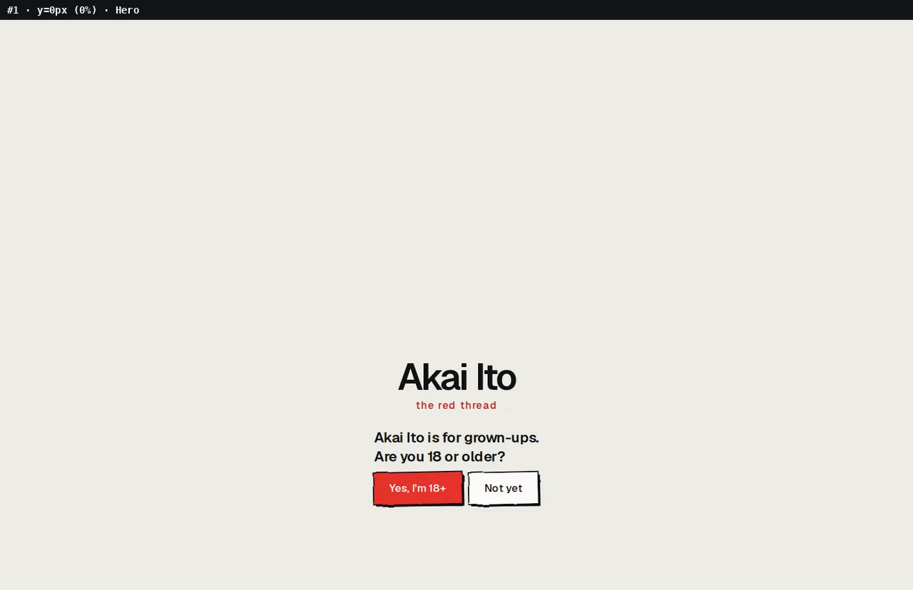
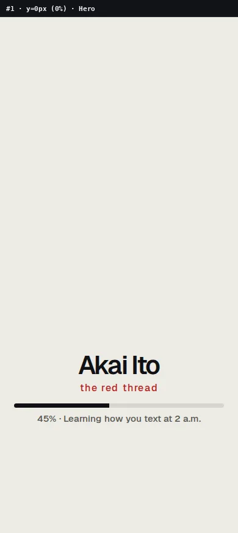

# UI Design System & Master Generation Blueprint: akaiito-ai

> **Akai Ito — Your twin dates millions. You go on one date.** (https://akaiito.ai) — Akai Ito builds a digital twin of you. It goes on millions of first dates, lives ten thousand lives with your best match, then books one...





---

## 1. Executive Visual Persona & Design Archetype

- **Brand Essence & Persona**: **Akai Ito — Your twin dates millions. You go on one date.** (`https://akaiito.ai`). Akai Ito builds a digital twin of you. It goes on millions of first dates, lives ten thousand lives with your best match, then books one...
- **Capture Provenance**: Live browser capture (`tier1_fast`, HTTP `200`, captured `2026-11-24`).
- **Visual Archetype**: **Light-Gallery WebGL / Canvas Interactive Experience (`#ecebe5` / `#ff0000`)**.
- **Anti-AI-Slop Differentiators**:
  - **Live-Computed Chromatic Polarity**: Anchors the viewport in `#ecebe5` (live computed `html` `background-color` (`computed_styles.json`)) paired with `#111113` primary typography and `#ff0000` accents.
  - **Grounded Typographic Hierarchy**: Uses `Geist` across display (`Your twin dates millions. You go on `) and body copy, paired with `Geist Mono` for monospace/code.
  - **Calibrated Spatial Grid & Motion**: Combines `1440px` container bounds (`gap: 8px`, padding `.5rem`) with `cubic-bezier(.2,.7,.1,1)` easing and Lenis Smooth Scroll (`data-lenis`), Three.js / WebGL Canvas Pipeline.

---

## 2. Spatial Architecture & Modular Grid Mathematics

### Viewport Allocation & Container Geometry
- **Captured Journey Filmstrips**: Desktop `1280×828px` (`assets/desktop-journey.webp`, `1` keyframes up to `y=0px` / doc `900px`), Mobile `390×872px` (`assets/mobile-journey.webp`, `1` keyframes).
- **Master Container Bounds**: `1440px` (full-bleed `100%` viewport stage).
- **Canvas Lateral Padding & Spacing**: `.5rem` lateral canvas padding with `8px` grid gap.
- **Border Radius Scale**: `50%`, `62.4375rem`, `1.5rem`, `.75rem`.

### Responsive Breakpoint Architecture
- **Desktop Layout**: Multi-column CSS Grid / Flexbox layout at `1440px` (`max-width: 1440px`, `gap: 8px`).
- **Mobile Layout**: Single-column vertical stack at `390px` viewport width with `.5rem` horizontal padding.
- **Extracted CSS Media Queries**: `@media (min-width:1500px)`, `@media (prefers-reduced-motion:reduce)`, `@media (max-width:900px)`, `@media (max-width:56.25rem)`.

---

## 3. Color System, Materiality & Atmospheric Lighting

### Semantic Palette & Source Grounding
| Semantic Role | Ground-Truth Value | Extracted Live / CSS Source |
|---|---|---|
| **Primary Canvas Substrate** | `#ecebe5` | live computed `html` `background-color` (`computed_styles.json`) |
| **Primary Typography Ink** | `#111113` | live computed `h1` `color` (`computed_styles.json`) |
| **Elevated Surface / Card Substrate** | `#fbfaf7` | live computed `footer` `background-color` (`computed_styles.json`) |
| **Interactive Accent / Highlight** | `#ff0000` | `.btn.red { background: red }` (`#ff0000`) |
| **Secondary / Muted Copy** | `#6f6e6a` | live computed `footer` `color` (`computed_styles.json`) |
| **Structural Hairline Border** | `#d2d1cc` | `var(--line)` in `:root` (`rgba(17,17,19,.12)`) |
| **Variable Token (`--red`)** | `#e4322b` | `var(--red)` in `:root` |
| **Variable Token (`--blue`)** | `#1a73e8` | `var(--blue)` in `:root` |
| **Variable Token (`--flesh`)** | `#f3c3a5` | `var(--flesh)` in `:root` |

### Sanitized Root CSS Variables (`ui-ux.md` Ground Truth)
| Variable Name | Extracted Value | Semantic Role |
|---|---|---|
| `--fit` | `1` | Design System Custom Token |
| `--paper` | `#ecebe5` | Canvas / Surface Token |
| `--ink` | `#111113` | Typography Ink Token |
| `--card` | `#fbfaf7` | Color / Atmospheric Token |
| `--red` | `#e4322b` | Color / Atmospheric Token |
| `--muted` | `#6f6e6a` | Color / Atmospheric Token |
| `--line` | `rgba(17,17,19,.12)` | Color / Atmospheric Token |
| `--blue` | `#1a73e8` | Color / Atmospheric Token |
| `--sans` | `"Geist","Geist Fallback","Inter",system-ui,-apple-system,sans-serif` | Typography / Scale Token |
| `--mono` | `"Geist","Geist Fallback","Inter",system-ui,sans-serif` | Typography / Scale Token |
| `--bg` | `#ecebe5` | Canvas / Surface Token |
| `--flesh` | `#f3c3a5` | Color / Atmospheric Token |
| `--dockH` | `6.4rem` | Dimension / Scale Token |
| `--navH` | `4.6rem` | Layout / Spatial Grid Token |
| `--ii` | `clamp(1.125rem, 2.4vw, 1.875rem)` | Dimension / Scale Token |
| `--tr` | `-.8deg` | Design System Custom Token |

---

## 4. Typographic Scale & Editorial Hierarchy

### Font Family Stacks
- **Display Typography**: `Geist`.
- **Primary Body Stack**: `Geist`.
- **Technical / Metadata Stack**: `Geist Mono`.

### Typographic Scale & Rules (Live Computed & Stylesheet Grounded)
- **Hero Display (`H1`)**: live computed `h1` (`font-size: 112.5px`, `line-height: 101.25px`, `font-weight: 500`, `letter-spacing: -6.1875px`).
- **Section Heading (`H2`)**: live computed `h2` (`font-size: 72px`, `line-height: 67.68px`, `font-weight: 500`, `letter-spacing: -3.6px`); rule `h2` (`font-size: clamp(44px, 6.4vw, 120px)`).
- **Body Copy**: live computed `body` (`font-size: 16px`, `line-height: 24px`, `font-weight: 400`); rule `p` (`font-size: .9375rem`).
- **Metadata & Navigation Labels**: live computed `nav/a` (`font-size: 16px`, `line-height: 24px`, `font-weight: 400`); CSS variables `--mono: "Geist","Geist Fallback","Inter",system-ui,sans-serif`; rule `small` (`font-size: .74rem`, `line-height: 1.25`).

---

## 5. Choreographed Motion & Interaction Physics

### Primary Easing Curves
- **Extracted Timing Functions**: `cubic-bezier(.2,.7,.1,1)`, `cubic-bezier(.2,1.3,.35,1)`, `cubic-bezier(.2,1.45,.35,1)`.

### Per-Element Transition & Choreography Rules
- **Selector `.nav`**: `transition: translate .45s cubic-bezier(.2,.7,.1,1),padding .4s` extracted from `akaiito-ai` stylesheet.
- **Selector `.btn`**: `transition: transform .25s cubic-bezier(.2,.7,.1,1)` extracted from `akaiito-ai` stylesheet.
- **Selector `.ln`**: `transition: transform .55s cubic-bezier(.2,.7,.1,1),opacity .4s` extracted from `akaiito-ai` stylesheet.
- **Extracted Easing Curve (`cubic-bezier(.2,.7,.1,1)`)**: Governs interactive state transitions across `<header.ahd>` and `<section.hero>`.
- **Runtime Interaction Engine**: Integrates Lenis Smooth Scroll (`data-lenis`), Three.js / WebGL Canvas Pipeline with `prefers-reduced-motion: reduce` fallback guards.
### Measured Runtime Scroll & Interaction Telemetry (`behavioral_journey_v2`)
- **Scroll Driver Mode**: `native` (max document height `900px`, deepest scrollY reached `0px` across `1` desktop keyframes).
- **Detected Scroll / Motion Libraries**: Native browser scroll / standard CSS transitions.

---

## 6. Component Wireframe & Structural DOM Map

### Visual Layout Schematic — Desktop (`1440px`, Grounded in `dom.html` & Landmark Bounding Boxes)
```
┌────────────────────────────────────────────────────────────────────────┐
│ DESKTOP VIEWPORT (1440px) — Akai Ito — Your twin dates millions. You g │
│ ====================================================================== │
│ [ <header.ahd> (1440px)               | Akai Ito · App · How it work ] │
│ ---------------------------------------------------------------------- │
│ | HERO STAGE: <section.sec> (w=1440px)                               | │
│ | H1: Your twin dates millions. You go on one date.                  | │
│ | Substrate: #ecebe5 | Ink: #111113 | Accent: #ff0000                | │
│ ---------------------------------------------------------------------- │
│ | SHOWCASE GRID (<section.hero>) max-w: 1440px                       | │
│ | +------------------------------+  +------------------------------+ | │
│ | | 1 window awake on this block |  | Your twin lives in your pock | | │
│ | +------------------------------+  +------------------------------+ | │
│ ---------------------------------------------------------------------- │
│ | DETAIL MODULE (<section.appsec>) — Act I · Right now You           | │
│ ---------------------------------------------------------------------- │
│ [ FOOTER (<footer.anim-off>   ) | https://akaiito.ai                   │
└────────────────────────────────────────────────────────────────────────┘
```

### Visual Layout Schematic — Mobile Reflow (`390px`)
```
┌────────────────────────────────────────────────────────────────────────┐
│ MOBILE VIEWPORT REFLOW (390px) — Single-Column Stack (gap: 8px)        │
│ ====================================================================== │
│ [ HEADER BAR (<header.ahd>            ) | Compact Menu (390px)         │
│ ---------------------------------------------------------------------- │
│ | HERO STAGE (<section.sec>) — 390px Vertical Lead                   | │
│ | H1: Your twin dates millions. You go on one date.                  | │
│ ---------------------------------------------------------------------- │
│ | SHOWCASE STACK (<section.hero>) — 1-Col Stack                      | │
│ | [ Item 1: 1 window awake on this block Everyone you could l...   ] | │
│ | [ Item 2: Your twin lives in your pocket.                        ] | │
│ ---------------------------------------------------------------------- │
│ | DETAIL STACK (<section.appsec>) — 1-Col (Act I · Right now )       | │
│ ---------------------------------------------------------------------- │
│ [ FOOTER (<footer.anim-off>   ) | Stacked 390px Colophon               │
└────────────────────────────────────────────────────────────────────────┘
```

### Granular DOM Region Breakdown
1. **Brand Header & Navigation Bar (<header.ahd> — `akaiito-ai`)**:
   - Landmark `<header class="ahd">` (`1440px`) hosting `Akai Ito — Your twin dates millions.` navigation (`Akai Ito · App · How it works · The model · Simulation`), DOM attributes (`data-slot="head"`, `data-d="-1"`, `data-d="1"`, `data-slot="body"`), and stylesheet rule `html { background:var(--paper);font-size:16px;overflow-x:clip }`.
2. **Hero Stage & Focal Lead (<section.sec> — `Your twin dates millions. You go o`)**:
   - Landmark `<section class="sec opener">` presenting display lead `Your twin dates millions. You go on one date.` and copy excerpt *"Akai Ito is for grown-ups. Are you 18 or older?"* over `#ecebe5` canvas and `#111113` ink.
3. **Primary Showcase & Content Grid (<section.hero> — `1 window awake on this block Every`)**:
   - Landmark `<section class="hero sec">` rendering section `1 window awake on this block Everyone you could l...` with copy *"Akai Ito · AI dating, by simulation"*, asset references (`icon.webp`, `favicon.png`, `apple-touch.png`, `phone.webp`), and grid rule `body { overflow-x:clip }`.
4. **Interactive Detail & Feature Matrix (<section.appsec> — `Your twin lives in your pocket.`)**:
   - Landmark `<section class="sec appsec">` framing `Your twin lives in your pocket.` and `Act I · Right now You’ve swiped almost 4,000 times.` (*"Your twin dates millions."*) with `#fbfaf7` surface cards, `#ff0000` accents, and `stage { position:fixed;inset:0;width:100%;height:100%;display:block;z-index:0 }`.
5. **Colophon & Global Directory Footer (<footer.anim-off> — `https://akaiito.ai`)**:
   - Landmark `<footer class="anim-off">` anchoring `Akai Ito — Your twin dates milli` footer links (`Akai Ito · App · How it works · The model · Simulation`), copy *"You go on one date."*, and `#d2d1cc` structural dividers.
### Full Vertical Scroll Sequence (Desktop `1440×900` Keyframes)
- **Step 01** (`y=0px`, `0%`): Active landmark `Hero` · sticky/fixed elements: `2`

---

## 7. Master Zero-Shot AI Generation Prompt

```markdown
# Master Zero-Shot Frontend Generation Prompt: akaiito-ai (Akai Ito — Your twin dates millions. You go on one date.)

You are a principal frontend architect and design systems engineer. Build a complete, production-ready web application replicating the exact design system, DOM landmarks, typographic hierarchy, color tokens, and motion physics of `akaiito-ai` (**Akai Ito — Your twin dates millions. You go on one date.** — `https://akaiito.ai`).

### 1. Visual Archetype & Anti-AI-Slop Mandates
- **Archetype**: Light-Gallery WebGL / Canvas Interactive Experience (`#ecebe5` / `#ff0000`).
- **Identity & Domain Context**: Akai Ito builds a digital twin of you. It goes on millions of first dates, lives ten thousand lives with your best match, then books one...
- **Primary Substrate**: `#ecebe5` (live computed `html` `background-color` (`computed_styles.json`)), **Primary Ink**: `#111113`, **Accent / Highlight**: `#ff0000`.
- **Site-Specific Differentiators**:
  - **Live-Computed Chromatic Polarity**: Anchors the viewport in `#ecebe5` (live computed `html` `background-color` (`computed_styles.json`)) paired with `#111113` primary typography and `#ff0000` accents.
  - **Grounded Typographic Hierarchy**: Uses `Geist` across display (`Your twin dates millions. You go on `) and body copy, paired with `Geist Mono` for monospace/code.
  - **Calibrated Spatial Grid & Motion**: Combines `1440px` container bounds (`gap: 8px`, padding `.5rem`) with `cubic-bezier(.2,.7,.1,1)` easing and Lenis Smooth Scroll (`data-lenis`), Three.js / WebGL Canvas Pipeline.

### 2. Ground-Truth CSS Variables (`:root` Token Contract)
Declare and consume these exact custom properties extracted from `akaiito-ai` in your global stylesheet:

:root {
  /* Akai Ito — Your twin dates millions. You go on one date. (akaiito-ai) — Live-Grounded CSS Variables */
  --fit: 1; /* Design System Custom Token (akaiito-ai) */
  --paper: #ecebe5; /* Canvas / Surface Token (akaiito-ai) */
  --ink: #111113; /* Typography Ink Token (akaiito-ai) */
  --card: #fbfaf7; /* Color / Atmospheric Token (akaiito-ai) */
  --red: #e4322b; /* Color / Atmospheric Token (akaiito-ai) */
  --muted: #6f6e6a; /* Color / Atmospheric Token (akaiito-ai) */
  --line: rgba(17,17,19,.12); /* Color / Atmospheric Token (akaiito-ai) */
  --blue: #1a73e8; /* Color / Atmospheric Token (akaiito-ai) */
  --sans: "Geist","Geist Fallback","Inter",system-ui,-apple-system,sans-serif; /* Typography / Scale Token (akaiito-ai) */
  --mono: "Geist","Geist Fallback","Inter",system-ui,sans-serif; /* Typography / Scale Token (akaiito-ai) */
  --bg: #ecebe5; /* Canvas / Surface Token (akaiito-ai) */
  --flesh: #f3c3a5; /* Color / Atmospheric Token (akaiito-ai) */
  --dockH: 6.4rem; /* Dimension / Scale Token (akaiito-ai) */
  --navH: 4.6rem; /* Layout / Spatial Grid Token (akaiito-ai) */
  --ii: clamp(1.125rem, 2.4vw, 1.875rem); /* Dimension / Scale Token (akaiito-ai) */
  --tr: -.8deg; /* Design System Custom Token (akaiito-ai) */
}

### 3. Semantic Color & Materiality Contract
Map every surface, ink, and border strictly to these source-grounded tokens:
- **Primary Canvas Substrate**: `#ecebe5` — grounded in live computed `html` `background-color` (`computed_styles.json`)
- **Primary Typography Ink**: `#111113` — grounded in live computed `h1` `color` (`computed_styles.json`)
- **Elevated Surface / Card Substrate**: `#fbfaf7` — grounded in live computed `footer` `background-color` (`computed_styles.json`)
- **Interactive Accent / Highlight**: `#ff0000` — grounded in `.btn.red { background: red }` (`#ff0000`)
- **Secondary / Muted Copy**: `#6f6e6a` — grounded in live computed `footer` `color` (`computed_styles.json`)
- **Structural Hairline Border**: `#d2d1cc` — grounded in `var(--line)` in `:root` (`rgba(17,17,19,.12)`)
- **Variable Token (`--red`)**: `#e4322b` — grounded in `var(--red)` in `:root`
- **Variable Token (`--blue`)**: `#1a73e8` — grounded in `var(--blue)` in `:root`
- **Variable Token (`--flesh`)**: `#f3c3a5` — grounded in `var(--flesh)` in `:root`

### 4. Spatial Grid, Container Bounds & Responsive Breakpoints
- **Desktop Viewport Reference**: `1280×828px` (single-viewport 100vh live capture (900px), `1440px` standard desktop width).
- **Mobile Viewport Reference**: `390×872px` (full-page live capture (872px), `390px` standard mobile width).
- **Container Max-Width**: `1440px` (full-bleed `100%` viewport stage)
- **Padding & Gutters**: `.5rem` lateral canvas padding with `8px` grid gap
- **Desktop Grid**: Multi-column CSS Grid / Flexbox layout at `1440px` (`max-width: 1440px`, `gap: 8px`)
- **Mobile Adaptation**: Single-column vertical stack at `390px` viewport width with `.5rem` horizontal padding
- **Media Queries**: `@media (min-width:1500px)`, `@media (prefers-reduced-motion:reduce)`, `@media (max-width:900px)`, `@media (max-width:56.25rem)`
- **Corner Radii**: `50%`, `62.4375rem`, `1.5rem`, `.75rem`

### 5. Typography & Editorial Scale Contract
- **Display Font Stack**: `Geist`
- **Body Font Stack**: `Geist`
- **Monospace / Technical Font Stack**: `Geist Mono`
- **H1 Display Rule**: live computed `h1` (`font-size: 112.5px`, `line-height: 101.25px`, `font-weight: 500`, `letter-spacing: -6.1875px`)
- **H2 Section Rule**: live computed `h2` (`font-size: 72px`, `line-height: 67.68px`, `font-weight: 500`, `letter-spacing: -3.6px`); rule `h2` (`font-size: clamp(44px, 6.4vw, 120px)`)
- **Body Copy Rule**: live computed `body` (`font-size: 16px`, `line-height: 24px`, `font-weight: 400`); rule `p` (`font-size: .9375rem`)
- **Metadata & Index Rule**: live computed `nav/a` (`font-size: 16px`, `line-height: 24px`, `font-weight: 400`); CSS variables `--mono: "Geist","Geist Fallback","Inter",system-ui,sans-serif`; rule `small` (`font-size: .74rem`, `line-height: 1.25`)

### 6. Component Hierarchy, Verbatim Copy & Real DOM Landmarks
Scaffold `akaiito-ai` (`Akai Ito — Your twin dates millions. You go on one date.`) with these exact structural regions, extracted copy, and CSS rules from `dom.html`:
1. **Brand Header & Navigation Bar (<header.ahd> — `akaiito-ai`)**:
   - DOM & Selectors: Landmark `<header class="ahd">` (`1440px`) hosting `Akai Ito — Your twin dates millions.` navigation (`Akai Ito · App · How it works · The model · Simulation`), DOM attributes (`data-slot="head"`, `data-d="-1"`, `data-d="1"`, `data-slot="body"`), and stylesheet rule `html { background:var(--paper);font-size:16px;overflow-x:clip }`.
   - Responsive Contract: Header `Brand Header & Navigation Bar (<header.ahd> — `akaiito-ai`)` (`akaiito-ai`) adapts across `@media (min-width:1500px)`, `@media (prefers-reduced-motion:reduce)`, `@media (max-width:900px)`, `@media (max-width:56.25rem)` with `cubic-bezier(.2,.7,.1,1)`, `cubic-bezier(.2,1.3,.35,1)`, `cubic-bezier(.2,1.45,.35,1)` transitions and links `Akai Ito · App · How it works · The model · Simulation`.
2. **Hero Stage & Focal Lead (<section.sec> — `Your twin dates millions. You go o`)**:
   - DOM & Selectors: Landmark `<section class="sec opener">` presenting display lead `Your twin dates millions. You go on one date.` and copy excerpt *"Akai Ito is for grown-ups. Are you 18 or older?"* over `#ecebe5` canvas and `#111113` ink.
   - Responsive Contract: Hero stage (`1280×828px` desktop / `390×872px` mobile) sets `#ecebe5` background with `#111113` headline `Your twin dates millions. You go on one date.`.
3. **Primary Showcase & Content Grid (<section.hero> — `1 window awake on this block Every`)**:
   - DOM & Selectors: Landmark `<section class="hero sec">` rendering section `1 window awake on this block Everyone you could l...` with copy *"Akai Ito · AI dating, by simulation"*, asset references (`icon.webp`, `favicon.png`, `apple-touch.png`, `phone.webp`), and grid rule `body { overflow-x:clip }`.
   - Responsive Contract: Showcase grid `Primary Showcase & Content Grid (<section.hero> — `1 window awake on this block Every`)` applies Multi-column CSS Grid / Flexbox layout at `1440px` (`max-width: 1440px`, `gap: 8px`) on desktop and Single-column vertical stack at `390px` viewport width with `.5rem` horizontal padding on mobile.
4. **Interactive Detail & Feature Matrix (<section.appsec> — `Your twin lives in your pocket.`)**:
   - DOM & Selectors: Landmark `<section class="sec appsec">` framing `Your twin lives in your pocket.` and `Act I · Right now You’ve swiped almost 4,000 times.` (*"Your twin dates millions."*) with `#fbfaf7` surface cards, `#ff0000` accents, and `stage { position:fixed;inset:0;width:100%;height:100%;display:block;z-index:0 }`.
   - Responsive Contract: Detail module `Interactive Detail & Feature Matrix (<section.appsec> — `Your twin lives in your pocket.`)` uses `50%`, `62.4375rem`, `1.5rem`, `.75rem` radii, `#ff0000` highlights, and assets (icon.webp, favicon.png, apple-touch.png).
5. **Colophon & Global Directory Footer (<footer.anim-off> — `https://akaiito.ai`)**:
   - DOM & Selectors: Landmark `<footer class="anim-off">` anchoring `Akai Ito — Your twin dates milli` footer links (`Akai Ito · App · How it works · The model · Simulation`), copy *"You go on one date."*, and `#d2d1cc` structural dividers.
   - Responsive Contract: Footer `Colophon & Global Directory Footer (<footer.anim-off> — `https://akaiito.ai`)` aligns to `1440px` (full-bleed `100%` viewport stage) with `.5rem` lateral canvas padding with `8px` grid gap and attributes (data-slot="head", data-d="-1", data-d="1").

#### Verbatim DOM Copy Excerpts (`dom.html`)
- Copy Excerpt 1: *"Akai Ito is for grown-ups. Are you 18 or older?"*
- Copy Excerpt 2: *"Akai Ito · AI dating, by simulation"*
- Copy Excerpt 3: *"Your twin dates millions."*
- Copy Excerpt 4: *"You go on one date."*

### 7. Motion, Extracted Stylesheet Rules & Interaction Choreography
- **Primary Easing Functions**: `cubic-bezier(.2,.7,.1,1)`, `cubic-bezier(.2,1.3,.35,1)`, `cubic-bezier(.2,1.45,.35,1)`
- **Extracted Stylesheet Rules (`akaiito-ai`)**:
- `html { background:var(--paper);font-size:16px;overflow-x:clip }`
- `body { overflow-x:clip }`
- `stage { position:fixed;inset:0;width:100%;height:100%;display:block;z-index:0 }`
- `flow { position:fixed;inset:0;width:100%;height:100%;z-index:2;pointer-events:none }`
- `main { position:relative;z-index:1 }`
- **Per-Selector Transition Rules**:
- **Selector `.nav`**: `transition: translate .45s cubic-bezier(.2,.7,.1,1),padding .4s` extracted from `akaiito-ai` stylesheet.
- **Selector `.btn`**: `transition: transform .25s cubic-bezier(.2,.7,.1,1)` extracted from `akaiito-ai` stylesheet.
- **Selector `.ln`**: `transition: transform .55s cubic-bezier(.2,.7,.1,1),opacity .4s` extracted from `akaiito-ai` stylesheet.
- **Extracted Easing Curve (`cubic-bezier(.2,.7,.1,1)`)**: Governs interactive state transitions across `<header.ahd>` and `<section.hero>`.
- **Runtime Interaction Engine**: Integrates Lenis Smooth Scroll (`data-lenis`), Three.js / WebGL Canvas Pipeline with `prefers-reduced-motion: reduce` fallback guards.
### 7b. Full-Page Scroll Choreography, Interactive States & Multi-Page Routes
- **Scroll Mechanics**: Implement `native` vertical progression up to `900px` across 1 distinct viewport chapters.
- **Vertical Chapter Sequence**: Hero (0%).

### 8. Technical Deliverables
- Implement in Next.js (App Router) with TypeScript and Tailwind CSS consuming the `:root` custom properties defined above for `akaiito-ai`.
- Reproduce both the `1440px` desktop architecture and `390px` mobile breakpoint transitions, preserving semantic HTML5 landmarks (`<header>`, `<nav>`, `<main>`, `<section>`, `<footer>`) and `prefers-reduced-motion` accessibility guards.
```
---

## 8. Full-Page Scroll Journey, Interactive States & Subpage Inventory

### Desktop Scroll Keyframes (`1440×900` WebP)
| Step | Scroll Y | Progress | Active Landmark / Section | Sticky/Fixed | Visual Asset |
| :---: | :---: | :---: | :--- | :---: | :--- |
| `#01` | `0px` | `0%` | Hero | `2` | [desktop-step-01.webp](assets/desktop-step-01.webp) |

### Mobile Condensed Keyframes (`390×844` WebP)
| Step | Scroll Y | Progress | Active Landmark | Visual Asset |
| :---: | :---: | :---: | :--- | :--- |
| `#01` | `0px` | `0%` | Hero | [mobile-step-01.webp](assets/mobile-step-01.webp) |

