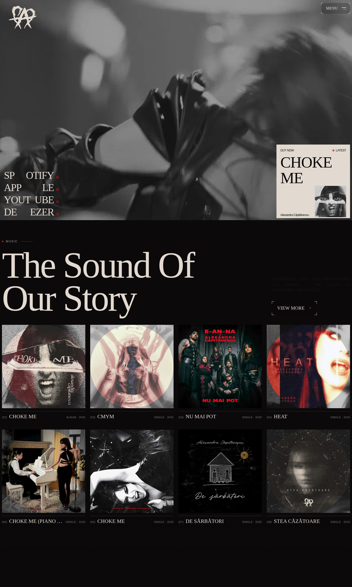
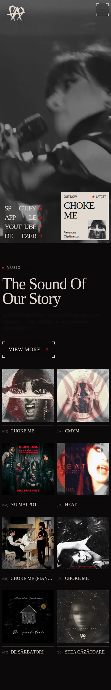

# UI Design System & Master Generation Blueprint: alexandracapitanescu-com

> **Alexandra Căpitănescu - Official Website** (https://alexandracapitanescu.com/) — Romanian artist Alexandra Căpitănescu and her band blend alternative rock, raw emotion and explosive live energy.



---

## 1. Executive Visual Persona & Design Archetype

- **Brand Essence & Persona**: **Alexandra Căpitănescu - Official Website** (`https://alexandracapitanescu.com/`). Romanian artist Alexandra Căpitănescu and her band blend alternative rock, raw emotion and explosive live energy.
- **Capture Provenance**: Live browser capture (`tier1_fast`, HTTP `200`, captured `2026-11-23`).
- **Visual Archetype**: **High-Contrast Obsidian / Atmospheric Design System (`#0b090a` canvas, `#e2d9d0` ink, `#ff0000` accent)**.
- **Anti-AI-Slop Differentiators**:
  - **Live-Computed Chromatic Polarity**: Anchors the viewport in `#0b090a` (live computed `html` `background-color` (`computed_styles.json`)) paired with `#e2d9d0` primary typography and `#ff0000` accents.
  - **Grounded Typographic Hierarchy**: Pairs `hershey` for display copy (`Alexandra Căpitănescu`) with `hershey Fallback` and `SFMono-Regular`.
  - **Calibrated Spatial Grid & Motion**: Combines `1440px` container bounds (`gap: var(--spacing)`, padding `88px`) with `cubic-bezier(.16,1,.3,1)` easing.

---

## 2. Spatial Architecture & Modular Grid Mathematics



### Viewport Allocation & Container Geometry
- **Captured Viewport Dimensions**: Desktop `1440×2400px` (`assets/desktop.png`, clamped at 2400px live multi-section capture), Mobile `390×2400px` (`assets/mobile.png`, clamped at 2400px live multi-section capture).
- **Master Container Bounds**: `1440px` (non-`@media` desktop container stylesheet rule).
- **Canvas Lateral Padding & Spacing**: `88px` lateral canvas padding with `var(--spacing)` grid gap.
- **Border Radius Scale**: `.25rem`, `50%`.

### Responsive Breakpoint Architecture
- **Desktop Layout**: Multi-column CSS Grid / Flexbox layout at `1440px` (`max-width: 1440px`, `gap: var(--spacing)`).
- **Mobile Layout**: Single-column vertical stack at `390px` viewport width with `88px` horizontal padding.
- **Extracted CSS Media Queries**: `@media (min-width:48rem)`, `@media (prefers-reduced-motion:reduce)`, `@media (min-width:768px)`, `@media (max-width:767px)`.

---

## 3. Color System, Materiality & Atmospheric Lighting

### Semantic Palette & Source Grounding
| Semantic Role | Ground-Truth Value | Extracted Live / CSS Source |
|---|---|---|
| **Primary Canvas Substrate** | `#0b090a` | live computed `html` `background-color` (`computed_styles.json`) |
| **Primary Typography Ink** | `#e2d9d0` | live computed `h1` `color` (`computed_styles.json`) |
| **Elevated Surface / Card Substrate** | `#ff0000` | `::selection { background: red }` (`#ff0000`) |
| **Interactive Accent / Highlight** | `#ff0000` | `.stream-link__arrow { color: red }` (`#ff0000`) |
| **Secondary / Muted Copy** | `#e0514f` | `.submit__error { color: #e0514f }` |
| **Structural Hairline Border** | `#ff0000` | `.intro-pulse svg { stroke: #ff0000 }` |
| **Variable Token (`--color-red`)** | `#ba1818` | `var(--color-red)` in `:root` |

### Sanitized Root CSS Variables (`ui-ux.md` Ground Truth)
| Variable Name | Extracted Value | Semantic Role |
|---|---|---|
| `--intro-total` | `4.7s` | Motion / Timing Token |
| `--ease-out-expo` | `cubic-bezier(.16, 1, .3, 1)` | Motion / Easing Token |
| `--ease-in-expo` | `cubic-bezier(.7, 0, .84, 0)` | Motion / Easing Token |
| `--ease-door` | `cubic-bezier(.76, 0, .24, 1)` | Motion / Easing Token |
| `--spacing` | `.25rem` | Layout / Spatial Grid Token |
| `--text-xs` | `.75rem` | Typography Ink Token |
| `--text-xs--line-height` | `calc(1 / .75)` | Typography Ink Token |
| `--text-2xl` | `1.5rem` | Typography Ink Token |
| `--text-2xl--line-height` | `calc(2 / 1.5)` | Typography Ink Token |
| `--default-font-family` | `var(--font-sans)` | Typography / Scale Token |
| `--default-mono-font-family` | `var(--font-mono)` | Typography / Scale Token |
| `--color-red` | `#ba1818` | Brand / Palette Token |
| `--color-cream` | `#e2d9d0` | Brand / Palette Token |
| `--color-ink` | `#0b090a` | Typography Ink Token |
| `--font-display` | `"Times New Roman", Times, serif` | Typography / Scale Token |
| `--font-body` | `Arial, Helvetica, sans-serif` | Typography / Scale Token |

---

## 4. Typographic Scale & Editorial Hierarchy

### Font Family Stacks
- **Display Typography**: `hershey`.
- **Primary Body Stack**: `hershey Fallback`.
- **Technical / Metadata Stack**: `SFMono-Regular`.

### Typographic Scale & Rules (Live Computed & Stylesheet Grounded)
- **Hero Display (`H1`)**: live computed `h1` (`font-size: 16px`, `line-height: 24px`, `font-weight: 400`); CSS variables `--font-display: "Times New Roman", Times, serif`.
- **Section Heading (`H2`)**: live computed `h2` (`font-size: 149.76px`, `line-height: 134.784px`, `font-weight: 400`, `letter-spacing: -5.2416px`); CSS variables `--text-2xl: 1.5rem`, `--text-2xl--line-height: calc(2 / 1.5)`; rule `.section-title` (`font-size: clamp(56px,6.6vw,110px)`).
- **Body Copy**: live computed `body` (`font-size: 16px`, `line-height: 24px`, `font-weight: 400`); CSS variables `--font-body: Arial, Helvetica, sans-serif`; rule `p` (`font-size: clamp(18px,1.6vw,22px)`, `line-height: 1.2`).
- **Metadata & Navigation Labels**: live computed `nav/a` (`font-size: 16px`, `line-height: 24px`, `font-weight: 400`); CSS variables `--text-xs: .75rem`, `--text-xs--line-height: calc(1 / .75)`, `--default-mono-font-family: var(--font-mono)`; rule `small` (`font-size: 10px`, `letter-spacing: .14em`).

---

## 5. Choreographed Motion & Interaction Physics

### Primary Easing Curves
- **Extracted Timing Functions**: `cubic-bezier(.16,1,.3,1)`, `cubic-bezier(.7,0,.84,0)`, `cubic-bezier(.76,0,.24,1)`.

### Per-Element Transition & Choreography Rules
- **Selector `.site-logo`**: `transition: transform .7s var(--ease-out-expo)` extracted from `alexandracapitanescu-com` stylesheet.
- **Selector `.menu-button`**: `transition: background-color .3s,color .3s` extracted from `alexandracapitanescu-com` stylesheet.
- **Selector `.menu-button:before`**: `transition: inset .4s var(--ease-out-expo)` extracted from `alexandracapitanescu-com` stylesheet.
- **Extracted Easing Curve (`cubic-bezier(.16,1,.3,1)`)**: Governs interactive state transitions across `<header.site-header>` and `<section.px-2>`.
- **State & Hover Choreography**: Opacity and transform transitions on `<section.h-svh>` and `<section.px-2>` interactive targets.

---

## 6. Component Wireframe & Structural DOM Map

### Visual Layout Schematic — Desktop (`1440px`, Grounded in `dom.html` & Landmark Bounding Boxes)
```
┌────────────────────────────────────────────────────────────────────────┐
│ DESKTOP VIEWPORT (1440px) — Alexandra Căpitănescu - Official Website   │
│ ====================================================================== │
│ [ <header.site-header> (1440x72px)    | Tickets Tour dates · ( ) Mee ] │
│ ---------------------------------------------------------------------- │
│ | HERO STAGE: <section.h-svh> (w=1440px)                             | │
│ | H1: Alexandra Căpitănescu                                          | │
│ | Substrate: #0b090a | Ink: #e2d9d0 | Accent: #ff0000                | │
│ ---------------------------------------------------------------------- │
│ | SHOWCASE GRID (<section.px-2>) max-w: 1440px                       | │
│ | +------------------------------+  +------------------------------+ | │
│ | | The Sound Of Our Story       |  | We Are Making “Noise”        | | │
│ | +------------------------------+  +------------------------------+ | │
│ ---------------------------------------------------------------------- │
│ | DETAIL MODULE (<section.bg-ink>) — Made by you.                    | │
│ ---------------------------------------------------------------------- │
│ [ FOOTER (<footer.site-footer>) | https://alexandracapitanescu.com/    │
└────────────────────────────────────────────────────────────────────────┘
```

### Visual Layout Schematic — Mobile Reflow (`390px`)
```
┌────────────────────────────────────────────────────────────────────────┐
│ MOBILE VIEWPORT REFLOW (390px) — Single-Column Stack (gap: var(--sp)   │
│ ====================================================================== │
│ [ HEADER BAR (<header.site-header>    ) | Compact Menu (390px)         │
│ ---------------------------------------------------------------------- │
│ | HERO STAGE (<section.h-svh>) — 390px Vertical Lead                 | │
│ | H1: Alexandra Căpitănescu                                          | │
│ ---------------------------------------------------------------------- │
│ | SHOWCASE STACK (<section.px-2>) — 1-Col Stack                      | │
│ | [ Item 1: The Sound Of Our Story                                 ] | │
│ | [ Item 2: We Are Making “Noise”                                  ] | │
│ ---------------------------------------------------------------------- │
│ | DETAIL STACK (<section.bg-ink>) — 1-Col (Made by you.)             | │
│ ---------------------------------------------------------------------- │
│ [ FOOTER (<footer.site-footer>) | Stacked 390px Colophon               │
└────────────────────────────────────────────────────────────────────────┘
```

### Granular DOM Region Breakdown
1. **Brand Header & Navigation Bar (<header.site-header> — `alexandracapitanescu-com`)**:
   - Landmark `<header class="site-header intro-reveal">` (`1440x72px`) hosting `Alexandra Căpitănescu - Official Web` navigation (`Tickets Tour dates · ( ) Meet the band · News From the road · Fan Art Made by you · Merch Official shop`), DOM attributes (`data-precedence="next"`, `data-precedence="next"`, `data-side="left"`, `data-accent="true"`), and stylesheet rule `backdrop { box-sizing:border-box;border:0 solid;margin:0;padding:0 }`.
2. **Hero Stage & Focal Lead (<section.h-svh> — `Alexandra Căpitănescu`)**:
   - Landmark `<section class="h-svh overflow-clip">` presenting display lead `Alexandra Căpitănescu` and copy excerpt *"Out now Latest Choke Me"* over `#0b090a` canvas and `#e2d9d0` ink.
3. **Primary Showcase & Content Grid (<section.px-2> — `The Sound Of Our Story`)**:
   - Landmark `<section class="px-2 pt-20">` rendering section `The Sound Of Our Story` with copy *"Alexandra Căpitănescu"*, asset references (`1uywzyker6zod.css`, `2j1ir--xjy6fe.css`, `1dx8d72ay49iv.js`, `0s2cptn1mmf6r.js`), and grid rule `file-selector-button { box-sizing:border-box;border:0 solid;margin:0;padding:0 }`.
4. **Interactive Detail & Feature Matrix (<section.bg-ink> — `We Are Making “Noise”`)**:
   - Landmark `<section class="bg-ink relative">` framing `We Are Making “Noise”` and `Made by you.` (*"Alternative rock, raw emotion and live energy — the sound of Alex"*) with `#ff0000` surface cards, `#ff0000` accents, and `strong { font-weight:bolder }`.
5. **Colophon & Global Directory Footer (<footer.site-footer> — `https://alexandracapitanescu.com/`)**:
   - Landmark `<footer class="site-footer">` anchoring `Alexandra Căpitănescu - Official` footer links (`Tickets Tour dates · ( ) Meet the band · News From the road · Fan Art Made by you · Merch Official shop`), copy *"( 01 ) Choke Me Album · 2026"*, and `#ff0000` structural dividers.

---

## 7. Master Zero-Shot AI Generation Prompt

```markdown
# Master Zero-Shot Frontend Generation Prompt: alexandracapitanescu-com (Alexandra Căpitănescu - Official Website)

You are a principal frontend architect and design systems engineer. Build a complete, production-ready web application replicating the exact design system, DOM landmarks, typographic hierarchy, color tokens, and motion physics of `alexandracapitanescu-com` (**Alexandra Căpitănescu - Official Website** — `https://alexandracapitanescu.com/`).

### 1. Visual Archetype & Anti-AI-Slop Mandates
- **Archetype**: High-Contrast Obsidian / Atmospheric Design System (`#0b090a` canvas, `#e2d9d0` ink, `#ff0000` accent).
- **Identity & Domain Context**: Romanian artist Alexandra Căpitănescu and her band blend alternative rock, raw emotion and explosive live energy.
- **Primary Substrate**: `#0b090a` (live computed `html` `background-color` (`computed_styles.json`)), **Primary Ink**: `#e2d9d0`, **Accent / Highlight**: `#ff0000`.
- **Site-Specific Differentiators**:
  - **Live-Computed Chromatic Polarity**: Anchors the viewport in `#0b090a` (live computed `html` `background-color` (`computed_styles.json`)) paired with `#e2d9d0` primary typography and `#ff0000` accents.
  - **Grounded Typographic Hierarchy**: Pairs `hershey` for display copy (`Alexandra Căpitănescu`) with `hershey Fallback` and `SFMono-Regular`.
  - **Calibrated Spatial Grid & Motion**: Combines `1440px` container bounds (`gap: var(--spacing)`, padding `88px`) with `cubic-bezier(.16,1,.3,1)` easing.

### 2. Ground-Truth CSS Variables (`:root` Token Contract)
Declare and consume these exact custom properties extracted from `alexandracapitanescu-com` in your global stylesheet:

:root {
  /* Alexandra Căpitănescu - Official Website (alexandracapitanescu-com) — Live-Grounded CSS Variables */
  --intro-total: 4.7s; /* Motion / Timing Token (alexandracapitanescu-com) */
  --ease-out-expo: cubic-bezier(.16, 1, .3, 1); /* Motion / Easing Token (alexandracapitanescu-com) */
  --ease-in-expo: cubic-bezier(.7, 0, .84, 0); /* Motion / Easing Token (alexandracapitanescu-com) */
  --ease-door: cubic-bezier(.76, 0, .24, 1); /* Motion / Easing Token (alexandracapitanescu-com) */
  --spacing: .25rem; /* Layout / Spatial Grid Token (alexandracapitanescu-com) */
  --text-xs: .75rem; /* Typography Ink Token (alexandracapitanescu-com) */
  --text-xs--line-height: calc(1 / .75); /* Typography Ink Token (alexandracapitanescu-com) */
  --text-2xl: 1.5rem; /* Typography Ink Token (alexandracapitanescu-com) */
  --text-2xl--line-height: calc(2 / 1.5); /* Typography Ink Token (alexandracapitanescu-com) */
  --default-font-family: var(--font-sans); /* Typography / Scale Token (alexandracapitanescu-com) */
  --default-mono-font-family: var(--font-mono); /* Typography / Scale Token (alexandracapitanescu-com) */
  --color-red: #ba1818; /* Brand / Palette Token (alexandracapitanescu-com) */
  --color-cream: #e2d9d0; /* Brand / Palette Token (alexandracapitanescu-com) */
  --color-ink: #0b090a; /* Typography Ink Token (alexandracapitanescu-com) */
  --font-display: "Times New Roman", Times, serif; /* Typography / Scale Token (alexandracapitanescu-com) */
  --font-body: Arial, Helvetica, sans-serif; /* Typography / Scale Token (alexandracapitanescu-com) */
}

### 3. Semantic Color & Materiality Contract
Map every surface, ink, and border strictly to these source-grounded tokens:
- **Primary Canvas Substrate**: `#0b090a` — grounded in live computed `html` `background-color` (`computed_styles.json`)
- **Primary Typography Ink**: `#e2d9d0` — grounded in live computed `h1` `color` (`computed_styles.json`)
- **Elevated Surface / Card Substrate**: `#ff0000` — grounded in `::selection { background: red }` (`#ff0000`)
- **Interactive Accent / Highlight**: `#ff0000` — grounded in `.stream-link__arrow { color: red }` (`#ff0000`)
- **Secondary / Muted Copy**: `#e0514f` — grounded in `.submit__error { color: #e0514f }`
- **Structural Hairline Border**: `#ff0000` — grounded in `.intro-pulse svg { stroke: #ff0000 }`
- **Variable Token (`--color-red`)**: `#ba1818` — grounded in `var(--color-red)` in `:root`

### 4. Spatial Grid, Container Bounds & Responsive Breakpoints
- **Desktop Viewport Reference**: `1440×2400px` (clamped at 2400px live multi-section capture, `1440px` standard desktop width).
- **Mobile Viewport Reference**: `390×2400px` (clamped at 2400px live multi-section capture, `390px` standard mobile width).
- **Container Max-Width**: `1440px` (non-`@media` desktop container stylesheet rule)
- **Padding & Gutters**: `88px` lateral canvas padding with `var(--spacing)` grid gap
- **Desktop Grid**: Multi-column CSS Grid / Flexbox layout at `1440px` (`max-width: 1440px`, `gap: var(--spacing)`)
- **Mobile Adaptation**: Single-column vertical stack at `390px` viewport width with `88px` horizontal padding
- **Media Queries**: `@media (min-width:48rem)`, `@media (prefers-reduced-motion:reduce)`, `@media (min-width:768px)`, `@media (max-width:767px)`
- **Corner Radii**: `.25rem`, `50%`

### 5. Typography & Editorial Scale Contract
- **Display Font Stack**: `hershey`
- **Body Font Stack**: `hershey Fallback`
- **Monospace / Technical Font Stack**: `SFMono-Regular`
- **H1 Display Rule**: live computed `h1` (`font-size: 16px`, `line-height: 24px`, `font-weight: 400`); CSS variables `--font-display: "Times New Roman", Times, serif`
- **H2 Section Rule**: live computed `h2` (`font-size: 149.76px`, `line-height: 134.784px`, `font-weight: 400`, `letter-spacing: -5.2416px`); CSS variables `--text-2xl: 1.5rem`, `--text-2xl--line-height: calc(2 / 1.5)`; rule `.section-title` (`font-size: clamp(56px,6.6vw,110px)`)
- **Body Copy Rule**: live computed `body` (`font-size: 16px`, `line-height: 24px`, `font-weight: 400`); CSS variables `--font-body: Arial, Helvetica, sans-serif`; rule `p` (`font-size: clamp(18px,1.6vw,22px)`, `line-height: 1.2`)
- **Metadata & Index Rule**: live computed `nav/a` (`font-size: 16px`, `line-height: 24px`, `font-weight: 400`); CSS variables `--text-xs: .75rem`, `--text-xs--line-height: calc(1 / .75)`, `--default-mono-font-family: var(--font-mono)`; rule `small` (`font-size: 10px`, `letter-spacing: .14em`)

### 6. Component Hierarchy, Verbatim Copy & Real DOM Landmarks
Scaffold `alexandracapitanescu-com` (`Alexandra Căpitănescu - Official Website`) with these exact structural regions, extracted copy, and CSS rules from `dom.html`:
1. **Brand Header & Navigation Bar (<header.site-header> — `alexandracapitanescu-com`)**:
   - DOM & Selectors: Landmark `<header class="site-header intro-reveal">` (`1440x72px`) hosting `Alexandra Căpitănescu - Official Web` navigation (`Tickets Tour dates · ( ) Meet the band · News From the road · Fan Art Made by you · Merch Official shop`), DOM attributes (`data-precedence="next"`, `data-precedence="next"`, `data-side="left"`, `data-accent="true"`), and stylesheet rule `backdrop { box-sizing:border-box;border:0 solid;margin:0;padding:0 }`.
   - Responsive Contract: Header `Brand Header & Navigation Bar (<header.site-header> — `alexandracapitanescu-com`)` (`alexandracapitanescu-com`) adapts across `@media (min-width:48rem)`, `@media (prefers-reduced-motion:reduce)`, `@media (min-width:768px)`, `@media (max-width:767px)` with `cubic-bezier(.16,1,.3,1)`, `cubic-bezier(.7,0,.84,0)`, `cubic-bezier(.76,0,.24,1)` transitions and links `Tickets Tour dates · ( ) Meet the band · News From the road · Fan Art Made by you · Merch Official shop`.
2. **Hero Stage & Focal Lead (<section.h-svh> — `Alexandra Căpitănescu`)**:
   - DOM & Selectors: Landmark `<section class="h-svh overflow-clip">` presenting display lead `Alexandra Căpitănescu` and copy excerpt *"Out now Latest Choke Me"* over `#0b090a` canvas and `#e2d9d0` ink.
   - Responsive Contract: Hero stage (`1440×2400px` desktop / `390×2400px` mobile) sets `#0b090a` background with `#e2d9d0` headline `Alexandra Căpitănescu`.
3. **Primary Showcase & Content Grid (<section.px-2> — `The Sound Of Our Story`)**:
   - DOM & Selectors: Landmark `<section class="px-2 pt-20">` rendering section `The Sound Of Our Story` with copy *"Alexandra Căpitănescu"*, asset references (`1uywzyker6zod.css`, `2j1ir--xjy6fe.css`, `1dx8d72ay49iv.js`, `0s2cptn1mmf6r.js`), and grid rule `file-selector-button { box-sizing:border-box;border:0 solid;margin:0;padding:0 }`.
   - Responsive Contract: Showcase grid `Primary Showcase & Content Grid (<section.px-2> — `The Sound Of Our Story`)` applies Multi-column CSS Grid / Flexbox layout at `1440px` (`max-width: 1440px`, `gap: var(--spacing)`) on desktop and Single-column vertical stack at `390px` viewport width with `88px` horizontal padding on mobile.
4. **Interactive Detail & Feature Matrix (<section.bg-ink> — `We Are Making “Noise”`)**:
   - DOM & Selectors: Landmark `<section class="bg-ink relative">` framing `We Are Making “Noise”` and `Made by you.` (*"Alternative rock, raw emotion and live energy — the sound of Alex"*) with `#ff0000` surface cards, `#ff0000` accents, and `strong { font-weight:bolder }`.
   - Responsive Contract: Detail module `Interactive Detail & Feature Matrix (<section.bg-ink> — `We Are Making “Noise”`)` uses `.25rem`, `50%` radii, `#ff0000` highlights, and assets (1uywzyker6zod.css, 2j1ir--xjy6fe.css, 1dx8d72ay49iv.js).
5. **Colophon & Global Directory Footer (<footer.site-footer> — `https://alexandracapitanescu.com/`)**:
   - DOM & Selectors: Landmark `<footer class="site-footer">` anchoring `Alexandra Căpitănescu - Official` footer links (`Tickets Tour dates · ( ) Meet the band · News From the road · Fan Art Made by you · Merch Official shop`), copy *"( 01 ) Choke Me Album · 2026"*, and `#ff0000` structural dividers.
   - Responsive Contract: Footer `Colophon & Global Directory Footer (<footer.site-footer> — `https://alexandracapitanescu.com/`)` aligns to `1440px` (non-`@media` desktop container stylesheet rule) with `88px` lateral canvas padding with `var(--spacing)` grid gap and attributes (data-precedence="next", data-precedence="next", data-side="left").

#### Verbatim DOM Copy Excerpts (`dom.html`)
- Copy Excerpt 1: *"Out now Latest Choke Me"*
- Copy Excerpt 2: *"Alexandra Căpitănescu"*
- Copy Excerpt 3: *"Alternative rock, raw emotion and live energy — the sound of Alexandra Căpitănescu."*
- Copy Excerpt 4: *"( 01 ) Choke Me Album · 2026"*

### 7. Motion, Extracted Stylesheet Rules & Interaction Choreography
- **Primary Easing Functions**: `cubic-bezier(.16,1,.3,1)`, `cubic-bezier(.7,0,.84,0)`, `cubic-bezier(.76,0,.24,1)`
- **Extracted Stylesheet Rules (`alexandracapitanescu-com`)**:
- `backdrop { box-sizing:border-box;border:0 solid;margin:0;padding:0 }`
- `file-selector-button { box-sizing:border-box;border:0 solid;margin:0;padding:0 }`
- `strong { font-weight:bolder }`
- `small { font-size:80% }`
- `sup { vertical-align:baseline;font-size:75%;line-height:0;position:relative }`
- **Per-Selector Transition Rules**:
- **Selector `.site-logo`**: `transition: transform .7s var(--ease-out-expo)` extracted from `alexandracapitanescu-com` stylesheet.
- **Selector `.menu-button`**: `transition: background-color .3s,color .3s` extracted from `alexandracapitanescu-com` stylesheet.
- **Selector `.menu-button:before`**: `transition: inset .4s var(--ease-out-expo)` extracted from `alexandracapitanescu-com` stylesheet.
- **Extracted Easing Curve (`cubic-bezier(.16,1,.3,1)`)**: Governs interactive state transitions across `<header.site-header>` and `<section.px-2>`.
- **State & Hover Choreography**: Opacity and transform transitions on `<section.h-svh>` and `<section.px-2>` interactive targets.

### 8. Technical Deliverables
- Implement in Next.js (App Router) with TypeScript and Tailwind CSS consuming the `:root` custom properties defined above for `alexandracapitanescu-com`.
- Reproduce both the `1440px` desktop architecture and `390px` mobile breakpoint transitions, preserving semantic HTML5 landmarks (`<header>`, `<nav>`, `<main>`, `<section>`, `<footer>`) and `prefers-reduced-motion` accessibility guards.
```
