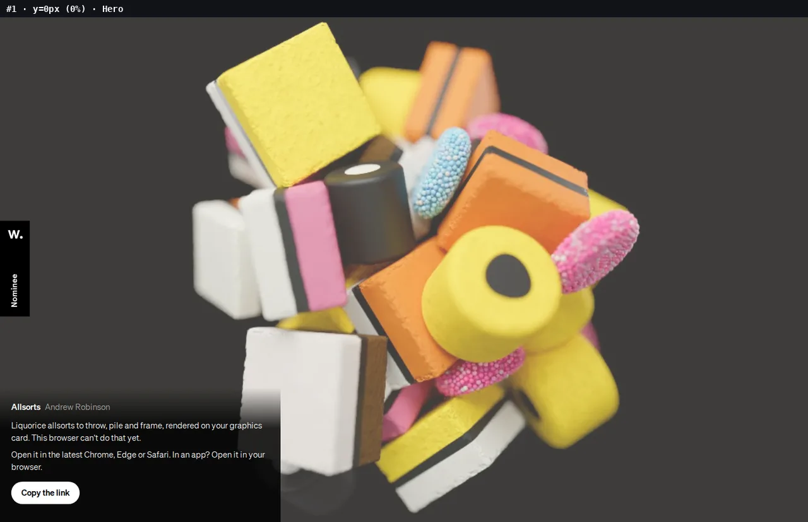
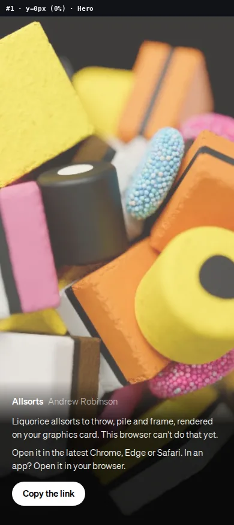

# UI Design System & Master Generation Blueprint: allsorts-andrew-rip

> **Allsorts · Andrew Robinson** (https://allsorts.andrew.rip) — Liquorice allsorts to throw, pile and frame, rendered in your browser. Save one as a wallpaper. By Andrew Robinson.





---

## 1. Executive Visual Persona & Design Archetype

- **Brand Essence & Persona**: **Allsorts · Andrew Robinson** (`https://allsorts.andrew.rip`). Liquorice allsorts to throw, pile and frame, rendered in your browser. Save one as a wallpaper. By Andrew Robinson.
- **Capture Provenance**: Live browser capture (`tier1_fast`, HTTP `200`, captured `2026-11-24`).
- **Visual Archetype**: **Dark-Substrate WebGL / Canvas Interactive Experience (`#000000` / `#dddddd`)**.
- **Anti-AI-Slop Differentiators**:
  - **Live-Computed Chromatic Polarity**: Anchors the viewport in `#000000` (live computed `body` `background-color` (`computed_styles.json`)) paired with `#ffffff` primary typography and `#dddddd` accents.
  - **Grounded Typographic Hierarchy**: Pairs `Soehne` for display copy (`Allsorts · Andrew Robinson`) with `Tiempos Fine`.
  - **Calibrated Spatial Grid & Motion**: Combines `1440px` container bounds (`gap: 12px`, padding `8px`) with `cubic-bezier(0.25,0.1,0.25,1)` easing and HTML5 `<canvas>` Interactive Viewport Surface.

---

## 2. Spatial Architecture & Modular Grid Mathematics

### Viewport Allocation & Container Geometry
- **Captured Journey Filmstrips**: Desktop `1280×828px` (`assets/desktop-journey.webp`, `1` keyframes up to `y=0px` / doc `900px`), Mobile `390×872px` (`assets/mobile-journey.webp`, `1` keyframes).
- **Master Container Bounds**: `1440px` (full-bleed `100%` viewport stage).
- **Canvas Lateral Padding & Spacing**: `8px` lateral canvas padding with `12px` grid gap.
- **Border Radius Scale**: `999px`, `6px`, `4px`, `1px`.

### Responsive Breakpoint Architecture
- **Desktop Layout**: Multi-column CSS Grid / Flexbox layout at `1440px` (`max-width: 1440px`, `gap: 12px`).
- **Mobile Layout**: Single-column vertical stack at `390px` viewport width with `8px` horizontal padding.
- **Extracted CSS Media Queries**: `@media (prefers-reduced-motion:reduce)`, `@media (width<=480px)`, `@media (width<=640px),(pointer:coarse) and (height<=500px)`.

---

## 3. Color System, Materiality & Atmospheric Lighting

### Semantic Palette & Source Grounding
| Semantic Role | Ground-Truth Value | Extracted Live / CSS Source |
|---|---|---|
| **Primary Canvas Substrate** | `#000000` | live computed `body` `background-color` (`computed_styles.json`) |
| **Primary Typography Ink** | `#ffffff` | live computed `body` `color` (`computed_styles.json`) |
| **Elevated Surface / Card Substrate** | `#111111` | `.lens.svelte-11id0ew { background: #111111 }` |
| **Interactive Accent / Highlight** | `#dddddd` | `.panel.svelte-1yxt74e button { color: #dddddd }` |
| **Secondary / Muted Copy** | `#777777` | `.dim.svelte-1tmptad { color: #777777 }` |
| **Structural Hairline Border** | `#262626` | `.total.svelte-qxof8p { border-top: #262626 }` |

### Sanitized Root CSS Variables (`ui-ux.md` Ground Truth)
| Variable Name | Extracted Value | Semantic Role |
|---|---|---|
| `--size` | `48px` | Layout / Spatial Grid Token |
| `--allsorts-andrew--bg` | `#000000` | Canvas Substrate (from live computed `body` `background-color` (`computed_styles.json`)) |
| `--allsorts-andrew--ink` | `#ffffff` | Primary Typography Ink (computed-derived) |
| `--allsorts-andrew--surface` | `#111111` | Surface Substrate (computed-derived) |
| `--allsorts-andrew--accent` | `#dddddd` | Interactive Accent (computed-derived) |
| `--allsorts-andrew--muted` | `#777777` | Secondary Ink (computed-derived) |
| `--allsorts-andrew--border` | `#262626` | Structural Border (computed-derived) |
| `--allsorts-andrew--container` | `1440px` | Container Bound (computed-derived) |
| `--allsorts-andrew--gap` | `12px` | Grid Gutter (computed-derived) |
| `--allsorts-andrew--pad` | `8px` | Lateral Padding (computed-derived) |
| `--allsorts-andrew--ease` | `cubic-bezier(0.25,0.1,0.25,1)` | Primary Easing Function |
| `--allsorts-andrew--radius` | `999px` | Corner Radius (computed-derived) |
| `--allsorts-andrew--fs-base` | `16px` | Observed Font Size Token |

---

## 4. Typographic Scale & Editorial Hierarchy

### Font Family Stacks
- **Display Typography**: `Soehne`.
- **Primary Body Stack**: `Tiempos Fine`.
- **Technical / Metadata Stack**: not declared in live computed styles (uses primary stack / `ui-monospace`).

### Typographic Scale & Rules (Live Computed & Stylesheet Grounded)
- **Hero Display (`H1`)**: observed font-size ladder: `16px`, `15px`, `13px`, `12px`, `14px`.
- **Section Heading (`H2`)**: observed font-size ladder: `16px`, `15px`, `13px`, `12px`, `14px`.
- **Body Copy**: live computed `body` (`font-size: 16px`, `line-height: normal`, `font-weight: 400`).
- **Metadata & Navigation Labels**: live computed `nav/a` (`font-size: 15px`, `line-height: 21.75px`, `font-weight: 300`).

---

## 5. Choreographed Motion & Interaction Physics

### Primary Easing Curves
- **Extracted Timing Functions**: `cubic-bezier(0.25,0.1,0.25,1)`.

### Per-Element Transition & Choreography Rules
- **Selector `button.svelte-hg5siv`**: `transition: opacity .2s` extracted from `allsorts-andrew-rip` stylesheet.
- **Selector `.lens.svelte-11id0ew`**: `transition: left .25s,top .25s` extracted from `allsorts-andrew-rip` stylesheet.
- **Selector `.close.svelte-11id0ew`**: `transition: left .25s,top .25s` extracted from `allsorts-andrew-rip` stylesheet.
- **Standard CSS Easing (`cubic-bezier(0.25,0.1,0.25,1)`)**: Default timing curve (no custom `cubic-bezier()` declared in captured CSS).
- **Runtime Interaction Engine**: Integrates HTML5 `<canvas>` Interactive Viewport Surface with `prefers-reduced-motion: reduce` fallback guards.
### Measured Runtime Scroll & Interaction Telemetry (`behavioral_journey_v2`)
- **Scroll Driver Mode**: `wheel` (max document height `900px`, deepest scrollY reached `0px` across `1` desktop keyframes).
- **Detected Scroll / Motion Libraries**: `WebGL/Canvas`.

---

## 6. Component Wireframe & Structural DOM Map

### Visual Layout Schematic — Desktop (`1440px`, Grounded in `dom.html` & Landmark Bounding Boxes)
```
┌────────────────────────────────────────────────────────────────────────┐
│ DESKTOP VIEWPORT (1440px) — Allsorts · Andrew Robinson                 │
│ ====================================================================== │
│ [ <header.stage> (1440px)             | Andrew Robinson              ] │
│ ---------------------------------------------------------------------- │
│ | HERO STAGE: <div.svelte-1pzb9eq> (w=1440px)                        | │
│ | H1: Allsorts · Andrew Robinson                                     | │
│ | Substrate: #000000 | Ink: #ffffff | Accent: #dddddd                | │
│ ---------------------------------------------------------------------- │
│ | SHOWCASE GRID (<div.light>) max-w: 1440px                          | │
│ | +------------------------------+  +------------------------------+ | │
│ | | Featured Work & Interactive  |  | Technical Architecture & Nar | | │
│ | +------------------------------+  +------------------------------+ | │
│ ---------------------------------------------------------------------- │
│ | DETAIL MODULE (<div.fallback>) — Global Directory & Co             | │
│ ---------------------------------------------------------------------- │
│ [ FOOTER (<footer.words>      ) | https://allsorts.andrew.rip          │
└────────────────────────────────────────────────────────────────────────┘
```

### Visual Layout Schematic — Mobile Reflow (`390px`)
```
┌────────────────────────────────────────────────────────────────────────┐
│ MOBILE VIEWPORT REFLOW (390px) — Single-Column Stack (gap: 12px)       │
│ ====================================================================== │
│ [ HEADER BAR (<header.stage>          ) | Compact Menu (390px)         │
│ ---------------------------------------------------------------------- │
│ | HERO STAGE (<div.svelte-1pzb9eq>) — 390px Vertical Lead            | │
│ | H1: Allsorts · Andrew Robinson                                     | │
│ ---------------------------------------------------------------------- │
│ | SHOWCASE STACK (<div.light>) — 1-Col Stack                         | │
│ | [ Item 1: Featured Work & Interactive Showcase                   ] | │
│ | [ Item 2: Technical Architecture & Narrative                     ] | │
│ ---------------------------------------------------------------------- │
│ | DETAIL STACK (<div.fallback>) — 1-Col (Global Directory &)         | │
│ ---------------------------------------------------------------------- │
│ [ FOOTER (<footer.words>      ) | Stacked 390px Colophon               │
└────────────────────────────────────────────────────────────────────────┘
```

### Granular DOM Region Breakdown
1. **Brand Header & Navigation Bar (<header.stage> — `allsorts-andrew-rip`)**:
   - Landmark `<header class="stage">` (`1440px`) hosting `Allsorts · Andrew Robinson` navigation (`Andrew Robinson`), DOM attributes (`data-website-id="ffd157e7-cca9-4ad9-ad..."`, `data-domains="allsorts.andrew.rip"`, `data-auto-track="true"`, `data-auto-pageview="false"`), and stylesheet rule `font-face { font-family:Soehne;src:url(../../../fonts/soehne-leicht.woff2)format("wo... }`.
2. **Hero Stage & Focal Lead (<div.svelte-1pzb9eq> — `Allsorts · Andrew Robinson`)**:
   - Landmark `<div class="svelte-1pzb9eq">` presenting display lead `Allsorts · Andrew Robinson` and copy excerpt *"Allsorts Andrew Robinson"* over `#000000` canvas and `#ffffff` ink.
3. **Primary Showcase & Content Grid (<div.light> — `Featured Work & Interactive Showca`)**:
   - Landmark `<div class="light">` rendering section `Featured Work & Interactive Showcase` with copy *"Liquorice allsorts to throw, pile and frame, rendered on your gra"*, asset references (`start.ChVgNEA1.js`, `payload.DSmR2FwN.js`, `CRzLMJPS.js`, `CKKoTArS.js`), and grid rule `body { overscroll-behavior:none;background:000;margin:0 }`.
4. **Interactive Detail & Feature Matrix (<div.fallback> — `Technical Architecture & Narrative`)**:
   - Landmark `<div class="fallback">` framing `Technical Architecture & Narrative` and `Global Directory & Contact` (*"Open it in the latest Chrome, Edge or Safari. In an app? Open it "*) with `#111111` surface cards, `#dddddd` accents, and `.row.svelte-qxof8p { justify-content:space-between;gap:12px;display:flex }`.
5. **Colophon & Global Directory Footer (<footer.words> — `https://allsorts.andrew.rip`)**:
   - Landmark `<footer class="words">` anchoring `Allsorts · Andrew Robinson` footer links (`Andrew Robinson`), copy *"Technical Architecture & Narrative"*, and `#262626` structural dividers.
### Full Vertical Scroll Sequence (Desktop `1440×900` Keyframes)
- **Step 01** (`y=0px`, `0%`): Active landmark `Hero` · sticky/fixed elements: `3`

---

## 7. Master Zero-Shot AI Generation Prompt

```markdown
# Master Zero-Shot Frontend Generation Prompt: allsorts-andrew-rip (Allsorts · Andrew Robinson)

You are a principal frontend architect and design systems engineer. Build a complete, production-ready web application replicating the exact design system, DOM landmarks, typographic hierarchy, color tokens, and motion physics of `allsorts-andrew-rip` (**Allsorts · Andrew Robinson** — `https://allsorts.andrew.rip`).

### 1. Visual Archetype & Anti-AI-Slop Mandates
- **Archetype**: Dark-Substrate WebGL / Canvas Interactive Experience (`#000000` / `#dddddd`).
- **Identity & Domain Context**: Liquorice allsorts to throw, pile and frame, rendered in your browser. Save one as a wallpaper. By Andrew Robinson.
- **Primary Substrate**: `#000000` (live computed `body` `background-color` (`computed_styles.json`)), **Primary Ink**: `#ffffff`, **Accent / Highlight**: `#dddddd`.
- **Site-Specific Differentiators**:
  - **Live-Computed Chromatic Polarity**: Anchors the viewport in `#000000` (live computed `body` `background-color` (`computed_styles.json`)) paired with `#ffffff` primary typography and `#dddddd` accents.
  - **Grounded Typographic Hierarchy**: Pairs `Soehne` for display copy (`Allsorts · Andrew Robinson`) with `Tiempos Fine`.
  - **Calibrated Spatial Grid & Motion**: Combines `1440px` container bounds (`gap: 12px`, padding `8px`) with `cubic-bezier(0.25,0.1,0.25,1)` easing and HTML5 `<canvas>` Interactive Viewport Surface.

### 2. Ground-Truth CSS Variables (`:root` Token Contract)
Declare and consume these exact custom properties extracted from `allsorts-andrew-rip` in your global stylesheet:

:root {
  /* Allsorts · Andrew Robinson (allsorts-andrew-rip) — Live-Grounded CSS Variables */
  --size: 48px; /* Layout / Spatial Grid Token (allsorts-andrew-rip) */
  --allsorts-andrew--bg: #000000; /* Canvas Substrate (from live computed `body` `background-color` (`computed_styles.json`)) (allsorts-andrew-rip) */
  --allsorts-andrew--ink: #ffffff; /* Primary Typography Ink (computed-derived) (allsorts-andrew-rip) */
  --allsorts-andrew--surface: #111111; /* Surface Substrate (computed-derived) (allsorts-andrew-rip) */
  --allsorts-andrew--accent: #dddddd; /* Interactive Accent (computed-derived) (allsorts-andrew-rip) */
  --allsorts-andrew--muted: #777777; /* Secondary Ink (computed-derived) (allsorts-andrew-rip) */
  --allsorts-andrew--border: #262626; /* Structural Border (computed-derived) (allsorts-andrew-rip) */
  --allsorts-andrew--container: 1440px; /* Container Bound (computed-derived) (allsorts-andrew-rip) */
  --allsorts-andrew--gap: 12px; /* Grid Gutter (computed-derived) (allsorts-andrew-rip) */
  --allsorts-andrew--pad: 8px; /* Lateral Padding (computed-derived) (allsorts-andrew-rip) */
  --allsorts-andrew--ease: cubic-bezier(0.25,0.1,0.25,1); /* Primary Easing Function (allsorts-andrew-rip) */
  --allsorts-andrew--radius: 999px; /* Corner Radius (computed-derived) (allsorts-andrew-rip) */
  --allsorts-andrew--fs-base: 16px; /* Observed Font Size Token (allsorts-andrew-rip) */
}

### 3. Semantic Color & Materiality Contract
Map every surface, ink, and border strictly to these source-grounded tokens:
- **Primary Canvas Substrate**: `#000000` — grounded in live computed `body` `background-color` (`computed_styles.json`)
- **Primary Typography Ink**: `#ffffff` — grounded in live computed `body` `color` (`computed_styles.json`)
- **Elevated Surface / Card Substrate**: `#111111` — grounded in `.lens.svelte-11id0ew { background: #111111 }`
- **Interactive Accent / Highlight**: `#dddddd` — grounded in `.panel.svelte-1yxt74e button { color: #dddddd }`
- **Secondary / Muted Copy**: `#777777` — grounded in `.dim.svelte-1tmptad { color: #777777 }`
- **Structural Hairline Border**: `#262626` — grounded in `.total.svelte-qxof8p { border-top: #262626 }`

### 4. Spatial Grid, Container Bounds & Responsive Breakpoints
- **Desktop Viewport Reference**: `1280×828px` (single-viewport 100vh live capture (900px), `1440px` standard desktop width).
- **Mobile Viewport Reference**: `390×872px` (full-page live capture (872px), `390px` standard mobile width).
- **Container Max-Width**: `1440px` (full-bleed `100%` viewport stage)
- **Padding & Gutters**: `8px` lateral canvas padding with `12px` grid gap
- **Desktop Grid**: Multi-column CSS Grid / Flexbox layout at `1440px` (`max-width: 1440px`, `gap: 12px`)
- **Mobile Adaptation**: Single-column vertical stack at `390px` viewport width with `8px` horizontal padding
- **Media Queries**: `@media (prefers-reduced-motion:reduce)`, `@media (width<=480px)`, `@media (width<=640px),(pointer:coarse) and (height<=500px)`
- **Corner Radii**: `999px`, `6px`, `4px`, `1px`

### 5. Typography & Editorial Scale Contract
- **Display Font Stack**: `Soehne`
- **Body Font Stack**: `Tiempos Fine`
- **Monospace / Technical Font Stack**: not declared in live computed styles (uses primary stack / `ui-monospace`)
- **H1 Display Rule**: observed font-size ladder: `16px`, `15px`, `13px`, `12px`, `14px`
- **H2 Section Rule**: observed font-size ladder: `16px`, `15px`, `13px`, `12px`, `14px`
- **Body Copy Rule**: live computed `body` (`font-size: 16px`, `line-height: normal`, `font-weight: 400`)
- **Metadata & Index Rule**: live computed `nav/a` (`font-size: 15px`, `line-height: 21.75px`, `font-weight: 300`)

### 6. Component Hierarchy, Verbatim Copy & Real DOM Landmarks
Scaffold `allsorts-andrew-rip` (`Allsorts · Andrew Robinson`) with these exact structural regions, extracted copy, and CSS rules from `dom.html`:
1. **Brand Header & Navigation Bar (<header.stage> — `allsorts-andrew-rip`)**:
   - DOM & Selectors: Landmark `<header class="stage">` (`1440px`) hosting `Allsorts · Andrew Robinson` navigation (`Andrew Robinson`), DOM attributes (`data-website-id="ffd157e7-cca9-4ad9-ad..."`, `data-domains="allsorts.andrew.rip"`, `data-auto-track="true"`, `data-auto-pageview="false"`), and stylesheet rule `font-face { font-family:Soehne;src:url(../../../fonts/soehne-leicht.woff2)format("wo... }`.
   - Responsive Contract: Header `Brand Header & Navigation Bar (<header.stage> — `allsorts-andrew-rip`)` (`allsorts-andrew-rip`) adapts across `@media (prefers-reduced-motion:reduce)`, `@media (width<=480px)`, `@media (width<=640px),(pointer:coarse) and (height<=500px)` with `cubic-bezier(0.25,0.1,0.25,1)` transitions and links `Andrew Robinson`.
2. **Hero Stage & Focal Lead (<div.svelte-1pzb9eq> — `Allsorts · Andrew Robinson`)**:
   - DOM & Selectors: Landmark `<div class="svelte-1pzb9eq">` presenting display lead `Allsorts · Andrew Robinson` and copy excerpt *"Allsorts Andrew Robinson"* over `#000000` canvas and `#ffffff` ink.
   - Responsive Contract: Hero stage (`1280×828px` desktop / `390×872px` mobile) sets `#000000` background with `#ffffff` headline `Allsorts · Andrew Robinson`.
3. **Primary Showcase & Content Grid (<div.light> — `Featured Work & Interactive Showca`)**:
   - DOM & Selectors: Landmark `<div class="light">` rendering section `Featured Work & Interactive Showcase` with copy *"Liquorice allsorts to throw, pile and frame, rendered on your gra"*, asset references (`start.ChVgNEA1.js`, `payload.DSmR2FwN.js`, `CRzLMJPS.js`, `CKKoTArS.js`), and grid rule `body { overscroll-behavior:none;background:000;margin:0 }`.
   - Responsive Contract: Showcase grid `Primary Showcase & Content Grid (<div.light> — `Featured Work & Interactive Showca`)` applies Multi-column CSS Grid / Flexbox layout at `1440px` (`max-width: 1440px`, `gap: 12px`) on desktop and Single-column vertical stack at `390px` viewport width with `8px` horizontal padding on mobile.
4. **Interactive Detail & Feature Matrix (<div.fallback> — `Technical Architecture & Narrative`)**:
   - DOM & Selectors: Landmark `<div class="fallback">` framing `Technical Architecture & Narrative` and `Global Directory & Contact` (*"Open it in the latest Chrome, Edge or Safari. In an app? Open it "*) with `#111111` surface cards, `#dddddd` accents, and `.row.svelte-qxof8p { justify-content:space-between;gap:12px;display:flex }`.
   - Responsive Contract: Detail module `Interactive Detail & Feature Matrix (<div.fallback> — `Technical Architecture & Narrative`)` uses `999px`, `6px`, `4px`, `1px` radii, `#dddddd` highlights, and assets (start.ChVgNEA1.js, payload.DSmR2FwN.js, CRzLMJPS.js).
5. **Colophon & Global Directory Footer (<footer.words> — `https://allsorts.andrew.rip`)**:
   - DOM & Selectors: Landmark `<footer class="words">` anchoring `Allsorts · Andrew Robinson` footer links (`Andrew Robinson`), copy *"Technical Architecture & Narrative"*, and `#262626` structural dividers.
   - Responsive Contract: Footer `Colophon & Global Directory Footer (<footer.words> — `https://allsorts.andrew.rip`)` aligns to `1440px` (full-bleed `100%` viewport stage) with `8px` lateral canvas padding with `12px` grid gap and attributes (data-website-id="ffd157e7-cca9-4ad9-ad...", data-domains="allsorts.andrew.rip", data-auto-track="true").

#### Verbatim DOM Copy Excerpts (`dom.html`)
- Copy Excerpt 1: *"Allsorts Andrew Robinson"*
- Copy Excerpt 2: *"Liquorice allsorts to throw, pile and frame, rendered on your graphics card. This..."*
- Copy Excerpt 3: *"Open it in the latest Chrome, Edge or Safari. In an app? Open it in your browser."*

### 7. Motion, Extracted Stylesheet Rules & Interaction Choreography
- **Primary Easing Functions**: `cubic-bezier(0.25,0.1,0.25,1)`
- **Extracted Stylesheet Rules (`allsorts-andrew-rip`)**:
- `font-face { font-family:Soehne;src:url(../../../fonts/soehne-leicht.woff2)format("wo... }`
- `body { overscroll-behavior:none;background:000;margin:0 }`
- `.row.svelte-qxof8p { justify-content:space-between;gap:12px;display:flex }`
- `.big.svelte-qxof8p { color:fff;font-size:13px }`
- `.total.svelte-qxof8p { border-top:1px solid ffffff26;margin-top:2px;padding-top:2px }`
- **Per-Selector Transition Rules**:
- **Selector `button.svelte-hg5siv`**: `transition: opacity .2s` extracted from `allsorts-andrew-rip` stylesheet.
- **Selector `.lens.svelte-11id0ew`**: `transition: left .25s,top .25s` extracted from `allsorts-andrew-rip` stylesheet.
- **Selector `.close.svelte-11id0ew`**: `transition: left .25s,top .25s` extracted from `allsorts-andrew-rip` stylesheet.
- **Standard CSS Easing (`cubic-bezier(0.25,0.1,0.25,1)`)**: Default timing curve (no custom `cubic-bezier()` declared in captured CSS).
- **Runtime Interaction Engine**: Integrates HTML5 `<canvas>` Interactive Viewport Surface with `prefers-reduced-motion: reduce` fallback guards.
### 7b. Full-Page Scroll Choreography, Interactive States & Multi-Page Routes
- **Scroll Mechanics**: Implement `wheel` vertical progression up to `900px` across 1 distinct viewport chapters using WebGL/Canvas.
- **Vertical Chapter Sequence**: Hero (0%).

### 8. Technical Deliverables
- Implement in Next.js (App Router) with TypeScript and Tailwind CSS consuming the `:root` custom properties defined above for `allsorts-andrew-rip`.
- Reproduce both the `1440px` desktop architecture and `390px` mobile breakpoint transitions, preserving semantic HTML5 landmarks (`<header>`, `<nav>`, `<main>`, `<section>`, `<footer>`) and `prefers-reduced-motion` accessibility guards.
```
---

## 8. Full-Page Scroll Journey, Interactive States & Subpage Inventory

### Desktop Scroll Keyframes (`1440×900` WebP)
| Step | Scroll Y | Progress | Active Landmark / Section | Sticky/Fixed | Visual Asset |
| :---: | :---: | :---: | :--- | :---: | :--- |
| `#01` | `0px` | `0%` | Hero | `3` | [desktop-step-01.webp](assets/desktop-step-01.webp) |

### Mobile Condensed Keyframes (`390×844` WebP)
| Step | Scroll Y | Progress | Active Landmark | Visual Asset |
| :---: | :---: | :---: | :--- | :--- |
| `#01` | `0px` | `0%` | Hero | [mobile-step-01.webp](assets/mobile-step-01.webp) |

