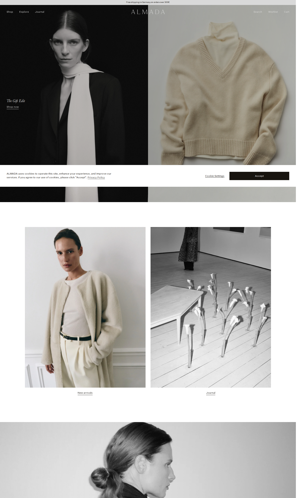

# UI Design System & Master Generation Blueprint: almadalabel-com

> **ALMADA LABEL - A modern take on a seasonless wardrobe** (https://almadalabel.com/) — Seasonless modern wardrobe staples designed with Scandinavian minimalism, resonating beyond trends. Responsibly crafted from high-quality...



---

## 1. Executive Visual Persona & Design Archetype

- **Brand Essence & Persona**: **ALMADA LABEL - A modern take on a seasonless wardrobe** (`https://almadalabel.com/`). Seasonless modern wardrobe staples designed with Scandinavian minimalism, resonating beyond trends. Responsibly crafted from high-quality...
- **Visual Archetype**: **Light-Substrate Editorial & Modular Grid System (`#ffffff` canvas, `#17140f` ink, `#a6a6a5` accent)**.
- **Anti-AI-Slop Differentiators**:
  - **Source-Grounded Chromatic Polarity**: Anchors the viewport in `#ffffff` (`var(--background_color)` in `:root`) paired with `#17140f` primary typography and `#a6a6a5` accents.
  - **Extracted Typographic Hierarchy**: Pairs `Heading Font Italic` for display copy (`Wishlist`) with `Heading Font Regular` and not declared in static CSS (uses primary stack / `ui-monospace`).
  - **Calibrated Spatial Grid & Motion**: Combines `var(--section_max_width)` container bounds (`gap: .75rem`, padding `1rem`) with `cubic-bezier(.6,.2,0,.8)` easing and Swiper Touch Carousel Engine, Barba.js Page Transition Router.

---

## 2. Spatial Architecture & Modular Grid Mathematics


### Viewport Allocation & Container Geometry
- **Captured Viewport Dimensions**: Desktop `1440×2400px` (`assets/desktop.png`, capped at 2400px multi-section capture), Mobile `390×2400px` (`assets/mobile.png`, capped at 2400px multi-section capture).
- **Master Container Bounds**: `var(--section_max_width)` extracted from `almadalabel-com` stylesheet.
- **Canvas Lateral Padding & Spacing**: `1rem` lateral canvas padding with `.75rem` grid gap.
- **Border Radius Scale**: `4px`, `50%`, `25px`, `2px`.

### Responsive Breakpoint Architecture
- **Desktop Layout**: Multi-column CSS Grid / Flexbox layout at `1440px` (`max-width: var(--section_max_width)`, `gap: .75rem`).
- **Mobile Layout**: Single-column vertical stack at `390px` viewport width with `1rem` horizontal padding.
- **Extracted CSS Media Queries**: `@media screen and (forced-colors:active)`, `@media screen and (width<=750px)`, `@media screen and (min-width:1025px)`, `@media screen and (min-width:1440px)and (max-width:1440px)`.

---

## 3. Color System, Materiality & Atmospheric Lighting

### Semantic Palette & Source Grounding
| Semantic Role | Ground-Truth Value | Extracted CSS Source / Selector |
|---|---|---|
| **Primary Canvas Substrate** | `#ffffff` | `var(--background_color)` in `:root` |
| **Primary Typography Ink** | `#f3f2f2` | `var(--background_color_2)` in `:root` |
| **Elevated Surface / Card Substrate** | `#17140f` | `var(--primary_text)` in `:root` |
| **Interactive Accent / Highlight** | `#a6a6a5` | `var(--primary_accent)` in `:root` |
| **Secondary / Muted Copy** | `#38302e` | `var(--secondary_accent)` in `:root` |
| **Structural Hairline Border** | `#55534e` | `var(--primary_gray)` in `:root` |

### Sanitized Root CSS Variables (`ui-ux.md` Ground Truth)
| Variable Name | Extracted Value | Semantic Role |
|---|---|---|
| `--adjustment_m` | `0px` | Dimension / Scale Token |
| `--adjustment_d` | `0px` | Dimension / Scale Token |
| `--pc-indicator-h` | `0px` | Dimension / Scale Token |
| `--pc-slide-base` | `200%` | Dimension / Scale Token |
| `--favorites-drawer-inline-padding` | `1.25rem` | Layout / Spatial Grid Token |
| `--favorites-recent-swiper-inline-offset` | `16px` | Dimension / Scale Token |
| `--favorites-recent-skeleton-per-view` | `2.476` | Design System Custom Token |
| `--favorites-recent-skeleton-gap` | `1rem` | Layout / Spatial Grid Token |
| `--mobile-menu-label-gap` | `.375rem` | Layout / Spatial Grid Token |
| `--aspect-ratio` | `.75` | Design System Custom Token |
| `--Drawer-bg` | `var(--background_color)` | Canvas / Surface Token |
| `--background_color` | `#ffffff` | Canvas / Surface Token |
| `--background_color_2` | `#f3f2f2` | Canvas / Surface Token |
| `--primary_text` | `#17140f` | Typography Ink Token |
| `--secondary_text` | `#ffffff` | Typography Ink Token |
| `--primary_accent` | `#a6a6a5` | Brand / Palette Token |

---

## 4. Typographic Scale & Editorial Hierarchy

### Font Family Stacks
- **Display Typography**: `Heading Font Italic`.
- **Primary Body Stack**: `Heading Font Regular`.
- **Technical / Metadata Stack**: not declared in static CSS (uses primary stack / `ui-monospace`).

### Typographic Scale & Rules (Extracted from Stylesheet & Variables)
- **Hero Display (`H1`)**: rule `h1` (`font-size: 32px`, `line-height: normal`).
- **Section Heading (`H2`)**: rule `h2` (`font-size: .875rem`, `line-height: 1.125rem`, `letter-spacing: 0`, `font-weight: 400`).
- **Body Copy**: CSS variables `--body_color: #FFF`, `--type_primary_paragraph_font: 'Paragraph Primary Font'`, `--weight_paragraph_font: 400`; rule `p` (`font-size: .75rem`, `line-height: 1.125rem`, `letter-spacing: 0`).
- **Metadata & Navigation Labels**: CSS variables `--mobile-menu-label-gap: .375rem`, `--label_onSale_Bg: #A6A6A5`, `--label_onSale_text: #A6A6A5`.

---

## 5. Choreographed Motion & Interaction Physics

### Primary Easing Curves
- **Extracted Timing Functions**: `cubic-bezier(.6,.2,0,.8)`.

### Per-Element Transition & Choreography Rules
- **Selector `.shopify-payment-button__button`**: `transition: background .2s ease-in-out` extracted from `almadalabel-com` stylesheet.
- **Selector `.search[aria-hidden=true]`**: `transition: all .5s ease-in` extracted from `almadalabel-com` stylesheet.
- **Selector `.Image--FadeIn`**: `transition: filter .3s .1s,-webkit-filter .3s .1s` extracted from `almadalabel-com` stylesheet.
- **Extracted Easing Curve (`cubic-bezier(.6,.2,0,.8)`)**: Governs interactive state transitions across `<header.Drawer__header>` and `<article.favorites-drawer__item>`.
- **Runtime Interaction Engine**: Integrates Swiper Touch Carousel Engine, Barba.js Page Transition Router, Framer Motion Layout Physics with `prefers-reduced-motion: reduce` fallback guards.

---

## 6. Component Wireframe & Structural DOM Map

### Visual Layout Schematic (Grounded in `dom.html` — `1440px` Desktop & `390px` Mobile Reflow)
```
┌────────────────────────────────────────────────────────────────────────┐
│ DESKTOP VIEWPORT (1440px) — ALMADA LABEL - A modern take on a seasonle │
│ ====================================================================== │
│ [ <header.Drawer__header>  | Journal · New Arrivals · Coming Soon · ]  │
│ ---------------------------------------------------------------------- │
│ | HERO STAGE: <article.favorites-drawer__item>                     |   │
│ | H1: Wishlist                                                     |   │
│ | Substrate: #ffffff    | Ink: #17140f    | Accent: #a6a6a5        |   │
│ ---------------------------------------------------------------------- │
│ | SHOWCASE GRID (<article.favorites-drawer_) max-w: var(--section_ |   │
│ | +------------------------------+  +------------------------------+ | │
│ | | ALMADA                       |  | Search                       | | │
│ | +------------------------------+  +------------------------------+ | │
│ ---------------------------------------------------------------------- │
│ | MOBILE VIEWPORT REFLOW (390px) — Single-Column Stack (gap: .75rem) | │
│ | [<header.Drawer__he] -> [<article.favorites] -> [<article.favorites] │
│ ---------------------------------------------------------------------- │
│ [ FOOTER (<footer.footer>       ) | https://almadalabel.com/           │
└────────────────────────────────────────────────────────────────────────┘
```

### Granular DOM Region Breakdown
1. **Brand Header & Navigation Bar (<header.Drawer__header> — `almadalabel-com`)**:
   - Landmark `<header class="Drawer__header">` hosting `ALMADA LABEL - A modern take on a se` navigation (`Journal · New Arrivals · Coming Soon · Belts New · Signatures`), DOM attributes (`data-source-attribution="shopify.exit_intersti..."`, `data-shop-id="25465225306"`, `data-venmo-supported="false"`, `data-environment="production"`), and stylesheet rule `.shopify-payment-button__button--... { visibility:hidden }`.
2. **Hero Stage & Focal Lead (<article.favorites-drawer__item> — `Wishlist`)**:
   - Landmark `<article class="favorites-drawer__item">` presenting display lead `Wishlist` and copy excerpt *"Free shipping to Finland on orders over 300€"* over `#ffffff` canvas and `#17140f` ink.
3. **Primary Showcase & Content Grid (<article.favorites-drawer__item> — `ALMADA`)**:
   - Landmark `<article class="favorites-drawer__item">` rendering section `ALMADA` with copy *"Search Wishlist Cart 0"*, asset references (`trsdk`, `clarity.js`, `vwmug8kkd7`, `cdn.shopify.com`), and grid rule `opify-payment-button__button--unb... { background-color:1990c6;padding:1em 2em }`.
4. **Interactive Detail & Feature Matrix (<article.favorites-drawer__item> — `Search`)**:
   - Landmark `<article class="favorites-drawer__item">` framing `Search` and `JOIN OUR MAILING LIST` (*"Autumn / Winter 26"*) with `#17140f` surface cards, `#a6a6a5` accents, and `ptions.shopify-payment-button__sk... { width:50%;margin-left:25%;margin-right:25%;border-radius:4px!important;h... }`.
5. **Colophon & Global Directory Footer (<footer.footer> — `https://almadalabel.com/`)**:
   - Landmark `<footer class="footer colorGroup--primary">` anchoring `ALMADA LABEL - A modern take on ` footer links (`Journal · New Arrivals · Coming Soon · Belts New · Signatures`), copy *"Silk Wool Cashmere"*, and `#55534e` structural dividers.

---

## 7. Master Zero-Shot AI Generation Prompt

```markdown
# Master Zero-Shot Frontend Generation Prompt: almadalabel-com (ALMADA LABEL - A modern take on a seasonless wardrobe)

You are a principal frontend architect and design systems engineer. Build a complete, production-ready web application replicating the exact design system, DOM landmarks, typographic hierarchy, color tokens, and motion physics of `almadalabel-com` (**ALMADA LABEL - A modern take on a seasonless wardrobe** — `https://almadalabel.com/`).

### 1. Visual Archetype & Anti-AI-Slop Mandates
- **Archetype**: Light-Substrate Editorial & Modular Grid System (`#ffffff` canvas, `#17140f` ink, `#a6a6a5` accent).
- **Identity & Domain Context**: Seasonless modern wardrobe staples designed with Scandinavian minimalism, resonating beyond trends. Responsibly crafted from high-quality...
- **Primary Substrate**: `#ffffff` (`var(--background_color)` in `:root`), **Primary Ink**: `#17140f`, **Accent / Highlight**: `#a6a6a5`.
- **Site-Specific Differentiators**:
  - **Source-Grounded Chromatic Polarity**: Anchors the viewport in `#ffffff` (`var(--background_color)` in `:root`) paired with `#17140f` primary typography and `#a6a6a5` accents.
  - **Extracted Typographic Hierarchy**: Pairs `Heading Font Italic` for display copy (`Wishlist`) with `Heading Font Regular` and not declared in static CSS (uses primary stack / `ui-monospace`).
  - **Calibrated Spatial Grid & Motion**: Combines `var(--section_max_width)` container bounds (`gap: .75rem`, padding `1rem`) with `cubic-bezier(.6,.2,0,.8)` easing and Swiper Touch Carousel Engine, Barba.js Page Transition Router.

### 2. Ground-Truth CSS Variables (`:root` Token Contract)
Declare and consume these exact custom properties extracted from `almadalabel-com` in your global stylesheet:

:root {
  /* ALMADA LABEL - A modern take on a seasonless wardrobe (almadalabel-com) — Ground-Truth Extracted CSS Variables */
  --adjustment_m: 0px; /* Dimension / Scale Token (almadalabel-com) */
  --adjustment_d: 0px; /* Dimension / Scale Token (almadalabel-com) */
  --pc-indicator-h: 0px; /* Dimension / Scale Token (almadalabel-com) */
  --pc-slide-base: 200%; /* Dimension / Scale Token (almadalabel-com) */
  --favorites-drawer-inline-padding: 1.25rem; /* Layout / Spatial Grid Token (almadalabel-com) */
  --favorites-recent-swiper-inline-offset: 16px; /* Dimension / Scale Token (almadalabel-com) */
  --favorites-recent-skeleton-per-view: 2.476; /* Design System Custom Token (almadalabel-com) */
  --favorites-recent-skeleton-gap: 1rem; /* Layout / Spatial Grid Token (almadalabel-com) */
  --mobile-menu-label-gap: .375rem; /* Layout / Spatial Grid Token (almadalabel-com) */
  --aspect-ratio: .75; /* Design System Custom Token (almadalabel-com) */
  --Drawer-bg: var(--background_color); /* Canvas / Surface Token (almadalabel-com) */
  --background_color: #ffffff; /* Canvas / Surface Token (almadalabel-com) */
  --background_color_2: #f3f2f2; /* Canvas / Surface Token (almadalabel-com) */
  --primary_text: #17140f; /* Typography Ink Token (almadalabel-com) */
  --secondary_text: #ffffff; /* Typography Ink Token (almadalabel-com) */
  --primary_accent: #a6a6a5; /* Brand / Palette Token (almadalabel-com) */
}

### 3. Semantic Color & Materiality Contract
Map every surface, ink, and border strictly to these source-grounded tokens:
- **Primary Canvas Substrate**: `#ffffff` — grounded in `var(--background_color)` in `:root`
- **Primary Typography Ink**: `#f3f2f2` — grounded in `var(--background_color_2)` in `:root`
- **Elevated Surface / Card Substrate**: `#17140f` — grounded in `var(--primary_text)` in `:root`
- **Interactive Accent / Highlight**: `#a6a6a5` — grounded in `var(--primary_accent)` in `:root`
- **Secondary / Muted Copy**: `#38302e` — grounded in `var(--secondary_accent)` in `:root`
- **Structural Hairline Border**: `#55534e` — grounded in `var(--primary_gray)` in `:root`

### 4. Spatial Grid, Container Bounds & Responsive Breakpoints
- **Desktop Viewport Reference**: `1440×2400px` (capped at 2400px multi-section capture, `1440px` standard desktop width).
- **Mobile Viewport Reference**: `390×2400px` (capped at 2400px multi-section capture, `390px` standard mobile width).
- **Container Max-Width**: `var(--section_max_width)` extracted from `almadalabel-com` stylesheet
- **Padding & Gutters**: `1rem` lateral canvas padding with `.75rem` grid gap
- **Desktop Grid**: Multi-column CSS Grid / Flexbox layout at `1440px` (`max-width: var(--section_max_width)`, `gap: .75rem`)
- **Mobile Adaptation**: Single-column vertical stack at `390px` viewport width with `1rem` horizontal padding
- **Media Queries**: `@media screen and (forced-colors:active)`, `@media screen and (width<=750px)`, `@media screen and (min-width:1025px)`, `@media screen and (min-width:1440px)and (max-width:1440px)`
- **Corner Radii**: `4px`, `50%`, `25px`, `2px`

### 5. Typography & Editorial Scale Contract
- **Display Font Stack**: `Heading Font Italic`
- **Body Font Stack**: `Heading Font Regular`
- **Monospace / Technical Font Stack**: not declared in static CSS (uses primary stack / `ui-monospace`)
- **H1 Display Rule**: rule `h1` (`font-size: 32px`, `line-height: normal`)
- **H2 Section Rule**: rule `h2` (`font-size: .875rem`, `line-height: 1.125rem`, `letter-spacing: 0`, `font-weight: 400`)
- **Body Copy Rule**: CSS variables `--body_color: #ffffff`, `--type_primary_paragraph_font: 'Paragraph Primary Font'`, `--weight_paragraph_font: 400`; rule `p` (`font-size: .75rem`, `line-height: 1.125rem`, `letter-spacing: 0`)
- **Metadata & Index Rule**: CSS variables `--mobile-menu-label-gap: .375rem`, `--label_onSale_Bg: #A6A6A5`, `--label_onSale_text: #A6A6A5`

### 6. Component Hierarchy, Verbatim Copy & Real DOM Landmarks
Scaffold `almadalabel-com` (`ALMADA LABEL - A modern take on a seasonless wardrobe`) with these exact structural regions, extracted copy, and CSS rules from `dom.html`:
1. **Brand Header & Navigation Bar (<header.Drawer__header> — `almadalabel-com`)**:
   - DOM & Selectors: Landmark `<header class="Drawer__header">` hosting `ALMADA LABEL - A modern take on a se` navigation (`Journal · New Arrivals · Coming Soon · Belts New · Signatures`), DOM attributes (`data-source-attribution="shopify.exit_intersti..."`, `data-shop-id="25465225306"`, `data-venmo-supported="false"`, `data-environment="production"`), and stylesheet rule `.shopify-payment-button__button--... { visibility:hidden }`.
   - Responsive Contract: Header `Brand Header & Navigation Bar (<header.Drawer__header> — `almadalabel-com`)` (`almadalabel-com`) adapts across `@media screen and (forced-colors:active)`, `@media screen and (width<=750px)`, `@media screen and (min-width:1025px)`, `@media screen and (min-width:1440px)and (max-width:1440px)` with `cubic-bezier(.6,.2,0,.8)` transitions and links `Journal · New Arrivals · Coming Soon · Belts New · Signatures`.
2. **Hero Stage & Focal Lead (<article.favorites-drawer__item> — `Wishlist`)**:
   - DOM & Selectors: Landmark `<article class="favorites-drawer__item">` presenting display lead `Wishlist` and copy excerpt *"Free shipping to Finland on orders over 300€"* over `#ffffff` canvas and `#17140f` ink.
   - Responsive Contract: Hero stage (`1440×2400px` desktop / `390×2400px` mobile) sets `#ffffff` background with `#17140f` headline `Wishlist`.
3. **Primary Showcase & Content Grid (<article.favorites-drawer__item> — `ALMADA`)**:
   - DOM & Selectors: Landmark `<article class="favorites-drawer__item">` rendering section `ALMADA` with copy *"Search Wishlist Cart 0"*, asset references (`trsdk`, `clarity.js`, `vwmug8kkd7`, `cdn.shopify.com`), and grid rule `opify-payment-button__button--unb... { background-color:1990c6;padding:1em 2em }`.
   - Responsive Contract: Showcase grid `Primary Showcase & Content Grid (<article.favorites-drawer__item> — `ALMADA`)` applies Multi-column CSS Grid / Flexbox layout at `1440px` (`max-width: var(--section_max_width)`, `gap: .75rem`) on desktop and Single-column vertical stack at `390px` viewport width with `1rem` horizontal padding on mobile.
4. **Interactive Detail & Feature Matrix (<article.favorites-drawer__item> — `Search`)**:
   - DOM & Selectors: Landmark `<article class="favorites-drawer__item">` framing `Search` and `JOIN OUR MAILING LIST` (*"Autumn / Winter 26"*) with `#17140f` surface cards, `#a6a6a5` accents, and `ptions.shopify-payment-button__sk... { width:50%;margin-left:25%;margin-right:25%;border-radius:4px!important;h... }`.
   - Responsive Contract: Detail module `Interactive Detail & Feature Matrix (<article.favorites-drawer__item> — `Search`)` uses `4px`, `50%`, `25px`, `2px` radii, `#a6a6a5` highlights, and assets (trsdk, clarity.js, vwmug8kkd7).
5. **Colophon & Global Directory Footer (<footer.footer> — `https://almadalabel.com/`)**:
   - DOM & Selectors: Landmark `<footer class="footer colorGroup--primary">` anchoring `ALMADA LABEL - A modern take on ` footer links (`Journal · New Arrivals · Coming Soon · Belts New · Signatures`), copy *"Silk Wool Cashmere"*, and `#55534e` structural dividers.
   - Responsive Contract: Footer `Colophon & Global Directory Footer (<footer.footer> — `https://almadalabel.com/`)` aligns to `var(--section_max_width)` extracted from `almadalabel-com` stylesheet with `1rem` lateral canvas padding with `.75rem` grid gap and attributes (data-source-attribution="shopify.exit_intersti...", data-shop-id="25465225306", data-venmo-supported="false").

#### Verbatim DOM Copy Excerpts (`dom.html`)
- Copy Excerpt 1: *"Free shipping to Finland on orders over 300€"*
- Copy Excerpt 2: *"Search Wishlist Cart 0"*
- Copy Excerpt 3: *"Autumn / Winter 26"*
- Copy Excerpt 4: *"Silk Wool Cashmere"*

### 7. Motion, Extracted Stylesheet Rules & Interaction Choreography
- **Primary Easing Functions**: `cubic-bezier(.6,.2,0,.8)`
- **Extracted Stylesheet Rules (`almadalabel-com`)**:
- `.shopify-payment-button__button--... { visibility:hidden }`
- `opify-payment-button__button--unb... { background-color:1990c6;padding:1em 2em }`
- `ptions.shopify-payment-button__sk... { width:50%;margin-left:25%;margin-right:25%;border-radius:4px!important;h... }`
- `shopify-payment-button__button--b... { z-index:1;flex-direction:column;display:flex;position:relative }`
- `on__button--branded .shopify-clea... { flex-direction:column!important;flex:1!important;display:flex!important }`
- **Per-Selector Transition Rules**:
- **Selector `.shopify-payment-button__button`**: `transition: background .2s ease-in-out` extracted from `almadalabel-com` stylesheet.
- **Selector `.search[aria-hidden=true]`**: `transition: all .5s ease-in` extracted from `almadalabel-com` stylesheet.
- **Selector `.Image--FadeIn`**: `transition: filter .3s .1s,-webkit-filter .3s .1s` extracted from `almadalabel-com` stylesheet.
- **Extracted Easing Curve (`cubic-bezier(.6,.2,0,.8)`)**: Governs interactive state transitions across `<header.Drawer__header>` and `<article.favorites-drawer__item>`.
- **Runtime Interaction Engine**: Integrates Swiper Touch Carousel Engine, Barba.js Page Transition Router, Framer Motion Layout Physics with `prefers-reduced-motion: reduce` fallback guards.

### 8. Technical Deliverables
- Implement in Next.js (App Router) with TypeScript and Tailwind CSS consuming the `:root` custom properties defined above for `almadalabel-com`.
- Reproduce both the `1440px` desktop architecture and `390px` mobile breakpoint transitions, preserving semantic HTML5 landmarks (`<header>`, `<nav>`, `<main>`, `<section>`, `<footer>`) and `prefers-reduced-motion` accessibility guards.
```
