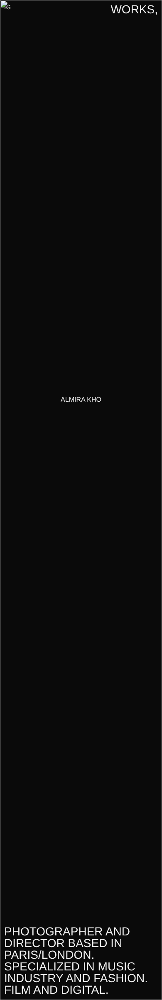

# UI Design System & Master Generation Blueprint: almirakho-com

> **Almira Kho - Photographer and Director** (https://almirakho.com/) — Almira Kho is a photographer and director based in Paris/London. Specialized in music industry and fashion. Film and digital.


---

## 1. Executive Visual Persona & Design Archetype

- **Brand Essence & Persona**: **Almira Kho - Photographer and Director** (`https://almirakho.com/`). Almira Kho is a photographer and director based in Paris/London. Specialized in music industry and fashion. Film and digital.
- **Visual Archetype**: **High-Contrast Obsidian / Atmospheric Design System (`#0a0a0a` canvas, `#fafafa` ink, `#3dd68c` accent)**.
- **Anti-AI-Slop Differentiators**:
  - **Source-Grounded Chromatic Polarity**: Anchors the viewport in `#0a0a0a` (`var(--color-black)` in `:root`) paired with `#fafafa` primary typography and `#3dd68c` accents.
  - **Extracted Typographic Hierarchy**: Pairs `Archivo` for display copy (`Almira Kho`) with `Archivo` and not declared in static CSS (uses primary stack / `ui-monospace`).
  - **Calibrated Spatial Grid & Motion**: Combines `260px` container bounds (`gap: 6px`, padding `10rem`) with `cubic-bezier(.455,.03,.515,.955)` easing and Lenis Smooth Scroll (`data-lenis`).

---

## 2. Spatial Architecture & Modular Grid Mathematics



### Viewport Allocation & Container Geometry
- **Captured Viewport Dimensions**: Desktop `1440×2400px` (`assets/desktop.png`, capped at 2400px multi-section capture), Mobile `390×2400px` (`assets/mobile.png`, capped at 2400px multi-section capture).
- **Master Container Bounds**: `260px` extracted from `almirakho-com` stylesheet.
- **Canvas Lateral Padding & Spacing**: `10rem` lateral canvas padding with `6px` grid gap.
- **Border Radius Scale**: `var(--vp-radius)`, `var(--vp-button-radius)`, `var(--vp-radius-xs)`, `var(--vp-timeline-radius)`.

### Responsive Breakpoint Architecture
- **Desktop Layout**: Multi-column CSS Grid / Flexbox layout at `1440px` (`max-width: 260px`, `gap: 6px`).
- **Mobile Layout**: Single-column vertical stack at `390px` viewport width with `10rem` horizontal padding.
- **Extracted CSS Media Queries**: `@media screen and (width<=900px)`, `@media screen and (width<=420px)`, `@media screen and (hover:hover) and (pointer:fine)`.

---

## 3. Color System, Materiality & Atmospheric Lighting

### Semantic Palette & Source Grounding
| Semantic Role | Ground-Truth Value | Extracted CSS Source / Selector |
|---|---|---|
| **Primary Canvas Substrate** | `#0a0a0a` | `var(--color-black)` in `:root` |
| **Primary Typography Ink** | `#fafafa` | `var(--color-white)` in `:root` |
| **Elevated Surface / Card Substrate** | `#e45050` | `var(--color-red)` in `:root` |
| **Interactive Accent / Highlight** | `#3dd68c` | `var(--vp-primary)` in `:root` |
| **Secondary / Muted Copy** | `#2ec97a` | `var(--vp-primary-hover)` in `:root` |
| **Structural Hairline Border** | `#24b86e` | `var(--vp-primary-active)` in `:root` |
| **Variable Token (`--color-white-50`)** | `#ffffff80` | `var(--color-white-50)` in `:root` |
| **Variable Token (`--color-white-5`)** | `#ffffff0d` | `var(--color-white-5)` in `:root` |

### Sanitized Root CSS Variables (`ui-ux.md` Ground Truth)
| Variable Name | Extracted Value | Semantic Role |
|---|---|---|
| `--vw` | `100vw` | Layout / Spatial Grid Token |
| `--vh` | `100vh` | Layout / Spatial Grid Token |
| `--ivh` | `100dvh` | Layout / Spatial Grid Token |
| `--rem` | `1px` | Dimension / Scale Token |
| `--main-font-name` | `"Archivo"` | Typography / Scale Token |
| `--display-font-name` | `"Archivo"` | Typography / Scale Token |
| `--main-font` | `var(--main-font-name), "Helvetica Neue", "Arial", sans-serif` | Typography / Scale Token |
| `--display-font` | `var(--display-font-name), "Helvetica Neue", "Arial", sans-serif` | Typography / Scale Token |
| `--color-black` | `#0a0a0a` | Canvas / Surface Token |
| `--color-white` | `#fafafa` | Canvas / Surface Token |
| `--color-white-50` | `#ffffff80` | Canvas / Surface Token |
| `--color-white-5` | `#ffffff0d` | Canvas / Surface Token |
| `--color-red` | `#e45050` | Brand / Palette Token |
| `--grid-margin` | `20rem` | Layout / Spatial Grid Token |
| `--grid-gutter` | `20rem` | Layout / Spatial Grid Token |
| `--grid-column` | `calc(var(--vw)/10 - var(--grid-gutter)*9/10 - var(--grid-margin)*2/10)` | Layout / Spatial Grid Token |

---

## 4. Typographic Scale & Editorial Hierarchy

### Font Family Stacks
- **Display Typography**: `Archivo`.
- **Primary Body Stack**: `Archivo`.
- **Technical / Metadata Stack**: not declared in static CSS (uses primary stack / `ui-monospace`).

### Typographic Scale & Rules (Extracted from Stylesheet & Variables)
- **Hero Display (`H1`)**: CSS variables `--display-font-name: "Archivo"`, `--display-font: var(--display-font-name), "Helvetica Neue", "Arial", sans-serif`.
- **Section Heading (`H2`)**: not explicitly declared on tag in static CSS (stylesheet font-size ladder: `16rem`, `var(--rem)`, `13px`, `var(--vp-font-size)`, `var(--vp-font-size-sm)`).
- **Body Copy**: rule `,p` (`font-size: inherit`, `letter-spacing: inherit`, `font-weight: inherit`).
- **Metadata & Navigation Labels**: not explicitly declared on tag in static CSS (stylesheet font-size ladder: `16rem`, `var(--rem)`, `13px`, `var(--vp-font-size)`, `var(--vp-font-size-sm)`).

---

## 5. Choreographed Motion & Interaction Physics

### Primary Easing Curves
- **Extracted Timing Functions**: `cubic-bezier(.455,.03,.515,.955)`, `cubic-bezier(.19,1,.22,1)`, `cubic-bezier(.16,1,.3,1)`.

### Per-Element Transition & Choreography Rules
- **Selector `.fade-leave-active`**: `transition: opacity .35s` extracted from `almirakho-com` stylesheet.
- **Selector `.project-enter-active`**: `transition: opacity .65s .2s,transform .65s cubic-bezier(.455,.03,.515,.955) .2s` extracted from `almirakho-com` stylesheet.
- **Selector `.project-leave-active`**: `transition: opacity .45s,transform .45s` extracted from `almirakho-com` stylesheet.
- **Extracted Easing Curve (`cubic-bezier(.455,.03,.515,.955)`)**: Governs interactive state transitions across `<header.header>` and `<main.home-link>`.
- **Runtime Interaction Engine**: Integrates Lenis Smooth Scroll (`data-lenis`) with `prefers-reduced-motion: reduce` fallback guards.

---

## 6. Component Wireframe & Structural DOM Map

### Visual Layout Schematic (Grounded in `dom.html` — `1440px` Desktop & `390px` Mobile Reflow)
```
┌────────────────────────────────────────────────────────────────────────┐
│ DESKTOP VIEWPORT (1440px) — Almira Kho - Photographer and Director     │
│ ====================================================================== │
│ [ <header.header>          | Almira Kho · About · IG                ]  │
│ ---------------------------------------------------------------------- │
│ | HERO STAGE: <main.header>                                        |   │
│ | H1: Almira Kho                                                   |   │
│ | Substrate: #0a0a0a    | Ink: #fafafa    | Accent: #3dd68c        |   │
│ ---------------------------------------------------------------------- │
│ | SHOWCASE GRID (<main.home-link>          ) max-w: 260px          |   │
│ | +------------------------------+  +------------------------------+ | │
│ | | Photographer and director ba |  | almirakho-com Interactive Ma | | │
│ | +------------------------------+  +------------------------------+ | │
│ ---------------------------------------------------------------------- │
│ | MOBILE VIEWPORT REFLOW (390px) — Single-Column Stack (gap: 6px   ) | │
│ | [<header.header>] -> [<main.header>] -> [<main.home-link>] |         │
│ ---------------------------------------------------------------------- │
│ [ FOOTER (<footer.router-link-ex) | https://almirakho.com/             │
└────────────────────────────────────────────────────────────────────────┘
```

### Granular DOM Region Breakdown
1. **Brand Header & Navigation Bar (<header.header> — `almirakho-com`)**:
   - Landmark `<header class="header">` hosting `Almira Kho - Photographer and Direct` navigation (`Almira Kho · About · IG`), DOM attributes (`data-scroll="top"`, `data-v-app`, `data-v-edc13355`, `data-v-83432065`), and stylesheet rule `html { font-family:var(--main-font);letter-spacing:0;text-transform:uppercase;f... }`.
2. **Hero Stage & Focal Lead (<main.header> — `Almira Kho`)**:
   - Landmark `<main class="header">` presenting display lead `Almira Kho` and copy excerpt *"Photographer and director based in Paris/London. Specialized in m"* over `#0a0a0a` canvas and `#fafafa` ink.
3. **Primary Showcase & Content Grid (<main.home-link> — `Photographer and director based in`)**:
   - Landmark `<main class="home-link">` rendering section `Photographer and director based in Paris/London.` with copy *"Almira Kho"*, asset references (`entry.BkXJSryM.css`, `Cg0QnzOv.js`, `B_9E_aBj.js`, `HclGiUj8.js`), and grid rule `body::-moz-selection { background-color:var(--color-white);color:var(--color-black) }`.
4. **Interactive Detail & Feature Matrix (<main.router-link-active> — `almirakho-com Interactive Matrix`)**:
   - Landmark `<main class="router-link-active">` framing `almirakho-com Interactive Matrix` and `almirakho-com Archive & Directory` (*"Photographer and director based in Paris/London."*) with `#e45050` surface cards, `#3dd68c` accents, and `html::-moz-selection { background-color:var(--color-white);color:var(--color-black) }`.
5. **Colophon & Global Directory Footer (<footer.router-link-exact-active> — `https://almirakho.com/`)**:
   - Landmark `<footer class="router-link-exact-active">` anchoring `Almira Kho - Photographer and Di` footer links (`Almira Kho · About · IG`), copy *"almirakho-com Interactive Matrix"*, and `#24b86e` structural dividers.

---

## 7. Master Zero-Shot AI Generation Prompt

```markdown
# Master Zero-Shot Frontend Generation Prompt: almirakho-com (Almira Kho - Photographer and Director)

You are a principal frontend architect and design systems engineer. Build a complete, production-ready web application replicating the exact design system, DOM landmarks, typographic hierarchy, color tokens, and motion physics of `almirakho-com` (**Almira Kho - Photographer and Director** — `https://almirakho.com/`).

### 1. Visual Archetype & Anti-AI-Slop Mandates
- **Archetype**: High-Contrast Obsidian / Atmospheric Design System (`#0a0a0a` canvas, `#fafafa` ink, `#3dd68c` accent).
- **Identity & Domain Context**: Almira Kho is a photographer and director based in Paris/London. Specialized in music industry and fashion. Film and digital.
- **Primary Substrate**: `#0a0a0a` (`var(--color-black)` in `:root`), **Primary Ink**: `#fafafa`, **Accent / Highlight**: `#3dd68c`.
- **Site-Specific Differentiators**:
  - **Source-Grounded Chromatic Polarity**: Anchors the viewport in `#0a0a0a` (`var(--color-black)` in `:root`) paired with `#fafafa` primary typography and `#3dd68c` accents.
  - **Extracted Typographic Hierarchy**: Pairs `Archivo` for display copy (`Almira Kho`) with `Archivo` and not declared in static CSS (uses primary stack / `ui-monospace`).
  - **Calibrated Spatial Grid & Motion**: Combines `260px` container bounds (`gap: 6px`, padding `10rem`) with `cubic-bezier(.455,.03,.515,.955)` easing and Lenis Smooth Scroll (`data-lenis`).

### 2. Ground-Truth CSS Variables (`:root` Token Contract)
Declare and consume these exact custom properties extracted from `almirakho-com` in your global stylesheet:

:root {
  /* Almira Kho - Photographer and Director (almirakho-com) — Ground-Truth Extracted CSS Variables */
  --vw: 100vw; /* Layout / Spatial Grid Token (almirakho-com) */
  --vh: 100vh; /* Layout / Spatial Grid Token (almirakho-com) */
  --ivh: 100dvh; /* Layout / Spatial Grid Token (almirakho-com) */
  --rem: 1px; /* Dimension / Scale Token (almirakho-com) */
  --main-font-name: "Archivo"; /* Typography / Scale Token (almirakho-com) */
  --display-font-name: "Archivo"; /* Typography / Scale Token (almirakho-com) */
  --main-font: var(--main-font-name), "Helvetica Neue", "Arial", sans-serif; /* Typography / Scale Token (almirakho-com) */
  --display-font: var(--display-font-name), "Helvetica Neue", "Arial", sans-serif; /* Typography / Scale Token (almirakho-com) */
  --color-black: #0a0a0a; /* Canvas / Surface Token (almirakho-com) */
  --color-white: #fafafa; /* Canvas / Surface Token (almirakho-com) */
  --color-white-50: #ffffff80; /* Canvas / Surface Token (almirakho-com) */
  --color-white-5: #ffffff0d; /* Canvas / Surface Token (almirakho-com) */
  --color-red: #e45050; /* Brand / Palette Token (almirakho-com) */
  --grid-margin: 20rem; /* Layout / Spatial Grid Token (almirakho-com) */
  --grid-gutter: 20rem; /* Layout / Spatial Grid Token (almirakho-com) */
  --grid-column: calc(var(--vw)/10 - var(--grid-gutter)*9/10 - var(--grid-margin)*2/10); /* Layout / Spatial Grid Token (almirakho-com) */
}

### 3. Semantic Color & Materiality Contract
Map every surface, ink, and border strictly to these source-grounded tokens:
- **Primary Canvas Substrate**: `#0a0a0a` — grounded in `var(--color-black)` in `:root`
- **Primary Typography Ink**: `#fafafa` — grounded in `var(--color-white)` in `:root`
- **Elevated Surface / Card Substrate**: `#e45050` — grounded in `var(--color-red)` in `:root`
- **Interactive Accent / Highlight**: `#3dd68c` — grounded in `var(--vp-primary)` in `:root`
- **Secondary / Muted Copy**: `#2ec97a` — grounded in `var(--vp-primary-hover)` in `:root`
- **Structural Hairline Border**: `#24b86e` — grounded in `var(--vp-primary-active)` in `:root`
- **Variable Token (`--color-white-50`)**: `#ffffff80` — grounded in `var(--color-white-50)` in `:root`
- **Variable Token (`--color-white-5`)**: `#ffffff0d` — grounded in `var(--color-white-5)` in `:root`

### 4. Spatial Grid, Container Bounds & Responsive Breakpoints
- **Desktop Viewport Reference**: `1440×2400px` (capped at 2400px multi-section capture, `1440px` standard desktop width).
- **Mobile Viewport Reference**: `390×2400px` (capped at 2400px multi-section capture, `390px` standard mobile width).
- **Container Max-Width**: `260px` extracted from `almirakho-com` stylesheet
- **Padding & Gutters**: `10rem` lateral canvas padding with `6px` grid gap
- **Desktop Grid**: Multi-column CSS Grid / Flexbox layout at `1440px` (`max-width: 260px`, `gap: 6px`)
- **Mobile Adaptation**: Single-column vertical stack at `390px` viewport width with `10rem` horizontal padding
- **Media Queries**: `@media screen and (width<=900px)`, `@media screen and (width<=420px)`, `@media screen and (hover:hover) and (pointer:fine)`
- **Corner Radii**: `var(--vp-radius)`, `var(--vp-button-radius)`, `var(--vp-radius-xs)`, `var(--vp-timeline-radius)`

### 5. Typography & Editorial Scale Contract
- **Display Font Stack**: `Archivo`
- **Body Font Stack**: `Archivo`
- **Monospace / Technical Font Stack**: not declared in static CSS (uses primary stack / `ui-monospace`)
- **H1 Display Rule**: CSS variables `--display-font-name: "Archivo"`, `--display-font: var(--display-font-name), "Helvetica Neue", "Arial", sans-serif`
- **H2 Section Rule**: not explicitly declared on tag in static CSS (stylesheet font-size ladder: `16rem`, `var(--rem)`, `13px`, `var(--vp-font-size)`, `var(--vp-font-size-sm)`)
- **Body Copy Rule**: rule `,p` (`font-size: inherit`, `letter-spacing: inherit`, `font-weight: inherit`)
- **Metadata & Index Rule**: not explicitly declared on tag in static CSS (stylesheet font-size ladder: `16rem`, `var(--rem)`, `13px`, `var(--vp-font-size)`, `var(--vp-font-size-sm)`)

### 6. Component Hierarchy, Verbatim Copy & Real DOM Landmarks
Scaffold `almirakho-com` (`Almira Kho - Photographer and Director`) with these exact structural regions, extracted copy, and CSS rules from `dom.html`:
1. **Brand Header & Navigation Bar (<header.header> — `almirakho-com`)**:
   - DOM & Selectors: Landmark `<header class="header">` hosting `Almira Kho - Photographer and Direct` navigation (`Almira Kho · About · IG`), DOM attributes (`data-scroll="top"`, `data-v-app`, `data-v-edc13355`, `data-v-83432065`), and stylesheet rule `html { font-family:var(--main-font);letter-spacing:0;text-transform:uppercase;f... }`.
   - Responsive Contract: Header `Brand Header & Navigation Bar (<header.header> — `almirakho-com`)` (`almirakho-com`) adapts across `@media screen and (width<=900px)`, `@media screen and (width<=420px)`, `@media screen and (hover:hover) and (pointer:fine)` with `cubic-bezier(.455,.03,.515,.955)`, `cubic-bezier(.19,1,.22,1)`, `cubic-bezier(.16,1,.3,1)` transitions and links `Almira Kho · About · IG`.
2. **Hero Stage & Focal Lead (<main.header> — `Almira Kho`)**:
   - DOM & Selectors: Landmark `<main class="header">` presenting display lead `Almira Kho` and copy excerpt *"Photographer and director based in Paris/London. Specialized in m"* over `#0a0a0a` canvas and `#fafafa` ink.
   - Responsive Contract: Hero stage (`1440×2400px` desktop / `390×2400px` mobile) sets `#0a0a0a` background with `#fafafa` headline `Almira Kho`.
3. **Primary Showcase & Content Grid (<main.home-link> — `Photographer and director based in`)**:
   - DOM & Selectors: Landmark `<main class="home-link">` rendering section `Photographer and director based in Paris/London.` with copy *"Almira Kho"*, asset references (`entry.BkXJSryM.css`, `Cg0QnzOv.js`, `B_9E_aBj.js`, `HclGiUj8.js`), and grid rule `body::-moz-selection { background-color:var(--color-white);color:var(--color-black) }`.
   - Responsive Contract: Showcase grid `Primary Showcase & Content Grid (<main.home-link> — `Photographer and director based in`)` applies Multi-column CSS Grid / Flexbox layout at `1440px` (`max-width: 260px`, `gap: 6px`) on desktop and Single-column vertical stack at `390px` viewport width with `10rem` horizontal padding on mobile.
4. **Interactive Detail & Feature Matrix (<main.router-link-active> — `almirakho-com Interactive Matrix`)**:
   - DOM & Selectors: Landmark `<main class="router-link-active">` framing `almirakho-com Interactive Matrix` and `almirakho-com Archive & Directory` (*"Photographer and director based in Paris/London."*) with `#e45050` surface cards, `#3dd68c` accents, and `html::-moz-selection { background-color:var(--color-white);color:var(--color-black) }`.
   - Responsive Contract: Detail module `Interactive Detail & Feature Matrix (<main.router-link-active> — `almirakho-com Interactive Matrix`)` uses `var(--vp-radius)`, `var(--vp-button-radius)`, `var(--vp-radius-xs)`, `var(--vp-timeline-radius)` radii, `#3dd68c` highlights, and assets (entry.BkXJSryM.css, Cg0QnzOv.js, B_9E_aBj.js).
5. **Colophon & Global Directory Footer (<footer.router-link-exact-active> — `https://almirakho.com/`)**:
   - DOM & Selectors: Landmark `<footer class="router-link-exact-active">` anchoring `Almira Kho - Photographer and Di` footer links (`Almira Kho · About · IG`), copy *"almirakho-com Interactive Matrix"*, and `#24b86e` structural dividers.
   - Responsive Contract: Footer `Colophon & Global Directory Footer (<footer.router-link-exact-active> — `https://almirakho.com/`)` aligns to `260px` extracted from `almirakho-com` stylesheet with `10rem` lateral canvas padding with `6px` grid gap and attributes (data-scroll="top", data-v-app, data-v-edc13355).

#### Verbatim DOM Copy Excerpts (`dom.html`)
- Copy Excerpt 1: *"Photographer and director based in Paris/London. Specialized in music industry and..."*

### 7. Motion, Extracted Stylesheet Rules & Interaction Choreography
- **Primary Easing Functions**: `cubic-bezier(.455,.03,.515,.955)`, `cubic-bezier(.19,1,.22,1)`, `cubic-bezier(.16,1,.3,1)`
- **Extracted Stylesheet Rules (`almirakho-com`)**:
- `html { font-family:var(--main-font);letter-spacing:0;text-transform:uppercase;f... }`
- `body::-moz-selection { background-color:var(--color-white);color:var(--color-black) }`
- `html::-moz-selection { background-color:var(--color-white);color:var(--color-black) }`
- `body::selection { background-color:var(--color-white);color:var(--color-black) }`
- `html::selection { background-color:var(--color-white);color:var(--color-black) }`
- **Per-Selector Transition Rules**:
- **Selector `.fade-leave-active`**: `transition: opacity .35s` extracted from `almirakho-com` stylesheet.
- **Selector `.project-enter-active`**: `transition: opacity .65s .2s,transform .65s cubic-bezier(.455,.03,.515,.955) .2s` extracted from `almirakho-com` stylesheet.
- **Selector `.project-leave-active`**: `transition: opacity .45s,transform .45s` extracted from `almirakho-com` stylesheet.
- **Extracted Easing Curve (`cubic-bezier(.455,.03,.515,.955)`)**: Governs interactive state transitions across `<header.header>` and `<main.home-link>`.
- **Runtime Interaction Engine**: Integrates Lenis Smooth Scroll (`data-lenis`) with `prefers-reduced-motion: reduce` fallback guards.

### 8. Technical Deliverables
- Implement in Next.js (App Router) with TypeScript and Tailwind CSS consuming the `:root` custom properties defined above for `almirakho-com`.
- Reproduce both the `1440px` desktop architecture and `390px` mobile breakpoint transitions, preserving semantic HTML5 landmarks (`<header>`, `<nav>`, `<main>`, `<section>`, `<footer>`) and `prefers-reduced-motion` accessibility guards.
```
