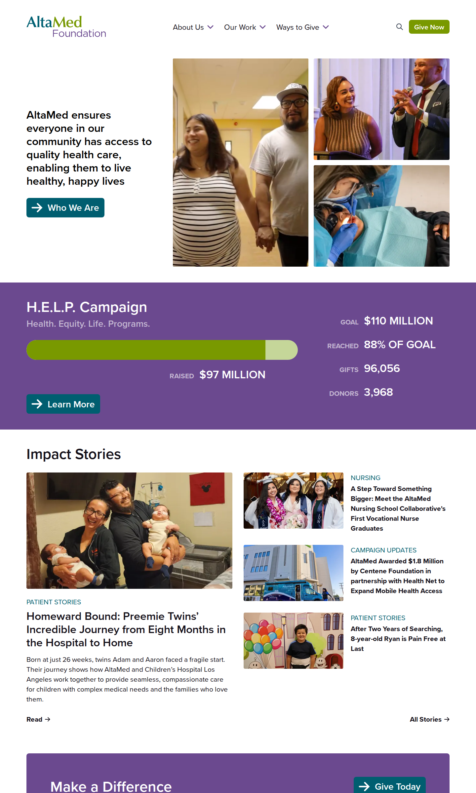
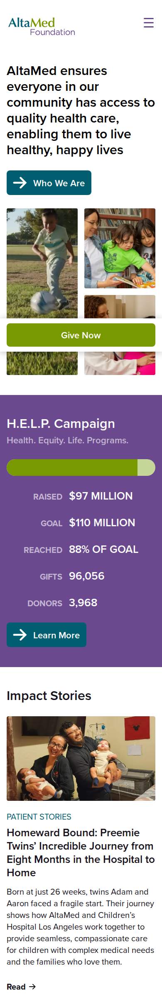

# UI Design System & Master Generation Blueprint: altamedfoundation-org

> **AltaMed Foundation · AltaMed Foundation** (https://altamedfoundation.org/) — AltaMed ensures everyone in our community has access to quality health care, enabling them to live healthy, happy lives.



---

## 1. Executive Visual Persona & Design Archetype

- **Brand Essence & Persona**: **AltaMed Foundation · AltaMed Foundation** (`https://altamedfoundation.org/`). AltaMed ensures everyone in our community has access to quality health care, enabling them to live healthy, happy lives.
- **Capture Provenance**: Live browser capture (`tier1_fast`, HTTP `200`, captured `2026-11-23`).
- **Visual Archetype**: **Light-Substrate Editorial & Modular Grid System (`#ffffff` canvas, `#000000` ink, `#242029` accent)**.
- **Anti-AI-Slop Differentiators**:
  - **Live-Computed Chromatic Polarity**: Anchors the viewport in `#ffffff` (live computed `body` `background-color` (`computed_styles.json`)) paired with `#000000` primary typography and `#242029` accents.
  - **Grounded Typographic Hierarchy**: Pairs `proxima-nova` for display copy (`H.E.L.P. Campaign`) with `proxima-nova` and not declared in live computed styles (uses primary stack / `ui-monospace`).
  - **Calibrated Spatial Grid & Motion**: Combines `96rem` container bounds (`gap: var(--spacing)`, padding `var(--spacing)`) with `cubic-bezier(0,0,.2,1)` easing.

---

## 2. Spatial Architecture & Modular Grid Mathematics



### Viewport Allocation & Container Geometry
- **Captured Viewport Dimensions**: Desktop `1440×2400px` (`assets/desktop.png`, clamped at 2400px live multi-section capture), Mobile `390×2400px` (`assets/mobile.png`, clamped at 2400px live multi-section capture).
- **Master Container Bounds**: `96rem` (non-`@media` desktop container stylesheet rule).
- **Canvas Lateral Padding & Spacing**: `var(--spacing)` lateral canvas padding with `var(--spacing)` grid gap.
- **Border Radius Scale**: `.3125rem`, `.375rem`, `.25rem`, `4px`.

### Responsive Breakpoint Architecture
- **Desktop Layout**: Multi-column CSS Grid / Flexbox layout at `1440px` (`max-width: 96rem`, `gap: var(--spacing)`).
- **Mobile Layout**: Single-column vertical stack at `390px` viewport width with `var(--spacing)` horizontal padding.
- **Extracted CSS Media Queries**: `@media (min-width:40rem)`, `@media (min-width:48rem)`, `@media (min-width:64rem)`, `@media (min-width:80rem)`.

---

## 3. Color System, Materiality & Atmospheric Lighting

### Semantic Palette & Source Grounding
| Semantic Role | Ground-Truth Value | Extracted Live / CSS Source |
|---|---|---|
| **Primary Canvas Substrate** | `#ffffff` | live computed `body` `background-color` (`computed_styles.json`) |
| **Primary Typography Ink** | `#000000` | live computed `p` `color` (`computed_styles.json`) |
| **Elevated Surface / Card Substrate** | `#ffa500` | `.bg-campaign-orange { background-color: orange }` (`#ffa500`) |
| **Interactive Accent / Highlight** | `#242029` | live computed `a` `color` (`computed_styles.json`) |
| **Secondary / Muted Copy** | `#737373` | `var(--muted-foreground)` in `:root` |
| **Structural Hairline Border** | `#e5e5e5` | `var(--border)` in `:root` |
| **Variable Token (`--foreground`)** | `#0a0a0a` | `var(--foreground)` in `:root` |
| **Variable Token (`--primary`)** | `#171717` | `var(--primary)` in `:root` |
| **Variable Token (`--primary-foreground`)** | `#fafafa` | `var(--primary-foreground)` in `:root` |
| **Variable Token (`--secondary`)** | `#f5f5f5` | `var(--secondary)` in `:root` |

### Sanitized Root CSS Variables (`ui-ux.md` Ground Truth)
| Variable Name | Extracted Value | Semantic Role |
|---|---|---|
| `--sticky-cta-height` | `calc(.75rem + 3.5rem + max(.75rem, env(safe-area-inset-bottom)))` | Brand / Palette Token |
| `--radius` | `.5rem` | Elevation / Border Token |
| `--background` | `#fff` | Canvas / Surface Token |
| `--foreground` | `#0a0a0a` | Typography Ink Token |
| `--card` | `#fff` | Color / Atmospheric Token |
| `--card-foreground` | `#0a0a0a` | Typography Ink Token |
| `--popover` | `#fff` | Color / Atmospheric Token |
| `--popover-foreground` | `#0a0a0a` | Typography Ink Token |
| `--primary` | `#171717` | Brand / Palette Token |
| `--primary-foreground` | `#fafafa` | Typography Ink Token |
| `--secondary` | `#f5f5f5` | Brand / Palette Token |
| `--secondary-foreground` | `#171717` | Typography Ink Token |
| `--muted` | `#f5f5f5` | Color / Atmospheric Token |
| `--muted-foreground` | `#737373` | Typography Ink Token |
| `--accent` | `#f5f5f5` | Brand / Palette Token |
| `--accent-foreground` | `#171717` | Typography Ink Token |

---

## 4. Typographic Scale & Editorial Hierarchy

### Font Family Stacks
- **Display Typography**: `proxima-nova`.
- **Primary Body Stack**: `proxima-nova`.
- **Technical / Metadata Stack**: not declared in live computed styles (uses primary stack / `ui-monospace`).

### Typographic Scale & Rules (Live Computed & Stylesheet Grounded)
- **Hero Display (`H1`)**: CSS variables `--text-4xl: 2.25rem`, `--text-4xl--line-height: calc(2.5 / 2.25)`.
- **Section Heading (`H2`)**: live computed `h2` (`font-size: 45px`, `line-height: 50px`, `font-weight: 600`); CSS variables `--text-3xl: 1.875rem`, `--text-3xl--line-height: calc(2.25 / 1.875)`, `--text-title-lg: 34px`.
- **Body Copy**: live computed `body` (`font-size: 20px`, `line-height: 30px`, `font-weight: 400`); CSS variables `--text-base: 1rem`, `--text-base--line-height: calc(1.5 / 1)`, `--font-size-body: 18px`.
- **Metadata & Navigation Labels**: live computed `nav/a` (`font-size: 20px`, `line-height: 30px`, `font-weight: 400`); CSS variables `--text-xs: .75rem`, `--text-xs--line-height: calc(1 / .75)`, `--text-sm: .875rem`.

---

## 5. Choreographed Motion & Interaction Physics

### Primary Easing Curves
- **Extracted Timing Functions**: `cubic-bezier(0,0,.2,1)`, `cubic-bezier(.4,0,.6,1)`, `cubic-bezier(.4,0,.2,1)`.

### Per-Element Transition & Choreography Rules
- **Selector `layer theme`**: `transition: .15s` extracted from `altamedfoundation-org` stylesheet.
- **Selector `.transition`**: `transition: var(--tw-ease,var(--default-transition-timing-function))` extracted from `altamedfoundation-org` stylesheet.
- **Selector `color\]`**: `transition: var(--tw-ease,var(--default-transition-timing-function))` extracted from `altamedfoundation-org` stylesheet.
- **Extracted Easing Curve (`cubic-bezier(0,0,.2,1)`)**: Governs interactive state transitions across `<header.relative>` and `<section.scroll-mt-24>`.
- **State & Hover Choreography**: Opacity and transform transitions on `<section.bg-white>` and `<section.scroll-mt-24>` interactive targets.

---

## 6. Component Wireframe & Structural DOM Map

### Visual Layout Schematic — Desktop (`1440px`, Grounded in `dom.html` & Landmark Bounding Boxes)
```
┌────────────────────────────────────────────────────────────────────────┐
│ DESKTOP VIEWPORT (1440px) — AltaMed Foundation · AltaMed Foundation    │
│ ====================================================================== │
│ [ <header.relative> (1440x129px)      | Overview · Index · Archive · ] │
│ ---------------------------------------------------------------------- │
│ | HERO STAGE: <section.bg-white> (w=1440px)                          | │
│ | H1: H.E.L.P. Campaign                                              | │
│ | Substrate: #ffffff | Ink: #000000 | Accent: #242029                | │
│ ---------------------------------------------------------------------- │
│ | SHOWCASE GRID (<section.scroll-mt-24>) max-w: 96rem                | │
│ | +------------------------------+  +------------------------------+ | │
│ | | Impact Stories               |  | Homeward Bound: Preemie Twin | | │
│ | +------------------------------+  +------------------------------+ | │
│ ---------------------------------------------------------------------- │
│ | DETAIL MODULE (<section.py-12>) — Make a Difference                | │
│ ---------------------------------------------------------------------- │
│ [ FOOTER (<footer.pt-8>       ) | https://altamedfoundation.org/       │
└────────────────────────────────────────────────────────────────────────┘
```

### Visual Layout Schematic — Mobile Reflow (`390px`)
```
┌────────────────────────────────────────────────────────────────────────┐
│ MOBILE VIEWPORT REFLOW (390px) — Single-Column Stack (gap: var(--sp)   │
│ ====================================================================== │
│ [ HEADER BAR (<header.relative>       ) | Compact Menu (390px)         │
│ ---------------------------------------------------------------------- │
│ | HERO STAGE (<section.bg-white>) — 390px Vertical Lead              | │
│ | H1: H.E.L.P. Campaign                                              | │
│ ---------------------------------------------------------------------- │
│ | SHOWCASE STACK (<section.scroll-mt-24>) — 1-Col Stack              | │
│ | [ Item 1: Impact Stories                                         ] | │
│ | [ Item 2: Homeward Bound: Preemie Twins’ Incredible Journey...   ] | │
│ ---------------------------------------------------------------------- │
│ | DETAIL STACK (<section.py-12>) — 1-Col (Make a Difference)         | │
│ ---------------------------------------------------------------------- │
│ [ FOOTER (<footer.pt-8>       ) | Stacked 390px Colophon               │
└────────────────────────────────────────────────────────────────────────┘
```

### Granular DOM Region Breakdown
1. **Brand Header & Navigation Bar (<header.relative> — `altamedfoundation-org`)**:
   - Landmark `<header class="relative z-50">` (`1440x129px`) hosting `AltaMed Foundation · AltaMed Foundat` navigation (`Overview · Index · Archive · About · Contact`), DOM attributes (`data-scroll-behavior="smooth"`, `data-precedence="next"`, `data-href="/_next/static/immutab..."`, `data-nimg="1"`), and stylesheet rule `.tk-proxima-nova { font-family: "proxima-nova",sans-serif; }`.
2. **Hero Stage & Focal Lead (<section.bg-white> — `H.E.L.P. Campaign`)**:
   - Landmark `<section class="bg-white py-12">` presenting display lead `H.E.L.P. Campaign` and copy excerpt *"AltaMed ensures everyone in our community has access to quality h"* over `#ffffff` canvas and `#000000` ink.
3. **Primary Showcase & Content Grid (<section.scroll-mt-24> — `Impact Stories`)**:
   - Landmark `<section class="scroll-mt-24 bg-purple">` rendering section `Impact Stories` with copy *"Health. Equity. Life. Programs."*, asset references (`vdqo9h3n.api.sanity.io`, `altamed-foundation-logo.svg`, `3kc4s5-t1h7ps.js`, `1h6ujiewnnn1_.js`), and grid rule `.tk-gotham-xnarrow { font-family: "gotham-xnarrow",sans-serif; }`.
4. **Interactive Detail & Feature Matrix (<section.py-12> — `Homeward Bound: Preemie Twins’ Inc`)**:
   - Landmark `<section class="scroll-mt-24 bg-white">` framing `Homeward Bound: Preemie Twins’ Incredible Journey...` and `Make a Difference` (*"Learn More about the H.E.L.P. Campaign"*) with `#ffa500` surface cards, `#242029` accents, and `.tk-gotham-narrow { font-family: "gotham-narrow",sans-serif; }`.
5. **Colophon & Global Directory Footer (<footer.pt-8> — `https://altamedfoundation.org/`)**:
   - Landmark `<footer class="pt-8 pb-8">` anchoring `AltaMed Foundation · AltaMed Fou` footer links (`Overview · Index · Archive · About · Contact`), copy *"about the H.E.L.P. Campaign"*, and `#e5e5e5` structural dividers.

---

## 7. Master Zero-Shot AI Generation Prompt

```markdown
# Master Zero-Shot Frontend Generation Prompt: altamedfoundation-org (AltaMed Foundation · AltaMed Foundation)

You are a principal frontend architect and design systems engineer. Build a complete, production-ready web application replicating the exact design system, DOM landmarks, typographic hierarchy, color tokens, and motion physics of `altamedfoundation-org` (**AltaMed Foundation · AltaMed Foundation** — `https://altamedfoundation.org/`).

### 1. Visual Archetype & Anti-AI-Slop Mandates
- **Archetype**: Light-Substrate Editorial & Modular Grid System (`#ffffff` canvas, `#000000` ink, `#242029` accent).
- **Identity & Domain Context**: AltaMed ensures everyone in our community has access to quality health care, enabling them to live healthy, happy lives.
- **Primary Substrate**: `#ffffff` (live computed `body` `background-color` (`computed_styles.json`)), **Primary Ink**: `#000000`, **Accent / Highlight**: `#242029`.
- **Site-Specific Differentiators**:
  - **Live-Computed Chromatic Polarity**: Anchors the viewport in `#ffffff` (live computed `body` `background-color` (`computed_styles.json`)) paired with `#000000` primary typography and `#242029` accents.
  - **Grounded Typographic Hierarchy**: Pairs `proxima-nova` for display copy (`H.E.L.P. Campaign`) with `proxima-nova` and not declared in live computed styles (uses primary stack / `ui-monospace`).
  - **Calibrated Spatial Grid & Motion**: Combines `96rem` container bounds (`gap: var(--spacing)`, padding `var(--spacing)`) with `cubic-bezier(0,0,.2,1)` easing.

### 2. Ground-Truth CSS Variables (`:root` Token Contract)
Declare and consume these exact custom properties extracted from `altamedfoundation-org` in your global stylesheet:

:root {
  /* AltaMed Foundation · AltaMed Foundation (altamedfoundation-org) — Live-Grounded CSS Variables */
  --sticky-cta-height: calc(.75rem + 3.5rem + max(.75rem, env(safe-area-inset-bottom))); /* Brand / Palette Token (altamedfoundation-org) */
  --radius: .5rem; /* Elevation / Border Token (altamedfoundation-org) */
  --background: #fff; /* Canvas / Surface Token (altamedfoundation-org) */
  --foreground: #0a0a0a; /* Typography Ink Token (altamedfoundation-org) */
  --card: #fff; /* Color / Atmospheric Token (altamedfoundation-org) */
  --card-foreground: #0a0a0a; /* Typography Ink Token (altamedfoundation-org) */
  --popover: #fff; /* Color / Atmospheric Token (altamedfoundation-org) */
  --popover-foreground: #0a0a0a; /* Typography Ink Token (altamedfoundation-org) */
  --primary: #171717; /* Brand / Palette Token (altamedfoundation-org) */
  --primary-foreground: #fafafa; /* Typography Ink Token (altamedfoundation-org) */
  --secondary: #f5f5f5; /* Brand / Palette Token (altamedfoundation-org) */
  --secondary-foreground: #171717; /* Typography Ink Token (altamedfoundation-org) */
  --muted: #f5f5f5; /* Color / Atmospheric Token (altamedfoundation-org) */
  --muted-foreground: #737373; /* Typography Ink Token (altamedfoundation-org) */
  --accent: #f5f5f5; /* Brand / Palette Token (altamedfoundation-org) */
  --accent-foreground: #171717; /* Typography Ink Token (altamedfoundation-org) */
}

### 3. Semantic Color & Materiality Contract
Map every surface, ink, and border strictly to these source-grounded tokens:
- **Primary Canvas Substrate**: `#ffffff` — grounded in live computed `body` `background-color` (`computed_styles.json`)
- **Primary Typography Ink**: `#000000` — grounded in live computed `p` `color` (`computed_styles.json`)
- **Elevated Surface / Card Substrate**: `#ffa500` — grounded in `.bg-campaign-orange { background-color: orange }` (`#ffa500`)
- **Interactive Accent / Highlight**: `#242029` — grounded in live computed `a` `color` (`computed_styles.json`)
- **Secondary / Muted Copy**: `#737373` — grounded in `var(--muted-foreground)` in `:root`
- **Structural Hairline Border**: `#e5e5e5` — grounded in `var(--border)` in `:root`
- **Variable Token (`--foreground`)**: `#0a0a0a` — grounded in `var(--foreground)` in `:root`
- **Variable Token (`--primary`)**: `#171717` — grounded in `var(--primary)` in `:root`
- **Variable Token (`--primary-foreground`)**: `#fafafa` — grounded in `var(--primary-foreground)` in `:root`
- **Variable Token (`--secondary`)**: `#f5f5f5` — grounded in `var(--secondary)` in `:root`

### 4. Spatial Grid, Container Bounds & Responsive Breakpoints
- **Desktop Viewport Reference**: `1440×2400px` (clamped at 2400px live multi-section capture, `1440px` standard desktop width).
- **Mobile Viewport Reference**: `390×2400px` (clamped at 2400px live multi-section capture, `390px` standard mobile width).
- **Container Max-Width**: `96rem` (non-`@media` desktop container stylesheet rule)
- **Padding & Gutters**: `var(--spacing)` lateral canvas padding with `var(--spacing)` grid gap
- **Desktop Grid**: Multi-column CSS Grid / Flexbox layout at `1440px` (`max-width: 96rem`, `gap: var(--spacing)`)
- **Mobile Adaptation**: Single-column vertical stack at `390px` viewport width with `var(--spacing)` horizontal padding
- **Media Queries**: `@media (min-width:40rem)`, `@media (min-width:48rem)`, `@media (min-width:64rem)`, `@media (min-width:80rem)`
- **Corner Radii**: `.3125rem`, `.375rem`, `.25rem`, `4px`

### 5. Typography & Editorial Scale Contract
- **Display Font Stack**: `proxima-nova`
- **Body Font Stack**: `proxima-nova`
- **Monospace / Technical Font Stack**: not declared in live computed styles (uses primary stack / `ui-monospace`)
- **H1 Display Rule**: CSS variables `--text-4xl: 2.25rem`, `--text-4xl--line-height: calc(2.5 / 2.25)`
- **H2 Section Rule**: live computed `h2` (`font-size: 45px`, `line-height: 50px`, `font-weight: 600`); CSS variables `--text-3xl: 1.875rem`, `--text-3xl--line-height: calc(2.25 / 1.875)`, `--text-title-lg: 34px`
- **Body Copy Rule**: live computed `body` (`font-size: 20px`, `line-height: 30px`, `font-weight: 400`); CSS variables `--text-base: 1rem`, `--text-base--line-height: calc(1.5 / 1)`, `--font-size-body: 18px`
- **Metadata & Index Rule**: live computed `nav/a` (`font-size: 20px`, `line-height: 30px`, `font-weight: 400`); CSS variables `--text-xs: .75rem`, `--text-xs--line-height: calc(1 / .75)`, `--text-sm: .875rem`

### 6. Component Hierarchy, Verbatim Copy & Real DOM Landmarks
Scaffold `altamedfoundation-org` (`AltaMed Foundation · AltaMed Foundation`) with these exact structural regions, extracted copy, and CSS rules from `dom.html`:
1. **Brand Header & Navigation Bar (<header.relative> — `altamedfoundation-org`)**:
   - DOM & Selectors: Landmark `<header class="relative z-50">` (`1440x129px`) hosting `AltaMed Foundation · AltaMed Foundat` navigation (`Overview · Index · Archive · About · Contact`), DOM attributes (`data-scroll-behavior="smooth"`, `data-precedence="next"`, `data-href="/_next/static/immutab..."`, `data-nimg="1"`), and stylesheet rule `.tk-proxima-nova { font-family: "proxima-nova",sans-serif; }`.
   - Responsive Contract: Header `Brand Header & Navigation Bar (<header.relative> — `altamedfoundation-org`)` (`altamedfoundation-org`) adapts across `@media (min-width:40rem)`, `@media (min-width:48rem)`, `@media (min-width:64rem)`, `@media (min-width:80rem)` with `cubic-bezier(0,0,.2,1)`, `cubic-bezier(.4,0,.6,1)`, `cubic-bezier(.4,0,.2,1)` transitions and links `Overview · Index · Archive · About · Contact`.
2. **Hero Stage & Focal Lead (<section.bg-white> — `H.E.L.P. Campaign`)**:
   - DOM & Selectors: Landmark `<section class="bg-white py-12">` presenting display lead `H.E.L.P. Campaign` and copy excerpt *"AltaMed ensures everyone in our community has access to quality h"* over `#ffffff` canvas and `#000000` ink.
   - Responsive Contract: Hero stage (`1440×2400px` desktop / `390×2400px` mobile) sets `#ffffff` background with `#000000` headline `H.E.L.P. Campaign`.
3. **Primary Showcase & Content Grid (<section.scroll-mt-24> — `Impact Stories`)**:
   - DOM & Selectors: Landmark `<section class="scroll-mt-24 bg-purple">` rendering section `Impact Stories` with copy *"Health. Equity. Life. Programs."*, asset references (`vdqo9h3n.api.sanity.io`, `altamed-foundation-logo.svg`, `3kc4s5-t1h7ps.js`, `1h6ujiewnnn1_.js`), and grid rule `.tk-gotham-xnarrow { font-family: "gotham-xnarrow",sans-serif; }`.
   - Responsive Contract: Showcase grid `Primary Showcase & Content Grid (<section.scroll-mt-24> — `Impact Stories`)` applies Multi-column CSS Grid / Flexbox layout at `1440px` (`max-width: 96rem`, `gap: var(--spacing)`) on desktop and Single-column vertical stack at `390px` viewport width with `var(--spacing)` horizontal padding on mobile.
4. **Interactive Detail & Feature Matrix (<section.py-12> — `Homeward Bound: Preemie Twins’ Inc`)**:
   - DOM & Selectors: Landmark `<section class="scroll-mt-24 bg-white">` framing `Homeward Bound: Preemie Twins’ Incredible Journey...` and `Make a Difference` (*"Learn More about the H.E.L.P. Campaign"*) with `#ffa500` surface cards, `#242029` accents, and `.tk-gotham-narrow { font-family: "gotham-narrow",sans-serif; }`.
   - Responsive Contract: Detail module `Interactive Detail & Feature Matrix (<section.py-12> — `Homeward Bound: Preemie Twins’ Inc`)` uses `.3125rem`, `.375rem`, `.25rem`, `4px` radii, `#242029` highlights, and assets (vdqo9h3n.api.sanity.io, altamed-foundation-logo.svg, 3kc4s5-t1h7ps.js).
5. **Colophon & Global Directory Footer (<footer.pt-8> — `https://altamedfoundation.org/`)**:
   - DOM & Selectors: Landmark `<footer class="pt-8 pb-8">` anchoring `AltaMed Foundation · AltaMed Fou` footer links (`Overview · Index · Archive · About · Contact`), copy *"about the H.E.L.P. Campaign"*, and `#e5e5e5` structural dividers.
   - Responsive Contract: Footer `Colophon & Global Directory Footer (<footer.pt-8> — `https://altamedfoundation.org/`)` aligns to `96rem` (non-`@media` desktop container stylesheet rule) with `var(--spacing)` lateral canvas padding with `var(--spacing)` grid gap and attributes (data-scroll-behavior="smooth", data-precedence="next", data-href="/_next/static/immutab...").

#### Verbatim DOM Copy Excerpts (`dom.html`)
- Copy Excerpt 1: *"AltaMed ensures everyone in our community has access to quality health care, enabl..."*
- Copy Excerpt 2: *"Health. Equity. Life. Programs."*
- Copy Excerpt 3: *"Learn More about the H.E.L.P. Campaign"*
- Copy Excerpt 4: *"about the H.E.L.P. Campaign"*

### 7. Motion, Extracted Stylesheet Rules & Interaction Choreography
- **Primary Easing Functions**: `cubic-bezier(0,0,.2,1)`, `cubic-bezier(.4,0,.6,1)`, `cubic-bezier(.4,0,.2,1)`
- **Extracted Stylesheet Rules (`altamedfoundation-org`)**:
- `.tk-proxima-nova { font-family: "proxima-nova",sans-serif; }`
- `.tk-gotham-xnarrow { font-family: "gotham-xnarrow",sans-serif; }`
- `.tk-gotham-narrow { font-family: "gotham-narrow",sans-serif; }`
- `.tk-gotham-condensed { font-family: "gotham-condensed",sans-serif; }`
- `.tk-gotham { font-family: "gotham",sans-serif; }`
- **Per-Selector Transition Rules**:
- **Selector `layer theme`**: `transition: .15s` extracted from `altamedfoundation-org` stylesheet.
- **Selector `.transition`**: `transition: var(--tw-ease,var(--default-transition-timing-function))` extracted from `altamedfoundation-org` stylesheet.
- **Selector `color\]`**: `transition: var(--tw-ease,var(--default-transition-timing-function))` extracted from `altamedfoundation-org` stylesheet.
- **Extracted Easing Curve (`cubic-bezier(0,0,.2,1)`)**: Governs interactive state transitions across `<header.relative>` and `<section.scroll-mt-24>`.
- **State & Hover Choreography**: Opacity and transform transitions on `<section.bg-white>` and `<section.scroll-mt-24>` interactive targets.

### 8. Technical Deliverables
- Implement in Next.js (App Router) with TypeScript and Tailwind CSS consuming the `:root` custom properties defined above for `altamedfoundation-org`.
- Reproduce both the `1440px` desktop architecture and `390px` mobile breakpoint transitions, preserving semantic HTML5 landmarks (`<header>`, `<nav>`, `<main>`, `<section>`, `<footer>`) and `prefers-reduced-motion` accessibility guards.
```
