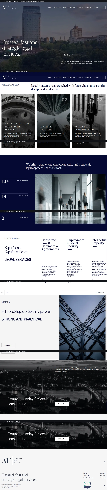
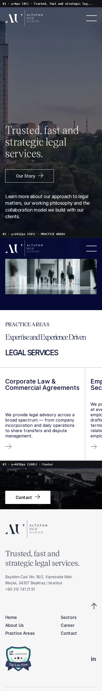

# UI Design System & Master Generation Blueprint: altufanulu-com_en

> **Altufan Ulu Law Office · Istanbul Legal Counsel** (https://altufanulu.com/en/) — Altufan Ulu Law Office provides trusted, fast and strategic legal services in Istanbul. Expert counsel across corporate, employment, IP,...





---

## 1. Executive Visual Persona & Design Archetype

- **Brand Essence & Persona**: **Altufan Ulu Law Office · Istanbul Legal Counsel** (`https://altufanulu.com/en/`). Altufan Ulu Law Office provides trusted, fast and strategic legal services in Istanbul. Expert counsel across corporate, employment, IP,...
- **Capture Provenance**: Live browser capture (`tier1_fast`, HTTP `200`, captured `2026-11-24`).
- **Visual Archetype**: **Light-Substrate Editorial & Modular Grid System (`#ffffff` canvas, `#000000` ink, `#0000ee` accent)**.
- **Anti-AI-Slop Differentiators**:
  - **Live-Computed Chromatic Polarity**: Anchors the viewport in `#ffffff` (live computed `browser-default` `background-color` (`computed_styles.json`)) paired with `#000000` primary typography and `#0000ee` accents.
  - **Grounded Typographic Hierarchy**: Pairs `Victor Serif` for display copy (`Trusted, fast and strategic legal se`) with `Inter`.
  - **Calibrated Spatial Grid & Motion**: Combines `107rem` container bounds (`gap: 1rem`, padding `20px`) with `cubic-bezier(.16,1,.3,1)` easing and Lenis Smooth Scroll (`data-lenis`), GSAP Timeline & ScrollTrigger.

---

## 2. Spatial Architecture & Modular Grid Mathematics

### Viewport Allocation & Container Geometry
- **Captured Journey Filmstrips**: Desktop `1280×5796px` (`assets/desktop-journey.webp`, `7` keyframes up to `y=4717px` / doc `6009px`), Mobile `390×2616px` (`assets/mobile-journey.webp`, `3` keyframes).
- **Master Container Bounds**: `107rem` (non-`@media` desktop container stylesheet rule).
- **Canvas Lateral Padding & Spacing**: `20px` lateral canvas padding with `1rem` grid gap.
- **Border Radius Scale**: `2px`, `50%`, `1px`, `3px`.

### Responsive Breakpoint Architecture
- **Desktop Layout**: Multi-column CSS Grid / Flexbox layout at `1440px` (`max-width: 107rem`, `gap: 1rem`).
- **Mobile Layout**: Single-column vertical stack at `390px` viewport width with `20px` horizontal padding.
- **Extracted CSS Media Queries**: `@media (max-width:1024px)`, `@media (max-width:480px)`, `@media only screen and (max-width:1024px)`, `@media only screen and (max-width:768px)`.

---

## 3. Color System, Materiality & Atmospheric Lighting

### Semantic Palette & Source Grounding
| Semantic Role | Ground-Truth Value | Extracted Live / CSS Source |
|---|---|---|
| **Primary Canvas Substrate** | `#ffffff` | live computed `browser-default` `background-color` (`computed_styles.json`) |
| **Primary Typography Ink** | `#000000` | live computed `main` `color` (`computed_styles.json`) |
| **Elevated Surface / Card Substrate** | `#f6f6f6` | live computed `footer` `background-color` (`computed_styles.json`) |
| **Interactive Accent / Highlight** | `#0000ee` | live computed `a` `color` (`computed_styles.json`) |
| **Secondary / Muted Copy** | `#0000ee` | live computed `a` `color` (`computed_styles.json`) |
| **Structural Hairline Border** | `#edeef1` | `.au-pub-card__author { border-right: #edeef1 }` |
| **Variable Token (`--bg-blue`)** | `#050a34` | `var(--bg-blue)` in `:root` |
| **Variable Token (`--bg-grey`)** | `#f4f4f5` | `var(--bg-grey)` in `:root` |
| **Variable Token (`--bg`)** | `#fdfaf6` | `var(--bg)` in `:root` |
| **Variable Token (`--bg-green-1`)** | `#263a05` | `var(--bg-green-1)` in `:root` |
| **Variable Token (`--bg-green-2`)** | `#003726` | `var(--bg-green-2)` in `:root` |
| **Variable Token (`--swiper-theme-color`)** | `#007aff` | `var(--swiper-theme-color)` in stylesheet |

### Sanitized Root CSS Variables (`ui-ux.md` Ground Truth)
| Variable Name | Extracted Value | Semantic Role |
|---|---|---|
| `--white` | `#fff` | Canvas / Surface Token |
| `--bg-blue` | `#050a34` | Canvas / Surface Token |
| `--bg-grey` | `#f4f4f5` | Canvas / Surface Token |
| `--bg` | `#fdfaf6` | Canvas / Surface Token |
| `--bg-green-1` | `#263a05` | Canvas / Surface Token |
| `--bg-green-2` | `#003726` | Canvas / Surface Token |
| `--swiper-theme-color` | `#007aff` | Brand / Palette Token |
| `--swiper-navigation-size` | `44px` | Layout / Spatial Grid Token |
| `--swiper-preloader-color` | `#fff` | Brand / Palette Token |
| `--altufanulu-com-e-bg` | `#ffffff` | Canvas Substrate (from live computed `browser-default` `background-color` (`computed_styles.json`)) |
| `--altufanulu-com-e-ink` | `#000000` | Primary Typography Ink (computed-derived) |
| `--altufanulu-com-e-surface` | `#f6f6f6` | Surface Substrate (computed-derived) |
| `--altufanulu-com-e-accent` | `#0000ee` | Interactive Accent (computed-derived) |
| `--altufanulu-com-e-muted` | `#0000ee` | Secondary Ink (computed-derived) |
| `--altufanulu-com-e-border` | `#edeef1` | Structural Border (computed-derived) |
| `--altufanulu-com-e-container` | `107rem` | Container Bound (computed-derived) |

---

## 4. Typographic Scale & Editorial Hierarchy

### Font Family Stacks
- **Display Typography**: `Victor Serif`.
- **Primary Body Stack**: `Inter`.
- **Technical / Metadata Stack**: not declared in live computed styles (uses primary stack / `ui-monospace`).

### Typographic Scale & Rules (Live Computed & Stylesheet Grounded)
- **Hero Display (`H1`)**: live computed `h1` (`font-size: 70px`, `line-height: 77px`, `font-weight: 400`); rule `h1` (`font-size: 5rem`, `line-height: 1.1`, `font-weight: 300`).
- **Section Heading (`H2`)**: live computed `h2` (`font-size: 24px`, `line-height: normal`, `font-weight: 500`, `letter-spacing: -0.48px`); rule `h2` (`font-size: 2.4rem`, `letter-spacing: -.02em`, `font-weight: 500`).
- **Body Copy**: live computed `body` (`font-size: 10px`, `line-height: normal`, `font-weight: 400`); rule `p` (`line-height: 1.75`).
- **Metadata & Navigation Labels**: live computed `nav/a` (`font-size: 10px`, `line-height: normal`, `font-weight: 400`); rule `small` (`font-size: 2rem`).

---

## 5. Choreographed Motion & Interaction Physics

### Primary Easing Curves
- **Extracted Timing Functions**: `cubic-bezier(.16,1,.3,1)`.

### Per-Element Transition & Choreography Rules
- **Selector `.au-cc-close`**: `transition: color 0.2s` extracted from `altufanulu-com_en` stylesheet.
- **Selector `.au-cc-btn`**: `transition: background 0.2s,color 0.2s,border-color 0.2s` extracted from `altufanulu-com_en` stylesheet.
- **Selector `.au-cc-trigger`**: `transition: transform 0.2s,box-shadow 0.2s` extracted from `altufanulu-com_en` stylesheet.
- **Extracted Easing Curve (`cubic-bezier(.16,1,.3,1)`)**: Governs interactive state transitions across `<header.lenis>` and `<section.padding>`.
- **Runtime Interaction Engine**: Integrates Lenis Smooth Scroll (`data-lenis`), GSAP Timeline & ScrollTrigger, Swiper Touch Carousel Engine, Barba.js Page Transition Router with `prefers-reduced-motion: reduce` fallback guards.
### Measured Runtime Scroll & Interaction Telemetry (`behavioral_journey_v2`)
- **Scroll Driver Mode**: `native` (max document height `6009px`, deepest scrollY reached `4717px` across `7` desktop keyframes).
- **Detected Scroll / Motion Libraries**: `Lenis`, `GSAP/ScrollTrigger`.
- **Hover Physics (`primary_cta` · `Our Story`)**: `backgroundColor`: `rgba(0, 0, 0, 0)` -> `rgba(5, 10, 52, 0.96)`; `borderColor`: `rgb(245, 240, 232)` -> `rgb(14, 19, 59)` (`transition-duration: 0.4s`, `timing: ease`).
- **Interactive Control Probe (`carousel_next`)**: Tested `Next slide` (diff `1.874`).
- **Route Transition Architecture**: First internal navigation (`/en/about/`) measured as `direct` in `5774ms`.

---

## 6. Component Wireframe & Structural DOM Map

### Visual Layout Schematic — Desktop (`1440px`, Grounded in `dom.html` & Landmark Bounding Boxes)
```
┌────────────────────────────────────────────────────────────────────────┐
│ DESKTOP VIEWPORT (1440px) — Altufan Ulu Law Office · Istanbul Legal Co │
│ ====================================================================== │
│ [ <header.lenis> (1440x130px)         | HOME · ABOUT US · PRACTICE A ] │
│ ---------------------------------------------------------------------- │
│ | HERO STAGE: <section.hero-content> (w=1440px)                      | │
│ | H1: Trusted, fast and strategic legal services.                    | │
│ | Substrate: #ffffff | Ink: #000000 | Accent: #0000ee                | │
│ ---------------------------------------------------------------------- │
│ | SHOWCASE GRID (<section.padding>) max-w: 107rem                    | │
│ | +------------------------------+  +------------------------------+ | │
│ | | WHY ALTUFAN ULU?             |  | BOUTIQUE STRUCTURE, INDEPEND | | │
│ | +------------------------------+  +------------------------------+ | │
│ ---------------------------------------------------------------------- │
│ | DETAIL MODULE (<section.padding:nth(2)>) — STRATEGIC SOLUTIONS     | │
│ ---------------------------------------------------------------------- │
│ [ FOOTER (<footer.page-templat) | https://altufanulu.com/en/           │
└────────────────────────────────────────────────────────────────────────┘
```

### Visual Layout Schematic — Mobile Reflow (`390px`)
```
┌────────────────────────────────────────────────────────────────────────┐
│ MOBILE VIEWPORT REFLOW (390px) — Single-Column Stack (gap: 1rem)       │
│ ====================================================================== │
│ [ HEADER BAR (<header.lenis>          ) | Compact Menu (390px)         │
│ ---------------------------------------------------------------------- │
│ | HERO STAGE (<section.hero-content>) — 390px Vertical Lead          | │
│ | H1: Trusted, fast and strategic legal services.                    | │
│ ---------------------------------------------------------------------- │
│ | SHOWCASE STACK (<section.padding>) — 1-Col Stack                   | │
│ | [ Item 1: WHY ALTUFAN ULU?                                       ] | │
│ | [ Item 2: BOUTIQUE STRUCTURE, INDEPENDENT APPROACH               ] | │
│ ---------------------------------------------------------------------- │
│ | DETAIL STACK (<section.padding:nth(2)>) — 1-Col (STRATEGIC SOLUTION) │
│ ---------------------------------------------------------------------- │
│ [ FOOTER (<footer.page-templat) | Stacked 390px Colophon               │
└────────────────────────────────────────────────────────────────────────┘
```

### Granular DOM Region Breakdown
1. **Brand Header & Navigation Bar (<header.lenis> — `altufanulu-com_en`)**:
   - Landmark `<header class="lenis">` (`1440x130px`) hosting `Altufan Ulu Law Office · Istanbul Le` navigation (`HOME · ABOUT US · PRACTICE AREAS · SECTORS · CAREER`), DOM attributes (`data-optimized="1"`, `data-optimized="1"`, `data-no-transition`, `data-barba="wrapper"`), and stylesheet rule `root { font-size:10px!important }`.
2. **Hero Stage & Focal Lead (<section.hero-content> — `Trusted, fast and strategic legal `)**:
   - Landmark `<section class="hero-content">` presenting display lead `Trusted, fast and strategic legal services.` and copy excerpt *"We give every case the focus it deserves. When needed, we bring t"* over `#ffffff` canvas and `#000000` ink.
3. **Primary Showcase & Content Grid (<section.padding> — `WHY ALTUFAN ULU?`)**:
   - Landmark `<section class="padding">` rendering section `WHY ALTUFAN ULU?` with copy *"Learn more about our approach to legal matters, our working philo"*, asset references (`apple-touch-icon.png`, `favicon-32x32.png`, `favicon-16x16.png`, `site.webmanifest`), and grid rule `pre { margin:0;padding:0 }`.
4. **Interactive Detail & Feature Matrix (<section.padding:nth(2)> — `BOUTIQUE STRUCTURE, INDEPENDENT AP`)**:
   - Landmark `<section class="padding">` framing `BOUTIQUE STRUCTURE, INDEPENDENT APPROACH` and `STRATEGIC SOLUTIONS` (*"Legal matters are approached with foresight, analysis and a disci"*) with `#f6f6f6` surface cards, `#0000ee` accents, and `img { max-width:100%;height:auto }`.
5. **Colophon & Global Directory Footer (<footer.page-template-page-en-home> — `https://altufanulu.com/en/`)**:
   - Landmark `<footer class="page-template-page-en-home">` anchoring `Altufan Ulu Law Office · Istanbu` footer links (`HOME · ABOUT US · PRACTICE AREAS · SECTORS · CAREER`), copy *"01 BOUTIQUE STRUCTURE, INDEPENDENT APPROACH We give every ca"*, and `#edeef1` structural dividers.
### Full Vertical Scroll Sequence (Desktop `1440×900` Keyframes)
- **Step 01** (`y=0px`, `0%`): Active landmark `Trusted, fast and strategic legal services.` · sticky/fixed elements: `1`
- **Step 02** (`y=850px`, `18%`): Active landmark `WHY ALTUFAN ULU?` · sticky/fixed elements: `1`
- **Step 03** (`y=1700px`, `35%`): Active landmark `Section @ 35%` · sticky/fixed elements: `1`
- **Step 04** (`y=2550px`, `50%`): Active landmark `PRACTICE AREAS` · sticky/fixed elements: `0`
- **Step 05** (`y=3400px`, `67%`): Active landmark `SECTORS` · sticky/fixed elements: `0`
- **Step 06** (`y=4250px`, `86%`): Active landmark `Section @ 86%` · sticky/fixed elements: `0`
- **Step 07** (`y=4717px`, `95%`): Active landmark `Footer` · sticky/fixed elements: `0`

### Multi-Page Internal Route Map
- **Detail Route (`/en/about/`)**: `https://altufanulu.com/en/about/` — H1: `About Altufan Ulu Law Office – OUR FOUNDER`, scrollHeight `6239px`, transition `direct` (`5774ms`)
- **Detail Route (`/en/practice-areas/`)**: `https://altufanulu.com/en/practice-areas/` — H1: `Practice Areas`, scrollHeight `3192px`, transition `direct` (`3102ms`)
- **Detail Route (`/en/sectors/`)**: `https://altufanulu.com/en/sectors/` — H1: `SECTORS WE SERVE`, scrollHeight `2746px`, transition `direct` (`2529ms`)

---

## 7. Master Zero-Shot AI Generation Prompt

```markdown
# Master Zero-Shot Frontend Generation Prompt: altufanulu-com_en (Altufan Ulu Law Office · Istanbul Legal Counsel)

You are a principal frontend architect and design systems engineer. Build a complete, production-ready web application replicating the exact design system, DOM landmarks, typographic hierarchy, color tokens, and motion physics of `altufanulu-com_en` (**Altufan Ulu Law Office · Istanbul Legal Counsel** — `https://altufanulu.com/en/`).

### 1. Visual Archetype & Anti-AI-Slop Mandates
- **Archetype**: Light-Substrate Editorial & Modular Grid System (`#ffffff` canvas, `#000000` ink, `#0000ee` accent).
- **Identity & Domain Context**: Altufan Ulu Law Office provides trusted, fast and strategic legal services in Istanbul. Expert counsel across corporate, employment, IP,...
- **Primary Substrate**: `#ffffff` (live computed `browser-default` `background-color` (`computed_styles.json`)), **Primary Ink**: `#000000`, **Accent / Highlight**: `#0000ee`.
- **Site-Specific Differentiators**:
  - **Live-Computed Chromatic Polarity**: Anchors the viewport in `#ffffff` (live computed `browser-default` `background-color` (`computed_styles.json`)) paired with `#000000` primary typography and `#0000ee` accents.
  - **Grounded Typographic Hierarchy**: Pairs `Victor Serif` for display copy (`Trusted, fast and strategic legal se`) with `Inter`.
  - **Calibrated Spatial Grid & Motion**: Combines `107rem` container bounds (`gap: 1rem`, padding `20px`) with `cubic-bezier(.16,1,.3,1)` easing and Lenis Smooth Scroll (`data-lenis`), GSAP Timeline & ScrollTrigger.

### 2. Ground-Truth CSS Variables (`:root` Token Contract)
Declare and consume these exact custom properties extracted from `altufanulu-com_en` in your global stylesheet:

:root {
  /* Altufan Ulu Law Office · Istanbul Legal Counsel (altufanulu-com_en) — Live-Grounded CSS Variables */
  --white: #fff; /* Canvas / Surface Token (altufanulu-com_en) */
  --bg-blue: #050a34; /* Canvas / Surface Token (altufanulu-com_en) */
  --bg-grey: #f4f4f5; /* Canvas / Surface Token (altufanulu-com_en) */
  --bg: #fdfaf6; /* Canvas / Surface Token (altufanulu-com_en) */
  --bg-green-1: #263a05; /* Canvas / Surface Token (altufanulu-com_en) */
  --bg-green-2: #003726; /* Canvas / Surface Token (altufanulu-com_en) */
  --swiper-theme-color: #007aff; /* Brand / Palette Token (altufanulu-com_en) */
  --swiper-navigation-size: 44px; /* Layout / Spatial Grid Token (altufanulu-com_en) */
  --swiper-preloader-color: #fff; /* Brand / Palette Token (altufanulu-com_en) */
  --altufanulu-com-e-bg: #ffffff; /* Canvas Substrate (from live computed `browser-default` `background-color` (`computed_styles.json`)) (altufanulu-com_en) */
  --altufanulu-com-e-ink: #000000; /* Primary Typography Ink (computed-derived) (altufanulu-com_en) */
  --altufanulu-com-e-surface: #f6f6f6; /* Surface Substrate (computed-derived) (altufanulu-com_en) */
  --altufanulu-com-e-accent: #0000ee; /* Interactive Accent (computed-derived) (altufanulu-com_en) */
  --altufanulu-com-e-muted: #0000ee; /* Secondary Ink (computed-derived) (altufanulu-com_en) */
  --altufanulu-com-e-border: #edeef1; /* Structural Border (computed-derived) (altufanulu-com_en) */
  --altufanulu-com-e-container: 107rem; /* Container Bound (computed-derived) (altufanulu-com_en) */
}

### 3. Semantic Color & Materiality Contract
Map every surface, ink, and border strictly to these source-grounded tokens:
- **Primary Canvas Substrate**: `#ffffff` — grounded in live computed `browser-default` `background-color` (`computed_styles.json`)
- **Primary Typography Ink**: `#000000` — grounded in live computed `main` `color` (`computed_styles.json`)
- **Elevated Surface / Card Substrate**: `#f6f6f6` — grounded in live computed `footer` `background-color` (`computed_styles.json`)
- **Interactive Accent / Highlight**: `#0000ee` — grounded in live computed `a` `color` (`computed_styles.json`)
- **Secondary / Muted Copy**: `#0000ee` — grounded in live computed `a` `color` (`computed_styles.json`)
- **Structural Hairline Border**: `#edeef1` — grounded in `.au-pub-card__author { border-right: #edeef1 }`
- **Variable Token (`--bg-blue`)**: `#050a34` — grounded in `var(--bg-blue)` in `:root`
- **Variable Token (`--bg-grey`)**: `#f4f4f5` — grounded in `var(--bg-grey)` in `:root`
- **Variable Token (`--bg`)**: `#fdfaf6` — grounded in `var(--bg)` in `:root`
- **Variable Token (`--bg-green-1`)**: `#263a05` — grounded in `var(--bg-green-1)` in `:root`
- **Variable Token (`--bg-green-2`)**: `#003726` — grounded in `var(--bg-green-2)` in `:root`
- **Variable Token (`--swiper-theme-color`)**: `#007aff` — grounded in `var(--swiper-theme-color)` in stylesheet

### 4. Spatial Grid, Container Bounds & Responsive Breakpoints
- **Desktop Viewport Reference**: `1280×5796px` (multi-frame vertical journey filmstrip (5796px), `1440px` standard desktop width).
- **Mobile Viewport Reference**: `390×2616px` (multi-frame vertical journey filmstrip (2616px), `390px` standard mobile width).
- **Container Max-Width**: `107rem` (non-`@media` desktop container stylesheet rule)
- **Padding & Gutters**: `20px` lateral canvas padding with `1rem` grid gap
- **Desktop Grid**: Multi-column CSS Grid / Flexbox layout at `1440px` (`max-width: 107rem`, `gap: 1rem`)
- **Mobile Adaptation**: Single-column vertical stack at `390px` viewport width with `20px` horizontal padding
- **Media Queries**: `@media (max-width:1024px)`, `@media (max-width:480px)`, `@media only screen and (max-width:1024px)`, `@media only screen and (max-width:768px)`
- **Corner Radii**: `2px`, `50%`, `1px`, `3px`

### 5. Typography & Editorial Scale Contract
- **Display Font Stack**: `Victor Serif`
- **Body Font Stack**: `Inter`
- **Monospace / Technical Font Stack**: not declared in live computed styles (uses primary stack / `ui-monospace`)
- **H1 Display Rule**: live computed `h1` (`font-size: 70px`, `line-height: 77px`, `font-weight: 400`); rule `h1` (`font-size: 5rem`, `line-height: 1.1`, `font-weight: 300`)
- **H2 Section Rule**: live computed `h2` (`font-size: 24px`, `line-height: normal`, `font-weight: 500`, `letter-spacing: -0.48px`); rule `h2` (`font-size: 2.4rem`, `letter-spacing: -.02em`, `font-weight: 500`)
- **Body Copy Rule**: live computed `body` (`font-size: 10px`, `line-height: normal`, `font-weight: 400`); rule `p` (`line-height: 1.75`)
- **Metadata & Index Rule**: live computed `nav/a` (`font-size: 10px`, `line-height: normal`, `font-weight: 400`); rule `small` (`font-size: 2rem`)

### 6. Component Hierarchy, Verbatim Copy & Real DOM Landmarks
Scaffold `altufanulu-com_en` (`Altufan Ulu Law Office · Istanbul Legal Counsel`) with these exact structural regions, extracted copy, and CSS rules from `dom.html`:
1. **Brand Header & Navigation Bar (<header.lenis> — `altufanulu-com_en`)**:
   - DOM & Selectors: Landmark `<header class="lenis">` (`1440x130px`) hosting `Altufan Ulu Law Office · Istanbul Le` navigation (`HOME · ABOUT US · PRACTICE AREAS · SECTORS · CAREER`), DOM attributes (`data-optimized="1"`, `data-optimized="1"`, `data-no-transition`, `data-barba="wrapper"`), and stylesheet rule `root { font-size:10px!important }`.
   - Responsive Contract: Header `Brand Header & Navigation Bar (<header.lenis> — `altufanulu-com_en`)` (`altufanulu-com_en`) adapts across `@media (max-width:1024px)`, `@media (max-width:480px)`, `@media only screen and (max-width:1024px)`, `@media only screen and (max-width:768px)` with `cubic-bezier(.16,1,.3,1)` transitions and links `HOME · ABOUT US · PRACTICE AREAS · SECTORS · CAREER`.
2. **Hero Stage & Focal Lead (<section.hero-content> — `Trusted, fast and strategic legal `)**:
   - DOM & Selectors: Landmark `<section class="hero-content">` presenting display lead `Trusted, fast and strategic legal services.` and copy excerpt *"We give every case the focus it deserves. When needed, we bring t"* over `#ffffff` canvas and `#000000` ink.
   - Responsive Contract: Hero stage (`1280×5796px` desktop / `390×2616px` mobile) sets `#ffffff` background with `#000000` headline `Trusted, fast and strategic legal services.`.
3. **Primary Showcase & Content Grid (<section.padding> — `WHY ALTUFAN ULU?`)**:
   - DOM & Selectors: Landmark `<section class="padding">` rendering section `WHY ALTUFAN ULU?` with copy *"Learn more about our approach to legal matters, our working philo"*, asset references (`apple-touch-icon.png`, `favicon-32x32.png`, `favicon-16x16.png`, `site.webmanifest`), and grid rule `pre { margin:0;padding:0 }`.
   - Responsive Contract: Showcase grid `Primary Showcase & Content Grid (<section.padding> — `WHY ALTUFAN ULU?`)` applies Multi-column CSS Grid / Flexbox layout at `1440px` (`max-width: 107rem`, `gap: 1rem`) on desktop and Single-column vertical stack at `390px` viewport width with `20px` horizontal padding on mobile.
4. **Interactive Detail & Feature Matrix (<section.padding:nth(2)> — `BOUTIQUE STRUCTURE, INDEPENDENT AP`)**:
   - DOM & Selectors: Landmark `<section class="padding">` framing `BOUTIQUE STRUCTURE, INDEPENDENT APPROACH` and `STRATEGIC SOLUTIONS` (*"Legal matters are approached with foresight, analysis and a disci"*) with `#f6f6f6` surface cards, `#0000ee` accents, and `img { max-width:100%;height:auto }`.
   - Responsive Contract: Detail module `Interactive Detail & Feature Matrix (<section.padding:nth(2)> — `BOUTIQUE STRUCTURE, INDEPENDENT AP`)` uses `2px`, `50%`, `1px`, `3px` radii, `#0000ee` highlights, and assets (apple-touch-icon.png, favicon-32x32.png, favicon-16x16.png).
5. **Colophon & Global Directory Footer (<footer.page-template-page-en-home> — `https://altufanulu.com/en/`)**:
   - DOM & Selectors: Landmark `<footer class="page-template-page-en-home">` anchoring `Altufan Ulu Law Office · Istanbu` footer links (`HOME · ABOUT US · PRACTICE AREAS · SECTORS · CAREER`), copy *"01 BOUTIQUE STRUCTURE, INDEPENDENT APPROACH We give every ca"*, and `#edeef1` structural dividers.
   - Responsive Contract: Footer `Colophon & Global Directory Footer (<footer.page-template-page-en-home> — `https://altufanulu.com/en/`)` aligns to `107rem` (non-`@media` desktop container stylesheet rule) with `20px` lateral canvas padding with `1rem` grid gap and attributes (data-optimized="1", data-optimized="1", data-no-transition).

#### Verbatim DOM Copy Excerpts (`dom.html`)
- Copy Excerpt 1: *"We give every case the focus it deserves. When needed, we bring together the right..."*
- Copy Excerpt 2: *"Learn more about our approach to legal matters, our working philosophy and the col..."*
- Copy Excerpt 3: *"Legal matters are approached with foresight, analysis and a disciplined work ethic."*
- Copy Excerpt 4: *"01 BOUTIQUE STRUCTURE, INDEPENDENT APPROACH We give every case the focus it deserv..."*

### 7. Motion, Extracted Stylesheet Rules & Interaction Choreography
- **Primary Easing Functions**: `cubic-bezier(.16,1,.3,1)`
- **Extracted Stylesheet Rules (`altufanulu-com_en`)**:
- `root { font-size:10px!important }`
- `pre { margin:0;padding:0 }`
- `img { max-width:100%;height:auto }`
- `.custom-headline figure { position:relative }`
- `.custom-headline figure::after { content:'';position:absolute;inset:0;background:rgb(5 10 52 / .15);point... }`
- **Per-Selector Transition Rules**:
- **Selector `.au-cc-close`**: `transition: color 0.2s` extracted from `altufanulu-com_en` stylesheet.
- **Selector `.au-cc-btn`**: `transition: background 0.2s,color 0.2s,border-color 0.2s` extracted from `altufanulu-com_en` stylesheet.
- **Selector `.au-cc-trigger`**: `transition: transform 0.2s,box-shadow 0.2s` extracted from `altufanulu-com_en` stylesheet.
- **Extracted Easing Curve (`cubic-bezier(.16,1,.3,1)`)**: Governs interactive state transitions across `<header.lenis>` and `<section.padding>`.
- **Runtime Interaction Engine**: Integrates Lenis Smooth Scroll (`data-lenis`), GSAP Timeline & ScrollTrigger, Swiper Touch Carousel Engine, Barba.js Page Transition Router with `prefers-reduced-motion: reduce` fallback guards.
### 7b. Full-Page Scroll Choreography, Interactive States & Multi-Page Routes
- **Scroll Mechanics**: Implement `native` vertical progression up to `6009px` across 7 distinct viewport chapters using Lenis, GSAP/ScrollTrigger.
- **Vertical Chapter Sequence**: Trusted, fast and strategic... (0%) -> WHY ALTUFAN ULU? (18%) -> Section @ 35% (35%) -> PRACTICE AREAS (50%) -> SECTORS (67%) -> Section @ 86% (86%) -> Footer (95%).
- **Hover Micro-Interaction (`primary_cta`)**: Animate `backgroundColor, borderColor` with `0.4s ease`.
- **Multi-Page Routes**: Scaffold internal routes `/en/about/` (detail, direct), `/en/practice-areas/` (detail, direct), `/en/sectors/` (detail, direct) sharing the global header/footer shell and design tokens.

### 8. Technical Deliverables
- Implement in Next.js (App Router) with TypeScript and Tailwind CSS consuming the `:root` custom properties defined above for `altufanulu-com_en`.
- Reproduce both the `1440px` desktop architecture and `390px` mobile breakpoint transitions, preserving semantic HTML5 landmarks (`<header>`, `<nav>`, `<main>`, `<section>`, `<footer>`) and `prefers-reduced-motion` accessibility guards.
```
---

## 8. Full-Page Scroll Journey, Interactive States & Subpage Inventory

### Desktop Scroll Keyframes (`1440×900` WebP)
| Step | Scroll Y | Progress | Active Landmark / Section | Sticky/Fixed | Visual Asset |
| :---: | :---: | :---: | :--- | :---: | :--- |
| `#01` | `0px` | `0%` | Trusted, fast and strategic legal services. | `1` | [desktop-step-01.webp](assets/desktop-step-01.webp) |
| `#02` | `850px` | `18%` | WHY ALTUFAN ULU? | `1` | [desktop-step-02.webp](assets/desktop-step-02.webp) |
| `#03` | `1700px` | `35%` | Section @ 35% | `1` | [desktop-step-03.webp](assets/desktop-step-03.webp) |
| `#04` | `2550px` | `50%` | PRACTICE AREAS | `0` | [desktop-step-04.webp](assets/desktop-step-04.webp) |
| `#05` | `3400px` | `67%` | SECTORS | `0` | [desktop-step-05.webp](assets/desktop-step-05.webp) |
| `#06` | `4250px` | `86%` | Section @ 86% | `0` | [desktop-step-06.webp](assets/desktop-step-06.webp) |
| `#07` | `4717px` | `95%` | Footer | `0` | [desktop-step-07.webp](assets/desktop-step-07.webp) |

### Mobile Condensed Keyframes (`390×844` WebP)
| Step | Scroll Y | Progress | Active Landmark | Visual Asset |
| :---: | :---: | :---: | :--- | :--- |
| `#01` | `0px` | `0%` | Trusted, fast and strategic legal services. | [mobile-step-01.webp](assets/mobile-step-01.webp) |
| `#02` | `2012px` | `50%` | PRACTICE AREAS | [mobile-step-02.webp](assets/mobile-step-02.webp) |
| `#03` | `4039px` | `100%` | Footer | [mobile-step-03.webp](assets/mobile-step-03.webp) |

### Internal Subpage Filmstrips (`1080px` Wide WebP)
| # | Template | Route URL | H1 / Title | Scroll Height | Transition | Filmstrip Asset |
| :-: | :---: | :--- | :--- | :---: | :---: | :--- |
| `1` | `detail` | `https://altufanulu.com/en/about/` | About Altufan Ulu Law Office – OUR FO... | `6239px` | `direct` (`5774ms`) | [subpage-01-en-about.webp](assets/subpage-01-en-about.webp) |
| `2` | `detail` | `https://altufanulu.com/en/practice-areas/` | Practice Areas | `3192px` | `direct` (`3102ms`) | [subpage-02-en-practice-areas.webp](assets/subpage-02-en-practice-areas.webp) |
| `3` | `detail` | `https://altufanulu.com/en/sectors/` | SECTORS WE SERVE | `2746px` | `direct` (`2529ms`) | [subpage-03-en-sectors.webp](assets/subpage-03-en-sectors.webp) |

