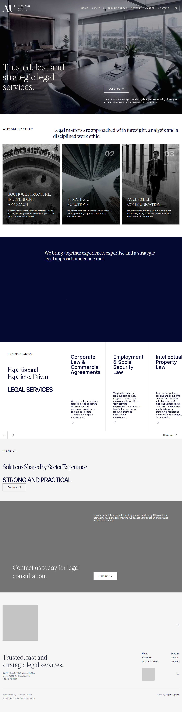
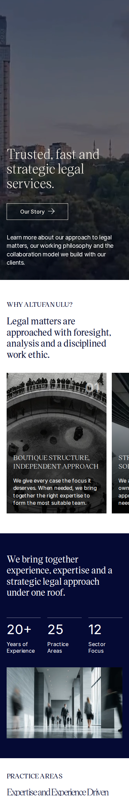

# UI Design System & Master Generation Blueprint: altufanulu-com_en

> **Altufan Ulu Law Office · Istanbul Legal Counsel** (https://altufanulu.com/en/) — Altufan Ulu Law Office provides trusted, fast and strategic legal services in Istanbul. Expert counsel across corporate, employment, IP,...



---

## 1. Executive Visual Persona & Design Archetype

- **Brand Essence & Persona**: **Altufan Ulu Law Office · Istanbul Legal Counsel** (`https://altufanulu.com/en/`). Altufan Ulu Law Office provides trusted, fast and strategic legal services in Istanbul. Expert counsel across corporate, employment, IP,...
- **Visual Archetype**: **Light-Substrate Editorial & Modular Grid System (`#fff` canvas, `#050a34` ink, `#fdfaf6` accent)**.
- **Anti-AI-Slop Differentiators**:
  - **Source-Grounded Chromatic Polarity**: Anchors the viewport in `#fff` (`var(--white)` in `:root`) paired with `#050a34` primary typography and `#fdfaf6` accents.
  - **Extracted Typographic Hierarchy**: Pairs `Inter` for display copy (`Trusted, fast and strategic legal se`) with `Victor Serif` and not declared in static CSS (uses primary stack / `ui-monospace`).
  - **Calibrated Spatial Grid & Motion**: Combines `1024px` container bounds (`gap: 1rem`, padding `2rem`) with `cubic-bezier(.16,1,.3,1)` easing and Lenis Smooth Scroll (`data-lenis`), GSAP Timeline & ScrollTrigger.

---

## 2. Spatial Architecture & Modular Grid Mathematics



### Viewport Allocation & Container Geometry
- **Captured Viewport Dimensions**: Desktop `1440×5617px` (`assets/desktop.png`, full-page scroll capture), Mobile `390×2400px` (`assets/mobile.png`, capped at 2400px multi-section capture).
- **Master Container Bounds**: `1024px` extracted from `altufanulu-com_en` stylesheet.
- **Canvas Lateral Padding & Spacing**: `2rem` lateral canvas padding with `1rem` grid gap.
- **Border Radius Scale**: `2px`, `50%`, `1px`, `3px`.

### Responsive Breakpoint Architecture
- **Desktop Layout**: Multi-column CSS Grid / Flexbox layout at `1440px` (`max-width: 1024px`, `gap: 1rem`).
- **Mobile Layout**: Single-column vertical stack at `390px` viewport width with `2rem` horizontal padding.
- **Extracted CSS Media Queries**: `@media (max-width:1024px)`, `@media (max-width:480px)`, `@media only screen and (max-width:1024px)`, `@media only screen and (max-width:768px)`.

---

## 3. Color System, Materiality & Atmospheric Lighting

### Semantic Palette & Source Grounding
| Semantic Role | Ground-Truth Value | Extracted CSS Source / Selector |
|---|---|---|
| **Primary Canvas Substrate** | `#fff` | `var(--white)` in `:root` |
| **Primary Typography Ink** | `#050a34` | `var(--bg-blue)` in `:root` |
| **Elevated Surface / Card Substrate** | `#f4f4f5` | `var(--bg-grey)` in `:root` |
| **Interactive Accent / Highlight** | `#fdfaf6` | `var(--bg)` in `:root` |
| **Secondary / Muted Copy** | `#263a05` | `var(--bg-green-1)` in `:root` |
| **Structural Hairline Border** | `#003726` | `var(--bg-green-2)` in `:root` |
| **Variable Token (`--swiper-theme-color`)** | `#007aff` | `var(--swiper-theme-color)` in stylesheet |

### Sanitized Root CSS Variables (`ui-ux.md` Ground Truth)
| Variable Name | Extracted Value | Semantic Role |
|---|---|---|
| `--white` | `#fff` | Canvas / Surface Token |
| `--bg-blue` | `#050a34` | Canvas / Surface Token |
| `--bg-grey` | `#f4f4f5` | Canvas / Surface Token |
| `--bg` | `#fdfaf6` | Canvas / Surface Token |
| `--bg-green-1` | `#263a05` | Canvas / Surface Token |
| `--bg-green-2` | `#003726` | Canvas / Surface Token |
| `--swiper-theme-color` | `#007aff` | Brand / Palette Token |
| `--swiper-navigation-size` | `44px` | Layout / Spatial Grid Token |
| `--swiper-preloader-color` | `#fff` | Brand / Palette Token |
| `--altufanulu-com-e-bg` | `#fff` | Canvas Substrate (from `var(--white)` in `:root`) |
| `--altufanulu-com-e-ink` | `#050a34` | Primary Typography Ink (stylesheet-derived) |
| `--altufanulu-com-e-surface` | `#f4f4f5` | Surface Substrate (stylesheet-derived) |
| `--altufanulu-com-e-accent` | `#fdfaf6` | Interactive Accent (stylesheet-derived) |
| `--altufanulu-com-e-muted` | `#263a05` | Secondary Ink (stylesheet-derived) |
| `--altufanulu-com-e-border` | `#003726` | Structural Border (stylesheet-derived) |
| `--altufanulu-com-e-container` | `1024px` | Container Bound (stylesheet-derived) |

---

## 4. Typographic Scale & Editorial Hierarchy

### Font Family Stacks
- **Display Typography**: `Inter`.
- **Primary Body Stack**: `Victor Serif`.
- **Technical / Metadata Stack**: not declared in static CSS (uses primary stack / `ui-monospace`).

### Typographic Scale & Rules (Extracted from Stylesheet & Variables)
- **Hero Display (`H1`)**: rule `h1` (`font-size: 5rem`, `line-height: 1.1`, `font-weight: 300`).
- **Section Heading (`H2`)**: rule `h2` (`font-size: 2.4rem`, `letter-spacing: -.02em`, `font-weight: 500`).
- **Body Copy**: rule `p` (`line-height: 1.75!important`).
- **Metadata & Navigation Labels**: rule `small` (`font-size: 2rem`).

---

## 5. Choreographed Motion & Interaction Physics

### Primary Easing Curves
- **Extracted Timing Functions**: `cubic-bezier(.16,1,.3,1)`.

### Per-Element Transition & Choreography Rules
- **Selector `.au-cc-close`**: `transition: color 0.2s` extracted from `altufanulu-com_en` stylesheet.
- **Selector `.au-cc-btn`**: `transition: background 0.2s,color 0.2s,border-color 0.2s` extracted from `altufanulu-com_en` stylesheet.
- **Selector `.au-cc-trigger`**: `transition: transform 0.2s,box-shadow 0.2s` extracted from `altufanulu-com_en` stylesheet.
- **Extracted Easing Curve (`cubic-bezier(.16,1,.3,1)`)**: Governs interactive state transitions across `<header.lenis>` and `<section.padding>`.
- **Runtime Interaction Engine**: Integrates Lenis Smooth Scroll (`data-lenis`), GSAP Timeline & ScrollTrigger, Swiper Touch Carousel Engine, Barba.js Page Transition Router with `prefers-reduced-motion: reduce` fallback guards.

---

## 6. Component Wireframe & Structural DOM Map

### Visual Layout Schematic (Grounded in `dom.html` — `1440px` Desktop & `390px` Mobile Reflow)
```
┌────────────────────────────────────────────────────────────────────────┐
│ DESKTOP VIEWPORT (1440px) — Altufan Ulu Law Office · Istanbul Legal Co │
│ ====================================================================== │
│ [ <header.lenis>           | HOME · ABOUT US · PRACTICE AREAS · SEC ]  │
│ ---------------------------------------------------------------------- │
│ | HERO STAGE: <section.hero-content>                               |   │
│ | H1: Trusted, fast and strategic legal services.                  |   │
│ | Substrate: #fff       | Ink: #050a34    | Accent: #fdfaf6        |   │
│ ---------------------------------------------------------------------- │
│ | SHOWCASE GRID (<section.padding>         ) max-w: 1024px         |   │
│ | +------------------------------+  +------------------------------+ | │
│ | | WHY ALTUFAN ULU?             |  | BOUTIQUE STRUCTURE, INDEPEND | | │
│ | +------------------------------+  +------------------------------+ | │
│ ---------------------------------------------------------------------- │
│ | MOBILE VIEWPORT REFLOW (390px) — Single-Column Stack (gap: 1rem  ) | │
│ | [<header.lenis>] -> [<section.hero-cont] -> [<section.padding>] |    │
│ ---------------------------------------------------------------------- │
│ [ FOOTER (<footer.page-template-) | https://altufanulu.com/en/         │
└────────────────────────────────────────────────────────────────────────┘
```

### Granular DOM Region Breakdown
1. **Brand Header & Navigation Bar (<header.lenis> — `altufanulu-com_en`)**:
   - Landmark `<header class="lenis">` hosting `Altufan Ulu Law Office · Istanbul Le` navigation (`HOME · ABOUT US · PRACTICE AREAS · SECTORS · CAREER`), DOM attributes (`data-optimized="1"`, `data-optimized="1"`, `data-no-transition`, `data-barba="wrapper"`), and stylesheet rule `root { font-size:10px!important }`.
2. **Hero Stage & Focal Lead (<section.hero-content> — `Trusted, fast and strategic legal `)**:
   - Landmark `<section class="hero-content">` presenting display lead `Trusted, fast and strategic legal services.` and copy excerpt *"Learn more about our approach to legal matters, our working philo"* over `#fff` canvas and `#050a34` ink.
3. **Primary Showcase & Content Grid (<section.padding> — `WHY ALTUFAN ULU?`)**:
   - Landmark `<section class="padding">` rendering section `WHY ALTUFAN ULU?` with copy *"Legal matters are approached with foresight, analysis and a disci"*, asset references (`apple-touch-icon.png`, `favicon-32x32.png`, `favicon-16x16.png`, `site.webmanifest`), and grid rule `pre { margin:0;padding:0 }`.
4. **Interactive Detail & Feature Matrix (<section.padding> — `BOUTIQUE STRUCTURE, INDEPENDENT AP`)**:
   - Landmark `<section class="padding">` framing `BOUTIQUE STRUCTURE, INDEPENDENT APPROACH` and `STRATEGIC SOLUTIONS` (*"01 BOUTIQUE STRUCTURE, INDEPENDENT APPROACH We give every case th"*) with `#f4f4f5` surface cards, `#fdfaf6` accents, and `img { max-width:100%;height:auto }`.
5. **Colophon & Global Directory Footer (<footer.page-template-page-en-home> — `https://altufanulu.com/en/`)**:
   - Landmark `<footer class="page-template-page-en-home">` anchoring `Altufan Ulu Law Office · Istanbu` footer links (`HOME · ABOUT US · PRACTICE AREAS · SECTORS · CAREER`), copy *"We give every case the focus it deserves. When needed, we br"*, and `#003726` structural dividers.

---

## 7. Master Zero-Shot AI Generation Prompt

```markdown
# Master Zero-Shot Frontend Generation Prompt: altufanulu-com_en (Altufan Ulu Law Office · Istanbul Legal Counsel)

You are a principal frontend architect and design systems engineer. Build a complete, production-ready web application replicating the exact design system, DOM landmarks, typographic hierarchy, color tokens, and motion physics of `altufanulu-com_en` (**Altufan Ulu Law Office · Istanbul Legal Counsel** — `https://altufanulu.com/en/`).

### 1. Visual Archetype & Anti-AI-Slop Mandates
- **Archetype**: Light-Substrate Editorial & Modular Grid System (`#fff` canvas, `#050a34` ink, `#fdfaf6` accent).
- **Identity & Domain Context**: Altufan Ulu Law Office provides trusted, fast and strategic legal services in Istanbul. Expert counsel across corporate, employment, IP,...
- **Primary Substrate**: `#fff` (`var(--white)` in `:root`), **Primary Ink**: `#050a34`, **Accent / Highlight**: `#fdfaf6`.
- **Site-Specific Differentiators**:
  - **Source-Grounded Chromatic Polarity**: Anchors the viewport in `#fff` (`var(--white)` in `:root`) paired with `#050a34` primary typography and `#fdfaf6` accents.
  - **Extracted Typographic Hierarchy**: Pairs `Inter` for display copy (`Trusted, fast and strategic legal se`) with `Victor Serif` and not declared in static CSS (uses primary stack / `ui-monospace`).
  - **Calibrated Spatial Grid & Motion**: Combines `1024px` container bounds (`gap: 1rem`, padding `2rem`) with `cubic-bezier(.16,1,.3,1)` easing and Lenis Smooth Scroll (`data-lenis`), GSAP Timeline & ScrollTrigger.

### 2. Ground-Truth CSS Variables (`:root` Token Contract)
Declare and consume these exact custom properties extracted from `altufanulu-com_en` in your global stylesheet:

:root {
  /* Altufan Ulu Law Office · Istanbul Legal Counsel (altufanulu-com_en) — Ground-Truth Extracted CSS Variables */
  --white: #fff; /* Canvas / Surface Token (altufanulu-com_en) */
  --bg-blue: #050a34; /* Canvas / Surface Token (altufanulu-com_en) */
  --bg-grey: #f4f4f5; /* Canvas / Surface Token (altufanulu-com_en) */
  --bg: #fdfaf6; /* Canvas / Surface Token (altufanulu-com_en) */
  --bg-green-1: #263a05; /* Canvas / Surface Token (altufanulu-com_en) */
  --bg-green-2: #003726; /* Canvas / Surface Token (altufanulu-com_en) */
  --swiper-theme-color: #007aff; /* Brand / Palette Token (altufanulu-com_en) */
  --swiper-navigation-size: 44px; /* Layout / Spatial Grid Token (altufanulu-com_en) */
  --swiper-preloader-color: #fff; /* Brand / Palette Token (altufanulu-com_en) */
  --altufanulu-com-e-bg: #fff; /* Canvas Substrate (from `var(--white)` in `:root`) (altufanulu-com_en) */
  --altufanulu-com-e-ink: #050a34; /* Primary Typography Ink (stylesheet-derived) (altufanulu-com_en) */
  --altufanulu-com-e-surface: #f4f4f5; /* Surface Substrate (stylesheet-derived) (altufanulu-com_en) */
  --altufanulu-com-e-accent: #fdfaf6; /* Interactive Accent (stylesheet-derived) (altufanulu-com_en) */
  --altufanulu-com-e-muted: #263a05; /* Secondary Ink (stylesheet-derived) (altufanulu-com_en) */
  --altufanulu-com-e-border: #003726; /* Structural Border (stylesheet-derived) (altufanulu-com_en) */
  --altufanulu-com-e-container: 1024px; /* Container Bound (stylesheet-derived) (altufanulu-com_en) */
}

### 3. Semantic Color & Materiality Contract
Map every surface, ink, and border strictly to these source-grounded tokens:
- **Primary Canvas Substrate**: `#fff` — grounded in `var(--white)` in `:root`
- **Primary Typography Ink**: `#050a34` — grounded in `var(--bg-blue)` in `:root`
- **Elevated Surface / Card Substrate**: `#f4f4f5` — grounded in `var(--bg-grey)` in `:root`
- **Interactive Accent / Highlight**: `#fdfaf6` — grounded in `var(--bg)` in `:root`
- **Secondary / Muted Copy**: `#263a05` — grounded in `var(--bg-green-1)` in `:root`
- **Structural Hairline Border**: `#003726` — grounded in `var(--bg-green-2)` in `:root`
- **Variable Token (`--swiper-theme-color`)**: `#007aff` — grounded in `var(--swiper-theme-color)` in stylesheet

### 4. Spatial Grid, Container Bounds & Responsive Breakpoints
- **Desktop Viewport Reference**: `1440×5617px` (full-page scroll capture, `1440px` standard desktop width).
- **Mobile Viewport Reference**: `390×2400px` (capped at 2400px multi-section capture, `390px` standard mobile width).
- **Container Max-Width**: `1024px` extracted from `altufanulu-com_en` stylesheet
- **Padding & Gutters**: `2rem` lateral canvas padding with `1rem` grid gap
- **Desktop Grid**: Multi-column CSS Grid / Flexbox layout at `1440px` (`max-width: 1024px`, `gap: 1rem`)
- **Mobile Adaptation**: Single-column vertical stack at `390px` viewport width with `2rem` horizontal padding
- **Media Queries**: `@media (max-width:1024px)`, `@media (max-width:480px)`, `@media only screen and (max-width:1024px)`, `@media only screen and (max-width:768px)`
- **Corner Radii**: `2px`, `50%`, `1px`, `3px`

### 5. Typography & Editorial Scale Contract
- **Display Font Stack**: `Inter`
- **Body Font Stack**: `Victor Serif`
- **Monospace / Technical Font Stack**: not declared in static CSS (uses primary stack / `ui-monospace`)
- **H1 Display Rule**: rule `h1` (`font-size: 5rem`, `line-height: 1.1`, `font-weight: 300`)
- **H2 Section Rule**: rule `h2` (`font-size: 2.4rem`, `letter-spacing: -.02em`, `font-weight: 500`)
- **Body Copy Rule**: rule `p` (`line-height: 1.75!important`)
- **Metadata & Index Rule**: rule `small` (`font-size: 2rem`)

### 6. Component Hierarchy, Verbatim Copy & Real DOM Landmarks
Scaffold `altufanulu-com_en` (`Altufan Ulu Law Office · Istanbul Legal Counsel`) with these exact structural regions, extracted copy, and CSS rules from `dom.html`:
1. **Brand Header & Navigation Bar (<header.lenis> — `altufanulu-com_en`)**:
   - DOM & Selectors: Landmark `<header class="lenis">` hosting `Altufan Ulu Law Office · Istanbul Le` navigation (`HOME · ABOUT US · PRACTICE AREAS · SECTORS · CAREER`), DOM attributes (`data-optimized="1"`, `data-optimized="1"`, `data-no-transition`, `data-barba="wrapper"`), and stylesheet rule `root { font-size:10px!important }`.
   - Responsive Contract: Header `Brand Header & Navigation Bar (<header.lenis> — `altufanulu-com_en`)` (`altufanulu-com_en`) adapts across `@media (max-width:1024px)`, `@media (max-width:480px)`, `@media only screen and (max-width:1024px)`, `@media only screen and (max-width:768px)` with `cubic-bezier(.16,1,.3,1)` transitions and links `HOME · ABOUT US · PRACTICE AREAS · SECTORS · CAREER`.
2. **Hero Stage & Focal Lead (<section.hero-content> — `Trusted, fast and strategic legal `)**:
   - DOM & Selectors: Landmark `<section class="hero-content">` presenting display lead `Trusted, fast and strategic legal services.` and copy excerpt *"Learn more about our approach to legal matters, our working philo"* over `#fff` canvas and `#050a34` ink.
   - Responsive Contract: Hero stage (`1440×5617px` desktop / `390×2400px` mobile) sets `#fff` background with `#050a34` headline `Trusted, fast and strategic legal services.`.
3. **Primary Showcase & Content Grid (<section.padding> — `WHY ALTUFAN ULU?`)**:
   - DOM & Selectors: Landmark `<section class="padding">` rendering section `WHY ALTUFAN ULU?` with copy *"Legal matters are approached with foresight, analysis and a disci"*, asset references (`apple-touch-icon.png`, `favicon-32x32.png`, `favicon-16x16.png`, `site.webmanifest`), and grid rule `pre { margin:0;padding:0 }`.
   - Responsive Contract: Showcase grid `Primary Showcase & Content Grid (<section.padding> — `WHY ALTUFAN ULU?`)` applies Multi-column CSS Grid / Flexbox layout at `1440px` (`max-width: 1024px`, `gap: 1rem`) on desktop and Single-column vertical stack at `390px` viewport width with `2rem` horizontal padding on mobile.
4. **Interactive Detail & Feature Matrix (<section.padding> — `BOUTIQUE STRUCTURE, INDEPENDENT AP`)**:
   - DOM & Selectors: Landmark `<section class="padding">` framing `BOUTIQUE STRUCTURE, INDEPENDENT APPROACH` and `STRATEGIC SOLUTIONS` (*"01 BOUTIQUE STRUCTURE, INDEPENDENT APPROACH We give every case th"*) with `#f4f4f5` surface cards, `#fdfaf6` accents, and `img { max-width:100%;height:auto }`.
   - Responsive Contract: Detail module `Interactive Detail & Feature Matrix (<section.padding> — `BOUTIQUE STRUCTURE, INDEPENDENT AP`)` uses `2px`, `50%`, `1px`, `3px` radii, `#fdfaf6` highlights, and assets (apple-touch-icon.png, favicon-32x32.png, favicon-16x16.png).
5. **Colophon & Global Directory Footer (<footer.page-template-page-en-home> — `https://altufanulu.com/en/`)**:
   - DOM & Selectors: Landmark `<footer class="page-template-page-en-home">` anchoring `Altufan Ulu Law Office · Istanbu` footer links (`HOME · ABOUT US · PRACTICE AREAS · SECTORS · CAREER`), copy *"We give every case the focus it deserves. When needed, we br"*, and `#003726` structural dividers.
   - Responsive Contract: Footer `Colophon & Global Directory Footer (<footer.page-template-page-en-home> — `https://altufanulu.com/en/`)` aligns to `1024px` extracted from `altufanulu-com_en` stylesheet with `2rem` lateral canvas padding with `1rem` grid gap and attributes (data-optimized="1", data-optimized="1", data-no-transition).

#### Verbatim DOM Copy Excerpts (`dom.html`)
- Copy Excerpt 1: *"Learn more about our approach to legal matters, our working philosophy and the col..."*
- Copy Excerpt 2: *"Legal matters are approached with foresight, analysis and a disciplined work ethic."*
- Copy Excerpt 3: *"01 BOUTIQUE STRUCTURE, INDEPENDENT APPROACH We give every case the focus it deserv..."*
- Copy Excerpt 4: *"We give every case the focus it deserves. When needed, we bring together the right..."*

### 7. Motion, Extracted Stylesheet Rules & Interaction Choreography
- **Primary Easing Functions**: `cubic-bezier(.16,1,.3,1)`
- **Extracted Stylesheet Rules (`altufanulu-com_en`)**:
- `root { font-size:10px!important }`
- `pre { margin:0;padding:0 }`
- `img { max-width:100%;height:auto }`
- `.custom-headline figure { position:relative }`
- `.custom-headline figure::after { content:'';position:absolute;inset:0;background:rgb(5 10 52 / .15);point... }`
- **Per-Selector Transition Rules**:
- **Selector `.au-cc-close`**: `transition: color 0.2s` extracted from `altufanulu-com_en` stylesheet.
- **Selector `.au-cc-btn`**: `transition: background 0.2s,color 0.2s,border-color 0.2s` extracted from `altufanulu-com_en` stylesheet.
- **Selector `.au-cc-trigger`**: `transition: transform 0.2s,box-shadow 0.2s` extracted from `altufanulu-com_en` stylesheet.
- **Extracted Easing Curve (`cubic-bezier(.16,1,.3,1)`)**: Governs interactive state transitions across `<header.lenis>` and `<section.padding>`.
- **Runtime Interaction Engine**: Integrates Lenis Smooth Scroll (`data-lenis`), GSAP Timeline & ScrollTrigger, Swiper Touch Carousel Engine, Barba.js Page Transition Router with `prefers-reduced-motion: reduce` fallback guards.

### 8. Technical Deliverables
- Implement in Next.js (App Router) with TypeScript and Tailwind CSS consuming the `:root` custom properties defined above for `altufanulu-com_en`.
- Reproduce both the `1440px` desktop architecture and `390px` mobile breakpoint transitions, preserving semantic HTML5 landmarks (`<header>`, `<nav>`, `<main>`, `<section>`, `<footer>`) and `prefers-reduced-motion` accessibility guards.
```
