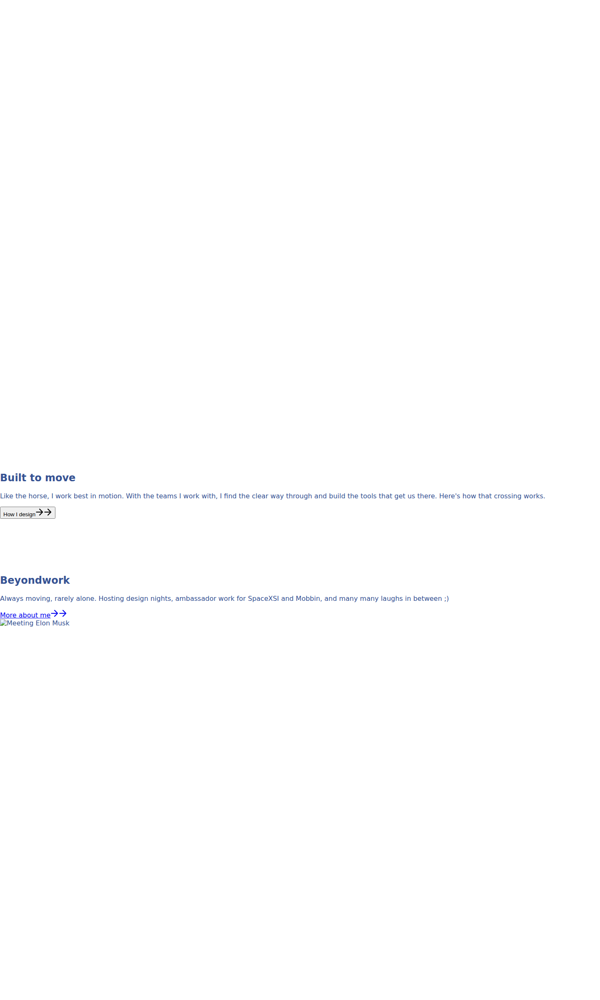
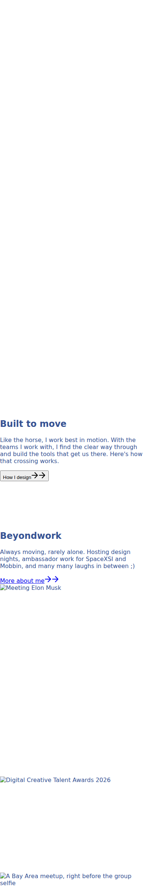

# UI Design System & Master Generation Blueprint: andreas-vision

> **Andreas Kruszakin, growth-focused design engineer in Europe** (https://andreas.vision) — I'm Andreas, a growth-focused design engineer who is design first and builds the system underneath. I make founders' products easy to get...



---

## 1. Executive Visual Persona & Design Archetype

- **Brand Essence & Persona**: **Andreas Kruszakin, growth-focused design engineer in Europe** (`https://andreas.vision`). I'm Andreas, a growth-focused design engineer who is design first and builds the system underneath. I make founders' products easy to get...
- **Visual Archetype**: **Light-Gallery WebGL / Canvas Interactive Experience (`#fff` / `#000000`)**.
- **Anti-AI-Slop Differentiators**:
  - **Source-Grounded Chromatic Polarity**: Anchors the viewport in `#fff` (`html { background: #fff }`) paired with `#000000` primary typography and `#000000` accents.
  - **Extracted Typographic Hierarchy**: Pairs `Geist Variable` for display copy (`Designer who ships with vision Desig`) with `Geist Mono Variable` and `Geist Mono Variable`.
  - **Calibrated Spatial Grid & Motion**: Combines `none (full-bleed `100%` viewport stage)` container bounds (`gap: 0px (flush layout)`, padding `0px`) with `cubic-bezier(0.25,0.1,0.25,1)` easing and Lenis Smooth Scroll (`data-lenis`), Three.js / WebGL Canvas Pipeline.

---

## 2. Spatial Architecture & Modular Grid Mathematics



### Viewport Allocation & Container Geometry
- **Captured Viewport Dimensions**: Desktop `1440×2400px` (`assets/desktop.png`, capped at 2400px multi-section capture), Mobile `390×2400px` (`assets/mobile.png`, capped at 2400px multi-section capture).
- **Master Container Bounds**: `none (full-bleed `100%` viewport stage)` extracted from `andreas-vision` stylesheet.
- **Canvas Lateral Padding & Spacing**: `0px` lateral canvas padding with `0px (flush layout)` grid gap.
- **Border Radius Scale**: `0px` (sharp unrounded corners).

### Responsive Breakpoint Architecture
- **Desktop Layout**: Multi-column CSS Grid / Flexbox layout at `1440px` (`max-width: none (full-bleed `100%` viewport stage)`, `gap: 0px (flush layout)`).
- **Mobile Layout**: Single-column vertical stack at `390px` viewport width with `0px` horizontal padding.
- **Extracted CSS Media Queries**: no `@media` queries in static stylesheet (fluid viewport scaling).

---

## 3. Color System, Materiality & Atmospheric Lighting

### Semantic Palette & Source Grounding
| Semantic Role | Ground-Truth Value | Extracted CSS Source / Selector |
|---|---|---|
| **Primary Canvas Substrate** | `#fff` | `html { background: #fff }` |
| **Primary Typography Ink** | `#000000` | `body` default contrast ink (`#000000`) |

### Sanitized Root CSS Variables (`ui-ux.md` Ground Truth)
| Variable Name | Extracted Value | Semantic Role |
|---|---|---|
| `--font-sans` | `"Geist Variable", -apple-system, system-ui, sans-serif` | Typography / Scale Token |
| `--font-brand` | `"Geist Variable", -apple-system, system-ui, sans-serif` | Brand / Palette Token |
| `--font-brand-serif` | `"Newsreader Variable", Georgia, serif` | Brand / Palette Token |
| `--font-brand-mono` | `"Geist Mono Variable", ui-monospace, monospace` | Brand / Palette Token |
| `--font-site` | `"Geist Variable", -apple-system, system-ui, sans-serif` | Typography / Scale Token |
| `--font-site-highlight` | `"TRJN DaVinci", "Newsreader Variable", Georgia, serif` | Canvas / Surface Token |
| `--screens` | `1.8` | Design System Custom Token |
| `--peek` | `80px` | Dimension / Scale Token |
| `--word` | `500ms` | Motion / Timing Token |
| `--stagger` | `70ms` | Motion / Timing Token |
| `--delay` | `120ms` | Motion / Easing Token |
| `--out` | `0` | Design System Custom Token |
| `--bio` | `1` | Design System Custom Token |
| `--radius` | `28px` | Elevation / Border Token |
| `--tile-radius` | `16px` | Elevation / Border Token |
| `--tile-aspect` | `1.5` | Design System Custom Token |

---

## 4. Typographic Scale & Editorial Hierarchy

### Font Family Stacks
- **Display Typography**: `Geist Variable`.
- **Primary Body Stack**: `Geist Mono Variable`.
- **Technical / Metadata Stack**: `Geist Mono Variable`.

### Typographic Scale & Rules (Extracted from Stylesheet & Variables)
- **Hero Display (`H1`)**: not extracted from static CSS (sized via runtime/utility classes).
- **Section Heading (`H2`)**: not extracted from static CSS (sized via runtime/utility classes).
- **Body Copy**: not extracted from static CSS (sized via runtime/utility classes).
- **Metadata & Navigation Labels**: CSS variables `--font-brand-mono: "Geist Mono Variable", ui-monospace, monospace`, `--label-color: var(--palette-b60)`, `--labels: 0`.

---

## 5. Choreographed Motion & Interaction Physics

### Primary Easing Curves
- **Extracted Timing Functions**: `cubic-bezier(0.25,0.1,0.25,1)`.

### Per-Element Transition & Choreography Rules
- **Selector `style]`**: `transition: none` extracted from `andreas-vision` stylesheet.
- **Standard CSS Easing (`cubic-bezier(0.25,0.1,0.25,1)`)**: Default timing curve (no custom `cubic-bezier()` declared in static CSS).
- **Runtime Interaction Engine**: Integrates Lenis Smooth Scroll (`data-lenis`), Three.js / WebGL Canvas Pipeline with `prefers-reduced-motion: reduce` fallback guards.

---

## 6. Component Wireframe & Structural DOM Map

### Visual Layout Schematic (Grounded in `dom.html` — `1440px` Desktop & `390px` Mobile Reflow)
```
┌────────────────────────────────────────────────────────────────────────┐
│ DESKTOP VIEWPORT (1440px) — Andreas Kruszakin, growth-focused design e │
│ ====================================================================== │
│ [ <header.top>             | Overview · Index · Archive · About · C ]  │
│ ---------------------------------------------------------------------- │
│ | HERO STAGE: <section.e5sioty0>                                   |   │
│ | H1: Designer who ships with vision Design Engineer wh...         |   │
│ | Substrate: #fff       | Ink: #000000    | Accent: #000000        |   │
│ ---------------------------------------------------------------------- │
│ | SHOWCASE GRID (<section.swap>            ) max-w: none (full-ble |   │
│ | +------------------------------+  +------------------------------+ | │
│ | | Work                         |  | Built to move                | | │
│ | +------------------------------+  +------------------------------+ | │
│ ---------------------------------------------------------------------- │
│ | MOBILE VIEWPORT REFLOW (390px) — Single-Column Stack (gap: 0px (f) | │
│ | [<header.top>] -> [<section.e5sioty0>] -> [<section.swap>] |         │
│ ---------------------------------------------------------------------- │
│ [ FOOTER (<footer.css-za9d9j>   ) | https://andreas.vision             │
└────────────────────────────────────────────────────────────────────────┘
```

### Granular DOM Region Breakdown
1. **Brand Header & Navigation Bar (<header.top> — `andreas-vision`)**:
   - Landmark `<header class="top">` hosting `Andreas Kruszakin, growth-focused de` navigation (`Overview · Index · Archive · About · Contact`), DOM attributes (`data-selection-ink`, `data-emotion="css-global"`, `data-s`, `data-emotion="css-global"`), and stylesheet rule `root { height: 100%; margin: 0; }`.
2. **Hero Stage & Focal Lead (<section.e5sioty0> — `Designer who ships with vision Des`)**:
   - Landmark `<section class="e5sioty0 css-8jf4oe">` presenting display lead `Designer who ships with vision Design Engineer wh...` and copy excerpt *"Designer who ships with vision"* over `#fff` canvas and `#000000` ink.
3. **Primary Showcase & Content Grid (<section.swap> — `Work`)**:
   - Landmark `<section class="swap css-1eowax1">` rendering section `Work` with copy *"Design Engineer who ships growth"*, asset references (`llms.txt`, `icon-192.png`, `favicon.ico`, `favicon.svg`), and grid rule `html { background: fff; }`.
4. **Interactive Detail & Feature Matrix (<section.swap> — `Built to move`)**:
   - Landmark `<section class="swap css-1yyyvev">` framing `Built to move` and `Beyond work` (*"I'm Andreas, making precise, joyful interfaces and the tools to b"*) with `#fff` surface cards, `#000000` accents, and `header { border-color: #000000; }`.
5. **Colophon & Global Directory Footer (<footer.css-za9d9j> — `https://andreas.vision`)**:
   - Landmark `<footer class="css-za9d9j e154gxt60">` anchoring `Andreas Kruszakin, growth-focuse` footer links (`Overview · Index · Archive · About · Contact`), copy *"Cheval Inbox Canvas Arrange Share 2. Inbox: crit and variant"*, and `#000000` structural dividers.

---

## 7. Master Zero-Shot AI Generation Prompt

```markdown
# Master Zero-Shot Frontend Generation Prompt: andreas-vision (Andreas Kruszakin, growth-focused design engineer in Europe)

You are a principal frontend architect and design systems engineer. Build a complete, production-ready web application replicating the exact design system, DOM landmarks, typographic hierarchy, color tokens, and motion physics of `andreas-vision` (**Andreas Kruszakin, growth-focused design engineer in Europe** — `https://andreas.vision`).

### 1. Visual Archetype & Anti-AI-Slop Mandates
- **Archetype**: Light-Gallery WebGL / Canvas Interactive Experience (`#fff` / `#000000`).
- **Identity & Domain Context**: I'm Andreas, a growth-focused design engineer who is design first and builds the system underneath. I make founders' products easy to get...
- **Primary Substrate**: `#fff` (`html { background: #fff }`), **Primary Ink**: `#000000`, **Accent / Highlight**: `#000000`.
- **Site-Specific Differentiators**:
  - **Source-Grounded Chromatic Polarity**: Anchors the viewport in `#fff` (`html { background: #fff }`) paired with `#000000` primary typography and `#000000` accents.
  - **Extracted Typographic Hierarchy**: Pairs `Geist Variable` for display copy (`Designer who ships with vision Desig`) with `Geist Mono Variable` and `Geist Mono Variable`.
  - **Calibrated Spatial Grid & Motion**: Combines `none (full-bleed `100%` viewport stage)` container bounds (`gap: 0px (flush layout)`, padding `0px`) with `cubic-bezier(0.25,0.1,0.25,1)` easing and Lenis Smooth Scroll (`data-lenis`), Three.js / WebGL Canvas Pipeline.

### 2. Ground-Truth CSS Variables (`:root` Token Contract)
Declare and consume these exact custom properties extracted from `andreas-vision` in your global stylesheet:

:root {
  /* Andreas Kruszakin, growth-focused design engineer in Europe (andreas-vision) — Ground-Truth Extracted CSS Variables */
  --font-sans: "Geist Variable", -apple-system, system-ui, sans-serif; /* Typography / Scale Token (andreas-vision) */
  --font-brand: "Geist Variable", -apple-system, system-ui, sans-serif; /* Brand / Palette Token (andreas-vision) */
  --font-brand-serif: "Newsreader Variable", Georgia, serif; /* Brand / Palette Token (andreas-vision) */
  --font-brand-mono: "Geist Mono Variable", ui-monospace, monospace; /* Brand / Palette Token (andreas-vision) */
  --font-site: "Geist Variable", -apple-system, system-ui, sans-serif; /* Typography / Scale Token (andreas-vision) */
  --font-site-highlight: "TRJN DaVinci", "Newsreader Variable", Georgia, serif; /* Canvas / Surface Token (andreas-vision) */
  --screens: 1.8; /* Design System Custom Token (andreas-vision) */
  --peek: 80px; /* Dimension / Scale Token (andreas-vision) */
  --word: 500ms; /* Motion / Timing Token (andreas-vision) */
  --stagger: 70ms; /* Motion / Timing Token (andreas-vision) */
  --delay: 120ms; /* Motion / Easing Token (andreas-vision) */
  --out: 0; /* Design System Custom Token (andreas-vision) */
  --bio: 1; /* Design System Custom Token (andreas-vision) */
  --radius: 28px; /* Elevation / Border Token (andreas-vision) */
  --tile-radius: 16px; /* Elevation / Border Token (andreas-vision) */
  --tile-aspect: 1.5; /* Design System Custom Token (andreas-vision) */
}

### 3. Semantic Color & Materiality Contract
Map every surface, ink, and border strictly to these source-grounded tokens:
- **Primary Canvas Substrate**: `#fff` — grounded in `html { background: #fff }`
- **Primary Typography Ink**: `#000000` — grounded in `body` default contrast ink (`#000000`)

### 4. Spatial Grid, Container Bounds & Responsive Breakpoints
- **Desktop Viewport Reference**: `1440×2400px` (capped at 2400px multi-section capture, `1440px` standard desktop width).
- **Mobile Viewport Reference**: `390×2400px` (capped at 2400px multi-section capture, `390px` standard mobile width).
- **Container Max-Width**: `none (full-bleed `100%` viewport stage)` extracted from `andreas-vision` stylesheet
- **Padding & Gutters**: `0px` lateral canvas padding with `0px (flush layout)` grid gap
- **Desktop Grid**: Multi-column CSS Grid / Flexbox layout at `1440px` (`max-width: none (full-bleed `100%` viewport stage)`, `gap: 0px (flush layout)`)
- **Mobile Adaptation**: Single-column vertical stack at `390px` viewport width with `0px` horizontal padding
- **Media Queries**: no `@media` queries in static stylesheet (fluid viewport scaling)
- **Corner Radii**: `0px` (sharp unrounded corners)

### 5. Typography & Editorial Scale Contract
- **Display Font Stack**: `Geist Variable`
- **Body Font Stack**: `Geist Mono Variable`
- **Monospace / Technical Font Stack**: `Geist Mono Variable`
- **H1 Display Rule**: not extracted from static CSS (sized via runtime/utility classes)
- **H2 Section Rule**: not extracted from static CSS (sized via runtime/utility classes)
- **Body Copy Rule**: not extracted from static CSS (sized via runtime/utility classes)
- **Metadata & Index Rule**: CSS variables `--font-brand-mono: "Geist Mono Variable", ui-monospace, monospace`, `--label-color: var(--palette-b60)`, `--labels: 0`

### 6. Component Hierarchy, Verbatim Copy & Real DOM Landmarks
Scaffold `andreas-vision` (`Andreas Kruszakin, growth-focused design engineer in Europe`) with these exact structural regions, extracted copy, and CSS rules from `dom.html`:
1. **Brand Header & Navigation Bar (<header.top> — `andreas-vision`)**:
   - DOM & Selectors: Landmark `<header class="top">` hosting `Andreas Kruszakin, growth-focused de` navigation (`Overview · Index · Archive · About · Contact`), DOM attributes (`data-selection-ink`, `data-emotion="css-global"`, `data-s`, `data-emotion="css-global"`), and stylesheet rule `root { height: 100%; margin: 0; }`.
   - Responsive Contract: Header `Brand Header & Navigation Bar (<header.top> — `andreas-vision`)` (`andreas-vision`) adapts across no `@media` queries in static stylesheet (fluid viewport scaling) with `cubic-bezier(0.25,0.1,0.25,1)` transitions and links `Overview · Index · Archive · About · Contact`.
2. **Hero Stage & Focal Lead (<section.e5sioty0> — `Designer who ships with vision Des`)**:
   - DOM & Selectors: Landmark `<section class="e5sioty0 css-8jf4oe">` presenting display lead `Designer who ships with vision Design Engineer wh...` and copy excerpt *"Designer who ships with vision"* over `#fff` canvas and `#000000` ink.
   - Responsive Contract: Hero stage (`1440×2400px` desktop / `390×2400px` mobile) sets `#fff` background with `#000000` headline `Designer who ships with vision Design Engineer wh...`.
3. **Primary Showcase & Content Grid (<section.swap> — `Work`)**:
   - DOM & Selectors: Landmark `<section class="swap css-1eowax1">` rendering section `Work` with copy *"Design Engineer who ships growth"*, asset references (`llms.txt`, `icon-192.png`, `favicon.ico`, `favicon.svg`), and grid rule `html { background: fff; }`.
   - Responsive Contract: Showcase grid `Primary Showcase & Content Grid (<section.swap> — `Work`)` applies Multi-column CSS Grid / Flexbox layout at `1440px` (`max-width: none (full-bleed `100%` viewport stage)`, `gap: 0px (flush layout)`) on desktop and Single-column vertical stack at `390px` viewport width with `0px` horizontal padding on mobile.
4. **Interactive Detail & Feature Matrix (<section.swap> — `Built to move`)**:
   - DOM & Selectors: Landmark `<section class="swap css-1yyyvev">` framing `Built to move` and `Beyond work` (*"I'm Andreas, making precise, joyful interfaces and the tools to b"*) with `#fff` surface cards, `#000000` accents, and `header { border-color: #000000; }`.
   - Responsive Contract: Detail module `Interactive Detail & Feature Matrix (<section.swap> — `Built to move`)` uses `0px` (sharp unrounded corners) radii, `#000000` highlights, and assets (llms.txt, icon-192.png, favicon.ico).
5. **Colophon & Global Directory Footer (<footer.css-za9d9j> — `https://andreas.vision`)**:
   - DOM & Selectors: Landmark `<footer class="css-za9d9j e154gxt60">` anchoring `Andreas Kruszakin, growth-focuse` footer links (`Overview · Index · Archive · About · Contact`), copy *"Cheval Inbox Canvas Arrange Share 2. Inbox: crit and variant"*, and `#000000` structural dividers.
   - Responsive Contract: Footer `Colophon & Global Directory Footer (<footer.css-za9d9j> — `https://andreas.vision`)` aligns to `none (full-bleed `100%` viewport stage)` extracted from `andreas-vision` stylesheet with `0px` lateral canvas padding with `0px (flush layout)` grid gap and attributes (data-selection-ink, data-emotion="css-global", data-s).

#### Verbatim DOM Copy Excerpts (`dom.html`)
- Copy Excerpt 1: *"Designer who ships with vision"*
- Copy Excerpt 2: *"Design Engineer who ships growth"*
- Copy Excerpt 3: *"I'm Andreas, making precise, joyful interfaces and the tools to build them, from f..."*
- Copy Excerpt 4: *"Cheval Inbox Canvas Arrange Share 2. Inbox: crit and variants Inbox Brief A Cheval..."*

### 7. Motion, Extracted Stylesheet Rules & Interaction Choreography
- **Primary Easing Functions**: `cubic-bezier(0.25,0.1,0.25,1)`
- **Extracted Stylesheet Rules (`andreas-vision`)**:
- `root { height: 100%; margin: 0; }`
- `html { background: fff; }`
- **Per-Selector Transition Rules**:
- **Selector `style]`**: `transition: none` extracted from `andreas-vision` stylesheet.
- **Standard CSS Easing (`cubic-bezier(0.25,0.1,0.25,1)`)**: Default timing curve (no custom `cubic-bezier()` declared in static CSS).
- **Runtime Interaction Engine**: Integrates Lenis Smooth Scroll (`data-lenis`), Three.js / WebGL Canvas Pipeline with `prefers-reduced-motion: reduce` fallback guards.

### 8. Technical Deliverables
- Implement in Next.js (App Router) with TypeScript and Tailwind CSS consuming the `:root` custom properties defined above for `andreas-vision`.
- Reproduce both the `1440px` desktop architecture and `390px` mobile breakpoint transitions, preserving semantic HTML5 landmarks (`<header>`, `<nav>`, `<main>`, `<section>`, `<footer>`) and `prefers-reduced-motion` accessibility guards.
```
