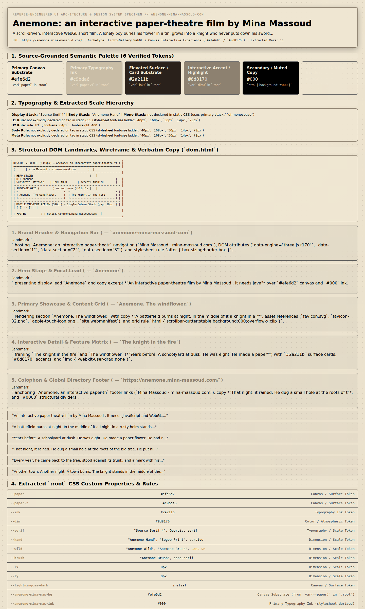
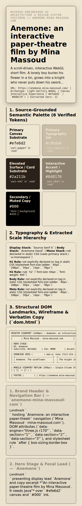

# UI Design System & Master Generation Blueprint: anemone-mina-massoud-com

> **Anemone: an interactive paper-theatre film by Mina Massoud** (https://anemone.mina-massoud.com/) — A scroll-driven, interactive WebGL short film. A lonely boy buries his flower in a tin, grows into a knight who never puts down his sword...



---

## 1. Executive Visual Persona & Design Archetype

- **Brand Essence & Persona**: **Anemone: an interactive paper-theatre film by Mina Massoud** (`https://anemone.mina-massoud.com/`). A scroll-driven, interactive WebGL short film. A lonely boy buries his flower in a tin, grows into a knight who never puts down his sword...
- **Visual Archetype**: **Light-Gallery WebGL / Canvas Interactive Experience (`#efe6d2` / `#8d8170`)**.
- **Anti-AI-Slop Differentiators**:
  - **Source-Grounded Chromatic Polarity**: Anchors the viewport in `#efe6d2` (`var(--paper)` in `:root`) paired with `#000` primary typography and `#8d8170` accents.
  - **Extracted Typographic Hierarchy**: Pairs `Source Serif 4` for display copy (`Anemone`) with `Anemone Hand` and not declared in static CSS (uses primary stack / `ui-monospace`).
  - **Calibrated Spatial Grid & Motion**: Combines `none (full-bleed `100%` viewport stage)` container bounds (`gap: 10px`, padding `10px`) with `cubic-bezier(.2,.7,.2,1)` easing and Lenis Smooth Scroll (`data-lenis`), GSAP Timeline & ScrollTrigger.

---

## 2. Spatial Architecture & Modular Grid Mathematics



### Viewport Allocation & Container Geometry
- **Captured Viewport Dimensions**: Desktop `1440×2400px` (`assets/desktop.png`, capped at 2400px multi-section capture), Mobile `390×2400px` (`assets/mobile.png`, capped at 2400px multi-section capture).
- **Master Container Bounds**: `none (full-bleed `100%` viewport stage)` extracted from `anemone-mina-massoud-com` stylesheet.
- **Canvas Lateral Padding & Spacing**: `10px` lateral canvas padding with `10px` grid gap.
- **Border Radius Scale**: `2px`, `999px`, `50%`.

### Responsive Breakpoint Architecture
- **Desktop Layout**: Multi-column CSS Grid / Flexbox layout at `1440px` (`max-width: none (full-bleed `100%` viewport stage)`, `gap: 10px`).
- **Mobile Layout**: Single-column vertical stack at `390px` viewport width with `10px` horizontal padding.
- **Extracted CSS Media Queries**: `@media (prefers-reduced-motion:reduce)`, `@media (width<=600px)`.

---

## 3. Color System, Materiality & Atmospheric Lighting

### Semantic Palette & Source Grounding
| Semantic Role | Ground-Truth Value | Extracted CSS Source / Selector |
|---|---|---|
| **Primary Canvas Substrate** | `#efe6d2` | `var(--paper)` in `:root` |
| **Primary Typography Ink** | `#c9bda6` | `var(--paper-2)` in `:root` |
| **Elevated Surface / Card Substrate** | `#2a211b` | `var(--ink)` in `:root` |
| **Interactive Accent / Highlight** | `#8d8170` | `var(--dim)` in `:root` |
| **Secondary / Muted Copy** | `#000` | `html { background: #000 }` |
| **Structural Hairline Border** | `#0000` | `.vignette { background: #0000 }` |

### Sanitized Root CSS Variables (`ui-ux.md` Ground Truth)
| Variable Name | Extracted Value | Semantic Role |
|---|---|---|
| `--paper` | `#efe6d2` | Canvas / Surface Token |
| `--paper-2` | `#c9bda6` | Canvas / Surface Token |
| `--ink` | `#2a211b` | Typography Ink Token |
| `--dim` | `#8d8170` | Color / Atmospheric Token |
| `--serif` | `"Source Serif 4", Georgia, serif` | Typography / Scale Token |
| `--hand` | `"Anemone Hand", "Segoe Print", cursive` | Dimension / Scale Token |
| `--wild` | `"Anemone Wild", "Anemone Brush", sans-serif` | Dimension / Scale Token |
| `--brush` | `"Anemone Brush", sans-serif` | Dimension / Scale Token |
| `--lx` | `0px` | Dimension / Scale Token |
| `--ly` | `0px` | Dimension / Scale Token |
| `--lightningcss-dark` | `initial` | Canvas / Surface Token |
| `--anemone-mina-mas-bg` | `#efe6d2` | Canvas Substrate (from `var(--paper)` in `:root`) |
| `--anemone-mina-mas-ink` | `#000` | Primary Typography Ink (stylesheet-derived) |
| `--anemone-mina-mas-surface` | `#2a211b` | Surface Substrate (stylesheet-derived) |
| `--anemone-mina-mas-accent` | `#8d8170` | Interactive Accent (stylesheet-derived) |
| `--anemone-mina-mas-muted` | `#000` | Secondary Ink (stylesheet-derived) |

---

## 4. Typographic Scale & Editorial Hierarchy

### Font Family Stacks
- **Display Typography**: `Source Serif 4`.
- **Primary Body Stack**: `Anemone Hand`.
- **Technical / Metadata Stack**: not declared in static CSS (uses primary stack / `ui-monospace`).

### Typographic Scale & Rules (Extracted from Stylesheet & Variables)
- **Hero Display (`H1`)**: not explicitly declared on tag in static CSS (stylesheet font-size ladder: `40px`, `168px`, `30px`, `14px`, `78px`).
- **Section Heading (`H2`)**: rule `h2` (`font-size: 64px`, `font-weight: 400`).
- **Body Copy**: not explicitly declared on tag in static CSS (stylesheet font-size ladder: `40px`, `168px`, `30px`, `14px`, `78px`).
- **Metadata & Navigation Labels**: not explicitly declared on tag in static CSS (stylesheet font-size ladder: `40px`, `168px`, `30px`, `14px`, `78px`).

---

## 5. Choreographed Motion & Interaction Physics

### Primary Easing Curves
- **Extracted Timing Functions**: `cubic-bezier(.2,.7,.2,1)`.

### Per-Element Transition & Choreography Rules
- **Selector `.hold-hint`**: `transition: opacity .6s` extracted from `anemone-mina-massoud-com` stylesheet.
- **Selector `.pry-bar`**: `transition: opacity .5s` extracted from `anemone-mina-massoud-com` stylesheet.
- **Selector `.sound-toggle`**: `transition: opacity 1.2s 1.5s,color .3s` extracted from `anemone-mina-massoud-com` stylesheet.
- **Extracted Easing Curve (`cubic-bezier(.2,.7,.2,1)`)**: Governs interactive state transitions across `<header.has-flower>` and `<section.section>`.
- **Runtime Interaction Engine**: Integrates Lenis Smooth Scroll (`data-lenis`), GSAP Timeline & ScrollTrigger, Three.js / WebGL Canvas Pipeline with `prefers-reduced-motion: reduce` fallback guards.

---

## 6. Component Wireframe & Structural DOM Map

### Visual Layout Schematic (Grounded in `dom.html` — `1440px` Desktop & `390px` Mobile Reflow)
```
┌────────────────────────────────────────────────────────────────────────┐
│ DESKTOP VIEWPORT (1440px) — Anemone: an interactive paper-theatre film │
│ ====================================================================== │
│ [ <header.has-flower>      | Mina Massoud · mina-massoud.com        ]  │
│ ---------------------------------------------------------------------- │
│ | HERO STAGE: <section.section>                                    |   │
│ | H1: Anemone                                                      |   │
│ | Substrate: #efe6d2    | Ink: #000       | Accent: #8d8170        |   │
│ ---------------------------------------------------------------------- │
│ | SHOWCASE GRID (<section.section>         ) max-w: none (full-ble |   │
│ | +------------------------------+  +------------------------------+ | │
│ | | Anemone. The windflower.     |  | The knight in the fire       | | │
│ | +------------------------------+  +------------------------------+ | │
│ ---------------------------------------------------------------------- │
│ | MOBILE VIEWPORT REFLOW (390px) — Single-Column Stack (gap: 10px  ) | │
│ | [<header.has-flower] -> [<section.section>] -> [<section.section>] | │
│ ---------------------------------------------------------------------- │
│ [ FOOTER (<footer.css3d>        ) | https://anemone.mina-massoud.com/  │
└────────────────────────────────────────────────────────────────────────┘
```

### Granular DOM Region Breakdown
1. **Brand Header & Navigation Bar (<header.has-flower> — `anemone-mina-massoud-com`)**:
   - Landmark `<header class="has-flower">` hosting `Anemone: an interactive paper-theatr` navigation (`Mina Massoud · mina-massoud.com`), DOM attributes (`data-engine="three.js r170"`, `data-section="1"`, `data-section="2"`, `data-section="3"`), and stylesheet rule `after { box-sizing:border-box }`.
2. **Hero Stage & Focal Lead (<section.section> — `Anemone`)**:
   - Landmark `<section class="section section-1">` presenting display lead `Anemone` and copy excerpt *"An interactive paper-theatre film by Mina Massoud . It needs Java"* over `#efe6d2` canvas and `#000` ink.
3. **Primary Showcase & Content Grid (<section.section> — `Anemone. The windflower.`)**:
   - Landmark `<section class="section section-2">` rendering section `Anemone. The windflower.` with copy *"A battlefield burns at night. In the middle of it a knight in a r"*, asset references (`favicon.svg`, `favicon-32.png`, `apple-touch-icon.png`, `site.webmanifest`), and grid rule `html { scrollbar-gutter:stable;background:000;overflow-x:clip }`.
4. **Interactive Detail & Feature Matrix (<section.section> — `The knight in the fire`)**:
   - Landmark `<section class="section section-3">` framing `The knight in the fire` and `The windflower` (*"Years before. A schoolyard at dusk. He was eight. He made a paper"*) with `#2a211b` surface cards, `#8d8170` accents, and `img { -webkit-user-drag:none }`.
5. **Colophon & Global Directory Footer (<footer.css3d> — `https://anemone.mina-massoud.com/`)**:
   - Landmark `<footer class="css3d">` anchoring `Anemone: an interactive paper-th` footer links (`Mina Massoud · mina-massoud.com`), copy *"That night, it rained. He dug a small hole at the roots of t"*, and `#0000` structural dividers.

---

## 7. Master Zero-Shot AI Generation Prompt

```markdown
# Master Zero-Shot Frontend Generation Prompt: anemone-mina-massoud-com (Anemone: an interactive paper-theatre film by Mina Massoud)

You are a principal frontend architect and design systems engineer. Build a complete, production-ready web application replicating the exact design system, DOM landmarks, typographic hierarchy, color tokens, and motion physics of `anemone-mina-massoud-com` (**Anemone: an interactive paper-theatre film by Mina Massoud** — `https://anemone.mina-massoud.com/`).

### 1. Visual Archetype & Anti-AI-Slop Mandates
- **Archetype**: Light-Gallery WebGL / Canvas Interactive Experience (`#efe6d2` / `#8d8170`).
- **Identity & Domain Context**: A scroll-driven, interactive WebGL short film. A lonely boy buries his flower in a tin, grows into a knight who never puts down his sword...
- **Primary Substrate**: `#efe6d2` (`var(--paper)` in `:root`), **Primary Ink**: `#000`, **Accent / Highlight**: `#8d8170`.
- **Site-Specific Differentiators**:
  - **Source-Grounded Chromatic Polarity**: Anchors the viewport in `#efe6d2` (`var(--paper)` in `:root`) paired with `#000` primary typography and `#8d8170` accents.
  - **Extracted Typographic Hierarchy**: Pairs `Source Serif 4` for display copy (`Anemone`) with `Anemone Hand` and not declared in static CSS (uses primary stack / `ui-monospace`).
  - **Calibrated Spatial Grid & Motion**: Combines `none (full-bleed `100%` viewport stage)` container bounds (`gap: 10px`, padding `10px`) with `cubic-bezier(.2,.7,.2,1)` easing and Lenis Smooth Scroll (`data-lenis`), GSAP Timeline & ScrollTrigger.

### 2. Ground-Truth CSS Variables (`:root` Token Contract)
Declare and consume these exact custom properties extracted from `anemone-mina-massoud-com` in your global stylesheet:

:root {
  /* Anemone: an interactive paper-theatre film by Mina Massoud (anemone-mina-massoud-com) — Ground-Truth Extracted CSS Variables */
  --paper: #efe6d2; /* Canvas / Surface Token (anemone-mina-massoud-com) */
  --paper-2: #c9bda6; /* Canvas / Surface Token (anemone-mina-massoud-com) */
  --ink: #2a211b; /* Typography Ink Token (anemone-mina-massoud-com) */
  --dim: #8d8170; /* Color / Atmospheric Token (anemone-mina-massoud-com) */
  --serif: "Source Serif 4", Georgia, serif; /* Typography / Scale Token (anemone-mina-massoud-com) */
  --hand: "Anemone Hand", "Segoe Print", cursive; /* Dimension / Scale Token (anemone-mina-massoud-com) */
  --wild: "Anemone Wild", "Anemone Brush", sans-serif; /* Dimension / Scale Token (anemone-mina-massoud-com) */
  --brush: "Anemone Brush", sans-serif; /* Dimension / Scale Token (anemone-mina-massoud-com) */
  --lx: 0px; /* Dimension / Scale Token (anemone-mina-massoud-com) */
  --ly: 0px; /* Dimension / Scale Token (anemone-mina-massoud-com) */
  --lightningcss-dark: initial; /* Canvas / Surface Token (anemone-mina-massoud-com) */
  --anemone-mina-mas-bg: #efe6d2; /* Canvas Substrate (from `var(--paper)` in `:root`) (anemone-mina-massoud-com) */
  --anemone-mina-mas-ink: #000; /* Primary Typography Ink (stylesheet-derived) (anemone-mina-massoud-com) */
  --anemone-mina-mas-surface: #2a211b; /* Surface Substrate (stylesheet-derived) (anemone-mina-massoud-com) */
  --anemone-mina-mas-accent: #8d8170; /* Interactive Accent (stylesheet-derived) (anemone-mina-massoud-com) */
  --anemone-mina-mas-muted: #000; /* Secondary Ink (stylesheet-derived) (anemone-mina-massoud-com) */
}

### 3. Semantic Color & Materiality Contract
Map every surface, ink, and border strictly to these source-grounded tokens:
- **Primary Canvas Substrate**: `#efe6d2` — grounded in `var(--paper)` in `:root`
- **Primary Typography Ink**: `#c9bda6` — grounded in `var(--paper-2)` in `:root`
- **Elevated Surface / Card Substrate**: `#2a211b` — grounded in `var(--ink)` in `:root`
- **Interactive Accent / Highlight**: `#8d8170` — grounded in `var(--dim)` in `:root`
- **Secondary / Muted Copy**: `#000` — grounded in `html { background: #000 }`
- **Structural Hairline Border**: `#0000` — grounded in `.vignette { background: #0000 }`

### 4. Spatial Grid, Container Bounds & Responsive Breakpoints
- **Desktop Viewport Reference**: `1440×2400px` (capped at 2400px multi-section capture, `1440px` standard desktop width).
- **Mobile Viewport Reference**: `390×2400px` (capped at 2400px multi-section capture, `390px` standard mobile width).
- **Container Max-Width**: `none (full-bleed `100%` viewport stage)` extracted from `anemone-mina-massoud-com` stylesheet
- **Padding & Gutters**: `10px` lateral canvas padding with `10px` grid gap
- **Desktop Grid**: Multi-column CSS Grid / Flexbox layout at `1440px` (`max-width: none (full-bleed `100%` viewport stage)`, `gap: 10px`)
- **Mobile Adaptation**: Single-column vertical stack at `390px` viewport width with `10px` horizontal padding
- **Media Queries**: `@media (prefers-reduced-motion:reduce)`, `@media (width<=600px)`
- **Corner Radii**: `2px`, `999px`, `50%`

### 5. Typography & Editorial Scale Contract
- **Display Font Stack**: `Source Serif 4`
- **Body Font Stack**: `Anemone Hand`
- **Monospace / Technical Font Stack**: not declared in static CSS (uses primary stack / `ui-monospace`)
- **H1 Display Rule**: not explicitly declared on tag in static CSS (stylesheet font-size ladder: `40px`, `168px`, `30px`, `14px`, `78px`)
- **H2 Section Rule**: rule `h2` (`font-size: 64px`, `font-weight: 400`)
- **Body Copy Rule**: not explicitly declared on tag in static CSS (stylesheet font-size ladder: `40px`, `168px`, `30px`, `14px`, `78px`)
- **Metadata & Index Rule**: not explicitly declared on tag in static CSS (stylesheet font-size ladder: `40px`, `168px`, `30px`, `14px`, `78px`)

### 6. Component Hierarchy, Verbatim Copy & Real DOM Landmarks
Scaffold `anemone-mina-massoud-com` (`Anemone: an interactive paper-theatre film by Mina Massoud`) with these exact structural regions, extracted copy, and CSS rules from `dom.html`:
1. **Brand Header & Navigation Bar (<header.has-flower> — `anemone-mina-massoud-com`)**:
   - DOM & Selectors: Landmark `<header class="has-flower">` hosting `Anemone: an interactive paper-theatr` navigation (`Mina Massoud · mina-massoud.com`), DOM attributes (`data-engine="three.js r170"`, `data-section="1"`, `data-section="2"`, `data-section="3"`), and stylesheet rule `after { box-sizing:border-box }`.
   - Responsive Contract: Header `Brand Header & Navigation Bar (<header.has-flower> — `anemone-mina-massoud-com`)` (`anemone-mina-massoud-com`) adapts across `@media (prefers-reduced-motion:reduce)`, `@media (width<=600px)` with `cubic-bezier(.2,.7,.2,1)` transitions and links `Mina Massoud · mina-massoud.com`.
2. **Hero Stage & Focal Lead (<section.section> — `Anemone`)**:
   - DOM & Selectors: Landmark `<section class="section section-1">` presenting display lead `Anemone` and copy excerpt *"An interactive paper-theatre film by Mina Massoud . It needs Java"* over `#efe6d2` canvas and `#000` ink.
   - Responsive Contract: Hero stage (`1440×2400px` desktop / `390×2400px` mobile) sets `#efe6d2` background with `#000` headline `Anemone`.
3. **Primary Showcase & Content Grid (<section.section> — `Anemone. The windflower.`)**:
   - DOM & Selectors: Landmark `<section class="section section-2">` rendering section `Anemone. The windflower.` with copy *"A battlefield burns at night. In the middle of it a knight in a r"*, asset references (`favicon.svg`, `favicon-32.png`, `apple-touch-icon.png`, `site.webmanifest`), and grid rule `html { scrollbar-gutter:stable;background:000;overflow-x:clip }`.
   - Responsive Contract: Showcase grid `Primary Showcase & Content Grid (<section.section> — `Anemone. The windflower.`)` applies Multi-column CSS Grid / Flexbox layout at `1440px` (`max-width: none (full-bleed `100%` viewport stage)`, `gap: 10px`) on desktop and Single-column vertical stack at `390px` viewport width with `10px` horizontal padding on mobile.
4. **Interactive Detail & Feature Matrix (<section.section> — `The knight in the fire`)**:
   - DOM & Selectors: Landmark `<section class="section section-3">` framing `The knight in the fire` and `The windflower` (*"Years before. A schoolyard at dusk. He was eight. He made a paper"*) with `#2a211b` surface cards, `#8d8170` accents, and `img { -webkit-user-drag:none }`.
   - Responsive Contract: Detail module `Interactive Detail & Feature Matrix (<section.section> — `The knight in the fire`)` uses `2px`, `999px`, `50%` radii, `#8d8170` highlights, and assets (favicon.svg, favicon-32.png, apple-touch-icon.png).
5. **Colophon & Global Directory Footer (<footer.css3d> — `https://anemone.mina-massoud.com/`)**:
   - DOM & Selectors: Landmark `<footer class="css3d">` anchoring `Anemone: an interactive paper-th` footer links (`Mina Massoud · mina-massoud.com`), copy *"That night, it rained. He dug a small hole at the roots of t"*, and `#0000` structural dividers.
   - Responsive Contract: Footer `Colophon & Global Directory Footer (<footer.css3d> — `https://anemone.mina-massoud.com/`)` aligns to `none (full-bleed `100%` viewport stage)` extracted from `anemone-mina-massoud-com` stylesheet with `10px` lateral canvas padding with `10px` grid gap and attributes (data-engine="three.js r170", data-section="1", data-section="2").

#### Verbatim DOM Copy Excerpts (`dom.html`)
- Copy Excerpt 1: *"An interactive paper-theatre film by Mina Massoud . It needs JavaScript and WebGL,..."*
- Copy Excerpt 2: *"A battlefield burns at night. In the middle of it a knight in a rusty helm stands..."*
- Copy Excerpt 3: *"Years before. A schoolyard at dusk. He was eight. He made a paper flower. He had n..."*
- Copy Excerpt 4: *"That night, it rained. He dug a small hole at the roots of the big tree. He put hi..."*

### 7. Motion, Extracted Stylesheet Rules & Interaction Choreography
- **Primary Easing Functions**: `cubic-bezier(.2,.7,.2,1)`
- **Extracted Stylesheet Rules (`anemone-mina-massoud-com`)**:
- `after { box-sizing:border-box }`
- `html { scrollbar-gutter:stable;background:000;overflow-x:clip }`
- `img { -webkit-user-drag:none }`
- `html.lenis body { height:auto }`
- `.lenis.lenis-smooth { scroll-behavior:auto!important }`
- **Per-Selector Transition Rules**:
- **Selector `.hold-hint`**: `transition: opacity .6s` extracted from `anemone-mina-massoud-com` stylesheet.
- **Selector `.pry-bar`**: `transition: opacity .5s` extracted from `anemone-mina-massoud-com` stylesheet.
- **Selector `.sound-toggle`**: `transition: opacity 1.2s 1.5s,color .3s` extracted from `anemone-mina-massoud-com` stylesheet.
- **Extracted Easing Curve (`cubic-bezier(.2,.7,.2,1)`)**: Governs interactive state transitions across `<header.has-flower>` and `<section.section>`.
- **Runtime Interaction Engine**: Integrates Lenis Smooth Scroll (`data-lenis`), GSAP Timeline & ScrollTrigger, Three.js / WebGL Canvas Pipeline with `prefers-reduced-motion: reduce` fallback guards.

### 8. Technical Deliverables
- Implement in Next.js (App Router) with TypeScript and Tailwind CSS consuming the `:root` custom properties defined above for `anemone-mina-massoud-com`.
- Reproduce both the `1440px` desktop architecture and `390px` mobile breakpoint transitions, preserving semantic HTML5 landmarks (`<header>`, `<nav>`, `<main>`, `<section>`, `<footer>`) and `prefers-reduced-motion` accessibility guards.
```
