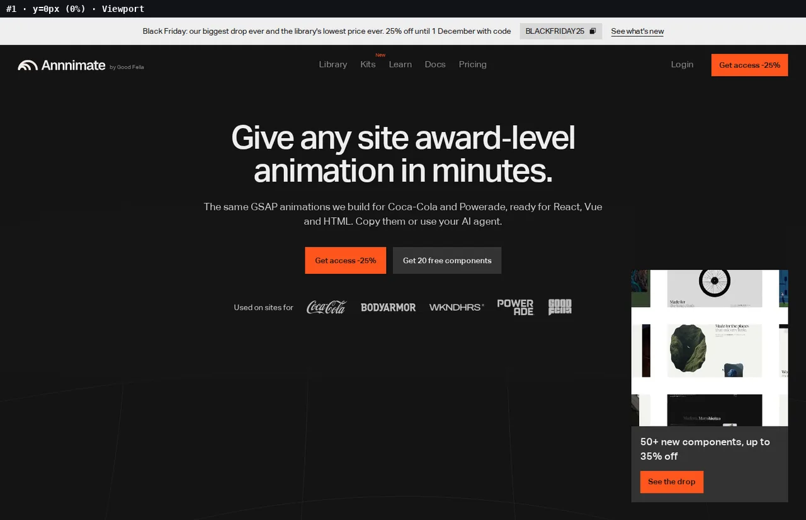
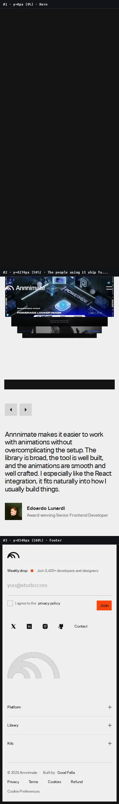

# UI Design System & Master Generation Blueprint: annnimate-com

> **GSAP Motion Components for React & Vue · Annnimate** (https://annnimate.com) — Production GSAP motion components for React and Vue. Every component is built to the standard we ship for real brands. By Good Fella.





---

## 1. Executive Visual Persona & Design Archetype

- **Brand Essence & Persona**: **GSAP Motion Components for React & Vue · Annnimate** (`https://annnimate.com`). Production GSAP motion components for React and Vue. Every component is built to the standard we ship for real brands. By Good Fella.
- **Capture Provenance**: Live browser capture (`tier1_fast`, HTTP `200`, captured `2026-11-24`).
- **Visual Archetype**: **Dark-Substrate WebGL / Canvas Interactive Experience (`#141314` / `#fb460d`)**.
- **Anti-AI-Slop Differentiators**:
  - **Live-Computed Chromatic Polarity**: Anchors the viewport in `#141314` (live computed `body` `background-color` (`computed_styles.json`)) paired with `#eeeeee` primary typography and `#fb460d` accents.
  - **Grounded Typographic Hierarchy**: Uses `aktivGrotesk` across display (`Give any site award‑level animation `) and body copy, paired with `Geist Mono` for monospace/code.
  - **Calibrated Spatial Grid & Motion**: Combines `96rem` container bounds (`gap: 3px`, padding `32px`) with `cubic-bezier(.4,0,1,1)` easing and Lenis Smooth Scroll (`data-lenis`), GSAP Timeline & ScrollTrigger.

---

## 2. Spatial Architecture & Modular Grid Mathematics

### Viewport Allocation & Container Geometry
- **Captured Journey Filmstrips**: Desktop `1280×828px` (`assets/desktop-journey.webp`, `1` keyframes up to `y=0px` / doc `900px`), Mobile `390×2616px` (`assets/mobile-journey.webp`, `3` keyframes).
- **Master Container Bounds**: `96rem` (non-`@media` desktop container stylesheet rule).
- **Canvas Lateral Padding & Spacing**: `32px` lateral canvas padding with `3px` grid gap.
- **Border Radius Scale**: `.25rem`, `var(--adm-radius)`, `var(--adm-radius-md)`, `var(--adm-radius-sm)`.

### Responsive Breakpoint Architecture
- **Desktop Layout**: Multi-column CSS Grid / Flexbox layout at `1440px` (`max-width: 96rem`, `gap: 3px`).
- **Mobile Layout**: Single-column vertical stack at `390px` viewport width with `32px` horizontal padding.
- **Extracted CSS Media Queries**: `@media (min-width:40rem)`, `@media (min-width:48rem)`, `@media (min-width:64rem)`, `@media (min-width:80rem)`.

---

## 3. Color System, Materiality & Atmospheric Lighting

### Semantic Palette & Source Grounding
| Semantic Role | Ground-Truth Value | Extracted Live / CSS Source |
|---|---|---|
| **Primary Canvas Substrate** | `#141314` | live computed `body` `background-color` (`computed_styles.json`) |
| **Primary Typography Ink** | `#eeeeee` | live computed `h1` `color` (`computed_styles.json`) |
| **Elevated Surface / Card Substrate** | `#171717` | `var(--card-foreground)` in `:root` |
| **Interactive Accent / Highlight** | `#fb460d` | `var(--brand)` in `:root` |
| **Secondary / Muted Copy** | `#696869` | `var(--foreground-muted)` in `:root` |
| **Structural Hairline Border** | `#121112` | `var(--border-muted)` in `:root` (`0000001a`) |
| **Variable Token (`--background`)** | `#fafafa` | `var(--background)` in `:root` |
| **Variable Token (`--card`)** | `#ffffff` | `var(--card)` in `:root` |
| **Variable Token (`--secondary`)** | `#f0f0f0` | `var(--secondary)` in `:root` |
| **Variable Token (`--secondary-muted`)** | `#e5e5e5` | `var(--secondary-muted)` in `:root` |
| **Variable Token (`--secondary-muted-foreground`)** | `#404040` | `var(--secondary-muted-foreground)` in `:root` |
| **Variable Token (`--surface`)** | `#ebebeb` | `var(--surface)` in `:root` |

### Sanitized Root CSS Variables (`ui-ux.md` Ground Truth)
| Variable Name | Extracted Value | Semantic Role |
|---|---|---|
| `--v2-header-h` | `72px` | Layout / Spatial Grid Token |
| `--v2-header-gap` | `16px` | Layout / Spatial Grid Token |
| `--v2-sticky-top` | `24px` | Dimension / Scale Token |
| `--radius` | `.375rem` | Elevation / Border Token |
| `--background` | `#fafafa` | Canvas / Surface Token |
| `--foreground` | `#171717` | Typography Ink Token |
| `--card` | `#fff` | Color / Atmospheric Token |
| `--card-foreground` | `#171717` | Typography Ink Token |
| `--popover` | `#fff` | Color / Atmospheric Token |
| `--popover-foreground` | `#171717` | Typography Ink Token |
| `--secondary` | `#f0f0f0` | Brand / Palette Token |
| `--secondary-foreground` | `#171717` | Typography Ink Token |
| `--secondary-muted` | `#e5e5e5` | Brand / Palette Token |
| `--secondary-muted-foreground` | `#404040` | Typography Ink Token |
| `--surface` | `#ebebeb` | Canvas / Surface Token |
| `--surface-foreground` | `#171717` | Canvas / Surface Token |

---

## 4. Typographic Scale & Editorial Hierarchy

### Font Family Stacks
- **Display Typography**: `aktivGrotesk`.
- **Primary Body Stack**: `aktivGrotesk`.
- **Technical / Metadata Stack**: `Geist Mono`.

### Typographic Scale & Rules (Live Computed & Stylesheet Grounded)
- **Hero Display (`H1`)**: live computed `h1` (`font-size: 59.298px`, `line-height: 59.298px`, `font-weight: 500`, `letter-spacing: -2.07543px`); CSS variables `--text-4xl: 2.25rem`, `--text-4xl--line-height: calc(2.5/2.25)`, `--text-5xl: 3rem`; rule `,.h1` (`font-size: var(--font-size-4xl)`, `line-height: 1.2`, `letter-spacing: -.04em`).
- **Section Heading (`H2`)**: live computed `h2` (`font-size: 37.9102px`, `line-height: 42.649px`, `font-weight: 500`, `letter-spacing: -1.51641px`); CSS variables `--text-2xl: 1.5rem`, `--text-2xl--line-height: calc(2/1.5)`, `--text-3xl: 1.875rem`; rule `,.h2` (`font-size: var(--font-size-2xl)`, `line-height: 1.2`, `letter-spacing: -.03em`).
- **Body Copy**: live computed `body` (`font-size: 18px`, `line-height: 27px`, `font-weight: 400`); CSS variables `--text-base: 1rem`, `--text-base--line-height: calc(1.5/1)`, `--font-size-base: clamp(1rem,.95rem + .25vw,1.125rem)`.
- **Metadata & Navigation Labels**: live computed `nav/a` (`font-size: 18px`, `line-height: 27px`, `font-weight: 400`); CSS variables `--font-mono: var(--font-geist-mono),"SF Mono",Monaco,"Cascadia Code",monospace`, `--text-xs: .75rem`, `--text-xs--line-height: calc(1/.75)`.

---

## 5. Choreographed Motion & Interaction Physics

### Primary Easing Curves
- **Extracted Timing Functions**: `cubic-bezier(.4,0,1,1)`, `cubic-bezier(0,0,.2,1)`, `cubic-bezier(.4,0,.2,1)`.

### Per-Element Transition & Choreography Rules
- **Selector `layer theme`**: `transition: .15s` extracted from `annnimate-com` stylesheet.
- **Selector `.transition`**: `transition: var(--tw-ease,var(--default-transition-timing-function))` extracted from `annnimate-com` stylesheet.
- **Selector `.transition\!`**: `transition: var(--tw-ease,var(--default-transition-timing-function))!impor...` extracted from `annnimate-com` stylesheet.
- **Extracted Easing Curve (`cubic-bezier(.4,0,1,1)`)**: Governs interactive state transitions across `<header.v2-header>` and `<section.pt-64>`.
- **Runtime Interaction Engine**: Integrates Lenis Smooth Scroll (`data-lenis`), GSAP Timeline & ScrollTrigger, Three.js / WebGL Canvas Pipeline, Framer Motion Layout Physics with `prefers-reduced-motion: reduce` fallback guards.
### Measured Runtime Scroll & Interaction Telemetry (`behavioral_journey_v2`)
- **Scroll Driver Mode**: `wheel` (max document height `900px`, deepest scrollY reached `0px` across `1` desktop keyframes).
- **Detected Scroll / Motion Libraries**: Native browser scroll / standard CSS transitions.

---

## 6. Component Wireframe & Structural DOM Map

### Visual Layout Schematic — Desktop (`1440px`, Grounded in `dom.html` & Landmark Bounding Boxes)
```
┌────────────────────────────────────────────────────────────────────────┐
│ DESKTOP VIEWPORT (1440px) — GSAP Motion Components for React & Vue · A │
│ ====================================================================== │
│ [ <header.v2-header> (1440x72px)      | Library Library · Kits Kits  ] │
│ ---------------------------------------------------------------------- │
│ | HERO STAGE: <section.bg-background> (w=1440px)                     | │
│ | H1: Give any site award‑level animation in minutes.                | │
│ | Substrate: #141314 | Ink: #eeeeee | Accent: #fb460d                | │
│ ---------------------------------------------------------------------- │
│ | SHOWCASE GRID (<section.pt-64>) max-w: 96rem                       | │
│ | +------------------------------+  +------------------------------+ | │
│ | | Try it before you copy it.   |  | Client-ready the moment you  | | │
│ | +------------------------------+  +------------------------------+ | │
│ ---------------------------------------------------------------------- │
│ | DETAIL MODULE (<section.py-64>) — Motion that wins the             | │
│ ---------------------------------------------------------------------- │
│ [ FOOTER (<footer.annnimate-fo) | https://annnimate.com                │
└────────────────────────────────────────────────────────────────────────┘
```

### Visual Layout Schematic — Mobile Reflow (`390px`)
```
┌────────────────────────────────────────────────────────────────────────┐
│ MOBILE VIEWPORT REFLOW (390px) — Single-Column Stack (gap: 3px)        │
│ ====================================================================== │
│ [ HEADER BAR (<header.v2-header>      ) | Compact Menu (390px)         │
│ ---------------------------------------------------------------------- │
│ | HERO STAGE (<section.bg-background>) — 390px Vertical Lead         | │
│ | H1: Give any site award‑level animation in minutes.                | │
│ ---------------------------------------------------------------------- │
│ | SHOWCASE STACK (<section.pt-64>) — 1-Col Stack                     | │
│ | [ Item 1: Try it before you copy it.                             ] | │
│ | [ Item 2: Client-ready the moment you paste it.                  ] | │
│ ---------------------------------------------------------------------- │
│ | DETAIL STACK (<section.py-64>) — 1-Col (Motion that wins t)        | │
│ ---------------------------------------------------------------------- │
│ [ FOOTER (<footer.annnimate-fo) | Stacked 390px Colophon               │
└────────────────────────────────────────────────────────────────────────┘
```

### Granular DOM Region Breakdown
1. **Brand Header & Navigation Bar (<header.v2-header> — `annnimate-com`)**:
   - Landmark `<header class="v2-header inset-x-0">` (`1440x72px`) hosting `GSAP Motion Components for React & V` navigation (`Library Library · Kits Kits New · Learn Learn · Docs Docs · Pricing Pricing`), DOM attributes (`data-precedence="next"`, `data-precedence="next"`, `data-precedence="next"`, `data-precedence="next"`), and stylesheet rule `host { --glass-primary:color-mix(in srgb,var(--color-muted)70%,transparent) }`.
2. **Hero Stage & Focal Lead (<section.bg-background> — `Give any site award‑level animatio`)**:
   - Landmark `<section class="bg-background pt-112">` presenting display lead `Give any site award‑level animation in minutes.` and copy excerpt *"Give any site award‑level"* over `#141314` canvas and `#eeeeee` ink.
3. **Primary Showcase & Content Grid (<section.pt-64> — `Try it before you copy it.`)**:
   - Landmark `<section class="bg-background pt-64">` rendering section `Try it before you copy it.` with copy *"animation in minutes."*, asset references (`teaser-poster.jpg`, `edoardo_avatar.avif`, `lukas_avatar.avif`, `matthew_avatar.avif`), and grid rule `backdrop { box-sizing:border-box;border:0 solid;margin:0;padding:0 }`.
4. **Interactive Detail & Feature Matrix (<section.py-64> — `Client-ready the moment you paste `)**:
   - Landmark `<section class="bg-background py-64">` framing `Client-ready the moment you paste it.` and `Motion that wins the pitch` (*"The same GSAP animations we build for Coca-Cola and Powerade, rea"*) with `#171717` surface cards, `#fb460d` accents, and `file-selector-button { box-sizing:border-box;border:0 solid;margin:0;padding:0 }`.
5. **Colophon & Global Directory Footer (<footer.annnimate-footer> — `https://annnimate.com`)**:
   - Landmark `<footer class="annnimate-footer bg-background">` anchoring `GSAP Motion Components for React` footer links (`Library Library · Kits Kits New · Learn Learn · Docs Docs · Pricing Pricing`), copy *"Get access -25% Get access -25%"*, and `#121112` structural dividers.
### Full Vertical Scroll Sequence (Desktop `1440×900` Keyframes)
- **Step 01** (`y=0px`, `0%`): Active landmark `Viewport` · sticky/fixed elements: `0`

---

## 7. Master Zero-Shot AI Generation Prompt

```markdown
# Master Zero-Shot Frontend Generation Prompt: annnimate-com (GSAP Motion Components for React & Vue · Annnimate)

You are a principal frontend architect and design systems engineer. Build a complete, production-ready web application replicating the exact design system, DOM landmarks, typographic hierarchy, color tokens, and motion physics of `annnimate-com` (**GSAP Motion Components for React & Vue · Annnimate** — `https://annnimate.com`).

### 1. Visual Archetype & Anti-AI-Slop Mandates
- **Archetype**: Dark-Substrate WebGL / Canvas Interactive Experience (`#141314` / `#fb460d`).
- **Identity & Domain Context**: Production GSAP motion components for React and Vue. Every component is built to the standard we ship for real brands. By Good Fella.
- **Primary Substrate**: `#141314` (live computed `body` `background-color` (`computed_styles.json`)), **Primary Ink**: `#eeeeee`, **Accent / Highlight**: `#fb460d`.
- **Site-Specific Differentiators**:
  - **Live-Computed Chromatic Polarity**: Anchors the viewport in `#141314` (live computed `body` `background-color` (`computed_styles.json`)) paired with `#eeeeee` primary typography and `#fb460d` accents.
  - **Grounded Typographic Hierarchy**: Uses `aktivGrotesk` across display (`Give any site award‑level animation `) and body copy, paired with `Geist Mono` for monospace/code.
  - **Calibrated Spatial Grid & Motion**: Combines `96rem` container bounds (`gap: 3px`, padding `32px`) with `cubic-bezier(.4,0,1,1)` easing and Lenis Smooth Scroll (`data-lenis`), GSAP Timeline & ScrollTrigger.

### 2. Ground-Truth CSS Variables (`:root` Token Contract)
Declare and consume these exact custom properties extracted from `annnimate-com` in your global stylesheet:

:root {
  /* GSAP Motion Components for React & Vue · Annnimate (annnimate-com) — Live-Grounded CSS Variables */
  --v2-header-h: 72px; /* Layout / Spatial Grid Token (annnimate-com) */
  --v2-header-gap: 16px; /* Layout / Spatial Grid Token (annnimate-com) */
  --v2-sticky-top: 24px; /* Dimension / Scale Token (annnimate-com) */
  --radius: .375rem; /* Elevation / Border Token (annnimate-com) */
  --background: #fafafa; /* Canvas / Surface Token (annnimate-com) */
  --foreground: #171717; /* Typography Ink Token (annnimate-com) */
  --card: #fff; /* Color / Atmospheric Token (annnimate-com) */
  --card-foreground: #171717; /* Typography Ink Token (annnimate-com) */
  --popover: #fff; /* Color / Atmospheric Token (annnimate-com) */
  --popover-foreground: #171717; /* Typography Ink Token (annnimate-com) */
  --secondary: #f0f0f0; /* Brand / Palette Token (annnimate-com) */
  --secondary-foreground: #171717; /* Typography Ink Token (annnimate-com) */
  --secondary-muted: #e5e5e5; /* Brand / Palette Token (annnimate-com) */
  --secondary-muted-foreground: #404040; /* Typography Ink Token (annnimate-com) */
  --surface: #ebebeb; /* Canvas / Surface Token (annnimate-com) */
  --surface-foreground: #171717; /* Canvas / Surface Token (annnimate-com) */
}

### 3. Semantic Color & Materiality Contract
Map every surface, ink, and border strictly to these source-grounded tokens:
- **Primary Canvas Substrate**: `#141314` — grounded in live computed `body` `background-color` (`computed_styles.json`)
- **Primary Typography Ink**: `#eeeeee` — grounded in live computed `h1` `color` (`computed_styles.json`)
- **Elevated Surface / Card Substrate**: `#171717` — grounded in `var(--card-foreground)` in `:root`
- **Interactive Accent / Highlight**: `#fb460d` — grounded in `var(--brand)` in `:root`
- **Secondary / Muted Copy**: `#696869` — grounded in `var(--foreground-muted)` in `:root`
- **Structural Hairline Border**: `#121112` — grounded in `var(--border-muted)` in `:root` (`0000001a`)
- **Variable Token (`--background`)**: `#fafafa` — grounded in `var(--background)` in `:root`
- **Variable Token (`--card`)**: `#ffffff` — grounded in `var(--card)` in `:root`
- **Variable Token (`--secondary`)**: `#f0f0f0` — grounded in `var(--secondary)` in `:root`
- **Variable Token (`--secondary-muted`)**: `#e5e5e5` — grounded in `var(--secondary-muted)` in `:root`
- **Variable Token (`--secondary-muted-foreground`)**: `#404040` — grounded in `var(--secondary-muted-foreground)` in `:root`
- **Variable Token (`--surface`)**: `#ebebeb` — grounded in `var(--surface)` in `:root`

### 4. Spatial Grid, Container Bounds & Responsive Breakpoints
- **Desktop Viewport Reference**: `1280×828px` (single-viewport 100vh live capture (900px), `1440px` standard desktop width).
- **Mobile Viewport Reference**: `390×2616px` (multi-frame vertical journey filmstrip (2616px), `390px` standard mobile width).
- **Container Max-Width**: `96rem` (non-`@media` desktop container stylesheet rule)
- **Padding & Gutters**: `32px` lateral canvas padding with `3px` grid gap
- **Desktop Grid**: Multi-column CSS Grid / Flexbox layout at `1440px` (`max-width: 96rem`, `gap: 3px`)
- **Mobile Adaptation**: Single-column vertical stack at `390px` viewport width with `32px` horizontal padding
- **Media Queries**: `@media (min-width:40rem)`, `@media (min-width:48rem)`, `@media (min-width:64rem)`, `@media (min-width:80rem)`
- **Corner Radii**: `.25rem`, `var(--adm-radius)`, `var(--adm-radius-md)`, `var(--adm-radius-sm)`

### 5. Typography & Editorial Scale Contract
- **Display Font Stack**: `aktivGrotesk`
- **Body Font Stack**: `aktivGrotesk`
- **Monospace / Technical Font Stack**: `Geist Mono`
- **H1 Display Rule**: live computed `h1` (`font-size: 59.298px`, `line-height: 59.298px`, `font-weight: 500`, `letter-spacing: -2.07543px`); CSS variables `--text-4xl: 2.25rem`, `--text-4xl--line-height: calc(2.5/2.25)`, `--text-5xl: 3rem`; rule `,.h1` (`font-size: var(--font-size-4xl)`, `line-height: 1.2`, `letter-spacing: -.04em`)
- **H2 Section Rule**: live computed `h2` (`font-size: 37.9102px`, `line-height: 42.649px`, `font-weight: 500`, `letter-spacing: -1.51641px`); CSS variables `--text-2xl: 1.5rem`, `--text-2xl--line-height: calc(2/1.5)`, `--text-3xl: 1.875rem`; rule `,.h2` (`font-size: var(--font-size-2xl)`, `line-height: 1.2`, `letter-spacing: -.03em`)
- **Body Copy Rule**: live computed `body` (`font-size: 18px`, `line-height: 27px`, `font-weight: 400`); CSS variables `--text-base: 1rem`, `--text-base--line-height: calc(1.5/1)`, `--font-size-base: clamp(1rem,.95rem + .25vw,1.125rem)`
- **Metadata & Index Rule**: live computed `nav/a` (`font-size: 18px`, `line-height: 27px`, `font-weight: 400`); CSS variables `--font-mono: var(--font-geist-mono),"SF Mono",Monaco,"Cascadia Code",monospace`, `--text-xs: .75rem`, `--text-xs--line-height: calc(1/.75)`

### 6. Component Hierarchy, Verbatim Copy & Real DOM Landmarks
Scaffold `annnimate-com` (`GSAP Motion Components for React & Vue · Annnimate`) with these exact structural regions, extracted copy, and CSS rules from `dom.html`:
1. **Brand Header & Navigation Bar (<header.v2-header> — `annnimate-com`)**:
   - DOM & Selectors: Landmark `<header class="v2-header inset-x-0">` (`1440x72px`) hosting `GSAP Motion Components for React & V` navigation (`Library Library · Kits Kits New · Learn Learn · Docs Docs · Pricing Pricing`), DOM attributes (`data-precedence="next"`, `data-precedence="next"`, `data-precedence="next"`, `data-precedence="next"`), and stylesheet rule `host { --glass-primary:color-mix(in srgb,var(--color-muted)70%,transparent) }`.
   - Responsive Contract: Header `Brand Header & Navigation Bar (<header.v2-header> — `annnimate-com`)` (`annnimate-com`) adapts across `@media (min-width:40rem)`, `@media (min-width:48rem)`, `@media (min-width:64rem)`, `@media (min-width:80rem)` with `cubic-bezier(.4,0,1,1)`, `cubic-bezier(0,0,.2,1)`, `cubic-bezier(.4,0,.2,1)` transitions and links `Library Library · Kits Kits New · Learn Learn · Docs Docs · Pricing Pricing`.
2. **Hero Stage & Focal Lead (<section.bg-background> — `Give any site award‑level animatio`)**:
   - DOM & Selectors: Landmark `<section class="bg-background pt-112">` presenting display lead `Give any site award‑level animation in minutes.` and copy excerpt *"Give any site award‑level"* over `#141314` canvas and `#eeeeee` ink.
   - Responsive Contract: Hero stage (`1280×828px` desktop / `390×2616px` mobile) sets `#141314` background with `#eeeeee` headline `Give any site award‑level animation in minutes.`.
3. **Primary Showcase & Content Grid (<section.pt-64> — `Try it before you copy it.`)**:
   - DOM & Selectors: Landmark `<section class="bg-background pt-64">` rendering section `Try it before you copy it.` with copy *"animation in minutes."*, asset references (`teaser-poster.jpg`, `edoardo_avatar.avif`, `lukas_avatar.avif`, `matthew_avatar.avif`), and grid rule `backdrop { box-sizing:border-box;border:0 solid;margin:0;padding:0 }`.
   - Responsive Contract: Showcase grid `Primary Showcase & Content Grid (<section.pt-64> — `Try it before you copy it.`)` applies Multi-column CSS Grid / Flexbox layout at `1440px` (`max-width: 96rem`, `gap: 3px`) on desktop and Single-column vertical stack at `390px` viewport width with `32px` horizontal padding on mobile.
4. **Interactive Detail & Feature Matrix (<section.py-64> — `Client-ready the moment you paste `)**:
   - DOM & Selectors: Landmark `<section class="bg-background py-64">` framing `Client-ready the moment you paste it.` and `Motion that wins the pitch` (*"The same GSAP animations we build for Coca-Cola and Powerade, rea"*) with `#171717` surface cards, `#fb460d` accents, and `file-selector-button { box-sizing:border-box;border:0 solid;margin:0;padding:0 }`.
   - Responsive Contract: Detail module `Interactive Detail & Feature Matrix (<section.py-64> — `Client-ready the moment you paste `)` uses `.25rem`, `var(--adm-radius)`, `var(--adm-radius-md)`, `var(--adm-radius-sm)` radii, `#fb460d` highlights, and assets (teaser-poster.jpg, edoardo_avatar.avif, lukas_avatar.avif).
5. **Colophon & Global Directory Footer (<footer.annnimate-footer> — `https://annnimate.com`)**:
   - DOM & Selectors: Landmark `<footer class="annnimate-footer bg-background">` anchoring `GSAP Motion Components for React` footer links (`Library Library · Kits Kits New · Learn Learn · Docs Docs · Pricing Pricing`), copy *"Get access -25% Get access -25%"*, and `#121112` structural dividers.
   - Responsive Contract: Footer `Colophon & Global Directory Footer (<footer.annnimate-footer> — `https://annnimate.com`)` aligns to `96rem` (non-`@media` desktop container stylesheet rule) with `32px` lateral canvas padding with `3px` grid gap and attributes (data-precedence="next", data-precedence="next", data-precedence="next").

#### Verbatim DOM Copy Excerpts (`dom.html`)
- Copy Excerpt 1: *"Give any site award‑level"*
- Copy Excerpt 2: *"animation in minutes."*
- Copy Excerpt 3: *"The same GSAP animations we build for Coca-Cola and Powerade, ready for React, Vue..."*
- Copy Excerpt 4: *"Get access -25% Get access -25%"*

### 7. Motion, Extracted Stylesheet Rules & Interaction Choreography
- **Primary Easing Functions**: `cubic-bezier(.4,0,1,1)`, `cubic-bezier(0,0,.2,1)`, `cubic-bezier(.4,0,.2,1)`
- **Extracted Stylesheet Rules (`annnimate-com`)**:
- `host { --glass-primary:color-mix(in srgb,var(--color-muted)70%,transparent) }`
- `backdrop { box-sizing:border-box;border:0 solid;margin:0;padding:0 }`
- `file-selector-button { box-sizing:border-box;border:0 solid;margin:0;padding:0 }`
- `strong { font-weight:bolder }`
- `small { font-size:80% }`
- **Per-Selector Transition Rules**:
- **Selector `layer theme`**: `transition: .15s` extracted from `annnimate-com` stylesheet.
- **Selector `.transition`**: `transition: var(--tw-ease,var(--default-transition-timing-function))` extracted from `annnimate-com` stylesheet.
- **Selector `.transition\!`**: `transition: var(--tw-ease,var(--default-transition-timing-function))!impor...` extracted from `annnimate-com` stylesheet.
- **Extracted Easing Curve (`cubic-bezier(.4,0,1,1)`)**: Governs interactive state transitions across `<header.v2-header>` and `<section.pt-64>`.
- **Runtime Interaction Engine**: Integrates Lenis Smooth Scroll (`data-lenis`), GSAP Timeline & ScrollTrigger, Three.js / WebGL Canvas Pipeline, Framer Motion Layout Physics with `prefers-reduced-motion: reduce` fallback guards.
### 7b. Full-Page Scroll Choreography, Interactive States & Multi-Page Routes
- **Scroll Mechanics**: Implement `wheel` vertical progression up to `900px` across 1 distinct viewport chapters.
- **Vertical Chapter Sequence**: Viewport (0%).

### 8. Technical Deliverables
- Implement in Next.js (App Router) with TypeScript and Tailwind CSS consuming the `:root` custom properties defined above for `annnimate-com`.
- Reproduce both the `1440px` desktop architecture and `390px` mobile breakpoint transitions, preserving semantic HTML5 landmarks (`<header>`, `<nav>`, `<main>`, `<section>`, `<footer>`) and `prefers-reduced-motion` accessibility guards.
```
---

## 8. Full-Page Scroll Journey, Interactive States & Subpage Inventory

### Desktop Scroll Keyframes (`1440×900` WebP)
| Step | Scroll Y | Progress | Active Landmark / Section | Sticky/Fixed | Visual Asset |
| :---: | :---: | :---: | :--- | :---: | :--- |
| `#01` | `0px` | `0%` | Viewport | `0` | [desktop-step-01.webp](assets/desktop-step-01.webp) |

### Mobile Condensed Keyframes (`390×844` WebP)
| Step | Scroll Y | Progress | Active Landmark | Visual Asset |
| :---: | :---: | :---: | :--- | :--- |
| `#01` | `0px` | `0%` | Hero | [mobile-step-01.webp](assets/mobile-step-01.webp) |
| `#02` | `4274px` | `50%` | The people using it ship for a living. | [mobile-step-02.webp](assets/mobile-step-02.webp) |
| `#03` | `8549px` | `100%` | Footer | [mobile-step-03.webp](assets/mobile-step-03.webp) |

