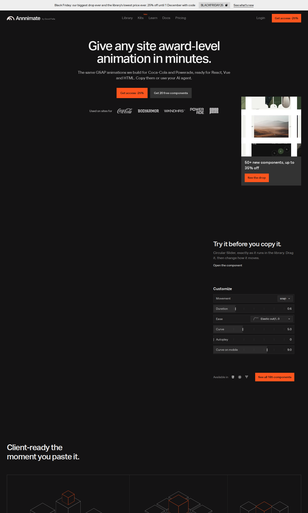
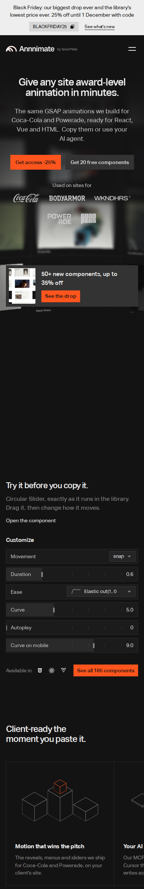

# UI Design System & Master Generation Blueprint: annnimate-com

> **GSAP Motion Components for React & Vue · Annnimate** (https://annnimate.com) — Production GSAP motion components for React and Vue. Every component is built to the standard we ship for real brands. By Good Fella.



---

## 1. Executive Visual Persona & Design Archetype

- **Brand Essence & Persona**: **GSAP Motion Components for React & Vue · Annnimate** (`https://annnimate.com`). Production GSAP motion components for React and Vue. Every component is built to the standard we ship for real brands. By Good Fella.
- **Visual Archetype**: **Dark-Substrate WebGL / Canvas Interactive Experience (`#000` / `#f5f5f5`)**.
- **Anti-AI-Slop Differentiators**:
  - **Source-Grounded Chromatic Polarity**: Anchors the viewport in `#000` (`var(--color-black)` in `:root`) paired with `#fff` primary typography and `#f5f5f5` accents.
  - **Extracted Typographic Hierarchy**: Pairs `Geist` for display copy (`Give any site award‑level animation `) with `Geist Mono` and `Geist Mono`.
  - **Calibrated Spatial Grid & Motion**: Combines `40rem` container bounds (`gap: 3px`, padding `1.5rem`) with `cubic-bezier(.4,0,1,1)` easing and Lenis Smooth Scroll (`data-lenis`), GSAP Timeline & ScrollTrigger.

---

## 2. Spatial Architecture & Modular Grid Mathematics



### Viewport Allocation & Container Geometry
- **Captured Viewport Dimensions**: Desktop `1440×2400px` (`assets/desktop.png`, capped at 2400px multi-section capture), Mobile `390×2400px` (`assets/mobile.png`, capped at 2400px multi-section capture).
- **Master Container Bounds**: `40rem` extracted from `annnimate-com` stylesheet.
- **Canvas Lateral Padding & Spacing**: `1.5rem` lateral canvas padding with `3px` grid gap.
- **Border Radius Scale**: `.25rem`, `var(--adm-radius)`, `var(--adm-radius-md)`, `var(--adm-radius-sm)`.

### Responsive Breakpoint Architecture
- **Desktop Layout**: Multi-column CSS Grid / Flexbox layout at `1440px` (`max-width: 40rem`, `gap: 3px`).
- **Mobile Layout**: Single-column vertical stack at `390px` viewport width with `1.5rem` horizontal padding.
- **Extracted CSS Media Queries**: `@media (min-width:40rem)`, `@media (min-width:48rem)`, `@media (min-width:64rem)`, `@media (min-width:80rem)`.

---

## 3. Color System, Materiality & Atmospheric Lighting

### Semantic Palette & Source Grounding
| Semantic Role | Ground-Truth Value | Extracted CSS Source / Selector |
|---|---|---|
| **Primary Canvas Substrate** | `#000` | `var(--color-black)` in `:root` |
| **Primary Typography Ink** | `#fff` | `var(--color-white)` in `:root` |
| **Elevated Surface / Card Substrate** | `#fafafa` | `var(--gray-50)` in `:root` |
| **Interactive Accent / Highlight** | `#f5f5f5` | `var(--gray-100)` in `:root` |
| **Secondary / Muted Copy** | `#eee` | `var(--gray-150)` in `:root` |
| **Structural Hairline Border** | `#e8e8e8` | `var(--gray-200)` in `:root` |

### Sanitized Root CSS Variables (`ui-ux.md` Ground Truth)
| Variable Name | Extracted Value | Semantic Role |
|---|---|---|
| `--angle` | `0deg` | Design System Custom Token |
| `--font-mono` | `var(--font-geist-mono),"SF Mono",Monaco,"Cascadia Code",monospace` | Typography / Scale Token |
| `--color-red-400` | `oklch(70.4% .191 22.216)` | Brand / Palette Token |
| `--color-red-500` | `oklch(63.7% .237 25.331)` | Brand / Palette Token |
| `--color-red-600` | `oklch(57.7% .245 27.325)` | Brand / Palette Token |
| `--color-amber-400` | `oklch(82.8% .189 84.429)` | Brand / Palette Token |
| `--color-amber-500` | `oklch(76.9% .188 70.08)` | Brand / Palette Token |
| `--color-lime-50` | `oklch(98.6% .031 120.757)` | Brand / Palette Token |
| `--color-lime-100` | `oklch(96.7% .067 122.328)` | Brand / Palette Token |
| `--color-lime-200` | `oklch(93.8% .127 124.321)` | Brand / Palette Token |
| `--color-lime-300` | `oklch(89.7% .196 126.665)` | Brand / Palette Token |
| `--color-lime-400` | `oklch(84.1% .238 128.85)` | Brand / Palette Token |
| `--color-lime-500` | `oklch(76.8% .233 130.85)` | Brand / Palette Token |
| `--color-lime-600` | `oklch(64.8% .2 131.684)` | Brand / Palette Token |
| `--color-lime-700` | `oklch(53.2% .157 131.589)` | Brand / Palette Token |
| `--color-lime-800` | `oklch(45.3% .124 130.933)` | Brand / Palette Token |

---

## 4. Typographic Scale & Editorial Hierarchy

### Font Family Stacks
- **Display Typography**: `Geist`.
- **Primary Body Stack**: `Geist Mono`.
- **Technical / Metadata Stack**: `Geist Mono`.

### Typographic Scale & Rules (Extracted from Stylesheet & Variables)
- **Hero Display (`H1`)**: CSS variables `--text-4xl: 2.25rem`, `--text-4xl--line-height: calc(2.5/2.25)`, `--text-5xl: 3rem`; rule `,.h1` (`font-size: var(--font-size-4xl)`, `line-height: 1.2`, `letter-spacing: -.04em`).
- **Section Heading (`H2`)**: CSS variables `--text-2xl: 1.5rem`, `--text-2xl--line-height: calc(2/1.5)`, `--text-3xl: 1.875rem`; rule `,.h2` (`font-size: var(--font-size-2xl)`, `line-height: 1.2`, `letter-spacing: -.03em`).
- **Body Copy**: CSS variables `--text-base: 1rem`, `--text-base--line-height: calc(1.5/1)`, `--font-size-base: clamp(1rem,.95rem + .25vw,1.125rem)`.
- **Metadata & Navigation Labels**: CSS variables `--font-mono: var(--font-geist-mono),"SF Mono",Monaco,"Cascadia Code",monospace`, `--text-xs: .75rem`, `--text-xs--line-height: calc(1/.75)`.

---

## 5. Choreographed Motion & Interaction Physics

### Primary Easing Curves
- **Extracted Timing Functions**: `cubic-bezier(.4,0,1,1)`, `cubic-bezier(0,0,.2,1)`, `cubic-bezier(.4,0,.2,1)`.

### Per-Element Transition & Choreography Rules
- **Selector `layer theme`**: `transition: .15s` extracted from `annnimate-com` stylesheet.
- **Selector `.transition`**: `transition: var(--tw-ease,var(--default-transition-timing-function))` extracted from `annnimate-com` stylesheet.
- **Selector `.transition\!`**: `transition: var(--tw-ease,var(--default-transition-timing-function))!impor...` extracted from `annnimate-com` stylesheet.
- **Extracted Easing Curve (`cubic-bezier(.4,0,1,1)`)**: Governs interactive state transitions across `<header.v2-header>` and `<section.bg-background>`.
- **Runtime Interaction Engine**: Integrates Lenis Smooth Scroll (`data-lenis`), GSAP Timeline & ScrollTrigger, Three.js / WebGL Canvas Pipeline, Framer Motion Layout Physics with `prefers-reduced-motion: reduce` fallback guards.

---

## 6. Component Wireframe & Structural DOM Map

### Visual Layout Schematic (Grounded in `dom.html` — `1440px` Desktop & `390px` Mobile Reflow)
```
┌────────────────────────────────────────────────────────────────────────┐
│ DESKTOP VIEWPORT (1440px) — GSAP Motion Components for React & Vue · A │
│ ====================================================================== │
│ [ <header.v2-header>       | Library Library · Kits Kits New · Lear ]  │
│ ---------------------------------------------------------------------- │
│ | HERO STAGE: <section.relative>                                   |   │
│ | H1: Give any site award‑level animation in minutes.              |   │
│ | Substrate: #000       | Ink: #fff       | Accent: #f5f5f5        |   │
│ ---------------------------------------------------------------------- │
│ | SHOWCASE GRID (<section.bg-background>   ) max-w: 40rem          |   │
│ | +------------------------------+  +------------------------------+ | │
│ | | Try it before you copy it.   |  | Client-ready the moment you  | | │
│ | +------------------------------+  +------------------------------+ | │
│ ---------------------------------------------------------------------- │
│ | MOBILE VIEWPORT REFLOW (390px) — Single-Column Stack (gap: 3px   ) | │
│ | [<header.v2-header>] -> [<section.relative>] -> [<section.bg-backgr] │
│ ---------------------------------------------------------------------- │
│ [ FOOTER (<footer.annnimate-foot) | https://annnimate.com              │
└────────────────────────────────────────────────────────────────────────┘
```

### Granular DOM Region Breakdown
1. **Brand Header & Navigation Bar (<header.v2-header> — `annnimate-com`)**:
   - Landmark `<header class="v2-header inset-x-0">` hosting `GSAP Motion Components for React & V` navigation (`Library Library · Kits Kits New · Learn Learn · Docs Docs · Pricing Pricing`), DOM attributes (`data-precedence="next"`, `data-precedence="next"`, `data-precedence="next"`, `data-precedence="next"`), and stylesheet rule `host { --glass-primary:color-mix(in srgb,var(--color-muted)70%,transparent) }`.
2. **Hero Stage & Focal Lead (<section.relative> — `Give any site award‑level animatio`)**:
   - Landmark `<section class="relative flex">` presenting display lead `Give any site award‑level animation in minutes.` and copy excerpt *"Get access Get access"* over `#000` canvas and `#fff` ink.
3. **Primary Showcase & Content Grid (<section.bg-background> — `Try it before you copy it.`)**:
   - Landmark `<section class="bg-background pt-64">` rendering section `Try it before you copy it.` with copy *"Curated, not a catalog dump."*, asset references (`edoardo_avatar.avif`, `lukas_avatar.avif`, `matthew_avatar.avif`, `3e5aujvbo39dz.css`), and grid rule `backdrop { box-sizing:border-box;border:0 solid;margin:0;padding:0 }`.
4. **Interactive Detail & Feature Matrix (<section.bg-background> — `Client-ready the moment you paste `)**:
   - Landmark `<section class="bg-background py-64">` framing `Client-ready the moment you paste it.` and `Motion that wins the pitch` (*"Every component built to the bar we ship for real brands. Filter,"*) with `#fafafa` surface cards, `#f5f5f5` accents, and `file-selector-button { box-sizing:border-box;border:0 solid;margin:0;padding:0 }`.
5. **Colophon & Global Directory Footer (<footer.annnimate-footer> — `https://annnimate.com`)**:
   - Landmark `<footer class="annnimate-footer relative">` anchoring `GSAP Motion Components for React` footer links (`Library Library · Kits Kits New · Learn Learn · Docs Docs · Pricing Pricing`), copy *"Browse the library Browse the library"*, and `#e8e8e8` structural dividers.

---

## 7. Master Zero-Shot AI Generation Prompt

```markdown
# Master Zero-Shot Frontend Generation Prompt: annnimate-com (GSAP Motion Components for React & Vue · Annnimate)

You are a principal frontend architect and design systems engineer. Build a complete, production-ready web application replicating the exact design system, DOM landmarks, typographic hierarchy, color tokens, and motion physics of `annnimate-com` (**GSAP Motion Components for React & Vue · Annnimate** — `https://annnimate.com`).

### 1. Visual Archetype & Anti-AI-Slop Mandates
- **Archetype**: Dark-Substrate WebGL / Canvas Interactive Experience (`#000` / `#f5f5f5`).
- **Identity & Domain Context**: Production GSAP motion components for React and Vue. Every component is built to the standard we ship for real brands. By Good Fella.
- **Primary Substrate**: `#000` (`var(--color-black)` in `:root`), **Primary Ink**: `#fff`, **Accent / Highlight**: `#f5f5f5`.
- **Site-Specific Differentiators**:
  - **Source-Grounded Chromatic Polarity**: Anchors the viewport in `#000` (`var(--color-black)` in `:root`) paired with `#fff` primary typography and `#f5f5f5` accents.
  - **Extracted Typographic Hierarchy**: Pairs `Geist` for display copy (`Give any site award‑level animation `) with `Geist Mono` and `Geist Mono`.
  - **Calibrated Spatial Grid & Motion**: Combines `40rem` container bounds (`gap: 3px`, padding `1.5rem`) with `cubic-bezier(.4,0,1,1)` easing and Lenis Smooth Scroll (`data-lenis`), GSAP Timeline & ScrollTrigger.

### 2. Ground-Truth CSS Variables (`:root` Token Contract)
Declare and consume these exact custom properties extracted from `annnimate-com` in your global stylesheet:

:root {
  /* GSAP Motion Components for React & Vue · Annnimate (annnimate-com) — Ground-Truth Extracted CSS Variables */
  --angle: 0deg; /* Design System Custom Token (annnimate-com) */
  --font-mono: var(--font-geist-mono),"SF Mono",Monaco,"Cascadia Code",monospace; /* Typography / Scale Token (annnimate-com) */
  --color-red-400: oklch(70.4% .191 22.216); /* Brand / Palette Token (annnimate-com) */
  --color-red-500: oklch(63.7% .237 25.331); /* Brand / Palette Token (annnimate-com) */
  --color-red-600: oklch(57.7% .245 27.325); /* Brand / Palette Token (annnimate-com) */
  --color-amber-400: oklch(82.8% .189 84.429); /* Brand / Palette Token (annnimate-com) */
  --color-amber-500: oklch(76.9% .188 70.08); /* Brand / Palette Token (annnimate-com) */
  --color-lime-50: oklch(98.6% .031 120.757); /* Brand / Palette Token (annnimate-com) */
  --color-lime-100: oklch(96.7% .067 122.328); /* Brand / Palette Token (annnimate-com) */
  --color-lime-200: oklch(93.8% .127 124.321); /* Brand / Palette Token (annnimate-com) */
  --color-lime-300: oklch(89.7% .196 126.665); /* Brand / Palette Token (annnimate-com) */
  --color-lime-400: oklch(84.1% .238 128.85); /* Brand / Palette Token (annnimate-com) */
  --color-lime-500: oklch(76.8% .233 130.85); /* Brand / Palette Token (annnimate-com) */
  --color-lime-600: oklch(64.8% .2 131.684); /* Brand / Palette Token (annnimate-com) */
  --color-lime-700: oklch(53.2% .157 131.589); /* Brand / Palette Token (annnimate-com) */
  --color-lime-800: oklch(45.3% .124 130.933); /* Brand / Palette Token (annnimate-com) */
}

### 3. Semantic Color & Materiality Contract
Map every surface, ink, and border strictly to these source-grounded tokens:
- **Primary Canvas Substrate**: `#000` — grounded in `var(--color-black)` in `:root`
- **Primary Typography Ink**: `#fff` — grounded in `var(--color-white)` in `:root`
- **Elevated Surface / Card Substrate**: `#fafafa` — grounded in `var(--gray-50)` in `:root`
- **Interactive Accent / Highlight**: `#f5f5f5` — grounded in `var(--gray-100)` in `:root`
- **Secondary / Muted Copy**: `#eee` — grounded in `var(--gray-150)` in `:root`
- **Structural Hairline Border**: `#e8e8e8` — grounded in `var(--gray-200)` in `:root`

### 4. Spatial Grid, Container Bounds & Responsive Breakpoints
- **Desktop Viewport Reference**: `1440×2400px` (capped at 2400px multi-section capture, `1440px` standard desktop width).
- **Mobile Viewport Reference**: `390×2400px` (capped at 2400px multi-section capture, `390px` standard mobile width).
- **Container Max-Width**: `40rem` extracted from `annnimate-com` stylesheet
- **Padding & Gutters**: `1.5rem` lateral canvas padding with `3px` grid gap
- **Desktop Grid**: Multi-column CSS Grid / Flexbox layout at `1440px` (`max-width: 40rem`, `gap: 3px`)
- **Mobile Adaptation**: Single-column vertical stack at `390px` viewport width with `1.5rem` horizontal padding
- **Media Queries**: `@media (min-width:40rem)`, `@media (min-width:48rem)`, `@media (min-width:64rem)`, `@media (min-width:80rem)`
- **Corner Radii**: `.25rem`, `var(--adm-radius)`, `var(--adm-radius-md)`, `var(--adm-radius-sm)`

### 5. Typography & Editorial Scale Contract
- **Display Font Stack**: `Geist`
- **Body Font Stack**: `Geist Mono`
- **Monospace / Technical Font Stack**: `Geist Mono`
- **H1 Display Rule**: CSS variables `--text-4xl: 2.25rem`, `--text-4xl--line-height: calc(2.5/2.25)`, `--text-5xl: 3rem`; rule `,.h1` (`font-size: var(--font-size-4xl)`, `line-height: 1.2`, `letter-spacing: -.04em`)
- **H2 Section Rule**: CSS variables `--text-2xl: 1.5rem`, `--text-2xl--line-height: calc(2/1.5)`, `--text-3xl: 1.875rem`; rule `,.h2` (`font-size: var(--font-size-2xl)`, `line-height: 1.2`, `letter-spacing: -.03em`)
- **Body Copy Rule**: CSS variables `--text-base: 1rem`, `--text-base--line-height: calc(1.5/1)`, `--font-size-base: clamp(1rem,.95rem + .25vw,1.125rem)`
- **Metadata & Index Rule**: CSS variables `--font-mono: var(--font-geist-mono),"SF Mono",Monaco,"Cascadia Code",monospace`, `--text-xs: .75rem`, `--text-xs--line-height: calc(1/.75)`

### 6. Component Hierarchy, Verbatim Copy & Real DOM Landmarks
Scaffold `annnimate-com` (`GSAP Motion Components for React & Vue · Annnimate`) with these exact structural regions, extracted copy, and CSS rules from `dom.html`:
1. **Brand Header & Navigation Bar (<header.v2-header> — `annnimate-com`)**:
   - DOM & Selectors: Landmark `<header class="v2-header inset-x-0">` hosting `GSAP Motion Components for React & V` navigation (`Library Library · Kits Kits New · Learn Learn · Docs Docs · Pricing Pricing`), DOM attributes (`data-precedence="next"`, `data-precedence="next"`, `data-precedence="next"`, `data-precedence="next"`), and stylesheet rule `host { --glass-primary:color-mix(in srgb,var(--color-muted)70%,transparent) }`.
   - Responsive Contract: Header `Brand Header & Navigation Bar (<header.v2-header> — `annnimate-com`)` (`annnimate-com`) adapts across `@media (min-width:40rem)`, `@media (min-width:48rem)`, `@media (min-width:64rem)`, `@media (min-width:80rem)` with `cubic-bezier(.4,0,1,1)`, `cubic-bezier(0,0,.2,1)`, `cubic-bezier(.4,0,.2,1)` transitions and links `Library Library · Kits Kits New · Learn Learn · Docs Docs · Pricing Pricing`.
2. **Hero Stage & Focal Lead (<section.relative> — `Give any site award‑level animatio`)**:
   - DOM & Selectors: Landmark `<section class="relative flex">` presenting display lead `Give any site award‑level animation in minutes.` and copy excerpt *"Get access Get access"* over `#000` canvas and `#fff` ink.
   - Responsive Contract: Hero stage (`1440×2400px` desktop / `390×2400px` mobile) sets `#000` background with `#fff` headline `Give any site award‑level animation in minutes.`.
3. **Primary Showcase & Content Grid (<section.bg-background> — `Try it before you copy it.`)**:
   - DOM & Selectors: Landmark `<section class="bg-background pt-64">` rendering section `Try it before you copy it.` with copy *"Curated, not a catalog dump."*, asset references (`edoardo_avatar.avif`, `lukas_avatar.avif`, `matthew_avatar.avif`, `3e5aujvbo39dz.css`), and grid rule `backdrop { box-sizing:border-box;border:0 solid;margin:0;padding:0 }`.
   - Responsive Contract: Showcase grid `Primary Showcase & Content Grid (<section.bg-background> — `Try it before you copy it.`)` applies Multi-column CSS Grid / Flexbox layout at `1440px` (`max-width: 40rem`, `gap: 3px`) on desktop and Single-column vertical stack at `390px` viewport width with `1.5rem` horizontal padding on mobile.
4. **Interactive Detail & Feature Matrix (<section.bg-background> — `Client-ready the moment you paste `)**:
   - DOM & Selectors: Landmark `<section class="bg-background py-64">` framing `Client-ready the moment you paste it.` and `Motion that wins the pitch` (*"Every component built to the bar we ship for real brands. Filter,"*) with `#fafafa` surface cards, `#f5f5f5` accents, and `file-selector-button { box-sizing:border-box;border:0 solid;margin:0;padding:0 }`.
   - Responsive Contract: Detail module `Interactive Detail & Feature Matrix (<section.bg-background> — `Client-ready the moment you paste `)` uses `.25rem`, `var(--adm-radius)`, `var(--adm-radius-md)`, `var(--adm-radius-sm)` radii, `#f5f5f5` highlights, and assets (edoardo_avatar.avif, lukas_avatar.avif, matthew_avatar.avif).
5. **Colophon & Global Directory Footer (<footer.annnimate-footer> — `https://annnimate.com`)**:
   - DOM & Selectors: Landmark `<footer class="annnimate-footer relative">` anchoring `GSAP Motion Components for React` footer links (`Library Library · Kits Kits New · Learn Learn · Docs Docs · Pricing Pricing`), copy *"Browse the library Browse the library"*, and `#e8e8e8` structural dividers.
   - Responsive Contract: Footer `Colophon & Global Directory Footer (<footer.annnimate-footer> — `https://annnimate.com`)` aligns to `40rem` extracted from `annnimate-com` stylesheet with `1.5rem` lateral canvas padding with `3px` grid gap and attributes (data-precedence="next", data-precedence="next", data-precedence="next").

#### Verbatim DOM Copy Excerpts (`dom.html`)
- Copy Excerpt 1: *"Get access Get access"*
- Copy Excerpt 2: *"Curated, not a catalog dump."*
- Copy Excerpt 3: *"Every component built to the bar we ship for real brands. Filter, preview live, co..."*
- Copy Excerpt 4: *"Browse the library Browse the library"*

### 7. Motion, Extracted Stylesheet Rules & Interaction Choreography
- **Primary Easing Functions**: `cubic-bezier(.4,0,1,1)`, `cubic-bezier(0,0,.2,1)`, `cubic-bezier(.4,0,.2,1)`
- **Extracted Stylesheet Rules (`annnimate-com`)**:
- `host { --glass-primary:color-mix(in srgb,var(--color-muted)70%,transparent) }`
- `backdrop { box-sizing:border-box;border:0 solid;margin:0;padding:0 }`
- `file-selector-button { box-sizing:border-box;border:0 solid;margin:0;padding:0 }`
- `strong { font-weight:bolder }`
- `small { font-size:80% }`
- **Per-Selector Transition Rules**:
- **Selector `layer theme`**: `transition: .15s` extracted from `annnimate-com` stylesheet.
- **Selector `.transition`**: `transition: var(--tw-ease,var(--default-transition-timing-function))` extracted from `annnimate-com` stylesheet.
- **Selector `.transition\!`**: `transition: var(--tw-ease,var(--default-transition-timing-function))!impor...` extracted from `annnimate-com` stylesheet.
- **Extracted Easing Curve (`cubic-bezier(.4,0,1,1)`)**: Governs interactive state transitions across `<header.v2-header>` and `<section.bg-background>`.
- **Runtime Interaction Engine**: Integrates Lenis Smooth Scroll (`data-lenis`), GSAP Timeline & ScrollTrigger, Three.js / WebGL Canvas Pipeline, Framer Motion Layout Physics with `prefers-reduced-motion: reduce` fallback guards.

### 8. Technical Deliverables
- Implement in Next.js (App Router) with TypeScript and Tailwind CSS consuming the `:root` custom properties defined above for `annnimate-com`.
- Reproduce both the `1440px` desktop architecture and `390px` mobile breakpoint transitions, preserving semantic HTML5 landmarks (`<header>`, `<nav>`, `<main>`, `<section>`, `<footer>`) and `prefers-reduced-motion` accessibility guards.
```
