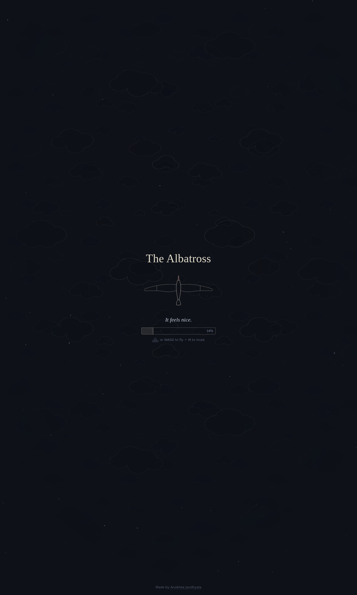
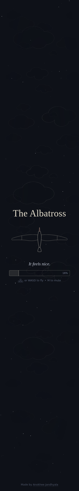

# UI Design System & Master Generation Blueprint: anokhee-dev_albatross

> **The Albatross** (https://anokhee.dev/albatross) — A lone albatross makes first contact with a strange place.



---

## 1. Executive Visual Persona & Design Archetype

- **Brand Essence & Persona**: **The Albatross** (`https://anokhee.dev/albatross`). A lone albatross makes first contact with a strange place.
- **Visual Archetype**: **Light-Substrate Editorial & Modular Grid System (`#c9cfdd` canvas, `#7d879e` ink, `#e7dfc9` accent)**.
- **Anti-AI-Slop Differentiators**:
  - **Source-Grounded Chromatic Polarity**: Anchors the viewport in `#c9cfdd` (`var(--ink)` in `:root`) paired with `#7d879e` primary typography and `#e7dfc9` accents.
  - **Extracted Typographic Hierarchy**: Pairs `Cormorant Garamond` for display copy (`The Albatross`) with `Space Grotesk` and not declared in static CSS (uses primary stack / `ui-monospace`).
  - **Calibrated Spatial Grid & Motion**: Combines `720px` container bounds (`gap: 8px`, padding `16px`) with `cubic-bezier(0.25,0.1,0.25,1)` easing and Three.js / WebGL Canvas Pipeline.

---

## 2. Spatial Architecture & Modular Grid Mathematics



### Viewport Allocation & Container Geometry
- **Captured Viewport Dimensions**: Desktop `1440×2400px` (`assets/desktop.png`, capped at 2400px multi-section capture), Mobile `390×2400px` (`assets/mobile.png`, capped at 2400px multi-section capture).
- **Master Container Bounds**: `720px` extracted from `anokhee-dev_albatross` stylesheet.
- **Canvas Lateral Padding & Spacing**: `16px` lateral canvas padding with `8px` grid gap.
- **Border Radius Scale**: `4.5px`, `7px`, `4px`, `6px`.

### Responsive Breakpoint Architecture
- **Desktop Layout**: Multi-column CSS Grid / Flexbox layout at `1440px` (`max-width: 720px`, `gap: 8px`).
- **Mobile Layout**: Single-column vertical stack at `390px` viewport width with `16px` horizontal padding.
- **Extracted CSS Media Queries**: `@media (prefers-reduced-motion: reduce)`, `@media (max-width: 720px)`.

---

## 3. Color System, Materiality & Atmospheric Lighting

### Semantic Palette & Source Grounding
| Semantic Role | Ground-Truth Value | Extracted CSS Source / Selector |
|---|---|---|
| **Primary Canvas Substrate** | `#c9cfdd` | `var(--ink)` in `:root` |
| **Primary Typography Ink** | `#7d879e` | `var(--mute)` in `:root` |
| **Elevated Surface / Card Substrate** | `#e6dfcc` | `var(--fill)` in `:root` |
| **Interactive Accent / Highlight** | `#e7dfc9` | `var(--lab-bg)` in `:root` |
| **Secondary / Muted Copy** | `#f1ead8` | `var(--lab-bg-2)` in `:root` |
| **Structural Hairline Border** | `#cdc2a5` | `var(--lab-line)` in `:root` |
| **Variable Token (`--lab-ink`)** | `#2a2721` | `var(--lab-ink)` in `:root` |
| **Variable Token (`--lab-mute`)** | `#76705f` | `var(--lab-mute)` in `:root` |
| **Variable Token (`--lab-faint`)** | `#a69e88` | `var(--lab-faint)` in `:root` |
| **Variable Token (`--lab-moss`)** | `#6f8a52` | `var(--lab-moss)` in `:root` |
| **Variable Token (`--lab-clay`)** | `#c0693a` | `var(--lab-clay)` in `:root` |

### Sanitized Root CSS Variables (`ui-ux.md` Ground Truth)
| Variable Name | Extracted Value | Semantic Role |
|---|---|---|
| `--ink` | `#c9cfdd` | Typography Ink Token |
| `--mute` | `#7d879e` | Color / Atmospheric Token |
| `--fill` | `#e6dfcc` | Color / Atmospheric Token |
| `--track` | `rgba(230, 223, 204, 0.1)` | Color / Atmospheric Token |
| `--tile` | `300px` | Dimension / Scale Token |
| `--lab-bg` | `#e7dfc9` | Canvas / Surface Token |
| `--lab-bg-2` | `#f1ead8` | Canvas / Surface Token |
| `--lab-line` | `#cdc2a5` | Color / Atmospheric Token |
| `--lab-ink` | `#2a2721` | Typography Ink Token |
| `--lab-mute` | `#76705f` | Color / Atmospheric Token |
| `--lab-faint` | `#a69e88` | Color / Atmospheric Token |
| `--lab-moss` | `#6f8a52` | Color / Atmospheric Token |
| `--lab-clay` | `#c0693a` | Color / Atmospheric Token |
| `--lab-glass` | `rgba(231, 223, 201, 0.86)` | Color / Atmospheric Token |
| `--anokhee-dev-alba-bg` | `#c9cfdd` | Canvas Substrate (from `var(--ink)` in `:root`) |
| `--anokhee-dev-alba-ink` | `#7d879e` | Primary Typography Ink (stylesheet-derived) |

---

## 4. Typographic Scale & Editorial Hierarchy

### Font Family Stacks
- **Display Typography**: `Cormorant Garamond`.
- **Primary Body Stack**: `Space Grotesk`.
- **Technical / Metadata Stack**: not declared in static CSS (uses primary stack / `ui-monospace`).

### Typographic Scale & Rules (Extracted from Stylesheet & Variables)
- **Hero Display (`H1`)**: rule `h1` (`letter-spacing: 0.01em`).
- **Section Heading (`H2`)**: not explicitly declared on tag in static CSS (stylesheet font-size ladder: `16px`, `12px`, `10.5px`, `13px`, `11px`).
- **Body Copy**: not explicitly declared on tag in static CSS (stylesheet font-size ladder: `16px`, `12px`, `10.5px`, `13px`, `11px`).
- **Metadata & Navigation Labels**: not explicitly declared on tag in static CSS (stylesheet font-size ladder: `16px`, `12px`, `10.5px`, `13px`, `11px`).

---

## 5. Choreographed Motion & Interaction Physics

### Primary Easing Curves
- **Extracted Timing Functions**: `cubic-bezier(0.25,0.1,0.25,1)`.

### Per-Element Transition & Choreography Rules
- **Selector `.pop-toggle`**: `transition: opacity 0.2s ease, background 0.2s ease` extracted from `anokhee-dev_albatross` stylesheet.
- **Selector `.wx-col-next`**: `transition: opacity 0.3s ease` extracted from `anokhee-dev_albatross` stylesheet.
- **Selector `.chips button`**: `transition: background 0.2s ease, color 0.2s ease` extracted from `anokhee-dev_albatross` stylesheet.
- **Standard CSS Easing (`cubic-bezier(0.25,0.1,0.25,1)`)**: Default timing curve (no custom `cubic-bezier()` declared in static CSS).
- **Runtime Interaction Engine**: Integrates Three.js / WebGL Canvas Pipeline with `prefers-reduced-motion: reduce` fallback guards.

---

## 6. Component Wireframe & Structural DOM Map

### Visual Layout Schematic (Grounded in `dom.html` — `1440px` Desktop & `390px` Mobile Reflow)
```
┌────────────────────────────────────────────────────────────────────────┐
│ DESKTOP VIEWPORT (1440px) — The Albatross                              │
│ ====================================================================== │
│ [ <nav.stars>              | Field · Heads · Pillars · Obelisks · T ]  │
│ ---------------------------------------------------------------------- │
│ | HERO STAGE: <section.credits-col>                                |   │
│ | H1: The Albatross                                                |   │
│ | Substrate: #c9cfdd    | Ink: #7d879e    | Accent: #e7dfc9        |   │
│ ---------------------------------------------------------------------- │
│ | SHOWCASE GRID (<section.credits-col>     ) max-w: 720px          |   │
│ | +------------------------------+  +------------------------------+ | │
│ | | Forecast                     |  | Made by                      | | │
│ | +------------------------------+  +------------------------------+ | │
│ ---------------------------------------------------------------------- │
│ | MOBILE VIEWPORT REFLOW (390px) — Single-Column Stack (gap: 8px   ) | │
│ | [<nav.stars>] -> [<section.credits-c] -> [<section.credits-c] |      │
│ ---------------------------------------------------------------------- │
│ [ FOOTER (<footer.near>         ) | https://anokhee.dev/albatross      │
└────────────────────────────────────────────────────────────────────────┘
```

### Granular DOM Region Breakdown
1. **Brand Header & Navigation Bar (<nav.stars> — `anokhee-dev_albatross`)**:
   - Landmark `<nav class="stars">` hosting `The Albatross` navigation (`Field · Heads · Pillars · Obelisks · Trees`), DOM attributes (`data-woke`), and stylesheet rule `root { --ui: "Space Grotesk", "Inter", "IBM Plex Sans", "Helvetica Neue", syste... }`.
2. **Hero Stage & Focal Lead (<section.credits-col> — `The Albatross`)**:
   - Landmark `<section class="credits-col">` presenting display lead `The Albatross` and copy excerpt *"or WASD to fly • M to mute"* over `#c9cfdd` canvas and `#7d879e` ink.
3. **Primary Showcase & Content Grid (<section.credits-col> — `Forecast`)**:
   - Landmark `<section class="credits-col">` rendering section `Forecast` with copy *"Made by Anokhee Jandhyala"*, asset references (`favicon.svg`, `fonts.googleapis.com`, `fonts.gstatic.com`, `css2`), and grid rule `body { margin: 0; height: 100%; overflow: hidden; background: 0e1118; }`.
4. **Interactive Detail & Feature Matrix (<section.credits-col> — `Made by`)**:
   - Landmark `<section class="credits-col">` framing `Made by` and `Music` (*"Music For Dictionary Apps by Ichiro Nakagawa, CC BY"*) with `#e6dfcc` surface cards, `#e7dfc9` accents, and `canvas { display: block; cursor: grab; }`.
5. **Colophon & Global Directory Footer (<footer.near> — `https://anokhee.dev/albatross`)**:
   - Landmark `<footer class="near">` anchoring `The Albatross` footer links (`Field · Heads · Pillars · Obelisks · Trees`), copy *"freesound_community"*, and `#cdc2a5` structural dividers.

---

## 7. Master Zero-Shot AI Generation Prompt

```markdown
# Master Zero-Shot Frontend Generation Prompt: anokhee-dev_albatross (The Albatross)

You are a principal frontend architect and design systems engineer. Build a complete, production-ready web application replicating the exact design system, DOM landmarks, typographic hierarchy, color tokens, and motion physics of `anokhee-dev_albatross` (**The Albatross** — `https://anokhee.dev/albatross`).

### 1. Visual Archetype & Anti-AI-Slop Mandates
- **Archetype**: Light-Substrate Editorial & Modular Grid System (`#c9cfdd` canvas, `#7d879e` ink, `#e7dfc9` accent).
- **Identity & Domain Context**: A lone albatross makes first contact with a strange place.
- **Primary Substrate**: `#c9cfdd` (`var(--ink)` in `:root`), **Primary Ink**: `#7d879e`, **Accent / Highlight**: `#e7dfc9`.
- **Site-Specific Differentiators**:
  - **Source-Grounded Chromatic Polarity**: Anchors the viewport in `#c9cfdd` (`var(--ink)` in `:root`) paired with `#7d879e` primary typography and `#e7dfc9` accents.
  - **Extracted Typographic Hierarchy**: Pairs `Cormorant Garamond` for display copy (`The Albatross`) with `Space Grotesk` and not declared in static CSS (uses primary stack / `ui-monospace`).
  - **Calibrated Spatial Grid & Motion**: Combines `720px` container bounds (`gap: 8px`, padding `16px`) with `cubic-bezier(0.25,0.1,0.25,1)` easing and Three.js / WebGL Canvas Pipeline.

### 2. Ground-Truth CSS Variables (`:root` Token Contract)
Declare and consume these exact custom properties extracted from `anokhee-dev_albatross` in your global stylesheet:

:root {
  /* The Albatross (anokhee-dev_albatross) — Ground-Truth Extracted CSS Variables */
  --ink: #c9cfdd; /* Typography Ink Token (anokhee-dev_albatross) */
  --mute: #7d879e; /* Color / Atmospheric Token (anokhee-dev_albatross) */
  --fill: #e6dfcc; /* Color / Atmospheric Token (anokhee-dev_albatross) */
  --track: rgba(230, 223, 204, 0.1); /* Color / Atmospheric Token (anokhee-dev_albatross) */
  --tile: 300px; /* Dimension / Scale Token (anokhee-dev_albatross) */
  --lab-bg: #e7dfc9; /* Canvas / Surface Token (anokhee-dev_albatross) */
  --lab-bg-2: #f1ead8; /* Canvas / Surface Token (anokhee-dev_albatross) */
  --lab-line: #cdc2a5; /* Color / Atmospheric Token (anokhee-dev_albatross) */
  --lab-ink: #2a2721; /* Typography Ink Token (anokhee-dev_albatross) */
  --lab-mute: #76705f; /* Color / Atmospheric Token (anokhee-dev_albatross) */
  --lab-faint: #a69e88; /* Color / Atmospheric Token (anokhee-dev_albatross) */
  --lab-moss: #6f8a52; /* Color / Atmospheric Token (anokhee-dev_albatross) */
  --lab-clay: #c0693a; /* Color / Atmospheric Token (anokhee-dev_albatross) */
  --lab-glass: rgba(231, 223, 201, 0.86); /* Color / Atmospheric Token (anokhee-dev_albatross) */
  --anokhee-dev-alba-bg: #c9cfdd; /* Canvas Substrate (from `var(--ink)` in `:root`) (anokhee-dev_albatross) */
  --anokhee-dev-alba-ink: #7d879e; /* Primary Typography Ink (stylesheet-derived) (anokhee-dev_albatross) */
}

### 3. Semantic Color & Materiality Contract
Map every surface, ink, and border strictly to these source-grounded tokens:
- **Primary Canvas Substrate**: `#c9cfdd` — grounded in `var(--ink)` in `:root`
- **Primary Typography Ink**: `#7d879e` — grounded in `var(--mute)` in `:root`
- **Elevated Surface / Card Substrate**: `#e6dfcc` — grounded in `var(--fill)` in `:root`
- **Interactive Accent / Highlight**: `#e7dfc9` — grounded in `var(--lab-bg)` in `:root`
- **Secondary / Muted Copy**: `#f1ead8` — grounded in `var(--lab-bg-2)` in `:root`
- **Structural Hairline Border**: `#cdc2a5` — grounded in `var(--lab-line)` in `:root`
- **Variable Token (`--lab-ink`)**: `#2a2721` — grounded in `var(--lab-ink)` in `:root`
- **Variable Token (`--lab-mute`)**: `#76705f` — grounded in `var(--lab-mute)` in `:root`
- **Variable Token (`--lab-faint`)**: `#a69e88` — grounded in `var(--lab-faint)` in `:root`
- **Variable Token (`--lab-moss`)**: `#6f8a52` — grounded in `var(--lab-moss)` in `:root`
- **Variable Token (`--lab-clay`)**: `#c0693a` — grounded in `var(--lab-clay)` in `:root`

### 4. Spatial Grid, Container Bounds & Responsive Breakpoints
- **Desktop Viewport Reference**: `1440×2400px` (capped at 2400px multi-section capture, `1440px` standard desktop width).
- **Mobile Viewport Reference**: `390×2400px` (capped at 2400px multi-section capture, `390px` standard mobile width).
- **Container Max-Width**: `720px` extracted from `anokhee-dev_albatross` stylesheet
- **Padding & Gutters**: `16px` lateral canvas padding with `8px` grid gap
- **Desktop Grid**: Multi-column CSS Grid / Flexbox layout at `1440px` (`max-width: 720px`, `gap: 8px`)
- **Mobile Adaptation**: Single-column vertical stack at `390px` viewport width with `16px` horizontal padding
- **Media Queries**: `@media (prefers-reduced-motion: reduce)`, `@media (max-width: 720px)`
- **Corner Radii**: `4.5px`, `7px`, `4px`, `6px`

### 5. Typography & Editorial Scale Contract
- **Display Font Stack**: `Cormorant Garamond`
- **Body Font Stack**: `Space Grotesk`
- **Monospace / Technical Font Stack**: not declared in static CSS (uses primary stack / `ui-monospace`)
- **H1 Display Rule**: rule `h1` (`letter-spacing: 0.01em`)
- **H2 Section Rule**: not explicitly declared on tag in static CSS (stylesheet font-size ladder: `16px`, `12px`, `10.5px`, `13px`, `11px`)
- **Body Copy Rule**: not explicitly declared on tag in static CSS (stylesheet font-size ladder: `16px`, `12px`, `10.5px`, `13px`, `11px`)
- **Metadata & Index Rule**: not explicitly declared on tag in static CSS (stylesheet font-size ladder: `16px`, `12px`, `10.5px`, `13px`, `11px`)

### 6. Component Hierarchy, Verbatim Copy & Real DOM Landmarks
Scaffold `anokhee-dev_albatross` (`The Albatross`) with these exact structural regions, extracted copy, and CSS rules from `dom.html`:
1. **Brand Header & Navigation Bar (<nav.stars> — `anokhee-dev_albatross`)**:
   - DOM & Selectors: Landmark `<nav class="stars">` hosting `The Albatross` navigation (`Field · Heads · Pillars · Obelisks · Trees`), DOM attributes (`data-woke`), and stylesheet rule `root { --ui: "Space Grotesk", "Inter", "IBM Plex Sans", "Helvetica Neue", syste... }`.
   - Responsive Contract: Header `Brand Header & Navigation Bar (<nav.stars> — `anokhee-dev_albatross`)` (`anokhee-dev_albatross`) adapts across `@media (prefers-reduced-motion: reduce)`, `@media (max-width: 720px)` with `cubic-bezier(0.25,0.1,0.25,1)` transitions and links `Field · Heads · Pillars · Obelisks · Trees`.
2. **Hero Stage & Focal Lead (<section.credits-col> — `The Albatross`)**:
   - DOM & Selectors: Landmark `<section class="credits-col">` presenting display lead `The Albatross` and copy excerpt *"or WASD to fly • M to mute"* over `#c9cfdd` canvas and `#7d879e` ink.
   - Responsive Contract: Hero stage (`1440×2400px` desktop / `390×2400px` mobile) sets `#c9cfdd` background with `#7d879e` headline `The Albatross`.
3. **Primary Showcase & Content Grid (<section.credits-col> — `Forecast`)**:
   - DOM & Selectors: Landmark `<section class="credits-col">` rendering section `Forecast` with copy *"Made by Anokhee Jandhyala"*, asset references (`favicon.svg`, `fonts.googleapis.com`, `fonts.gstatic.com`, `css2`), and grid rule `body { margin: 0; height: 100%; overflow: hidden; background: 0e1118; }`.
   - Responsive Contract: Showcase grid `Primary Showcase & Content Grid (<section.credits-col> — `Forecast`)` applies Multi-column CSS Grid / Flexbox layout at `1440px` (`max-width: 720px`, `gap: 8px`) on desktop and Single-column vertical stack at `390px` viewport width with `16px` horizontal padding on mobile.
4. **Interactive Detail & Feature Matrix (<section.credits-col> — `Made by`)**:
   - DOM & Selectors: Landmark `<section class="credits-col">` framing `Made by` and `Music` (*"Music For Dictionary Apps by Ichiro Nakagawa, CC BY"*) with `#e6dfcc` surface cards, `#e7dfc9` accents, and `canvas { display: block; cursor: grab; }`.
   - Responsive Contract: Detail module `Interactive Detail & Feature Matrix (<section.credits-col> — `Made by`)` uses `4.5px`, `7px`, `4px`, `6px` radii, `#e7dfc9` highlights, and assets (favicon.svg, fonts.googleapis.com, fonts.gstatic.com).
5. **Colophon & Global Directory Footer (<footer.near> — `https://anokhee.dev/albatross`)**:
   - DOM & Selectors: Landmark `<footer class="near">` anchoring `The Albatross` footer links (`Field · Heads · Pillars · Obelisks · Trees`), copy *"freesound_community"*, and `#cdc2a5` structural dividers.
   - Responsive Contract: Footer `Colophon & Global Directory Footer (<footer.near> — `https://anokhee.dev/albatross`)` aligns to `720px` extracted from `anokhee-dev_albatross` stylesheet with `16px` lateral canvas padding with `8px` grid gap and attributes (data-woke).

#### Verbatim DOM Copy Excerpts (`dom.html`)
- Copy Excerpt 1: *"or WASD to fly • M to mute"*
- Copy Excerpt 2: *"Made by Anokhee Jandhyala"*
- Copy Excerpt 3: *"Music For Dictionary Apps by Ichiro Nakagawa, CC BY"*
- Copy Excerpt 4: *"freesound_community"*

### 7. Motion, Extracted Stylesheet Rules & Interaction Choreography
- **Primary Easing Functions**: `cubic-bezier(0.25,0.1,0.25,1)`
- **Extracted Stylesheet Rules (`anokhee-dev_albatross`)**:
- `root { --ui: "Space Grotesk", "Inter", "IBM Plex Sans", "Helvetica Neue", syste... }`
- `body { margin: 0; height: 100%; overflow: hidden; background: 0e1118; }`
- `canvas { display: block; cursor: grab; }`
- `canvas:active { cursor: grabbing; }`
- `.settings-buttons { display: flex; gap: 6px; }`
- **Per-Selector Transition Rules**:
- **Selector `.pop-toggle`**: `transition: opacity 0.2s ease, background 0.2s ease` extracted from `anokhee-dev_albatross` stylesheet.
- **Selector `.wx-col-next`**: `transition: opacity 0.3s ease` extracted from `anokhee-dev_albatross` stylesheet.
- **Selector `.chips button`**: `transition: background 0.2s ease, color 0.2s ease` extracted from `anokhee-dev_albatross` stylesheet.
- **Standard CSS Easing (`cubic-bezier(0.25,0.1,0.25,1)`)**: Default timing curve (no custom `cubic-bezier()` declared in static CSS).
- **Runtime Interaction Engine**: Integrates Three.js / WebGL Canvas Pipeline with `prefers-reduced-motion: reduce` fallback guards.

### 8. Technical Deliverables
- Implement in Next.js (App Router) with TypeScript and Tailwind CSS consuming the `:root` custom properties defined above for `anokhee-dev_albatross`.
- Reproduce both the `1440px` desktop architecture and `390px` mobile breakpoint transitions, preserving semantic HTML5 landmarks (`<header>`, `<nav>`, `<main>`, `<section>`, `<footer>`) and `prefers-reduced-motion` accessibility guards.
```
