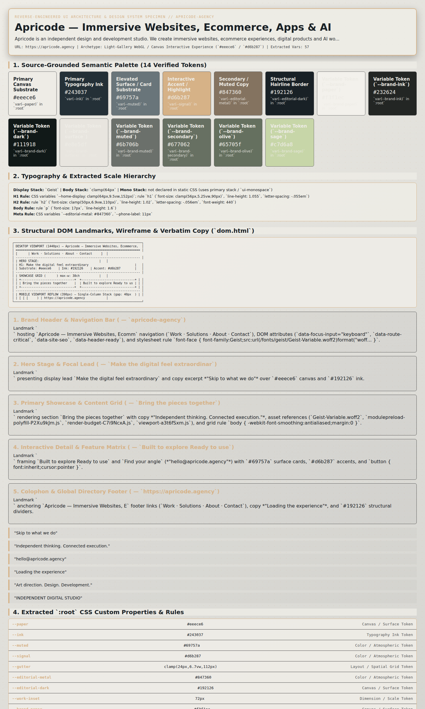
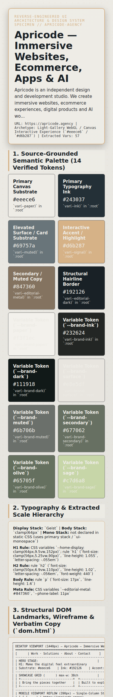

# UI Design System & Master Generation Blueprint: apricode-agency

> **Apricode — Immersive Websites, Ecommerce, Apps & AI** (https://apricode.agency) — Apricode is an independent design and development studio. We create immersive websites, ecommerce experiences, digital products and AI wo...



---

## 1. Executive Visual Persona & Design Archetype

- **Brand Essence & Persona**: **Apricode — Immersive Websites, Ecommerce, Apps & AI** (`https://apricode.agency`). Apricode is an independent design and development studio. We create immersive websites, ecommerce experiences, digital products and AI wo...
- **Visual Archetype**: **Light-Gallery WebGL / Canvas Interactive Experience (`#eeece6` / `#d6b287`)**.
- **Anti-AI-Slop Differentiators**:
  - **Source-Grounded Chromatic Polarity**: Anchors the viewport in `#eeece6` (`var(--paper)` in `:root`) paired with `#192126` primary typography and `#d6b287` accents.
  - **Extracted Typographic Hierarchy**: Pairs `Geist` for display copy (`Make the digital feel extraordinary`) with `clamp(64px` and not declared in static CSS (uses primary stack / `ui-monospace`).
  - **Calibrated Spatial Grid & Motion**: Combines `38ch` container bounds (`gap: 40px`, padding `15px`) with `cubic-bezier(.16,1,.3,1)` easing and Lenis Smooth Scroll (`data-lenis`), GSAP Timeline & ScrollTrigger.

---

## 2. Spatial Architecture & Modular Grid Mathematics



### Viewport Allocation & Container Geometry
- **Captured Viewport Dimensions**: Desktop `1440×2400px` (`assets/desktop.png`, capped at 2400px multi-section capture), Mobile `390×2400px` (`assets/mobile.png`, capped at 2400px multi-section capture).
- **Master Container Bounds**: `38ch` extracted from `apricode-agency` stylesheet.
- **Canvas Lateral Padding & Spacing**: `15px` lateral canvas padding with `40px` grid gap.
- **Border Radius Scale**: `30px`, `50%`, `20px`, `3px`.

### Responsive Breakpoint Architecture
- **Desktop Layout**: Multi-column CSS Grid / Flexbox layout at `1440px` (`max-width: 38ch`, `gap: 40px`).
- **Mobile Layout**: Single-column vertical stack at `390px` viewport width with `15px` horizontal padding.
- **Extracted CSS Media Queries**: `@media (width<=1100px)`, `@media (width<=760px)`, `@media (height<=700px) and (width>=761px)`, `@media (prefers-reduced-motion:reduce)`.

---

## 3. Color System, Materiality & Atmospheric Lighting

### Semantic Palette & Source Grounding
| Semantic Role | Ground-Truth Value | Extracted CSS Source / Selector |
|---|---|---|
| **Primary Canvas Substrate** | `#eeece6` | `var(--paper)` in `:root` |
| **Primary Typography Ink** | `#243037` | `var(--ink)` in `:root` |
| **Elevated Surface / Card Substrate** | `#69757a` | `var(--muted)` in `:root` |
| **Interactive Accent / Highlight** | `#d6b287` | `var(--signal)` in `:root` |
| **Secondary / Muted Copy** | `#847360` | `var(--editorial-metal)` in `:root` |
| **Structural Hairline Border** | `#192126` | `var(--editorial-dark)` in `:root` |
| **Variable Token (`--brand-paper`)** | `#f3f1ec` | `var(--brand-paper)` in `:root` |
| **Variable Token (`--brand-ink`)** | `#232624` | `var(--brand-ink)` in `:root` |
| **Variable Token (`--brand-dark`)** | `#111918` | `var(--brand-dark)` in `:root` |
| **Variable Token (`--brand-surface`)** | `#e8e5df` | `var(--brand-surface)` in `:root` |
| **Variable Token (`--brand-muted`)** | `#6b706b` | `var(--brand-muted)` in `:root` |
| **Variable Token (`--brand-secondary`)** | `#677062` | `var(--brand-secondary)` in `:root` |
| **Variable Token (`--brand-olive`)** | `#65705f` | `var(--brand-olive)` in `:root` |
| **Variable Token (`--brand-sage`)** | `#c7d6a8` | `var(--brand-sage)` in `:root` |

### Sanitized Root CSS Variables (`ui-ux.md` Ground Truth)
| Variable Name | Extracted Value | Semantic Role |
|---|---|---|
| `--paper` | `#eeece6` | Canvas / Surface Token |
| `--ink` | `#243037` | Typography Ink Token |
| `--muted` | `#69757a` | Color / Atmospheric Token |
| `--signal` | `#d6b287` | Color / Atmospheric Token |
| `--gutter` | `clamp(24px,6.7vw,112px)` | Layout / Spatial Grid Token |
| `--editorial-metal` | `#847360` | Color / Atmospheric Token |
| `--editorial-dark` | `#192126` | Canvas / Surface Token |
| `--work-inset` | `72px` | Dimension / Scale Token |
| `--brand-paper` | `#f3f1ec` | Canvas / Surface Token |
| `--brand-ink` | `#232624` | Typography Ink Token |
| `--brand-dark` | `#111918` | Canvas / Surface Token |
| `--brand-surface` | `#e8e5df` | Canvas / Surface Token |
| `--brand-muted` | `#6b706b` | Brand / Palette Token |
| `--brand-secondary` | `#677062` | Brand / Palette Token |
| `--brand-olive` | `#65705f` | Brand / Palette Token |
| `--brand-sage` | `#c7d6a8` | Brand / Palette Token |

---

## 4. Typographic Scale & Editorial Hierarchy

### Font Family Stacks
- **Display Typography**: `Geist`.
- **Primary Body Stack**: `clamp(64px`.
- **Technical / Metadata Stack**: not declared in static CSS (uses primary stack / `ui-monospace`).

### Typographic Scale & Rules (Extracted from Stylesheet & Variables)
- **Hero Display (`H1`)**: CSS variables `--home-display: clamp(64px,9.5vw,152px)`; rule `h1` (`font-size: clamp(56px,5.25vw,90px)`, `line-height: 1.055`, `letter-spacing: -.055em`).
- **Section Heading (`H2`)**: rule `h2` (`font-size: clamp(50px,6.9vw,110px)`, `line-height: 1.02`, `letter-spacing: -.056em`, `font-weight: 440`).
- **Body Copy**: rule `p` (`font-size: 17px`, `line-height: 1.6`).
- **Metadata & Navigation Labels**: CSS variables `--editorial-metal: #847360`, `--phone-label: 11px`.

---

## 5. Choreographed Motion & Interaction Physics

### Primary Easing Curves
- **Extracted Timing Functions**: `cubic-bezier(.16,1,.3,1)`, `cubic-bezier(.2,.7,.2,1)`, `cubic-bezier(.32,0,.2,1)`.

### Per-Element Transition & Choreography Rules
- **Selector `.passage-nav`**: `transition: transform .4s,color .3s` extracted from `apricode-agency` stylesheet.
- **Selector `.passage-nav>nav>a:not(.nav-conta...`**: `transition: transform .3s` extracted from `apricode-agency` stylesheet.
- **Selector `.text-link span`**: `transition: transform .3s` extracted from `apricode-agency` stylesheet.
- **Extracted Easing Curve (`cubic-bezier(.16,1,.3,1)`)**: Governs interactive state transitions across `<header.passage-nav>` and `<section.scene-copy>`.
- **Runtime Interaction Engine**: Integrates Lenis Smooth Scroll (`data-lenis`), GSAP Timeline & ScrollTrigger, Three.js / WebGL Canvas Pipeline with `prefers-reduced-motion: reduce` fallback guards.

---

## 6. Component Wireframe & Structural DOM Map

### Visual Layout Schematic (Grounded in `dom.html` — `1440px` Desktop & `390px` Mobile Reflow)
```
┌────────────────────────────────────────────────────────────────────────┐
│ DESKTOP VIEWPORT (1440px) — Apricode — Immersive Websites, Ecommerce,  │
│ ====================================================================== │
│ [ <header.passage-nav>     | Work · Solutions · About · Contact     ]  │
│ ---------------------------------------------------------------------- │
│ | HERO STAGE: <section.scene-copy>                                 |   │
│ | H1: Make the digital feel extraordinary                          |   │
│ | Substrate: #eeece6    | Ink: #192126    | Accent: #d6b287        |   │
│ ---------------------------------------------------------------------- │
│ | SHOWCASE GRID (<section.scene-copy>      ) max-w: 38ch           |   │
│ | +------------------------------+  +------------------------------+ | │
│ | | Bring the pieces together    |  | Built to explore Ready to us | | │
│ | +------------------------------+  +------------------------------+ | │
│ ---------------------------------------------------------------------- │
│ | MOBILE VIEWPORT REFLOW (390px) — Single-Column Stack (gap: 40px  ) | │
│ | [<header.passage-na] -> [<section.scene-cop] -> [<section.scene-cop] │
│ ---------------------------------------------------------------------- │
│ [ FOOTER (<footer.site-end>     ) | https://apricode.agency            │
└────────────────────────────────────────────────────────────────────────┘
```

### Granular DOM Region Breakdown
1. **Brand Header & Navigation Bar (<header.passage-nav> — `apricode-agency`)**:
   - Landmark `<header class="passage-nav has-adaptive-header">` hosting `Apricode — Immersive Websites, Ecomm` navigation (`Work · Solutions · About · Contact`), DOM attributes (`data-focus-input="keyboard"`, `data-route-critical`, `data-site-seo`, `data-header-ready`), and stylesheet rule `font-face { font-family:Geist;src:url(/fonts/geist/Geist-Variable.woff2)format("woff... }`.
2. **Hero Stage & Focal Lead (<section.scene-copy> — `Make the digital feel extraordinar`)**:
   - Landmark `<section class="scene-copy scene-copy--hero">` presenting display lead `Make the digital feel extraordinary` and copy excerpt *"Skip to what we do"* over `#eeece6` canvas and `#192126` ink.
3. **Primary Showcase & Content Grid (<section.scene-copy> — `Bring the pieces together`)**:
   - Landmark `<section class="scene-copy scene-copy--pieces">` rendering section `Bring the pieces together` with copy *"Independent thinking. Connected execution."*, asset references (`Geist-Variable.woff2`, `modulepreload-polyfill-P2Xu9kJm.js`, `render-budget-C7i9NcxA.js`, `viewport-a3t6fSxm.js`), and grid rule `body { -webkit-font-smoothing:antialiased;margin:0 }`.
4. **Interactive Detail & Feature Matrix (<section.scene-copy> — `Built to explore Ready to use`)**:
   - Landmark `<section class="scene-copy scene-copy--connection">` framing `Built to explore Ready to use` and `Find your angle` (*"hello@apricode.agency"*) with `#69757a` surface cards, `#d6b287` accents, and `button { font:inherit;cursor:pointer }`.
5. **Colophon & Global Directory Footer (<footer.site-end> — `https://apricode.agency`)**:
   - Landmark `<footer class="site-end">` anchoring `Apricode — Immersive Websites, E` footer links (`Work · Solutions · About · Contact`), copy *"Loading the experience"*, and `#192126` structural dividers.

---

## 7. Master Zero-Shot AI Generation Prompt

```markdown
# Master Zero-Shot Frontend Generation Prompt: apricode-agency (Apricode — Immersive Websites, Ecommerce, Apps & AI)

You are a principal frontend architect and design systems engineer. Build a complete, production-ready web application replicating the exact design system, DOM landmarks, typographic hierarchy, color tokens, and motion physics of `apricode-agency` (**Apricode — Immersive Websites, Ecommerce, Apps & AI** — `https://apricode.agency`).

### 1. Visual Archetype & Anti-AI-Slop Mandates
- **Archetype**: Light-Gallery WebGL / Canvas Interactive Experience (`#eeece6` / `#d6b287`).
- **Identity & Domain Context**: Apricode is an independent design and development studio. We create immersive websites, ecommerce experiences, digital products and AI wo...
- **Primary Substrate**: `#eeece6` (`var(--paper)` in `:root`), **Primary Ink**: `#192126`, **Accent / Highlight**: `#d6b287`.
- **Site-Specific Differentiators**:
  - **Source-Grounded Chromatic Polarity**: Anchors the viewport in `#eeece6` (`var(--paper)` in `:root`) paired with `#192126` primary typography and `#d6b287` accents.
  - **Extracted Typographic Hierarchy**: Pairs `Geist` for display copy (`Make the digital feel extraordinary`) with `clamp(64px` and not declared in static CSS (uses primary stack / `ui-monospace`).
  - **Calibrated Spatial Grid & Motion**: Combines `38ch` container bounds (`gap: 40px`, padding `15px`) with `cubic-bezier(.16,1,.3,1)` easing and Lenis Smooth Scroll (`data-lenis`), GSAP Timeline & ScrollTrigger.

### 2. Ground-Truth CSS Variables (`:root` Token Contract)
Declare and consume these exact custom properties extracted from `apricode-agency` in your global stylesheet:

:root {
  /* Apricode — Immersive Websites, Ecommerce, Apps & AI (apricode-agency) — Ground-Truth Extracted CSS Variables */
  --paper: #eeece6; /* Canvas / Surface Token (apricode-agency) */
  --ink: #243037; /* Typography Ink Token (apricode-agency) */
  --muted: #69757a; /* Color / Atmospheric Token (apricode-agency) */
  --signal: #d6b287; /* Color / Atmospheric Token (apricode-agency) */
  --gutter: clamp(24px,6.7vw,112px); /* Layout / Spatial Grid Token (apricode-agency) */
  --editorial-metal: #847360; /* Color / Atmospheric Token (apricode-agency) */
  --editorial-dark: #192126; /* Canvas / Surface Token (apricode-agency) */
  --work-inset: 72px; /* Dimension / Scale Token (apricode-agency) */
  --brand-paper: #f3f1ec; /* Canvas / Surface Token (apricode-agency) */
  --brand-ink: #232624; /* Typography Ink Token (apricode-agency) */
  --brand-dark: #111918; /* Canvas / Surface Token (apricode-agency) */
  --brand-surface: #e8e5df; /* Canvas / Surface Token (apricode-agency) */
  --brand-muted: #6b706b; /* Brand / Palette Token (apricode-agency) */
  --brand-secondary: #677062; /* Brand / Palette Token (apricode-agency) */
  --brand-olive: #65705f; /* Brand / Palette Token (apricode-agency) */
  --brand-sage: #c7d6a8; /* Brand / Palette Token (apricode-agency) */
}

### 3. Semantic Color & Materiality Contract
Map every surface, ink, and border strictly to these source-grounded tokens:
- **Primary Canvas Substrate**: `#eeece6` — grounded in `var(--paper)` in `:root`
- **Primary Typography Ink**: `#243037` — grounded in `var(--ink)` in `:root`
- **Elevated Surface / Card Substrate**: `#69757a` — grounded in `var(--muted)` in `:root`
- **Interactive Accent / Highlight**: `#d6b287` — grounded in `var(--signal)` in `:root`
- **Secondary / Muted Copy**: `#847360` — grounded in `var(--editorial-metal)` in `:root`
- **Structural Hairline Border**: `#192126` — grounded in `var(--editorial-dark)` in `:root`
- **Variable Token (`--brand-paper`)**: `#f3f1ec` — grounded in `var(--brand-paper)` in `:root`
- **Variable Token (`--brand-ink`)**: `#232624` — grounded in `var(--brand-ink)` in `:root`
- **Variable Token (`--brand-dark`)**: `#111918` — grounded in `var(--brand-dark)` in `:root`
- **Variable Token (`--brand-surface`)**: `#e8e5df` — grounded in `var(--brand-surface)` in `:root`
- **Variable Token (`--brand-muted`)**: `#6b706b` — grounded in `var(--brand-muted)` in `:root`
- **Variable Token (`--brand-secondary`)**: `#677062` — grounded in `var(--brand-secondary)` in `:root`
- **Variable Token (`--brand-olive`)**: `#65705f` — grounded in `var(--brand-olive)` in `:root`
- **Variable Token (`--brand-sage`)**: `#c7d6a8` — grounded in `var(--brand-sage)` in `:root`

### 4. Spatial Grid, Container Bounds & Responsive Breakpoints
- **Desktop Viewport Reference**: `1440×2400px` (capped at 2400px multi-section capture, `1440px` standard desktop width).
- **Mobile Viewport Reference**: `390×2400px` (capped at 2400px multi-section capture, `390px` standard mobile width).
- **Container Max-Width**: `38ch` extracted from `apricode-agency` stylesheet
- **Padding & Gutters**: `15px` lateral canvas padding with `40px` grid gap
- **Desktop Grid**: Multi-column CSS Grid / Flexbox layout at `1440px` (`max-width: 38ch`, `gap: 40px`)
- **Mobile Adaptation**: Single-column vertical stack at `390px` viewport width with `15px` horizontal padding
- **Media Queries**: `@media (width<=1100px)`, `@media (width<=760px)`, `@media (height<=700px) and (width>=761px)`, `@media (prefers-reduced-motion:reduce)`
- **Corner Radii**: `30px`, `50%`, `20px`, `3px`

### 5. Typography & Editorial Scale Contract
- **Display Font Stack**: `Geist`
- **Body Font Stack**: `clamp(64px`
- **Monospace / Technical Font Stack**: not declared in static CSS (uses primary stack / `ui-monospace`)
- **H1 Display Rule**: CSS variables `--home-display: clamp(64px,9.5vw,152px)`; rule `h1` (`font-size: clamp(56px,5.25vw,90px)`, `line-height: 1.055`, `letter-spacing: -.055em`)
- **H2 Section Rule**: rule `h2` (`font-size: clamp(50px,6.9vw,110px)`, `line-height: 1.02`, `letter-spacing: -.056em`, `font-weight: 440`)
- **Body Copy Rule**: rule `p` (`font-size: 17px`, `line-height: 1.6`)
- **Metadata & Index Rule**: CSS variables `--editorial-metal: #847360`, `--phone-label: 11px`

### 6. Component Hierarchy, Verbatim Copy & Real DOM Landmarks
Scaffold `apricode-agency` (`Apricode — Immersive Websites, Ecommerce, Apps & AI`) with these exact structural regions, extracted copy, and CSS rules from `dom.html`:
1. **Brand Header & Navigation Bar (<header.passage-nav> — `apricode-agency`)**:
   - DOM & Selectors: Landmark `<header class="passage-nav has-adaptive-header">` hosting `Apricode — Immersive Websites, Ecomm` navigation (`Work · Solutions · About · Contact`), DOM attributes (`data-focus-input="keyboard"`, `data-route-critical`, `data-site-seo`, `data-header-ready`), and stylesheet rule `font-face { font-family:Geist;src:url(/fonts/geist/Geist-Variable.woff2)format("woff... }`.
   - Responsive Contract: Header `Brand Header & Navigation Bar (<header.passage-nav> — `apricode-agency`)` (`apricode-agency`) adapts across `@media (width<=1100px)`, `@media (width<=760px)`, `@media (height<=700px) and (width>=761px)`, `@media (prefers-reduced-motion:reduce)` with `cubic-bezier(.16,1,.3,1)`, `cubic-bezier(.2,.7,.2,1)`, `cubic-bezier(.32,0,.2,1)` transitions and links `Work · Solutions · About · Contact`.
2. **Hero Stage & Focal Lead (<section.scene-copy> — `Make the digital feel extraordinar`)**:
   - DOM & Selectors: Landmark `<section class="scene-copy scene-copy--hero">` presenting display lead `Make the digital feel extraordinary` and copy excerpt *"Skip to what we do"* over `#eeece6` canvas and `#192126` ink.
   - Responsive Contract: Hero stage (`1440×2400px` desktop / `390×2400px` mobile) sets `#eeece6` background with `#192126` headline `Make the digital feel extraordinary`.
3. **Primary Showcase & Content Grid (<section.scene-copy> — `Bring the pieces together`)**:
   - DOM & Selectors: Landmark `<section class="scene-copy scene-copy--pieces">` rendering section `Bring the pieces together` with copy *"Independent thinking. Connected execution."*, asset references (`Geist-Variable.woff2`, `modulepreload-polyfill-P2Xu9kJm.js`, `render-budget-C7i9NcxA.js`, `viewport-a3t6fSxm.js`), and grid rule `body { -webkit-font-smoothing:antialiased;margin:0 }`.
   - Responsive Contract: Showcase grid `Primary Showcase & Content Grid (<section.scene-copy> — `Bring the pieces together`)` applies Multi-column CSS Grid / Flexbox layout at `1440px` (`max-width: 38ch`, `gap: 40px`) on desktop and Single-column vertical stack at `390px` viewport width with `15px` horizontal padding on mobile.
4. **Interactive Detail & Feature Matrix (<section.scene-copy> — `Built to explore Ready to use`)**:
   - DOM & Selectors: Landmark `<section class="scene-copy scene-copy--connection">` framing `Built to explore Ready to use` and `Find your angle` (*"hello@apricode.agency"*) with `#69757a` surface cards, `#d6b287` accents, and `button { font:inherit;cursor:pointer }`.
   - Responsive Contract: Detail module `Interactive Detail & Feature Matrix (<section.scene-copy> — `Built to explore Ready to use`)` uses `30px`, `50%`, `20px`, `3px` radii, `#d6b287` highlights, and assets (Geist-Variable.woff2, modulepreload-polyfill-P2Xu9kJm.js, render-budget-C7i9NcxA.js).
5. **Colophon & Global Directory Footer (<footer.site-end> — `https://apricode.agency`)**:
   - DOM & Selectors: Landmark `<footer class="site-end">` anchoring `Apricode — Immersive Websites, E` footer links (`Work · Solutions · About · Contact`), copy *"Loading the experience"*, and `#192126` structural dividers.
   - Responsive Contract: Footer `Colophon & Global Directory Footer (<footer.site-end> — `https://apricode.agency`)` aligns to `38ch` extracted from `apricode-agency` stylesheet with `15px` lateral canvas padding with `40px` grid gap and attributes (data-focus-input="keyboard", data-route-critical, data-site-seo).

#### Verbatim DOM Copy Excerpts (`dom.html`)
- Copy Excerpt 1: *"Skip to what we do"*
- Copy Excerpt 2: *"Independent thinking. Connected execution."*
- Copy Excerpt 3: *"hello@apricode.agency"*
- Copy Excerpt 4: *"Loading the experience"*

### 7. Motion, Extracted Stylesheet Rules & Interaction Choreography
- **Primary Easing Functions**: `cubic-bezier(.16,1,.3,1)`, `cubic-bezier(.2,.7,.2,1)`, `cubic-bezier(.32,0,.2,1)`
- **Extracted Stylesheet Rules (`apricode-agency`)**:
- `font-face { font-family:Geist;src:url(/fonts/geist/Geist-Variable.woff2)format("woff... }`
- `body { -webkit-font-smoothing:antialiased;margin:0 }`
- `button { font:inherit;cursor:pointer }`
- `a:focus-visible { outline:2px solid var(--signal);outline-offset:6px }`
- `img { object-fit:cover;width:100%;height:100%;display:block }`
- **Per-Selector Transition Rules**:
- **Selector `.passage-nav`**: `transition: transform .4s,color .3s` extracted from `apricode-agency` stylesheet.
- **Selector `.passage-nav>nav>a:not(.nav-conta...`**: `transition: transform .3s` extracted from `apricode-agency` stylesheet.
- **Selector `.text-link span`**: `transition: transform .3s` extracted from `apricode-agency` stylesheet.
- **Extracted Easing Curve (`cubic-bezier(.16,1,.3,1)`)**: Governs interactive state transitions across `<header.passage-nav>` and `<section.scene-copy>`.
- **Runtime Interaction Engine**: Integrates Lenis Smooth Scroll (`data-lenis`), GSAP Timeline & ScrollTrigger, Three.js / WebGL Canvas Pipeline with `prefers-reduced-motion: reduce` fallback guards.

### 8. Technical Deliverables
- Implement in Next.js (App Router) with TypeScript and Tailwind CSS consuming the `:root` custom properties defined above for `apricode-agency`.
- Reproduce both the `1440px` desktop architecture and `390px` mobile breakpoint transitions, preserving semantic HTML5 landmarks (`<header>`, `<nav>`, `<main>`, `<section>`, `<footer>`) and `prefers-reduced-motion` accessibility guards.
```
