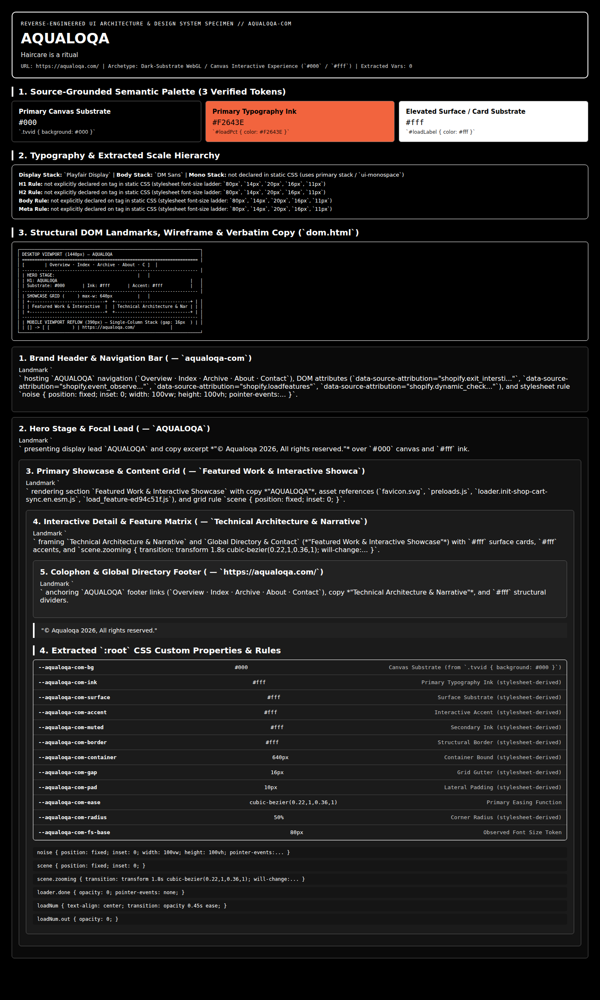
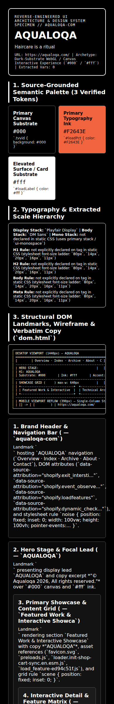

# UI Design System & Master Generation Blueprint: aqualoqa-com

> **AQUALOQA** (https://aqualoqa.com/) — Haircare is a ritual



---

## 1. Executive Visual Persona & Design Archetype

- **Brand Essence & Persona**: **AQUALOQA** (`https://aqualoqa.com/`). Haircare is a ritual
- **Visual Archetype**: **Dark-Substrate WebGL / Canvas Interactive Experience (`#000` / `#fff`)**.
- **Anti-AI-Slop Differentiators**:
  - **Source-Grounded Chromatic Polarity**: Anchors the viewport in `#000` (`.tvvid { background: #000 }`) paired with `#fff` primary typography and `#fff` accents.
  - **Extracted Typographic Hierarchy**: Pairs `Playfair Display` for display copy (`AQUALOQA`) with `DM Sans` and not declared in static CSS (uses primary stack / `ui-monospace`).
  - **Calibrated Spatial Grid & Motion**: Combines `640px` container bounds (`gap: 16px`, padding `10px`) with `cubic-bezier(0.22,1,0.36,1)` easing and HTML5 `<canvas>` Interactive Viewport Surface.

---

## 2. Spatial Architecture & Modular Grid Mathematics



### Viewport Allocation & Container Geometry
- **Captured Viewport Dimensions**: Desktop `1440×2400px` (`assets/desktop.png`, capped at 2400px multi-section capture), Mobile `390×2400px` (`assets/mobile.png`, capped at 2400px multi-section capture).
- **Master Container Bounds**: `640px` extracted from `aqualoqa-com` stylesheet.
- **Canvas Lateral Padding & Spacing**: `10px` lateral canvas padding with `16px` grid gap.
- **Border Radius Scale**: `50%`, `2px`.

### Responsive Breakpoint Architecture
- **Desktop Layout**: Multi-column CSS Grid / Flexbox layout at `1440px` (`max-width: 640px`, `gap: 16px`).
- **Mobile Layout**: Single-column vertical stack at `390px` viewport width with `10px` horizontal padding.
- **Extracted CSS Media Queries**: `@media (prefers-reduced-motion: reduce)`, `@media (max-width: 640px)`.

---

## 3. Color System, Materiality & Atmospheric Lighting

### Semantic Palette & Source Grounding
| Semantic Role | Ground-Truth Value | Extracted CSS Source / Selector |
|---|---|---|
| **Primary Canvas Substrate** | `#000` | `.tvvid { background: #000 }` |
| **Primary Typography Ink** | `#F2643E` | `#loadPct { color: #F2643E }` |
| **Elevated Surface / Card Substrate** | `#fff` | `#loadLabel { color: #fff }` |

### Sanitized Root CSS Variables (`ui-ux.md` Ground Truth)
| Variable Name | Extracted Value | Semantic Role |
|---|---|---|
| `--aqualoqa-com-bg` | `#000` | Canvas Substrate (from `.tvvid { background: #000 }`) |
| `--aqualoqa-com-ink` | `#fff` | Primary Typography Ink (stylesheet-derived) |
| `--aqualoqa-com-surface` | `#fff` | Surface Substrate (stylesheet-derived) |
| `--aqualoqa-com-accent` | `#fff` | Interactive Accent (stylesheet-derived) |
| `--aqualoqa-com-muted` | `#fff` | Secondary Ink (stylesheet-derived) |
| `--aqualoqa-com-border` | `#fff` | Structural Border (stylesheet-derived) |
| `--aqualoqa-com-container` | `640px` | Container Bound (stylesheet-derived) |
| `--aqualoqa-com-gap` | `16px` | Grid Gutter (stylesheet-derived) |
| `--aqualoqa-com-pad` | `10px` | Lateral Padding (stylesheet-derived) |
| `--aqualoqa-com-ease` | `cubic-bezier(0.22,1,0.36,1)` | Primary Easing Function |
| `--aqualoqa-com-radius` | `50%` | Corner Radius (stylesheet-derived) |
| `--aqualoqa-com-fs-base` | `80px` | Observed Font Size Token |

---

## 4. Typographic Scale & Editorial Hierarchy

### Font Family Stacks
- **Display Typography**: `Playfair Display`.
- **Primary Body Stack**: `DM Sans`.
- **Technical / Metadata Stack**: not declared in static CSS (uses primary stack / `ui-monospace`).

### Typographic Scale & Rules (Extracted from Stylesheet & Variables)
- **Hero Display (`H1`)**: not explicitly declared on tag in static CSS (stylesheet font-size ladder: `80px`, `14px`, `20px`, `16px`, `11px`).
- **Section Heading (`H2`)**: not explicitly declared on tag in static CSS (stylesheet font-size ladder: `80px`, `14px`, `20px`, `16px`, `11px`).
- **Body Copy**: not explicitly declared on tag in static CSS (stylesheet font-size ladder: `80px`, `14px`, `20px`, `16px`, `11px`).
- **Metadata & Navigation Labels**: not explicitly declared on tag in static CSS (stylesheet font-size ladder: `80px`, `14px`, `20px`, `16px`, `11px`).

---

## 5. Choreographed Motion & Interaction Physics

### Primary Easing Curves
- **Extracted Timing Functions**: `cubic-bezier(0.22,1,0.36,1)`.

### Per-Element Transition & Choreography Rules
- **Selector `#scene.zooming`**: `transition: transform 1.8s cubic-bezier(0.22,1,0.36,1)` extracted from `aqualoqa-com` stylesheet.
- **Selector `#loader`**: `transition: opacity 0.6s ease 0.15s` extracted from `aqualoqa-com` stylesheet.
- **Selector `#loadNum`**: `transition: opacity 0.45s ease` extracted from `aqualoqa-com` stylesheet.
- **Extracted Easing Curve (`cubic-bezier(0.22,1,0.36,1)`)**: Governs interactive state transitions across `<header.analytics>` and `<div.shopify-section>`.
- **Runtime Interaction Engine**: Integrates HTML5 `<canvas>` Interactive Viewport Surface with `prefers-reduced-motion: reduce` fallback guards.

---

## 6. Component Wireframe & Structural DOM Map

### Visual Layout Schematic (Grounded in `dom.html` — `1440px` Desktop & `390px` Mobile Reflow)
```
┌────────────────────────────────────────────────────────────────────────┐
│ DESKTOP VIEWPORT (1440px) — AQUALOQA                                   │
│ ====================================================================== │
│ [ <header.analytics>       | Overview · Index · Archive · About · C ]  │
│ ---------------------------------------------------------------------- │
│ | HERO STAGE: <div.shopify-section>                                |   │
│ | H1: AQUALOQA                                                     |   │
│ | Substrate: #000       | Ink: #fff       | Accent: #fff           |   │
│ ---------------------------------------------------------------------- │
│ | SHOWCASE GRID (<div.shopify-section>     ) max-w: 640px          |   │
│ | +------------------------------+  +------------------------------+ | │
│ | | Featured Work & Interactive  |  | Technical Architecture & Nar | | │
│ | +------------------------------+  +------------------------------+ | │
│ ---------------------------------------------------------------------- │
│ | MOBILE VIEWPORT REFLOW (390px) — Single-Column Stack (gap: 16px  ) | │
│ | [<header.analytics>] -> [<div.shopify-secti] -> [<div.shopify-secti] │
│ ---------------------------------------------------------------------- │
│ [ FOOTER (<footer.done>         ) | https://aqualoqa.com/              │
└────────────────────────────────────────────────────────────────────────┘
```

### Granular DOM Region Breakdown
1. **Brand Header & Navigation Bar (<header.analytics> — `aqualoqa-com`)**:
   - Landmark `<header class="analytics">` hosting `AQUALOQA` navigation (`Overview · Index · Archive · About · Contact`), DOM attributes (`data-source-attribution="shopify.exit_intersti..."`, `data-source-attribution="shopify.event_observe..."`, `data-source-attribution="shopify.loadfeatures"`, `data-source-attribution="shopify.dynamic_check..."`), and stylesheet rule `noise { position: fixed; inset: 0; width: 100vw; height: 100vh; pointer-events:... }`.
2. **Hero Stage & Focal Lead (<div.shopify-section> — `AQUALOQA`)**:
   - Landmark `<div class="shopify-section">` presenting display lead `AQUALOQA` and copy excerpt *"© Aqualoqa 2026, All rights reserved."* over `#000` canvas and `#fff` ink.
3. **Primary Showcase & Content Grid (<div.shopify-section> — `Featured Work & Interactive Showca`)**:
   - Landmark `<div class="shopify-section">` rendering section `Featured Work & Interactive Showcase` with copy *"AQUALOQA"*, asset references (`favicon.svg`, `preloads.js`, `loader.init-shop-cart-sync.en.esm.js`, `load_feature-ed94c51f.js`), and grid rule `scene { position: fixed; inset: 0; }`.
4. **Interactive Detail & Feature Matrix (<div.shopify-section> — `Technical Architecture & Narrative`)**:
   - Landmark `<div class="shopify-section">` framing `Technical Architecture & Narrative` and `Global Directory & Contact` (*"Featured Work & Interactive Showcase"*) with `#fff` surface cards, `#fff` accents, and `scene.zooming { transition: transform 1.8s cubic-bezier(0.22,1,0.36,1); will-change:... }`.
5. **Colophon & Global Directory Footer (<footer.done> — `https://aqualoqa.com/`)**:
   - Landmark `<footer class="done">` anchoring `AQUALOQA` footer links (`Overview · Index · Archive · About · Contact`), copy *"Technical Architecture & Narrative"*, and `#fff` structural dividers.

---

## 7. Master Zero-Shot AI Generation Prompt

```markdown
# Master Zero-Shot Frontend Generation Prompt: aqualoqa-com (AQUALOQA)

You are a principal frontend architect and design systems engineer. Build a complete, production-ready web application replicating the exact design system, DOM landmarks, typographic hierarchy, color tokens, and motion physics of `aqualoqa-com` (**AQUALOQA** — `https://aqualoqa.com/`).

### 1. Visual Archetype & Anti-AI-Slop Mandates
- **Archetype**: Dark-Substrate WebGL / Canvas Interactive Experience (`#000` / `#fff`).
- **Identity & Domain Context**: Haircare is a ritual
- **Primary Substrate**: `#000` (`.tvvid { background: #000 }`), **Primary Ink**: `#fff`, **Accent / Highlight**: `#fff`.
- **Site-Specific Differentiators**:
  - **Source-Grounded Chromatic Polarity**: Anchors the viewport in `#000` (`.tvvid { background: #000 }`) paired with `#fff` primary typography and `#fff` accents.
  - **Extracted Typographic Hierarchy**: Pairs `Playfair Display` for display copy (`AQUALOQA`) with `DM Sans` and not declared in static CSS (uses primary stack / `ui-monospace`).
  - **Calibrated Spatial Grid & Motion**: Combines `640px` container bounds (`gap: 16px`, padding `10px`) with `cubic-bezier(0.22,1,0.36,1)` easing and HTML5 `<canvas>` Interactive Viewport Surface.

### 2. Ground-Truth CSS Variables (`:root` Token Contract)
Declare and consume these exact custom properties extracted from `aqualoqa-com` in your global stylesheet:

:root {
  /* AQUALOQA (aqualoqa-com) — Ground-Truth Extracted CSS Variables */
  --aqualoqa-com-bg: #000; /* Canvas Substrate (from `.tvvid { background: #000 }`) (aqualoqa-com) */
  --aqualoqa-com-ink: #fff; /* Primary Typography Ink (stylesheet-derived) (aqualoqa-com) */
  --aqualoqa-com-surface: #fff; /* Surface Substrate (stylesheet-derived) (aqualoqa-com) */
  --aqualoqa-com-accent: #fff; /* Interactive Accent (stylesheet-derived) (aqualoqa-com) */
  --aqualoqa-com-muted: #fff; /* Secondary Ink (stylesheet-derived) (aqualoqa-com) */
  --aqualoqa-com-border: #fff; /* Structural Border (stylesheet-derived) (aqualoqa-com) */
  --aqualoqa-com-container: 640px; /* Container Bound (stylesheet-derived) (aqualoqa-com) */
  --aqualoqa-com-gap: 16px; /* Grid Gutter (stylesheet-derived) (aqualoqa-com) */
  --aqualoqa-com-pad: 10px; /* Lateral Padding (stylesheet-derived) (aqualoqa-com) */
  --aqualoqa-com-ease: cubic-bezier(0.22,1,0.36,1); /* Primary Easing Function (aqualoqa-com) */
  --aqualoqa-com-radius: 50%; /* Corner Radius (stylesheet-derived) (aqualoqa-com) */
  --aqualoqa-com-fs-base: 80px; /* Observed Font Size Token (aqualoqa-com) */
}

### 3. Semantic Color & Materiality Contract
Map every surface, ink, and border strictly to these source-grounded tokens:
- **Primary Canvas Substrate**: `#000` — grounded in `.tvvid { background: #000 }`
- **Primary Typography Ink**: `#F2643E` — grounded in `#loadPct { color: #F2643E }`
- **Elevated Surface / Card Substrate**: `#fff` — grounded in `#loadLabel { color: #fff }`

### 4. Spatial Grid, Container Bounds & Responsive Breakpoints
- **Desktop Viewport Reference**: `1440×2400px` (capped at 2400px multi-section capture, `1440px` standard desktop width).
- **Mobile Viewport Reference**: `390×2400px` (capped at 2400px multi-section capture, `390px` standard mobile width).
- **Container Max-Width**: `640px` extracted from `aqualoqa-com` stylesheet
- **Padding & Gutters**: `10px` lateral canvas padding with `16px` grid gap
- **Desktop Grid**: Multi-column CSS Grid / Flexbox layout at `1440px` (`max-width: 640px`, `gap: 16px`)
- **Mobile Adaptation**: Single-column vertical stack at `390px` viewport width with `10px` horizontal padding
- **Media Queries**: `@media (prefers-reduced-motion: reduce)`, `@media (max-width: 640px)`
- **Corner Radii**: `50%`, `2px`

### 5. Typography & Editorial Scale Contract
- **Display Font Stack**: `Playfair Display`
- **Body Font Stack**: `DM Sans`
- **Monospace / Technical Font Stack**: not declared in static CSS (uses primary stack / `ui-monospace`)
- **H1 Display Rule**: not explicitly declared on tag in static CSS (stylesheet font-size ladder: `80px`, `14px`, `20px`, `16px`, `11px`)
- **H2 Section Rule**: not explicitly declared on tag in static CSS (stylesheet font-size ladder: `80px`, `14px`, `20px`, `16px`, `11px`)
- **Body Copy Rule**: not explicitly declared on tag in static CSS (stylesheet font-size ladder: `80px`, `14px`, `20px`, `16px`, `11px`)
- **Metadata & Index Rule**: not explicitly declared on tag in static CSS (stylesheet font-size ladder: `80px`, `14px`, `20px`, `16px`, `11px`)

### 6. Component Hierarchy, Verbatim Copy & Real DOM Landmarks
Scaffold `aqualoqa-com` (`AQUALOQA`) with these exact structural regions, extracted copy, and CSS rules from `dom.html`:
1. **Brand Header & Navigation Bar (<header.analytics> — `aqualoqa-com`)**:
   - DOM & Selectors: Landmark `<header class="analytics">` hosting `AQUALOQA` navigation (`Overview · Index · Archive · About · Contact`), DOM attributes (`data-source-attribution="shopify.exit_intersti..."`, `data-source-attribution="shopify.event_observe..."`, `data-source-attribution="shopify.loadfeatures"`, `data-source-attribution="shopify.dynamic_check..."`), and stylesheet rule `noise { position: fixed; inset: 0; width: 100vw; height: 100vh; pointer-events:... }`.
   - Responsive Contract: Header `Brand Header & Navigation Bar (<header.analytics> — `aqualoqa-com`)` (`aqualoqa-com`) adapts across `@media (prefers-reduced-motion: reduce)`, `@media (max-width: 640px)` with `cubic-bezier(0.22,1,0.36,1)` transitions and links `Overview · Index · Archive · About · Contact`.
2. **Hero Stage & Focal Lead (<div.shopify-section> — `AQUALOQA`)**:
   - DOM & Selectors: Landmark `<div class="shopify-section">` presenting display lead `AQUALOQA` and copy excerpt *"© Aqualoqa 2026, All rights reserved."* over `#000` canvas and `#fff` ink.
   - Responsive Contract: Hero stage (`1440×2400px` desktop / `390×2400px` mobile) sets `#000` background with `#fff` headline `AQUALOQA`.
3. **Primary Showcase & Content Grid (<div.shopify-section> — `Featured Work & Interactive Showca`)**:
   - DOM & Selectors: Landmark `<div class="shopify-section">` rendering section `Featured Work & Interactive Showcase` with copy *"AQUALOQA"*, asset references (`favicon.svg`, `preloads.js`, `loader.init-shop-cart-sync.en.esm.js`, `load_feature-ed94c51f.js`), and grid rule `scene { position: fixed; inset: 0; }`.
   - Responsive Contract: Showcase grid `Primary Showcase & Content Grid (<div.shopify-section> — `Featured Work & Interactive Showca`)` applies Multi-column CSS Grid / Flexbox layout at `1440px` (`max-width: 640px`, `gap: 16px`) on desktop and Single-column vertical stack at `390px` viewport width with `10px` horizontal padding on mobile.
4. **Interactive Detail & Feature Matrix (<div.shopify-section> — `Technical Architecture & Narrative`)**:
   - DOM & Selectors: Landmark `<div class="shopify-section">` framing `Technical Architecture & Narrative` and `Global Directory & Contact` (*"Featured Work & Interactive Showcase"*) with `#fff` surface cards, `#fff` accents, and `scene.zooming { transition: transform 1.8s cubic-bezier(0.22,1,0.36,1); will-change:... }`.
   - Responsive Contract: Detail module `Interactive Detail & Feature Matrix (<div.shopify-section> — `Technical Architecture & Narrative`)` uses `50%`, `2px` radii, `#fff` highlights, and assets (favicon.svg, preloads.js, loader.init-shop-cart-sync.en.esm.js).
5. **Colophon & Global Directory Footer (<footer.done> — `https://aqualoqa.com/`)**:
   - DOM & Selectors: Landmark `<footer class="done">` anchoring `AQUALOQA` footer links (`Overview · Index · Archive · About · Contact`), copy *"Technical Architecture & Narrative"*, and `#fff` structural dividers.
   - Responsive Contract: Footer `Colophon & Global Directory Footer (<footer.done> — `https://aqualoqa.com/`)` aligns to `640px` extracted from `aqualoqa-com` stylesheet with `10px` lateral canvas padding with `16px` grid gap and attributes (data-source-attribution="shopify.exit_intersti...", data-source-attribution="shopify.event_observe...", data-source-attribution="shopify.loadfeatures").

#### Verbatim DOM Copy Excerpts (`dom.html`)
- Copy Excerpt 1: *"© Aqualoqa 2026, All rights reserved."*

### 7. Motion, Extracted Stylesheet Rules & Interaction Choreography
- **Primary Easing Functions**: `cubic-bezier(0.22,1,0.36,1)`
- **Extracted Stylesheet Rules (`aqualoqa-com`)**:
- `noise { position: fixed; inset: 0; width: 100vw; height: 100vh; pointer-events:... }`
- `scene { position: fixed; inset: 0; }`
- `scene.zooming { transition: transform 1.8s cubic-bezier(0.22,1,0.36,1); will-change:... }`
- `loader.done { opacity: 0; pointer-events: none; }`
- `loadNum { text-align: center; transition: opacity 0.45s ease; }`
- **Per-Selector Transition Rules**:
- **Selector `#scene.zooming`**: `transition: transform 1.8s cubic-bezier(0.22,1,0.36,1)` extracted from `aqualoqa-com` stylesheet.
- **Selector `#loader`**: `transition: opacity 0.6s ease 0.15s` extracted from `aqualoqa-com` stylesheet.
- **Selector `#loadNum`**: `transition: opacity 0.45s ease` extracted from `aqualoqa-com` stylesheet.
- **Extracted Easing Curve (`cubic-bezier(0.22,1,0.36,1)`)**: Governs interactive state transitions across `<header.analytics>` and `<div.shopify-section>`.
- **Runtime Interaction Engine**: Integrates HTML5 `<canvas>` Interactive Viewport Surface with `prefers-reduced-motion: reduce` fallback guards.

### 8. Technical Deliverables
- Implement in Next.js (App Router) with TypeScript and Tailwind CSS consuming the `:root` custom properties defined above for `aqualoqa-com`.
- Reproduce both the `1440px` desktop architecture and `390px` mobile breakpoint transitions, preserving semantic HTML5 landmarks (`<header>`, `<nav>`, `<main>`, `<section>`, `<footer>`) and `prefers-reduced-motion` accessibility guards.
```
