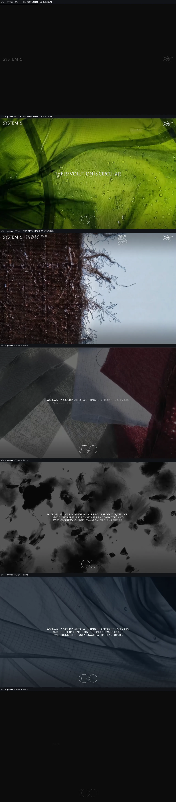
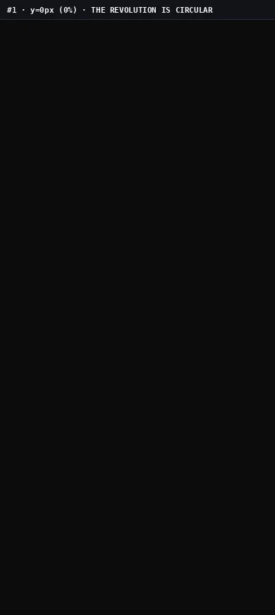

# UI Design System & Master Generation Blueprint: arcteryx-com_us-en-explore-system0

> **System 0 · Arc’teryx** (https://arcteryx.com/us/en/explore/system0) — System 0 is the Arc’teryx platform linking our products, services, and guest experience together in a committed, synchronized journey tow...





---

## 1. Executive Visual Persona & Design Archetype

- **Brand Essence & Persona**: **System 0 · Arc’teryx** (`https://arcteryx.com/us/en/explore/system0`). System 0 is the Arc’teryx platform linking our products, services, and guest experience together in a committed, synchronized journey tow...
- **Capture Provenance**: Live browser capture (`tier1_fast`, HTTP `200`, captured `2026-11-24`).
- **Visual Archetype**: **High-Contrast Obsidian / Atmospheric Design System (`#0c0c0c` canvas, `#fdfdfd` ink, `#1883fd` accent)**.
- **Anti-AI-Slop Differentiators**:
  - **Live-Computed Chromatic Polarity**: Anchors the viewport in `#0c0c0c` (live computed `html` `background-color` (`computed_styles.json`)) paired with `#fdfdfd` primary typography and `#1883fd` accents.
  - **Grounded Typographic Hierarchy**: Uses `Elan ITC Pro` across display (`THE REVOLUTION IS CIRCULAR`) and body copy.
  - **Calibrated Spatial Grid & Motion**: Combines `1440px` container bounds (`gap: 16.5%`, padding `var(--dot-overlap-offset-horizontal)`) with `cubic-bezier(.42,0,.58,1)` easing and Three.js / WebGL Canvas Pipeline, Swiper Touch Carousel Engine.

---

## 2. Spatial Architecture & Modular Grid Mathematics

### Viewport Allocation & Container Geometry
- **Captured Journey Filmstrips**: Desktop `1280×5796px` (`assets/desktop-journey.webp`, `7` keyframes up to `y=0px` / doc `900px`), Mobile `390×872px` (`assets/mobile-journey.webp`, `1` keyframes).
- **Master Container Bounds**: `1440px` (full-bleed `100%` desktop stage measured on `1440px` viewport).
- **Canvas Lateral Padding & Spacing**: `var(--dot-overlap-offset-horizontal)` lateral canvas padding with `16.5%` grid gap.
- **Border Radius Scale**: `50%`, `3px`, `2.5px`, `4px`.

### Responsive Breakpoint Architecture
- **Desktop Layout**: Multi-column CSS Grid / Flexbox layout at `1440px` (`max-width: 1440px`, `gap: 16.5%`).
- **Mobile Layout**: Single-column vertical stack at `390px` viewport width with `var(--dot-overlap-offset-horizontal)` horizontal padding.
- **Extracted CSS Media Queries**: `@media (prefers-reduced-motion:no-preference)`, `@media only screen and (min-width:1280px)`, `@media only screen and (max-width:1279px)`, `@media only screen and (min-width:768px)`.

---

## 3. Color System, Materiality & Atmospheric Lighting

### Semantic Palette & Source Grounding
| Semantic Role | Ground-Truth Value | Extracted Live / CSS Source |
|---|---|---|
| **Primary Canvas Substrate** | `#0c0c0c` | live computed `html` `background-color` (`computed_styles.json`) |
| **Primary Typography Ink** | `#fdfdfd` | live computed `h1` `color` (`computed_styles.json`) |
| **Elevated Surface / Card Substrate** | `#2c6415` | `#ot-sdk-btn.optanon-show-settin... { background-color: #2c6415 }` |
| **Interactive Accent / Highlight** | `#1883fd` | `#onetrust-pc-sdk #ot-pc-desc a:... { color: #1883fd }` |
| **Secondary / Muted Copy** | `#1f96db` | `-banner-sdk .onetrust-vendors-l... { color: #1f96db }` |
| **Structural Hairline Border** | `#57665a` | `#ot-sdk-btn.optanon-show-settin... { border: #57665a }` |

### Sanitized Root CSS Variables (`ui-ux.md` Ground Truth)
| Variable Name | Extracted Value | Semantic Role |
|---|---|---|
| `--dot-overlap-offset-horizontal` | `12px` | Dimension / Scale Token |
| `--dot-overlap-offset-vertical` | `14px` | Dimension / Scale Token |
| `--dot-overlap-offset-relative` | `calc( var(--dot-overlap-offset-horizontal) + .5% )` | Dimension / Scale Token |
| `--circle-size` | `var(--button-circle-small-size)` | Layout / Spatial Grid Token |
| `--circle-border-opacity` | `1` | Elevation / Border Token |
| `--circle-border-interact` | `.2` | Elevation / Border Token |
| `--circle-content-opacity` | `1` | Design System Custom Token |
| `--circle-content-interact` | `1` | Design System Custom Token |
| `--pill-background` | `rgb(26, 26, 26)` | Canvas / Surface Token |
| `--pill-color` | `rgb(253, 253, 253)` | Brand / Palette Token |
| `--pill-background-active` | `rgb(212, 212, 212)` | Canvas / Surface Token |
| `--pill-color-active` | `rgb(12, 12, 12)` | Brand / Palette Token |
| `--pill-background-hover` | `rgb(253, 253, 253)` | Canvas / Surface Token |
| `--pill-color-hover` | `rgb(12, 12, 12)` | Brand / Palette Token |
| `--pill-background-disabled` | `rgb(253, 253, 253)` | Canvas / Surface Token |
| `--pill-color-disabled` | `rgb(212, 212, 212)` | Brand / Palette Token |

---

## 4. Typographic Scale & Editorial Hierarchy

### Font Family Stacks
- **Display Typography**: `Elan ITC Pro`.
- **Primary Body Stack**: `Elan ITC Pro`.
- **Technical / Metadata Stack**: not declared in live computed styles (uses primary stack / `ui-monospace`).

### Typographic Scale & Rules (Live Computed & Stylesheet Grounded)
- **Hero Display (`H1`)**: live computed `h1` (`font-size: 40px`, `line-height: 40px`, `font-weight: 400`, `letter-spacing: 0.4px`); CSS variables `--font-helvetica-now-display: "Helvetica Now Display", helvetica, sans-serif`, `--type-font-size-display-1: 34px`, `--type-font-size-display-2: 20px`; rule `h1` (`font-size: 1.5rem`, `line-height: 1.2`).
- **Section Heading (`H2`)**: live computed `h2` (`font-size: 22px`, `line-height: 24px`, `font-weight: 400`, `letter-spacing: 0.4px`); rule `h2` (`font-size: 1.5rem`, `line-height: 1.25`).
- **Body Copy**: live computed `body` (`font-size: 16px`, `line-height: normal`, `font-weight: 400`); CSS variables `--type-font-size-body-1: 18px`, `--type-font-size-body-2: 14px`, `--type-line-height-body-1: 22px`; rule `,p` (`line-height: inherit`, `letter-spacing: inherit`, `font-weight: inherit`).
- **Metadata & Navigation Labels**: live computed `nav/a` (`font-size: 16px`, `line-height: normal`, `font-weight: 400`); CSS variables `--type-letter-spacing-display-1: .4px`, `--type-letter-spacing-display-2: .4px`, `--type-letter-spacing-body-1: .25px`.

---

## 5. Choreographed Motion & Interaction Physics

### Primary Easing Curves
- **Extracted Timing Functions**: `cubic-bezier(.42,0,.58,1)`, `cubic-bezier(.87,-.01,.16,1)`.

### Per-Element Transition & Choreography Rules
- **Selector `media(prefers-reduced-motion:no-p...`**: `transition: opacity .2s cubic-bezier(.42,0,.58,1)` extracted from `arcteryx-com_us-en-explore-system0` stylesheet.
- **Selector `media(prefers-reduced-motion:no-p...`**: `transition: fill .2s cubic-bezier(.42,0,.58,1),stroke-opacity .2s cubic-be...` extracted from `arcteryx-com_us-en-explore-system0` stylesheet.
- **Selector `media(prefers-reduced-motion:no-p...`**: `transition: opacity .2s cubic-bezier(.42,0,.58,1)` extracted from `arcteryx-com_us-en-explore-system0` stylesheet.
- **Extracted Easing Curve (`cubic-bezier(.42,0,.58,1)`)**: Governs interactive state transitions across `<header.onetrust-pc-dark-filter>` and `<section.ot-fade-in>`.
- **Runtime Interaction Engine**: Integrates Three.js / WebGL Canvas Pipeline, Swiper Touch Carousel Engine with `prefers-reduced-motion: reduce` fallback guards.
### Measured Runtime Scroll & Interaction Telemetry (`behavioral_journey_v2`)
- **Scroll Driver Mode**: `wheel` (max document height `900px`, deepest scrollY reached `0px` across `7` desktop keyframes).
- **Detected Scroll / Motion Libraries**: Native browser scroll / standard CSS transitions.
- **Hover Physics (`primary_cta` · `I.`)**: Computed transition `0s` / `ease` (no static color/transform shift captured at rest).
- **Route Transition Architecture**: First internal navigation (`/us/en/explore/system0/mission/`) measured as `direct` in `2028ms`.

---

## 6. Component Wireframe & Structural DOM Map

### Visual Layout Schematic — Desktop (`1440px`, Grounded in `dom.html` & Landmark Bounding Boxes)
```
┌────────────────────────────────────────────────────────────────────────┐
│ DESKTOP VIEWPORT (1440px) — System 0 · Arc’teryx                       │
│ ====================================================================== │
│ [ <header.onetrust-pc-da (1440x208px) | PROCESS · MISSION · SPERRO S ] │
│ ---------------------------------------------------------------------- │
│ | HERO STAGE: <section.ot-hide> (w=1440px)                           | │
│ | H1: THE REVOLUTION IS CIRCULAR                                     | │
│ | Substrate: #0c0c0c | Ink: #fdfdfd | Accent: #1883fd                | │
│ ---------------------------------------------------------------------- │
│ | SHOWCASE GRID (<section.ot-fade-in>) max-w: 1440px                 | │
│ | +------------------------------+  +------------------------------+ | │
│ | | The Revolution is Circular   |  | Find preferred materials     | | │
│ | +------------------------------+  +------------------------------+ | │
│ ---------------------------------------------------------------------- │
│ | DETAIL MODULE (<section.otFloatingRounded) — Design for durability | │
│ ---------------------------------------------------------------------- │
│ [ FOOTER (<footer.otRelFont>  ) | https://arcteryx.com/us/en/explore/  │
└────────────────────────────────────────────────────────────────────────┘
```

### Visual Layout Schematic — Mobile Reflow (`390px`)
```
┌────────────────────────────────────────────────────────────────────────┐
│ MOBILE VIEWPORT REFLOW (390px) — Single-Column Stack (gap: 16.5%)      │
│ ====================================================================== │
│ [ HEADER BAR (<header.onetrust-pc-dark) | Compact Menu (390px)         │
│ ---------------------------------------------------------------------- │
│ | HERO STAGE (<section.ot-hide>) — 390px Vertical Lead               | │
│ | H1: THE REVOLUTION IS CIRCULAR                                     | │
│ ---------------------------------------------------------------------- │
│ | SHOWCASE STACK (<section.ot-fade-in>) — 1-Col Stack                | │
│ | [ Item 1: The Revolution is Circular                             ] | │
│ | [ Item 2: Find preferred materials                               ] | │
│ ---------------------------------------------------------------------- │
│ | DETAIL STACK (<section.otFloatingRound) — 1-Col (Design for durabil) │
│ ---------------------------------------------------------------------- │
│ [ FOOTER (<footer.otRelFont>  ) | Stacked 390px Colophon               │
└────────────────────────────────────────────────────────────────────────┘
```

### Granular DOM Region Breakdown
1. **Brand Header & Navigation Bar (<header.onetrust-pc-dark-filter> — `arcteryx-com_us-en-explore-system0`)**:
   - Landmark `<header class="onetrust-pc-dark-filter">` (`1440x208px`) hosting `System 0 · Arc’teryx` navigation (`PROCESS · MISSION · SPERRO SV · ARC’TERYX · ReBIRD`), DOM attributes (`data-signup-tag="4467"`, `data-is-header-visible="true"`, `data-id="D15L1J3C77UCOE1UF3N0"`, `data-document-language="true"`), and stylesheet rule `._container_ybue0_1 { display:grid;width:100% }`.
2. **Hero Stage & Focal Lead (<section.ot-hide> — `THE REVOLUTION IS CIRCULAR`)**:
   - Landmark `<section class="ot-hide">` presenting display lead `THE REVOLUTION IS CIRCULAR` and copy excerpt *"TO CREATE AN ENDURING SYSTEM,SOMETIMES YOU HAVE TO BREAK IT ALL D"* over `#0c0c0c` canvas and `#fdfdfd` ink.
3. **Primary Showcase & Content Grid (<section.ot-fade-in> — `The Revolution is Circular`)**:
   - Landmark `<section class="ot-fade-in">` rendering section `The Revolution is Circular` with copy *"To create an enduring system, Sometimes you have to break it all "*, asset references (`identify_f7846436.js`, `amzn.js`, `main.MTUyMzg1YjAxMQ.js`, `0.8.77`), and grid rule `._asset_ybue0_9 { opacity:0;transition:opacity .2s cubic-bezier(.42,0,.58,1) }`.
4. **Interactive Detail & Feature Matrix (<section.otFloatingRoundedCorner> — `Find preferred materials`)**:
   - Landmark `<section class="otFloatingRoundedCorner">` framing `Find preferred materials` and `Design for durability` (*"To create an enduring system,"*) with `#2c6415` surface cards, `#1883fd` accents, and `._picture_ybue0_18 { display:contents }`.
5. **Colophon & Global Directory Footer (<footer.otRelFont> — `https://arcteryx.com/us/en/explore/system0`)**:
   - Landmark `<footer class="otRelFont">` anchoring `System 0 · Arc’teryx` footer links (`PROCESS · MISSION · SPERRO SV · ARC’TERYX · ReBIRD`), copy *"Sometimes you have to break it all down."*, and `#57665a` structural dividers.
### Full Vertical Scroll Sequence (Desktop `1440×900` Keyframes)
- **Step 01** (`y=0px`, `0%`): Active landmark `THE REVOLUTION IS CIRCULAR` · sticky/fixed elements: `3`
- **Step 02** (`y=0px`, `8%`): Active landmark `THE REVOLUTION IS CIRCULAR` · sticky/fixed elements: `3`
- **Step 03** (`y=0px`, `17%`): Active landmark `THE REVOLUTION IS CIRCULAR` · sticky/fixed elements: `3`
- **Step 04** (`y=0px`, `25%`): Active landmark `Hero` · sticky/fixed elements: `3`
- **Step 05** (`y=0px`, `33%`): Active landmark `Hero` · sticky/fixed elements: `3`
- **Step 06** (`y=0px`, `42%`): Active landmark `Hero` · sticky/fixed elements: `3`
- **Step 07** (`y=0px`, `50%`): Active landmark `Hero` · sticky/fixed elements: `3`

### Multi-Page Internal Route Map
- **Detail Route (`/us/en/explore/system0/mission/`)**: `https://arcteryx.com/us/en/explore/system0/mission/` — H1: `TO CREATE AN ENDURING SYSTEM, SOMETIMES YOU HAVE...`, scrollHeight `900px`, transition `direct` (`2028ms`)
- **Detail Route (`/us/en/explore/system0/sperrosv/`)**: `https://arcteryx.com/us/en/explore/system0/sperrosv/` — H1: `DESIGNED TO PERSIST™`, scrollHeight `900px`, transition `direct` (`1485ms`)
- **Detail Route (`/us/en/`)**: `https://arcteryx.com/us/en/` — H1: `NEW TOURING KITS`, scrollHeight `5146px`, transition `direct` (`2906ms`)

---

## 7. Master Zero-Shot AI Generation Prompt

```markdown
# Master Zero-Shot Frontend Generation Prompt: arcteryx-com_us-en-explore-system0 (System 0 · Arc’teryx)

You are a principal frontend architect and design systems engineer. Build a complete, production-ready web application replicating the exact design system, DOM landmarks, typographic hierarchy, color tokens, and motion physics of `arcteryx-com_us-en-explore-system0` (**System 0 · Arc’teryx** — `https://arcteryx.com/us/en/explore/system0`).

### 1. Visual Archetype & Anti-AI-Slop Mandates
- **Archetype**: High-Contrast Obsidian / Atmospheric Design System (`#0c0c0c` canvas, `#fdfdfd` ink, `#1883fd` accent).
- **Identity & Domain Context**: System 0 is the Arc’teryx platform linking our products, services, and guest experience together in a committed, synchronized journey tow...
- **Primary Substrate**: `#0c0c0c` (live computed `html` `background-color` (`computed_styles.json`)), **Primary Ink**: `#fdfdfd`, **Accent / Highlight**: `#1883fd`.
- **Site-Specific Differentiators**:
  - **Live-Computed Chromatic Polarity**: Anchors the viewport in `#0c0c0c` (live computed `html` `background-color` (`computed_styles.json`)) paired with `#fdfdfd` primary typography and `#1883fd` accents.
  - **Grounded Typographic Hierarchy**: Uses `Elan ITC Pro` across display (`THE REVOLUTION IS CIRCULAR`) and body copy.
  - **Calibrated Spatial Grid & Motion**: Combines `1440px` container bounds (`gap: 16.5%`, padding `var(--dot-overlap-offset-horizontal)`) with `cubic-bezier(.42,0,.58,1)` easing and Three.js / WebGL Canvas Pipeline, Swiper Touch Carousel Engine.

### 2. Ground-Truth CSS Variables (`:root` Token Contract)
Declare and consume these exact custom properties extracted from `arcteryx-com_us-en-explore-system0` in your global stylesheet:

:root {
  /* System 0 · Arc’teryx (arcteryx-com_us-en-explore-system0) — Live-Grounded CSS Variables */
  --dot-overlap-offset-horizontal: 12px; /* Dimension / Scale Token (arcteryx-com_us-en-explore-system0) */
  --dot-overlap-offset-vertical: 14px; /* Dimension / Scale Token (arcteryx-com_us-en-explore-system0) */
  --dot-overlap-offset-relative: calc( var(--dot-overlap-offset-horizontal) + .5% ); /* Dimension / Scale Token (arcteryx-com_us-en-explore-system0) */
  --circle-size: var(--button-circle-small-size); /* Layout / Spatial Grid Token (arcteryx-com_us-en-explore-system0) */
  --circle-border-opacity: 1; /* Elevation / Border Token (arcteryx-com_us-en-explore-system0) */
  --circle-border-interact: .2; /* Elevation / Border Token (arcteryx-com_us-en-explore-system0) */
  --circle-content-opacity: 1; /* Design System Custom Token (arcteryx-com_us-en-explore-system0) */
  --circle-content-interact: 1; /* Design System Custom Token (arcteryx-com_us-en-explore-system0) */
  --pill-background: rgb(26, 26, 26); /* Canvas / Surface Token (arcteryx-com_us-en-explore-system0) */
  --pill-color: rgb(253, 253, 253); /* Brand / Palette Token (arcteryx-com_us-en-explore-system0) */
  --pill-background-active: rgb(212, 212, 212); /* Canvas / Surface Token (arcteryx-com_us-en-explore-system0) */
  --pill-color-active: rgb(12, 12, 12); /* Brand / Palette Token (arcteryx-com_us-en-explore-system0) */
  --pill-background-hover: rgb(253, 253, 253); /* Canvas / Surface Token (arcteryx-com_us-en-explore-system0) */
  --pill-color-hover: rgb(12, 12, 12); /* Brand / Palette Token (arcteryx-com_us-en-explore-system0) */
  --pill-background-disabled: rgb(253, 253, 253); /* Canvas / Surface Token (arcteryx-com_us-en-explore-system0) */
  --pill-color-disabled: rgb(212, 212, 212); /* Brand / Palette Token (arcteryx-com_us-en-explore-system0) */
}

### 3. Semantic Color & Materiality Contract
Map every surface, ink, and border strictly to these source-grounded tokens:
- **Primary Canvas Substrate**: `#0c0c0c` — grounded in live computed `html` `background-color` (`computed_styles.json`)
- **Primary Typography Ink**: `#fdfdfd` — grounded in live computed `h1` `color` (`computed_styles.json`)
- **Elevated Surface / Card Substrate**: `#2c6415` — grounded in `#ot-sdk-btn.optanon-show-settin... { background-color: #2c6415 }`
- **Interactive Accent / Highlight**: `#1883fd` — grounded in `#onetrust-pc-sdk #ot-pc-desc a:... { color: #1883fd }`
- **Secondary / Muted Copy**: `#1f96db` — grounded in `-banner-sdk .onetrust-vendors-l... { color: #1f96db }`
- **Structural Hairline Border**: `#57665a` — grounded in `#ot-sdk-btn.optanon-show-settin... { border: #57665a }`

### 4. Spatial Grid, Container Bounds & Responsive Breakpoints
- **Desktop Viewport Reference**: `1280×5796px` (multi-frame vertical journey filmstrip (5796px), `1440px` standard desktop width).
- **Mobile Viewport Reference**: `390×872px` (full-page live capture (872px), `390px` standard mobile width).
- **Container Max-Width**: `1440px` (full-bleed `100%` desktop stage measured on `1440px` viewport)
- **Padding & Gutters**: `var(--dot-overlap-offset-horizontal)` lateral canvas padding with `16.5%` grid gap
- **Desktop Grid**: Multi-column CSS Grid / Flexbox layout at `1440px` (`max-width: 1440px`, `gap: 16.5%`)
- **Mobile Adaptation**: Single-column vertical stack at `390px` viewport width with `var(--dot-overlap-offset-horizontal)` horizontal padding
- **Media Queries**: `@media (prefers-reduced-motion:no-preference)`, `@media only screen and (min-width:1280px)`, `@media only screen and (max-width:1279px)`, `@media only screen and (min-width:768px)`
- **Corner Radii**: `50%`, `3px`, `2.5px`, `4px`

### 5. Typography & Editorial Scale Contract
- **Display Font Stack**: `Elan ITC Pro`
- **Body Font Stack**: `Elan ITC Pro`
- **Monospace / Technical Font Stack**: not declared in live computed styles (uses primary stack / `ui-monospace`)
- **H1 Display Rule**: live computed `h1` (`font-size: 40px`, `line-height: 40px`, `font-weight: 400`, `letter-spacing: 0.4px`); CSS variables `--font-helvetica-now-display: "Helvetica Now Display", helvetica, sans-serif`, `--type-font-size-display-1: 34px`, `--type-font-size-display-2: 20px`; rule `h1` (`font-size: 1.5rem`, `line-height: 1.2`)
- **H2 Section Rule**: live computed `h2` (`font-size: 22px`, `line-height: 24px`, `font-weight: 400`, `letter-spacing: 0.4px`); rule `h2` (`font-size: 1.5rem`, `line-height: 1.25`)
- **Body Copy Rule**: live computed `body` (`font-size: 16px`, `line-height: normal`, `font-weight: 400`); CSS variables `--type-font-size-body-1: 18px`, `--type-font-size-body-2: 14px`, `--type-line-height-body-1: 22px`; rule `,p` (`line-height: inherit`, `letter-spacing: inherit`, `font-weight: inherit`)
- **Metadata & Index Rule**: live computed `nav/a` (`font-size: 16px`, `line-height: normal`, `font-weight: 400`); CSS variables `--type-letter-spacing-display-1: .4px`, `--type-letter-spacing-display-2: .4px`, `--type-letter-spacing-body-1: .25px`

### 6. Component Hierarchy, Verbatim Copy & Real DOM Landmarks
Scaffold `arcteryx-com_us-en-explore-system0` (`System 0 · Arc’teryx`) with these exact structural regions, extracted copy, and CSS rules from `dom.html`:
1. **Brand Header & Navigation Bar (<header.onetrust-pc-dark-filter> — `arcteryx-com_us-en-explore-system0`)**:
   - DOM & Selectors: Landmark `<header class="onetrust-pc-dark-filter">` (`1440x208px`) hosting `System 0 · Arc’teryx` navigation (`PROCESS · MISSION · SPERRO SV · ARC’TERYX · ReBIRD`), DOM attributes (`data-signup-tag="4467"`, `data-is-header-visible="true"`, `data-id="D15L1J3C77UCOE1UF3N0"`, `data-document-language="true"`), and stylesheet rule `._container_ybue0_1 { display:grid;width:100% }`.
   - Responsive Contract: Header `Brand Header & Navigation Bar (<header.onetrust-pc-dark-filter> — `arcteryx-com_us-en-explore-system0`)` (`arcteryx-com_us-en-explore-system0`) adapts across `@media (prefers-reduced-motion:no-preference)`, `@media only screen and (min-width:1280px)`, `@media only screen and (max-width:1279px)`, `@media only screen and (min-width:768px)` with `cubic-bezier(.42,0,.58,1)`, `cubic-bezier(.87,-.01,.16,1)` transitions and links `PROCESS · MISSION · SPERRO SV · ARC’TERYX · ReBIRD`.
2. **Hero Stage & Focal Lead (<section.ot-hide> — `THE REVOLUTION IS CIRCULAR`)**:
   - DOM & Selectors: Landmark `<section class="ot-hide">` presenting display lead `THE REVOLUTION IS CIRCULAR` and copy excerpt *"TO CREATE AN ENDURING SYSTEM,SOMETIMES YOU HAVE TO BREAK IT ALL D"* over `#0c0c0c` canvas and `#fdfdfd` ink.
   - Responsive Contract: Hero stage (`1280×5796px` desktop / `390×872px` mobile) sets `#0c0c0c` background with `#fdfdfd` headline `THE REVOLUTION IS CIRCULAR`.
3. **Primary Showcase & Content Grid (<section.ot-fade-in> — `The Revolution is Circular`)**:
   - DOM & Selectors: Landmark `<section class="ot-fade-in">` rendering section `The Revolution is Circular` with copy *"To create an enduring system, Sometimes you have to break it all "*, asset references (`identify_f7846436.js`, `amzn.js`, `main.MTUyMzg1YjAxMQ.js`, `0.8.77`), and grid rule `._asset_ybue0_9 { opacity:0;transition:opacity .2s cubic-bezier(.42,0,.58,1) }`.
   - Responsive Contract: Showcase grid `Primary Showcase & Content Grid (<section.ot-fade-in> — `The Revolution is Circular`)` applies Multi-column CSS Grid / Flexbox layout at `1440px` (`max-width: 1440px`, `gap: 16.5%`) on desktop and Single-column vertical stack at `390px` viewport width with `var(--dot-overlap-offset-horizontal)` horizontal padding on mobile.
4. **Interactive Detail & Feature Matrix (<section.otFloatingRoundedCorner> — `Find preferred materials`)**:
   - DOM & Selectors: Landmark `<section class="otFloatingRoundedCorner">` framing `Find preferred materials` and `Design for durability` (*"To create an enduring system,"*) with `#2c6415` surface cards, `#1883fd` accents, and `._picture_ybue0_18 { display:contents }`.
   - Responsive Contract: Detail module `Interactive Detail & Feature Matrix (<section.otFloatingRoundedCorner> — `Find preferred materials`)` uses `50%`, `3px`, `2.5px`, `4px` radii, `#1883fd` highlights, and assets (identify_f7846436.js, amzn.js, main.MTUyMzg1YjAxMQ.js).
5. **Colophon & Global Directory Footer (<footer.otRelFont> — `https://arcteryx.com/us/en/explore/system0`)**:
   - DOM & Selectors: Landmark `<footer class="otRelFont">` anchoring `System 0 · Arc’teryx` footer links (`PROCESS · MISSION · SPERRO SV · ARC’TERYX · ReBIRD`), copy *"Sometimes you have to break it all down."*, and `#57665a` structural dividers.
   - Responsive Contract: Footer `Colophon & Global Directory Footer (<footer.otRelFont> — `https://arcteryx.com/us/en/explore/system0`)` aligns to `1440px` (full-bleed `100%` desktop stage measured on `1440px` viewport) with `var(--dot-overlap-offset-horizontal)` lateral canvas padding with `16.5%` grid gap and attributes (data-signup-tag="4467", data-is-header-visible="true", data-id="D15L1J3C77UCOE1UF3N0").

#### Verbatim DOM Copy Excerpts (`dom.html`)
- Copy Excerpt 1: *"TO CREATE AN ENDURING SYSTEM,SOMETIMES YOU HAVE TO BREAK IT ALL DOWN."*
- Copy Excerpt 2: *"To create an enduring system, Sometimes you have to break it all down."*
- Copy Excerpt 3: *"To create an enduring system,"*
- Copy Excerpt 4: *"Sometimes you have to break it all down."*

### 7. Motion, Extracted Stylesheet Rules & Interaction Choreography
- **Primary Easing Functions**: `cubic-bezier(.42,0,.58,1)`, `cubic-bezier(.87,-.01,.16,1)`
- **Extracted Stylesheet Rules (`arcteryx-com_us-en-explore-system0`)**:
- `._container_ybue0_1 { display:grid;width:100% }`
- `._asset_ybue0_9 { opacity:0;transition:opacity .2s cubic-bezier(.42,0,.58,1) }`
- `._picture_ybue0_18 { display:contents }`
- `._container_zjxo5_1 { --dot-overlap-offset-horizontal: 20px;--dot-overlap-offset-vertical: 16px }`
- `._icon_zjxo5_16 { grid-area:1/1;aspect-ratio:var(--loop-aspect-ratio) }`
- **Per-Selector Transition Rules**:
- **Selector `media(prefers-reduced-motion:no-p...`**: `transition: opacity .2s cubic-bezier(.42,0,.58,1)` extracted from `arcteryx-com_us-en-explore-system0` stylesheet.
- **Selector `media(prefers-reduced-motion:no-p...`**: `transition: fill .2s cubic-bezier(.42,0,.58,1),stroke-opacity .2s cubic-be...` extracted from `arcteryx-com_us-en-explore-system0` stylesheet.
- **Selector `media(prefers-reduced-motion:no-p...`**: `transition: opacity .2s cubic-bezier(.42,0,.58,1)` extracted from `arcteryx-com_us-en-explore-system0` stylesheet.
- **Extracted Easing Curve (`cubic-bezier(.42,0,.58,1)`)**: Governs interactive state transitions across `<header.onetrust-pc-dark-filter>` and `<section.ot-fade-in>`.
- **Runtime Interaction Engine**: Integrates Three.js / WebGL Canvas Pipeline, Swiper Touch Carousel Engine with `prefers-reduced-motion: reduce` fallback guards.
### 7b. Full-Page Scroll Choreography, Interactive States & Multi-Page Routes
- **Scroll Mechanics**: Implement `wheel` vertical progression up to `900px` across 7 distinct viewport chapters.
- **Vertical Chapter Sequence**: THE REVOLUTION IS CIRCULAR (0%) -> THE REVOLUTION IS CIRCULAR (8%) -> THE REVOLUTION IS CIRCULAR (17%) -> Hero (25%) -> Hero (33%) -> Hero (42%) -> Hero (50%).
- **Multi-Page Routes**: Scaffold internal routes `/us/en/explore/system0/mission/` (detail, direct), `/us/en/explore/system0/sperrosv/` (detail, direct), `/us/en/` (detail, direct) sharing the global header/footer shell and design tokens.

### 8. Technical Deliverables
- Implement in Next.js (App Router) with TypeScript and Tailwind CSS consuming the `:root` custom properties defined above for `arcteryx-com_us-en-explore-system0`.
- Reproduce both the `1440px` desktop architecture and `390px` mobile breakpoint transitions, preserving semantic HTML5 landmarks (`<header>`, `<nav>`, `<main>`, `<section>`, `<footer>`) and `prefers-reduced-motion` accessibility guards.
```
---

## 8. Full-Page Scroll Journey, Interactive States & Subpage Inventory

### Desktop Scroll Keyframes (`1440×900` WebP)
| Step | Scroll Y | Progress | Active Landmark / Section | Sticky/Fixed | Visual Asset |
| :---: | :---: | :---: | :--- | :---: | :--- |
| `#01` | `0px` | `0%` | THE REVOLUTION IS CIRCULAR | `3` | [desktop-step-01.webp](assets/desktop-step-01.webp) |
| `#02` | `0px` | `8%` | THE REVOLUTION IS CIRCULAR | `3` | [desktop-step-02.webp](assets/desktop-step-02.webp) |
| `#03` | `0px` | `17%` | THE REVOLUTION IS CIRCULAR | `3` | [desktop-step-03.webp](assets/desktop-step-03.webp) |
| `#04` | `0px` | `25%` | Hero | `3` | [desktop-step-04.webp](assets/desktop-step-04.webp) |
| `#05` | `0px` | `33%` | Hero | `3` | [desktop-step-05.webp](assets/desktop-step-05.webp) |
| `#06` | `0px` | `42%` | Hero | `3` | [desktop-step-06.webp](assets/desktop-step-06.webp) |
| `#07` | `0px` | `50%` | Hero | `3` | [desktop-step-07.webp](assets/desktop-step-07.webp) |

### Mobile Condensed Keyframes (`390×844` WebP)
| Step | Scroll Y | Progress | Active Landmark | Visual Asset |
| :---: | :---: | :---: | :--- | :--- |
| `#01` | `0px` | `0%` | THE REVOLUTION IS CIRCULAR | [mobile-step-01.webp](assets/mobile-step-01.webp) |

### Internal Subpage Filmstrips (`1080px` Wide WebP)
| # | Template | Route URL | H1 / Title | Scroll Height | Transition | Filmstrip Asset |
| :-: | :---: | :--- | :--- | :---: | :---: | :--- |
| `1` | `detail` | `https://arcteryx.com/us/en/explore/system0/mission/` | TO CREATE AN ENDURING SYSTEM, SOMETIM... | `900px` | `direct` (`2028ms`) | [subpage-01-us-en-explore-system0-mission.webp](assets/subpage-01-us-en-explore-system0-mission.webp) |
| `2` | `detail` | `https://arcteryx.com/us/en/explore/system0/sperrosv/` | DESIGNED TO PERSIST™ | `900px` | `direct` (`1485ms`) | [subpage-02-us-en-explore-system0-sperrosv.webp](assets/subpage-02-us-en-explore-system0-sperrosv.webp) |
| `3` | `detail` | `https://arcteryx.com/us/en/` | NEW TOURING KITS | `5146px` | `direct` (`2906ms`) | [subpage-03-us-en.webp](assets/subpage-03-us-en.webp) |

