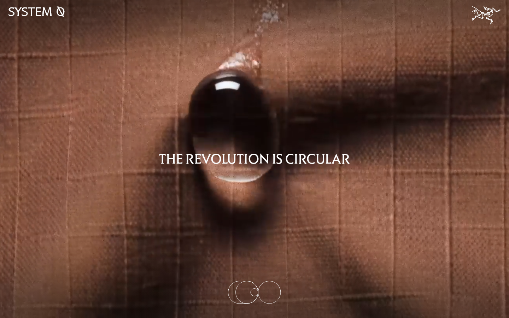

# UI Design System & Master Generation Blueprint: arcteryx-com_us-en-explore-system0

> **System 0 · Arc’teryx** (https://arcteryx.com/us/en/explore/system0) — System 0 is the Arc’teryx platform linking our products, services, and guest experience together in a committed, synchronized journey tow...



---

## 1. Executive Visual Persona & Design Archetype

- **Brand Essence & Persona**: **System 0 · Arc’teryx** (`https://arcteryx.com/us/en/explore/system0`). System 0 is the Arc’teryx platform linking our products, services, and guest experience together in a committed, synchronized journey tow...
- **Capture Provenance**: Live browser capture (`tier1_fast`, HTTP `200`, captured `2026-11-23`).
- **Visual Archetype**: **High-Contrast Obsidian / Atmospheric Design System (`#0c0c0c` canvas, `#fdfdfd` ink, `#1883fd` accent)**.
- **Anti-AI-Slop Differentiators**:
  - **Live-Computed Chromatic Polarity**: Anchors the viewport in `#0c0c0c` (live computed `html` `background-color` (`computed_styles.json`)) paired with `#fdfdfd` primary typography and `#1883fd` accents.
  - **Grounded Typographic Hierarchy**: Pairs `Elan ITC Pro` for display copy (`THE REVOLUTION IS CIRCULAR`) with `Elan ITC Pro` and not declared in live computed styles (uses primary stack / `ui-monospace`).
  - **Calibrated Spatial Grid & Motion**: Combines `1440px` container bounds (`gap: var(--spacing-quarter)`, padding `var(--grid-gutter-outer)`) with `cubic-bezier(.87,-.01,.16,1)` easing and Three.js / WebGL Canvas Pipeline.

---

## 2. Spatial Architecture & Modular Grid Mathematics


### Viewport Allocation & Container Geometry
- **Captured Viewport Dimensions**: Desktop `1440×900px` (`assets/desktop.png`, single-viewport 100vh live capture (900px)), Mobile `390×844px` (`assets/mobile.png`, single-viewport 100vh live capture (844px)).
- **Master Container Bounds**: `1440px` (full-bleed `100%` desktop stage measured on `1440px` viewport).
- **Canvas Lateral Padding & Spacing**: `var(--grid-gutter-outer)` lateral canvas padding with `var(--spacing-quarter)` grid gap.
- **Border Radius Scale**: `50%`, `3px`, `2.5px`, `4px`.

### Responsive Breakpoint Architecture
- **Desktop Layout**: Multi-column CSS Grid / Flexbox layout at `1440px` (`max-width: 1440px`, `gap: var(--spacing-quarter)`).
- **Mobile Layout**: Single-column vertical stack at `390px` viewport width with `var(--grid-gutter-outer)` horizontal padding.
- **Extracted CSS Media Queries**: `@media only screen and (min-width:1024px)`, `@media (prefers-reduced-motion:no-preference)`, `@media only screen and (min-width:768px)`, `@media only screen and (max-width:1023px)`.

---

## 3. Color System, Materiality & Atmospheric Lighting

### Semantic Palette & Source Grounding
| Semantic Role | Ground-Truth Value | Extracted Live / CSS Source |
|---|---|---|
| **Primary Canvas Substrate** | `#0c0c0c` | live computed `html` `background-color` (`computed_styles.json`) |
| **Primary Typography Ink** | `#fdfdfd` | live computed `h1` `color` (`computed_styles.json`) |
| **Elevated Surface / Card Substrate** | `#2c6415` | `#ot-sdk-btn.optanon-show-settin... { background-color: #2c6415 }` |
| **Interactive Accent / Highlight** | `#1883fd` | `#onetrust-pc-sdk #ot-pc-desc a:... { color: #1883fd }` |
| **Secondary / Muted Copy** | `#1f96db` | `-banner-sdk .onetrust-vendors-l... { color: #1f96db }` |
| **Structural Hairline Border** | `#57665a` | `#ot-sdk-btn.optanon-show-settin... { border: #57665a }` |

### Sanitized Root CSS Variables (`ui-ux.md` Ground Truth)
| Variable Name | Extracted Value | Semantic Role |
|---|---|---|
| `--icon-system-0-height-half` | `calc(var(--header-icon-system-0-height) / 2)` | Layout / Spatial Grid Token |
| `--tagline-height-half` | `calc(var(--header-tagline-height) / 2)` | Typography / Scale Token |
| `--icon-arcteryx-height` | `42px` | Layout / Spatial Grid Token |
| `--icon-arcteryx-height-half` | `calc(var(--icon-arcteryx-height) / 2)` | Layout / Spatial Grid Token |
| `--hamburger-size-half` | `calc(var(--header-hamburger-size) / 2)` | Layout / Spatial Grid Token |
| `--final-position-offset` | `calc( var(--tagline-height-half) - var(--icon-system-0-height-half) )` | Dimension / Scale Token |
| `--manifesto-track-height` | `var(--manifesto-track-height-base)` | Layout / Spatial Grid Token |
| `--manifesto-pin-range` | `calc(var(--manifesto-track-height) - 100svh)` | Dimension / Scale Token |
| `--manifesto-overlap` | `calc(var(--manifesto-pin-range) / 3)` | Design System Custom Token |
| `--spacer` | `var(--spacing-half)` | Layout / Spatial Grid Token |
| `--spacer-half` | `calc(var(--spacer) / 2)` | Layout / Spatial Grid Token |
| `--dot-overlap-offset-horizontal` | `12px` | Dimension / Scale Token |
| `--dot-overlap-offset-vertical` | `14px` | Dimension / Scale Token |
| `--dot-overlap-offset-relative` | `calc( var(--dot-overlap-offset-horizontal) + .5% )` | Dimension / Scale Token |
| `--circle-size` | `var(--button-circle-small-size)` | Layout / Spatial Grid Token |
| `--circle-border-opacity` | `1` | Elevation / Border Token |

---

## 4. Typographic Scale & Editorial Hierarchy

### Font Family Stacks
- **Display Typography**: `Elan ITC Pro`.
- **Primary Body Stack**: `Elan ITC Pro`.
- **Technical / Metadata Stack**: not declared in live computed styles (uses primary stack / `ui-monospace`).

### Typographic Scale & Rules (Live Computed & Stylesheet Grounded)
- **Hero Display (`H1`)**: live computed `h1` (`font-size: 40px`, `line-height: 40px`, `font-weight: 400`, `letter-spacing: 0.4px`); CSS variables `--font-helvetica-now-display: "Helvetica Now Display", helvetica, sans-serif`, `--type-font-size-display-1: 34px`, `--type-font-size-display-2: 20px`; rule `h1` (`font-size: 1.5rem`, `line-height: 1.2`).
- **Section Heading (`H2`)**: live computed `h2` (`font-size: 22px`, `line-height: 24px`, `font-weight: 400`, `letter-spacing: 0.4px`); rule `h2` (`font-size: 1.5rem`, `line-height: 1.25`).
- **Body Copy**: live computed `body` (`font-size: 16px`, `line-height: normal`, `font-weight: 400`); CSS variables `--type-font-size-body-1: 18px`, `--type-font-size-body-2: 14px`, `--type-line-height-body-1: 22px`; rule `,p` (`line-height: inherit`, `letter-spacing: inherit`, `font-weight: inherit`).
- **Metadata & Navigation Labels**: live computed `nav/a` (`font-size: 16px`, `line-height: normal`, `font-weight: 400`); CSS variables `--type-letter-spacing-display-1: .4px`, `--type-letter-spacing-display-2: .4px`, `--type-letter-spacing-body-1: .25px`.

---

## 5. Choreographed Motion & Interaction Physics

### Primary Easing Curves
- **Extracted Timing Functions**: `cubic-bezier(.87,-.01,.16,1)`, `cubic-bezier(.42,0,.58,1)`.

### Per-Element Transition & Choreography Rules
- **Selector `media(prefers-reduced-motion:no-p...`**: `transition: opacity .2s cubic-bezier(.87,-.01,.16,1)` extracted from `arcteryx-com_us-en-explore-system0` stylesheet.
- **Selector `media(prefers-reduced-motion:no-p...`**: `transition: opacity .4s cubic-bezier(.87,-.01,.16,1)` extracted from `arcteryx-com_us-en-explore-system0` stylesheet.
- **Selector `media(prefers-reduced-motion:no-p...`**: `transition: opacity .2s cubic-bezier(.87,-.01,.16,1)` extracted from `arcteryx-com_us-en-explore-system0` stylesheet.
- **Extracted Easing Curve (`cubic-bezier(.87,-.01,.16,1)`)**: Governs interactive state transitions across `<header.onetrust-pc-dark-filter>` and `<section.ot-fade-in>`.
- **Runtime Interaction Engine**: Integrates Three.js / WebGL Canvas Pipeline with `prefers-reduced-motion: reduce` fallback guards.

---

## 6. Component Wireframe & Structural DOM Map

### Visual Layout Schematic — Desktop (`1440px`, Grounded in `dom.html` & Landmark Bounding Boxes)
```
┌────────────────────────────────────────────────────────────────────────┐
│ DESKTOP VIEWPORT (1440px) — System 0 · Arc’teryx                       │
│ ====================================================================== │
│ [ <header.onetrust-pc-da (1440x208px) | PROCESS · MISSION · SPERRO S ] │
│ ---------------------------------------------------------------------- │
│ | HERO STAGE: <section.ot-hide> (w=1440px)                           | │
│ | H1: THE REVOLUTION IS CIRCULAR                                     | │
│ | Substrate: #0c0c0c | Ink: #fdfdfd | Accent: #1883fd                | │
│ ---------------------------------------------------------------------- │
│ | SHOWCASE GRID (<section.ot-fade-in>) max-w: 1440px                 | │
│ | +------------------------------+  +------------------------------+ | │
│ | | The Revolution is Circular   |  | Find preferred materials     | | │
│ | +------------------------------+  +------------------------------+ | │
│ ---------------------------------------------------------------------- │
│ | DETAIL MODULE (<section.otFloatingRounded) — Design for durability | │
│ ---------------------------------------------------------------------- │
│ [ FOOTER (<footer.otRelFont>  ) | https://arcteryx.com/us/en/explore/  │
└────────────────────────────────────────────────────────────────────────┘
```

### Visual Layout Schematic — Mobile Reflow (`390px`)
```
┌────────────────────────────────────────────────────────────────────────┐
│ MOBILE VIEWPORT REFLOW (390px) — Single-Column Stack (gap: var(--sp)   │
│ ====================================================================== │
│ [ HEADER BAR (<header.onetrust-pc-dark) | Compact Menu (390px)         │
│ ---------------------------------------------------------------------- │
│ | HERO STAGE (<section.ot-hide>) — 390px Vertical Lead               | │
│ | H1: THE REVOLUTION IS CIRCULAR                                     | │
│ ---------------------------------------------------------------------- │
│ | SHOWCASE STACK (<section.ot-fade-in>) — 1-Col Stack                | │
│ | [ Item 1: The Revolution is Circular                             ] | │
│ | [ Item 2: Find preferred materials                               ] | │
│ ---------------------------------------------------------------------- │
│ | DETAIL STACK (<section.otFloatingRound) — 1-Col (Design for durabil) │
│ ---------------------------------------------------------------------- │
│ [ FOOTER (<footer.otRelFont>  ) | Stacked 390px Colophon               │
└────────────────────────────────────────────────────────────────────────┘
```

### Granular DOM Region Breakdown
1. **Brand Header & Navigation Bar (<header.onetrust-pc-dark-filter> — `arcteryx-com_us-en-explore-system0`)**:
   - Landmark `<header class="onetrust-pc-dark-filter">` (`1440x208px`) hosting `System 0 · Arc’teryx` navigation (`PROCESS · MISSION · SPERRO SV · ARC’TERYX · ReBIRD`), DOM attributes (`data-signup-tag="4467"`, `data-is-header-visible="true"`, `data-document-language="true"`, `data-language-detection="true"`), and stylesheet rule `._infinityLoopContainer_18bgu_1 { padding-inline:var(--grid-gutter-outer);margin-block:auto }`.
2. **Hero Stage & Focal Lead (<section.ot-hide> — `THE REVOLUTION IS CIRCULAR`)**:
   - Landmark `<section class="ot-hide">` presenting display lead `THE REVOLUTION IS CIRCULAR` and copy excerpt *"TO CREATE AN ENDURING SYSTEM,SOMETIMES YOU HAVE TO BREAK IT ALL D"* over `#0c0c0c` canvas and `#fdfdfd` ink.
3. **Primary Showcase & Content Grid (<section.ot-fade-in> — `The Revolution is Circular`)**:
   - Landmark `<section class="ot-fade-in">` rendering section `The Revolution is Circular` with copy *"To create an enduring system, Sometimes you have to break it all "*, asset references (`Loading.zo8phPeo.css`, `footer-with-infinity-loop.BY7Pus-...`, `use-process-exit.mlCI1y1L.css`, `index.K17Bkq0c.css`), and grid rule `._contentContainer_18bgu_10 { display:flex;flex-direction:column;row-gap:var(--spacing-quarter);paddin... }`.
4. **Interactive Detail & Feature Matrix (<section.otFloatingRoundedCorner> — `Find preferred materials`)**:
   - Landmark `<section class="otFloatingRoundedCorner">` framing `Find preferred materials` and `Design for durability` (*"To create an enduring system,"*) with `#2c6415` surface cards, `#1883fd` accents, and `bgu_10 ._statementsContainer_18bg... { display:flex;flex-direction:column;gap:var(--spacing-quarter) }`.
5. **Colophon & Global Directory Footer (<footer.otRelFont> — `https://arcteryx.com/us/en/explore/system0`)**:
   - Landmark `<footer class="otRelFont">` anchoring `System 0 · Arc’teryx` footer links (`PROCESS · MISSION · SPERRO SV · ARC’TERYX · ReBIRD`), copy *"Sometimes you have to break it all down."*, and `#57665a` structural dividers.

---

## 7. Master Zero-Shot AI Generation Prompt

```markdown
# Master Zero-Shot Frontend Generation Prompt: arcteryx-com_us-en-explore-system0 (System 0 · Arc’teryx)

You are a principal frontend architect and design systems engineer. Build a complete, production-ready web application replicating the exact design system, DOM landmarks, typographic hierarchy, color tokens, and motion physics of `arcteryx-com_us-en-explore-system0` (**System 0 · Arc’teryx** — `https://arcteryx.com/us/en/explore/system0`).

### 1. Visual Archetype & Anti-AI-Slop Mandates
- **Archetype**: High-Contrast Obsidian / Atmospheric Design System (`#0c0c0c` canvas, `#fdfdfd` ink, `#1883fd` accent).
- **Identity & Domain Context**: System 0 is the Arc’teryx platform linking our products, services, and guest experience together in a committed, synchronized journey tow...
- **Primary Substrate**: `#0c0c0c` (live computed `html` `background-color` (`computed_styles.json`)), **Primary Ink**: `#fdfdfd`, **Accent / Highlight**: `#1883fd`.
- **Site-Specific Differentiators**:
  - **Live-Computed Chromatic Polarity**: Anchors the viewport in `#0c0c0c` (live computed `html` `background-color` (`computed_styles.json`)) paired with `#fdfdfd` primary typography and `#1883fd` accents.
  - **Grounded Typographic Hierarchy**: Pairs `Elan ITC Pro` for display copy (`THE REVOLUTION IS CIRCULAR`) with `Elan ITC Pro` and not declared in live computed styles (uses primary stack / `ui-monospace`).
  - **Calibrated Spatial Grid & Motion**: Combines `1440px` container bounds (`gap: var(--spacing-quarter)`, padding `var(--grid-gutter-outer)`) with `cubic-bezier(.87,-.01,.16,1)` easing and Three.js / WebGL Canvas Pipeline.

### 2. Ground-Truth CSS Variables (`:root` Token Contract)
Declare and consume these exact custom properties extracted from `arcteryx-com_us-en-explore-system0` in your global stylesheet:

:root {
  /* System 0 · Arc’teryx (arcteryx-com_us-en-explore-system0) — Live-Grounded CSS Variables */
  --icon-system-0-height-half: calc(var(--header-icon-system-0-height) / 2); /* Layout / Spatial Grid Token (arcteryx-com_us-en-explore-system0) */
  --tagline-height-half: calc(var(--header-tagline-height) / 2); /* Typography / Scale Token (arcteryx-com_us-en-explore-system0) */
  --icon-arcteryx-height: 42px; /* Layout / Spatial Grid Token (arcteryx-com_us-en-explore-system0) */
  --icon-arcteryx-height-half: calc(var(--icon-arcteryx-height) / 2); /* Layout / Spatial Grid Token (arcteryx-com_us-en-explore-system0) */
  --hamburger-size-half: calc(var(--header-hamburger-size) / 2); /* Layout / Spatial Grid Token (arcteryx-com_us-en-explore-system0) */
  --final-position-offset: calc( var(--tagline-height-half) - var(--icon-system-0-height-half) ); /* Dimension / Scale Token (arcteryx-com_us-en-explore-system0) */
  --manifesto-track-height: var(--manifesto-track-height-base); /* Layout / Spatial Grid Token (arcteryx-com_us-en-explore-system0) */
  --manifesto-pin-range: calc(var(--manifesto-track-height) - 100svh); /* Dimension / Scale Token (arcteryx-com_us-en-explore-system0) */
  --manifesto-overlap: calc(var(--manifesto-pin-range) / 3); /* Design System Custom Token (arcteryx-com_us-en-explore-system0) */
  --spacer: var(--spacing-half); /* Layout / Spatial Grid Token (arcteryx-com_us-en-explore-system0) */
  --spacer-half: calc(var(--spacer) / 2); /* Layout / Spatial Grid Token (arcteryx-com_us-en-explore-system0) */
  --dot-overlap-offset-horizontal: 12px; /* Dimension / Scale Token (arcteryx-com_us-en-explore-system0) */
  --dot-overlap-offset-vertical: 14px; /* Dimension / Scale Token (arcteryx-com_us-en-explore-system0) */
  --dot-overlap-offset-relative: calc( var(--dot-overlap-offset-horizontal) + .5% ); /* Dimension / Scale Token (arcteryx-com_us-en-explore-system0) */
  --circle-size: var(--button-circle-small-size); /* Layout / Spatial Grid Token (arcteryx-com_us-en-explore-system0) */
  --circle-border-opacity: 1; /* Elevation / Border Token (arcteryx-com_us-en-explore-system0) */
}

### 3. Semantic Color & Materiality Contract
Map every surface, ink, and border strictly to these source-grounded tokens:
- **Primary Canvas Substrate**: `#0c0c0c` — grounded in live computed `html` `background-color` (`computed_styles.json`)
- **Primary Typography Ink**: `#fdfdfd` — grounded in live computed `h1` `color` (`computed_styles.json`)
- **Elevated Surface / Card Substrate**: `#2c6415` — grounded in `#ot-sdk-btn.optanon-show-settin... { background-color: #2c6415 }`
- **Interactive Accent / Highlight**: `#1883fd` — grounded in `#onetrust-pc-sdk #ot-pc-desc a:... { color: #1883fd }`
- **Secondary / Muted Copy**: `#1f96db` — grounded in `-banner-sdk .onetrust-vendors-l... { color: #1f96db }`
- **Structural Hairline Border**: `#57665a` — grounded in `#ot-sdk-btn.optanon-show-settin... { border: #57665a }`

### 4. Spatial Grid, Container Bounds & Responsive Breakpoints
- **Desktop Viewport Reference**: `1440×900px` (single-viewport 100vh live capture (900px), `1440px` standard desktop width).
- **Mobile Viewport Reference**: `390×844px` (single-viewport 100vh live capture (844px), `390px` standard mobile width).
- **Container Max-Width**: `1440px` (full-bleed `100%` desktop stage measured on `1440px` viewport)
- **Padding & Gutters**: `var(--grid-gutter-outer)` lateral canvas padding with `var(--spacing-quarter)` grid gap
- **Desktop Grid**: Multi-column CSS Grid / Flexbox layout at `1440px` (`max-width: 1440px`, `gap: var(--spacing-quarter)`)
- **Mobile Adaptation**: Single-column vertical stack at `390px` viewport width with `var(--grid-gutter-outer)` horizontal padding
- **Media Queries**: `@media only screen and (min-width:1024px)`, `@media (prefers-reduced-motion:no-preference)`, `@media only screen and (min-width:768px)`, `@media only screen and (max-width:1023px)`
- **Corner Radii**: `50%`, `3px`, `2.5px`, `4px`

### 5. Typography & Editorial Scale Contract
- **Display Font Stack**: `Elan ITC Pro`
- **Body Font Stack**: `Elan ITC Pro`
- **Monospace / Technical Font Stack**: not declared in live computed styles (uses primary stack / `ui-monospace`)
- **H1 Display Rule**: live computed `h1` (`font-size: 40px`, `line-height: 40px`, `font-weight: 400`, `letter-spacing: 0.4px`); CSS variables `--font-helvetica-now-display: "Helvetica Now Display", helvetica, sans-serif`, `--type-font-size-display-1: 34px`, `--type-font-size-display-2: 20px`; rule `h1` (`font-size: 1.5rem`, `line-height: 1.2`)
- **H2 Section Rule**: live computed `h2` (`font-size: 22px`, `line-height: 24px`, `font-weight: 400`, `letter-spacing: 0.4px`); rule `h2` (`font-size: 1.5rem`, `line-height: 1.25`)
- **Body Copy Rule**: live computed `body` (`font-size: 16px`, `line-height: normal`, `font-weight: 400`); CSS variables `--type-font-size-body-1: 18px`, `--type-font-size-body-2: 14px`, `--type-line-height-body-1: 22px`; rule `,p` (`line-height: inherit`, `letter-spacing: inherit`, `font-weight: inherit`)
- **Metadata & Index Rule**: live computed `nav/a` (`font-size: 16px`, `line-height: normal`, `font-weight: 400`); CSS variables `--type-letter-spacing-display-1: .4px`, `--type-letter-spacing-display-2: .4px`, `--type-letter-spacing-body-1: .25px`

### 6. Component Hierarchy, Verbatim Copy & Real DOM Landmarks
Scaffold `arcteryx-com_us-en-explore-system0` (`System 0 · Arc’teryx`) with these exact structural regions, extracted copy, and CSS rules from `dom.html`:
1. **Brand Header & Navigation Bar (<header.onetrust-pc-dark-filter> — `arcteryx-com_us-en-explore-system0`)**:
   - DOM & Selectors: Landmark `<header class="onetrust-pc-dark-filter">` (`1440x208px`) hosting `System 0 · Arc’teryx` navigation (`PROCESS · MISSION · SPERRO SV · ARC’TERYX · ReBIRD`), DOM attributes (`data-signup-tag="4467"`, `data-is-header-visible="true"`, `data-document-language="true"`, `data-language-detection="true"`), and stylesheet rule `._infinityLoopContainer_18bgu_1 { padding-inline:var(--grid-gutter-outer);margin-block:auto }`.
   - Responsive Contract: Header `Brand Header & Navigation Bar (<header.onetrust-pc-dark-filter> — `arcteryx-com_us-en-explore-system0`)` (`arcteryx-com_us-en-explore-system0`) adapts across `@media only screen and (min-width:1024px)`, `@media (prefers-reduced-motion:no-preference)`, `@media only screen and (min-width:768px)`, `@media only screen and (max-width:1023px)` with `cubic-bezier(.87,-.01,.16,1)`, `cubic-bezier(.42,0,.58,1)` transitions and links `PROCESS · MISSION · SPERRO SV · ARC’TERYX · ReBIRD`.
2. **Hero Stage & Focal Lead (<section.ot-hide> — `THE REVOLUTION IS CIRCULAR`)**:
   - DOM & Selectors: Landmark `<section class="ot-hide">` presenting display lead `THE REVOLUTION IS CIRCULAR` and copy excerpt *"TO CREATE AN ENDURING SYSTEM,SOMETIMES YOU HAVE TO BREAK IT ALL D"* over `#0c0c0c` canvas and `#fdfdfd` ink.
   - Responsive Contract: Hero stage (`1440×900px` desktop / `390×844px` mobile) sets `#0c0c0c` background with `#fdfdfd` headline `THE REVOLUTION IS CIRCULAR`.
3. **Primary Showcase & Content Grid (<section.ot-fade-in> — `The Revolution is Circular`)**:
   - DOM & Selectors: Landmark `<section class="ot-fade-in">` rendering section `The Revolution is Circular` with copy *"To create an enduring system, Sometimes you have to break it all "*, asset references (`Loading.zo8phPeo.css`, `footer-with-infinity-loop.BY7Pus-...`, `use-process-exit.mlCI1y1L.css`, `index.K17Bkq0c.css`), and grid rule `._contentContainer_18bgu_10 { display:flex;flex-direction:column;row-gap:var(--spacing-quarter);paddin... }`.
   - Responsive Contract: Showcase grid `Primary Showcase & Content Grid (<section.ot-fade-in> — `The Revolution is Circular`)` applies Multi-column CSS Grid / Flexbox layout at `1440px` (`max-width: 1440px`, `gap: var(--spacing-quarter)`) on desktop and Single-column vertical stack at `390px` viewport width with `var(--grid-gutter-outer)` horizontal padding on mobile.
4. **Interactive Detail & Feature Matrix (<section.otFloatingRoundedCorner> — `Find preferred materials`)**:
   - DOM & Selectors: Landmark `<section class="otFloatingRoundedCorner">` framing `Find preferred materials` and `Design for durability` (*"To create an enduring system,"*) with `#2c6415` surface cards, `#1883fd` accents, and `bgu_10 ._statementsContainer_18bg... { display:flex;flex-direction:column;gap:var(--spacing-quarter) }`.
   - Responsive Contract: Detail module `Interactive Detail & Feature Matrix (<section.otFloatingRoundedCorner> — `Find preferred materials`)` uses `50%`, `3px`, `2.5px`, `4px` radii, `#1883fd` highlights, and assets (Loading.zo8phPeo.css, footer-with-infinity-loop.BY7Pus-..., use-process-exit.mlCI1y1L.css).
5. **Colophon & Global Directory Footer (<footer.otRelFont> — `https://arcteryx.com/us/en/explore/system0`)**:
   - DOM & Selectors: Landmark `<footer class="otRelFont">` anchoring `System 0 · Arc’teryx` footer links (`PROCESS · MISSION · SPERRO SV · ARC’TERYX · ReBIRD`), copy *"Sometimes you have to break it all down."*, and `#57665a` structural dividers.
   - Responsive Contract: Footer `Colophon & Global Directory Footer (<footer.otRelFont> — `https://arcteryx.com/us/en/explore/system0`)` aligns to `1440px` (full-bleed `100%` desktop stage measured on `1440px` viewport) with `var(--grid-gutter-outer)` lateral canvas padding with `var(--spacing-quarter)` grid gap and attributes (data-signup-tag="4467", data-is-header-visible="true", data-document-language="true").

#### Verbatim DOM Copy Excerpts (`dom.html`)
- Copy Excerpt 1: *"TO CREATE AN ENDURING SYSTEM,SOMETIMES YOU HAVE TO BREAK IT ALL DOWN."*
- Copy Excerpt 2: *"To create an enduring system, Sometimes you have to break it all down."*
- Copy Excerpt 3: *"To create an enduring system,"*
- Copy Excerpt 4: *"Sometimes you have to break it all down."*

### 7. Motion, Extracted Stylesheet Rules & Interaction Choreography
- **Primary Easing Functions**: `cubic-bezier(.87,-.01,.16,1)`, `cubic-bezier(.42,0,.58,1)`
- **Extracted Stylesheet Rules (`arcteryx-com_us-en-explore-system0`)**:
- `._infinityLoopContainer_18bgu_1 { padding-inline:var(--grid-gutter-outer);margin-block:auto }`
- `._contentContainer_18bgu_10 { display:flex;flex-direction:column;row-gap:var(--spacing-quarter);paddin... }`
- `bgu_10 ._statementsContainer_18bg... { display:flex;flex-direction:column;gap:var(--spacing-quarter) }`
- `._statement_18bgu_24 ._body_18bgu_46 { color:var(--color-muted) }`
- `ner_18bgu_10 ._assetsContainer_18... { display:flex;column-gap:var(--spacing-4);order:-1;height:fit-content;pad... }`
- **Per-Selector Transition Rules**:
- **Selector `media(prefers-reduced-motion:no-p...`**: `transition: opacity .2s cubic-bezier(.87,-.01,.16,1)` extracted from `arcteryx-com_us-en-explore-system0` stylesheet.
- **Selector `media(prefers-reduced-motion:no-p...`**: `transition: opacity .4s cubic-bezier(.87,-.01,.16,1)` extracted from `arcteryx-com_us-en-explore-system0` stylesheet.
- **Selector `media(prefers-reduced-motion:no-p...`**: `transition: opacity .2s cubic-bezier(.87,-.01,.16,1)` extracted from `arcteryx-com_us-en-explore-system0` stylesheet.
- **Extracted Easing Curve (`cubic-bezier(.87,-.01,.16,1)`)**: Governs interactive state transitions across `<header.onetrust-pc-dark-filter>` and `<section.ot-fade-in>`.
- **Runtime Interaction Engine**: Integrates Three.js / WebGL Canvas Pipeline with `prefers-reduced-motion: reduce` fallback guards.

### 8. Technical Deliverables
- Implement in Next.js (App Router) with TypeScript and Tailwind CSS consuming the `:root` custom properties defined above for `arcteryx-com_us-en-explore-system0`.
- Reproduce both the `1440px` desktop architecture and `390px` mobile breakpoint transitions, preserving semantic HTML5 landmarks (`<header>`, `<nav>`, `<main>`, `<section>`, `<footer>`) and `prefers-reduced-motion` accessibility guards.
```
