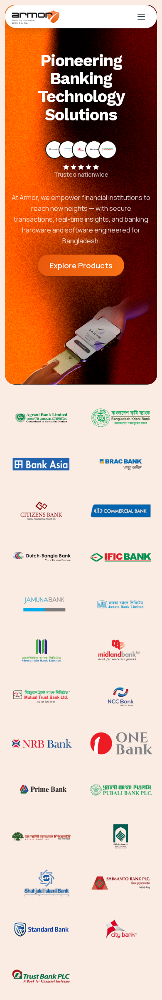

# UI Design System & Master Generation Blueprint: armor-bd-com

> **Armor Bangladesh Limited — ATM, CRM & Banking Technology Solutions** (https://armor-bd.com) — Armor Bangladesh Limited provides banking hardware and software — cash recyclers, ATMs, kiosks, UPS, payment switching and card managemen...


---

## 1. Executive Visual Persona & Design Archetype

- **Brand Essence & Persona**: **Armor Bangladesh Limited — ATM, CRM & Banking Technology Solutions** (`https://armor-bd.com`). Armor Bangladesh Limited provides banking hardware and software — cash recyclers, ATMs, kiosks, UPS, payment switching and card managemen...
- **Final Redirected URL**: [https://www.armor-bd.com/](https://www.armor-bd.com/)
- **Capture Provenance**: Live browser capture (`tier1_fast`, HTTP `200`, captured `2026-11-23`).
- **Visual Archetype**: **Dark-Substrate WebGL / Canvas Interactive Experience (`#2d1f1a` / `#ea580c`)**.
- **Anti-AI-Slop Differentiators**:
  - **Live-Computed Chromatic Polarity**: Anchors the viewport in `#2d1f1a` (live computed `body` `background-color` (`computed_styles.json`)) paired with `#ffffff` primary typography and `#ea580c` accents.
  - **Grounded Typographic Hierarchy**: Pairs `Work Sans` for display copy (`Pioneering Banking Technology Soluti`) with `Unbounded` and `SFMono-Regular`.
  - **Calibrated Spatial Grid & Motion**: Combines `1408px` container bounds (`gap: .125rem`, padding `.375rem`) with `cubic-bezier(0,0,.2,1)` easing and Lenis Smooth Scroll (`data-lenis`), Three.js / WebGL Canvas Pipeline.

---

## 2. Spatial Architecture & Modular Grid Mathematics



### Viewport Allocation & Container Geometry
- **Captured Viewport Dimensions**: Desktop `1440×2400px` (`assets/desktop.png`, clamped at 2400px live multi-section capture), Mobile `390×2400px` (`assets/mobile.png`, clamped at 2400px live multi-section capture).
- **Master Container Bounds**: `1408px` (measured widest bounded `<section>` landmark width on `1440px` desktop).
- **Canvas Lateral Padding & Spacing**: `.375rem` lateral canvas padding with `.125rem` grid gap.
- **Border Radius Scale**: `8px`, `.3125rem`, `.375rem`, `.25rem`.

### Responsive Breakpoint Architecture
- **Desktop Layout**: Multi-column CSS Grid / Flexbox layout at `1440px` (`max-width: 1408px`, `gap: .125rem`).
- **Mobile Layout**: Single-column vertical stack at `390px` viewport width with `.375rem` horizontal padding.
- **Extracted CSS Media Queries**: `@media (min-width: 640px)`, `@media (min-width: 768px)`, `@media (min-width: 1024px)`, `@media (min-width: 1280px)`.

---

## 3. Color System, Materiality & Atmospheric Lighting

### Semantic Palette & Source Grounding
| Semantic Role | Ground-Truth Value | Extracted Live / CSS Source |
|---|---|---|
| **Primary Canvas Substrate** | `#2d1f1a` | live computed `body` `background-color` (`computed_styles.json`) |
| **Primary Typography Ink** | `#ffffff` | live computed `h1` `color` (`computed_styles.json`) |
| **Elevated Surface / Card Substrate** | `#ea580c` | live computed `button` `background-color` (`computed_styles.json`) |
| **Interactive Accent / Highlight** | `#ea580c` | live computed `button` `background-color` (`computed_styles.json`) |
| **Secondary / Muted Copy** | `#faebe3` | live computed `nav` `color` (`computed_styles.json`) |
| **Structural Hairline Border** | `#2d201c` | `10 { border-color: #2d201c }` |

### Sanitized Root CSS Variables (`ui-ux.md` Ground Truth)
| Variable Name | Extracted Value | Semantic Role |
|---|---|---|
| `--toast-icon-margin-start` | `-3px` | Layout / Spatial Grid Token |
| `--toast-icon-margin-end` | `4px` | Layout / Spatial Grid Token |
| `--toast-svg-margin-start` | `-1px` | Layout / Spatial Grid Token |
| `--toast-svg-margin-end` | `0px` | Layout / Spatial Grid Token |
| `--toast-button-margin-start` | `auto` | Layout / Spatial Grid Token |
| `--toast-button-margin-end` | `0` | Layout / Spatial Grid Token |
| `--toast-close-button-start` | `0` | Design System Custom Token |
| `--toast-close-button-end` | `unset` | Design System Custom Token |
| `--toast-close-button-transform` | `translate(-35%, -35%)` | Dimension / Scale Token |
| `--gray1` | `hsl(0, 0%, 99%)` | Color / Atmospheric Token |
| `--gray2` | `hsl(0, 0%, 97.3%)` | Color / Atmospheric Token |
| `--gray3` | `hsl(0, 0%, 95.1%)` | Color / Atmospheric Token |
| `--gray4` | `hsl(0, 0%, 93%)` | Color / Atmospheric Token |
| `--gray5` | `hsl(0, 0%, 90.9%)` | Color / Atmospheric Token |
| `--gray6` | `hsl(0, 0%, 88.7%)` | Color / Atmospheric Token |
| `--gray7` | `hsl(0, 0%, 85.8%)` | Color / Atmospheric Token |

---

## 4. Typographic Scale & Editorial Hierarchy

### Font Family Stacks
- **Display Typography**: `Work Sans`.
- **Primary Body Stack**: `Unbounded`.
- **Technical / Metadata Stack**: `SFMono-Regular`.

### Typographic Scale & Rules (Live Computed & Stylesheet Grounded)
- **Hero Display (`H1`)**: live computed `h1` (`font-size: 72px`, `line-height: 72px`, `font-weight: 700`, `letter-spacing: -1.8px`); rule `h1` (`font-weight: 700`).
- **Section Heading (`H2`)**: live computed `h2` (`font-size: 72px`, `line-height: 72px`, `font-weight: 700`); rule `h2` (`font-weight: 700`).
- **Body Copy**: live computed `body` (`font-size: 16px`, `line-height: 24px`, `font-weight: 400`).
- **Metadata & Navigation Labels**: live computed `nav/a` (`font-size: 16px`, `line-height: 24px`, `font-weight: 400`).

---

## 5. Choreographed Motion & Interaction Physics

### Primary Easing Curves
- **Extracted Timing Functions**: `cubic-bezier(0,0,.2,1)`, `cubic-bezier(.4,0,.2,1)`, `cubic-bezier(0,0,.25,1)`.

### Per-Element Transition & Choreography Rules
- **Selector `.transition`**: `transition: cubic-bezier(0,0,.2,1)` extracted from `armor-bd-com` stylesheet.
- **Selector `filter\]`**: `transition: cubic-bezier(0,0,.2,1)` extracted from `armor-bd-com` stylesheet.
- **Selector `.transition-all`**: `transition: cubic-bezier(0,0,.2,1)` extracted from `armor-bd-com` stylesheet.
- **Extracted Easing Curve (`cubic-bezier(0,0,.2,1)`)**: Governs interactive state transitions across `<nav.rounded-full>` and `<section.relative>`.
- **Runtime Interaction Engine**: Integrates Lenis Smooth Scroll (`data-lenis`), Three.js / WebGL Canvas Pipeline with `prefers-reduced-motion: reduce` fallback guards.

---

## 6. Component Wireframe & Structural DOM Map

### Visual Layout Schematic — Desktop (`1440px`, Grounded in `dom.html` & Landmark Bounding Boxes)
```
┌────────────────────────────────────────────────────────────────────────┐
│ DESKTOP VIEWPORT (1440px) — Armor Bangladesh Limited — ATM, CRM & Bank │
│ ====================================================================== │
│ [ <nav.rounded-full> (1280x56px)      | Products · Why us · About ·  ] │
│ ---------------------------------------------------------------------- │
│ | HERO STAGE: <section.lenis-smooth> (w=1440px)                      | │
│ | H1: Pioneering Banking Technology Solutions                        | │
│ | Substrate: #2d1f1a | Ink: #ffffff | Accent: #ea580c                | │
│ ---------------------------------------------------------------------- │
│ | SHOWCASE GRID (<section.relative>) max-w: 1408px                   | │
│ | +------------------------------+  +------------------------------+ | │
│ | | Trusted nationwide           |  | Technology Solutions         | | │
│ | +------------------------------+  +------------------------------+ | │
│ ---------------------------------------------------------------------- │
│ | DETAIL MODULE (<section.py-6>) — At Armor, we empower              | │
│ ---------------------------------------------------------------------- │
│ [ FOOTER (<footer.bg-primary> ) | https://armor-bd.com                 │
└────────────────────────────────────────────────────────────────────────┘
```

### Visual Layout Schematic — Mobile Reflow (`390px`)
```
┌────────────────────────────────────────────────────────────────────────┐
│ MOBILE VIEWPORT REFLOW (390px) — Single-Column Stack (gap: .125rem)    │
│ ====================================================================== │
│ [ HEADER BAR (<nav.rounded-full>      ) | Compact Menu (390px)         │
│ ---------------------------------------------------------------------- │
│ | HERO STAGE (<section.lenis-smooth>) — 390px Vertical Lead          | │
│ | H1: Pioneering Banking Technology Solutions                        | │
│ ---------------------------------------------------------------------- │
│ | SHOWCASE STACK (<section.relative>) — 1-Col Stack                  | │
│ | [ Item 1: Trusted nationwide                                     ] | │
│ | [ Item 2: Technology Solutions                                   ] | │
│ ---------------------------------------------------------------------- │
│ | DETAIL STACK (<section.py-6>) — 1-Col (At Armor, we empow)         | │
│ ---------------------------------------------------------------------- │
│ [ FOOTER (<footer.bg-primary> ) | Stacked 390px Colophon               │
└────────────────────────────────────────────────────────────────────────┘
```

### Granular DOM Region Breakdown
1. **Brand Header & Navigation Bar (<nav.rounded-full> — `armor-bd-com`)**:
   - Landmark `<nav class="rounded-full shadow-lg">` (`1280x56px`) hosting `Armor Bangladesh Limited — ATM, CRM ` navigation (`Products · Why us · About · Career · Contact`), DOM attributes (`data-discover="true"`, `data-discover="true"`, `data-discover="true"`, `data-discover="true"`), and stylesheet rule `after { box-sizing:border-box;border-width:0;border-style:solid;border-color:e5e7eb }`.
2. **Hero Stage & Focal Lead (<section.lenis-smooth> — `Pioneering Banking Technology Solu`)**:
   - Landmark `<section class="lenis-smooth">` presenting display lead `Pioneering Banking Technology Solutions` and copy excerpt *"Trusted nationwide"* over `#2d1f1a` canvas and `#ffffff` ink.
3. **Primary Showcase & Content Grid (<section.relative> — `Trusted nationwide`)**:
   - Landmark `<section class="relative overflow-hidden">` rendering section `Trusted nationwide` with copy *"Technology Solutions"*, asset references (`favicon.ico`, `index-CjIBsQtn.js`, `index-BvNfHRqr.css`, `HomeV2-CKyWaDQ7.js`), and grid rule `body { margin:0;line-height:inherit }`.
4. **Interactive Detail & Feature Matrix (<section.py-6> — `Technology Solutions`)**:
   - Landmark `<section class="py-6 bg-primary">` framing `Technology Solutions` and `At Armor, we empower financial institutions to r` (*"At Armor, we empower financial institutions to reach new heights "*) with `#ea580c` surface cards, `#ea580c` accents, and `strong { font-weight:bolder }`.
5. **Colophon & Global Directory Footer (<footer.bg-primary> — `https://armor-bd.com`)**:
   - Landmark `<footer class="bg-primary text-secondary">` anchoring `Armor Bangladesh Limited — ATM, ` footer links (`Products · Why us · About · Career · Contact`), copy *"Specialized Technical Experts"*, and `#2d201c` structural dividers.

---

## 7. Master Zero-Shot AI Generation Prompt

```markdown
# Master Zero-Shot Frontend Generation Prompt: armor-bd-com (Armor Bangladesh Limited — ATM, CRM & Banking Technology Solutions)

You are a principal frontend architect and design systems engineer. Build a complete, production-ready web application replicating the exact design system, DOM landmarks, typographic hierarchy, color tokens, and motion physics of `armor-bd-com` (**Armor Bangladesh Limited — ATM, CRM & Banking Technology Solutions** — `https://armor-bd.com`).

### 1. Visual Archetype & Anti-AI-Slop Mandates
- **Archetype**: Dark-Substrate WebGL / Canvas Interactive Experience (`#2d1f1a` / `#ea580c`).
- **Identity & Domain Context**: Armor Bangladesh Limited provides banking hardware and software — cash recyclers, ATMs, kiosks, UPS, payment switching and card managemen...
- **Primary Substrate**: `#2d1f1a` (live computed `body` `background-color` (`computed_styles.json`)), **Primary Ink**: `#ffffff`, **Accent / Highlight**: `#ea580c`.
- **Site-Specific Differentiators**:
  - **Live-Computed Chromatic Polarity**: Anchors the viewport in `#2d1f1a` (live computed `body` `background-color` (`computed_styles.json`)) paired with `#ffffff` primary typography and `#ea580c` accents.
  - **Grounded Typographic Hierarchy**: Pairs `Work Sans` for display copy (`Pioneering Banking Technology Soluti`) with `Unbounded` and `SFMono-Regular`.
  - **Calibrated Spatial Grid & Motion**: Combines `1408px` container bounds (`gap: .125rem`, padding `.375rem`) with `cubic-bezier(0,0,.2,1)` easing and Lenis Smooth Scroll (`data-lenis`), Three.js / WebGL Canvas Pipeline.

### 2. Ground-Truth CSS Variables (`:root` Token Contract)
Declare and consume these exact custom properties extracted from `armor-bd-com` in your global stylesheet:

:root {
  /* Armor Bangladesh Limited — ATM, CRM & Banking Technology Solutions (armor-bd-com) — Live-Grounded CSS Variables */
  --toast-icon-margin-start: -3px; /* Layout / Spatial Grid Token (armor-bd-com) */
  --toast-icon-margin-end: 4px; /* Layout / Spatial Grid Token (armor-bd-com) */
  --toast-svg-margin-start: -1px; /* Layout / Spatial Grid Token (armor-bd-com) */
  --toast-svg-margin-end: 0px; /* Layout / Spatial Grid Token (armor-bd-com) */
  --toast-button-margin-start: auto; /* Layout / Spatial Grid Token (armor-bd-com) */
  --toast-button-margin-end: 0; /* Layout / Spatial Grid Token (armor-bd-com) */
  --toast-close-button-start: 0; /* Design System Custom Token (armor-bd-com) */
  --toast-close-button-end: unset; /* Design System Custom Token (armor-bd-com) */
  --toast-close-button-transform: translate(-35%, -35%); /* Dimension / Scale Token (armor-bd-com) */
  --gray1: hsl(0, 0%, 99%); /* Color / Atmospheric Token (armor-bd-com) */
  --gray2: hsl(0, 0%, 97.3%); /* Color / Atmospheric Token (armor-bd-com) */
  --gray3: hsl(0, 0%, 95.1%); /* Color / Atmospheric Token (armor-bd-com) */
  --gray4: hsl(0, 0%, 93%); /* Color / Atmospheric Token (armor-bd-com) */
  --gray5: hsl(0, 0%, 90.9%); /* Color / Atmospheric Token (armor-bd-com) */
  --gray6: hsl(0, 0%, 88.7%); /* Color / Atmospheric Token (armor-bd-com) */
  --gray7: hsl(0, 0%, 85.8%); /* Color / Atmospheric Token (armor-bd-com) */
}

### 3. Semantic Color & Materiality Contract
Map every surface, ink, and border strictly to these source-grounded tokens:
- **Primary Canvas Substrate**: `#2d1f1a` — grounded in live computed `body` `background-color` (`computed_styles.json`)
- **Primary Typography Ink**: `#ffffff` — grounded in live computed `h1` `color` (`computed_styles.json`)
- **Elevated Surface / Card Substrate**: `#ea580c` — grounded in live computed `button` `background-color` (`computed_styles.json`)
- **Interactive Accent / Highlight**: `#ea580c` — grounded in live computed `button` `background-color` (`computed_styles.json`)
- **Secondary / Muted Copy**: `#faebe3` — grounded in live computed `nav` `color` (`computed_styles.json`)
- **Structural Hairline Border**: `#2d201c` — grounded in `10 { border-color: #2d201c }`

### 4. Spatial Grid, Container Bounds & Responsive Breakpoints
- **Desktop Viewport Reference**: `1440×2400px` (clamped at 2400px live multi-section capture, `1440px` standard desktop width).
- **Mobile Viewport Reference**: `390×2400px` (clamped at 2400px live multi-section capture, `390px` standard mobile width).
- **Container Max-Width**: `1408px` (measured widest bounded `<section>` landmark width on `1440px` desktop)
- **Padding & Gutters**: `.375rem` lateral canvas padding with `.125rem` grid gap
- **Desktop Grid**: Multi-column CSS Grid / Flexbox layout at `1440px` (`max-width: 1408px`, `gap: .125rem`)
- **Mobile Adaptation**: Single-column vertical stack at `390px` viewport width with `.375rem` horizontal padding
- **Media Queries**: `@media (min-width: 640px)`, `@media (min-width: 768px)`, `@media (min-width: 1024px)`, `@media (min-width: 1280px)`
- **Corner Radii**: `8px`, `.3125rem`, `.375rem`, `.25rem`

### 5. Typography & Editorial Scale Contract
- **Display Font Stack**: `Work Sans`
- **Body Font Stack**: `Unbounded`
- **Monospace / Technical Font Stack**: `SFMono-Regular`
- **H1 Display Rule**: live computed `h1` (`font-size: 72px`, `line-height: 72px`, `font-weight: 700`, `letter-spacing: -1.8px`); rule `h1` (`font-weight: 700`)
- **H2 Section Rule**: live computed `h2` (`font-size: 72px`, `line-height: 72px`, `font-weight: 700`); rule `h2` (`font-weight: 700`)
- **Body Copy Rule**: live computed `body` (`font-size: 16px`, `line-height: 24px`, `font-weight: 400`)
- **Metadata & Index Rule**: live computed `nav/a` (`font-size: 16px`, `line-height: 24px`, `font-weight: 400`)

### 6. Component Hierarchy, Verbatim Copy & Real DOM Landmarks
Scaffold `armor-bd-com` (`Armor Bangladesh Limited — ATM, CRM & Banking Technology Solutions`) with these exact structural regions, extracted copy, and CSS rules from `dom.html`:
1. **Brand Header & Navigation Bar (<nav.rounded-full> — `armor-bd-com`)**:
   - DOM & Selectors: Landmark `<nav class="rounded-full shadow-lg">` (`1280x56px`) hosting `Armor Bangladesh Limited — ATM, CRM ` navigation (`Products · Why us · About · Career · Contact`), DOM attributes (`data-discover="true"`, `data-discover="true"`, `data-discover="true"`, `data-discover="true"`), and stylesheet rule `after { box-sizing:border-box;border-width:0;border-style:solid;border-color:e5e7eb }`.
   - Responsive Contract: Header `Brand Header & Navigation Bar (<nav.rounded-full> — `armor-bd-com`)` (`armor-bd-com`) adapts across `@media (min-width: 640px)`, `@media (min-width: 768px)`, `@media (min-width: 1024px)`, `@media (min-width: 1280px)` with `cubic-bezier(0,0,.2,1)`, `cubic-bezier(.4,0,.2,1)`, `cubic-bezier(0,0,.25,1)` transitions and links `Products · Why us · About · Career · Contact`.
2. **Hero Stage & Focal Lead (<section.lenis-smooth> — `Pioneering Banking Technology Solu`)**:
   - DOM & Selectors: Landmark `<section class="lenis-smooth">` presenting display lead `Pioneering Banking Technology Solutions` and copy excerpt *"Trusted nationwide"* over `#2d1f1a` canvas and `#ffffff` ink.
   - Responsive Contract: Hero stage (`1440×2400px` desktop / `390×2400px` mobile) sets `#2d1f1a` background with `#ffffff` headline `Pioneering Banking Technology Solutions`.
3. **Primary Showcase & Content Grid (<section.relative> — `Trusted nationwide`)**:
   - DOM & Selectors: Landmark `<section class="relative overflow-hidden">` rendering section `Trusted nationwide` with copy *"Technology Solutions"*, asset references (`favicon.ico`, `index-CjIBsQtn.js`, `index-BvNfHRqr.css`, `HomeV2-CKyWaDQ7.js`), and grid rule `body { margin:0;line-height:inherit }`.
   - Responsive Contract: Showcase grid `Primary Showcase & Content Grid (<section.relative> — `Trusted nationwide`)` applies Multi-column CSS Grid / Flexbox layout at `1440px` (`max-width: 1408px`, `gap: .125rem`) on desktop and Single-column vertical stack at `390px` viewport width with `.375rem` horizontal padding on mobile.
4. **Interactive Detail & Feature Matrix (<section.py-6> — `Technology Solutions`)**:
   - DOM & Selectors: Landmark `<section class="py-6 bg-primary">` framing `Technology Solutions` and `At Armor, we empower financial institutions to r` (*"At Armor, we empower financial institutions to reach new heights "*) with `#ea580c` surface cards, `#ea580c` accents, and `strong { font-weight:bolder }`.
   - Responsive Contract: Detail module `Interactive Detail & Feature Matrix (<section.py-6> — `Technology Solutions`)` uses `8px`, `.3125rem`, `.375rem`, `.25rem` radii, `#ea580c` highlights, and assets (favicon.ico, index-CjIBsQtn.js, index-BvNfHRqr.css).
5. **Colophon & Global Directory Footer (<footer.bg-primary> — `https://armor-bd.com`)**:
   - DOM & Selectors: Landmark `<footer class="bg-primary text-secondary">` anchoring `Armor Bangladesh Limited — ATM, ` footer links (`Products · Why us · About · Career · Contact`), copy *"Specialized Technical Experts"*, and `#2d201c` structural dividers.
   - Responsive Contract: Footer `Colophon & Global Directory Footer (<footer.bg-primary> — `https://armor-bd.com`)` aligns to `1408px` (measured widest bounded `<section>` landmark width on `1440px` desktop) with `.375rem` lateral canvas padding with `.125rem` grid gap and attributes (data-discover="true", data-discover="true", data-discover="true").

#### Verbatim DOM Copy Excerpts (`dom.html`)
- Copy Excerpt 1: *"Trusted nationwide"*
- Copy Excerpt 2: *"Technology Solutions"*
- Copy Excerpt 3: *"At Armor, we empower financial institutions to reach new heights — with secure tra..."*
- Copy Excerpt 4: *"Specialized Technical Experts"*

### 7. Motion, Extracted Stylesheet Rules & Interaction Choreography
- **Primary Easing Functions**: `cubic-bezier(0,0,.2,1)`, `cubic-bezier(.4,0,.2,1)`, `cubic-bezier(0,0,.25,1)`
- **Extracted Stylesheet Rules (`armor-bd-com`)**:
- `after { box-sizing:border-box;border-width:0;border-style:solid;border-color:e5e7eb }`
- `body { margin:0;line-height:inherit }`
- `strong { font-weight:bolder }`
- `small { font-size:80% }`
- `sup { font-size:75%;line-height:0;position:relative;vertical-align:baseline }`
- **Per-Selector Transition Rules**:
- **Selector `.transition`**: `transition: cubic-bezier(0,0,.2,1)` extracted from `armor-bd-com` stylesheet.
- **Selector `filter\]`**: `transition: cubic-bezier(0,0,.2,1)` extracted from `armor-bd-com` stylesheet.
- **Selector `.transition-all`**: `transition: cubic-bezier(0,0,.2,1)` extracted from `armor-bd-com` stylesheet.
- **Extracted Easing Curve (`cubic-bezier(0,0,.2,1)`)**: Governs interactive state transitions across `<nav.rounded-full>` and `<section.relative>`.
- **Runtime Interaction Engine**: Integrates Lenis Smooth Scroll (`data-lenis`), Three.js / WebGL Canvas Pipeline with `prefers-reduced-motion: reduce` fallback guards.

### 8. Technical Deliverables
- Implement in Next.js (App Router) with TypeScript and Tailwind CSS consuming the `:root` custom properties defined above for `armor-bd-com`.
- Reproduce both the `1440px` desktop architecture and `390px` mobile breakpoint transitions, preserving semantic HTML5 landmarks (`<header>`, `<nav>`, `<main>`, `<section>`, `<footer>`) and `prefers-reduced-motion` accessibility guards.
```
