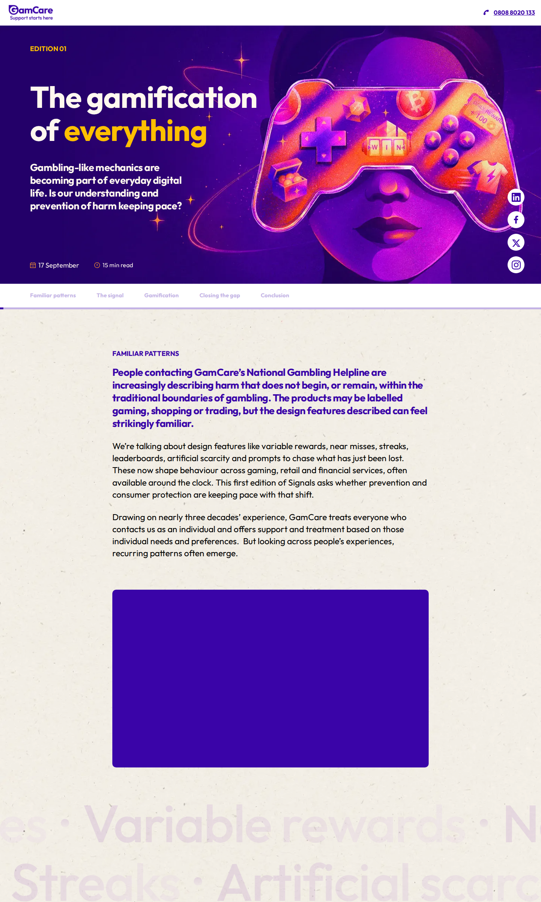
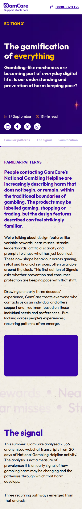

# UI Design System & Master Generation Blueprint: articles-gamcare-org-uk

> **The Gamification of Everything · GamCare** (https://articles.gamcare.org.uk/) — Gambling-like mechanics are becoming part of everyday digital life. Explore how gamification can shape behaviour and why prevention needs...



---

## 1. Executive Visual Persona & Design Archetype

- **Brand Essence & Persona**: **The Gamification of Everything · GamCare** (`https://articles.gamcare.org.uk/`). Gambling-like mechanics are becoming part of everyday digital life. Explore how gamification can shape behaviour and why prevention needs...
- **Visual Archetype**: **High-Contrast Obsidian / Atmospheric Design System (`#3a04a8` canvas, `#fff8ef` ink, `#eee` accent)**.
- **Anti-AI-Slop Differentiators**:
  - **Source-Grounded Chromatic Polarity**: Anchors the viewport in `#3a04a8` (`var(--brand--indigo)` in `:root`) paired with `#fff8ef` primary typography and `#eee` accents.
  - **Extracted Typographic Hierarchy**: Pairs `Outfit` for display copy (`The gamification of everything`) with `.75rem` and `monospace!important`.
  - **Calibrated Spatial Grid & Motion**: Combines `940px` container bounds (`gap: 16px`, padding `9px`) with `cubic-bezier(.165,.84,.44,1)` easing and GSAP Timeline & ScrollTrigger, Three.js / WebGL Canvas Pipeline.

---

## 2. Spatial Architecture & Modular Grid Mathematics



### Viewport Allocation & Container Geometry
- **Captured Viewport Dimensions**: Desktop `1440×2400px` (`assets/desktop.png`, capped at 2400px multi-section capture), Mobile `390×2400px` (`assets/mobile.png`, capped at 2400px multi-section capture).
- **Master Container Bounds**: `940px` extracted from `articles-gamcare-org-uk` stylesheet.
- **Canvas Lateral Padding & Spacing**: `9px` lateral canvas padding with `16px` grid gap.
- **Border Radius Scale**: `3px`, `100%`, `50%`, `var(--_sizes---border-radius--small)`.

### Responsive Breakpoint Architecture
- **Desktop Layout**: Multi-column CSS Grid / Flexbox layout at `1440px` (`max-width: 940px`, `gap: 16px`).
- **Mobile Layout**: Single-column vertical stack at `390px` viewport width with `9px` horizontal padding.
- **Extracted CSS Media Queries**: `@media screen and (max-width:991px)`, `@media screen and (max-width:767px)`, `@media screen and (max-width:479px)`, `@media (min-width:768px)`.

---

## 3. Color System, Materiality & Atmospheric Lighting

### Semantic Palette & Source Grounding
| Semantic Role | Ground-Truth Value | Extracted CSS Source / Selector |
|---|---|---|
| **Primary Canvas Substrate** | `#3a04a8` | `var(--brand--indigo)` in `:root` |
| **Primary Typography Ink** | `#ff9c00` | `var(--brand--orange)` in `:root` |
| **Elevated Surface / Card Substrate** | `#291a5c` | `var(--brand--tolopea)` in `:root` |
| **Interactive Accent / Highlight** | `#eee` | `var(--neutral--neutral-light)` in `:root` |
| **Secondary / Muted Copy** | `#fff8ef` | `var(--neutral--cream)` in `:root` |
| **Structural Hairline Border** | `#ffc000` | `var(--brand--light-orange)` in `:root` |

### Sanitized Root CSS Variables (`ui-ux.md` Ground Truth)
| Variable Name | Extracted Value | Semantic Role |
|---|---|---|
| `--font-family--body` | `Outfit,Arial,sans-serif` | Typography / Scale Token |
| `--_theme---text--primary` | `var(--neutral--black)` | Typography Ink Token |
| `--_typography---body--body-font-size` | `1rem` | Typography / Scale Token |
| `--_typography---body--body-line-height` | `var(--font-height--xlarge)` | Typography / Scale Token |
| `--_typography---body--body-font-weight` | `var(--font-weight--normal)` | Typography / Scale Token |
| `--_typography---body--body-letter-spacing` | `var(--letter-spacing--default)` | Typography / Scale Token |
| `--_layout---spacing--none` | `0rem` | Layout / Spatial Grid Token |
| `--font-family--heading` | `Outfit,Arial,sans-serif` | Typography Ink Token |
| `--_typography---h1--h1-font-size` | `5rem` | Typography / Scale Token |
| `--_typography---h1--h1-line-height` | `var(--font-height--small)` | Typography / Scale Token |
| `--_typography---h1--h1-font-weight` | `var(--font-weight--bold)` | Typography / Scale Token |
| `--_typography---h1--h1-letter-spacing` | `-.1rem` | Typography / Scale Token |
| `--_typography---h2--h2-font-size` | `3.75rem` | Typography / Scale Token |
| `--_typography---h2--h2-line-height` | `var(--font-height--medium)` | Typography / Scale Token |
| `--_typography---h2--h2-font-weight` | `var(--font-weight--bold)` | Typography / Scale Token |
| `--_typography---h2--h2-letter-spacing` | `-.1125rem` | Typography / Scale Token |

---

## 4. Typographic Scale & Editorial Hierarchy

### Font Family Stacks
- **Display Typography**: `Outfit`.
- **Primary Body Stack**: `.75rem`.
- **Technical / Metadata Stack**: `monospace!important`.

### Typographic Scale & Rules (Extracted from Stylesheet & Variables)
- **Hero Display (`H1`)**: CSS variables `--_typography---h1--h1-font-size: 5rem`, `--_typography---h1--h1-line-height: var(--font-height--small)`, `--_typography---h1--h1-font-weight: var(--font-weight--bold)`.
- **Section Heading (`H2`)**: CSS variables `--_typography---h2--h2-font-size: 3.75rem`, `--_typography---h2--h2-line-height: var(--font-height--medium)`, `--_typography---h2--h2-font-weight: var(--font-weight--bold)`.
- **Body Copy**: CSS variables `--font-family--body: Outfit,Arial,sans-serif`, `--_typography---body--body-font-size: 1rem`, `--_typography---body--body-line-height: var(--font-height--xlarge)`.
- **Metadata & Navigation Labels**: CSS variables `--_typography---body--body-letter-spacing: var(--letter-spacing--default)`, `--_typography---h1--h1-letter-spacing: -.1rem`, `--_typography---h2--h2-letter-spacing: -.1125rem`.

---

## 5. Choreographed Motion & Interaction Physics

### Primary Easing Curves
- **Extracted Timing Functions**: `cubic-bezier(.165,.84,.44,1)`, `cubic-bezier(0.17,0,0.2,1)`, `cubic-bezier(0.5,0,0.83,1)`.

### Per-Element Transition & Choreography Rules
- **Selector `.w-webflow-badge>img`**: `transition: unset` extracted from `articles-gamcare-org-uk` stylesheet.
- **Selector `.w-slider-dot`**: `transition: background-color .1s,color .1s` extracted from `articles-gamcare-org-uk` stylesheet.
- **Selector `.w-lightbox-control`**: `transition: all .3s` extracted from `articles-gamcare-org-uk` stylesheet.
- **Extracted Easing Curve (`cubic-bezier(.165,.84,.44,1)`)**: Governs interactive state transitions across `<nav.nav_link-wrap>` and `<section.section>`.
- **Runtime Interaction Engine**: Integrates GSAP Timeline & ScrollTrigger, Three.js / WebGL Canvas Pipeline, Swiper Touch Carousel Engine with `prefers-reduced-motion: reduce` fallback guards.

---

## 6. Component Wireframe & Structural DOM Map

### Visual Layout Schematic (Grounded in `dom.html` — `1440px` Desktop & `390px` Mobile Reflow)
```
┌────────────────────────────────────────────────────────────────────────┐
│ DESKTOP VIEWPORT (1440px) — The Gamification of Everything · GamCare   │
│ ====================================================================== │
│ [ <nav.nav_link-wrap>      | 0808 8020 133                          ]  │
│ ---------------------------------------------------------------------- │
│ | HERO STAGE: <section.section>                                    |   │
│ | H1: The gamification of everything                               |   │
│ | Substrate: #3a04a8    | Ink: #fff8ef    | Accent: #eee           |   │
│ ---------------------------------------------------------------------- │
│ | SHOWCASE GRID (<section.section>         ) max-w: 940px          |   │
│ | +------------------------------+  +------------------------------+ | │
│ | | The signal                   |  | What do we mean by gamificat | | │
│ | +------------------------------+  +------------------------------+ | │
│ ---------------------------------------------------------------------- │
│ | MOBILE VIEWPORT REFLOW (390px) — Single-Column Stack (gap: 16px  ) | │
│ | [<nav.nav_link-wrap] -> [<section.section>] -> [<section.section>] | │
│ ---------------------------------------------------------------------- │
│ [ FOOTER (<footer.footer>       ) | https://articles.gamcare.org.uk/   │
└────────────────────────────────────────────────────────────────────────┘
```

### Granular DOM Region Breakdown
1. **Brand Header & Navigation Bar (<nav.nav_link-wrap> — `articles-gamcare-org-uk`)**:
   - Landmark `<nav class="nav_link-wrap w-nav-menu">` hosting `The Gamification of Everything · Gam` navigation (`0808 8020 133`), DOM attributes (`data-wf-domain="articles.gamcare.org.uk"`, `data-wf-page="6a9541bcb6d4e8d3269865d8"`, `data-wf-site="6a9541b9b6d4e8d32698651c"`, `data-animation="default"`), and stylesheet rule `html { -webkit-text-size-adjust:100%;-ms-text-size-adjust:100%;font-family:sans... }`.
2. **Hero Stage & Focal Lead (<section.section> — `The gamification of everything`)**:
   - Landmark `<section class="section is-home-hero">` presenting display lead `The gamification of everything` and copy excerpt *"Gambling-like mechanics are becoming part of everyday digital lif"* over `#3a04a8` canvas and `#fff8ef` ink.
3. **Primary Showcase & Content Grid (<section.section> — `The signal`)**:
   - Landmark `<section class="section">` rendering section `The signal` with copy *"People contacting GamCare’s National Gambling Helpline are increa"*, asset references (`cdn.prod.website-files.com`, `gamcare.webflow.shared.3ff275b4f....`, `clarity.js`, `yqtqehex3o`), and grid rule `summary { display:block }`.
4. **Interactive Detail & Feature Matrix (<section.section> — `What do we mean by gamification?`)**:
   - Landmark `<section class="section">` framing `What do we mean by gamification?` and `The concern is not The concern is not gamificatio...` (*"We’re talking about design features like variable rewards, near m"*) with `#291a5c` surface cards, `#eee` accents, and `video { vertical-align:baseline;display:inline-block }`.
5. **Colophon & Global Directory Footer (<footer.footer> — `https://articles.gamcare.org.uk/`)**:
   - Landmark `<footer class="footer">` anchoring `The Gamification of Everything ·` footer links (`0808 8020 133`), copy *"Drawing on nearly three decades’ experience, GamCare treats "*, and `#ffc000` structural dividers.

---

## 7. Master Zero-Shot AI Generation Prompt

```markdown
# Master Zero-Shot Frontend Generation Prompt: articles-gamcare-org-uk (The Gamification of Everything · GamCare)

You are a principal frontend architect and design systems engineer. Build a complete, production-ready web application replicating the exact design system, DOM landmarks, typographic hierarchy, color tokens, and motion physics of `articles-gamcare-org-uk` (**The Gamification of Everything · GamCare** — `https://articles.gamcare.org.uk/`).

### 1. Visual Archetype & Anti-AI-Slop Mandates
- **Archetype**: High-Contrast Obsidian / Atmospheric Design System (`#3a04a8` canvas, `#fff8ef` ink, `#eee` accent).
- **Identity & Domain Context**: Gambling-like mechanics are becoming part of everyday digital life. Explore how gamification can shape behaviour and why prevention needs...
- **Primary Substrate**: `#3a04a8` (`var(--brand--indigo)` in `:root`), **Primary Ink**: `#fff8ef`, **Accent / Highlight**: `#eee`.
- **Site-Specific Differentiators**:
  - **Source-Grounded Chromatic Polarity**: Anchors the viewport in `#3a04a8` (`var(--brand--indigo)` in `:root`) paired with `#fff8ef` primary typography and `#eee` accents.
  - **Extracted Typographic Hierarchy**: Pairs `Outfit` for display copy (`The gamification of everything`) with `.75rem` and `monospace!important`.
  - **Calibrated Spatial Grid & Motion**: Combines `940px` container bounds (`gap: 16px`, padding `9px`) with `cubic-bezier(.165,.84,.44,1)` easing and GSAP Timeline & ScrollTrigger, Three.js / WebGL Canvas Pipeline.

### 2. Ground-Truth CSS Variables (`:root` Token Contract)
Declare and consume these exact custom properties extracted from `articles-gamcare-org-uk` in your global stylesheet:

:root {
  /* The Gamification of Everything · GamCare (articles-gamcare-org-uk) — Ground-Truth Extracted CSS Variables */
  --font-family--body: Outfit,Arial,sans-serif; /* Typography / Scale Token (articles-gamcare-org-uk) */
  --_theme---text--primary: var(--neutral--black); /* Typography Ink Token (articles-gamcare-org-uk) */
  --_typography---body--body-font-size: 1rem; /* Typography / Scale Token (articles-gamcare-org-uk) */
  --_typography---body--body-line-height: var(--font-height--xlarge); /* Typography / Scale Token (articles-gamcare-org-uk) */
  --_typography---body--body-font-weight: var(--font-weight--normal); /* Typography / Scale Token (articles-gamcare-org-uk) */
  --_typography---body--body-letter-spacing: var(--letter-spacing--default); /* Typography / Scale Token (articles-gamcare-org-uk) */
  --_layout---spacing--none: 0rem; /* Layout / Spatial Grid Token (articles-gamcare-org-uk) */
  --font-family--heading: Outfit,Arial,sans-serif; /* Typography Ink Token (articles-gamcare-org-uk) */
  --_typography---h1--h1-font-size: 5rem; /* Typography / Scale Token (articles-gamcare-org-uk) */
  --_typography---h1--h1-line-height: var(--font-height--small); /* Typography / Scale Token (articles-gamcare-org-uk) */
  --_typography---h1--h1-font-weight: var(--font-weight--bold); /* Typography / Scale Token (articles-gamcare-org-uk) */
  --_typography---h1--h1-letter-spacing: -.1rem; /* Typography / Scale Token (articles-gamcare-org-uk) */
  --_typography---h2--h2-font-size: 3.75rem; /* Typography / Scale Token (articles-gamcare-org-uk) */
  --_typography---h2--h2-line-height: var(--font-height--medium); /* Typography / Scale Token (articles-gamcare-org-uk) */
  --_typography---h2--h2-font-weight: var(--font-weight--bold); /* Typography / Scale Token (articles-gamcare-org-uk) */
  --_typography---h2--h2-letter-spacing: -.1125rem; /* Typography / Scale Token (articles-gamcare-org-uk) */
}

### 3. Semantic Color & Materiality Contract
Map every surface, ink, and border strictly to these source-grounded tokens:
- **Primary Canvas Substrate**: `#3a04a8` — grounded in `var(--brand--indigo)` in `:root`
- **Primary Typography Ink**: `#ff9c00` — grounded in `var(--brand--orange)` in `:root`
- **Elevated Surface / Card Substrate**: `#291a5c` — grounded in `var(--brand--tolopea)` in `:root`
- **Interactive Accent / Highlight**: `#eee` — grounded in `var(--neutral--neutral-light)` in `:root`
- **Secondary / Muted Copy**: `#fff8ef` — grounded in `var(--neutral--cream)` in `:root`
- **Structural Hairline Border**: `#ffc000` — grounded in `var(--brand--light-orange)` in `:root`

### 4. Spatial Grid, Container Bounds & Responsive Breakpoints
- **Desktop Viewport Reference**: `1440×2400px` (capped at 2400px multi-section capture, `1440px` standard desktop width).
- **Mobile Viewport Reference**: `390×2400px` (capped at 2400px multi-section capture, `390px` standard mobile width).
- **Container Max-Width**: `940px` extracted from `articles-gamcare-org-uk` stylesheet
- **Padding & Gutters**: `9px` lateral canvas padding with `16px` grid gap
- **Desktop Grid**: Multi-column CSS Grid / Flexbox layout at `1440px` (`max-width: 940px`, `gap: 16px`)
- **Mobile Adaptation**: Single-column vertical stack at `390px` viewport width with `9px` horizontal padding
- **Media Queries**: `@media screen and (max-width:991px)`, `@media screen and (max-width:767px)`, `@media screen and (max-width:479px)`, `@media (min-width:768px)`
- **Corner Radii**: `3px`, `100%`, `50%`, `var(--_sizes---border-radius--small)`

### 5. Typography & Editorial Scale Contract
- **Display Font Stack**: `Outfit`
- **Body Font Stack**: `.75rem`
- **Monospace / Technical Font Stack**: `monospace!important`
- **H1 Display Rule**: CSS variables `--_typography---h1--h1-font-size: 5rem`, `--_typography---h1--h1-line-height: var(--font-height--small)`, `--_typography---h1--h1-font-weight: var(--font-weight--bold)`
- **H2 Section Rule**: CSS variables `--_typography---h2--h2-font-size: 3.75rem`, `--_typography---h2--h2-line-height: var(--font-height--medium)`, `--_typography---h2--h2-font-weight: var(--font-weight--bold)`
- **Body Copy Rule**: CSS variables `--font-family--body: Outfit,Arial,sans-serif`, `--_typography---body--body-font-size: 1rem`, `--_typography---body--body-line-height: var(--font-height--xlarge)`
- **Metadata & Index Rule**: CSS variables `--_typography---body--body-letter-spacing: var(--letter-spacing--default)`, `--_typography---h1--h1-letter-spacing: -.1rem`, `--_typography---h2--h2-letter-spacing: -.1125rem`

### 6. Component Hierarchy, Verbatim Copy & Real DOM Landmarks
Scaffold `articles-gamcare-org-uk` (`The Gamification of Everything · GamCare`) with these exact structural regions, extracted copy, and CSS rules from `dom.html`:
1. **Brand Header & Navigation Bar (<nav.nav_link-wrap> — `articles-gamcare-org-uk`)**:
   - DOM & Selectors: Landmark `<nav class="nav_link-wrap w-nav-menu">` hosting `The Gamification of Everything · Gam` navigation (`0808 8020 133`), DOM attributes (`data-wf-domain="articles.gamcare.org.uk"`, `data-wf-page="6a9541bcb6d4e8d3269865d8"`, `data-wf-site="6a9541b9b6d4e8d32698651c"`, `data-animation="default"`), and stylesheet rule `html { -webkit-text-size-adjust:100%;-ms-text-size-adjust:100%;font-family:sans... }`.
   - Responsive Contract: Header `Brand Header & Navigation Bar (<nav.nav_link-wrap> — `articles-gamcare-org-uk`)` (`articles-gamcare-org-uk`) adapts across `@media screen and (max-width:991px)`, `@media screen and (max-width:767px)`, `@media screen and (max-width:479px)`, `@media (min-width:768px)` with `cubic-bezier(.165,.84,.44,1)`, `cubic-bezier(0.17,0,0.2,1)`, `cubic-bezier(0.5,0,0.83,1)` transitions and links `0808 8020 133`.
2. **Hero Stage & Focal Lead (<section.section> — `The gamification of everything`)**:
   - DOM & Selectors: Landmark `<section class="section is-home-hero">` presenting display lead `The gamification of everything` and copy excerpt *"Gambling-like mechanics are becoming part of everyday digital lif"* over `#3a04a8` canvas and `#fff8ef` ink.
   - Responsive Contract: Hero stage (`1440×2400px` desktop / `390×2400px` mobile) sets `#3a04a8` background with `#fff8ef` headline `The gamification of everything`.
3. **Primary Showcase & Content Grid (<section.section> — `The signal`)**:
   - DOM & Selectors: Landmark `<section class="section">` rendering section `The signal` with copy *"People contacting GamCare’s National Gambling Helpline are increa"*, asset references (`cdn.prod.website-files.com`, `gamcare.webflow.shared.3ff275b4f....`, `clarity.js`, `yqtqehex3o`), and grid rule `summary { display:block }`.
   - Responsive Contract: Showcase grid `Primary Showcase & Content Grid (<section.section> — `The signal`)` applies Multi-column CSS Grid / Flexbox layout at `1440px` (`max-width: 940px`, `gap: 16px`) on desktop and Single-column vertical stack at `390px` viewport width with `9px` horizontal padding on mobile.
4. **Interactive Detail & Feature Matrix (<section.section> — `What do we mean by gamification?`)**:
   - DOM & Selectors: Landmark `<section class="section">` framing `What do we mean by gamification?` and `The concern is not The concern is not gamificatio...` (*"We’re talking about design features like variable rewards, near m"*) with `#291a5c` surface cards, `#eee` accents, and `video { vertical-align:baseline;display:inline-block }`.
   - Responsive Contract: Detail module `Interactive Detail & Feature Matrix (<section.section> — `What do we mean by gamification?`)` uses `3px`, `100%`, `50%`, `var(--_sizes---border-radius--small)` radii, `#eee` highlights, and assets (cdn.prod.website-files.com, gamcare.webflow.shared.3ff275b4f...., clarity.js).
5. **Colophon & Global Directory Footer (<footer.footer> — `https://articles.gamcare.org.uk/`)**:
   - DOM & Selectors: Landmark `<footer class="footer">` anchoring `The Gamification of Everything ·` footer links (`0808 8020 133`), copy *"Drawing on nearly three decades’ experience, GamCare treats "*, and `#ffc000` structural dividers.
   - Responsive Contract: Footer `Colophon & Global Directory Footer (<footer.footer> — `https://articles.gamcare.org.uk/`)` aligns to `940px` extracted from `articles-gamcare-org-uk` stylesheet with `9px` lateral canvas padding with `16px` grid gap and attributes (data-wf-domain="articles.gamcare.org.uk", data-wf-page="6a9541bcb6d4e8d3269865d8", data-wf-site="6a9541b9b6d4e8d32698651c").

#### Verbatim DOM Copy Excerpts (`dom.html`)
- Copy Excerpt 1: *"Gambling-like mechanics are becoming part of everyday digital life. Is our underst..."*
- Copy Excerpt 2: *"People contacting GamCare’s National Gambling Helpline are increasingly describing..."*
- Copy Excerpt 3: *"We’re talking about design features like variable rewards, near misses, streaks, l..."*
- Copy Excerpt 4: *"Drawing on nearly three decades’ experience, GamCare treats everyone who contacts..."*

### 7. Motion, Extracted Stylesheet Rules & Interaction Choreography
- **Primary Easing Functions**: `cubic-bezier(.165,.84,.44,1)`, `cubic-bezier(0.17,0,0.2,1)`, `cubic-bezier(0.5,0,0.83,1)`
- **Extracted Stylesheet Rules (`articles-gamcare-org-uk`)**:
- `html { -webkit-text-size-adjust:100%;-ms-text-size-adjust:100%;font-family:sans... }`
- `summary { display:block }`
- `video { vertical-align:baseline;display:inline-block }`
- `template { display:none }`
- `strong { font-weight:700 }`
- **Per-Selector Transition Rules**:
- **Selector `.w-webflow-badge>img`**: `transition: unset` extracted from `articles-gamcare-org-uk` stylesheet.
- **Selector `.w-slider-dot`**: `transition: background-color .1s,color .1s` extracted from `articles-gamcare-org-uk` stylesheet.
- **Selector `.w-lightbox-control`**: `transition: all .3s` extracted from `articles-gamcare-org-uk` stylesheet.
- **Extracted Easing Curve (`cubic-bezier(.165,.84,.44,1)`)**: Governs interactive state transitions across `<nav.nav_link-wrap>` and `<section.section>`.
- **Runtime Interaction Engine**: Integrates GSAP Timeline & ScrollTrigger, Three.js / WebGL Canvas Pipeline, Swiper Touch Carousel Engine with `prefers-reduced-motion: reduce` fallback guards.

### 8. Technical Deliverables
- Implement in Next.js (App Router) with TypeScript and Tailwind CSS consuming the `:root` custom properties defined above for `articles-gamcare-org-uk`.
- Reproduce both the `1440px` desktop architecture and `390px` mobile breakpoint transitions, preserving semantic HTML5 landmarks (`<header>`, `<nav>`, `<main>`, `<section>`, `<footer>`) and `prefers-reduced-motion` accessibility guards.
```
