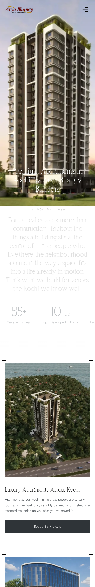

# UI Design System & Master Generation Blueprint: aryabhangybuilders-com

> **Premium Builders In Kochi · Flats & Apartments · Arya Bhangy** (https://aryabhangybuilders.com/) — RERA-registered 2.5, 3 & 4 BHK apartments in Vyttila and Kumbalam, Kochi, from a family group building since 1969. Book a site visit.


---

## 1. Executive Visual Persona & Design Archetype

- **Brand Essence & Persona**: **Premium Builders In Kochi · Flats & Apartments · Arya Bhangy** (`https://aryabhangybuilders.com/`). RERA-registered 2.5, 3 & 4 BHK apartments in Vyttila and Kumbalam, Kochi, from a family group building since 1969. Book a site visit.
- **Capture Provenance**: Live browser capture (`tier1_fast`, HTTP `200`, captured `2026-11-23`).
- **Visual Archetype**: **Light-Substrate Editorial & Modular Grid System (`#f7f8f9` canvas, `#222222` ink, `#375efb` accent)**.
- **Anti-AI-Slop Differentiators**:
  - **Live-Computed Chromatic Polarity**: Anchors the viewport in `#f7f8f9` (live computed `body` `background-color` (`computed_styles.json`)) paired with `#222222` primary typography and `#375efb` accents.
  - **Grounded Typographic Hierarchy**: Pairs `CS Alpha` for display copy (`Premium Apartments in Kochi, by Arya`) with `Segoe UI` and not declared in live computed styles (uses primary stack / `ui-monospace`).
  - **Calibrated Spatial Grid & Motion**: Combines `100vw` container bounds (`gap: var(--row-gap)`, padding `5px`) with `cubic-bezier(0.22,0.61,0.36,1)` easing and Lenis Smooth Scroll (`data-lenis`), GSAP Timeline & ScrollTrigger.

---

## 2. Spatial Architecture & Modular Grid Mathematics



### Viewport Allocation & Container Geometry
- **Captured Viewport Dimensions**: Desktop `1440×2400px` (`assets/desktop.png`, clamped at 2400px live multi-section capture), Mobile `390×2400px` (`assets/mobile.png`, clamped at 2400px live multi-section capture).
- **Master Container Bounds**: `100vw` (non-`@media` desktop container stylesheet rule).
- **Canvas Lateral Padding & Spacing**: `5px` lateral canvas padding with `var(--row-gap)` grid gap.
- **Border Radius Scale**: `var(--border-radius)`, `3px`, `2px`, `4px`.

### Responsive Breakpoint Architecture
- **Desktop Layout**: Multi-column CSS Grid / Flexbox layout at `1440px` (`max-width: 100vw`, `gap: var(--row-gap)`).
- **Mobile Layout**: Single-column vertical stack at `390px` viewport width with `5px` horizontal padding.
- **Extracted CSS Media Queries**: `@media (max-width:1024px)`, `@media (max-width:767px)`, `@media (min-width:-1)`, `@media (max-width:-1)`.

---

## 3. Color System, Materiality & Atmospheric Lighting

### Semantic Palette & Source Grounding
| Semantic Role | Ground-Truth Value | Extracted Live / CSS Source |
|---|---|---|
| **Primary Canvas Substrate** | `#f7f8f9` | live computed `body` `background-color` (`computed_styles.json`) |
| **Primary Typography Ink** | `#222222` | live computed `main` `color` (`computed_styles.json`) |
| **Elevated Surface / Card Substrate** | `#5bc0de` | `nt.elementor-button-info .eleme... { background-color: #5bc0de }` |
| **Interactive Accent / Highlight** | `#375efb` | `.elementor .e-button-base { background-color: #375efb }` |
| **Secondary / Muted Copy** | `#7a7a7a` | `var(--e-global-color-text)` in `:root` |
| **Structural Hairline Border** | `#69727d` | `entor-field-group .elementor-fi... { border: #69727d }` |
| **Variable Token (`--contrast-2`)** | `#575760` | `var(--contrast-2)` in `:root` |
| **Variable Token (`--contrast-3`)** | `#b2b2be` | `var(--contrast-3)` in `:root` |
| **Variable Token (`--base`)** | `#f0f0f0` | `var(--base)` in `:root` |
| **Variable Token (`--base-3`)** | `#ffffff` | `var(--base-3)` in `:root` |
| **Variable Token (`--accent`)** | `#1e73be` | `var(--accent)` in `:root` |

### Sanitized Root CSS Variables (`ui-ux.md` Ground Truth)
| Variable Name | Extracted Value | Semantic Role |
|---|---|---|
| `--contrast` | `#222222` | Color / Atmospheric Token |
| `--contrast-2` | `#575760` | Color / Atmospheric Token |
| `--contrast-3` | `#b2b2be` | Color / Atmospheric Token |
| `--base` | `#f0f0f0` | Color / Atmospheric Token |
| `--base-2` | `#f7f8f9` | Color / Atmospheric Token |
| `--base-3` | `#ffffff` | Color / Atmospheric Token |
| `--accent` | `#1e73be` | Brand / Palette Token |
| `--gp-search-modal-bg-color` | `var(--base-3)` | Canvas / Surface Token |
| `--gp-search-modal-text-color` | `var(--contrast)` | Typography Ink Token |
| `--gp-search-modal-overlay-bg-color` | `rgba(0,0,0,0.2)` | Canvas / Surface Token |
| `--e-global-color-v4-white` | `var(--white)` | Canvas / Surface Token |
| `--e-global-color-v4-black` | `var(--black)` | Canvas / Surface Token |
| `--e-global-color-v4-cream-50` | `var(--cream-50)` | Brand / Palette Token |
| `--e-global-color-v4-cream-100` | `var(--cream-100)` | Brand / Palette Token |
| `--e-global-color-v4-cream-150` | `var(--cream-150)` | Brand / Palette Token |
| `--e-global-color-v4-cream-200` | `var(--cream-200)` | Brand / Palette Token |

---

## 4. Typographic Scale & Editorial Hierarchy

### Font Family Stacks
- **Display Typography**: `CS Alpha`.
- **Primary Body Stack**: `Segoe UI`.
- **Technical / Metadata Stack**: not declared in live computed styles (uses primary stack / `ui-monospace`).

### Typographic Scale & Rules (Live Computed & Stylesheet Grounded)
- **Hero Display (`H1`)**: live computed `h1` (`font-size: 40px`, `line-height: 46px`, `font-weight: 400`, `letter-spacing: -0.6px`); CSS variables `--page-title-display: block`.
- **Section Heading (`H2`)**: live computed `h2` (`font-size: 40px`, `line-height: 46px`, `font-weight: 400`, `letter-spacing: -0.6px`); rule `h2` (`font-size: 36px`).
- **Body Copy**: live computed `body` (`font-size: 17px`, `line-height: 25.5px`, `font-weight: 400`).
- **Metadata & Navigation Labels**: live computed `nav/a` (`font-size: 17px`, `line-height: 25.5px`, `font-weight: 400`).

---

## 5. Choreographed Motion & Interaction Physics

### Primary Easing Curves
- **Extracted Timing Functions**: `cubic-bezier(0.22,0.61,0.36,1)`.

### Per-Element Transition & Choreography Rules
- **Selector `entor .elementor-background-video...`**: `transition: opacity 1s` extracted from `aryabhangybuilders-com` stylesheet.
- **Selector `.elementor-custom-embed-play svg`**: `transition: all .5s` extracted from `aryabhangybuilders-com` stylesheet.
- **Selector `.elementor-ken-burns`**: `transition: 10s` extracted from `aryabhangybuilders-com` stylesheet.
- **Extracted Easing Curve (`cubic-bezier(0.22,0.61,0.36,1)`)**: Governs interactive state transitions across `<header.elementor>` and `<article.page>`.
- **Runtime Interaction Engine**: Integrates Lenis Smooth Scroll (`data-lenis`), GSAP Timeline & ScrollTrigger, Swiper Touch Carousel Engine, Lottie Vector Animation Player with `prefers-reduced-motion: reduce` fallback guards.

---

## 6. Component Wireframe & Structural DOM Map

### Visual Layout Schematic — Desktop (`1440px`, Grounded in `dom.html` & Landmark Bounding Boxes)
```
┌────────────────────────────────────────────────────────────────────────┐
│ DESKTOP VIEWPORT (1440px) — Premium Builders In Kochi · Flats & Apartm │
│ ====================================================================== │
│ [ <header.elementor> (1440x0px)       | Home · Residential · Commerc ] │
│ ---------------------------------------------------------------------- │
│ | HERO STAGE: <article.post-2414> (w=1440px)                         | │
│ | H1: Premium Apartments in Kochi, by Arya Bhangy Builders           | │
│ | Substrate: #f7f8f9 | Ink: #222222 | Accent: #375efb                | │
│ ---------------------------------------------------------------------- │
│ | SHOWCASE GRID (<article.page>) max-w: 100vw                        | │
│ | +------------------------------+  +------------------------------+ | │
│ | | Years in Business            |  | sq.ft. Developed in Kochi    | | │
│ | +------------------------------+  +------------------------------+ | │
│ ---------------------------------------------------------------------- │
│ | DETAIL MODULE (<article.type-page>) — Transparent Transacti        | │
│ ---------------------------------------------------------------------- │
│ [ FOOTER (<footer.elementor>  ) | https://aryabhangybuilders.com/      │
└────────────────────────────────────────────────────────────────────────┘
```

### Visual Layout Schematic — Mobile Reflow (`390px`)
```
┌────────────────────────────────────────────────────────────────────────┐
│ MOBILE VIEWPORT REFLOW (390px) — Single-Column Stack (gap: var(--ro)   │
│ ====================================================================== │
│ [ HEADER BAR (<header.elementor>      ) | Compact Menu (390px)         │
│ ---------------------------------------------------------------------- │
│ | HERO STAGE (<article.post-2414>) — 390px Vertical Lead             | │
│ | H1: Premium Apartments in Kochi, by Arya Bhangy Builders           | │
│ ---------------------------------------------------------------------- │
│ | SHOWCASE STACK (<article.page>) — 1-Col Stack                      | │
│ | [ Item 1: Years in Business                                      ] | │
│ | [ Item 2: sq.ft. Developed in Kochi                              ] | │
│ ---------------------------------------------------------------------- │
│ | DETAIL STACK (<article.type-page>) — 1-Col (Transparent Transa)    | │
│ ---------------------------------------------------------------------- │
│ [ FOOTER (<footer.elementor>  ) | Stacked 390px Colophon               │
└────────────────────────────────────────────────────────────────────────┘
```

### Granular DOM Region Breakdown
1. **Brand Header & Navigation Bar (<header.elementor> — `aryabhangybuilders-com`)**:
   - Landmark `<header class="elementor elementor-5070">` (`1440x0px`) hosting `Premium Builders In Kochi · Flats & ` navigation (`Home · Residential · Commercial · Our Legacy · Testimonials`), DOM attributes (`data-elementor-device-mode="desktop"`, `data-opened="1"`, `data-elementor-type="header"`, `data-elementor-id="5070"`), and stylesheet rule `root { --direction-multiplier:1 }`.
2. **Hero Stage & Focal Lead (<article.post-2414> — `Premium Apartments in Kochi, by Ar`)**:
   - Landmark `<article class="post-2414 page">` presenting display lead `Premium Apartments in Kochi, by Arya Bhangy Builders` and copy excerpt *"Est. 1969 · Kochi, Kerala"* over `#f7f8f9` canvas and `#222222` ink.
3. **Primary Showcase & Content Grid (<article.page> — `Years in Business`)**:
   - Landmark `<article class="post-2414 page">` rendering section `Years in Business` with copy *"F o r u s , r e a l e s t a t e i s m o r e t h a n c o n s t r u"*, asset references (`1806948866520083`, `fbevents.js`, `gtm.js`, `embed`), and grid rule `.elementor-hidden { display:none }`.
4. **Interactive Detail & Feature Matrix (<article.type-page> — `sq.ft. Developed in Kochi`)**:
   - Landmark `<article class="post-2414 page">` framing `sq.ft. Developed in Kochi` and `Transparent Transactions` (*"Apartments across Kochi, in the areas people are actually looking"*) with `#5bc0de` surface cards, `#375efb` accents, and `.elementor-visibility-hidden { visibility:hidden }`.
5. **Colophon & Global Directory Footer (<footer.elementor> — `https://aryabhangybuilders.com/`)**:
   - Landmark `<footer class="elementor elementor-6448">` anchoring `Premium Builders In Kochi · Flat` footer links (`Home · Residential · Commercial · Our Legacy · Testimonials`), copy *"Commercial spaces built for the businesses inside them. Prac"*, and `#69727d` structural dividers.

---

## 7. Master Zero-Shot AI Generation Prompt

```markdown
# Master Zero-Shot Frontend Generation Prompt: aryabhangybuilders-com (Premium Builders In Kochi · Flats & Apartments · Arya Bhangy)

You are a principal frontend architect and design systems engineer. Build a complete, production-ready web application replicating the exact design system, DOM landmarks, typographic hierarchy, color tokens, and motion physics of `aryabhangybuilders-com` (**Premium Builders In Kochi · Flats & Apartments · Arya Bhangy** — `https://aryabhangybuilders.com/`).

### 1. Visual Archetype & Anti-AI-Slop Mandates
- **Archetype**: Light-Substrate Editorial & Modular Grid System (`#f7f8f9` canvas, `#222222` ink, `#375efb` accent).
- **Identity & Domain Context**: RERA-registered 2.5, 3 & 4 BHK apartments in Vyttila and Kumbalam, Kochi, from a family group building since 1969. Book a site visit.
- **Primary Substrate**: `#f7f8f9` (live computed `body` `background-color` (`computed_styles.json`)), **Primary Ink**: `#222222`, **Accent / Highlight**: `#375efb`.
- **Site-Specific Differentiators**:
  - **Live-Computed Chromatic Polarity**: Anchors the viewport in `#f7f8f9` (live computed `body` `background-color` (`computed_styles.json`)) paired with `#222222` primary typography and `#375efb` accents.
  - **Grounded Typographic Hierarchy**: Pairs `CS Alpha` for display copy (`Premium Apartments in Kochi, by Arya`) with `Segoe UI` and not declared in live computed styles (uses primary stack / `ui-monospace`).
  - **Calibrated Spatial Grid & Motion**: Combines `100vw` container bounds (`gap: var(--row-gap)`, padding `5px`) with `cubic-bezier(0.22,0.61,0.36,1)` easing and Lenis Smooth Scroll (`data-lenis`), GSAP Timeline & ScrollTrigger.

### 2. Ground-Truth CSS Variables (`:root` Token Contract)
Declare and consume these exact custom properties extracted from `aryabhangybuilders-com` in your global stylesheet:

:root {
  /* Premium Builders In Kochi · Flats & Apartments · Arya Bhangy (aryabhangybuilders-com) — Live-Grounded CSS Variables */
  --contrast: #222222; /* Color / Atmospheric Token (aryabhangybuilders-com) */
  --contrast-2: #575760; /* Color / Atmospheric Token (aryabhangybuilders-com) */
  --contrast-3: #b2b2be; /* Color / Atmospheric Token (aryabhangybuilders-com) */
  --base: #f0f0f0; /* Color / Atmospheric Token (aryabhangybuilders-com) */
  --base-2: #f7f8f9; /* Color / Atmospheric Token (aryabhangybuilders-com) */
  --base-3: #ffffff; /* Color / Atmospheric Token (aryabhangybuilders-com) */
  --accent: #1e73be; /* Brand / Palette Token (aryabhangybuilders-com) */
  --gp-search-modal-bg-color: var(--base-3); /* Canvas / Surface Token (aryabhangybuilders-com) */
  --gp-search-modal-text-color: var(--contrast); /* Typography Ink Token (aryabhangybuilders-com) */
  --gp-search-modal-overlay-bg-color: rgba(0,0,0,0.2); /* Canvas / Surface Token (aryabhangybuilders-com) */
  --e-global-color-v4-white: var(--white); /* Canvas / Surface Token (aryabhangybuilders-com) */
  --e-global-color-v4-black: var(--black); /* Canvas / Surface Token (aryabhangybuilders-com) */
  --e-global-color-v4-cream-50: var(--cream-50); /* Brand / Palette Token (aryabhangybuilders-com) */
  --e-global-color-v4-cream-100: var(--cream-100); /* Brand / Palette Token (aryabhangybuilders-com) */
  --e-global-color-v4-cream-150: var(--cream-150); /* Brand / Palette Token (aryabhangybuilders-com) */
  --e-global-color-v4-cream-200: var(--cream-200); /* Brand / Palette Token (aryabhangybuilders-com) */
}

### 3. Semantic Color & Materiality Contract
Map every surface, ink, and border strictly to these source-grounded tokens:
- **Primary Canvas Substrate**: `#f7f8f9` — grounded in live computed `body` `background-color` (`computed_styles.json`)
- **Primary Typography Ink**: `#222222` — grounded in live computed `main` `color` (`computed_styles.json`)
- **Elevated Surface / Card Substrate**: `#5bc0de` — grounded in `nt.elementor-button-info .eleme... { background-color: #5bc0de }`
- **Interactive Accent / Highlight**: `#375efb` — grounded in `.elementor .e-button-base { background-color: #375efb }`
- **Secondary / Muted Copy**: `#7a7a7a` — grounded in `var(--e-global-color-text)` in `:root`
- **Structural Hairline Border**: `#69727d` — grounded in `entor-field-group .elementor-fi... { border: #69727d }`
- **Variable Token (`--contrast-2`)**: `#575760` — grounded in `var(--contrast-2)` in `:root`
- **Variable Token (`--contrast-3`)**: `#b2b2be` — grounded in `var(--contrast-3)` in `:root`
- **Variable Token (`--base`)**: `#f0f0f0` — grounded in `var(--base)` in `:root`
- **Variable Token (`--base-3`)**: `#ffffff` — grounded in `var(--base-3)` in `:root`
- **Variable Token (`--accent`)**: `#1e73be` — grounded in `var(--accent)` in `:root`

### 4. Spatial Grid, Container Bounds & Responsive Breakpoints
- **Desktop Viewport Reference**: `1440×2400px` (clamped at 2400px live multi-section capture, `1440px` standard desktop width).
- **Mobile Viewport Reference**: `390×2400px` (clamped at 2400px live multi-section capture, `390px` standard mobile width).
- **Container Max-Width**: `100vw` (non-`@media` desktop container stylesheet rule)
- **Padding & Gutters**: `5px` lateral canvas padding with `var(--row-gap)` grid gap
- **Desktop Grid**: Multi-column CSS Grid / Flexbox layout at `1440px` (`max-width: 100vw`, `gap: var(--row-gap)`)
- **Mobile Adaptation**: Single-column vertical stack at `390px` viewport width with `5px` horizontal padding
- **Media Queries**: `@media (max-width:1024px)`, `@media (max-width:767px)`, `@media (min-width:-1)`, `@media (max-width:-1)`
- **Corner Radii**: `var(--border-radius)`, `3px`, `2px`, `4px`

### 5. Typography & Editorial Scale Contract
- **Display Font Stack**: `CS Alpha`
- **Body Font Stack**: `Segoe UI`
- **Monospace / Technical Font Stack**: not declared in live computed styles (uses primary stack / `ui-monospace`)
- **H1 Display Rule**: live computed `h1` (`font-size: 40px`, `line-height: 46px`, `font-weight: 400`, `letter-spacing: -0.6px`); CSS variables `--page-title-display: block`
- **H2 Section Rule**: live computed `h2` (`font-size: 40px`, `line-height: 46px`, `font-weight: 400`, `letter-spacing: -0.6px`); rule `h2` (`font-size: 36px`)
- **Body Copy Rule**: live computed `body` (`font-size: 17px`, `line-height: 25.5px`, `font-weight: 400`)
- **Metadata & Index Rule**: live computed `nav/a` (`font-size: 17px`, `line-height: 25.5px`, `font-weight: 400`)

### 6. Component Hierarchy, Verbatim Copy & Real DOM Landmarks
Scaffold `aryabhangybuilders-com` (`Premium Builders In Kochi · Flats & Apartments · Arya Bhangy`) with these exact structural regions, extracted copy, and CSS rules from `dom.html`:
1. **Brand Header & Navigation Bar (<header.elementor> — `aryabhangybuilders-com`)**:
   - DOM & Selectors: Landmark `<header class="elementor elementor-5070">` (`1440x0px`) hosting `Premium Builders In Kochi · Flats & ` navigation (`Home · Residential · Commercial · Our Legacy · Testimonials`), DOM attributes (`data-elementor-device-mode="desktop"`, `data-opened="1"`, `data-elementor-type="header"`, `data-elementor-id="5070"`), and stylesheet rule `root { --direction-multiplier:1 }`.
   - Responsive Contract: Header `Brand Header & Navigation Bar (<header.elementor> — `aryabhangybuilders-com`)` (`aryabhangybuilders-com`) adapts across `@media (max-width:1024px)`, `@media (max-width:767px)`, `@media (min-width:-1)`, `@media (max-width:-1)` with `cubic-bezier(0.22,0.61,0.36,1)` transitions and links `Home · Residential · Commercial · Our Legacy · Testimonials`.
2. **Hero Stage & Focal Lead (<article.post-2414> — `Premium Apartments in Kochi, by Ar`)**:
   - DOM & Selectors: Landmark `<article class="post-2414 page">` presenting display lead `Premium Apartments in Kochi, by Arya Bhangy Builders` and copy excerpt *"Est. 1969 · Kochi, Kerala"* over `#f7f8f9` canvas and `#222222` ink.
   - Responsive Contract: Hero stage (`1440×2400px` desktop / `390×2400px` mobile) sets `#f7f8f9` background with `#222222` headline `Premium Apartments in Kochi, by Arya Bhangy Builders`.
3. **Primary Showcase & Content Grid (<article.page> — `Years in Business`)**:
   - DOM & Selectors: Landmark `<article class="post-2414 page">` rendering section `Years in Business` with copy *"F o r u s , r e a l e s t a t e i s m o r e t h a n c o n s t r u"*, asset references (`1806948866520083`, `fbevents.js`, `gtm.js`, `embed`), and grid rule `.elementor-hidden { display:none }`.
   - Responsive Contract: Showcase grid `Primary Showcase & Content Grid (<article.page> — `Years in Business`)` applies Multi-column CSS Grid / Flexbox layout at `1440px` (`max-width: 100vw`, `gap: var(--row-gap)`) on desktop and Single-column vertical stack at `390px` viewport width with `5px` horizontal padding on mobile.
4. **Interactive Detail & Feature Matrix (<article.type-page> — `sq.ft. Developed in Kochi`)**:
   - DOM & Selectors: Landmark `<article class="post-2414 page">` framing `sq.ft. Developed in Kochi` and `Transparent Transactions` (*"Apartments across Kochi, in the areas people are actually looking"*) with `#5bc0de` surface cards, `#375efb` accents, and `.elementor-visibility-hidden { visibility:hidden }`.
   - Responsive Contract: Detail module `Interactive Detail & Feature Matrix (<article.type-page> — `sq.ft. Developed in Kochi`)` uses `var(--border-radius)`, `3px`, `2px`, `4px` radii, `#375efb` highlights, and assets (1806948866520083, fbevents.js, gtm.js).
5. **Colophon & Global Directory Footer (<footer.elementor> — `https://aryabhangybuilders.com/`)**:
   - DOM & Selectors: Landmark `<footer class="elementor elementor-6448">` anchoring `Premium Builders In Kochi · Flat` footer links (`Home · Residential · Commercial · Our Legacy · Testimonials`), copy *"Commercial spaces built for the businesses inside them. Prac"*, and `#69727d` structural dividers.
   - Responsive Contract: Footer `Colophon & Global Directory Footer (<footer.elementor> — `https://aryabhangybuilders.com/`)` aligns to `100vw` (non-`@media` desktop container stylesheet rule) with `5px` lateral canvas padding with `var(--row-gap)` grid gap and attributes (data-elementor-device-mode="desktop", data-opened="1", data-elementor-type="header").

#### Verbatim DOM Copy Excerpts (`dom.html`)
- Copy Excerpt 1: *"Est. 1969 · Kochi, Kerala"*
- Copy Excerpt 2: *"F o r u s , r e a l e s t a t e i s m o r e t h a n c o n s t r u c t i o n . I t..."*
- Copy Excerpt 3: *"Apartments across Kochi, in the areas people are actually looking to live. Well-bu..."*
- Copy Excerpt 4: *"Commercial spaces built for the businesses inside them. Practical layouts, solid c..."*

### 7. Motion, Extracted Stylesheet Rules & Interaction Choreography
- **Primary Easing Functions**: `cubic-bezier(0.22,0.61,0.36,1)`
- **Extracted Stylesheet Rules (`aryabhangybuilders-com`)**:
- `root { --direction-multiplier:1 }`
- `.elementor-hidden { display:none }`
- `.elementor-visibility-hidden { visibility:hidden }`
- `.ui-helper-hidden-accessible { height:1px;margin:-1px;overflow:hidden;padding:0;position:absolute;top:-... }`
- `.elementor-clearfix:after { clear:both;content:"";display:block;height:0;width:0 }`
- **Per-Selector Transition Rules**:
- **Selector `entor .elementor-background-video...`**: `transition: opacity 1s` extracted from `aryabhangybuilders-com` stylesheet.
- **Selector `.elementor-custom-embed-play svg`**: `transition: all .5s` extracted from `aryabhangybuilders-com` stylesheet.
- **Selector `.elementor-ken-burns`**: `transition: 10s` extracted from `aryabhangybuilders-com` stylesheet.
- **Extracted Easing Curve (`cubic-bezier(0.22,0.61,0.36,1)`)**: Governs interactive state transitions across `<header.elementor>` and `<article.page>`.
- **Runtime Interaction Engine**: Integrates Lenis Smooth Scroll (`data-lenis`), GSAP Timeline & ScrollTrigger, Swiper Touch Carousel Engine, Lottie Vector Animation Player with `prefers-reduced-motion: reduce` fallback guards.

### 8. Technical Deliverables
- Implement in Next.js (App Router) with TypeScript and Tailwind CSS consuming the `:root` custom properties defined above for `aryabhangybuilders-com`.
- Reproduce both the `1440px` desktop architecture and `390px` mobile breakpoint transitions, preserving semantic HTML5 landmarks (`<header>`, `<nav>`, `<main>`, `<section>`, `<footer>`) and `prefers-reduced-motion` accessibility guards.
```
