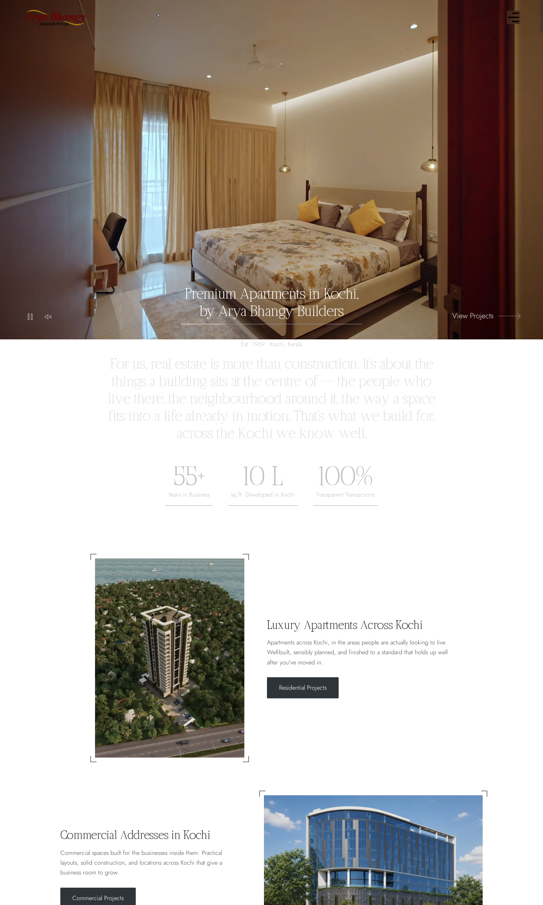

# UI Design System & Master Generation Blueprint: aryabhangybuilders-com

> **Premium Builders In Kochi · Flats & Apartments · Arya Bhangy** (https://aryabhangybuilders.com/) — RERA-registered 2.5, 3 & 4 BHK apartments in Vyttila and Kumbalam, Kochi, from a family group building since 1969. Book a site visit.



---

## 1. Executive Visual Persona & Design Archetype

- **Brand Essence & Persona**: **Premium Builders In Kochi · Flats & Apartments · Arya Bhangy** (`https://aryabhangybuilders.com/`). RERA-registered 2.5, 3 & 4 BHK apartments in Vyttila and Kumbalam, Kochi, from a family group building since 1969. Book a site visit.
- **Visual Archetype**: **Light-Substrate Editorial & Modular Grid System (`#fff` canvas, `#222222` ink, `#b2b2be` accent)**.
- **Anti-AI-Slop Differentiators**:
  - **Source-Grounded Chromatic Polarity**: Anchors the viewport in `#fff` (`var(--e-social-icon-icon-color)` in `:root`) paired with `#222222` primary typography and `#b2b2be` accents.
  - **Extracted Typographic Hierarchy**: Pairs `CS Alpha` for display copy (`Premium Apartments in Kochi, by Arya`) with `Jost` and not declared in static CSS (uses primary stack / `ui-monospace`).
  - **Calibrated Spatial Grid & Motion**: Combines `1024px` container bounds (`gap: 20px`, padding `10px`) with `cubic-bezier(0.22,0.61,0.36,1)` easing and Lenis Smooth Scroll (`data-lenis`), GSAP Timeline & ScrollTrigger.

---

## 2. Spatial Architecture & Modular Grid Mathematics


### Viewport Allocation & Container Geometry
- **Captured Viewport Dimensions**: Desktop `1440×2400px` (`assets/desktop.png`, capped at 2400px multi-section capture), Mobile `390×2400px` (`assets/mobile.png`, capped at 2400px multi-section capture).
- **Master Container Bounds**: `1024px` extracted from `aryabhangybuilders-com` stylesheet.
- **Canvas Lateral Padding & Spacing**: `10px` lateral canvas padding with `20px` grid gap.
- **Border Radius Scale**: `4px`, `2px`, `0px`, `var(--border-radius)`.

### Responsive Breakpoint Architecture
- **Desktop Layout**: Multi-column CSS Grid / Flexbox layout at `1440px` (`max-width: 1024px`, `gap: 20px`).
- **Mobile Layout**: Single-column vertical stack at `390px` viewport width with `10px` horizontal padding.
- **Extracted CSS Media Queries**: `@media (max-width:1024px)`, `@media (max-width:767px)`, `@media (min-width:-1)`, `@media (max-width:-1)`.

---

## 3. Color System, Materiality & Atmospheric Lighting

### Semantic Palette & Source Grounding
| Semantic Role | Ground-Truth Value | Extracted CSS Source / Selector |
|---|---|---|
| **Primary Canvas Substrate** | `#fff` | `var(--e-social-icon-icon-color)` in `:root` |
| **Primary Typography Ink** | `#222222` | `var(--contrast)` in `:root` |
| **Elevated Surface / Card Substrate** | `#575760` | `var(--contrast-2)` in `:root` |
| **Interactive Accent / Highlight** | `#b2b2be` | `var(--contrast-3)` in `:root` |
| **Secondary / Muted Copy** | `#f0f0f0` | `var(--base)` in `:root` |
| **Structural Hairline Border** | `#f7f8f9` | `var(--base-2)` in `:root` |

### Sanitized Root CSS Variables (`ui-ux.md` Ground Truth)
| Variable Name | Extracted Value | Semantic Role |
|---|---|---|
| `--flex-right` | `flex-start` | Design System Custom Token |
| `--justify-content` | `var(--flex-right,flex-end)` | Design System Custom Token |
| `--e-global-color-v4-white` | `var(--white)` | Canvas / Surface Token |
| `--e-global-color-v4-black` | `var(--black)` | Canvas / Surface Token |
| `--e-global-color-v4-cream-50` | `var(--cream-50)` | Brand / Palette Token |
| `--e-global-color-v4-cream-100` | `var(--cream-100)` | Brand / Palette Token |
| `--e-global-color-v4-cream-150` | `var(--cream-150)` | Brand / Palette Token |
| `--e-global-color-v4-cream-200` | `var(--cream-200)` | Brand / Palette Token |
| `--e-global-color-v4-beige-300` | `var(--beige-300)` | Brand / Palette Token |
| `--e-global-color-v4-beige-400` | `var(--beige-400)` | Brand / Palette Token |
| `--e-global-color-v4-taupe-450` | `var(--taupe-450)` | Brand / Palette Token |
| `--e-global-color-v4-taupe-500` | `var(--taupe-500)` | Brand / Palette Token |
| `--e-global-color-v4-charcoal` | `var(--charcoal)` | Brand / Palette Token |
| `--e-global-color-v4-charcoal-900` | `var(--charcoal-900)` | Brand / Palette Token |
| `--e-global-color-v4-charcoal-800` | `var(--charcoal-800)` | Brand / Palette Token |
| `--e-global-color-v4-charcoal-700` | `var(--charcoal-700)` | Brand / Palette Token |

---

## 4. Typographic Scale & Editorial Hierarchy

### Font Family Stacks
- **Display Typography**: `CS Alpha`.
- **Primary Body Stack**: `Jost`.
- **Technical / Metadata Stack**: not declared in static CSS (uses primary stack / `ui-monospace`).

### Typographic Scale & Rules (Extracted from Stylesheet & Variables)
- **Hero Display (`H1`)**: CSS variables `--page-title-display: block`.
- **Section Heading (`H2`)**: rule `h2` (`font-size: 36px`).
- **Body Copy**: not explicitly declared on tag in static CSS (stylesheet font-size ladder: `12px`, `14px`, `2.5em`, `100px`, `15px`).
- **Metadata & Navigation Labels**: not explicitly declared on tag in static CSS (stylesheet font-size ladder: `12px`, `14px`, `2.5em`, `100px`, `15px`).

---

## 5. Choreographed Motion & Interaction Physics

### Primary Easing Curves
- **Extracted Timing Functions**: `cubic-bezier(0.22,0.61,0.36,1)`.

### Per-Element Transition & Choreography Rules
- **Selector `.elementor .e-form-checkbox-base`**: `transition: background-color 200ms` extracted from `aryabhangybuilders-com` stylesheet.
- **Selector `.elementor .e-form-checkbox-base:...`**: `transition: opacity 200ms` extracted from `aryabhangybuilders-com` stylesheet.
- **Selector `entor .elementor-background-video...`**: `transition: opacity 1s` extracted from `aryabhangybuilders-com` stylesheet.
- **Extracted Easing Curve (`cubic-bezier(0.22,0.61,0.36,1)`)**: Governs interactive state transitions across `<header.elementor>` and `<article.post-2414>`.
- **Runtime Interaction Engine**: Integrates Lenis Smooth Scroll (`data-lenis`), GSAP Timeline & ScrollTrigger, Swiper Touch Carousel Engine, Lottie Vector Animation Player with `prefers-reduced-motion: reduce` fallback guards.

---

## 6. Component Wireframe & Structural DOM Map

### Visual Layout Schematic (Grounded in `dom.html` — `1440px` Desktop & `390px` Mobile Reflow)
```
┌────────────────────────────────────────────────────────────────────────┐
│ DESKTOP VIEWPORT (1440px) — Premium Builders In Kochi · Flats & Apartm │
│ ====================================================================== │
│ [ <header.elementor>       | Home · Residential · Commercial · Our  ]  │
│ ---------------------------------------------------------------------- │
│ | HERO STAGE: <article.post-2414>                                  |   │
│ | H1: Premium Apartments in Kochi, by Arya Bhangy Builders         |   │
│ | Substrate: #fff       | Ink: #222222    | Accent: #b2b2be        |   │
│ ---------------------------------------------------------------------- │
│ | SHOWCASE GRID (<article.post-2414>       ) max-w: 1024px         |   │
│ | +------------------------------+  +------------------------------+ | │
│ | | Years in Business            |  | sq.ft. Developed in Kochi    | | │
│ | +------------------------------+  +------------------------------+ | │
│ ---------------------------------------------------------------------- │
│ | MOBILE VIEWPORT REFLOW (390px) — Single-Column Stack (gap: 20px  ) | │
│ | [<header.elementor>] -> [<article.post-2414] -> [<article.post-2414] │
│ ---------------------------------------------------------------------- │
│ [ FOOTER (<footer.elementor>    ) | https://aryabhangybuilders.com/    │
└────────────────────────────────────────────────────────────────────────┘
```

### Granular DOM Region Breakdown
1. **Brand Header & Navigation Bar (<header.elementor> — `aryabhangybuilders-com`)**:
   - Landmark `<header class="elementor elementor-5070">` hosting `Premium Builders In Kochi · Flats & ` navigation (`Home · Residential · Commercial · Our Legacy · Testimonials`), DOM attributes (`data-elementor-device-mode="desktop"`, `data-opened="1"`, `data-elementor-type="header"`, `data-elementor-id="5070"`), and stylesheet rule `.e--ua-appleWebkit.rtl { --flex-right:flex-start }`.
2. **Hero Stage & Focal Lead (<article.post-2414> — `Premium Apartments in Kochi, by Ar`)**:
   - Landmark `<article class="post-2414 page">` presenting display lead `Premium Apartments in Kochi, by Arya Bhangy Builders` and copy excerpt *"sales@aryabhangybuilders.com"* over `#fff` canvas and `#222222` ink.
3. **Primary Showcase & Content Grid (<article.post-2414> — `Years in Business`)**:
   - Landmark `<article class="post-2414 page">` rendering section `Years in Business` with copy *"Enquire on WhatsApp."*, asset references (`1806948866520083`, `fbevents.js`, `gtm.js`, `embed`), and grid rule `widget-social-icons.e-grid-align-... { --justify-content:var(--flex-right,flex-end) }`.
4. **Interactive Detail & Feature Matrix (<article.post-2414> — `sq.ft. Developed in Kochi`)**:
   - Landmark `<article class="post-2414 page">` framing `sq.ft. Developed in Kochi` and `Transparent Transactions` (*"Est. 1969 · Kochi, Kerala"*) with `#575760` surface cards, `#b2b2be` accents, and `e-grid-align-right .elementor-gri... { margin-inline:calc(.5 * var(--grid-column-gap)) }`.
5. **Colophon & Global Directory Footer (<footer.elementor> — `https://aryabhangybuilders.com/`)**:
   - Landmark `<footer class="elementor elementor-6448">` anchoring `Premium Builders In Kochi · Flat` footer links (`Home · Residential · Commercial · Our Legacy · Testimonials`), copy *"F o r u s , r e a l e s t a t e i s m o r e t h a n c o n s "*, and `#f7f8f9` structural dividers.

---

## 7. Master Zero-Shot AI Generation Prompt

```markdown
# Master Zero-Shot Frontend Generation Prompt: aryabhangybuilders-com (Premium Builders In Kochi · Flats & Apartments · Arya Bhangy)

You are a principal frontend architect and design systems engineer. Build a complete, production-ready web application replicating the exact design system, DOM landmarks, typographic hierarchy, color tokens, and motion physics of `aryabhangybuilders-com` (**Premium Builders In Kochi · Flats & Apartments · Arya Bhangy** — `https://aryabhangybuilders.com/`).

### 1. Visual Archetype & Anti-AI-Slop Mandates
- **Archetype**: Light-Substrate Editorial & Modular Grid System (`#fff` canvas, `#222222` ink, `#b2b2be` accent).
- **Identity & Domain Context**: RERA-registered 2.5, 3 & 4 BHK apartments in Vyttila and Kumbalam, Kochi, from a family group building since 1969. Book a site visit.
- **Primary Substrate**: `#fff` (`var(--e-social-icon-icon-color)` in `:root`), **Primary Ink**: `#222222`, **Accent / Highlight**: `#b2b2be`.
- **Site-Specific Differentiators**:
  - **Source-Grounded Chromatic Polarity**: Anchors the viewport in `#fff` (`var(--e-social-icon-icon-color)` in `:root`) paired with `#222222` primary typography and `#b2b2be` accents.
  - **Extracted Typographic Hierarchy**: Pairs `CS Alpha` for display copy (`Premium Apartments in Kochi, by Arya`) with `Jost` and not declared in static CSS (uses primary stack / `ui-monospace`).
  - **Calibrated Spatial Grid & Motion**: Combines `1024px` container bounds (`gap: 20px`, padding `10px`) with `cubic-bezier(0.22,0.61,0.36,1)` easing and Lenis Smooth Scroll (`data-lenis`), GSAP Timeline & ScrollTrigger.

### 2. Ground-Truth CSS Variables (`:root` Token Contract)
Declare and consume these exact custom properties extracted from `aryabhangybuilders-com` in your global stylesheet:

:root {
  /* Premium Builders In Kochi · Flats & Apartments · Arya Bhangy (aryabhangybuilders-com) — Ground-Truth Extracted CSS Variables */
  --flex-right: flex-start; /* Design System Custom Token (aryabhangybuilders-com) */
  --justify-content: var(--flex-right,flex-end); /* Design System Custom Token (aryabhangybuilders-com) */
  --e-global-color-v4-white: var(--white); /* Canvas / Surface Token (aryabhangybuilders-com) */
  --e-global-color-v4-black: var(--black); /* Canvas / Surface Token (aryabhangybuilders-com) */
  --e-global-color-v4-cream-50: var(--cream-50); /* Brand / Palette Token (aryabhangybuilders-com) */
  --e-global-color-v4-cream-100: var(--cream-100); /* Brand / Palette Token (aryabhangybuilders-com) */
  --e-global-color-v4-cream-150: var(--cream-150); /* Brand / Palette Token (aryabhangybuilders-com) */
  --e-global-color-v4-cream-200: var(--cream-200); /* Brand / Palette Token (aryabhangybuilders-com) */
  --e-global-color-v4-beige-300: var(--beige-300); /* Brand / Palette Token (aryabhangybuilders-com) */
  --e-global-color-v4-beige-400: var(--beige-400); /* Brand / Palette Token (aryabhangybuilders-com) */
  --e-global-color-v4-taupe-450: var(--taupe-450); /* Brand / Palette Token (aryabhangybuilders-com) */
  --e-global-color-v4-taupe-500: var(--taupe-500); /* Brand / Palette Token (aryabhangybuilders-com) */
  --e-global-color-v4-charcoal: var(--charcoal); /* Brand / Palette Token (aryabhangybuilders-com) */
  --e-global-color-v4-charcoal-900: var(--charcoal-900); /* Brand / Palette Token (aryabhangybuilders-com) */
  --e-global-color-v4-charcoal-800: var(--charcoal-800); /* Brand / Palette Token (aryabhangybuilders-com) */
  --e-global-color-v4-charcoal-700: var(--charcoal-700); /* Brand / Palette Token (aryabhangybuilders-com) */
}

### 3. Semantic Color & Materiality Contract
Map every surface, ink, and border strictly to these source-grounded tokens:
- **Primary Canvas Substrate**: `#fff` — grounded in `var(--e-social-icon-icon-color)` in `:root`
- **Primary Typography Ink**: `#222222` — grounded in `var(--contrast)` in `:root`
- **Elevated Surface / Card Substrate**: `#575760` — grounded in `var(--contrast-2)` in `:root`
- **Interactive Accent / Highlight**: `#b2b2be` — grounded in `var(--contrast-3)` in `:root`
- **Secondary / Muted Copy**: `#f0f0f0` — grounded in `var(--base)` in `:root`
- **Structural Hairline Border**: `#f7f8f9` — grounded in `var(--base-2)` in `:root`

### 4. Spatial Grid, Container Bounds & Responsive Breakpoints
- **Desktop Viewport Reference**: `1440×2400px` (capped at 2400px multi-section capture, `1440px` standard desktop width).
- **Mobile Viewport Reference**: `390×2400px` (capped at 2400px multi-section capture, `390px` standard mobile width).
- **Container Max-Width**: `1024px` extracted from `aryabhangybuilders-com` stylesheet
- **Padding & Gutters**: `10px` lateral canvas padding with `20px` grid gap
- **Desktop Grid**: Multi-column CSS Grid / Flexbox layout at `1440px` (`max-width: 1024px`, `gap: 20px`)
- **Mobile Adaptation**: Single-column vertical stack at `390px` viewport width with `10px` horizontal padding
- **Media Queries**: `@media (max-width:1024px)`, `@media (max-width:767px)`, `@media (min-width:-1)`, `@media (max-width:-1)`
- **Corner Radii**: `4px`, `2px`, `0px`, `var(--border-radius)`

### 5. Typography & Editorial Scale Contract
- **Display Font Stack**: `CS Alpha`
- **Body Font Stack**: `Jost`
- **Monospace / Technical Font Stack**: not declared in static CSS (uses primary stack / `ui-monospace`)
- **H1 Display Rule**: CSS variables `--page-title-display: block`
- **H2 Section Rule**: rule `h2` (`font-size: 36px`)
- **Body Copy Rule**: not explicitly declared on tag in static CSS (stylesheet font-size ladder: `12px`, `14px`, `2.5em`, `100px`, `15px`)
- **Metadata & Index Rule**: not explicitly declared on tag in static CSS (stylesheet font-size ladder: `12px`, `14px`, `2.5em`, `100px`, `15px`)

### 6. Component Hierarchy, Verbatim Copy & Real DOM Landmarks
Scaffold `aryabhangybuilders-com` (`Premium Builders In Kochi · Flats & Apartments · Arya Bhangy`) with these exact structural regions, extracted copy, and CSS rules from `dom.html`:
1. **Brand Header & Navigation Bar (<header.elementor> — `aryabhangybuilders-com`)**:
   - DOM & Selectors: Landmark `<header class="elementor elementor-5070">` hosting `Premium Builders In Kochi · Flats & ` navigation (`Home · Residential · Commercial · Our Legacy · Testimonials`), DOM attributes (`data-elementor-device-mode="desktop"`, `data-opened="1"`, `data-elementor-type="header"`, `data-elementor-id="5070"`), and stylesheet rule `.e--ua-appleWebkit.rtl { --flex-right:flex-start }`.
   - Responsive Contract: Header `Brand Header & Navigation Bar (<header.elementor> — `aryabhangybuilders-com`)` (`aryabhangybuilders-com`) adapts across `@media (max-width:1024px)`, `@media (max-width:767px)`, `@media (min-width:-1)`, `@media (max-width:-1)` with `cubic-bezier(0.22,0.61,0.36,1)` transitions and links `Home · Residential · Commercial · Our Legacy · Testimonials`.
2. **Hero Stage & Focal Lead (<article.post-2414> — `Premium Apartments in Kochi, by Ar`)**:
   - DOM & Selectors: Landmark `<article class="post-2414 page">` presenting display lead `Premium Apartments in Kochi, by Arya Bhangy Builders` and copy excerpt *"sales@aryabhangybuilders.com"* over `#fff` canvas and `#222222` ink.
   - Responsive Contract: Hero stage (`1440×2400px` desktop / `390×2400px` mobile) sets `#fff` background with `#222222` headline `Premium Apartments in Kochi, by Arya Bhangy Builders`.
3. **Primary Showcase & Content Grid (<article.post-2414> — `Years in Business`)**:
   - DOM & Selectors: Landmark `<article class="post-2414 page">` rendering section `Years in Business` with copy *"Enquire on WhatsApp."*, asset references (`1806948866520083`, `fbevents.js`, `gtm.js`, `embed`), and grid rule `widget-social-icons.e-grid-align-... { --justify-content:var(--flex-right,flex-end) }`.
   - Responsive Contract: Showcase grid `Primary Showcase & Content Grid (<article.post-2414> — `Years in Business`)` applies Multi-column CSS Grid / Flexbox layout at `1440px` (`max-width: 1024px`, `gap: 20px`) on desktop and Single-column vertical stack at `390px` viewport width with `10px` horizontal padding on mobile.
4. **Interactive Detail & Feature Matrix (<article.post-2414> — `sq.ft. Developed in Kochi`)**:
   - DOM & Selectors: Landmark `<article class="post-2414 page">` framing `sq.ft. Developed in Kochi` and `Transparent Transactions` (*"Est. 1969 · Kochi, Kerala"*) with `#575760` surface cards, `#b2b2be` accents, and `e-grid-align-right .elementor-gri... { margin-inline:calc(.5 * var(--grid-column-gap)) }`.
   - Responsive Contract: Detail module `Interactive Detail & Feature Matrix (<article.post-2414> — `sq.ft. Developed in Kochi`)` uses `4px`, `2px`, `0px`, `var(--border-radius)` radii, `#b2b2be` highlights, and assets (1806948866520083, fbevents.js, gtm.js).
5. **Colophon & Global Directory Footer (<footer.elementor> — `https://aryabhangybuilders.com/`)**:
   - DOM & Selectors: Landmark `<footer class="elementor elementor-6448">` anchoring `Premium Builders In Kochi · Flat` footer links (`Home · Residential · Commercial · Our Legacy · Testimonials`), copy *"F o r u s , r e a l e s t a t e i s m o r e t h a n c o n s "*, and `#f7f8f9` structural dividers.
   - Responsive Contract: Footer `Colophon & Global Directory Footer (<footer.elementor> — `https://aryabhangybuilders.com/`)` aligns to `1024px` extracted from `aryabhangybuilders-com` stylesheet with `10px` lateral canvas padding with `20px` grid gap and attributes (data-elementor-device-mode="desktop", data-opened="1", data-elementor-type="header").

#### Verbatim DOM Copy Excerpts (`dom.html`)
- Copy Excerpt 1: *"sales@aryabhangybuilders.com"*
- Copy Excerpt 2: *"Enquire on WhatsApp."*
- Copy Excerpt 3: *"Est. 1969 · Kochi, Kerala"*
- Copy Excerpt 4: *"F o r u s , r e a l e s t a t e i s m o r e t h a n c o n s t r u c t i o n . I t..."*

### 7. Motion, Extracted Stylesheet Rules & Interaction Choreography
- **Primary Easing Functions**: `cubic-bezier(0.22,0.61,0.36,1)`
- **Extracted Stylesheet Rules (`aryabhangybuilders-com`)**:
- `.e--ua-appleWebkit.rtl { --flex-right:flex-start }`
- `widget-social-icons.e-grid-align-... { --justify-content:var(--flex-right,flex-end) }`
- `e-grid-align-right .elementor-gri... { margin-inline:calc(.5 * var(--grid-column-gap)) }`
- `icons.e-grid-align-left .elemento... { display:inline-block }`
- `.e-grid-align-left .elementor-gri... { margin-inline:0 }`
- **Per-Selector Transition Rules**:
- **Selector `.elementor .e-form-checkbox-base`**: `transition: background-color 200ms` extracted from `aryabhangybuilders-com` stylesheet.
- **Selector `.elementor .e-form-checkbox-base:...`**: `transition: opacity 200ms` extracted from `aryabhangybuilders-com` stylesheet.
- **Selector `entor .elementor-background-video...`**: `transition: opacity 1s` extracted from `aryabhangybuilders-com` stylesheet.
- **Extracted Easing Curve (`cubic-bezier(0.22,0.61,0.36,1)`)**: Governs interactive state transitions across `<header.elementor>` and `<article.post-2414>`.
- **Runtime Interaction Engine**: Integrates Lenis Smooth Scroll (`data-lenis`), GSAP Timeline & ScrollTrigger, Swiper Touch Carousel Engine, Lottie Vector Animation Player with `prefers-reduced-motion: reduce` fallback guards.

### 8. Technical Deliverables
- Implement in Next.js (App Router) with TypeScript and Tailwind CSS consuming the `:root` custom properties defined above for `aryabhangybuilders-com`.
- Reproduce both the `1440px` desktop architecture and `390px` mobile breakpoint transitions, preserving semantic HTML5 landmarks (`<header>`, `<nav>`, `<main>`, `<section>`, `<footer>`) and `prefers-reduced-motion` accessibility guards.
```
