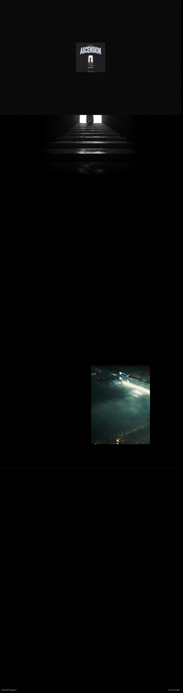
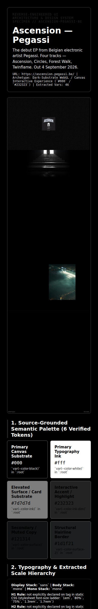

# UI Design System & Master Generation Blueprint: ascension-pegassi-be

> **Ascension — Pegassi** (https://ascension.pegassi.be/) — The debut EP from Belgian electronic artist Pegassi. Four tracks — Ascension, Circles, Forest Walk, Twinflame. Out 4 September 2026.



---

## 1. Executive Visual Persona & Design Archetype

- **Brand Essence & Persona**: **Ascension — Pegassi** (`https://ascension.pegassi.be/`). The debut EP from Belgian electronic artist Pegassi. Four tracks — Ascension, Circles, Forest Walk, Twinflame. Out 4 September 2026.
- **Visual Archetype**: **Dark-Substrate WebGL / Canvas Interactive Experience (`#000` / `#232323`)**.
- **Anti-AI-Slop Differentiators**:
  - **Source-Grounded Chromatic Polarity**: Anchors the viewport in `#000` (`var(--color-black)` in `:root`) paired with `#fff` primary typography and `#232323` accents.
  - **Extracted Typographic Hierarchy**: Pairs `sans` for display copy (`Pegassi — Ascension EP`) with `mono` and `mono`.
  - **Calibrated Spatial Grid & Motion**: Combines `650px` container bounds (`gap: 1rem`, padding `1rem`) with `cubic-bezier(0,0,.2,1)` easing and Lenis Smooth Scroll (`data-lenis`), Three.js / WebGL Canvas Pipeline.

---

## 2. Spatial Architecture & Modular Grid Mathematics



### Viewport Allocation & Container Geometry
- **Captured Viewport Dimensions**: Desktop `1440×5425px` (`assets/desktop.png`, full-page scroll capture), Mobile `390×2400px` (`assets/mobile.png`, capped at 2400px multi-section capture).
- **Master Container Bounds**: `650px` extracted from `ascension-pegassi-be` stylesheet.
- **Canvas Lateral Padding & Spacing**: `1rem` lateral canvas padding with `1rem` grid gap.
- **Border Radius Scale**: `.25rem`, `50%`.

### Responsive Breakpoint Architecture
- **Desktop Layout**: Multi-column CSS Grid / Flexbox layout at `1440px` (`max-width: 650px`, `gap: 1rem`).
- **Mobile Layout**: Single-column vertical stack at `390px` viewport width with `1rem` horizontal padding.
- **Extracted CSS Media Queries**: `@media (width>=650px)`, `@media (width>=1100px)`, `@media (width>=1300px)`, `@media (width>=1400px)`.

---

## 3. Color System, Materiality & Atmospheric Lighting

### Semantic Palette & Source Grounding
| Semantic Role | Ground-Truth Value | Extracted CSS Source / Selector |
|---|---|---|
| **Primary Canvas Substrate** | `#000` | `var(--color-black)` in `:root` |
| **Primary Typography Ink** | `#fff` | `var(--color-white)` in `:root` |
| **Elevated Surface / Card Substrate** | `#7d7d7d` | `var(--color-ink)` in `:root` |
| **Interactive Accent / Highlight** | `#232323` | `var(--color-ink-dim)` in `:root` |
| **Secondary / Muted Copy** | `#121314` | `var(--color-surface)` in `:root` |
| **Structural Hairline Border** | `#1d1f21` | `var(--color-surface-2)` in `:root` |

### Sanitized Root CSS Variables (`ui-ux.md` Ground Truth)
| Variable Name | Extracted Value | Semantic Role |
|---|---|---|
| `--gl-feather` | `0px` | Dimension / Scale Token |
| `--reveal` | `0` | Design System Custom Token |
| `--font-sans` | `"sans", sans-serif` | Typography / Scale Token |
| `--font-mono` | `"mono", monospace` | Typography / Scale Token |
| `--color-black` | `#000` | Canvas / Surface Token |
| `--color-white` | `#fff` | Canvas / Surface Token |
| `--spacing` | `.1rem` | Layout / Spatial Grid Token |
| `--font-weight-bold` | `700` | Typography / Scale Token |
| `--ease-out` | `cubic-bezier(0, 0, .2, 1)` | Motion / Easing Token |
| `--blur-sm` | `8px` | Elevation / Border Token |
| `--default-transition-duration` | `.15s` | Motion / Easing Token |
| `--default-transition-timing-function` | `cubic-bezier(.4, 0, .2, 1)` | Motion / Easing Token |
| `--default-font-family` | `var(--font-sans)` | Typography / Scale Token |
| `--default-mono-font-family` | `var(--font-mono)` | Typography / Scale Token |
| `--breakpoint-s` | `650px` | Dimension / Scale Token |
| `--color-ink` | `#7d7d7d` | Typography Ink Token |

---

## 4. Typographic Scale & Editorial Hierarchy

### Font Family Stacks
- **Display Typography**: `sans`.
- **Primary Body Stack**: `mono`.
- **Technical / Metadata Stack**: `mono`.

### Typographic Scale & Rules (Extracted from Stylesheet & Variables)
- **Hero Display (`H1`)**: not explicitly declared on tag in static CSS (stylesheet font-size ladder: `1em`, `80%`, `75%`, `1.3rem`, `1.7rem`).
- **Section Heading (`H2`)**: not explicitly declared on tag in static CSS (stylesheet font-size ladder: `1em`, `80%`, `75%`, `1.3rem`, `1.7rem`).
- **Body Copy**: not explicitly declared on tag in static CSS (stylesheet font-size ladder: `1em`, `80%`, `75%`, `1.3rem`, `1.7rem`).
- **Metadata & Navigation Labels**: CSS variables `--font-mono: "mono", monospace`, `--default-mono-font-family: var(--font-mono)`, `--label: 100`.

---

## 5. Choreographed Motion & Interaction Physics

### Primary Easing Curves
- **Extracted Timing Functions**: `cubic-bezier(0,0,.2,1)`, `cubic-bezier(.4,0,.2,1)`, `cubic-bezier(.25,.46,.45,.94)`.

### Per-Element Transition & Choreography Rules
- **Selector `layer theme`**: `transition: .15s` extracted from `ascension-pegassi-be` stylesheet.
- **Selector `.hoverable:after`**: `transition: opacity .15s var(--ease-out-quad)` extracted from `ascension-pegassi-be` stylesheet.
- **Selector `.grain:before`**: `transition: opacity .6s var(--ease-out-quad)` extracted from `ascension-pegassi-be` stylesheet.
- **Extracted Easing Curve (`cubic-bezier(0,0,.2,1)`)**: Governs interactive state transitions across `<header.absolute>` and `<section.site-max>`.
- **Runtime Interaction Engine**: Integrates Lenis Smooth Scroll (`data-lenis`), Three.js / WebGL Canvas Pipeline with `prefers-reduced-motion: reduce` fallback guards.

---

## 6. Component Wireframe & Structural DOM Map

### Visual Layout Schematic (Grounded in `dom.html` — `1440px` Desktop & `390px` Mobile Reflow)
```
┌────────────────────────────────────────────────────────────────────────┐
│ DESKTOP VIEWPORT (1440px) — Ascension — Pegassi                        │
│ ====================================================================== │
│ [ <header.absolute>        | Listen · Sequencer · About · Buy       ]  │
│ ---------------------------------------------------------------------- │
│ | HERO STAGE: <section.hero>                                       |   │
│ | H1: Pegassi — Ascension EP                                       |   │
│ | Substrate: #000       | Ink: #fff       | Accent: #232323        |   │
│ ---------------------------------------------------------------------- │
│ | SHOWCASE GRID (<section.site-max>        ) max-w: 650px          |   │
│ | +------------------------------+  +------------------------------+ | │
│ | | This EP is all about showing |  | The title track 1 combines t | | │
│ | +------------------------------+  +------------------------------+ | │
│ ---------------------------------------------------------------------- │
│ | MOBILE VIEWPORT REFLOW (390px) — Single-Column Stack (gap: 1rem  ) | │
│ | [<header.absolute>] -> [<section.hero>] -> [<section.site-max>] |    │
│ ---------------------------------------------------------------------- │
│ [ FOOTER (<footer.site-max>     ) | https://ascension.pegassi.be/      │
└────────────────────────────────────────────────────────────────────────┘
```

### Granular DOM Region Breakdown
1. **Brand Header & Navigation Bar (<header.absolute> — `ascension-pegassi-be`)**:
   - Landmark `<header class="absolute top-0">` hosting `Ascension — Pegassi` navigation (`Listen · Sequencer · About · Buy`), DOM attributes (`data-gl-host`, `data-engine="three.js r185"`, `data-v-337fa076`, `data-mask="0"`), and stylesheet rule `before { box-sizing:border-box;border:0 solid;margin:0;padding:0 }`.
2. **Hero Stage & Focal Lead (<section.hero> — `Pegassi — Ascension EP`)**:
   - Landmark `<section class="hero relative">` presenting display lead `Pegassi — Ascension EP` and copy excerpt *"This EP is all about showing my versatility as an artist. With “A"* over `#000` canvas and `#fff` ink.
3. **Primary Showcase & Content Grid (<section.site-max> — `This EP is all about showing my ve`)**:
   - Landmark `<section class="site-max site-grid">` rendering section `This EP is all about showing my versatility as a` with copy *"The title track 1 combines that uplifting yet heavy-hitting energ"*, asset references (`entry.mTHQBrhg.css`, `record-disc.BO204g5c.css`, `site-foot.CthBkmXY.css`, `PPNeueMontreal-Bold.l3ulKZJq.woff2`), and grid rule `file-selector-button { box-sizing:border-box;border:0 solid;margin:0;padding:0 }`.
4. **Interactive Detail & Feature Matrix (<section.site-max> — `The title track 1 combines that up`)**:
   - Landmark `<section class="site-max site-grid">` framing `The title track 1 combines that uplifting yet he` and `“Circles” 2 is only the second time in my career` (*"“Circles” 2 is only the second time in my career I've stepped on "*) with `#7d7d7d` surface cards, `#232323` accents, and `strong { font-weight:bolder }`.
5. **Colophon & Global Directory Footer (<footer.site-max> — `https://ascension.pegassi.be/`)**:
   - Landmark `<footer class="site-max site-grid">` anchoring `Ascension — Pegassi` footer links (`Listen · Sequencer · About · Buy`), copy *"A1 Ascension (03:01) B1 Forest Walk (03:10)"*, and `#1d1f21` structural dividers.

---

## 7. Master Zero-Shot AI Generation Prompt

```markdown
# Master Zero-Shot Frontend Generation Prompt: ascension-pegassi-be (Ascension — Pegassi)

You are a principal frontend architect and design systems engineer. Build a complete, production-ready web application replicating the exact design system, DOM landmarks, typographic hierarchy, color tokens, and motion physics of `ascension-pegassi-be` (**Ascension — Pegassi** — `https://ascension.pegassi.be/`).

### 1. Visual Archetype & Anti-AI-Slop Mandates
- **Archetype**: Dark-Substrate WebGL / Canvas Interactive Experience (`#000` / `#232323`).
- **Identity & Domain Context**: The debut EP from Belgian electronic artist Pegassi. Four tracks — Ascension, Circles, Forest Walk, Twinflame. Out 4 September 2026.
- **Primary Substrate**: `#000` (`var(--color-black)` in `:root`), **Primary Ink**: `#fff`, **Accent / Highlight**: `#232323`.
- **Site-Specific Differentiators**:
  - **Source-Grounded Chromatic Polarity**: Anchors the viewport in `#000` (`var(--color-black)` in `:root`) paired with `#fff` primary typography and `#232323` accents.
  - **Extracted Typographic Hierarchy**: Pairs `sans` for display copy (`Pegassi — Ascension EP`) with `mono` and `mono`.
  - **Calibrated Spatial Grid & Motion**: Combines `650px` container bounds (`gap: 1rem`, padding `1rem`) with `cubic-bezier(0,0,.2,1)` easing and Lenis Smooth Scroll (`data-lenis`), Three.js / WebGL Canvas Pipeline.

### 2. Ground-Truth CSS Variables (`:root` Token Contract)
Declare and consume these exact custom properties extracted from `ascension-pegassi-be` in your global stylesheet:

:root {
  /* Ascension — Pegassi (ascension-pegassi-be) — Ground-Truth Extracted CSS Variables */
  --gl-feather: 0px; /* Dimension / Scale Token (ascension-pegassi-be) */
  --reveal: 0; /* Design System Custom Token (ascension-pegassi-be) */
  --font-sans: "sans", sans-serif; /* Typography / Scale Token (ascension-pegassi-be) */
  --font-mono: "mono", monospace; /* Typography / Scale Token (ascension-pegassi-be) */
  --color-black: #000; /* Canvas / Surface Token (ascension-pegassi-be) */
  --color-white: #fff; /* Canvas / Surface Token (ascension-pegassi-be) */
  --spacing: .1rem; /* Layout / Spatial Grid Token (ascension-pegassi-be) */
  --font-weight-bold: 700; /* Typography / Scale Token (ascension-pegassi-be) */
  --ease-out: cubic-bezier(0, 0, .2, 1); /* Motion / Easing Token (ascension-pegassi-be) */
  --blur-sm: 8px; /* Elevation / Border Token (ascension-pegassi-be) */
  --default-transition-duration: .15s; /* Motion / Easing Token (ascension-pegassi-be) */
  --default-transition-timing-function: cubic-bezier(.4, 0, .2, 1); /* Motion / Easing Token (ascension-pegassi-be) */
  --default-font-family: var(--font-sans); /* Typography / Scale Token (ascension-pegassi-be) */
  --default-mono-font-family: var(--font-mono); /* Typography / Scale Token (ascension-pegassi-be) */
  --breakpoint-s: 650px; /* Dimension / Scale Token (ascension-pegassi-be) */
  --color-ink: #7d7d7d; /* Typography Ink Token (ascension-pegassi-be) */
}

### 3. Semantic Color & Materiality Contract
Map every surface, ink, and border strictly to these source-grounded tokens:
- **Primary Canvas Substrate**: `#000` — grounded in `var(--color-black)` in `:root`
- **Primary Typography Ink**: `#fff` — grounded in `var(--color-white)` in `:root`
- **Elevated Surface / Card Substrate**: `#7d7d7d` — grounded in `var(--color-ink)` in `:root`
- **Interactive Accent / Highlight**: `#232323` — grounded in `var(--color-ink-dim)` in `:root`
- **Secondary / Muted Copy**: `#121314` — grounded in `var(--color-surface)` in `:root`
- **Structural Hairline Border**: `#1d1f21` — grounded in `var(--color-surface-2)` in `:root`

### 4. Spatial Grid, Container Bounds & Responsive Breakpoints
- **Desktop Viewport Reference**: `1440×5425px` (full-page scroll capture, `1440px` standard desktop width).
- **Mobile Viewport Reference**: `390×2400px` (capped at 2400px multi-section capture, `390px` standard mobile width).
- **Container Max-Width**: `650px` extracted from `ascension-pegassi-be` stylesheet
- **Padding & Gutters**: `1rem` lateral canvas padding with `1rem` grid gap
- **Desktop Grid**: Multi-column CSS Grid / Flexbox layout at `1440px` (`max-width: 650px`, `gap: 1rem`)
- **Mobile Adaptation**: Single-column vertical stack at `390px` viewport width with `1rem` horizontal padding
- **Media Queries**: `@media (width>=650px)`, `@media (width>=1100px)`, `@media (width>=1300px)`, `@media (width>=1400px)`
- **Corner Radii**: `.25rem`, `50%`

### 5. Typography & Editorial Scale Contract
- **Display Font Stack**: `sans`
- **Body Font Stack**: `mono`
- **Monospace / Technical Font Stack**: `mono`
- **H1 Display Rule**: not explicitly declared on tag in static CSS (stylesheet font-size ladder: `1em`, `80%`, `75%`, `1.3rem`, `1.7rem`)
- **H2 Section Rule**: not explicitly declared on tag in static CSS (stylesheet font-size ladder: `1em`, `80%`, `75%`, `1.3rem`, `1.7rem`)
- **Body Copy Rule**: not explicitly declared on tag in static CSS (stylesheet font-size ladder: `1em`, `80%`, `75%`, `1.3rem`, `1.7rem`)
- **Metadata & Index Rule**: CSS variables `--font-mono: "mono", monospace`, `--default-mono-font-family: var(--font-mono)`, `--label: 100`

### 6. Component Hierarchy, Verbatim Copy & Real DOM Landmarks
Scaffold `ascension-pegassi-be` (`Ascension — Pegassi`) with these exact structural regions, extracted copy, and CSS rules from `dom.html`:
1. **Brand Header & Navigation Bar (<header.absolute> — `ascension-pegassi-be`)**:
   - DOM & Selectors: Landmark `<header class="absolute top-0">` hosting `Ascension — Pegassi` navigation (`Listen · Sequencer · About · Buy`), DOM attributes (`data-gl-host`, `data-engine="three.js r185"`, `data-v-337fa076`, `data-mask="0"`), and stylesheet rule `before { box-sizing:border-box;border:0 solid;margin:0;padding:0 }`.
   - Responsive Contract: Header `Brand Header & Navigation Bar (<header.absolute> — `ascension-pegassi-be`)` (`ascension-pegassi-be`) adapts across `@media (width>=650px)`, `@media (width>=1100px)`, `@media (width>=1300px)`, `@media (width>=1400px)` with `cubic-bezier(0,0,.2,1)`, `cubic-bezier(.4,0,.2,1)`, `cubic-bezier(.25,.46,.45,.94)` transitions and links `Listen · Sequencer · About · Buy`.
2. **Hero Stage & Focal Lead (<section.hero> — `Pegassi — Ascension EP`)**:
   - DOM & Selectors: Landmark `<section class="hero relative">` presenting display lead `Pegassi — Ascension EP` and copy excerpt *"This EP is all about showing my versatility as an artist. With “A"* over `#000` canvas and `#fff` ink.
   - Responsive Contract: Hero stage (`1440×5425px` desktop / `390×2400px` mobile) sets `#000` background with `#fff` headline `Pegassi — Ascension EP`.
3. **Primary Showcase & Content Grid (<section.site-max> — `This EP is all about showing my ve`)**:
   - DOM & Selectors: Landmark `<section class="site-max site-grid">` rendering section `This EP is all about showing my versatility as a` with copy *"The title track 1 combines that uplifting yet heavy-hitting energ"*, asset references (`entry.mTHQBrhg.css`, `record-disc.BO204g5c.css`, `site-foot.CthBkmXY.css`, `PPNeueMontreal-Bold.l3ulKZJq.woff2`), and grid rule `file-selector-button { box-sizing:border-box;border:0 solid;margin:0;padding:0 }`.
   - Responsive Contract: Showcase grid `Primary Showcase & Content Grid (<section.site-max> — `This EP is all about showing my ve`)` applies Multi-column CSS Grid / Flexbox layout at `1440px` (`max-width: 650px`, `gap: 1rem`) on desktop and Single-column vertical stack at `390px` viewport width with `1rem` horizontal padding on mobile.
4. **Interactive Detail & Feature Matrix (<section.site-max> — `The title track 1 combines that up`)**:
   - DOM & Selectors: Landmark `<section class="site-max site-grid">` framing `The title track 1 combines that uplifting yet he` and `“Circles” 2 is only the second time in my career` (*"“Circles” 2 is only the second time in my career I've stepped on "*) with `#7d7d7d` surface cards, `#232323` accents, and `strong { font-weight:bolder }`.
   - Responsive Contract: Detail module `Interactive Detail & Feature Matrix (<section.site-max> — `The title track 1 combines that up`)` uses `.25rem`, `50%` radii, `#232323` highlights, and assets (entry.mTHQBrhg.css, record-disc.BO204g5c.css, site-foot.CthBkmXY.css).
5. **Colophon & Global Directory Footer (<footer.site-max> — `https://ascension.pegassi.be/`)**:
   - DOM & Selectors: Landmark `<footer class="site-max site-grid">` anchoring `Ascension — Pegassi` footer links (`Listen · Sequencer · About · Buy`), copy *"A1 Ascension (03:01) B1 Forest Walk (03:10)"*, and `#1d1f21` structural dividers.
   - Responsive Contract: Footer `Colophon & Global Directory Footer (<footer.site-max> — `https://ascension.pegassi.be/`)` aligns to `650px` extracted from `ascension-pegassi-be` stylesheet with `1rem` lateral canvas padding with `1rem` grid gap and attributes (data-gl-host, data-engine="three.js r185", data-v-337fa076).

#### Verbatim DOM Copy Excerpts (`dom.html`)
- Copy Excerpt 1: *"This EP is all about showing my versatility as an artist. With “Ascension”, I'm dr..."*
- Copy Excerpt 2: *"The title track 1 combines that uplifting yet heavy-hitting energy with orchestral..."*
- Copy Excerpt 3: *"“Circles” 2 is only the second time in my career I've stepped on my own vocals, th..."*
- Copy Excerpt 4: *"A1 Ascension (03:01) B1 Forest Walk (03:10)"*

### 7. Motion, Extracted Stylesheet Rules & Interaction Choreography
- **Primary Easing Functions**: `cubic-bezier(0,0,.2,1)`, `cubic-bezier(.4,0,.2,1)`, `cubic-bezier(.25,.46,.45,.94)`
- **Extracted Stylesheet Rules (`ascension-pegassi-be`)**:
- `before { box-sizing:border-box;border:0 solid;margin:0;padding:0 }`
- `file-selector-button { box-sizing:border-box;border:0 solid;margin:0;padding:0 }`
- `strong { font-weight:bolder }`
- `small { font-size:80% }`
- `sup { vertical-align:baseline;font-size:75%;line-height:0;position:relative }`
- **Per-Selector Transition Rules**:
- **Selector `layer theme`**: `transition: .15s` extracted from `ascension-pegassi-be` stylesheet.
- **Selector `.hoverable:after`**: `transition: opacity .15s var(--ease-out-quad)` extracted from `ascension-pegassi-be` stylesheet.
- **Selector `.grain:before`**: `transition: opacity .6s var(--ease-out-quad)` extracted from `ascension-pegassi-be` stylesheet.
- **Extracted Easing Curve (`cubic-bezier(0,0,.2,1)`)**: Governs interactive state transitions across `<header.absolute>` and `<section.site-max>`.
- **Runtime Interaction Engine**: Integrates Lenis Smooth Scroll (`data-lenis`), Three.js / WebGL Canvas Pipeline with `prefers-reduced-motion: reduce` fallback guards.

### 8. Technical Deliverables
- Implement in Next.js (App Router) with TypeScript and Tailwind CSS consuming the `:root` custom properties defined above for `ascension-pegassi-be`.
- Reproduce both the `1440px` desktop architecture and `390px` mobile breakpoint transitions, preserving semantic HTML5 landmarks (`<header>`, `<nav>`, `<main>`, `<section>`, `<footer>`) and `prefers-reduced-motion` accessibility guards.
```
