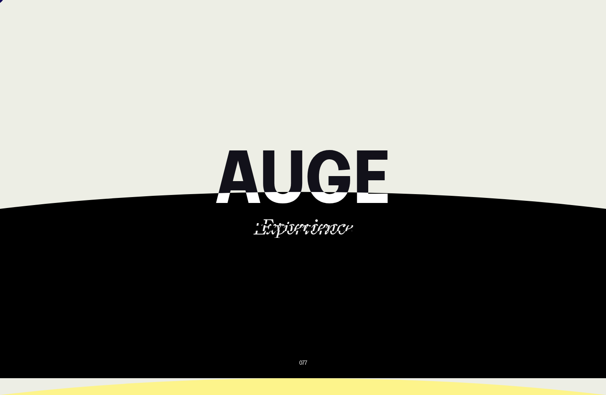
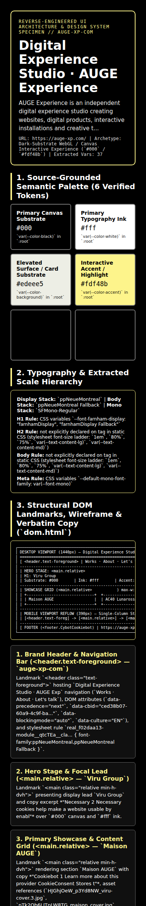

# UI Design System & Master Generation Blueprint: auge-xp-com

> **Digital Experience Studio · AUGE Experience** (https://auge-xp.com/) — AUGE Experience is an independent digital experience studio creating websites, digital products, interactive installations and creative t...



---

## 1. Executive Visual Persona & Design Archetype

- **Brand Essence & Persona**: **Digital Experience Studio · AUGE Experience** (`https://auge-xp.com/`). AUGE Experience is an independent digital experience studio creating websites, digital products, interactive installations and creative t...
- **Visual Archetype**: **Dark-Substrate WebGL / Canvas Interactive Experience (`#000` / `#fdf48b`)**.
- **Anti-AI-Slop Differentiators**:
  - **Source-Grounded Chromatic Polarity**: Anchors the viewport in `#000` (`var(--color-black)` in `:root`) paired with `#fff` primary typography and `#fdf48b` accents.
  - **Extracted Typographic Hierarchy**: Pairs `ppNeueMontreal` for display copy (`Viru Group`) with `ppNeueMontreal Fallback` and `SFMono-Regular`.
  - **Calibrated Spatial Grid & Motion**: Combines `40rem` container bounds (`gap: var(--grid-gap-desktop)`, padding `var(--spacing-gutter-desktop)`) with `cubic-bezier(0.25,0.1,0.25,1)` easing and HTML5 `<canvas>` Interactive Viewport Surface.

---

## 2. Spatial Architecture & Modular Grid Mathematics



### Viewport Allocation & Container Geometry
- **Captured Viewport Dimensions**: Desktop `1440×2400px` (`assets/desktop.png`, capped at 2400px multi-section capture), Mobile `390×2400px` (`assets/mobile.png`, capped at 2400px multi-section capture).
- **Master Container Bounds**: `40rem` extracted from `auge-xp-com` stylesheet.
- **Canvas Lateral Padding & Spacing**: `var(--spacing-gutter-desktop)` lateral canvas padding with `var(--grid-gap-desktop)` grid gap.
- **Border Radius Scale**: `3px`, `9px`, `50%`.

### Responsive Breakpoint Architecture
- **Desktop Layout**: Multi-column CSS Grid / Flexbox layout at `1440px` (`max-width: 40rem`, `gap: var(--grid-gap-desktop)`).
- **Mobile Layout**: Single-column vertical stack at `390px` viewport width with `var(--spacing-gutter-desktop)` horizontal padding.
- **Extracted CSS Media Queries**: `@media (min-width:40rem)`, `@media (min-width:48rem)`, `@media (min-width:64rem)`, `@media (min-width:80rem)`.

---

## 3. Color System, Materiality & Atmospheric Lighting

### Semantic Palette & Source Grounding
| Semantic Role | Ground-Truth Value | Extracted CSS Source / Selector |
|---|---|---|
| **Primary Canvas Substrate** | `#000` | `var(--color-black)` in `:root` |
| **Primary Typography Ink** | `#fff` | `var(--color-white)` in `:root` |
| **Elevated Surface / Card Substrate** | `#edeee5` | `var(--color-background)` in `:root` |
| **Interactive Accent / Highlight** | `#fdf48b` | `var(--color-accent)` in `:root` |
| **Secondary / Muted Copy** | `#0000` | `textarea { background-color: #0000 }` |
| **Structural Hairline Border** | `#000000` | `.bg-black { background-color: black }` (`#000000`) |

### Sanitized Root CSS Variables (`ui-ux.md` Ground Truth)
| Variable Name | Extracted Value | Semantic Role |
|---|---|---|
| `--font-sans` | `"ppNeueMontreal", "ppNeueMontreal Fallback"` | Typography / Scale Token |
| `--font-greed-bold` | `"greedBold", "greedBold Fallback"` | Typography / Scale Token |
| `--font-farnham-display` | `"farnhamDisplay", "farnhamDisplay Fallback"` | Typography / Scale Token |
| `--color-black` | `#000` | Canvas / Surface Token |
| `--color-white` | `#fff` | Canvas / Surface Token |
| `--spacing` | `.25rem` | Layout / Spatial Grid Token |
| `--font-weight-medium` | `500` | Typography / Scale Token |
| `--leading-tight` | `1.25` | Typography / Scale Token |
| `--leading-normal` | `1.5` | Typography / Scale Token |
| `--aspect-video` | `16 / 9` | Design System Custom Token |
| `--default-font-family` | `var(--font-sans)` | Typography / Scale Token |
| `--default-mono-font-family` | `var(--font-mono)` | Typography / Scale Token |
| `--color-background` | `#edeee5` | Canvas / Surface Token |
| `--color-foreground` | `#000` | Typography Ink Token |
| `--color-accent` | `#fdf48b` | Brand / Palette Token |
| `--font-greed` | `var(--font-greed-bold), sans-serif` | Typography / Scale Token |

---

## 4. Typographic Scale & Editorial Hierarchy

### Font Family Stacks
- **Display Typography**: `ppNeueMontreal`.
- **Primary Body Stack**: `ppNeueMontreal Fallback`.
- **Technical / Metadata Stack**: `SFMono-Regular`.

### Typographic Scale & Rules (Extracted from Stylesheet & Variables)
- **Hero Display (`H1`)**: CSS variables `--font-farnham-display: "farnhamDisplay", "farnhamDisplay Fallback"`.
- **Section Heading (`H2`)**: not explicitly declared on tag in static CSS (stylesheet font-size ladder: `1em`, `80%`, `75%`, `var(--text-content-lg)`, `var(--text-content-md)`).
- **Body Copy**: not explicitly declared on tag in static CSS (stylesheet font-size ladder: `1em`, `80%`, `75%`, `var(--text-content-lg)`, `var(--text-content-md)`).
- **Metadata & Navigation Labels**: CSS variables `--default-mono-font-family: var(--font-mono)`.

---

## 5. Choreographed Motion & Interaction Physics

### Primary Easing Curves
- **Extracted Timing Functions**: `cubic-bezier(0.25,0.1,0.25,1)`.

### Per-Element Transition & Choreography Rules
- **Standard CSS Easing (`cubic-bezier(0.25,0.1,0.25,1)`)**: Default timing curve (no custom `cubic-bezier()` declared in static CSS).
- **Runtime Interaction Engine**: Integrates HTML5 `<canvas>` Interactive Viewport Surface with `prefers-reduced-motion: reduce` fallback guards.

---

## 6. Component Wireframe & Structural DOM Map

### Visual Layout Schematic (Grounded in `dom.html` — `1440px` Desktop & `390px` Mobile Reflow)
```
┌────────────────────────────────────────────────────────────────────────┐
│ DESKTOP VIEWPORT (1440px) — Digital Experience Studio · AUGE Experienc │
│ ====================================================================== │
│ [ <header.text-foreground> | Works · About · Let's talk             ]  │
│ ---------------------------------------------------------------------- │
│ | HERO STAGE: <main.relative>                                      |   │
│ | H1: Viru Group                                                   |   │
│ | Substrate: #000       | Ink: #fff       | Accent: #fdf48b        |   │
│ ---------------------------------------------------------------------- │
│ | SHOWCASE GRID (<main.relative>           ) max-w: 40rem          |   │
│ | +------------------------------+  +------------------------------+ | │
│ | | Maison AUGE                  |  | AC40 Lunarossa               | | │
│ | +------------------------------+  +------------------------------+ | │
│ ---------------------------------------------------------------------- │
│ | MOBILE VIEWPORT REFLOW (390px) — Single-Column Stack (gap: var(--) | │
│ | [<header.text-foreg] -> [<main.relative>] -> [<main.relative>] |     │
│ ---------------------------------------------------------------------- │
│ [ FOOTER (<footer.CybotCookiebot) | https://auge-xp.com/               │
└────────────────────────────────────────────────────────────────────────┘
```

### Granular DOM Region Breakdown
1. **Brand Header & Navigation Bar (<header.text-foreground> — `auge-xp-com`)**:
   - Landmark `<header class="text-foreground">` hosting `Digital Experience Studio · AUGE Exp` navigation (`Works · About · Let's talk`), DOM attributes (`data-precedence="next"`, `data-cbid="ced38b07-60a9-4c9f-ba..."`, `data-blockingmode="auto"`, `data-culture="EN"`), and stylesheet rule `real_f02daa13-module__qtcTEa__cla... { font-family:ppNeueMontreal,ppNeueMontreal Fallback }`.
2. **Hero Stage & Focal Lead (<main.relative> — `Viru Group`)**:
   - Landmark `<main class="relative min-h-dvh">` presenting display lead `Viru Group` and copy excerpt *"Necessary 2 Necessary cookies help make a website usable by enabl"* over `#000` canvas and `#fff` ink.
3. **Primary Showcase & Content Grid (<main.relative> — `Maison AUGE`)**:
   - Landmark `<main class="relative min-h-dvh">` rendering section `Maison AUGE` with copy *"Cookiebot 1 Learn more about this provider CookieConsent Stores t"*, asset references (`HJGhjOeW_p3Yd8NW_viru-cover.3.jpg`, `nTk2Qb6LITpLW8TG_maison_cover.jpg`, `pUkcTZHGA7KhlJZ0_lunarossa_cover_...`, `VsNqcjWTy0U8igpA_don-molinico-cov...`), and grid rule `treal_f02daa13-module__qtcTEa__va... { --font-sans:"ppNeueMontreal", "ppNeueMontreal Fallback" }`.
4. **Interactive Detail & Feature Matrix (<main.relative> — `AC40 Lunarossa`)**:
   - Landmark `<main class="relative min-h-dvh">` framing `AC40 Lunarossa` and `Don Molinico` (*"Learn more about this provider"*) with `#edeee5` surface cards, `#fdf48b` accents, and `font-face { font-family:greedBold;src:url(../media/Greed_Bold-s.p.2gpcionblp7lf.woff... }`.
5. **Colophon & Global Directory Footer (<footer.CybotCookiebotDialogContentWrapper> — `https://auge-xp.com/`)**:
   - Landmark `<footer class="CybotCookiebotDialogContentWrapper">` anchoring `Digital Experience Studio · AUGE` footer links (`Works · About · Let's talk`), copy *"Stores the user's cookie consent state for the current domai"*, and `#000000` structural dividers.

---

## 7. Master Zero-Shot AI Generation Prompt

```markdown
# Master Zero-Shot Frontend Generation Prompt: auge-xp-com (Digital Experience Studio · AUGE Experience)

You are a principal frontend architect and design systems engineer. Build a complete, production-ready web application replicating the exact design system, DOM landmarks, typographic hierarchy, color tokens, and motion physics of `auge-xp-com` (**Digital Experience Studio · AUGE Experience** — `https://auge-xp.com/`).

### 1. Visual Archetype & Anti-AI-Slop Mandates
- **Archetype**: Dark-Substrate WebGL / Canvas Interactive Experience (`#000` / `#fdf48b`).
- **Identity & Domain Context**: AUGE Experience is an independent digital experience studio creating websites, digital products, interactive installations and creative t...
- **Primary Substrate**: `#000` (`var(--color-black)` in `:root`), **Primary Ink**: `#fff`, **Accent / Highlight**: `#fdf48b`.
- **Site-Specific Differentiators**:
  - **Source-Grounded Chromatic Polarity**: Anchors the viewport in `#000` (`var(--color-black)` in `:root`) paired with `#fff` primary typography and `#fdf48b` accents.
  - **Extracted Typographic Hierarchy**: Pairs `ppNeueMontreal` for display copy (`Viru Group`) with `ppNeueMontreal Fallback` and `SFMono-Regular`.
  - **Calibrated Spatial Grid & Motion**: Combines `40rem` container bounds (`gap: var(--grid-gap-desktop)`, padding `var(--spacing-gutter-desktop)`) with `cubic-bezier(0.25,0.1,0.25,1)` easing and HTML5 `<canvas>` Interactive Viewport Surface.

### 2. Ground-Truth CSS Variables (`:root` Token Contract)
Declare and consume these exact custom properties extracted from `auge-xp-com` in your global stylesheet:

:root {
  /* Digital Experience Studio · AUGE Experience (auge-xp-com) — Ground-Truth Extracted CSS Variables */
  --font-sans: "ppNeueMontreal", "ppNeueMontreal Fallback"; /* Typography / Scale Token (auge-xp-com) */
  --font-greed-bold: "greedBold", "greedBold Fallback"; /* Typography / Scale Token (auge-xp-com) */
  --font-farnham-display: "farnhamDisplay", "farnhamDisplay Fallback"; /* Typography / Scale Token (auge-xp-com) */
  --color-black: #000; /* Canvas / Surface Token (auge-xp-com) */
  --color-white: #fff; /* Canvas / Surface Token (auge-xp-com) */
  --spacing: .25rem; /* Layout / Spatial Grid Token (auge-xp-com) */
  --font-weight-medium: 500; /* Typography / Scale Token (auge-xp-com) */
  --leading-tight: 1.25; /* Typography / Scale Token (auge-xp-com) */
  --leading-normal: 1.5; /* Typography / Scale Token (auge-xp-com) */
  --aspect-video: 16 / 9; /* Design System Custom Token (auge-xp-com) */
  --default-font-family: var(--font-sans); /* Typography / Scale Token (auge-xp-com) */
  --default-mono-font-family: var(--font-mono); /* Typography / Scale Token (auge-xp-com) */
  --color-background: #edeee5; /* Canvas / Surface Token (auge-xp-com) */
  --color-foreground: #000; /* Typography Ink Token (auge-xp-com) */
  --color-accent: #fdf48b; /* Brand / Palette Token (auge-xp-com) */
  --font-greed: var(--font-greed-bold), sans-serif; /* Typography / Scale Token (auge-xp-com) */
}

### 3. Semantic Color & Materiality Contract
Map every surface, ink, and border strictly to these source-grounded tokens:
- **Primary Canvas Substrate**: `#000` — grounded in `var(--color-black)` in `:root`
- **Primary Typography Ink**: `#fff` — grounded in `var(--color-white)` in `:root`
- **Elevated Surface / Card Substrate**: `#edeee5` — grounded in `var(--color-background)` in `:root`
- **Interactive Accent / Highlight**: `#fdf48b` — grounded in `var(--color-accent)` in `:root`
- **Secondary / Muted Copy**: `#0000` — grounded in `textarea { background-color: #0000 }`
- **Structural Hairline Border**: `#000000` — grounded in `.bg-black { background-color: black }` (`#000000`)

### 4. Spatial Grid, Container Bounds & Responsive Breakpoints
- **Desktop Viewport Reference**: `1440×2400px` (capped at 2400px multi-section capture, `1440px` standard desktop width).
- **Mobile Viewport Reference**: `390×2400px` (capped at 2400px multi-section capture, `390px` standard mobile width).
- **Container Max-Width**: `40rem` extracted from `auge-xp-com` stylesheet
- **Padding & Gutters**: `var(--spacing-gutter-desktop)` lateral canvas padding with `var(--grid-gap-desktop)` grid gap
- **Desktop Grid**: Multi-column CSS Grid / Flexbox layout at `1440px` (`max-width: 40rem`, `gap: var(--grid-gap-desktop)`)
- **Mobile Adaptation**: Single-column vertical stack at `390px` viewport width with `var(--spacing-gutter-desktop)` horizontal padding
- **Media Queries**: `@media (min-width:40rem)`, `@media (min-width:48rem)`, `@media (min-width:64rem)`, `@media (min-width:80rem)`
- **Corner Radii**: `3px`, `9px`, `50%`

### 5. Typography & Editorial Scale Contract
- **Display Font Stack**: `ppNeueMontreal`
- **Body Font Stack**: `ppNeueMontreal Fallback`
- **Monospace / Technical Font Stack**: `SFMono-Regular`
- **H1 Display Rule**: CSS variables `--font-farnham-display: "farnhamDisplay", "farnhamDisplay Fallback"`
- **H2 Section Rule**: not explicitly declared on tag in static CSS (stylesheet font-size ladder: `1em`, `80%`, `75%`, `var(--text-content-lg)`, `var(--text-content-md)`)
- **Body Copy Rule**: not explicitly declared on tag in static CSS (stylesheet font-size ladder: `1em`, `80%`, `75%`, `var(--text-content-lg)`, `var(--text-content-md)`)
- **Metadata & Index Rule**: CSS variables `--default-mono-font-family: var(--font-mono)`

### 6. Component Hierarchy, Verbatim Copy & Real DOM Landmarks
Scaffold `auge-xp-com` (`Digital Experience Studio · AUGE Experience`) with these exact structural regions, extracted copy, and CSS rules from `dom.html`:
1. **Brand Header & Navigation Bar (<header.text-foreground> — `auge-xp-com`)**:
   - DOM & Selectors: Landmark `<header class="text-foreground">` hosting `Digital Experience Studio · AUGE Exp` navigation (`Works · About · Let's talk`), DOM attributes (`data-precedence="next"`, `data-cbid="ced38b07-60a9-4c9f-ba..."`, `data-blockingmode="auto"`, `data-culture="EN"`), and stylesheet rule `real_f02daa13-module__qtcTEa__cla... { font-family:ppNeueMontreal,ppNeueMontreal Fallback }`.
   - Responsive Contract: Header `Brand Header & Navigation Bar (<header.text-foreground> — `auge-xp-com`)` (`auge-xp-com`) adapts across `@media (min-width:40rem)`, `@media (min-width:48rem)`, `@media (min-width:64rem)`, `@media (min-width:80rem)` with `cubic-bezier(0.25,0.1,0.25,1)` transitions and links `Works · About · Let's talk`.
2. **Hero Stage & Focal Lead (<main.relative> — `Viru Group`)**:
   - DOM & Selectors: Landmark `<main class="relative min-h-dvh">` presenting display lead `Viru Group` and copy excerpt *"Necessary 2 Necessary cookies help make a website usable by enabl"* over `#000` canvas and `#fff` ink.
   - Responsive Contract: Hero stage (`1440×2400px` desktop / `390×2400px` mobile) sets `#000` background with `#fff` headline `Viru Group`.
3. **Primary Showcase & Content Grid (<main.relative> — `Maison AUGE`)**:
   - DOM & Selectors: Landmark `<main class="relative min-h-dvh">` rendering section `Maison AUGE` with copy *"Cookiebot 1 Learn more about this provider CookieConsent Stores t"*, asset references (`HJGhjOeW_p3Yd8NW_viru-cover.3.jpg`, `nTk2Qb6LITpLW8TG_maison_cover.jpg`, `pUkcTZHGA7KhlJZ0_lunarossa_cover_...`, `VsNqcjWTy0U8igpA_don-molinico-cov...`), and grid rule `treal_f02daa13-module__qtcTEa__va... { --font-sans:"ppNeueMontreal", "ppNeueMontreal Fallback" }`.
   - Responsive Contract: Showcase grid `Primary Showcase & Content Grid (<main.relative> — `Maison AUGE`)` applies Multi-column CSS Grid / Flexbox layout at `1440px` (`max-width: 40rem`, `gap: var(--grid-gap-desktop)`) on desktop and Single-column vertical stack at `390px` viewport width with `var(--spacing-gutter-desktop)` horizontal padding on mobile.
4. **Interactive Detail & Feature Matrix (<main.relative> — `AC40 Lunarossa`)**:
   - DOM & Selectors: Landmark `<main class="relative min-h-dvh">` framing `AC40 Lunarossa` and `Don Molinico` (*"Learn more about this provider"*) with `#edeee5` surface cards, `#fdf48b` accents, and `font-face { font-family:greedBold;src:url(../media/Greed_Bold-s.p.2gpcionblp7lf.woff... }`.
   - Responsive Contract: Detail module `Interactive Detail & Feature Matrix (<main.relative> — `AC40 Lunarossa`)` uses `3px`, `9px`, `50%` radii, `#fdf48b` highlights, and assets (HJGhjOeW_p3Yd8NW_viru-cover.3.jpg, nTk2Qb6LITpLW8TG_maison_cover.jpg, pUkcTZHGA7KhlJZ0_lunarossa_cover_...).
5. **Colophon & Global Directory Footer (<footer.CybotCookiebotDialogContentWrapper> — `https://auge-xp.com/`)**:
   - DOM & Selectors: Landmark `<footer class="CybotCookiebotDialogContentWrapper">` anchoring `Digital Experience Studio · AUGE` footer links (`Works · About · Let's talk`), copy *"Stores the user's cookie consent state for the current domai"*, and `#000000` structural dividers.
   - Responsive Contract: Footer `Colophon & Global Directory Footer (<footer.CybotCookiebotDialogContentWrapper> — `https://auge-xp.com/`)` aligns to `40rem` extracted from `auge-xp-com` stylesheet with `var(--spacing-gutter-desktop)` lateral canvas padding with `var(--grid-gap-desktop)` grid gap and attributes (data-precedence="next", data-cbid="ced38b07-60a9-4c9f-ba...", data-blockingmode="auto").

#### Verbatim DOM Copy Excerpts (`dom.html`)
- Copy Excerpt 1: *"Necessary 2 Necessary cookies help make a website usable by enabling basic functio..."*
- Copy Excerpt 2: *"Cookiebot 1 Learn more about this provider CookieConsent Stores the user's cookie..."*
- Copy Excerpt 3: *"Learn more about this provider"*
- Copy Excerpt 4: *"Stores the user's cookie consent state for the current domain"*

### 7. Motion, Extracted Stylesheet Rules & Interaction Choreography
- **Primary Easing Functions**: `cubic-bezier(0.25,0.1,0.25,1)`
- **Extracted Stylesheet Rules (`auge-xp-com`)**:
- `real_f02daa13-module__qtcTEa__cla... { font-family:ppNeueMontreal,ppNeueMontreal Fallback }`
- `treal_f02daa13-module__qtcTEa__va... { --font-sans:"ppNeueMontreal", "ppNeueMontreal Fallback" }`
- `font-face { font-family:greedBold;src:url(../media/Greed_Bold-s.p.2gpcionblp7lf.woff... }`
- `bold_5cf46213-module__jnljuW__cla... { font-family:greedBold,greedBold Fallback }`
- `dbold_5cf46213-module__jnljuW__va... { --font-greed-bold:"greedBold", "greedBold Fallback" }`
- **Per-Selector Transition Rules**:
- **Standard CSS Easing (`cubic-bezier(0.25,0.1,0.25,1)`)**: Default timing curve (no custom `cubic-bezier()` declared in static CSS).
- **Runtime Interaction Engine**: Integrates HTML5 `<canvas>` Interactive Viewport Surface with `prefers-reduced-motion: reduce` fallback guards.

### 8. Technical Deliverables
- Implement in Next.js (App Router) with TypeScript and Tailwind CSS consuming the `:root` custom properties defined above for `auge-xp-com`.
- Reproduce both the `1440px` desktop architecture and `390px` mobile breakpoint transitions, preserving semantic HTML5 landmarks (`<header>`, `<nav>`, `<main>`, `<section>`, `<footer>`) and `prefers-reduced-motion` accessibility guards.
```
