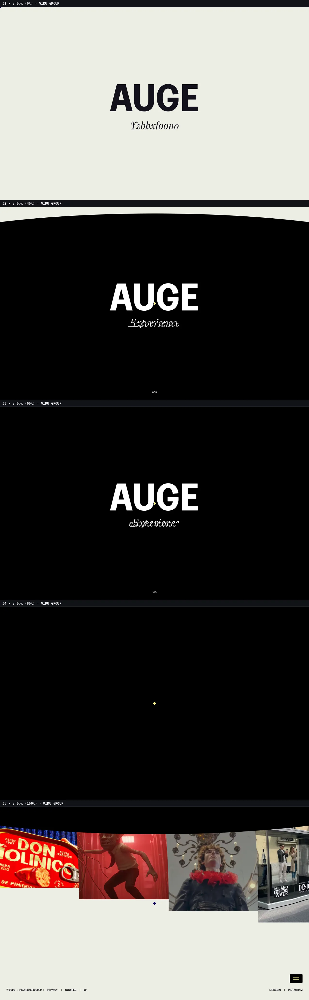
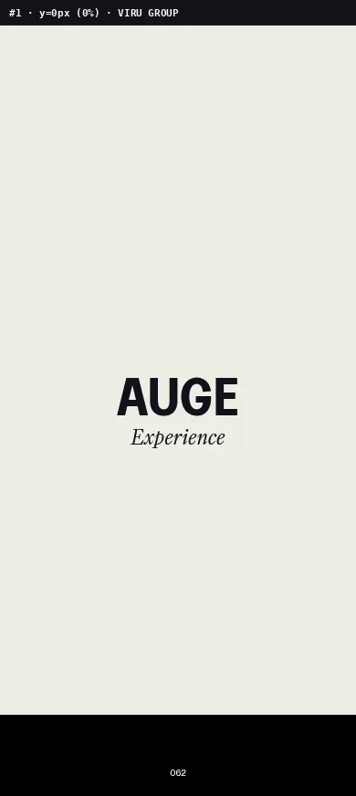

# UI Design System & Master Generation Blueprint: auge-xp-com

> **Digital Experience Studio · AUGE Experience** (https://auge-xp.com/) — AUGE Experience is an independent digital experience studio creating websites, digital products, interactive installations and creative t...





---

## 1. Executive Visual Persona & Design Archetype

- **Brand Essence & Persona**: **Digital Experience Studio · AUGE Experience** (`https://auge-xp.com/`). AUGE Experience is an independent digital experience studio creating websites, digital products, interactive installations and creative t...
- **Capture Provenance**: Live browser capture (`tier2_webgl`, HTTP `200`, captured `2026-11-24`).
- **Visual Archetype**: **Light-Gallery WebGL / Canvas Interactive Experience (`#edeee5` / `#fdf48b`)**.
- **Anti-AI-Slop Differentiators**:
  - **Live-Computed Chromatic Polarity**: Anchors the viewport in `#edeee5` (live computed `body` `background-color` (`computed_styles.json`)) paired with `#000000` primary typography and `#fdf48b` accents.
  - **Grounded Typographic Hierarchy**: Uses `ppNeueMontreal` across display (`AUGE EXPERIENCE© RCCS YFZVYTYHHV©`) and body copy, paired with `SFMono-Regular` for monospace/code.
  - **Calibrated Spatial Grid & Motion**: Combines `96rem` container bounds (`gap: var(--grid-gap-desktop)`, padding `var(--spacing-gutter-desktop)`) with `cubic-bezier(0.25,0.1,0.25,1)` easing and HTML5 `<canvas>` Interactive Viewport Surface.

---

## 2. Spatial Architecture & Modular Grid Mathematics

### Viewport Allocation & Container Geometry
- **Captured Journey Filmstrips**: Desktop `1280×4140px` (`assets/desktop-journey.webp`, `5` keyframes up to `y=0px` / doc `940px`), Mobile `390×872px` (`assets/mobile-journey.webp`, `1` keyframes).
- **Master Container Bounds**: `96rem` (non-`@media` desktop container stylesheet rule).
- **Canvas Lateral Padding & Spacing**: `var(--spacing-gutter-desktop)` lateral canvas padding with `var(--grid-gap-desktop)` grid gap.
- **Border Radius Scale**: `3px`, `9px`, `50%`.

### Responsive Breakpoint Architecture
- **Desktop Layout**: Multi-column CSS Grid / Flexbox layout at `1440px` (`max-width: 96rem`, `gap: var(--grid-gap-desktop)`).
- **Mobile Layout**: Single-column vertical stack at `390px` viewport width with `var(--spacing-gutter-desktop)` horizontal padding.
- **Extracted CSS Media Queries**: `@media (min-width:40rem)`, `@media (min-width:48rem)`, `@media (min-width:64rem)`, `@media (min-width:80rem)`.

---

## 3. Color System, Materiality & Atmospheric Lighting

### Semantic Palette & Source Grounding
| Semantic Role | Ground-Truth Value | Extracted Live / CSS Source |
|---|---|---|
| **Primary Canvas Substrate** | `#edeee5` | live computed `body` `background-color` (`computed_styles.json`) |
| **Primary Typography Ink** | `#000000` | live computed `h1` `color` (`computed_styles.json`) |
| **Elevated Surface / Card Substrate** | `#ffffff` | `40 { background-color: white }` (`#ffffff`) |
| **Interactive Accent / Highlight** | `#fdf48b` | `var(--color-accent)` in `:root` |
| **Secondary / Muted Copy** | `#ffffff` | live computed `button` `color` (`computed_styles.json`) |
| **Structural Hairline Border** | `#000000` | `botDialogBodyLevelButtonLevelOp... { border-color: #000000 }` |

### Sanitized Root CSS Variables (`ui-ux.md` Ground Truth)
| Variable Name | Extracted Value | Semantic Role |
|---|---|---|
| `--font-sans` | `"ppNeueMontreal", "ppNeueMontreal Fallback"` | Typography / Scale Token |
| `--font-greed-bold` | `"greedBold", "greedBold Fallback"` | Typography / Scale Token |
| `--font-farnham-display` | `"farnhamDisplay", "farnhamDisplay Fallback"` | Typography / Scale Token |
| `--color-black` | `#000` | Canvas / Surface Token |
| `--color-white` | `#fff` | Canvas / Surface Token |
| `--spacing` | `.25rem` | Layout / Spatial Grid Token |
| `--font-weight-medium` | `500` | Typography / Scale Token |
| `--leading-tight` | `1.25` | Typography / Scale Token |
| `--leading-normal` | `1.5` | Typography / Scale Token |
| `--aspect-video` | `16 / 9` | Design System Custom Token |
| `--default-font-family` | `var(--font-sans)` | Typography / Scale Token |
| `--default-mono-font-family` | `var(--font-mono)` | Typography / Scale Token |
| `--color-background` | `#edeee5` | Canvas / Surface Token |
| `--color-foreground` | `#000` | Typography Ink Token |
| `--color-accent` | `#fdf48b` | Brand / Palette Token |
| `--font-greed` | `var(--font-greed-bold), sans-serif` | Typography / Scale Token |

---

## 4. Typographic Scale & Editorial Hierarchy

### Font Family Stacks
- **Display Typography**: `ppNeueMontreal`.
- **Primary Body Stack**: `ppNeueMontreal`.
- **Technical / Metadata Stack**: `SFMono-Regular`.

### Typographic Scale & Rules (Live Computed & Stylesheet Grounded)
- **Hero Display (`H1`)**: live computed `h1` (`font-size: 18px`, `line-height: 27px`, `font-weight: 400`); CSS variables `--font-farnham-display: "farnhamDisplay", "farnhamDisplay Fallback"`.
- **Section Heading (`H2`)**: live computed `h3 (primary section heading)` (`font-size: 28.5px`, `line-height: 24.225px`, `font-weight: 400`).
- **Body Copy**: live computed `body` (`font-size: 16px`, `line-height: 24px`, `font-weight: 400`).
- **Metadata & Navigation Labels**: live computed `nav/a` (`font-size: 38px`, `line-height: 38px`, `font-weight: 400`); CSS variables `--default-mono-font-family: var(--font-mono)`.

---

## 5. Choreographed Motion & Interaction Physics

### Primary Easing Curves
- **Extracted Timing Functions**: `cubic-bezier(0.25,0.1,0.25,1)`.

### Per-Element Transition & Choreography Rules
- **Standard CSS Easing (`cubic-bezier(0.25,0.1,0.25,1)`)**: Default timing curve (no custom `cubic-bezier()` declared in captured CSS).
- **Runtime Interaction Engine**: Integrates HTML5 `<canvas>` Interactive Viewport Surface with `prefers-reduced-motion: reduce` fallback guards.
### Measured Runtime Scroll & Interaction Telemetry (`behavioral_journey_v2`)
- **Scroll Driver Mode**: `wheel` (max document height `940px`, deepest scrollY reached `0px` across `5` desktop keyframes).
- **Detected Scroll / Motion Libraries**: `WebGL/Canvas`.
- **Route Transition Architecture**: First internal navigation (`/works`) measured as `direct` in `2192ms`.

---

## 6. Component Wireframe & Structural DOM Map

### Visual Layout Schematic — Desktop (`1440px`, Grounded in `dom.html` & Landmark Bounding Boxes)
```
┌────────────────────────────────────────────────────────────────────────┐
│ DESKTOP VIEWPORT (1440px) — Digital Experience Studio · AUGE Experienc │
│ ====================================================================== │
│ [ <header.text-foregroun (1440x0px)   | Works · About · Let's talk   ] │
│ ---------------------------------------------------------------------- │
│ | HERO STAGE: <main.min-h-dvh> (w=1440px)                            | │
│ | H1: AUGE EXPERIENCE© RCCS YFZVYTYHHV©                              | │
│ | Substrate: #edeee5 | Ink: #000000 | Accent: #fdf48b                | │
│ ---------------------------------------------------------------------- │
│ | SHOWCASE GRID (<main.relative>) max-w: 96rem                       | │
│ | +------------------------------+  +------------------------------+ | │
│ | | AC40 Lunarossa               |  | Don Molinico                 | | │
│ | +------------------------------+  +------------------------------+ | │
│ ---------------------------------------------------------------------- │
│ | DETAIL MODULE (<main.min-h-dvh:nth(2)>) — Il Capo Production       | │
│ ---------------------------------------------------------------------- │
│ [ FOOTER (<footer.CybotCookieb) | https://auge-xp.com/                 │
└────────────────────────────────────────────────────────────────────────┘
```

### Visual Layout Schematic — Mobile Reflow (`390px`)
```
┌────────────────────────────────────────────────────────────────────────┐
│ MOBILE VIEWPORT REFLOW (390px) — Single-Column Stack (gap: var(--gr)   │
│ ====================================================================== │
│ [ HEADER BAR (<header.text-foreground>) | Compact Menu (390px)         │
│ ---------------------------------------------------------------------- │
│ | HERO STAGE (<main.min-h-dvh>) — 390px Vertical Lead                | │
│ | H1: AUGE EXPERIENCE© RCCS YFZVYTYHHV©                              | │
│ ---------------------------------------------------------------------- │
│ | SHOWCASE STACK (<main.relative>) — 1-Col Stack                     | │
│ | [ Item 1: AC40 Lunarossa                                         ] | │
│ | [ Item 2: Don Molinico                                           ] | │
│ ---------------------------------------------------------------------- │
│ | DETAIL STACK (<main.min-h-dvh:nth(2)>) — 1-Col (Il Capo Production)  │
│ ---------------------------------------------------------------------- │
│ [ FOOTER (<footer.CybotCookieb) | Stacked 390px Colophon               │
└────────────────────────────────────────────────────────────────────────┘
```

### Granular DOM Region Breakdown
1. **Brand Header & Navigation Bar (<header.text-foreground> — `auge-xp-com`)**:
   - Landmark `<header class="text-foreground">` (`1440x0px`) hosting `Digital Experience Studio · AUGE Exp` navigation (`Works · About · Let's talk`), DOM attributes (`data-precedence="next"`, `data-cbid="ced38b07-60a9-4c9f-ba..."`, `data-blockingmode="auto"`, `data-culture="EN"`), and stylesheet rule `real_f02daa13-module__qtcTEa__cla... { font-family:ppNeueMontreal,ppNeueMontreal Fallback }`.
2. **Hero Stage & Focal Lead (<main.min-h-dvh> — `AUGE EXPERIENCE© RCCS YFZVYTYHHV©`)**:
   - Landmark `<main class="min-h-dvh relative">` presenting display lead `AUGE EXPERIENCE© RCCS YFZVYTYHHV©` and copy excerpt *"An award-winning digital experience studio"* over `#edeee5` canvas and `#000000` ink.
3. **Primary Showcase & Content Grid (<main.relative> — `AC40 Lunarossa`)**:
   - Landmark `<main class="min-h-dvh relative">` rendering section `AC40 Lunarossa` with copy *"An award-winning digital experience studio partnering with ambiti"*, asset references (`HJGhjOeW_p3Yd8NW_viru-cover.3.jpg`, `nTk2Qb6LITpLW8TG_maison_cover.jpg`, `pUkcTZHGA7KhlJZ0_lunarossa_cover_...`, `VsNqcjWTy0U8igpA_don-molinico-cov...`), and grid rule `treal_f02daa13-module__qtcTEa__va... { --font-sans:"ppNeueMontreal", "ppNeueMontreal Fallback" }`.
4. **Interactive Detail & Feature Matrix (<main.min-h-dvh:nth(2)> — `Don Molinico`)**:
   - Landmark `<main class="min-h-dvh relative">` framing `Don Molinico` and `Il Capo Production` (*"partnering with ambitious brands to create"*) with `#ffffff` surface cards, `#fdf48b` accents, and `font-face { font-family:greedBold;src:url(../media/Greed_Bold-s.p.2gpcionblp7lf.woff... }`.
5. **Colophon & Global Directory Footer (<footer.CybotCookiebotDialogContentWrapper> — `https://auge-xp.com/`)**:
   - Landmark `<footer class="CybotCookiebotDialogContentWrapper">` anchoring `Digital Experience Studio · AUGE` footer links (`Works · About · Let's talk`), copy *"distinctive experiences through design,"*, and `#000000` structural dividers.
### Full Vertical Scroll Sequence (Desktop `1440×900` Keyframes)
- **Step 01** (`y=0px`, `0%`): Active landmark `VIRU GROUP` · sticky/fixed elements: `1`
- **Step 02** (`y=0px`, `40%`): Active landmark `VIRU GROUP` · sticky/fixed elements: `1`
- **Step 03** (`y=0px`, `60%`): Active landmark `VIRU GROUP` · sticky/fixed elements: `1`
- **Step 04** (`y=0px`, `80%`): Active landmark `VIRU GROUP` · sticky/fixed elements: `1`
- **Step 05** (`y=0px`, `100%`): Active landmark `VIRU GROUP` · sticky/fixed elements: `1`

### Multi-Page Internal Route Map
- **Listing Route (`/works`)**: `https://auge-xp.com/works` — H1: `Works · AUGE Experience`, scrollHeight `940px`, transition `direct` (`2192ms`)

---

## 7. Master Zero-Shot AI Generation Prompt

```markdown
# Master Zero-Shot Frontend Generation Prompt: auge-xp-com (Digital Experience Studio · AUGE Experience)

You are a principal frontend architect and design systems engineer. Build a complete, production-ready web application replicating the exact design system, DOM landmarks, typographic hierarchy, color tokens, and motion physics of `auge-xp-com` (**Digital Experience Studio · AUGE Experience** — `https://auge-xp.com/`).

### 1. Visual Archetype & Anti-AI-Slop Mandates
- **Archetype**: Light-Gallery WebGL / Canvas Interactive Experience (`#edeee5` / `#fdf48b`).
- **Identity & Domain Context**: AUGE Experience is an independent digital experience studio creating websites, digital products, interactive installations and creative t...
- **Primary Substrate**: `#edeee5` (live computed `body` `background-color` (`computed_styles.json`)), **Primary Ink**: `#000000`, **Accent / Highlight**: `#fdf48b`.
- **Site-Specific Differentiators**:
  - **Live-Computed Chromatic Polarity**: Anchors the viewport in `#edeee5` (live computed `body` `background-color` (`computed_styles.json`)) paired with `#000000` primary typography and `#fdf48b` accents.
  - **Grounded Typographic Hierarchy**: Uses `ppNeueMontreal` across display (`AUGE EXPERIENCE© RCCS YFZVYTYHHV©`) and body copy, paired with `SFMono-Regular` for monospace/code.
  - **Calibrated Spatial Grid & Motion**: Combines `96rem` container bounds (`gap: var(--grid-gap-desktop)`, padding `var(--spacing-gutter-desktop)`) with `cubic-bezier(0.25,0.1,0.25,1)` easing and HTML5 `<canvas>` Interactive Viewport Surface.

### 2. Ground-Truth CSS Variables (`:root` Token Contract)
Declare and consume these exact custom properties extracted from `auge-xp-com` in your global stylesheet:

:root {
  /* Digital Experience Studio · AUGE Experience (auge-xp-com) — Live-Grounded CSS Variables */
  --font-sans: "ppNeueMontreal", "ppNeueMontreal Fallback"; /* Typography / Scale Token (auge-xp-com) */
  --font-greed-bold: "greedBold", "greedBold Fallback"; /* Typography / Scale Token (auge-xp-com) */
  --font-farnham-display: "farnhamDisplay", "farnhamDisplay Fallback"; /* Typography / Scale Token (auge-xp-com) */
  --color-black: #000; /* Canvas / Surface Token (auge-xp-com) */
  --color-white: #fff; /* Canvas / Surface Token (auge-xp-com) */
  --spacing: .25rem; /* Layout / Spatial Grid Token (auge-xp-com) */
  --font-weight-medium: 500; /* Typography / Scale Token (auge-xp-com) */
  --leading-tight: 1.25; /* Typography / Scale Token (auge-xp-com) */
  --leading-normal: 1.5; /* Typography / Scale Token (auge-xp-com) */
  --aspect-video: 16 / 9; /* Design System Custom Token (auge-xp-com) */
  --default-font-family: var(--font-sans); /* Typography / Scale Token (auge-xp-com) */
  --default-mono-font-family: var(--font-mono); /* Typography / Scale Token (auge-xp-com) */
  --color-background: #edeee5; /* Canvas / Surface Token (auge-xp-com) */
  --color-foreground: #000; /* Typography Ink Token (auge-xp-com) */
  --color-accent: #fdf48b; /* Brand / Palette Token (auge-xp-com) */
  --font-greed: var(--font-greed-bold), sans-serif; /* Typography / Scale Token (auge-xp-com) */
}

### 3. Semantic Color & Materiality Contract
Map every surface, ink, and border strictly to these source-grounded tokens:
- **Primary Canvas Substrate**: `#edeee5` — grounded in live computed `body` `background-color` (`computed_styles.json`)
- **Primary Typography Ink**: `#000000` — grounded in live computed `h1` `color` (`computed_styles.json`)
- **Elevated Surface / Card Substrate**: `#ffffff` — grounded in `40 { background-color: white }` (`#ffffff`)
- **Interactive Accent / Highlight**: `#fdf48b` — grounded in `var(--color-accent)` in `:root`
- **Secondary / Muted Copy**: `#ffffff` — grounded in live computed `button` `color` (`computed_styles.json`)
- **Structural Hairline Border**: `#000000` — grounded in `botDialogBodyLevelButtonLevelOp... { border-color: #000000 }`

### 4. Spatial Grid, Container Bounds & Responsive Breakpoints
- **Desktop Viewport Reference**: `1280×4140px` (multi-frame vertical journey filmstrip (4140px), `1440px` standard desktop width).
- **Mobile Viewport Reference**: `390×872px` (full-page live capture (872px), `390px` standard mobile width).
- **Container Max-Width**: `96rem` (non-`@media` desktop container stylesheet rule)
- **Padding & Gutters**: `var(--spacing-gutter-desktop)` lateral canvas padding with `var(--grid-gap-desktop)` grid gap
- **Desktop Grid**: Multi-column CSS Grid / Flexbox layout at `1440px` (`max-width: 96rem`, `gap: var(--grid-gap-desktop)`)
- **Mobile Adaptation**: Single-column vertical stack at `390px` viewport width with `var(--spacing-gutter-desktop)` horizontal padding
- **Media Queries**: `@media (min-width:40rem)`, `@media (min-width:48rem)`, `@media (min-width:64rem)`, `@media (min-width:80rem)`
- **Corner Radii**: `3px`, `9px`, `50%`

### 5. Typography & Editorial Scale Contract
- **Display Font Stack**: `ppNeueMontreal`
- **Body Font Stack**: `ppNeueMontreal`
- **Monospace / Technical Font Stack**: `SFMono-Regular`
- **H1 Display Rule**: live computed `h1` (`font-size: 18px`, `line-height: 27px`, `font-weight: 400`); CSS variables `--font-farnham-display: "farnhamDisplay", "farnhamDisplay Fallback"`
- **H2 Section Rule**: live computed `h3 (primary section heading)` (`font-size: 28.5px`, `line-height: 24.225px`, `font-weight: 400`)
- **Body Copy Rule**: live computed `body` (`font-size: 16px`, `line-height: 24px`, `font-weight: 400`)
- **Metadata & Index Rule**: live computed `nav/a` (`font-size: 38px`, `line-height: 38px`, `font-weight: 400`); CSS variables `--default-mono-font-family: var(--font-mono)`

### 6. Component Hierarchy, Verbatim Copy & Real DOM Landmarks
Scaffold `auge-xp-com` (`Digital Experience Studio · AUGE Experience`) with these exact structural regions, extracted copy, and CSS rules from `dom.html`:
1. **Brand Header & Navigation Bar (<header.text-foreground> — `auge-xp-com`)**:
   - DOM & Selectors: Landmark `<header class="text-foreground">` (`1440x0px`) hosting `Digital Experience Studio · AUGE Exp` navigation (`Works · About · Let's talk`), DOM attributes (`data-precedence="next"`, `data-cbid="ced38b07-60a9-4c9f-ba..."`, `data-blockingmode="auto"`, `data-culture="EN"`), and stylesheet rule `real_f02daa13-module__qtcTEa__cla... { font-family:ppNeueMontreal,ppNeueMontreal Fallback }`.
   - Responsive Contract: Header `Brand Header & Navigation Bar (<header.text-foreground> — `auge-xp-com`)` (`auge-xp-com`) adapts across `@media (min-width:40rem)`, `@media (min-width:48rem)`, `@media (min-width:64rem)`, `@media (min-width:80rem)` with `cubic-bezier(0.25,0.1,0.25,1)` transitions and links `Works · About · Let's talk`.
2. **Hero Stage & Focal Lead (<main.min-h-dvh> — `AUGE EXPERIENCE© RCCS YFZVYTYHHV©`)**:
   - DOM & Selectors: Landmark `<main class="min-h-dvh relative">` presenting display lead `AUGE EXPERIENCE© RCCS YFZVYTYHHV©` and copy excerpt *"An award-winning digital experience studio"* over `#edeee5` canvas and `#000000` ink.
   - Responsive Contract: Hero stage (`1280×4140px` desktop / `390×872px` mobile) sets `#edeee5` background with `#000000` headline `AUGE EXPERIENCE© RCCS YFZVYTYHHV©`.
3. **Primary Showcase & Content Grid (<main.relative> — `AC40 Lunarossa`)**:
   - DOM & Selectors: Landmark `<main class="min-h-dvh relative">` rendering section `AC40 Lunarossa` with copy *"An award-winning digital experience studio partnering with ambiti"*, asset references (`HJGhjOeW_p3Yd8NW_viru-cover.3.jpg`, `nTk2Qb6LITpLW8TG_maison_cover.jpg`, `pUkcTZHGA7KhlJZ0_lunarossa_cover_...`, `VsNqcjWTy0U8igpA_don-molinico-cov...`), and grid rule `treal_f02daa13-module__qtcTEa__va... { --font-sans:"ppNeueMontreal", "ppNeueMontreal Fallback" }`.
   - Responsive Contract: Showcase grid `Primary Showcase & Content Grid (<main.relative> — `AC40 Lunarossa`)` applies Multi-column CSS Grid / Flexbox layout at `1440px` (`max-width: 96rem`, `gap: var(--grid-gap-desktop)`) on desktop and Single-column vertical stack at `390px` viewport width with `var(--spacing-gutter-desktop)` horizontal padding on mobile.
4. **Interactive Detail & Feature Matrix (<main.min-h-dvh:nth(2)> — `Don Molinico`)**:
   - DOM & Selectors: Landmark `<main class="min-h-dvh relative">` framing `Don Molinico` and `Il Capo Production` (*"partnering with ambitious brands to create"*) with `#ffffff` surface cards, `#fdf48b` accents, and `font-face { font-family:greedBold;src:url(../media/Greed_Bold-s.p.2gpcionblp7lf.woff... }`.
   - Responsive Contract: Detail module `Interactive Detail & Feature Matrix (<main.min-h-dvh:nth(2)> — `Don Molinico`)` uses `3px`, `9px`, `50%` radii, `#fdf48b` highlights, and assets (HJGhjOeW_p3Yd8NW_viru-cover.3.jpg, nTk2Qb6LITpLW8TG_maison_cover.jpg, pUkcTZHGA7KhlJZ0_lunarossa_cover_...).
5. **Colophon & Global Directory Footer (<footer.CybotCookiebotDialogContentWrapper> — `https://auge-xp.com/`)**:
   - DOM & Selectors: Landmark `<footer class="CybotCookiebotDialogContentWrapper">` anchoring `Digital Experience Studio · AUGE` footer links (`Works · About · Let's talk`), copy *"distinctive experiences through design,"*, and `#000000` structural dividers.
   - Responsive Contract: Footer `Colophon & Global Directory Footer (<footer.CybotCookiebotDialogContentWrapper> — `https://auge-xp.com/`)` aligns to `96rem` (non-`@media` desktop container stylesheet rule) with `var(--spacing-gutter-desktop)` lateral canvas padding with `var(--grid-gap-desktop)` grid gap and attributes (data-precedence="next", data-cbid="ced38b07-60a9-4c9f-ba...", data-blockingmode="auto").

#### Verbatim DOM Copy Excerpts (`dom.html`)
- Copy Excerpt 1: *"An award-winning digital experience studio"*
- Copy Excerpt 2: *"An award-winning digital experience studio partnering with ambitious brands to cre..."*
- Copy Excerpt 3: *"partnering with ambitious brands to create"*
- Copy Excerpt 4: *"distinctive experiences through design,"*

### 7. Motion, Extracted Stylesheet Rules & Interaction Choreography
- **Primary Easing Functions**: `cubic-bezier(0.25,0.1,0.25,1)`
- **Extracted Stylesheet Rules (`auge-xp-com`)**:
- `real_f02daa13-module__qtcTEa__cla... { font-family:ppNeueMontreal,ppNeueMontreal Fallback }`
- `treal_f02daa13-module__qtcTEa__va... { --font-sans:"ppNeueMontreal", "ppNeueMontreal Fallback" }`
- `font-face { font-family:greedBold;src:url(../media/Greed_Bold-s.p.2gpcionblp7lf.woff... }`
- `bold_5cf46213-module__jnljuW__cla... { font-family:greedBold,greedBold Fallback }`
- `dbold_5cf46213-module__jnljuW__va... { --font-greed-bold:"greedBold", "greedBold Fallback" }`
- **Per-Selector Transition Rules**:
- **Standard CSS Easing (`cubic-bezier(0.25,0.1,0.25,1)`)**: Default timing curve (no custom `cubic-bezier()` declared in captured CSS).
- **Runtime Interaction Engine**: Integrates HTML5 `<canvas>` Interactive Viewport Surface with `prefers-reduced-motion: reduce` fallback guards.
### 7b. Full-Page Scroll Choreography, Interactive States & Multi-Page Routes
- **Scroll Mechanics**: Implement `wheel` vertical progression up to `940px` across 5 distinct viewport chapters using WebGL/Canvas.
- **Vertical Chapter Sequence**: VIRU GROUP (0%) -> VIRU GROUP (40%) -> VIRU GROUP (60%) -> VIRU GROUP (80%) -> VIRU GROUP (100%).
- **Multi-Page Routes**: Scaffold internal routes `/works` (listing, direct) sharing the global header/footer shell and design tokens.

### 8. Technical Deliverables
- Implement in Next.js (App Router) with TypeScript and Tailwind CSS consuming the `:root` custom properties defined above for `auge-xp-com`.
- Reproduce both the `1440px` desktop architecture and `390px` mobile breakpoint transitions, preserving semantic HTML5 landmarks (`<header>`, `<nav>`, `<main>`, `<section>`, `<footer>`) and `prefers-reduced-motion` accessibility guards.
```
---

## 8. Full-Page Scroll Journey, Interactive States & Subpage Inventory

### Desktop Scroll Keyframes (`1440×900` WebP)
| Step | Scroll Y | Progress | Active Landmark / Section | Sticky/Fixed | Visual Asset |
| :---: | :---: | :---: | :--- | :---: | :--- |
| `#01` | `0px` | `0%` | VIRU GROUP | `1` | [desktop-step-01.webp](assets/desktop-step-01.webp) |
| `#02` | `0px` | `40%` | VIRU GROUP | `1` | [desktop-step-02.webp](assets/desktop-step-02.webp) |
| `#03` | `0px` | `60%` | VIRU GROUP | `1` | [desktop-step-03.webp](assets/desktop-step-03.webp) |
| `#04` | `0px` | `80%` | VIRU GROUP | `1` | [desktop-step-04.webp](assets/desktop-step-04.webp) |
| `#05` | `0px` | `100%` | VIRU GROUP | `1` | [desktop-step-05.webp](assets/desktop-step-05.webp) |

### Mobile Condensed Keyframes (`390×844` WebP)
| Step | Scroll Y | Progress | Active Landmark | Visual Asset |
| :---: | :---: | :---: | :--- | :--- |
| `#01` | `0px` | `0%` | VIRU GROUP | [mobile-step-01.webp](assets/mobile-step-01.webp) |

### Internal Subpage Filmstrips (`1080px` Wide WebP)
| # | Template | Route URL | H1 / Title | Scroll Height | Transition | Filmstrip Asset |
| :-: | :---: | :--- | :--- | :---: | :---: | :--- |
| `1` | `listing` | `https://auge-xp.com/works` | Works · AUGE Experience | `940px` | `direct` (`2192ms`) | [subpage-01-works.webp](assets/subpage-01-works.webp) |

