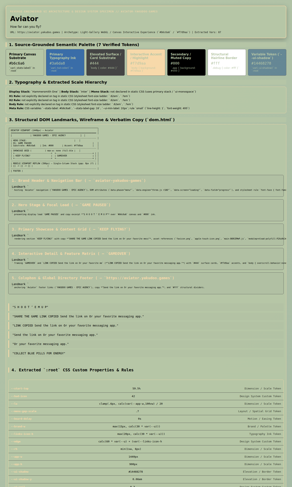
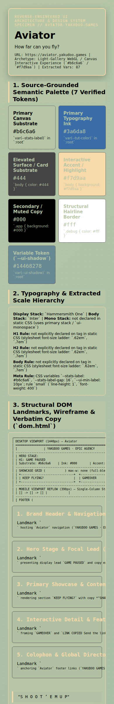

# UI Design System & Master Generation Blueprint: aviator-yakudoo-games

> **Aviator** (https://aviator.yakudoo.games) — How far can you fly?



---

## 1. Executive Visual Persona & Design Archetype

- **Brand Essence & Persona**: **Aviator** (`https://aviator.yakudoo.games`). How far can you fly?
- **Visual Archetype**: **Light-Gallery WebGL / Canvas Interactive Experience (`#b6c6a6` / `#f7d9aa`)**.
- **Anti-AI-Slop Differentiators**:
  - **Source-Grounded Chromatic Polarity**: Anchors the viewport in `#b6c6a6` (`var(--stats-label)` in `:root`) paired with `#000` primary typography and `#f7d9aa` accents.
  - **Extracted Typographic Hierarchy**: Pairs `Hammersmith One` for display copy (`GAME PAUSED`) with `Inter` and not declared in static CSS (uses primary stack / `ui-monospace`).
  - **Calibrated Spatial Grid & Motion**: Combines `none (full-bleed `100%` viewport stage)` container bounds (`gap: 0px (flush layout)`, padding `6px`) with `cubic-bezier(.25,1,.5,1)` easing and Three.js / WebGL Canvas Pipeline.

---

## 2. Spatial Architecture & Modular Grid Mathematics



### Viewport Allocation & Container Geometry
- **Captured Viewport Dimensions**: Desktop `1440×2400px` (`assets/desktop.png`, capped at 2400px multi-section capture), Mobile `390×2400px` (`assets/mobile.png`, capped at 2400px multi-section capture).
- **Master Container Bounds**: `none (full-bleed `100%` viewport stage)` extracted from `aviator-yakudoo-games` stylesheet.
- **Canvas Lateral Padding & Spacing**: `6px` lateral canvas padding with `0px (flush layout)` grid gap.
- **Border Radius Scale**: `0px` (sharp unrounded corners).

### Responsive Breakpoint Architecture
- **Desktop Layout**: Multi-column CSS Grid / Flexbox layout at `1440px` (`max-width: none (full-bleed `100%` viewport stage)`, `gap: 0px (flush layout)`).
- **Mobile Layout**: Single-column vertical stack at `390px` viewport width with `6px` horizontal padding.
- **Extracted CSS Media Queries**: no `@media` queries in static stylesheet (fluid viewport scaling).

---

## 3. Color System, Materiality & Atmospheric Lighting

### Semantic Palette & Source Grounding
| Semantic Role | Ground-Truth Value | Extracted CSS Source / Selector |
|---|---|---|
| **Primary Canvas Substrate** | `#b6c6a6` | `var(--stats-label)` in `:root` |
| **Primary Typography Ink** | `#3a6da8` | `var(--tut-color)` in `:root` |
| **Elevated Surface / Card Substrate** | `#444` | `body { color: #444 }` |
| **Interactive Accent / Highlight** | `#f7d9aa` | `body { background: #f7d9aa }` |
| **Secondary / Muted Copy** | `#000` | `.app { background: #000 }` |
| **Structural Hairline Border** | `#fff` | `.debug { color: #fff }` |
| **Variable Token (`--ui-shadow`)** | `#14468278` | `var(--ui-shadow)` in `:root` |

### Sanitized Root CSS Variables (`ui-ux.md` Ground Truth)
| Variable Name | Extracted Value | Semantic Role |
|---|---|---|
| `--start-top` | `59.5%` | Dimension / Scale Token |
| `--hud-icon` | `42` | Design System Custom Token |
| `--lu` | `clamp(.6px, calc(var(--app-w,100vw) / 2000), 1px)` | Dimension / Scale Token |
| `--menu-gap-scale` | `.7` | Layout / Spatial Grid Token |
| `--board-delay` | `0s` | Motion / Easing Token |
| `--brand-w` | `max(15px, calc(30 * var(--u)))` | Brand / Palette Token |
| `--links-icon-h` | `max(20px, calc(30 * var(--u)))` | Typography Ink Token |
| `--edge` | `calc(60 * var(--u) + (var(--links-icon-h) - var(--brand-w) * 30 / 25) / 2)` | Design System Custom Token |
| `--rh` | `min(1vw, 6px)` | Dimension / Scale Token |
| `--app-w` | `1440px` | Dimension / Scale Token |
| `--app-h` | `900px` | Dimension / Scale Token |
| `--ui-shadow` | `#14468278` | Elevation / Border Token |
| `--ui-shadow-y` | `0.06em` | Elevation / Border Token |
| `--ui-veil` | `0.3` | Design System Custom Token |
| `--ui-gauge` | `80` | Design System Custom Token |
| `--ui-cx` | `96` | Design System Custom Token |

---

## 4. Typographic Scale & Editorial Hierarchy

### Font Family Stacks
- **Display Typography**: `Hammersmith One`.
- **Primary Body Stack**: `Inter`.
- **Technical / Metadata Stack**: not declared in static CSS (uses primary stack / `ui-monospace`).

### Typographic Scale & Rules (Extracted from Stylesheet & Variables)
- **Hero Display (`H1`)**: not explicitly declared on tag in static CSS (stylesheet font-size ladder: `.62em`, `.7em`).
- **Section Heading (`H2`)**: not explicitly declared on tag in static CSS (stylesheet font-size ladder: `.62em`, `.7em`).
- **Body Copy**: not explicitly declared on tag in static CSS (stylesheet font-size ladder: `.62em`, `.7em`).
- **Metadata & Navigation Labels**: CSS variables `--stats-label: #b6c6a6`, `--stats-label-gap: 16`, `--ui-min-label: 10px`; rule `small` (`line-height: 1`, `font-weight: 400`).

---

## 5. Choreographed Motion & Interaction Physics

### Primary Easing Curves
- **Extracted Timing Functions**: `cubic-bezier(.25,1,.5,1)`, `cubic-bezier(.55,0,.9,.4)`, `cubic-bezier(.2,.9,.3,1.15)`.

### Per-Element Transition & Choreography Rules
- **Selector `.hud[data-phase=menu] .hud__veil`**: `transition: .3s` extracted from `aviator-yakudoo-games` stylesheet.
- **Selector `.hud__veil`**: `transition: opacity var(--hud-in,.7s) ease-out var(--hud-in-delay,.15s)` extracted from `aviator-yakudoo-games` stylesheet.
- **Selector `.hud__button`**: `transition: opacity .2s` extracted from `aviator-yakudoo-games` stylesheet.
- **Extracted Easing Curve (`cubic-bezier(.25,1,.5,1)`)**: Governs interactive state transitions across `<nav.links>` and `<section.board>`.
- **Runtime Interaction Engine**: Integrates Three.js / WebGL Canvas Pipeline with `prefers-reduced-motion: reduce` fallback guards.

---

## 6. Component Wireframe & Structural DOM Map

### Visual Layout Schematic (Grounded in `dom.html` — `1440px` Desktop & `390px` Mobile Reflow)
```
┌────────────────────────────────────────────────────────────────────────┐
│ DESKTOP VIEWPORT (1440px) — Aviator                                    │
│ ====================================================================== │
│ [ <nav.links>              | YAKUDOO GAMES · EPIC AGENCY            ]  │
│ ---------------------------------------------------------------------- │
│ | HERO STAGE: <section.board>                                      |   │
│ | H1: GAME PAUSED                                                  |   │
│ | Substrate: #b6c6a6    | Ink: #000       | Accent: #f7d9aa        |   │
│ ---------------------------------------------------------------------- │
│ | SHOWCASE GRID (<section.board>           ) max-w: none (full-ble |   │
│ | +------------------------------+  +------------------------------+ | │
│ | | KEEP FLYING?                 |  | GAMEOVER                     | | │
│ | +------------------------------+  +------------------------------+ | │
│ ---------------------------------------------------------------------- │
│ | MOBILE VIEWPORT REFLOW (390px) — Single-Column Stack (gap: 0px (f) | │
│ | [<nav.links>] -> [<section.board>] -> [<section.board>] |            │
│ ---------------------------------------------------------------------- │
│ [ FOOTER (<footer.energy-gauge__) | https://aviator.yakudoo.games      │
└────────────────────────────────────────────────────────────────────────┘
```

### Granular DOM Region Breakdown
1. **Brand Header & Navigation Bar (<nav.links> — `aviator-yakudoo-games`)**:
   - Landmark `<nav class="links">` hosting `Aviator` navigation (`YAKUDOO GAMES · EPIC AGENCY`), DOM attributes (`data-phase="menu"`, `data-engine="three.js r186"`, `data-screen="loading"`, `data-field="progress"`), and stylesheet rule `font-face { font-family:Hammersmith One;src:url(./HammersmithOne-Regular-DS-TeCEr.wo... }`.
2. **Hero Stage & Focal Lead (<section.board> — `GAME PAUSED`)**:
   - Landmark `<section class="board">` presenting display lead `GAME PAUSED` and copy excerpt *"S H O O T ’ E M U P"* over `#b6c6a6` canvas and `#000` ink.
3. **Primary Showcase & Content Grid (<section.board> — `KEEP FLYING?`)**:
   - Landmark `<section class="board">` rendering section `KEEP FLYING?` with copy *"SHARE THE GAME LINK COPIED Send the link on Or your favorite mess"*, asset references (`favicon.png`, `apple-touch-icon.png`, `main-B6RCEMmP.js`, `modulepreload-polyfill-P2Xu9kJm.js`), and grid rule `after { box-sizing:border-box }`.
4. **Interactive Detail & Feature Matrix (<section.board> — `GAMEOVER`)**:
   - Landmark `<section class="board">` framing `GAMEOVER` and `LINK COPIED Send the link on Or your favorite me` (*"LINK COPIED Send the link on Or your favorite messaging app."*) with `#444` surface cards, `#f7d9aa` accents, and `body { overscroll-behavior:none;height:100%;margin:0;overflow:hidden }`.
5. **Colophon & Global Directory Footer (<footer.energy-gauge__stop> — `https://aviator.yakudoo.games`)**:
   - Landmark `<footer class="energy-gauge__stop">` anchoring `Aviator` footer links (`YAKUDOO GAMES · EPIC AGENCY`), copy *"Send the link on Or your favorite messaging app."*, and `#fff` structural dividers.

---

## 7. Master Zero-Shot AI Generation Prompt

```markdown
# Master Zero-Shot Frontend Generation Prompt: aviator-yakudoo-games (Aviator)

You are a principal frontend architect and design systems engineer. Build a complete, production-ready web application replicating the exact design system, DOM landmarks, typographic hierarchy, color tokens, and motion physics of `aviator-yakudoo-games` (**Aviator** — `https://aviator.yakudoo.games`).

### 1. Visual Archetype & Anti-AI-Slop Mandates
- **Archetype**: Light-Gallery WebGL / Canvas Interactive Experience (`#b6c6a6` / `#f7d9aa`).
- **Identity & Domain Context**: How far can you fly?
- **Primary Substrate**: `#b6c6a6` (`var(--stats-label)` in `:root`), **Primary Ink**: `#000`, **Accent / Highlight**: `#f7d9aa`.
- **Site-Specific Differentiators**:
  - **Source-Grounded Chromatic Polarity**: Anchors the viewport in `#b6c6a6` (`var(--stats-label)` in `:root`) paired with `#000` primary typography and `#f7d9aa` accents.
  - **Extracted Typographic Hierarchy**: Pairs `Hammersmith One` for display copy (`GAME PAUSED`) with `Inter` and not declared in static CSS (uses primary stack / `ui-monospace`).
  - **Calibrated Spatial Grid & Motion**: Combines `none (full-bleed `100%` viewport stage)` container bounds (`gap: 0px (flush layout)`, padding `6px`) with `cubic-bezier(.25,1,.5,1)` easing and Three.js / WebGL Canvas Pipeline.

### 2. Ground-Truth CSS Variables (`:root` Token Contract)
Declare and consume these exact custom properties extracted from `aviator-yakudoo-games` in your global stylesheet:

:root {
  /* Aviator (aviator-yakudoo-games) — Ground-Truth Extracted CSS Variables */
  --start-top: 59.5%; /* Dimension / Scale Token (aviator-yakudoo-games) */
  --hud-icon: 42; /* Design System Custom Token (aviator-yakudoo-games) */
  --lu: clamp(.6px, calc(var(--app-w,100vw) / 2000), 1px); /* Dimension / Scale Token (aviator-yakudoo-games) */
  --menu-gap-scale: .7; /* Layout / Spatial Grid Token (aviator-yakudoo-games) */
  --board-delay: 0s; /* Motion / Easing Token (aviator-yakudoo-games) */
  --brand-w: max(15px, calc(30 * var(--u))); /* Brand / Palette Token (aviator-yakudoo-games) */
  --links-icon-h: max(20px, calc(30 * var(--u))); /* Typography Ink Token (aviator-yakudoo-games) */
  --edge: calc(60 * var(--u) + (var(--links-icon-h) - var(--brand-w) * 30 / 25) / 2); /* Design System Custom Token (aviator-yakudoo-games) */
  --rh: min(1vw, 6px); /* Dimension / Scale Token (aviator-yakudoo-games) */
  --app-w: 1440px; /* Dimension / Scale Token (aviator-yakudoo-games) */
  --app-h: 900px; /* Dimension / Scale Token (aviator-yakudoo-games) */
  --ui-shadow: #14468278; /* Elevation / Border Token (aviator-yakudoo-games) */
  --ui-shadow-y: 0.06em; /* Elevation / Border Token (aviator-yakudoo-games) */
  --ui-veil: 0.3; /* Design System Custom Token (aviator-yakudoo-games) */
  --ui-gauge: 80; /* Design System Custom Token (aviator-yakudoo-games) */
  --ui-cx: 96; /* Design System Custom Token (aviator-yakudoo-games) */
}

### 3. Semantic Color & Materiality Contract
Map every surface, ink, and border strictly to these source-grounded tokens:
- **Primary Canvas Substrate**: `#b6c6a6` — grounded in `var(--stats-label)` in `:root`
- **Primary Typography Ink**: `#3a6da8` — grounded in `var(--tut-color)` in `:root`
- **Elevated Surface / Card Substrate**: `#444` — grounded in `body { color: #444 }`
- **Interactive Accent / Highlight**: `#f7d9aa` — grounded in `body { background: #f7d9aa }`
- **Secondary / Muted Copy**: `#000` — grounded in `.app { background: #000 }`
- **Structural Hairline Border**: `#fff` — grounded in `.debug { color: #fff }`
- **Variable Token (`--ui-shadow`)**: `#14468278` — grounded in `var(--ui-shadow)` in `:root`

### 4. Spatial Grid, Container Bounds & Responsive Breakpoints
- **Desktop Viewport Reference**: `1440×2400px` (capped at 2400px multi-section capture, `1440px` standard desktop width).
- **Mobile Viewport Reference**: `390×2400px` (capped at 2400px multi-section capture, `390px` standard mobile width).
- **Container Max-Width**: `none (full-bleed `100%` viewport stage)` extracted from `aviator-yakudoo-games` stylesheet
- **Padding & Gutters**: `6px` lateral canvas padding with `0px (flush layout)` grid gap
- **Desktop Grid**: Multi-column CSS Grid / Flexbox layout at `1440px` (`max-width: none (full-bleed `100%` viewport stage)`, `gap: 0px (flush layout)`)
- **Mobile Adaptation**: Single-column vertical stack at `390px` viewport width with `6px` horizontal padding
- **Media Queries**: no `@media` queries in static stylesheet (fluid viewport scaling)
- **Corner Radii**: `0px` (sharp unrounded corners)

### 5. Typography & Editorial Scale Contract
- **Display Font Stack**: `Hammersmith One`
- **Body Font Stack**: `Inter`
- **Monospace / Technical Font Stack**: not declared in static CSS (uses primary stack / `ui-monospace`)
- **H1 Display Rule**: not explicitly declared on tag in static CSS (stylesheet font-size ladder: `.62em`, `.7em`)
- **H2 Section Rule**: not explicitly declared on tag in static CSS (stylesheet font-size ladder: `.62em`, `.7em`)
- **Body Copy Rule**: not explicitly declared on tag in static CSS (stylesheet font-size ladder: `.62em`, `.7em`)
- **Metadata & Index Rule**: CSS variables `--stats-label: #b6c6a6`, `--stats-label-gap: 16`, `--ui-min-label: 10px`; rule `small` (`line-height: 1`, `font-weight: 400`)

### 6. Component Hierarchy, Verbatim Copy & Real DOM Landmarks
Scaffold `aviator-yakudoo-games` (`Aviator`) with these exact structural regions, extracted copy, and CSS rules from `dom.html`:
1. **Brand Header & Navigation Bar (<nav.links> — `aviator-yakudoo-games`)**:
   - DOM & Selectors: Landmark `<nav class="links">` hosting `Aviator` navigation (`YAKUDOO GAMES · EPIC AGENCY`), DOM attributes (`data-phase="menu"`, `data-engine="three.js r186"`, `data-screen="loading"`, `data-field="progress"`), and stylesheet rule `font-face { font-family:Hammersmith One;src:url(./HammersmithOne-Regular-DS-TeCEr.wo... }`.
   - Responsive Contract: Header `Brand Header & Navigation Bar (<nav.links> — `aviator-yakudoo-games`)` (`aviator-yakudoo-games`) adapts across no `@media` queries in static stylesheet (fluid viewport scaling) with `cubic-bezier(.25,1,.5,1)`, `cubic-bezier(.55,0,.9,.4)`, `cubic-bezier(.2,.9,.3,1.15)` transitions and links `YAKUDOO GAMES · EPIC AGENCY`.
2. **Hero Stage & Focal Lead (<section.board> — `GAME PAUSED`)**:
   - DOM & Selectors: Landmark `<section class="board">` presenting display lead `GAME PAUSED` and copy excerpt *"S H O O T ’ E M U P"* over `#b6c6a6` canvas and `#000` ink.
   - Responsive Contract: Hero stage (`1440×2400px` desktop / `390×2400px` mobile) sets `#b6c6a6` background with `#000` headline `GAME PAUSED`.
3. **Primary Showcase & Content Grid (<section.board> — `KEEP FLYING?`)**:
   - DOM & Selectors: Landmark `<section class="board">` rendering section `KEEP FLYING?` with copy *"SHARE THE GAME LINK COPIED Send the link on Or your favorite mess"*, asset references (`favicon.png`, `apple-touch-icon.png`, `main-B6RCEMmP.js`, `modulepreload-polyfill-P2Xu9kJm.js`), and grid rule `after { box-sizing:border-box }`.
   - Responsive Contract: Showcase grid `Primary Showcase & Content Grid (<section.board> — `KEEP FLYING?`)` applies Multi-column CSS Grid / Flexbox layout at `1440px` (`max-width: none (full-bleed `100%` viewport stage)`, `gap: 0px (flush layout)`) on desktop and Single-column vertical stack at `390px` viewport width with `6px` horizontal padding on mobile.
4. **Interactive Detail & Feature Matrix (<section.board> — `GAMEOVER`)**:
   - DOM & Selectors: Landmark `<section class="board">` framing `GAMEOVER` and `LINK COPIED Send the link on Or your favorite me` (*"LINK COPIED Send the link on Or your favorite messaging app."*) with `#444` surface cards, `#f7d9aa` accents, and `body { overscroll-behavior:none;height:100%;margin:0;overflow:hidden }`.
   - Responsive Contract: Detail module `Interactive Detail & Feature Matrix (<section.board> — `GAMEOVER`)` uses `0px` (sharp unrounded corners) radii, `#f7d9aa` highlights, and assets (favicon.png, apple-touch-icon.png, main-B6RCEMmP.js).
5. **Colophon & Global Directory Footer (<footer.energy-gauge__stop> — `https://aviator.yakudoo.games`)**:
   - DOM & Selectors: Landmark `<footer class="energy-gauge__stop">` anchoring `Aviator` footer links (`YAKUDOO GAMES · EPIC AGENCY`), copy *"Send the link on Or your favorite messaging app."*, and `#fff` structural dividers.
   - Responsive Contract: Footer `Colophon & Global Directory Footer (<footer.energy-gauge__stop> — `https://aviator.yakudoo.games`)` aligns to `none (full-bleed `100%` viewport stage)` extracted from `aviator-yakudoo-games` stylesheet with `6px` lateral canvas padding with `0px (flush layout)` grid gap and attributes (data-phase="menu", data-engine="three.js r186", data-screen="loading").

#### Verbatim DOM Copy Excerpts (`dom.html`)
- Copy Excerpt 1: *"S H O O T ’ E M U P"*
- Copy Excerpt 2: *"SHARE THE GAME LINK COPIED Send the link on Or your favorite messaging app."*
- Copy Excerpt 3: *"LINK COPIED Send the link on Or your favorite messaging app."*
- Copy Excerpt 4: *"Send the link on Or your favorite messaging app."*

### 7. Motion, Extracted Stylesheet Rules & Interaction Choreography
- **Primary Easing Functions**: `cubic-bezier(.25,1,.5,1)`, `cubic-bezier(.55,0,.9,.4)`, `cubic-bezier(.2,.9,.3,1.15)`
- **Extracted Stylesheet Rules (`aviator-yakudoo-games`)**:
- `font-face { font-family:Hammersmith One;src:url(./HammersmithOne-Regular-DS-TeCEr.wo... }`
- `after { box-sizing:border-box }`
- `body { overscroll-behavior:none;height:100%;margin:0;overflow:hidden }`
- `.world canvas { width:100%;height:100%;display:block;position:absolute;inset:0 }`
- `.app--rotated { transform-origin:0 0;transform:rotate(90deg)translateY(-100%) }`
- **Per-Selector Transition Rules**:
- **Selector `.hud[data-phase=menu] .hud__veil`**: `transition: .3s` extracted from `aviator-yakudoo-games` stylesheet.
- **Selector `.hud__veil`**: `transition: opacity var(--hud-in,.7s) ease-out var(--hud-in-delay,.15s)` extracted from `aviator-yakudoo-games` stylesheet.
- **Selector `.hud__button`**: `transition: opacity .2s` extracted from `aviator-yakudoo-games` stylesheet.
- **Extracted Easing Curve (`cubic-bezier(.25,1,.5,1)`)**: Governs interactive state transitions across `<nav.links>` and `<section.board>`.
- **Runtime Interaction Engine**: Integrates Three.js / WebGL Canvas Pipeline with `prefers-reduced-motion: reduce` fallback guards.

### 8. Technical Deliverables
- Implement in Next.js (App Router) with TypeScript and Tailwind CSS consuming the `:root` custom properties defined above for `aviator-yakudoo-games`.
- Reproduce both the `1440px` desktop architecture and `390px` mobile breakpoint transitions, preserving semantic HTML5 landmarks (`<header>`, `<nav>`, `<main>`, `<section>`, `<footer>`) and `prefers-reduced-motion` accessibility guards.
```
