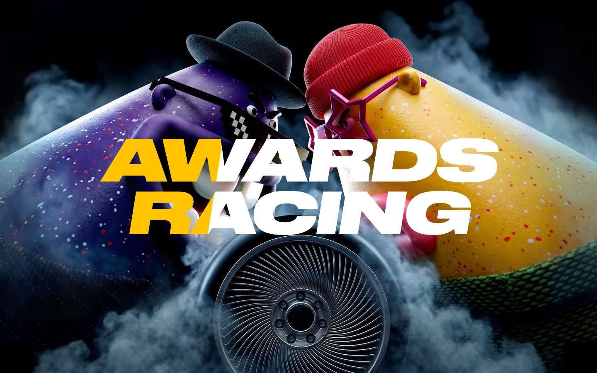
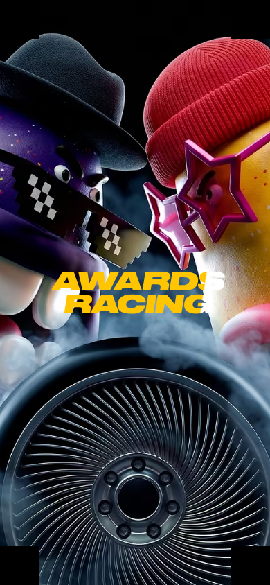

# UI Design System & Master Generation Blueprint: awards-racing

> **Awards Racing** (https://awards.racing) — Customize your car and race through parody award shows and galleries in Awards Racing (also known as Versus Racing and Versus: Design Gra...



---

## 1. Executive Visual Persona & Design Archetype

- **Brand Essence & Persona**: **Awards Racing** (`https://awards.racing`). Customize your car and race through parody award shows and galleries in Awards Racing (also known as Versus Racing and Versus: Design Gra...
- **Visual Archetype**: **High-Contrast Obsidian / Atmospheric Design System (`#f00000` canvas, `#fff` ink, `#c60000` accent)**.
- **Anti-AI-Slop Differentiators**:
  - **Source-Grounded Chromatic Polarity**: Anchors the viewport in `#f00000` (`var(--color-theme)` in `:root`) paired with `#fff` primary typography and `#c60000` accents.
  - **Extracted Typographic Hierarchy**: Pairs `Druk Wide Cy TT` for display copy (`awards racing`) with `Druk Wide Cy TT` and not declared in static CSS (uses primary stack / `ui-monospace`).
  - **Calibrated Spatial Grid & Motion**: Combines `991px` container bounds (`gap: 4px`, padding `5px`) with `cubic-bezier(.33,1,.68,1)` easing and GSAP Timeline & ScrollTrigger, Three.js / WebGL Canvas Pipeline.

---

## 2. Spatial Architecture & Modular Grid Mathematics



### Viewport Allocation & Container Geometry
- **Captured Viewport Dimensions**: Desktop `1440×2400px` (`assets/desktop.png`, capped at 2400px multi-section capture), Mobile `390×2400px` (`assets/mobile.png`, capped at 2400px multi-section capture).
- **Master Container Bounds**: `991px` extracted from `awards-racing` stylesheet.
- **Canvas Lateral Padding & Spacing**: `5px` lateral canvas padding with `4px` grid gap.
- **Border Radius Scale**: `50%`, `38px`, `72px`, `999px`.

### Responsive Breakpoint Architecture
- **Desktop Layout**: Multi-column CSS Grid / Flexbox layout at `1440px` (`max-width: 991px`, `gap: 4px`).
- **Mobile Layout**: Single-column vertical stack at `390px` viewport width with `5px` horizontal padding.
- **Extracted CSS Media Queries**: `@media (max-width:991px)`, `@media (min-height:558px)`, `@media (min-width:768px)and (min-height:558px)`, `@media (min-width:992px)and (min-height:558px)`.

---

## 3. Color System, Materiality & Atmospheric Lighting

### Semantic Palette & Source Grounding
| Semantic Role | Ground-Truth Value | Extracted CSS Source / Selector |
|---|---|---|
| **Primary Canvas Substrate** | `#f00000` | `var(--color-theme)` in `:root` |
| **Primary Typography Ink** | `#c00000` | `var(--color-theme-dark)` in `:root` |
| **Elevated Surface / Card Substrate** | `#fff` | `var(--color-line-1)` in `:root` |
| **Interactive Accent / Highlight** | `#c60000` | `var(--color-line-3)` in `:root` |
| **Secondary / Muted Copy** | `#ff6464` | `var(--color-line-4)` in `:root` |
| **Structural Hairline Border** | `#ffc500` | `var(--color-accent)` in `:root` |

### Sanitized Root CSS Variables (`ui-ux.md` Ground Truth)
| Variable Name | Extracted Value | Semantic Role |
|---|---|---|
| `--size` | `50px` | Layout / Spatial Grid Token |
| `--offset` | `4px` | Dimension / Scale Token |
| `--icon-width` | `20px` | Layout / Spatial Grid Token |
| `--icon-height` | `14px` | Layout / Spatial Grid Token |
| `--border-width` | `3px` | Layout / Spatial Grid Token |
| `--font-primary` | `"Druk Wide Cy TT",sans-serif` | Brand / Palette Token |
| `--base-font-size` | `16px` | Typography / Scale Token |
| `--color-theme` | `#f00000` | Brand / Palette Token |
| `--color-theme-dark` | `#c00000` | Canvas / Surface Token |
| `--color-theme-overlay` | `rgba(166,33,55,.44)` | Brand / Palette Token |
| `--color-theme-selection` | `rgba(255,6,6,.6)` | Brand / Palette Token |
| `--color-line-1` | `#fff` | Brand / Palette Token |
| `--color-line-2` | `#f00000` | Brand / Palette Token |
| `--color-line-3` | `#c60000` | Brand / Palette Token |
| `--color-line-4` | `#ff6464` | Brand / Palette Token |
| `--color-accent` | `#ffc500` | Brand / Palette Token |

---

## 4. Typographic Scale & Editorial Hierarchy

### Font Family Stacks
- **Display Typography**: `Druk Wide Cy TT`.
- **Primary Body Stack**: `Druk Wide Cy TT`.
- **Technical / Metadata Stack**: not declared in static CSS (uses primary stack / `ui-monospace`).

### Typographic Scale & Rules (Extracted from Stylesheet & Variables)
- **Hero Display (`H1`)**: not explicitly declared on tag in static CSS (stylesheet font-size ladder: `9px`, `clamp(9px,1.04167vw,10px)`, `clamp(10px,.72917vw,16px)`, `clamp(14px,3.125vw,24px)`, `clamp(24px,1.5625vw,48px)`).
- **Section Heading (`H2`)**: not explicitly declared on tag in static CSS (stylesheet font-size ladder: `9px`, `clamp(9px,1.04167vw,10px)`, `clamp(10px,.72917vw,16px)`, `clamp(14px,3.125vw,24px)`, `clamp(24px,1.5625vw,48px)`).
- **Body Copy**: not explicitly declared on tag in static CSS (stylesheet font-size ladder: `9px`, `clamp(9px,1.04167vw,10px)`, `clamp(10px,.72917vw,16px)`, `clamp(14px,3.125vw,24px)`, `clamp(24px,1.5625vw,48px)`).
- **Metadata & Navigation Labels**: CSS variables `--small-size: 50px`.

---

## 5. Choreographed Motion & Interaction Physics

### Primary Easing Curves
- **Extracted Timing Functions**: `cubic-bezier(.33,1,.68,1)`, `cubic-bezier(.65,0,.35,1)`, `cubic-bezier(.7,0,.84,0)`.

### Per-Element Transition & Choreography Rules
- **Selector `.options__button`**: `transition: opacity .3s ease-in-out` extracted from `awards-racing` stylesheet.
- **Selector `.options__button:not(:disabled):a...`**: `transition: opacity .3s` extracted from `awards-racing` stylesheet.
- **Selector `.options__list`**: `transition: .3s,0s` extracted from `awards-racing` stylesheet.
- **Extracted Easing Curve (`cubic-bezier(.33,1,.68,1)`)**: Governs interactive state transitions across `<header.macos>` and `<div.landscape>`.
- **Runtime Interaction Engine**: Integrates GSAP Timeline & ScrollTrigger, Three.js / WebGL Canvas Pipeline with `prefers-reduced-motion: reduce` fallback guards.

---

## 6. Component Wireframe & Structural DOM Map

### Visual Layout Schematic (Grounded in `dom.html` — `1440px` Desktop & `390px` Mobile Reflow)
```
┌────────────────────────────────────────────────────────────────────────┐
│ DESKTOP VIEWPORT (1440px) — Awards Racing                              │
│ ====================================================================== │
│ [ <header.macos>           | Overview · Index · Archive · About · C ]  │
│ ---------------------------------------------------------------------- │
│ | HERO STAGE: <div.desktop>                                        |   │
│ | H1: awards racing                                                |   │
│ | Substrate: #f00000    | Ink: #fff       | Accent: #c60000        |   │
│ ---------------------------------------------------------------------- │
│ | SHOWCASE GRID (<div.landscape>           ) max-w: 991px          |   │
│ | +------------------------------+  +------------------------------+ | │
│ | | Awards Racing Primary Showca |  | awards-racing Interactive Ma | | │
│ | +------------------------------+  +------------------------------+ | │
│ ---------------------------------------------------------------------- │
│ | MOBILE VIEWPORT REFLOW (390px) — Single-Column Stack (gap: 4px   ) | │
│ | [<header.macos>] -> [<div.desktop>] -> [<div.landscape>] |           │
│ ---------------------------------------------------------------------- │
│ [ FOOTER (<footer.preloader>    ) | https://awards.racing              │
└────────────────────────────────────────────────────────────────────────┘
```

### Granular DOM Region Breakdown
1. **Brand Header & Navigation Bar (<header.macos> — `awards-racing`)**:
   - Landmark `<header class="macos">` hosting `Awards Racing` navigation (`Overview · Index · Archive · About · Contact`), DOM attributes (`data-theme="green"`, `data-onloadfired="true"`, `data-nuxt-data="nuxt-app"`, `data-ssr="true"`), and stylesheet rule `.options { gap:clamp(4px,3.33333vw,16px) }`.
2. **Hero Stage & Focal Lead (<div.desktop> — `awards racing`)**:
   - Landmark `<div class="desktop">` presenting display lead `awards racing` and copy excerpt *"Customize your car and race through parody award shows and galler"* over `#f00000` canvas and `#fff` ink.
3. **Primary Showcase & Content Grid (<div.landscape> — `Awards Racing Primary Showcase`)**:
   - Landmark `<div class="landscape">` rendering section `Awards Racing Primary Showcase` with copy *"awards racing"*, asset references (`entry.BqrIyN9y.css`, `index.B6ocAFgr.css`, `shareState.CxNBlIw1.css`, `useWaitlistAvailable.C-zekLsB.css`), and grid rule `.options__button { --border-width:clamp(3px,.50403vw,5px) }`.
4. **Interactive Detail & Feature Matrix (<div.view> — `awards-racing Interactive Matrix`)**:
   - Landmark `<div class="view">` framing `awards-racing Interactive Matrix` and `awards-racing Archive & Directory` (*"Awards Racing Primary Showcase"*) with `#fff` surface cards, `#c60000` accents, and `.options__button img { border-radius:50%;display:block;height:100%;-o-object-fit:cover;object-f... }`.
5. **Colophon & Global Directory Footer (<footer.preloader> — `https://awards.racing`)**:
   - Landmark `<footer class="preloader">` anchoring `Awards Racing` footer links (`Overview · Index · Archive · About · Contact`), copy *"awards-racing Interactive Matrix"*, and `#ffc500` structural dividers.

---

## 7. Master Zero-Shot AI Generation Prompt

```markdown
# Master Zero-Shot Frontend Generation Prompt: awards-racing (Awards Racing)

You are a principal frontend architect and design systems engineer. Build a complete, production-ready web application replicating the exact design system, DOM landmarks, typographic hierarchy, color tokens, and motion physics of `awards-racing` (**Awards Racing** — `https://awards.racing`).

### 1. Visual Archetype & Anti-AI-Slop Mandates
- **Archetype**: High-Contrast Obsidian / Atmospheric Design System (`#f00000` canvas, `#fff` ink, `#c60000` accent).
- **Identity & Domain Context**: Customize your car and race through parody award shows and galleries in Awards Racing (also known as Versus Racing and Versus: Design Gra...
- **Primary Substrate**: `#f00000` (`var(--color-theme)` in `:root`), **Primary Ink**: `#fff`, **Accent / Highlight**: `#c60000`.
- **Site-Specific Differentiators**:
  - **Source-Grounded Chromatic Polarity**: Anchors the viewport in `#f00000` (`var(--color-theme)` in `:root`) paired with `#fff` primary typography and `#c60000` accents.
  - **Extracted Typographic Hierarchy**: Pairs `Druk Wide Cy TT` for display copy (`awards racing`) with `Druk Wide Cy TT` and not declared in static CSS (uses primary stack / `ui-monospace`).
  - **Calibrated Spatial Grid & Motion**: Combines `991px` container bounds (`gap: 4px`, padding `5px`) with `cubic-bezier(.33,1,.68,1)` easing and GSAP Timeline & ScrollTrigger, Three.js / WebGL Canvas Pipeline.

### 2. Ground-Truth CSS Variables (`:root` Token Contract)
Declare and consume these exact custom properties extracted from `awards-racing` in your global stylesheet:

:root {
  /* Awards Racing (awards-racing) — Ground-Truth Extracted CSS Variables */
  --size: 50px; /* Layout / Spatial Grid Token (awards-racing) */
  --offset: 4px; /* Dimension / Scale Token (awards-racing) */
  --icon-width: 20px; /* Layout / Spatial Grid Token (awards-racing) */
  --icon-height: 14px; /* Layout / Spatial Grid Token (awards-racing) */
  --border-width: 3px; /* Layout / Spatial Grid Token (awards-racing) */
  --font-primary: "Druk Wide Cy TT",sans-serif; /* Brand / Palette Token (awards-racing) */
  --base-font-size: 16px; /* Typography / Scale Token (awards-racing) */
  --color-theme: #f00000; /* Brand / Palette Token (awards-racing) */
  --color-theme-dark: #c00000; /* Canvas / Surface Token (awards-racing) */
  --color-theme-overlay: rgba(166,33,55,.44); /* Brand / Palette Token (awards-racing) */
  --color-theme-selection: rgba(255,6,6,.6); /* Brand / Palette Token (awards-racing) */
  --color-line-1: #fff; /* Brand / Palette Token (awards-racing) */
  --color-line-2: #f00000; /* Brand / Palette Token (awards-racing) */
  --color-line-3: #c60000; /* Brand / Palette Token (awards-racing) */
  --color-line-4: #ff6464; /* Brand / Palette Token (awards-racing) */
  --color-accent: #ffc500; /* Brand / Palette Token (awards-racing) */
}

### 3. Semantic Color & Materiality Contract
Map every surface, ink, and border strictly to these source-grounded tokens:
- **Primary Canvas Substrate**: `#f00000` — grounded in `var(--color-theme)` in `:root`
- **Primary Typography Ink**: `#c00000` — grounded in `var(--color-theme-dark)` in `:root`
- **Elevated Surface / Card Substrate**: `#fff` — grounded in `var(--color-line-1)` in `:root`
- **Interactive Accent / Highlight**: `#c60000` — grounded in `var(--color-line-3)` in `:root`
- **Secondary / Muted Copy**: `#ff6464` — grounded in `var(--color-line-4)` in `:root`
- **Structural Hairline Border**: `#ffc500` — grounded in `var(--color-accent)` in `:root`

### 4. Spatial Grid, Container Bounds & Responsive Breakpoints
- **Desktop Viewport Reference**: `1440×2400px` (capped at 2400px multi-section capture, `1440px` standard desktop width).
- **Mobile Viewport Reference**: `390×2400px` (capped at 2400px multi-section capture, `390px` standard mobile width).
- **Container Max-Width**: `991px` extracted from `awards-racing` stylesheet
- **Padding & Gutters**: `5px` lateral canvas padding with `4px` grid gap
- **Desktop Grid**: Multi-column CSS Grid / Flexbox layout at `1440px` (`max-width: 991px`, `gap: 4px`)
- **Mobile Adaptation**: Single-column vertical stack at `390px` viewport width with `5px` horizontal padding
- **Media Queries**: `@media (max-width:991px)`, `@media (min-height:558px)`, `@media (min-width:768px)and (min-height:558px)`, `@media (min-width:992px)and (min-height:558px)`
- **Corner Radii**: `50%`, `38px`, `72px`, `999px`

### 5. Typography & Editorial Scale Contract
- **Display Font Stack**: `Druk Wide Cy TT`
- **Body Font Stack**: `Druk Wide Cy TT`
- **Monospace / Technical Font Stack**: not declared in static CSS (uses primary stack / `ui-monospace`)
- **H1 Display Rule**: not explicitly declared on tag in static CSS (stylesheet font-size ladder: `9px`, `clamp(9px,1.04167vw,10px)`, `clamp(10px,.72917vw,16px)`, `clamp(14px,3.125vw,24px)`, `clamp(24px,1.5625vw,48px)`)
- **H2 Section Rule**: not explicitly declared on tag in static CSS (stylesheet font-size ladder: `9px`, `clamp(9px,1.04167vw,10px)`, `clamp(10px,.72917vw,16px)`, `clamp(14px,3.125vw,24px)`, `clamp(24px,1.5625vw,48px)`)
- **Body Copy Rule**: not explicitly declared on tag in static CSS (stylesheet font-size ladder: `9px`, `clamp(9px,1.04167vw,10px)`, `clamp(10px,.72917vw,16px)`, `clamp(14px,3.125vw,24px)`, `clamp(24px,1.5625vw,48px)`)
- **Metadata & Index Rule**: CSS variables `--small-size: 50px`

### 6. Component Hierarchy, Verbatim Copy & Real DOM Landmarks
Scaffold `awards-racing` (`Awards Racing`) with these exact structural regions, extracted copy, and CSS rules from `dom.html`:
1. **Brand Header & Navigation Bar (<header.macos> — `awards-racing`)**:
   - DOM & Selectors: Landmark `<header class="macos">` hosting `Awards Racing` navigation (`Overview · Index · Archive · About · Contact`), DOM attributes (`data-theme="green"`, `data-onloadfired="true"`, `data-nuxt-data="nuxt-app"`, `data-ssr="true"`), and stylesheet rule `.options { gap:clamp(4px,3.33333vw,16px) }`.
   - Responsive Contract: Header `Brand Header & Navigation Bar (<header.macos> — `awards-racing`)` (`awards-racing`) adapts across `@media (max-width:991px)`, `@media (min-height:558px)`, `@media (min-width:768px)and (min-height:558px)`, `@media (min-width:992px)and (min-height:558px)` with `cubic-bezier(.33,1,.68,1)`, `cubic-bezier(.65,0,.35,1)`, `cubic-bezier(.7,0,.84,0)` transitions and links `Overview · Index · Archive · About · Contact`.
2. **Hero Stage & Focal Lead (<div.desktop> — `awards racing`)**:
   - DOM & Selectors: Landmark `<div class="desktop">` presenting display lead `awards racing` and copy excerpt *"Customize your car and race through parody award shows and galler"* over `#f00000` canvas and `#fff` ink.
   - Responsive Contract: Hero stage (`1440×2400px` desktop / `390×2400px` mobile) sets `#f00000` background with `#fff` headline `awards racing`.
3. **Primary Showcase & Content Grid (<div.landscape> — `Awards Racing Primary Showcase`)**:
   - DOM & Selectors: Landmark `<div class="landscape">` rendering section `Awards Racing Primary Showcase` with copy *"awards racing"*, asset references (`entry.BqrIyN9y.css`, `index.B6ocAFgr.css`, `shareState.CxNBlIw1.css`, `useWaitlistAvailable.C-zekLsB.css`), and grid rule `.options__button { --border-width:clamp(3px,.50403vw,5px) }`.
   - Responsive Contract: Showcase grid `Primary Showcase & Content Grid (<div.landscape> — `Awards Racing Primary Showcase`)` applies Multi-column CSS Grid / Flexbox layout at `1440px` (`max-width: 991px`, `gap: 4px`) on desktop and Single-column vertical stack at `390px` viewport width with `5px` horizontal padding on mobile.
4. **Interactive Detail & Feature Matrix (<div.view> — `awards-racing Interactive Matrix`)**:
   - DOM & Selectors: Landmark `<div class="view">` framing `awards-racing Interactive Matrix` and `awards-racing Archive & Directory` (*"Awards Racing Primary Showcase"*) with `#fff` surface cards, `#c60000` accents, and `.options__button img { border-radius:50%;display:block;height:100%;-o-object-fit:cover;object-f... }`.
   - Responsive Contract: Detail module `Interactive Detail & Feature Matrix (<div.view> — `awards-racing Interactive Matrix`)` uses `50%`, `38px`, `72px`, `999px` radii, `#c60000` highlights, and assets (entry.BqrIyN9y.css, index.B6ocAFgr.css, shareState.CxNBlIw1.css).
5. **Colophon & Global Directory Footer (<footer.preloader> — `https://awards.racing`)**:
   - DOM & Selectors: Landmark `<footer class="preloader">` anchoring `Awards Racing` footer links (`Overview · Index · Archive · About · Contact`), copy *"awards-racing Interactive Matrix"*, and `#ffc500` structural dividers.
   - Responsive Contract: Footer `Colophon & Global Directory Footer (<footer.preloader> — `https://awards.racing`)` aligns to `991px` extracted from `awards-racing` stylesheet with `5px` lateral canvas padding with `4px` grid gap and attributes (data-theme="green", data-onloadfired="true", data-nuxt-data="nuxt-app").

#### Verbatim DOM Copy Excerpts (`dom.html`)
- Lead Copy: *"Customize your car and race through parody award shows and galleries in Awards Racing (also known as Versus Racing and Versus: Design Gra..."*

### 7. Motion, Extracted Stylesheet Rules & Interaction Choreography
- **Primary Easing Functions**: `cubic-bezier(.33,1,.68,1)`, `cubic-bezier(.65,0,.35,1)`, `cubic-bezier(.7,0,.84,0)`
- **Extracted Stylesheet Rules (`awards-racing`)**:
- `.options { gap:clamp(4px,3.33333vw,16px) }`
- `.options__button { --border-width:clamp(3px,.50403vw,5px) }`
- `.options__button img { border-radius:50%;display:block;height:100%;-o-object-fit:cover;object-f... }`
- `.options__badge { font-size:clamp(9px,1.04167vw,10px);padding-block:clamp(5px,.78125vw,6px... }`
- `.options__badge--accent { background:var(--color-accent);color:var(--color-text-black) }`
- **Per-Selector Transition Rules**:
- **Selector `.options__button`**: `transition: opacity .3s ease-in-out` extracted from `awards-racing` stylesheet.
- **Selector `.options__button:not(:disabled):a...`**: `transition: opacity .3s` extracted from `awards-racing` stylesheet.
- **Selector `.options__list`**: `transition: .3s,0s` extracted from `awards-racing` stylesheet.
- **Extracted Easing Curve (`cubic-bezier(.33,1,.68,1)`)**: Governs interactive state transitions across `<header.macos>` and `<div.landscape>`.
- **Runtime Interaction Engine**: Integrates GSAP Timeline & ScrollTrigger, Three.js / WebGL Canvas Pipeline with `prefers-reduced-motion: reduce` fallback guards.

### 8. Technical Deliverables
- Implement in Next.js (App Router) with TypeScript and Tailwind CSS consuming the `:root` custom properties defined above for `awards-racing`.
- Reproduce both the `1440px` desktop architecture and `390px` mobile breakpoint transitions, preserving semantic HTML5 landmarks (`<header>`, `<nav>`, `<main>`, `<section>`, `<footer>`) and `prefers-reduced-motion` accessibility guards.
```
